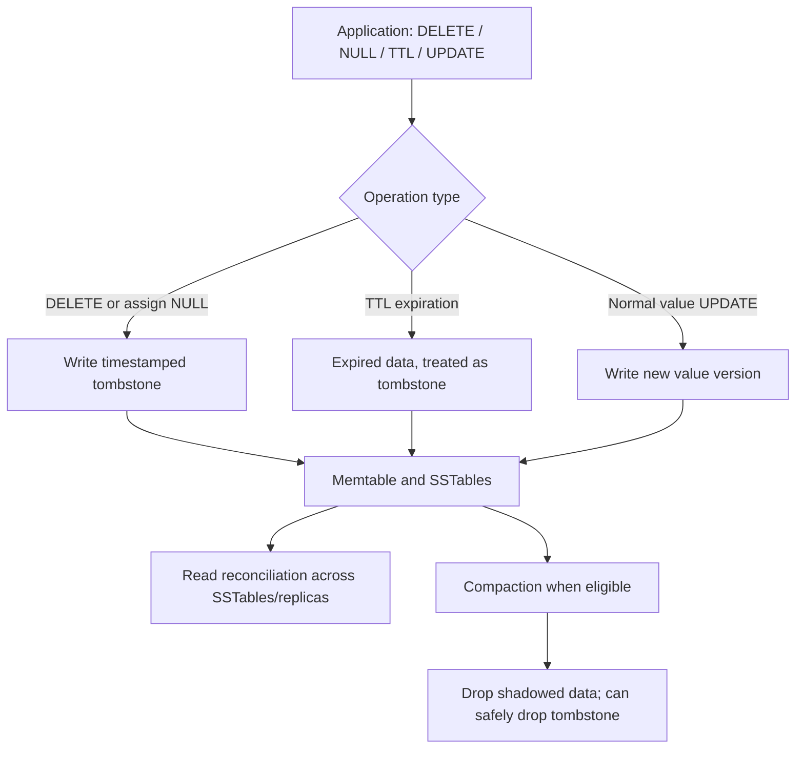
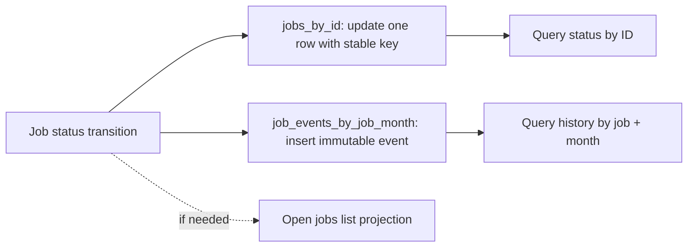
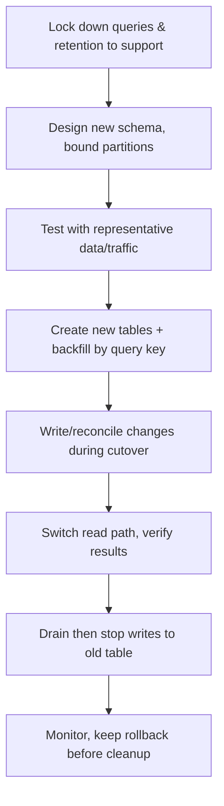

# Redesigning the Data Model to Reduce Delete/Update Churn Pressure

> **Chapter:** Tombstones and Reclamation  
> **Module:** `DATABASE_ENGINE_WIDE_COLUMN_CASSANDRA` — Apache Cassandra

In Apache Cassandra, deleting data does not mean data disappears from disk right away. Cassandra writes a **tombstone** (a timestamped deletion marker) so replicas, including temporarily unavailable ones, know which data must no longer be surfaced. **TTL** expiration also marks data as deleted. Tombstones and multiple value versions in SSTables can increase read cost, compaction work, and disk usage — especially when a data model repeatedly **deletes and re-inserts a row** every time a status changes.

The sustainable solution usually lies in **redesigning data and queries**, rather than merely raising tombstone limits or forcing compaction. This lesson guides you through identifying tombstone sources, shifting frequent "move/delete" mutations to stable-key state or immutable events when appropriate, picking bounded buckets and TTLs, while upholding consistency, replication, repair, and Java application behavior requirements.

After this lesson, you will be able to:

- Explain differences between overwriting values, deleting with `DELETE`, assigning `null`, and TTL expiration.
- Inspect business queries to spot schemas that force continuous delete/insert cycles.
- Design query-driven tables using a state + event log model, reducing churn and bounding partition size.
- Choose suitable retention/TTL/compaction strategies; understand the limits of `gc_grace_seconds`.
- Measure pre/post-migration effectiveness and handle uncertain write outcomes from Java properly.

## 1. Why do frequent deletes put pressure on Cassandra?

The standard write path on a replica goes through the **commit log** and **memtable**; memtables flush into **immutable SSTables**. Updating a column generally writes a new version with a newer timestamp. Deleting a row, a column, or a range of rows writes a **tombstone** to shadow old data on read. Cassandra relies on compaction to reconcile versions and reclaim eligible data.



Distinguish very clearly:

| Operation | Directly creates a tombstone? | Notable impact |
| --- | --- | --- |
| `DELETE FROM ... WHERE ...` | **Yes**: cell, row, range, or partition tombstone depending on statement | Can force queries to traverse many deleted values. |
| `UPDATE t SET col = null WHERE ...` | **Yes**: assigning `null` deletes the column in CQL | Creates a deletion marker; not a "free empty update." |
| `INSERT/UPDATE ... USING TTL ...` | **Upon TTL expiration**, data is treated like a tombstone | Periodic churn; mixing multiple TTLs in one SSTable hinders reclamation. |
| `UPDATE t SET status = 'DONE' WHERE ...` | **Does not necessarily** create a tombstone: writes a new column version | Still creates multiple versions, increasing write amplification and compaction work. |
| Replacing entire non-frozen collection or removing elements | **Can** create tombstones for replaced/deleted collection data | Large, frequently modified collections are a pressure source. |
| Not deleting, only setting `is_deleted=true` | **Does not create a row tombstone just from this boolean** | Old data still occupies space, reads must handle the flag; does not solve physical reclamation. |

A common design misconception is believing **every `UPDATE` creates a tombstone**. That is false. However, updating the same cell thousands of times still creates many versions in SSTables before compaction cleans them up. Good design must reduce **both tombstones and unnecessary rewrites**.

### How long do tombstones and deleted data persist?

`gc_grace_seconds` is a protection window giving tombstones a chance to propagate to replicas that experienced outages. The default is usually **864000 seconds (10 days)**, though check each table's actual configuration. A tombstone **only becomes eligible** for reclamation after this window; it **does not vanish at exact second 864000**. Compaction must also verify that dropping the tombstone will not let old data reappear, such as when shadowed data sits in another SSTable.

If a replica missed a delete and tombstones were reclaimed too early, that replica can bring old data back into the cluster during recovery/repair. This is called **zombie data**. Thus, cutting `gc_grace_seconds` to 0 to "wipe tombstones" is dangerous without verifying version mechanics, topology, and repair procedures.

**Remember:** replication and consistency level govern how data is acknowledged and read; **repair** helps replicas exchange missed data. All three relate to safe tombstone reclamation, yet none makes an over-deleting/over-writing model efficient.

## 2. A problematic model: using mutable status as part of the partition key

Suppose a job-management application supports:

1. Looking up a job by `job_id`.
2. Transitioning states `PENDING → RUNNING → COMPLETED`.
3. Viewing state-transition history.
4. Fetching a list of open jobs to process.

The team initially creates only a "list by status" table:

```sql
-- Assume keyspace app already exists with appropriate replication.
CREATE TABLE app.jobs_by_status (
    tenant_id text,
    status text,
    job_id uuid,
    title text,
    updated_at timestamp,
    PRIMARY KEY ((tenant_id, status), job_id)
);
```

With this table, `status` is **part of the partition key**. You cannot update `status` in place on the same row: changing the primary key means a **different row**. Applications typically do:

```sql
-- Example of a job changing status: delete old PENDING row...
DELETE FROM app.jobs_by_status
WHERE tenant_id = 'shop-01'
  AND status = 'PENDING'
  AND job_id = 11111111-1111-1111-1111-111111111111;

-- ... then create new RUNNING row.
INSERT INTO app.jobs_by_status (
    tenant_id, status, job_id, title, updated_at
) VALUES (
    'shop-01', 'RUNNING',
    11111111-1111-1111-1111-111111111111,
    'Sync invoices', '2026-11-21T10:30:00Z'
);
```

Every state transition creates a tombstone in the old partition and new data in the new partition. Three consequences follow:

- **Churn:** a job transitioning multiple times causes status partitions to undergo continuous inserts and deletes.
- **Hot/large partitions:** all `PENDING` jobs for a tenant can land in **one partition**, while job volume grows unbounded.
- **Application synchronization:** two writes across two partitions do not automatically form a global exactly-once transaction. A failure between steps can leave data on only one side.

`BATCH`, even logged batches, does not turn cross-partition updates into RDBMS-style isolated transactions. To guarantee state uniqueness and transition order, the application needs appropriate read/write models and coordination mechanisms.

A similar smell is designing primary keys around **status, sort position, or frequently changing attributes**: every change forces deleting an old key and inserting a new key. Move volatile attributes out of the primary key **when queries allow**, or manage them in a small projection with a clear lifecycle.

## 3. Redesigning: state by ID + immutable event history

For the flow "view the state of a job by ID," redesign into a table with a **stable** primary key:

```sql
CREATE TABLE app.jobs_by_id (
    tenant_id text,
    job_id uuid,
    title text,
    status text,
    updated_at timestamp,
    PRIMARY KEY ((tenant_id, job_id))
);

INSERT INTO app.jobs_by_id (
    tenant_id, job_id, title, status, updated_at
) VALUES (
    'shop-01',
    11111111-1111-1111-1111-111111111111,
    'Sync invoices',
    'PENDING',
    '2026-11-21T10:20:00Z'
);

-- No DELETE/INSERT across status partitions needed.
UPDATE app.jobs_by_id
SET status = 'RUNNING', updated_at = '2026-11-21T10:30:00Z'
WHERE tenant_id = 'shop-01'
  AND job_id = 11111111-1111-1111-1111-111111111111;

SELECT status, updated_at FROM app.jobs_by_id
WHERE tenant_id = 'shop-01'
  AND job_id = 11111111-1111-1111-1111-111111111111;
```

Benefit: status changes **inside a single row with a stable key**, reducing tombstones caused by hopping across status partitions. Limitation: `UPDATE` still generates new versions, and if you need to enforce ordering among competing workers, you must add appropriate conditional/versioning mechanics. Do not treat an unconditional update as guaranteeing status "only moves forward."

If **history** must be retained without repeatedly overwriting the same data, use an append-only table optimized for "job history by month":

```sql
CREATE TABLE app.job_events_by_job_month (
    tenant_id text,
    job_id uuid,
    event_month text,
    event_id timeuuid,
    new_status text,
    actor_id text,
    PRIMARY KEY ((tenant_id, job_id, event_month), event_id)
) WITH CLUSTERING ORDER BY (event_id DESC);

INSERT INTO app.job_events_by_job_month (
    tenant_id, job_id, event_month, event_id, new_status, actor_id
) VALUES (
    'shop-01',
    11111111-1111-1111-1111-111111111111,
    '2026-11',
    22222222-2222-1222-8222-222222222222,
    'RUNNING',
    'worker-17'
);

SELECT event_id, new_status, actor_id
FROM app.job_events_by_job_month
WHERE tenant_id = 'shop-01'
  AND job_id = 11111111-1111-1111-1111-111111111111
  AND event_month = '2026-11'
LIMIT 20;
```

`event_month` is computed stably from event time (e.g., `YYYY-MM`). A replayed event must reuse **the same `event_id` and partition key** to avoid inserting duplicates. An append-only event log does not delete/rewrite rows just because a new state transition happens. Monthly bucketing caps rows per partition; for jobs with huge event counts, use smaller buckets such as weekly or daily. **Never create an immutable event table with unbounded partitions and assume it is automatically safe.**



### Do these two tables guarantee strict transactions?

**No.** Updating `jobs_by_id` and inserting into `job_events_by_job_month` are two separate data mutations; errors, timeouts, or conflicts can occur between them. If you need a rebuildable source of truth, consider:

- Writing **immutable events** with stable IDs as the source of truth and building state/projections via a replay-capable consumer.
- Designing checkpoints/idempotency for the consumer, monitoring projection lag, and reconciling from the event log.
- When business rules require **accepting a transition only if the prior state is valid**, consider LWT/CAS on the single state row, e.g., `UPDATE ... IF status = 'PENDING'`. LWT carries performance cost and does not make two tables in different partitions an atomic transaction.

You do not need to keep all events forever. Define event history retention, audit, recovery, and capacity requirements before choosing TTLs.

## 4. What if the business still needs to "list open jobs"?

Moving from `jobs_by_status` to `jobs_by_id` improves by-ID lookups, **but no longer directly supports** "list all `PENDING` jobs of a tenant." In Cassandra, data modeling starts from queries; you cannot drop a projection table and expect the same performance for that query.

Options:

| Actual need | Option | Trade-off |
| --- | --- | --- |
| Only need one job's status by ID | State table `jobs_by_id` | Efficient lookup by ID; cannot list all statuses. |
| Need state-transition history per job | Append-only `job_events_by_job_month` | Extra storage; not a work-queue index. |
| Need an open-jobs feed by due date | Projection `open_jobs_by_due_day`, properly bucketed; delete from projection **once** upon completion | Still creates tombstones in the projection, yet far less churn and bounded partitions. |
| Need scheduler, assignment, claim/retry, changing priorities | Consider a dedicated queue/scheduler system and store state in Cassandra | Must operate an extra component and sync at application layer. |
| Need flexible multi-attribute search | Evaluate Cassandra-supported indexes, a search engine, or dedicated read models | Indexing cost, maintenance, and consistency traits require evaluation. |

Example "open jobs by due day, sharded" projection:

```sql
CREATE TABLE app.open_jobs_by_due_day (
    tenant_id text,
    due_day date,
    shard smallint,
    due_at timestamp,
    job_id uuid,
    title text,
    PRIMARY KEY ((tenant_id, due_day, shard), due_at, job_id)
) WITH CLUSTERING ORDER BY (due_at ASC, job_id ASC);
```

The application computes a deterministic `shard` from `job_id` to spread writes, queries all shards for the target day, and merges results. Completing a job still requires deleting this row, yet the design targets **a single deletion when the job leaves the open list** instead of deleting and re-inserting at every state transition. Projection reconciliation from the source of truth is necessary when independent writes fail.

**Tombstones are not "strictly forbidden."** When a query requires removing an item and retention permits, tombstones are Cassandra's proper mechanism. The goal is reducing **unnecessary** tombstone creation/traversal, bounding the data range each query scans, and reducing writes on hot keys.

## 5. Defining the data lifecycle before enabling TTL

TTL helps data expire automatically, yet **TTL expiration also creates tombstones**. Thus, a table with a 30-day TTL does not mean "on day 31 disk shrinks immediately." Cassandra only reclaims data when compaction and safety checks allow.

Three questions to answer before enabling TTL:

1. **How long must data be kept?** Retention of 7, 30, or 365 days is a business and compliance requirement, not a parameter to "shrink just to test."
2. **Will data still be updated after being written?** Tasks altering TTLs and updates overlapping across windows can keep data versions alive longer than expected.
3. **Are there many late-arriving events?** Very old data landing in new SSTables hinders grouping SSTables by time and dropping them wholesale.

### A better fit for TTL: nearly immutable events, uniform expiration policy

Example of a sensor events table needing only 30 days of retention, queried by device and day:

```sql
CREATE TABLE app.sensor_events_by_day (
    device_id text,
    event_day date,
    event_id timeuuid,
    reading double,
    PRIMARY KEY ((device_id, event_day), event_id)
) WITH default_time_to_live = 2592000
  AND compaction = {
    'class': 'TimeWindowCompactionStrategy',
    'compaction_window_unit': 'DAYS',
    'compaction_window_size': '1'
  };
```

Here:

- `(device_id, event_day)` bounds partitions by day; if one device produces too much data per day, add shards/shorter buckets.
- `default_time_to_live = 2592000` equals 30 days; upon expiry, tombstones and grace duration still apply.
- `TimeWindowCompactionStrategy` (**TWCS**) can benefit time-series data that is rarely modified and expires predictably, as it groups SSTables by time window to reclaim once expired **and safe**.
- Avoid mixing non-TTL data with varied TTL durations in the same table/SSTable when fast reclamation is desired. Cross-window updates or very late events also erode TWCS efficiency.
- Cassandra 5.0+ includes **UCS**, recommended for most workloads; choosing between UCS and TWCS must depend on your deployment version, TTL/time-series traits, and load testing — never simply swap classes without measuring.

If this table serves legal audits that cannot be deleted early, do not default to TTL. With TTL, retrying an insert on the same key can shift expiration times depending on write policy and timestamps; verify retention semantics under retries. Setting a very short `TTL` and continuously "renewing" the same column can skew capacity forecasts.

### Counterproductive "tombstone reduction" shortcuts

| Tempting shortcut | Why is it problematic? | Better alternative |
| --- | --- | --- |
| `ALTER TABLE ... WITH gc_grace_seconds = 0` to clean fast | Offline replicas can bring deleted data back (**zombies**); safety depends on version/repair workflow. | Keep grace aligned with recovery SLAs and repair; fix the tombstone-generating model. |
| Raising `tombstone_warn_threshold` and `tombstone_failure_threshold` | Only hides warnings or moves failure limits; does not remove read cost. | Identify tombstone-heavy partitions/queries and reduce churn. |
| Running major compactions continuously | High I/O and temporary space; ineligible tombstones still remain. | Monitor compaction, pick the right strategy, balance load. |
| Using `ALLOW FILTERING` to find un-deleted items | May scan massive irrelevant data and tombstones. | Create tables keyed for queries or bounded projections. |
| Flag-based "soft delete" with no retention | Fewer immediate tombstones yet old data grows forever; queries filter in app. | Use only with an explicit cleanup policy and read path. |
| Dumping all events into a single partition | Avoids status updates yet creates huge/hot partitions. | Bucket by time and/or deterministic shards. |

## 6. Reducing pressure from collections and update operations

Some APIs habitually resend **an entire collection** whenever a user adds or removes one element:

```sql
-- Example of frequently changing collection state.
CREATE TABLE app.user_settings (
    tenant_id text,
    user_id uuid,
    pinned_items list<text>,
    PRIMARY KEY ((tenant_id, user_id))
);
```

Overwriting or deleting elements of a non-frozen collection can generate tombstones; growing collections pack many changing values into one row. If the application frequently toggles individual items on/off, a "one item per row" model can be easier to control:

```sql
CREATE TABLE app.pins_by_user (
    tenant_id text,
    user_id uuid,
    item_id text,
    pinned_at timestamp,
    PRIMARY KEY ((tenant_id, user_id), item_id)
);

INSERT INTO app.pins_by_user (tenant_id, user_id, item_id, pinned_at)
VALUES (
    'shop-01',
    11111111-1111-1111-1111-111111111111,
    'item-25',
    '2026-11-21T10:30:00Z'
);

SELECT item_id FROM app.pins_by_user
WHERE tenant_id = 'shop-01'
  AND user_id = 11111111-1111-1111-1111-111111111111;
```

When **unpinning**, a row `DELETE` is still required, yet you avoid rewriting the user's entire collection. If pin/unpin churn is very high, review product semantics ("action history" vs. "current state"), bound partitions, and measure tombstones by query. Replacing collections with rows does not eliminate tombstones on its own, yet controls the size and blast radius of each change.

### Conditional updates with competing writers

If two workers can transition the same job from `PENDING` to two different states, blind overwrites do not guarantee semantically valid transitions. You can use LWT for **a single row**:

```sql
UPDATE app.jobs_by_id
SET status = 'RUNNING',
    updated_at = '2026-11-21T10:30:00Z'
WHERE tenant_id = 'shop-01'
  AND job_id = 11111111-1111-1111-1111-111111111111
IF status = 'PENDING';
```

The result includes `[applied]` so the caller knows whether the condition succeeded when the response arrives. On timeout, **the outcome remains uncertain**, requiring reads/reconciliation by ID and expected state; never infer "failed" from timeout alone. LWT carries latency/consensus overhead, so weigh the consistency level the business actually needs.

## 7. Data model migration plan

No `ALTER TABLE` command automatically converts a table with a changing partition key into a newly designed table. When changing primary keys and access patterns, you must create **new tables**, migrate data, and shift read/write traffic under control.



**Before migration**

1. Document actual queries: by `job_id`, by status, by date, job history, ordering, and paging requirements.
2. Measure partition sizes, hot-key distributions, status transitions/job, daily deletes/TTLs/collection edits, and data age.
3. Define retention policies, event exactly-once requirements, and reconciliation on lost responses.
4. Choose a schema for **each critical query**, avoiding one wide-partition table trying to serve everything.
5. Verify backups, replication factor, consistency levels, and repair cycles before major changes.

**During migration**

- Create new tables while keeping the old table serving until ready.
- Backfill data by partition with rate limiting; avoid cluster-wide `SELECT *` on large datasets. Track checkpoints/progress to resume cleanly after failures.
- If the application **dual-writes**, remember two tables are not atomically consistent; use event IDs, compensation/reconciliation, and monitor lag and errors.
- If migrating from an update table to an event log, define how to snapshot initial state and ingest new events without drops or duplicates.
- Test race conditions, timeouts, replica outages, and retries in staging with production-like replication, CL, and data.

**After migration**

- Shift read paths gradually, comparing states/projections and latency against the old table.
- Monitor tombstones scanned, SSTable counts, compaction backlog, free disk, read p99, and write p99.
- Maintain a monitored rollback window; clean up old data only after confirming no consumer reads it and retention policy permits.
- Dropping an old table is a schema change requiring deployment approval; it does **not** retroactively invalidate prior repairs/backups.

## 8. Measuring whether the new design actually reduces pressure

Good measurement distinguishes **tombstones created**, **tombstones read**, and **compaction I/O**. Looking at "disk usage dropped" in the first few minutes is insufficient.

| Signal | How to measure? | How to evaluate |
| --- | --- | --- |
| Tombstones per read | Per-table Cassandra metrics and selective tracing; tombstone warning logs | Did the rate of queries scanning many tombstones drop? |
| Read latency p95/p99 | Driver/server metrics, broken down by query and CL | Is it better under the same throughput and partition sizes? |
| Write rate & mutation fanout | App metrics and mutations per business event | Does one status transition emit fewer DELETE/INSERTs? |
| Pending compactions, I/O | `nodetool compactionstats`, storage metrics | Did backlog and write amplification decrease? |
| Disk used and free space | `df -h`, volume dashboards | After multiple compaction cycles, is old data reclaimed properly? |
| Partition size/warnings | `nodetool tablestats`, partition size distribution | Do new buckets prevent oversized partitions and hot keys? |
| Replica health & repair | `nodetool status`, repair/streaming state | Is deletion safety preserved within the grace window? |

On an operational node, some **read/inspection** commands:

```bash
nodetool status
nodetool compactionstats
nodetool tablestats app.jobs_by_id
nodetool tablestats app.job_events_by_job_month
```

In `cqlsh`, use `TRACING ON;` selectively on a small query and `TRACING OFF;` afterward. Continuous tracing at production traffic levels incurs overhead and adds monitoring data volume.

```sql
-- Query just 1 specific job; tracing can be enabled to inspect.
SELECT status, updated_at
FROM app.jobs_by_id
WHERE tenant_id = 'shop-01'
  AND job_id = 11111111-1111-1111-1111-111111111111;

-- Query history for a single month, bounded by row limit.
SELECT event_id, new_status
FROM app.job_events_by_job_month
WHERE tenant_id = 'shop-01'
  AND job_id = 11111111-1111-1111-1111-111111111111
  AND event_month = '2026-11'
LIMIT 20;
```

Exact metrics, warning labels, and parameters depend on **Cassandra version** and your monitoring stack. Do not aim for "zero tombstones at all costs": instead optimize how many tombstones **hot query paths** must traverse, safe reclamation capability, and overall system cost.

## 9. Java application: keeping event IDs stable and avoiding duplicate rows on replay

The Java Driver does not alter tombstone mechanics. Yet application code decides whether an event is processed twice, whether every state creates a `DELETE`, and whether retries produce extra copies.

Java Driver 4.x example writing an immutable event into `job_events_by_job_month` (this table has **no TTL set yet**). The caller must keep `eventId` constant when resending the same event:

```java
import java.util.UUID;

import com.datastax.oss.driver.api.core.CqlSession;
import com.datastax.oss.driver.api.core.DefaultConsistencyLevel;
import com.datastax.oss.driver.api.core.cql.BoundStatement;
import com.datastax.oss.driver.api.core.cql.PreparedStatement;

public final class JobEventStore {
    private final CqlSession session;
    private final PreparedStatement insert;

    public JobEventStore(CqlSession session) {
        this.session = session;
        this.insert = session.prepare(
            "INSERT INTO app.job_events_by_job_month " +
            "(tenant_id, job_id, event_month, event_id, new_status, actor_id) " +
            "VALUES (?, ?, ?, ?, ?, ?)");
    }

    public void append(String tenantId, UUID jobId, String eventMonth,
                       UUID eventId, String newStatus, String actorId) {
        // eventId is the event's stable timeuuid (UUID version 1);
        // eventMonth must be computed from event time, not retry time.
        BoundStatement stmt = insert.bind(
                tenantId, jobId, eventMonth, eventId, newStatus, actorId)
            .setConsistencyLevel(DefaultConsistencyLevel.LOCAL_QUORUM)
            .setIdempotent(true);

        session.execute(stmt);
    }
}
```

In this example, retrying with the same `PRIMARY KEY` and identical data does not create a new row; hence the statement can be marked idempotent **when the system guarantees payload does not change for the same ID and no business timestamp/version conflicts arise**. Review your driver's actual retry policy; `setIdempotent(true)` does not make a message broker guarantee exactly-once delivery, nor does it create cross-table transactions.

**Warning:** If using TTL, every rewrite must be checked for its effect on expiration timing. If incrementing counters, mutating collections, or running state transitions with side effects, do **not** mark idempotent just to enable retries. A timeout after sending does not prove the mutation was not applied; record an uncertain status and reconcile.

In systems with two write streams (`event` and `current_state`), pick one source of truth, keep `event_id` identical across retries, and implement checkpointed consumers plus projection rebuilds. When concurrent state transitions must be controlled, enforce conditions at the primary write point; never rely on eventual consistency to infer business ordering.

## 10. Applied exercises

**Question 1.** Table `jobs_by_status` has partition key `(tenant_id, status)`. Each job passes through three states; the app deletes the old row then inserts a new row. Why do tombstones grow? Which design eliminates these operations if the main query looks up status by `job_id`?

**Question 2.** A team replaces `DELETE` with `SET is_deleted = true` and sees fewer tombstone warnings. What can still degrade over time? What policies are still needed?

**Question 3.** An event table has a 30-day TTL; on day 31 disk usage has not dropped and SSTables remain large. Name at least two conditions/reasons before concluding compaction is broken.

**Question 4.** Why not set `gc_grace_seconds = 0` just because there are many tombstones? What are the roles of repair and offline replicas?

**Question 5.** The new design uses `jobs_by_id` for current state and `job_events_by_job_month` for history. Product asks to "query all `PENDING` jobs by deadline." Can those two tables alone guarantee fast queries? Propose an option and its trade-offs.

**Question 6.** A Java client hits a timeout writing an event, generates a new `event_id`, and retries. Despite identical payload content, what happens in the append-only table?

<details>
<summary>Answer hints</summary>

1. Every time status changes, the partition key changes and the app `DELETE`s the old row. Use `jobs_by_id` with a stable key to update the `status` column, and append events if history is needed.
2. Data still exists and grows; queries must filter the flag, and storage/read costs do not vanish on their own. You need retention/archival and a controlled deletion/reclamation plan.
3. Expired TTL creates tombstones, which must pass grace and safe compaction; SSTables may still hold live/overlapping data; late writes or mixed TTLs hinder whole-SSTable reclamation.
4. If an offline replica missed a delete, purging tombstones too early can let old data reappear when the replica returns. Repair and recovery cycles must align with grace.
5. No. Status/deadline queries need a projection by tenant, day, and shard, or a suitable queue/search system; the projection may still delete, yet with far less churn and proper reconciliation.
6. The new `event_id` creates a new row; one business event can appear twice. Keep the same ID, key, and payload across all replays.

</details>

## Key takeaways

- `DELETE`, assigning `null`, and TTL expiration create tombstones; **ordinary value UPDATEs do not necessarily create tombstones**, yet still increase versions to compact.
- Never place **frequently changing attributes** in the primary key if every change forces deleting an old row and inserting a new row.
- Design for **real queries**: state with a stable key, immutable events for history, small projections by day/shard when filtered lists are needed.
- Append-only and TTL designs must pair with **bounded buckets, explicit retention, and duplicate-event handling**; they are not cure-alls for every dataset.
- Tombstones are reclaimed only when **enough time and safe compaction conditions** are met. Adjusting `gc_grace_seconds` must factor in replicas, repairs, and zombie risk.
- Measure read tombstones, compaction, disk I/O, p99, partition size, and reconciliation capability before concluding a new design reduces pressure.

### References

- [Apache Cassandra — Tombstones](https://cassandra.apache.org/doc/stable/cassandra/managing/operating/compaction/tombstones.html)
- [Apache Cassandra — Compaction overview](https://cassandra.apache.org/doc/stable/cassandra/managing/operating/compaction/overview.html)
- [Apache Cassandra — Time Window Compaction Strategy](https://cassandra.apache.org/doc/stable/cassandra/managing/operating/compaction/twcs.html)
- [Apache Cassandra — CREATE TABLE and TTL](https://cassandra.apache.org/doc/stable/cassandra/reference/cql-commands/create-table.html)
