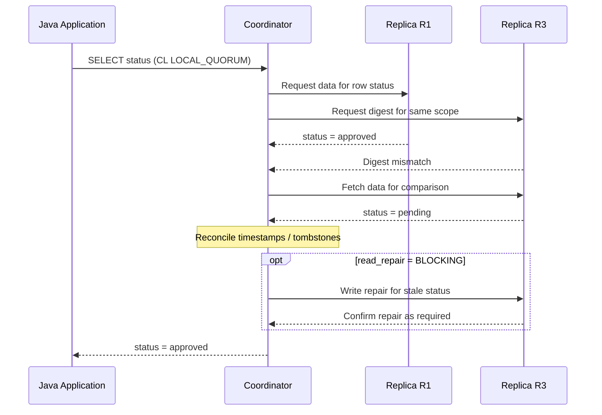

# Read Repair and How It Only Repairs the Read Data Scope in Cassandra

## 1. Problem: Reading the Right Record Does Not Mean Replicas Are Synchronized

In Apache Cassandra, data is distributed by **partition key** and replicated across multiple **replicas** according to the replication factor (RF). The **wide-column** model allows a partition to hold multiple rows ordered by clustering key. When an application issues a CQL statement, the coordinator selects replicas to serve the request based on topology and **consistency level (CL)**. Replicas can temporarily diverge due to network errors, node downtime, recovery processes, or writes that did not reach every copy.

**Read repair** is the mechanism that detects and can repair divergent data across replicas **during a read**. Its most important boundary is **only the data scope actually requested and compared by the query**, not implicitly the entire table, entire partition, or entire cluster.

For example, a table storing document state has two rows in the same partition:

```text
Partition: document_id = doc-1
  clustering row field_name = "status"    -> "approved"
  clustering row field_name = "reviewer"  -> "user-7"
```

A read requesting only the `status` row can trigger repair for discrepancies in that row. It **does not guarantee** that the `reviewer` row is also repaired on the same replica, even though both rows share the same partition key.

This is a critical limitation when studying **replica synchronization**: read repair helps consistency for the query just executed, yet Cassandra still requires other mechanisms—especially **anti-entropy repair**—to address unread data.

## 2. Why Can Replicas Store Different Versions?

Suppose a keyspace has RF = 3 in datacenter `dc1`, with three replicas R1, R2, and R3. The application updates the same partition while connectivity to R3 is disrupted:

| Replica | `status` | `reviewer` |
| --- | --- | --- |
| R1 | `approved` | `user-7` |
| R2 | `approved` | `user-7` |
| R3 | `pending` | `user-2` |

If the write is acknowledged at CL `LOCAL_QUORUM` when R1 and R2 respond, the coordinator can report success even though R3 has not received the new mutation. Cassandra uses mechanisms such as hinted handoff, read reconciliation, and repair to reduce divergence over time; **not all replicas become identical immediately upon ACK**.

Note: Cassandra data is not reconciled by "majority value voting." For regular cells, Cassandra evaluates timestamps, tombstones, TTLs, and reconciliation rules to construct the proper result from observed versions.

### Where Does a Replica Read Data From?

On each replica, data may reside in the **memtable** and multiple **immutable SSTables**. Bloom filters, partition indexes, key caches, and other cache structures assist local lookups. Reading values on a single node is distinct from **comparing data across nodes**:

- **Local read path:** locates versions of the partition/rows on one replica.
- **Reconciliation:** the coordinator reconciles results received from participating replicas.
- **Read repair:** when discrepancies are detected and table policy allows, the coordinator sends repair mutations to replicas needing updates.

Flushes and compactions on one replica **do not make that replica fetch newer data from other replicas**. They manage local storage state; read repair and anti-entropy repair solve different parts of the synchronization problem.

## 3. How Does Read Repair Work on a Digest Mismatch?

For a read that compares multiple replicas, the coordinator may request **full data** from one replica and a **digest** (a summary hash of the data) from another. If digests do not match, the coordinator must fetch full content to identify differences and reconcile them.



This is a conceptual learning model. The number of replicas contacted, exact message exchanges, speculative reads, and other optimizations may vary by version and cluster conditions. **CL specifies the number of responses required, which does not always equal the exact set of replicas a coordinator may contact.**

Conditions for reading the diagram accurately:

1. There must be **at least two results to compare**; reading from a single replica normally does not detect divergence with other replicas.
2. A digest mismatch indicates data within the **read scope** differs; a digest alone does not reveal which value is newer.
3. The coordinator must **reconcile the data**, including timestamps and tombstones, to decide what to repair.
4. When `BLOCKING` mode applies, the read waits for required repair acknowledgments per Cassandra rules before completing.
5. Repair scope is bound to the data queried/compared; rows, partitions, or replicas that did not participate **are not implicitly repaired**.

Read repair may **not occur** if contacted replicas return matching responses even when an uncontacted replica is stale. Thus, a single successful `SELECT` is not a "cluster-wide RF health check."

## 4. Four Boundaries of Read Repair Scope

### 4.1. Partition Key Boundary

A query with `WHERE document_id = 'doc-1'` targets partition `doc-1`. It does not tell Cassandra to compare data for `doc-2`, `doc-3`, or all other partitions in the table.

```sql
SELECT field_name, value
FROM replica_lab.fields_by_document
WHERE document_id = 'doc-1';
```

Reading `doc-1` is not a scan/repair of the `fields_by_document` table. Locating data via partition key is a hallmark of **query-driven table design** in Cassandra and simultaneously defines the natural upper bound of that read.

### 4.2. Clustering Row and Slice Boundary

In a table with `PRIMARY KEY ((document_id), field_name)`, querying only the `status` row is a narrow slice of the partition:

```sql
SELECT value
FROM replica_lab.fields_by_document
WHERE document_id = 'doc-1'
  AND field_name = 'status';
```

Read repair triggered by this query **does not prove** that the `reviewer` row or any other clustering rows were checked. Within the same partition, unread rows can still differ across replicas.

When using `LIMIT`, clustering range predicates, or pagination, you must also distinguish between the **entire partition** and the **data actually fetched to satisfy the request**. Never assume a query with `WHERE partition_key = ?` inspects every row if the application only retrieves the first few rows.

### 4.3. Column and Compared-Data Boundary

A query selecting only `value` differs from `SELECT *` in the data it requests:

```sql
SELECT value
FROM replica_lab.fields_by_document
WHERE document_id = 'doc-1'
  AND field_name = 'status';
```

Do not infer that every other column in the schema is synchronized merely because one column read cleanly. **Exact cell/column-level granularity sent during repair depends on protocol and version**, yet the safe operational rule remains: assert consistency only for the queried scope, never that the whole row/table is free of divergence.

Also remember that **tombstones and "row not found" cases** are part of logical data. An empty result does not automatically prove no replica holds a record; when replicas return conflicting information, the coordinator still reconciles per Cassandra semantics.

### 4.4. Replica and Datacenter Boundary

If `RF = 3` in one DC, `LOCAL_QUORUM` requires **two** acknowledgments in that DC. This **does not** force the coordinator to read from and repair every replica in the DC. The replica outside the contacted subset may still hold a stale value.

In multi-DC clusters using `NetworkTopologyStrategy`, local quorums in two different DCs may not overlap. Reading at `LOCAL_QUORUM` in `dc1` does not mean replicas in `dc2` are repaired.

| Boundary | Example Query / Config | What Must Not Be Inferred |
| --- | --- | --- |
| Partition | `WHERE document_id = 'doc-1'` | All other documents are synchronized |
| Clustering row | `AND field_name = 'status'` | The `reviewer` row in the same partition was repaired |
| Page / result slice | `LIMIT 10` or paginated query | Data beyond the examined slice was compared |
| Replica / DC | `LOCAL_QUORUM` in `dc1` | All replicas in `dc1` and `dc2` were updated |

## 5. Thought Experiment: Fixing One Row While Another Stays Stale

Suppose three replicas of partition `doc-1` are in this state:

```text
                  status              reviewer
R1                approved            user-7
R2                pending             user-2
R3                pending             user-2
```

R1 has newer changes while R2/R3 lagged behind, for instance because a low-CL write reached R1 first. A `LOCAL_QUORUM` read contacts R1 and R2 and detects a mismatch on row `status`:

```sql
SELECT value
FROM replica_lab.fields_by_document
WHERE document_id = 'doc-1'
  AND field_name = 'status';
```

Suppose within that scope `approved` has the winning timestamp; `read_repair = 'BLOCKING'` repairs the `status` value on R2. The post-read state **may** become:

```text
                  status              reviewer
R1                approved            user-7
R2                approved            user-2    <-- this row was not read
R3                pending             user-2    <-- this replica did not participate
```

Consequences:

- The client reading `status` receives the right value per reconciliation and query CL.
- R2 had only `status` repaired; it did not automatically receive `reviewer = user-7`.
- R3 can still remain stale on both rows.
- A later query reading only `reviewer` may need its own reconciliation/repair, or could still see the stale value if read at low CL from a stale replica.

**This illustrates a hypothetical divergence**, not a claim that every `SELECT` produces this state. When replicas already match, read repair does not write anything back.

### Relationship to Partition-Level Write Atomicity

If `status` and `reviewer` were written in **the same single-partition mutation/batch**, Cassandra's write path can preserve partition-level atomicity for that mutation. However, read repair touching only `status` on a stale replica can leave physical data on that replica **mixing old and new state** across the two clustering rows.

This is the trade-off documented by Cassandra between **monotonic quorum reads** and **partition-level write atomicity** when choosing a read repair strategy in Cassandra 4.x. Do not interpret this behavior as a multi-partition ACID transaction.

## 6. `BLOCKING` and `NONE`: Guarantees and Trade-Offs

Cassandra 4.x/5.x supports the `read_repair` table option with two primary choices:

| Policy | When Replicas Diverge | What Is Prioritized |
| --- | --- | --- |
| `BLOCKING` | Can send repair mutations and wait for relevant acknowledgments before returning | Supports **monotonic quorum reads** within appropriate CL/quorum scope |
| `NONE` | Still reconciles collected data to return the result, but **does not write repairs back on the read path** | Prevents partial read repair from violating **partition-level write atomicity** |

`BLOCKING` is the default in Cassandra 4.x per documentation; verify your actual version if running another release. Cassandra 3.x has different read repair settings and mechanics; never copy 4.x options onto 3.x without checking.

Common misconceptions:

1. `BLOCKING` **does not mean waiting for every replica in the cluster** to synchronize; the coordinator waits for relevant repairs per the mechanism and CL.
2. `NONE` **does not mean picking a random first replica** when collected results conflict; read reconciliation still happens.
3. `NONE` **does not disable anti-entropy repair**, and `BLOCKING` **does not replace anti-entropy repair**.
4. If no mismatch is detected, `BLOCKING` does not force Cassandra to write a repair.
5. Read repair does not turn regular writes into **compare-and-set**; for conditional update contention, consider **LWT (`IF ...`)**.

### Why Does `BLOCKING` Support Monotonic Quorum Reads?

With RF = 3 in one DC, a quorum has 2 replicas. Any two quorums **intersect in at least one replica**. Once a quorum read observes a newer value and blocking read repair finishes persisting the required data across the relevant quorum, a subsequent quorum read over the same scope has a basis not to regress to an older value merely by picking a different replica pair.

However, the reasoning relies on strict assumptions: same replica set/CL, same queried data, no new writes/deletes, proper timestamps/TTLs, and not generalizing across independent local quorums in multiple DCs.

**Monotonic quorum reads differ from linearizability**, differ from read-your-writes at arbitrary CLs, and do not provide atomicity across multiple partitions.

## 7. When Does a Read FAIL to Repair Stale Replicas?

| Situation | Why Read Repair May Not Occur | What to Do |
| --- | --- | --- |
| `ONE`/`LOCAL_ONE` read from one replica | May lack a digest from a second replica to detect mismatches | Choose read CL per consistency requirements |
| Quorum read where chosen replicas both hold the same stale copy | Fails to detect difference with an uncontacted newer replica | Review write/read CLs and replica scope; do not treat reads as cluster-wide repair |
| Query fetches only one clustering row | Other rows lie outside the compared scope | Do not extrapolate to the whole partition; use operational repair for broad sync |
| Statement fetches partial results via `LIMIT`/paging | Unqueried slices may not be inspected | Understand query shape; avoid pointless scans just to trigger repair |
| Table configured with `read_repair = 'NONE'` | Coordinator sends no write-back read repair on the read path | Maintain anti-entropy repair schedules |
| Replicas in another DC do not participate | Local quorum only requires local-DC responses | Coordinate cross-DC replication and repair properly |
| Application never reads the partition | Zero opportunity to trigger read repair for that data | Periodic anti-entropy repair is required |

For example, if R1 and R2 are both stale while R3 is fresh, a `LOCAL_QUORUM` read hitting R1 + R2 may detect no mismatch. The `R + W > RF` rule establishes intersection between **completed read/write quorums**, not guaranteed detection of a mutation written to only a single replica at a low CL.

## 8. Read Repair vs. Anti-Entropy Repair and Hinted Handoff

Read repair is **opportunistic repair** on the read path. Cassandra has other replica synchronization mechanisms:

| Mechanism | When Triggered | Impact Scope | Main Limitation |
| --- | --- | --- | --- |
| **Read repair** | Read detects mismatch and table policy allows | Queried data and participating replicas | Unread data can remain divergent |
| **Hinted handoff** | Coordinator stores hints for temporarily absent replicas when eligible, replays on recovery | Mutations whose hints are still retained | Hints have time/capacity limits; no guarantee of recovering everything |
| **Anti-entropy repair** | Scheduled/proactively triggered repair job | Selected token ranges and replicas in keyspace/table | Network, CPU, and I/O heavy; needs proper scheduling |
| **Replication** | Defines where copies live during reads/writes | Replicas assigned to the partition | Having RF does not mean instant synchronization |
| **Compaction** | Background task per table strategy | SSTables on each individual replica | Does not pull missing mutations from other replicas |

During anti-entropy repair, Cassandra compares data across replicas over a chosen range, typically via comparison structures such as **Merkle trees** and data streaming. Repair covers **data never read by applications**, making it an essential complement to read repair.

A common operational practice is running `nodetool repair` on a **topology-appropriate maintenance schedule**, choosing scope and incremental/full modes per version/runbook. Never run it blindly across all nodes simultaneously without assessing data volume, CPU, disk, bandwidth, and cluster health.

### Tombstones, TTLs, and Resurrection Risk

Read repair must account for **tombstones**, timestamps, and TTLs during reconciliation. If a replica misses a delete and is not repaired in time under certain conditions, tombstone garbage collection can allow old data to return (*zombie data*). That is why anti-entropy repair schedules and `gc_grace_seconds` must be designed carefully.

Never try to "fix" zombie risk by forcing `SELECT` on every partition or lowering `gc_grace_seconds` arbitrarily. Read repair only spans queries actually served; governing consistency across the entire dataset requires proper repair procedures and deletion policies.

## 9. CQL Practice: Same Partition, Querying Only One Row

The following example fits an Apache Cassandra 4.x/5.x **test cluster** with datacenter `dc1` and three available replicas. In your environment, adjust DC names/RF to your actual topology; on a single node, RF = 3 with CL `LOCAL_QUORUM` may lack enough replicas to run.

### Step 1: Create Keyspace and Table

```sql
CREATE KEYSPACE IF NOT EXISTS replica_lab
WITH replication = {
  'class': 'NetworkTopologyStrategy',
  'dc1': 3
};

CREATE TABLE IF NOT EXISTS replica_lab.fields_by_document (
    document_id text,
    field_name text,
    value text,
    PRIMARY KEY ((document_id), field_name)
) WITH read_repair = 'BLOCKING';
```

The partition key is `document_id`; each `field_name` is a clustering row. This schema is for **observing boundaries between rows within a partition**. In real applications, evaluate partition sizes and dominant queries before adopting this storage model.

### Step 2: Write Two Rows in the Same Partition

```sql
BEGIN BATCH
  INSERT INTO replica_lab.fields_by_document
    (document_id, field_name, value)
  VALUES ('doc-1', 'status', 'approved');

  INSERT INTO replica_lab.fields_by_document
    (document_id, field_name, value)
  VALUES ('doc-1', 'reviewer', 'user-7');
APPLY BATCH;
```

This batch writes two rows belonging to **the same partition**; do not use batches to bundle independent writes across thousands of partitions for throughput.

### Step 3: Compare Two Read Shapes

In `cqlsh`:

```text
CONSISTENCY LOCAL_QUORUM;
TRACING ON;
```

Read a single row:

```sql
SELECT field_name, value
FROM replica_lab.fields_by_document
WHERE document_id = 'doc-1'
  AND field_name = 'status';
```

Read all rows in the partition:

```sql
SELECT field_name, value
FROM replica_lab.fields_by_document
WHERE document_id = 'doc-1';
```

Turn off tracing when finished:

```text
TRACING OFF;
```

The first query requests only `status`, while the second has a broader scope. **You cannot reliably provoke a digest mismatch** merely by running two queries on a healthy cluster. If the trace shows no read repair, it may simply be because replicas are already consistent.

### Step 4: Inspect or Test the Policy on a Test Cluster

```text
DESCRIBE TABLE replica_lab.fields_by_document;
```

If supported by your Cassandra version, you can test switching to `NONE` in a **lab**:

```sql
ALTER TABLE replica_lab.fields_by_document
WITH read_repair = 'NONE';

-- After testing, restore BLOCKING if that is your chosen policy:
ALTER TABLE replica_lab.fields_by_document
WITH read_repair = 'BLOCKING';
```

Changing this policy affects consistency semantics and should never be done casually in production. To genuinely verify repair scope under replica divergence, use controlled fault-injection / isolated test clusters, recover nodes cleanly, and record which replicas were contacted. **Never manually delete SSTables or commit logs** to force mismatches.

### Step 5: Comparing Expected Observations

| Check | Expectation |
| --- | --- |
| `SELECT status` on a synchronized cluster | Returns data, typically with no write-back repair |
| `SELECT status` when replicas diverge and a mismatch is seen | Reconciles data; with `BLOCKING`, may repair the read scope |
| `SELECT reviewer` after repairing only `status` | No guarantee it was repaired by the previous query |
| `SELECT` at `LOCAL_ONE` | May read from one replica without comparing against others |
| Running properly configured anti-entropy repair | Can compare a broader scope than application reads touched |

## 10. Java Driver 4.x: Query Shape Determines Requested Data Scope

With Java Driver 4.x, the application specifies the partition key, clustering row, and statement CL. The application **does not call a read repair API directly** during `SELECT`; Cassandra handles read reconciliation and the table's `read_repair` policy internally.

```java
import java.util.Optional;

import com.datastax.oss.driver.api.core.CqlSession;
import com.datastax.oss.driver.api.core.DefaultConsistencyLevel;
import com.datastax.oss.driver.api.core.cql.BoundStatement;
import com.datastax.oss.driver.api.core.cql.PreparedStatement;
import com.datastax.oss.driver.api.core.cql.Row;

public final class DocumentFieldRepository {
    private final CqlSession session;
    private final PreparedStatement selectField;

    public DocumentFieldRepository(CqlSession session) {
        this.session = session;
        this.selectField = session.prepare(
            "SELECT value FROM replica_lab.fields_by_document " +
            "WHERE document_id = ? AND field_name = ?"
        );
    }

    public Optional<String> findField(String documentId, String fieldName) {
        BoundStatement statement = selectField.bind(documentId, fieldName)
            .setConsistencyLevel(DefaultConsistencyLevel.LOCAL_QUORUM);

        Row row = session.execute(statement).one();
        if (row == null || row.isNull("value")) {
            return Optional.empty();
        }
        return Optional.of(row.getString("value"));
    }
}
```

Calling `findField("doc-1", "status")` requests specifically the `status` clustering row. Using `LOCAL_QUORUM` and a `BLOCKING` table does not turn that call into a full synchronization of partition `doc-1`. If business logic needs `reviewer`, the application must query that data according to its design.

### Slow Reads Are Not Always Caused by Read Repair

When the driver hits timeouts, also check:

- Overloaded replicas or coordinator, or slow inter-node networking.
- CL requiring more replicas than are currently responding.
- Oversized partitions, excessive SSTables/tombstones, cache misses, or compaction backlogs.
- Actual digest mismatches where read repair extends the read path.

Do not downgrade `LOCAL_QUORUM` to `LOCAL_ONE` just to mask timeouts if business logic relies on quorum guarantees. Changing CL alters how replica divergence is detected and observed.

## 11. Diagnostics: Verifying the Repaired Scope

To investigate a replica divergence incident, gather context **before** asserting a root cause:

1. **Topology:** DC names, RF, available replica counts, and node status.
2. **Query shape:** partition key, clustering predicates, `LIMIT`, pagination, requested columns.
3. **Read/write CLs:** `ONE`, `LOCAL_ONE`, `LOCAL_QUORUM`, `QUORUM`, etc.
4. **Table policy:** `BLOCKING` vs. `NONE`, Cassandra version, and recent schema changes.
5. **Observed telemetry:** selective traces, logs, read latency, digest mismatch / read-repair metrics (metric names vary by version).
6. **Failure context:** how long a replica was offline, hinted handoff availability, anti-entropy repair history, tombstones, and TTLs.

```text
nodetool status
nodetool tablestats replica_lab.fields_by_document
```

These inspection commands provide node/table visibility but **do not prove a specific row underwent read repair**. `cqlsh` tracing helps observe request steps yet is not a full-RF verification tool; tracing adds overhead and should be enabled purposefully.

Helpful diagnostic questions:

| Question | Why Ask It? |
| --- | --- |
| Did the read contact at least two replicas with differing data? | Without observing a mismatch, there is no trigger to repair divergence |
| Which exact row/slice did the query read? | Read repair must not be extrapolated to unread rows |
| Which replicas actually participated in comparison/repair? | Other replicas may still be outdated |
| Is `BLOCKING` or `NONE` configured? | Determines whether write-back repair occurs on the read path |
| At what CL did the prior write succeed? | Determines whether quorum reads intersect with replicas that received the write |
| Did operational repair run after the outage? | Explains why unread data may still be divergent |

## 12. Self-Assessment Scenarios

**Scenario A — Reading one row while expecting the whole partition to update.** R1 has `status = approved` and `reviewer = user-7`; R2/R3 hold stale data. A `LOCAL_QUORUM` query reads only `status`, and the coordinator sees R1 differs from R2. After `BLOCKING` completes, can you conclude `reviewer` on R2 was also repaired?

**Answer:** No. Repair may have fixed only the `status` portion covered by the query; `reviewer` remains outside the compared scope.

**Scenario B — No mismatch detected.** R1/R2 are stale, R3 is fresh; a quorum query picks R1 and R2. Is repairing R1/R2 guaranteed?

**Answer:** No. Both selected replicas can return identical stale data, so the coordinator detects no discrepancy. Inspect prior write CL, replica selection, and operational repair.

**Scenario C — Two datacenters.** Each DC has RF = 3; an application in DC1 uses `LOCAL_QUORUM` and `BLOCKING`. Does a read in DC1 guarantee DC2 data is synchronized?

**Answer:** No. DC1's local quorum does not cover DC2. Cross-DC replication design and repair strategy must be evaluated separately.

**Scenario D — Stale data that is never queried.** A rarely read partition remains divergent after a prolonged outage. Should you rely on read repair to heal it automatically?

**Answer:** No. You need anti-entropy repair with an appropriate scope and schedule, combined with hinted handoff/replica monitoring and tombstone policies.

**Scenario E — Switching to `NONE` to cut latency.** After switching from `BLOCKING` to `NONE`, the application observes fewer read-path write-back repairs. Does that mean read results are no longer reconciled?

**Answer:** No. Cassandra still reconciles collected versions when returning results; `NONE` only omits write-back repairs on the read path while altering certain read consistency guarantees.

## 13. Checklist for Designing Java Systems with Cassandra

- [ ] Identify **partition key**, clustering key, and actual query shape before reasoning about repair scope.
- [ ] Distinguish **reconciled value returned to the client** from **repair value written back to replicas**.
- [ ] Never infer that read-repairing one clustering row repaired **every row in the partition**.
- [ ] Never infer that `LIMIT`, paging, or projections scan/repair the entire table.
- [ ] Know read/write CLs and DC scope; do not assume `LOCAL_QUORUM` in one DC synchronizes another DC.
- [ ] Understand the trade-off between `BLOCKING` and `NONE` in Cassandra 4.x/5.x.
- [ ] Maintain **anti-entropy repair** for required token ranges, including unread data.
- [ ] Handle tombstones, TTLs, and `gc_grace_seconds` safely to mitigate zombie data risk.
- [ ] Use selective tracing/metrics and inspect replicas and query shapes before changing CL or configuration.
- [ ] Do not confuse read repair with compaction, backups, or LWT for contested conditional updates.

**Remember:** Read repair has a scope **strictly bound to the data actually compared by the read and the participating replicas**. A `SELECT` returning the right value only tells you what was observed/completed per the CL and table policy; it **does not prove every row, partition, or replica is synchronized**. Managing consistency across Cassandra's distributed dataset requires coordinating query-driven table design, consistency levels, replication, read repair, hinted handoff, and anti-entropy repair schedules.
