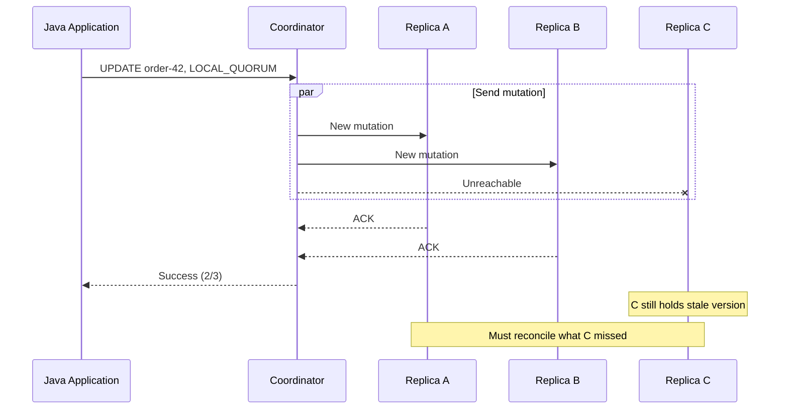
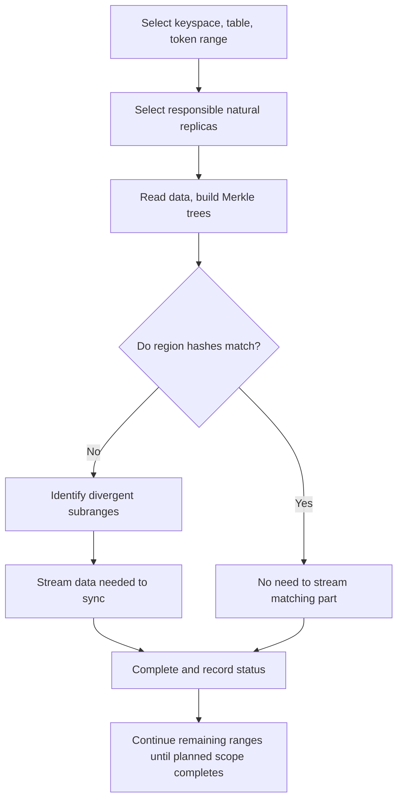

# Background Repair / Anti-Entropy and the Need for Proactive Reconciliation

## 1. Why Do Replicas Need Reconciliation?

Apache Cassandra is a **distributed wide-column** database: the partition key determines the token and set of **natural replicas** per the keyspace's replication strategy. During a write, the coordinator only needs responses matching the request's **consistency level (CL)** to return success. With replication factor (RF) equal to 3 and write CL = `LOCAL_QUORUM` in one data center (DC), two replica acknowledgments suffice; the third replica may be network-disconnected, overloaded, or yet to receive the mutation.

This allows Cassandra to keep serving the application when part of the cluster fails, yet creates the need for **replica synchronization** after an outage. A replica may miss `INSERT`, `UPDATE`, `DELETE`, or TTL-generated tombstone operations. Other replicas may hold newer data. Reconciliation is the process of detecting discrepancies across the token ranges that nodes jointly own, then transferring missing data so replicas converge.

This lesson belongs to the **Replica Synchronization** chapter in the `DATABASE_ENGINE_WIDE_COLUMN_CASSANDRA` module. It connects directly to partition keys, query-driven modeling, read/write consistency levels, CQL, compaction, repair, failure recovery, and reliability when Java applications access Cassandra.

Learning objectives:

1. Distinguish convergence mechanisms: **hinted handoff**, **read repair**, **anti-entropy repair**, and **compaction**.
2. Explain how repair checks token ranges with **Merkle trees** and streams discrepancies.
3. Understand **background repair** as a scheduled/orchestrated job, and recognize differences between Cassandra versions with and without Auto Repair.
4. Identify the need for **proactive periodic reconciliation**, especially before tombstones become eligible for purge.
5. Select an appropriate repair scope and mode, verify results, and avoid confusing single-node command completion with cluster-wide repair.

## 2. A Replica Divergence Scenario

Suppose keyspace `shop_ks` uses `NetworkTopologyStrategy` with RF = 3 in `dc1`. The three replicas for the partition keyed by `order-42` are A, B, and C.



Later C restarts. You cannot conclude C is up to date merely because:

- A and B ACKed the client;
- `nodetool status` shows C in state `UN` (Up/Normal);
- a read query at `LOCAL_QUORUM` returns the new value;
- compaction on C runs normally.

A quorum read may obtain responses from A/B without touching every partition on C. A replica **being alive** does not mean it has received **every mutation** missed while down.

### One Correct Read Is Not Enough to Declare Convergence

| Action | Observed Result | Correct Conclusion |
| --- | --- | --- |
| `SELECT` at CL = `ONE` returns stale value | The request may have read an un-updated replica or another issue needs inspection | Insufficient basis to claim all replicas are wrong. |
| `SELECT` at `LOCAL_QUORUM` returns new value | That query satisfied CL and retrieved the returned data per read mechanics | Does not prove all replicas and all partitions are synchronized. |
| C transitions from `DN` to `UN` | The node reconnected from gossip's perspective | Does not confirm all hints replayed or repair completed. |
| `nodetool repair` on one scope reports success | That scope/dataset finished the requested repair procedure | Does not necessarily cover the whole cluster, whole table, or out-of-scope data. |

## 3. Convergence Mechanisms: Opportunities and Limitations

| Mechanism | When Does It Occur? | What Does It Help With? | Limitations to Remember |
| --- | --- | --- | --- |
| **Hinted handoff** | Coordinator stores hints for a replica temporarily unable to accept writes, then replays upon recovery | Fast recovery of many mutations missed during brief outages | **Best effort**, bounded by time/config; hints can be incomplete, lost, or expired. |
| **Read repair** | On the read path when contacted replicas disagree and version/CL mechanisms permit | Can fix discrepancies detected while **reading those partitions** | Does not scan keys nobody reads; exact behavior varies by version. |
| **Anti-entropy repair** | Proactive repair job launched by operators, schedulers, or Auto Repair | Compares data across **token ranges** and synchronizes discrepancies among relevant replicas | Disk/network/CPU heavy; must cover full scope, nodes, and schedule. |
| **Compaction** | Per-node compaction scheduler or manual compaction operations | Merges local SSTables, purges older versions/tombstones when safe | **Exchanges no data between replicas**, so it never replaces repair. |

Repair is an **anti-entropy** tool: it compares existing data across multiple replicas to spot disagreements and streams differences. Read repair and hinted handoff reduce divergence, yet **cannot be used alone to guarantee all keys—including cold, unread keys—are reconciled**.

## 4. How Does Anti-Entropy Repair Work?

Conceptually, a repair session consists of these steps:

1. **Define scope:** keyspace, table, token ranges, and the nodes holding replicas for the target data region.
2. **Prepare data:** Cassandra selects SSTables/partitions to inspect according to repair type, version, and repaired/unrepaired metadata.
3. **Build Merkle trees:** each side constructs a hierarchical hash structure representing data across the token range. Comparing trees pinpoints differing regions without transferring every row over the network.
4. **Compare:** corresponding hashes are compared; matching ranges are skipped while differing regions are marked for synchronization.
5. **Stream differences:** replicas exchange required data per the repair protocol; SSTables and relevant metadata may be updated/rewritten.
6. **Record status:** a repair session may succeed, fail, or abort; inspect **what scope was actually processed**, not just a summary message.



**A Merkle tree is not a full copy of the table**; it uses hashes to localize divergence. Repair can be resource-intensive due to scanning data, building trees, streaming, and sometimes **anti-compaction**. A successful repair is not a cluster-wide SQL transaction and does not lock the entire table against new writes.

### Partition Key and RF Determine Which Replicas Are Compared

For a table declared with `PRIMARY KEY ((customer_id), order_id)`, the partition key is solely `customer_id`. Partition placement follows tokens, and the replication strategy selects replicas. Repair may need to compare A/B/C if all three replicate that token range, even if the Java app only connects to node A for reads. If a keyspace spans multiple DCs, repair planning must account for **all participating DCs and replicas** rather than inferring everything from the node where the command ran.

## 5. Does "Background Repair" Happen Automatically?

The word **background** can be misleading. It describes work running in the operational layer outside direct CQL request paths—it **does not automatically mean every Cassandra cluster has a complete repair schedule enabled**.

### On Earlier Cassandra Releases or Clusters Without Auto Repair

Anti-entropy repair **must be scheduled proactively** via `nodetool repair`, operational automation, or an orchestrator such as Cassandra Reaper. Continuous node compaction, active hinted handoff, or application reads do not replace that reconciliation schedule. A cluster lacking a repair schedule may run fine briefly and then accumulate long-term divergence after outages.

### On Releases with Auto Repair

Apache Cassandra includes **Auto Repair** per CEP-37: a built-in repair orchestrator introduced in the Cassandra 6.0 branch and backported to **Cassandra 5.0.8**. Documentation for 5.0.8 describes enabling the JVM property `-Dcassandra.autorepair.enable=true` **before startup** to create the required schema, followed by enabling the scheduler in `cassandra.yaml` or via supported admin interfaces. Enabling this property modifies schema and is documented as **not trivially reversible**; never enable it in production just to try a lab exercise.

When Auto Repair is used, the system can:

- Orchestrate **incremental**, **full**, and **preview repaired** schedules.
- Subdivide token ranges to bound per-repair data volume, throttle concurrent jobs, and automatically retry certain errors.
- Track history, such as records in `system_distributed.auto_repair_history` when supported by version/feature.
- Expose tools such as `nodetool autorepairstatus -t incremental` on compatible releases.

**Never assume Auto Repair is active solely from a version number.** Cassandra branches differ in feature eligibility and configuration defaults; in 5.0.8, having the feature present does not mean the scheduler is running. Before adding cron jobs or Reaper, verify the version, existing schedule state, and covered scope to avoid **two systems running overlapping repairs concurrently**.

| Environment | Verification Question | Appropriate Action |
| --- | --- | --- |
| Cassandra without built-in Auto Repair | Are cron/automation/Reaper and recent success logs active for every node/range? | Set up an appropriate repair schedule; monitor failures and missed ranges. |
| Cassandra supporting Auto Repair but not yet enabled | Are configuration, schedule, and scheduler state enabled? | Plan enablement per exact version docs; assess upgrade/config impact. |
| Cassandra with Auto Repair running | What are the full/incremental modes, intervals, coverage, failed ranges, and job states? | Monitor and reconcile coverage; avoid adding duplicate manual repair schedules. |

## 6. Full Repair and Incremental Repair

The two modes serve complementary roles:

| Attribute | **Incremental repair** | **Full repair** |
| --- | --- | --- |
| Data inspected | Data **not yet marked repaired** from previous incremental cycles | All data within the specified repair scope, including data already marked repaired. |
| Cost when run regularly | Typically lower because the newly written/unrepaired dataset is smaller | Typically higher I/O, CPU, network, and duration for the same scope. |
| Metadata / SSTables | Can mark data as repaired and use **anti-compaction** to separate repaired/unrepaired SSTables | Does not replace incremental repair's repaired-marking workflow. |
| Limitation | If already-repaired data later corrupts or disappears on one replica, subsequent incremental runs may skip it | Suitable for re-verifying historical data, but requires bounded scope and load control. |
| Operational need | Regular recurring schedule covering new data and preventing backlogs | Less frequent periodic schedule or targeted repair when verifying/recovering older datasets. |

In modern Cassandra releases, `nodetool repair` commonly defaults to **incremental repair**; `nodetool repair --full` requests a full repair. Check `nodetool help repair` on your exact version before writing a runbook. **Do not reflexively run full and incremental back-to-back**: understand repaired/unrepaired state, existing schedules, and available resources.

The first incremental cycle on a long-running cluster may need to process large volumes of data **never previously marked repaired**. It can trigger anti-compaction and significant I/O and disk usage; never estimate its cost solely from the last hour of writes.

## 7. Why Must Proactive Reconciliation Run Before Tombstones Expire?

Cassandra marks deleted data with **tombstones**. Tombstones must propagate to and be seen by replicas that might still hold old data. After **`gc_grace_seconds`** and once compaction safety conditions are met, tombstones can be purged from SSTables. If a replica stays offline too long, misses the tombstone, and the deletion marker vanishes on healthy replicas, old data can be streamed back during a later read/repair/streaming session—a phenomenon called **zombie data**.

```text
Day 0: A/B/C all hold order-42 = "ACTIVE"
Day 1: C goes down; DELETE/TTL creates tombstones on A and B
Day 2: Writes/reads continue succeeding at appropriate CL on A/B
...
After gc_grace and eligible compaction:
       A/B may no longer retain tombstones to refute old data
Day N: C returns carrying the stale record
Risk: old data may reappear if not reconciled in time
```

That is why a repair plan must:

- **Cover all responsible token ranges, tables, and replicas**, including relevant DCs.
- Have a repair cycle **shorter than the tombstone protection window**, leaving headroom for outages, failed repairs, backlogs, and maintenance. Never schedule a cycle "equal to `gc_grace_seconds`" because a single delayed job creates an exposure window.
- Track the **timestamp of the last successful repair per scope**, not merely when a cron job started.
- Handle long node outages, node replacements, RF increases, topology changes, and aging repaired data via an appropriate plan, potentially needing full repairs or additional checks.

**Example:** if `gc_grace_seconds = 864000` (10 days), a **full-coverage** reconciliation schedule must usually complete well under 10 days; pick a practical cadence based on load, capacity, repair duration, and failure margin. Never lower `gc_grace_seconds` arbitrarily to save tombstone overhead, as doing so raises resurrection risk. TTL expirations also carry deletion semantics; account for tombstone propagation paths and application correctness.

## 8. RF, CL, and Repair Solve Different Problems

Assume RF = 3 in `dc1`:

| Config / Observation | What Is Guaranteed for That Request? | What Still Requires Repair? |
| --- | --- | --- |
| Write `ONE` returns success | One replica acknowledged per the write path | The other two replicas may not have received the data yet. |
| Write `LOCAL_QUORUM` returns success | Two local replicas ACKed | The third replica may still be stale. |
| Read `LOCAL_QUORUM` returns new value | Read response met local quorum and reconciliation rules | Unread partitions can still diverge; stale data on another replica still needs reconciliation. |
| Node C recovers and replays available hints | Mutations that had hints and delivered successfully were transferred | Un-hinted, lost, or expired hints and unread ranges may still diverge. |
| Compaction reduces SSTables on A | Local read cost may decrease | B/C do not automatically pull missing mutations from A. |

The `R + W > RF` rule of thumb for read/write quorums in the same scope ensures replica sets **intersect** in many cases, but **does not replace repair against long-term data drift**. In multi-DC setups, `LOCAL_QUORUM` in two different DCs provides no mandatory intersection; repair schedules and consistency must match business needs.

## 9. Scope of a Single `nodetool repair` Command

The following commands **illustrate syntax only**. On a live cluster, repair can consume substantial CPU, disk I/O, and network. Use a test keyspace/table and read the exact version's help before executing.

```bash
# Verify syntax and tool version before scheduling:
nodetool help repair
nodetool status

# Repair a table/keyspace over ranges handled by this node:
nodetool repair repair_lab_ks orders_by_id

# Full repair of the table over ranges handled by the target node:
nodetool repair --full repair_lab_ks orders_by_id

# Restrict to the node's primary token ranges (per version docs):
nodetool repair -pr repair_lab_ks orders_by_id
```

**Crucial scope boundaries:**

1. The command is invoked **on one node** and initiates repair for ranges within its handling scope. It contacts relevant replicas to compare/stream; **it does not mean every range of every table in the cluster has been repaired**.
2. Specifying `repair_lab_ks orders_by_id` limits the **keyspace/table**. Never run the command without arguments on a large cluster unless you genuinely intend to process that full scope.
3. `-pr`/`--partitioner-range` restricts to the node's **primary ranges**. To cover the entire cluster under this strategy, you must run across appropriate nodes/DCs per runbook and verify no ranges were skipped; never run on one node and declare victory.
4. Flags restricting DCs, hosts, token ranges, job counts, preview, or validate alter scope and execution behavior. **A repair with narrow filters only covers those narrow filters**; verify exact behavior for your version.
5. Repair **does not change RF**, create tables, change partition keys, or fix flawed Java query assumptions.

To estimate divergence before streaming data, some releases support:

```bash
# Only estimates streaming volume; performs no synchronization:
nodetool repair --preview --full repair_lab_ks orders_by_id

# Checks the repaired dataset; does not stream repairs:
nodetool repair --validate repair_lab_ks orders_by_id
```

`--preview` and `--validate` modes **do not mean repair has fixed the data**. Preview and validate carry distinct semantics depending on scope and data category (e.g., validating the repaired dataset); they also consume resources. Confirm exact option availability on your running version.

## 10. Scheduling Controlled Background Repair

A useful anti-entropy schedule requires more detail than a single `nodetool repair` cron entry.

| Plan Component | What to Define |
| --- | --- |
| **Coverage** | Which keyspaces/tables/token ranges/DCs—are any DCs or new tables omitted? |
| **Repair type** | Incremental vs. full, and when to re-verify repaired datasets? |
| **Cadence** | How often is every range repaired **successfully**? Is there margin before `gc_grace_seconds`? |
| **Orchestration** | Max concurrent nodes/ranges; avoiding overlap with streaming, backups, and heavy compaction? |
| **Resilience** | Job failures, node outages, upgrades, topology changes: how are retries, alerts, and checkpoints/resumes handled? |
| **Resources** | Free disk, network throughput, CPU/GC, pending compactions, SSTable count, streaming backlog. |
| **Evidence** | History, logs, elapsed duration, completed/failed token ranges, and overdue alerts. |

**Example starting schedule:** A cluster with a default 10-day `gc_grace_seconds` might schedule steady daily incremental repairs and less frequent periodic full repairs, then tune based on size, runtime, mutation churn, and load tolerance. That schedule **is not a universal mandate for all clusters**; operational quality is measured by **coverage and completion time**, not how many cron lines exist.

### When Built-In Auto Repair Is Available

Only after verifying feature availability and permission to modify configuration on that version should operators inspect schedules, minimum intervals between sessions, concurrent job limits, repair types, and failure history via Auto Repair tools/metadata. Example status commands on supported releases:

```bash
nodetool autorepairstatus -t incremental
nodetool autorepairstatus -t full
```

**Do not** run these commands if your environment lacks the feature; do not assume `autorepairstatus` exists across all Cassandra branches. Never enable a new scheduler if the cluster already runs Reaper or cron schedules without planning the migration.

## 11. Observing and Verifying Repair Outcomes

Before and during repair, collect at least the following from relevant nodes:

```bash
nodetool status
nodetool netstats
nodetool tpstats
nodetool compactionstats
nodetool tablestats repair_lab_ks.orders_by_id
```

- `status` shows whether nodes are Up/Down and Joining/Leaving/Normal from an admin perspective; it is **not** a replica consistency metric.
- `netstats` reports streaming/data-transfer activity; correlate with logs and specific repair sessions.
- `tpstats` reveals thread queues and load; some versions expose repair pools/tasks.
- `compactionstats`, `tablestats`, and disk metrics show I/O pressure, SSTables, and anti-compaction growth during repair.
- **Logs, repair session IDs, success/failure states, completed range counts, and job history** determine whether the intended scope was truly processed.

> A `Completed` repair task counter **does not** prove all replicas/tables in the cluster were repaired. You need a **range × table × DC × timestamp** record and proof that failed jobs were retried.

Useful post-repair metrics to correlate:

| Metric Group | Interpretation |
| --- | --- |
| Repair duration, failed sessions, ranges completed | Shows whether the schedule runs and **covers the planned scope**. |
| Bytes streamed / pending streaming | How much data transferred; 0 bytes can mean already synced **within the checked scope**, not across every table. |
| Pending compactions, free disk, SSTable count | Whether repair/anti-compaction is causing load or needing extra disk headroom. |
| Read/write p95–p99 latency, timeouts, retries | Whether background repair degrades application traffic; compare at equal load and CL. |
| Pending hints and gossip/network errors | Reveals whether the environment suffers prolonged outages or missed mutations. |
| Repair history / preview repaired | Confirms latest schedule and divergent ranges; availability varies by version. |

In a Java application, read/write errors or differing values seen at `ONE` vs. `LOCAL_QUORUM` are a signal to investigate—**not sufficient to immediately trigger cluster-wide repair**. Cross-check CL, timestamps, TTLs, client consistency, logs, and exact partition keys before blaming replica desynchronization.

## 12. Reproducible Lab on a Test Cluster

**Environment:** A single-DC Cassandra lab with enough nodes for RF = 3 and example data center `dc1`. If your topology differs, adjust DC/RF names. Never induce outages or run keyspace-wide repairs in production to simulate this.

### 12.1. Creating a Table with an Explicit Partition Key

```sql
CREATE KEYSPACE repair_lab_ks
WITH replication = {'class': 'NetworkTopologyStrategy', 'dc1': '3'}
AND durable_writes = true;

CREATE TABLE repair_lab_ks.orders_by_id (
    customer_id text,
    order_id uuid,
    state text,
    updated_at timestamp,
    PRIMARY KEY ((customer_id), order_id)
) WITH gc_grace_seconds = 864000;

INSERT INTO repair_lab_ks.orders_by_id
    (customer_id, order_id, state, updated_at)
VALUES
    ('cust-42', 11111111-2222-3333-4444-555555555555,
     'CREATED', toTimestamp(now()));
```

The partition key is `customer_id`, and the clustering key is `order_id`. You can run:

```sql
CONSISTENCY LOCAL_QUORUM

SELECT customer_id, order_id, state
FROM repair_lab_ks.orders_by_id
WHERE customer_id = 'cust-42'
  AND order_id = 11111111-2222-3333-4444-555555555555;
```

On a three-node lab, inspect the replica list:

```bash
nodetool status
nodetool getendpoints repair_lab_ks orders_by_id cust-42
```

`getendpoints` only reports **natural replicas from metadata** on the queried node; it does not prove each replica actually holds a given record.

### 12.2. Measuring Before/After a Targeted Repair

1. Record timestamp, Cassandra version, keyspace, table, RF/CL, node/replica list, health, and active repair schedule.
2. Capture baseline via `nodetool tablestats`, `netstats`, logs, and CQL read latency over a controlled set of partitions.
3. On a chosen node and after checking disk/network headroom, run a **purpose-appropriate repair** (such as a full repair on just the lab table). Record the session ID and outcome.
4. Check for failed ranges, aborted jobs, or incomplete streaming. Re-collect metrics, read latencies, and query outputs.
5. Explain why repairing from one node is **not yet** a cluster-wide plan; full coverage requires covering any remaining token ranges/hosts/DCs.

You do not have to break a node to create divergence. A healthy lab may stream **0 bytes** because replicas are already synchronized, which is still sufficient for practicing log reading, scope verification, and cost observation. If simulating an actual outage, do so only in a test cluster with a prepared recovery procedure.

### 12.3. Observing Application Impact from Java

The following Java Driver 4.x snippet demonstrates a **partition-key-scoped read**; assume `session` and imports are already configured:

```java
PreparedStatement ps = session.prepare(
    "SELECT state, updated_at FROM repair_lab_ks.orders_by_id " +
    "WHERE customer_id = ? AND order_id = ?"
);

BoundStatement query = ps.bind(
    "cust-42",
    UUID.fromString("11111111-2222-3333-4444-555555555555")
).setConsistencyLevel(DefaultConsistencyLevel.LOCAL_QUORUM);

long startNs = System.nanoTime();
Row row = session.execute(query).one();
long latencyMs = (System.nanoTime() - startNs) / 1_000_000;

System.out.println("latencyMs=" + latencyMs);
System.out.println("state=" + (row == null ? "<missing>" : row.getString("state")));
```

During repair, driver p95/p99 latency and timeouts may shift because repair consumes disk/network bandwidth. Maintenance optimization must not measure solely "did repair finish," but balance **coverage, cost, latency, and data correctness**. CL = `LOCAL_QUORUM` does not turn every Java query into a full-table anti-entropy scan.

## 13. Handling Difficult Scenarios

| Scenario | Analysis Required | Remediation Approach |
| --- | --- | --- |
| Node C down for hours, then Up | Did all hints replay? Were mutations lost? When was the last successful repair? | Run/await scheduled repair with proper scope, monitor streaming; do not rely solely on `UN`. |
| Node down longer than `gc_grace_seconds` | Tombstones may have been purged on live replicas; stale data risks resurrection | Follow recovery/node-replacement runbook and verify data; do not bring old node into service assuming safety. |
| Regular repair schedule still misses ranges | Cron only ran on one node or filtered to one DC/table | Audit range × host × DC inventory, fill missing ranges, and track completion. |
| Incremental reports done but old data suspected corrupt | Repaired portion was skipped in subsequent incremental runs | Consider full repair and preview/validate modes if version supports them. |
| Repair causes timeouts or disk near full | Streaming/anti-compaction competing for resources; check free disk and concurrent jobs | Reduce concurrency, reschedule, or narrow scope per procedure; protect workload availability. |
| One DC unreachable | `LOCAL_*` CLs can keep serving surviving DC, yet cross-DC data may drift | Review replication strategy and reconciliation schedule across all involved DCs. |
| RF recently increased | New replicas likely lack full historical data | Schedule appropriate full repair/streaming for the new topology; do not treat `ALTER KEYSPACE` as full data copying. |

**Avoid fixing data manually by "copying SSTables" without a compatible procedure.** SSTables are bound by version, token range, repaired metadata, and schema; use supported administrative/streaming/repair tools for your exact release.

## 14. Misconceptions to Eliminate

| Claim | Correct Conclusion |
| --- | --- |
| "Cassandra is eventually consistent, so it heals everything automatically in the background." | **Insufficient basis.** Hints/read repair are best effort; anti-entropy requires an explicit schedule or enabled, monitored Auto Repair. |
| "`LOCAL_QUORUM` succeeded, so all three replicas are identical." | **False.** It only requires threshold ACKs, not every replica's confirmation. |
| "Node `UN` means it received all data missed during the outage." | **False.** Liveness status says nothing about data convergence. |
| "Compaction does the same thing as repair." | **False.** Compaction merges local SSTables; repair compares and transfers data across replicas. |
| "Just enable Auto Repair in a newer version and you're done." | **False.** Verify the feature is active, scheduled, jobs succeed, and no range/table/DC is missed. |
| "Incremental repair re-checks all historical data every run." | **False.** It typically focuses on data not yet marked repaired from prior cycles. |
| "`--preview` or `--validate` fixes discrepancies." | **False.** Those modes inspect/estimate without streaming repairs. |
| "Repair finishing on one node means the entire cluster is done." | **False.** Account for token ranges, nodes, and DCs per plan. |
| "Once tombstones pass `gc_grace_seconds`, deleting them is always safe." | **False.** A replica that missed the delete may still hold old data; repair schedules and compaction conditions govern risk. |

## 15. Self-Check

1. RF = 3, write `LOCAL_QUORUM` succeeds while C is down. When C returns to `UN`, why is reconciliation still required?
2. Why does read repair fail to guarantee fixing a partition that receives no read requests for months?
3. How do Merkle trees reduce data transfer during repair? When does streaming occur?
4. Why must you check whether a cluster already uses built-in Auto Repair vs. Reaper/cron before creating a new schedule?
5. Contrast a successful incremental repair with a full repair when a subset of **previously repaired** data becomes corrupted.
6. With a 10-day `gc_grace_seconds`, what happens if a node holding old data is isolated longer than this window and tombstones are purged? Why does the repair schedule need safety margin?
7. If you run `nodetool repair -pr repair_lab_ks orders_by_id` on one node, what must be verified before reporting "cluster-wide repair complete"?
8. After a repair streams 0 bytes, can you conclude the whole cluster has zero divergence? Explain the scope of that evidence.

**Completion criteria:** Learners can trace convergence paths across replicas, distinguish opportunistic from proactive mechanisms, understand full/incremental/Auto Repair per version, define operational scope, and design a **full-coverage repair plan ahead of tombstone expiration risk**, relying on verification metrics rather than node status alone.

## 16. Reference Documentation

- [Apache Cassandra — Repair](https://cassandra.apache.org/doc/stable/cassandra/managing/operating/repair.html): Merkle trees, full/incremental, `nodetool repair`, primary range scope, and operational scheduling.
- [Apache Cassandra — Hints](https://cassandra.apache.org/doc/stable/cassandra/managing/operating/hints.html): hinted handoff and best-effort limits of replaying missed mutations.
- [Apache Cassandra — Auto Repair](https://cassandra.apache.org/doc/stable/cassandra/managing/operating/auto_repair.html): CEP-37, availability from 5.0.8/6.0, scheduler, configuration, and monitoring.
- [Apache Cassandra — nodetool repair](https://cassandra.apache.org/doc/stable/cassandra/managing/tools/nodetool/repair.html): exact repair flag syntax per version.
- [Apache Cassandra — Storage Engine](https://cassandra.apache.org/doc/stable/cassandra/architecture/storage-engine.html): memtables, SSTables, compaction, and deletions.

**Practical conclusion:** RF and CL keep Cassandra available during failures, yet can leave replicas missing mutations. Hinted handoff, read repair, and compaction each play distinct roles; **anti-entropy repair with defined scope, schedule, and completion evidence** is the proactive mechanism to detect and fix divergence across infrequently read token ranges. On Cassandra versions with Auto Repair, verify the scheduler is truly enabled with full coverage; elsewhere, maintain an operator-orchestrated schedule. Timely repair is essential to prevent stale data from resurfacing once tombstones are purged.
