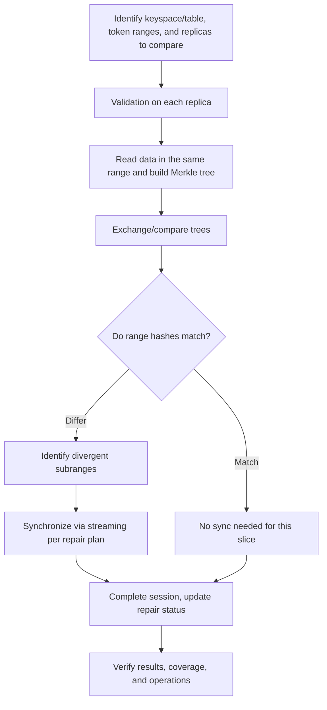

# Merkle Trees and Comparing Data Over the Same Token Range

> **Chapter:** Replica Synchronization  
> **Module:** `DATABASE_ENGINE_WIDE_COLUMN_CASSANDRA` — Apache Cassandra, a distributed wide-column database.  
> **Focus:** Understanding how anti-entropy repair builds and compares Merkle trees over the **same token range**, identifies divergent subranges, and streams data across replicas.

In Cassandra, a partition is identified by its **partition key** and mapped to a **token** by the partitioner. Based on the replication strategy and RF (replication factor), the same partition can have copies across multiple nodes. Reading or writing at a consistency level (CL) such as `LOCAL_QUORUM` does not guarantee every replica always holds the exact same state at every instant: nodes can be Down, networks can partition, or a replica can miss a mutation or tombstone.

Cassandra uses **anti-entropy repair** to find discrepancies across replicas and resynchronize data. A core tool in this process is the **Merkle tree**: a hash tree structure that compares two datasets by comparing branch hashes, descending only into regions that differ rather than shipping all rows across the network for row-by-row comparison.

The single most important point: **the two trees must represent the exact same token range and comparable data scope**. Comparing the root hashes of two different token sets cannot tell you whether data is consistent.

## 1. Learning Objectives

After this lesson, you will be able to:

1. Explain partition key → token → token range → replica set to be compared.
2. Describe Merkle tree structure, leaf hashes vs. parent hashes, and how divergent regions are detected.
3. Distinguish **validation (tree building)**, **comparison (tree diffing)**, and **synchronization (data streaming)** phases in repair.
4. Understand the limits of Merkle trees: hashes indicate **regions that may differ**, not directly "copy row X from A to B" in every case.
5. Select and monitor `nodetool repair` per policy, distinguish full and incremental repair, and interpret success/failure results.
6. Connect repair with consistency levels, tombstones, `gc_grace_seconds`, compaction, streaming, node downtime, and Java applications.
7. Design multi-replica test exercises with fault injection and proof that repair truly completed.

## 2. Reviewing Tokens and Replica Ownership

### 2.1. Partition Keys Are Hashed into Tokens

Suppose we store account events:

```sql
CREATE KEYSPACE IF NOT EXISTS lab_sync
WITH replication = {
  'class': 'NetworkTopologyStrategy',
  'dc1': 3
};

CREATE TABLE IF NOT EXISTS lab_sync.events_by_account (
    account_id uuid,
    event_time timestamp,
    event_id timeuuid,
    event_type text,
    payload text,
    PRIMARY KEY ((account_id), event_time, event_id)
) WITH CLUSTERING ORDER BY (event_time DESC, event_id DESC);
```

**Lab prerequisites:** datacenter `dc1` has three suitable replicas for RF=3. Adjust keyspace/topology if your lab differs. In this table:

- `account_id` is the **partition key**, determining the token of the entire partition.
- `event_time` and `event_id` are clustering columns, ordering rows **within** the partition.
- Every row with the same `account_id` shares the same token, regardless of how many timestamps or events exist.
- The standard partitioner is `Murmur3Partitioner`; token algorithms and storage must match cluster configuration.

A token range is usually written `(t_left, t_right]`, excluding the left boundary and including the right boundary. The token ring wraps around; a range may cross the end of the token space. With **vnodes**, each node holds many tokens and therefore owns many non-contiguous ranges.

### 2.2. What Does "Same Token Range" Mean?

Suppose nodes A and B both replicate range R = `(100, 200]` in a keyspace (illustrative numbers, not actual table tokens).

| Partition | Illustrative Token | In R? |
|---|---:|---|
| `account_1` | 108 | Yes |
| `account_2` | 165 | Yes |
| `account_3` | 210 | No |
| `account_4` | 200 | Yes |
| `account_5` | 100 | No |

To compare R properly, both A and B must construct representations for **partitions whose tokens fall in (100, 200]**, under the **same keyspace/table and comparison rules**. If A builds a tree for `(100,200]` and B builds one for `(150,250]`, differing root hashes cannot prove A and B hold mismatched data; the two trees describe two different ranges.

When a keyspace spans multiple DCs, **NetworkTopologyStrategy** selects replicas per DC/rack RF. Only compare nodes that **jointly replicate the specified range**; two arbitrary nodes in a cluster do not hold identical partitions.

### 2.3. Example of Why Two Replicas Diverge

A typical RF=3 scenario where A/B/C hold R:

1. C goes temporarily Down.
2. Client sends `INSERT` or `DELETE` at CL `LOCAL_QUORUM`; A and B return the required two ACKs.
3. C misses the mutation.
4. C returns and may hold an older version.
5. Repair is run to detect and synchronize the discrepancies.

Hinted handoff can deliver some missed mutations within configured limits, yet **does not replace repair**. Read repair affects only read data/ranges under specific conditions and does not guarantee the entire token range is reconciled.

## 3. What Is a Merkle Tree?

A **Merkle tree** is a tree where each node represents a hash of the data beneath it. Leaves represent subsets of data; parent node hashes are computed from child hashes (or an equivalent deterministic combination).

### 3.1. Illustrative Tree for a Range

Suppose R = `(100,200]` is split into four subranges:

- `R1 = (100,125]`
- `R2 = (125,150]`
- `R3 = (150,175]`
- `R4 = (175,200]`

Two replicas share identical data in R1, R2, and R4, but B missed an update in R3.

```text
       Replica A                            Replica B
       Root hA                              Root hB
          / \                                  / \
       h12  h34                            h12   h34'
       / \  / \                             / \   / \
      h1 h2 h3 h4                         h1 h2  h3' h4
            ^                                     ^
         Range R3                              Range R3

  Roots differ    -> compare branches
  h12 matches     -> skip R1, R2
  h34 differs     -> descend into R3, R4
  h3 differs      -> only R3 has discrepancies to sync
```

This example **simplifies** structure and partitioning. Cassandra adjusts tree depth, token range splits, and internal hashing according to version and data volume; leaves do not necessarily correspond to **a single row** or single token.

### 3.2. Why Does Comparing Hashes Save Data Transfer?

If a replica holds millions of partitions, sending every record to another node just to check for differences wastes bandwidth. Merkle trees allow:

1. Comparing the root hash for a range.
2. If equal, assuming proper hashing with negligible collision risk, treating the range as **fingerprint-matched**.
3. If different, comparing child branches to localize the discrepancy.
4. Repeating down to the leaf regions that need synchronization.

Thus, **comparison metadata** is vastly smaller than the raw dataset whenever most data already matches. Tree construction still requires **reading and hashing data** on the replicas; Merkle trees do not make validation free.

### 3.3. "Matching Hashes" Is Not an Absolute Guarantee

Merkle trees are a hash-based technique for verifying state over a range:

- Theoretically there is a tiny hash collision probability; the algorithm is not an absolute logical proof.
- Two trees should only be compared when range, timing/data type, schema, and repair state align.
- If data changes **while** the validator reads SSTables, the trees may reflect slightly different point-in-time observations.
- Matching roots **do not prove** the application never lost a write, since all replicas could simultaneously lack a mutation no source retained.
- A successful repair does not replace business reconciliation, backups, audit logs, or CDC policies.

## 4. How Leaf Hashes and Parent Hashes Work

### 4.1. Simple Mathematical Model

Let `H(x)` be a consistent hash function and `||` denote deterministic byte concatenation. With four leaves:

\[
h_1=H(D_{R1}),\quad h_2=H(D_{R2}),\quad h_3=H(D_{R3}),\quad h_4=H(D_{R4})
\]

\[
h_{12}=H(h_1 \mathbin{||} h_2),\quad
h_{34}=H(h_3 \mathbin{||} h_4)
\]

\[
h_{\mathrm{root}}=H(h_{12}\mathbin{||}h_{34})
\]

`D_Ri` represents the data within subrange Ri. This is a **textbook model**, not an exact byte-level replica of every Cassandra version's internal serialization and hashing implementation.

In practice, token/partition order, version/timestamp metadata, tombstones, and serialization logic determine what feeds into the fingerprint. During repair, Cassandra uses a standardized internal validation mechanism across compatible nodes.

### 4.2. What Causes Hashes to Differ?

| Situation in Range R3 | Can It Change the Fingerprint? | Why |
|---|---|---|
| B misses a partition that A has | Yes | Datasets in the range differ |
| B misses an updated cell | Yes | Value or metadata differs |
| A has a tombstone, B has old data | Yes | Deletion markers are part of the state to sync |
| B has the same value with a different timestamp | Potentially | Reconciliation-relevant metadata may differ |
| A/B differ only in physical SSTable paths | Not compared | Repair compares logical data/state, not filenames |
| Two nodes hold partitions in different token ranges | Not comparable via R's tree | Must align ranges first |
| Both A and B missed an update | Hashes may match | Repair cannot know about completely lost mutations |

A differing leaf hash identifies a **divergent subrange**; to fix it, synchronization performs detailed data streaming/comparison and applies Cassandra's reconciliation rules.

### 4.3. Tree Depth and Divergence Granularity

If a leaf covers a wide range, even a single divergent partition marks that leaf mismatched; the system may have to stream/sync a **wider slice than the few differing rows**.

If the tree is deeper, mismatched regions are narrower, at the cost of extra memory, hashing CPU, tree exchange overhead, and implementation limits.

General trade-off:

| Tree | Advantage | Cost / Risk |
|---|---|---|
| Fewer leaves, wider leaf ranges | Lighter comparison metadata | A tiny mismatch can widen the sync slice |
| More leaves, narrower ranges | Finer localization of discrepancies | More memory/CPU/metadata |
| Trees across many vnodes/ranges | Matches replica distribution | More validation sessions and stream plans |

Actual Merkle tree depth/precision is determined by Cassandra/version and repair strategy; you cannot tune it by altering the partition key of an existing populated table.

## 5. Three Phases of Anti-Entropy Repair

A repair follows **validation → comparison → synchronization**. Coordination classes, metric names, and detailed optimizations vary across Cassandra versions.



### 5.1. Phase 1 — Validation: Building Trees from Replica Data

A repair coordinator orchestrates participants for the target ranges. Replicas are instructed to generate **Merkle tree** validation digests for the identical scope.

During validation, Cassandra reads stored data—including version/tombstone metadata—typically via **validation compaction** / SSTable scanning. Costs include:

- Disk reads and cache churn competing with client queries.
- CPU for hashing data and processing partitions/versions.
- Memory and network metadata for trees/sessions.
- Long runtimes if tables are very large or nodes carry compaction backlogs.

**Repair is not a CQL `SELECT *`.** It operates at the storage layer by token ranges and replica topology.

### 5.2. Phase 2 — Comparison: Diffing Trees

The coordinator or repair orchestration layer exchanges fingerprints/trees and compares corresponding branches:

- Matching roots: the range is considered synchronized per that validation pass.
- Differing roots: descend to mismatched branches/leaves.
- Output is a **list of ranges needing sync**, not necessarily an absolute per-row right/wrong list.

Comparison must occur among relevant replicas **over the exact same token interval and table**. In clusters with vnodes and multiple replicas, one repair command can spawn numerous validation/comparison sessions.

### 5.3. Phase 3 — Synchronization: Streaming Required Data

Upon detecting mismatches, Cassandra schedules data transfer (typically via **streaming**) between replicas for the identified subranges. After receipt, replicas apply Cassandra semantics to merge values, timestamps, and tombstones.

Limitations to remember:

- A single mismatch can transfer many more bytes than one differing row due to **comparison/streaming granularity**.
- When two replicas hold differing versions, never oversimplify sync direction as "good node overwrites bad node"; reconciliation follows metadata and conflict-resolution rules.
- If data was lost on **every replica** (no copy retains the newer mutation), Merkle trees cannot recreate the data.
- If a participating node goes Down or streaming fails, repair is incomplete; never mark it "synchronized" just because trees were compared.

## 6. Example: A/B/C Diverge on One Partition in the Same Token Range

Assume R = `(100,200]`, with A, B, and C all replicating R at RF=3 in `dc1`. The events table has partition `account_id = X` whose token falls in R.

### 6.1. State Before Repair

| Partition in R | Replica A | Replica B | Replica C |
|---|---|---|---|
| X (token 120) | event#1, event#2 | event#1, event#2 | **only event#1** |
| Y (token 140) | event#3 | event#3 | event#3 |
| Z (token 180) | event#4 | event#4 | event#4 |

This can occur because C was Down when writing `event#2` was ACKed by A/B.

- A's and B's trees for R match.
- C's tree differs in the region containing token 120.
- If token 120 sits in leaf `R1=(100,125]`, a mismatch appears at R1.
- Streaming/reconciliation delivers the missing data to C.
- Once finished, all three replicas hold the same state for event#1 and event#2.

**All three nodes do not need to send the entire table to C.** Comparison and sync are scoped to token ranges and required replica pairs. Real cost still depends on source selection, leaf granularity, and session scope.

### 6.2. Tombstone Mismatches Matter More Than INSERT Mismatches

Suppose A/B received `DELETE event#1`, while C missed it:

| Replica | State |
|---|---|
| A | Tombstone shadowing event#1 |
| B | Tombstone shadowing event#1 |
| C | Stale live copy of event#1 |

While A/B retain the tombstone, repair detects the mismatch and streams/reconciles the deletion so C no longer preserves a version that could "resurrect."

If the tombstone is purged before C receives the delete and **no healthy replica retains the required deletion marker**, repair cannot infer deletion intent from an absence. C risks reintroducing old event#1 back into the cluster (**zombie data**).

Therefore, **Merkle trees are valuable because they detect current discrepancies**, yet they **do not replace retaining tombstones long enough and running repair on time**.

## 7. Repair, CL, and Consistency Understood Separately

### 7.1. Quorum Write Does Not Mean All Replicas Are Synchronized

With RF=3 in one DC, CL `LOCAL_QUORUM` typically requires two full replicas to ACK. If C is Down, A/B suffice for the write request; C can hold stale data.

A `LOCAL_QUORUM` read may return a valid result at that moment without confirming all token ranges on C are synchronized. **Read-path read repair cannot replace table-wide anti-entropy repair.**

### 7.2. Mechanism Comparison Table

| Mechanism | Problem Solved | Does Not Guarantee |
|---|---|---|
| **Write CL** | Enough replicas ACK the mutation for the request | All replicas received every mutation |
| **Read CL** | Enough replicas participate/respond per CL | Every partition cluster-wide is identical |
| **Hinted handoff** | Resends some missed mutations to temporarily Down nodes | Complete sync if node is Down long or hints do not exist |
| **Read repair** | Repairs some discrepancies detected on reads | Scanning every range |
| **Anti-entropy repair + Merkle tree** | Compares and synchronizes replicas over repaired ranges | Recovering mutations lost everywhere; fixing flawed business models |
| **Compaction** | Merges local SSTables, may reclaim tombstones | Automatic sync between nodes |
| **Bootstrap/replace streaming** | Populates nodes per topology | That source data was already consistent beforehand |

Choose CLs for business requirements and topology; **repair scheduling is a separate operational duty**. Raising CL does not make Merkle trees obsolete.

### 7.3. Repair Temporarily Increases Load

During repair:

- Validation heavily reads SSTables, which can impact throughput/latency.
- Streaming consumes network, disk read/write, and CPU.
- New SSTables or repaired/unrepaired state transitions can trigger additional compaction.
- Repair overlapping with bootstrap, replace, snapshots, or major compaction competes for resources.
- Java applications may observe higher p95/p99 latency and more timeouts.

Thus repair scheduling must account for resource capacity, **not merely frequency relative to `gc_grace_seconds`**.

## 8. Full Repair and Incremental Repair

Modern Cassandra branches support **full** and **incremental** modes with different handling of repaired/unrepaired SSTables. Details vary by Cassandra version and distribution.

### 8.1. Full Repair

A **full repair** evaluates all comparable data within the selected scope, including data already marked repaired by version mechanics. It is useful for deep reconciliation of a range or post-incident verification.

Typical `nodetool` syntax example:

```bash
# Run only with an approved repair plan on a lab cluster.
nodetool repair --full lab_sync events_by_account
```

**Running the command once on a single node does not implicitly cover the whole cluster**, especially with vnodes, multiple datacenters, or primary-range flags. Know which node coordinates, which ranges are processed, which replicas participate, and whether the job succeeded.

### 8.2. Incremental Repair

**Incremental repair** aims to process only SSTables/data not yet marked repaired, avoiding redundant work on subsequent runs. In supported releases, it can use **anti-compaction** to separate/mark repaired state after repair completes.

Key points:

- "Incremental" **does not mean** comparing Merkle trees in an entirely different way; it still compares data and syncs relevant ranges.
- Marking data repaired is meaningful only when required repair steps genuinely succeed per version semantics.
- Mis-scoped incremental schedules, mid-run failures, or unreconciled corruption inside previously repaired data can give operators false confidence.
- Periodic full repairs may be needed for certain policies or operational issues, though there is no single universal cadence for all clusters.

**Before choosing a repair mode**, check documentation for your running Cassandra release, full/transient replication variants (if any), datacenters, and your designed repair schedule. Never treat `--full` as a switch that "fixes all data everywhere" if execution scope is incomplete.

### 8.3. Repair Must Run Before Tombstones Lose Protection

A table's `gc_grace_seconds` sets the minimum age before a tombstone becomes eligible for reclamation during compaction; **it is not a guaranteed purge deadline**.

If replica C goes Down, misses a delete, and repair fails to deliver the deletion to C before tombstones are purged on healthy sources, zombie data can appear.

Prudent scheduling guideline:

\[
T_{\mathrm{down}}+T_{\mathrm{repair}}+T_{\mathrm{margin}}<T_{\mathrm{grace}}
\]

This is a **time-budgeting principle**, not a mathematical proof guaranteeing safety for every topology. Repair must **complete**, not merely be triggered by a scheduler. Monitor longest node downtime, repair coverage, and safety margin. A node Down past grace may need to be **isolated and replaced/rebootstrapped from trusted sources** per runbook rather than letting stale local data rejoin.

## 9. Practical Subtlety: "Same Token Range" with Vnodes

### 9.1. Why Not Compare All Disks Between A and B?

A and B may overlap on only a subset of token ranges. Outside their intersection:

- A holds data B **has no responsibility to store**.
- B holds data A **has no responsibility to store**.
- Hashing all SSTables on A against all SSTables on B would report mismatches that are **completely valid**.

Cassandra scopes repair using replica placement, keyspace strategy, ring metadata, and repair options. Validation trees are built for comparable ranges.

### 9.2. Ring Changes During Bootstrap/Decommission/Replace

Token ownership shifts as nodes join, leave, or are replaced. During topology transitions:

- Data is actively streaming between nodes.
- A new replica may not yet hold all ranges it is taking over.
- Concurrent repairs can add load and interact with membership transitions.

Verify topology is stable, streaming finished, and **the exact ranges/replicas at repair time** are accounted for before launching large jobs, unless a version-specific recovery procedure explicitly requires otherwise.

### 9.3. Multiple Datacenters and Racks

Example keyspace:

```sql
-- Multi-DC schema example; valid only if those DCs exist.
CREATE KEYSPACE IF NOT EXISTS lab_geo
WITH replication = {
    'class': 'NetworkTopologyStrategy',
    'dc1': 3,
    'dc2': 3
};
```

A repair restricted to `dc1` **does not implicitly synchronize replicas in `dc2`**. You need a repair policy with full DC coverage, accounting for cross-DC bandwidth cost and version repair options. Rack-aware placement also shapes actual replica sets.

If the cluster uses **transient replication** or newer features, full vs. transient replicas further affect repair behavior; consult your running version's docs rather than assuming all replicas behave identically.

## 10. CQL Lab Workflow: Inducing Divergence and Verifying Repair

This lab requires a multi-node Cassandra cluster configured appropriately and **authorized for fault injection**. Never perform node isolation or experimental repair tests in production.

### 10.1. Preparing Data and CL

Using `lab_sync.events_by_account` from section 2:

```sql
CONSISTENCY LOCAL_QUORUM;

INSERT INTO lab_sync.events_by_account (
    account_id, event_time, event_id, event_type, payload
) VALUES (
    11111111-1111-1111-1111-111111111111,
    '2026-11-21 08:00:00+0000',
    7c627d5a-a6b0-11ef-8ae8-0242ac120002,
    'created',
    'v1'
);

SELECT event_time, event_id, event_type, payload
FROM lab_sync.events_by_account
WHERE account_id = 11111111-1111-1111-1111-111111111111;
```

The goal is one representative partition. For larger datasets, generate **many `account_id` values** to span multiple token ranges; a single `account_id` exercises very little range coverage.

### 10.2. Simulating a Replica Missing a Write

In the **lab**:

1. Identify the actual replicas for `account_id` using version/keyspace-appropriate topology tools; do not guess from names A/B/C. Record the partition's token and range.
2. Isolate one replica C, confirming it shows Down while A/B retain quorum.
3. Issue a new mutation from `cqlsh`:

```sql
CONSISTENCY LOCAL_QUORUM;

INSERT INTO lab_sync.events_by_account (
    account_id, event_time, event_id, event_type, payload
) VALUES (
    11111111-1111-1111-1111-111111111111,
    '2026-11-21 09:00:00+0000',
    8c627d5a-a6b0-11ef-8ae8-0242ac120002,
    'updated',
    'v2'
);
```

4. Restore C. **Hinted handoff may already deliver the mutation to C**, so a persistent mismatch is not guaranteed. To study repair in isolation, design lab fault injection that controls hint delivery and verify observed behavior—never tweak production settings to force divergence.
5. Capture metrics/logs before and after repair; do not assume the two trees will definitely differ if the mutation already converged.

### 10.3. Observing Scope and Repair

Common `nodetool` commands:

```bash
nodetool status
nodetool describecluster
nodetool describering lab_sync
nodetool compactionstats
nodetool tpstats
nodetool netstats

# Example full repair per lab runbook:
nodetool repair --full lab_sync events_by_account
```

**Syntax note:** `describering`, `repair`, and DC/range selection flags can change across versions; run `nodetool help <command>` first. Checking `netstats` alone is insufficient: inspect repair session logs, validation, mismatches/streaming, and **completion status**.

### 10.4. Evaluating Results

Check these items:

| Evidence | Meaning | What It Does **Not** Prove |
|---|---|---|
| `nodetool status` shows all `UN` | Nodes are Up and Normal | All replicas hold identical data |
| Validation trees completed | Scanned/hashed corresponding ranges | Nodes finished synchronizing |
| Mismatch found in a range | Range fingerprints diverged | Which exact row is corrupted |
| Streaming completed | Planned required data transferred | Ranges outside the session are clean |
| Repair session success | That job finished per tool semantics | Entire cluster is repaired if job was partial |
| `SELECT` at `LOCAL_QUORUM` returns data | Sample query returns valid result | All replicas/tables/ranges match |
| Monitoring shows no current repair error | No active failure observed | No prior mutations were ever missed |

For critical data, implement reconciliation between the business source of truth and Cassandra tables, alongside backups and audits.

## 11. Handling Tombstones, TTLs, and Concurrent Data

### 11.1. Tombstones Must Also Be Hashed and Synchronized

If A has a tombstone while B retains an old value, the two states are not equivalent. Repair must handle deletion metadata so it never "copies the old row from B to A" and resurrects deleted data.

**Do not run repair too late** after tombstones have been purged on all healthy replicas; trees may still report differences, yet the system no longer holds deletion proof to reconcile business intent properly.

### 11.2. TTL and Compaction

TTL causes data to expire logically; tombstone/expiry metadata and compaction govern when disk space is reclaimed. Repair may encounter:

- Data that just expired on one side.
- SSTables undergoing compaction.
- Timing differences in observing recent mutations/expiries.
- Replicas that stayed offline too long.

Keep node clocks accurate and monitor repair/compaction. Never explain away every mismatch as a "Merkle tree bug"; data changing mid-validation, node downtime, or session failures can all cause discrepancies.

### 11.3. Concurrent Updates

If two clients update the same cell with different timestamps, Cassandra decides the "latest version" via **timestamps and reconciliation**, not simply which request reached a node last. Repair outcomes obey those same semantics.

Writes can continue arriving during repair; comparing two Merkle trees does not freeze the whole cluster into a global transactional snapshot. A successful repair does not guarantee writes arriving **concurrently after the validation point** were checked by those same trees.

## 12. Monitoring Resources and Repair Failures

### 12.1. Metrics to Track

| Group | Data to Collect | Alert Trigger |
|---|---|---|
| Scope | Keyspace/table, token ranges, replicas/DCs | Skipped sessions, wrong keyspace repaired |
| Validation | Tree build time, CPU, disk reads, errors | Abnormally slow validation |
| Comparison | Mismatched ranges, session counts | Sudden spike in divergent regions |
| Streaming | Bytes sent/received, peers, active streams | Timeouts, aborted streams |
| Repair progress | Completed/failed/pending sessions, history | Partial job failures hidden behind green dashboards |
| Node health | Up/Down/Joining/Leaving, GC, disk, network | Source/target node Down |
| Compaction | Pending compactions, I/O backlog | Client read/write p99 spikes |
| Tombstone/grace | Node downtime age, per-table grace, repair schedule | Node Down + repair lag approaching grace |
| Java client | p95/p99, timeouts, unavailable, retries | Retry storms during repair |

Exact JMX/Prometheus metric names differ across Cassandra versions and exporters. Focus on **measurement semantics and per-session final status**; never copy metric names from another distribution without verification.

### 12.2. When Validation Finishes but Repair Still Fails

This sequence can occur:

```text
Validation on A: PASS
Validation on B: PASS
Comparison: R3 differs
Streaming B → A: FAILED (network / disk / peer Down)
Repair job: FAILED or incomplete
```

Correct conclusion: **Merkle trees detected divergence, but failed to heal the replica**. Fix the network/disk/node issue, rerun repair per version state, and verify completion. Never mark success from a `"Merkle tree built"` log line.

### 12.3. Avoid Running Unbounded Concurrent Repairs

Launching too many repair jobs competing for disk/network can make synchronization **slower**, degrade client p99 latency, and increase the risk of hitting tombstone deadlines. Tune concurrency, bandwidth throttling, range counts, nodes/DCs, and backlogs per version docs; run on an orchestrated schedule.

Topology changes, full compactions, large snapshots, and repairs all compete for resources. Prioritize replica availability before raising parallelism.

## 13. Java Application Perspective

A Java application interacts via CQL/driver and does not directly exchange Merkle trees or orchestrate repairs. The driver tracks topology, token metadata, and per-query consistency levels, yet **cannot guarantee all replicas hold identical data simply because a `SELECT` succeeded**.

Java Driver 4.x example:

```java
import com.datastax.oss.driver.api.core.CqlSession;
import com.datastax.oss.driver.api.core.DefaultConsistencyLevel;
import com.datastax.oss.driver.api.core.cql.BoundStatement;
import com.datastax.oss.driver.api.core.cql.PreparedStatement;
import com.datastax.oss.driver.api.core.cql.ResultSet;
import java.net.InetSocketAddress;
import java.util.UUID;

public class AccountEventsReader {
    public static void main(String[] args) {
        UUID accountId = UUID.fromString(
            "11111111-1111-1111-1111-111111111111");

        try (CqlSession session = CqlSession.builder()
                .addContactPoint(new InetSocketAddress("127.0.0.1", 9042))
                .withLocalDatacenter("dc1")
                .build()) {
            PreparedStatement select = session.prepare(
                "SELECT event_time, event_id, event_type " +
                "FROM lab_sync.events_by_account " +
                "WHERE account_id = ? LIMIT 50");

            BoundStatement query = select.bind(accountId)
                .setConsistencyLevel(DefaultConsistencyLevel.LOCAL_QUORUM)
                .setPageSize(50);

            ResultSet rows = session.execute(query);
            rows.forEach(row ->
                System.out.println(row.getString("event_type")));
        }
    }
}
```

In production systems:

- Use the **right partition key** so token-aware routing targets appropriate replicas.
- Set CL according to business and DC requirements rather than defaulting to `ALL` to solve every discrepancy.
- Monitor timeouts/unavailable errors and retry policies while resource-heavy repairs run.
- For state-changing writes with side effects, separate **unknown-outcome timeouts** from confirmed non-application; design proper idempotency.
- Never let a Java API trigger `nodetool repair` on a `SELECT` error; repair is a planned administrative operation.
- Application-level reconciliation catches business discrepancies that repair cannot detect when every replica holds the wrong business data.

## 14. Incident Troubleshooting Scenarios

### Scenario A — Repair Finished, Yet One Client's `SELECT` Still Misses a Row

Verify the right keyspace/table/token range, repaired replica/DC scope, and whether the mutation existed on any replica when repair ran. If the write was lost across all copies, hash trees cannot resurrect it. Check timestamps, TTLs, tombstones, and whether the client queried an unexpected partition key.

### Scenario B — Zero Streaming Observed After Repair

Zero streaming **can be valid** if Merkle trees matched for the compared ranges. However, repair may also have **failed to run/complete** or targeted the wrong scope. Check validation/comparison logs, exit status, and coverage before concluding.

### Scenario C — Network Traffic Spiked Even Though Only One Row Differed

A Merkle leaf mismatch spans a subrange; actual streamed bytes do not equal that single row's size. Vnodes, large partitions, tree granularity, and repair mode can increase transfer volume. Inspect per-session stream-byte histograms and ranges.

### Scenario D — Node C Down 12 Days, Tombstone Grace 10 Days

This is a zombie risk if C missed deletes and tombstones on healthy replicas were purged. Never bring C back as a trusted node merely by running repair; keep it isolated, check backups/trusted sources, and consider replacement/rebootstrap per runbook.

### Scenario E — Full Repair on One Node Finished, Dashboard Says "Cluster Healthy"

Healthy status does not guarantee every vnode/range/DC was repaired. Check cluster-wide execution strategy, primary ranges, tables, peer nodes, and success history; confirm coverage only after aggregating every required session.

### Scenario F — Repair Running Concurrently with New Node Bootstrap

Topology is shifting, streaming competes for disk/network, and replica ownership can change. Check version compatibility, prioritize completing membership/streaming per runbook, and then repair needed ranges on a stable topology.

## 15. Safe Repair Operations Checklist

**Before repair**

- [ ] Confirm exact Cassandra version, keyspace/table, DCs, and RF.
- [ ] Record topology, token ownership/vnodes, Down nodes, and recent errors.
- [ ] Clarify goal: divergence reconciliation, scheduled repair, or node recovery.
- [ ] Pick full vs. incremental scope/strategy per runbook.
- [ ] Assess `gc_grace_seconds`, Down node age, latest repair coverage, and safety margin.
- [ ] Ensure sufficient disk headroom, network, CPU, and compaction health.
- [ ] Prepare metrics/logs, success criteria, and failure fallback plan.

**During repair**

- [ ] Monitor validation, comparison, streaming, and final session status.
- [ ] Log participating ranges/replicas, Down nodes, and retries/failures.
- [ ] Watch client p95/p99, I/O, pending compactions, and network saturation.
- [ ] Never mark complete if validation finished but streaming failed.

**After repair**

- [ ] Confirm all required sessions succeeded across the intended scope.
- [ ] Verify required nodes are Up/Normal with no pending errors.
- [ ] Spot-check sample CQL queries including updates/deletes/tombstones and previously impacted partitions.
- [ ] Record completion timestamp and covered ranges/DCs.
- [ ] Verify the next schedule falls before tombstone deadlines and update runbooks after any failure.
- [ ] Maintain backups/audits; repair cannot protect against business bugs replicated to every copy.

## 16. Self-Check Exercises

**Exercise 1 — Comparison scope.** A replicates `(0,100]` and `(200,300]`, while B replicates `(0,100]` and `(100,200]`. Can you compare full-disk Merkle roots of A and B to infer divergence? Which range must be scoped first?

**Exercise 2 — Four-leaf tree.** Two trees have identical h1, h2, and h4, but differing h3. Given differing roots, describe how the h3 branch is pinpointed without transferring all four subranges.

**Exercise 3 — Quorum write.** At RF=3, A/B receive a mutation while C is Down. Client writes at `LOCAL_QUORUM` and succeeds. Why must C still be repaired even if a subsequent `SELECT` returns the new result?

**Exercise 4 — Zombie data.** B holds old data while A holds a tombstone. When can repair propagate the deletion? When is deletion evidence no longer sufficient to rescue state?

**Exercise 5 — Distinguishing validation from synchronization.** Logs show "Merkle trees built" and "mismatch found", yet repair streaming errored out. Can repair be marked successful?

**Exercise 6 — Multi-DC scope.** A keyspace has RF=3 in `dc1` and RF=3 in `dc2`. Does a job inspecting only `dc1` replicas prove `dc2` is consistent?

**Exercise 7 — Incremental repair.** Why does "incremental repair success" on one scope not mean all repaired/unrepaired SSTables across every node/partition in the cluster are verified?

**Exercise 8 — Identical Merkle roots.** Two replicas share matching roots, yet the app insists a write from two days ago is missing. List at least two possibilities to investigate.

### Reference Answers

1. No. Their shared range is `(0,100]`; their other ranges have different ownership.
2. Roots differ → identify parent branch containing h3 → compare that branch's two leaves → subrange h3 is flagged for sync.
3. CL only required two ACKs; C may hold an older version. A single read does not scan every token range or every replica.
4. When the tombstone is still retained and included in repair; once purged from every trusted source, repair cannot infer deletion intent.
5. Not yet. Detecting divergence does not mean streaming and the repair session completed.
6. No. Repair coverage must include replicas in both DCs.
7. The job covered only the selected scope/mode; repaired state and coverage depend on version and do not equal a cluster-wide certificate.
8. Both missed the mutation; wrong range/table compared; write timed out and reached nowhere; data expired via TTL, was shadowed by a tombstone, or belongs to a different token; inspect audits/backups.

## 17. Takeaways

- **Merkle trees are a hash-based tool for locating data differences over the same token range.** Two compared trees must represent matching ranges and datasets across participating replicas.
- **Validation** reads data and builds trees; **comparison** finds divergent branches; **synchronization** transfers and merges data. Repair is meaningful only when the full session completes cleanly.
- Merkle leaves can represent **subranges**, not necessarily single rows; a mismatch can stream more data than one divergent mutation.
- **Read/write CL, hinted handoff, read repair, anti-entropy repair, and compaction solve different problems.** No single mechanism guarantees all replicas are always identical.
- **Tombstones must persist long enough for repair to deliver deletes to missed replicas.** Nodes Down past grace may require safe replacement/rebootstrap rather than reviving stale local data.
- Full/incremental repair, multi-DC, vnodes, topology changes, and streaming require planning **scope, resources, and verification** per exact Cassandra version.
- Java applications must design partition keys, CLs, and retries properly; Merkle trees and repair belong to cluster operations, not client CQL calls.
