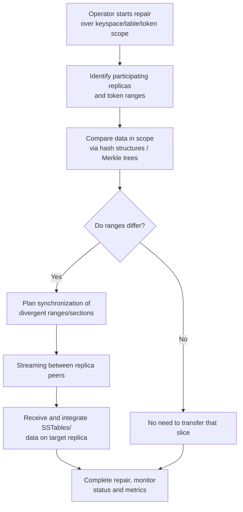
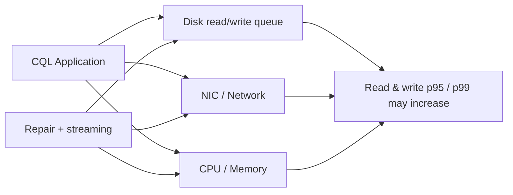
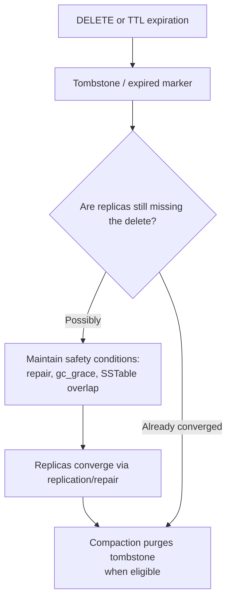

# Streaming Missing Data and Network/Disk Costs

**Chapter:** Replica Synchronization  
**Module:** `DATABASE_ENGINE_WIDE_COLUMN_CASSANDRA` — Apache Cassandra

Apache Cassandra distributes partitions by token and stores multiple **replicas** depending on the replication factor (RF). A write acknowledged by the coordinator at the chosen consistency level does not necessarily exist on **every replica** at the instant it replies. If a node loses connectivity, token ownership changes, a node is added, or synchronization is needed after a failure, Cassandra may need to **stream data** between nodes to bring replicas into a consistent state.

Within this module, we study Cassandra's distributed architecture and wide-column model, partition keys, query-driven table design, read/write consistency levels, replication, compaction, repair, failure recovery, and Java connectivity. This lesson dives into the operational question: **what data needs to be made up, when does Cassandra use streaming, and how does transfer volume affect network, disk, and application latency?**

Streaming is not a CQL command invoked by an application when reading a row. It is an inter-node operational mechanism used by workflows such as **repair**, **bootstrap**, **rebuild**, and topology changes. Do not equate streaming with the commit log, hinted handoff, or normal read queries.

## 1. Learning Outcomes

After this lesson, you will be able to:

1. Distinguish **missing data on a replica** from **logically nonexistent data**.
2. Explain the roles of replication factor, consistency level, hinted handoff, read repair, and anti-entropy repair.
3. Describe the workflow of comparing data ranges, identifying divergence, and transferring missing data via streaming.
4. Distinguish streaming caused by **repair** from streaming caused by **bootstrap/rebuild/decommission**.
5. Estimate network transfer, disk read/write, free capacity, I/O contention, and p95/p99 latency costs.
6. Run a three-replica experiment with one absent node, read state, and observe `nodetool netstats` during repair.
7. Schedule repair/streaming, monitor progress, handle errors, and avoid overloading the cluster.
8. Understand how compaction, tombstones, TTLs, and `gc_grace_seconds` relate to proper synchronization.

> **Scope:** Examples target Apache Cassandra 4.1/5.x, specifically a three-node single-datacenter topology. Depending on version and distribution, streaming protocol details, progress reporting, zero-copy features, throttle settings, and `nodetool` option syntax may vary. Check `nodetool help` and exact version docs before applying outside the lab.

## 2. Why Is Catch-Up Data Transfer Needed When Replication Already Exists?

Suppose a keyspace uses `NetworkTopologyStrategy` with RF = 3 in a single datacenter:

```text
Partition: sku-001

Replica A: stock = 15, version = 2
Replica B: stock = 15, version = 2
Replica C: stock = 20, version = 1   (missed the update)

W = LOCAL_QUORUM: requires 2 replicas to write successfully in the DC
R = LOCAL_QUORUM: requires 2 replicas to respond for a read in the DC
```

Replicas A and B may have received a new mutation while replica C was disconnected and still holds the old value. If the client wrote successfully at `LOCAL_QUORUM`, the system satisfied the **requested consistency level**, without promising all replicas converged immediately.

When C comes back online, Cassandra can catch it up via different mechanisms. If hinted handoff successfully replayed all missed mutations, the next repair may find **no divergence** and stream zero data. If hints expired/could not be stored or the node missed data over a prolonged outage, anti-entropy repair can detect and synchronize the differences.

### 2.1. Mechanism Comparison Table

| Mechanism | When It Occurs | What It Does | Must Not Be Inferred |
| --- | --- | --- | --- |
| **Replication** | Every normal mutation | Writes to replicas per topology and CL | A quorum ACK does not mean every replica already holds new data. |
| **Hinted handoff** | A replica temporarily misses writes, if hints are created and retained | Another node stores a hint and replays later | Hints are not long-term replicas and do not replace periodic repair. |
| **Read repair** | Certain reads detect discrepancies within the read data scope | May repair data among participating read replicas per version/config | Does not guarantee scanning and fixing unread partitions. |
| **Anti-entropy repair** | Proactive operational workflow | Compares data ranges and syncs divergence across replicas | Not a way to automatically turn every write into a transaction. |
| **Streaming** | Data transfer phase of repair, bootstrap, rebuild, or topology changes | Transfers SSTable components or sections between nodes | Cannot predict exact transferred bytes solely from missing logical row counts. |
| **Compaction** | Background job on each individual replica | Merges SSTables, processes versions/tombstones when safe | Does not compare or repair data across different nodes. |

**Consistency of a single query** and **physical synchronization across replicas** are two separate questions. With RF=3, `LOCAL_QUORUM` can still return valid data from two live replicas while the third lags; `ONE` may hit the stale replica. A successful client read does not prove all three nodes' disks hold the new mutation.

## 3. How Repair Leads to Streaming Missing Data

An anti-entropy repair typically follows these stages. Exact order and components vary by version, yet the overall meaning holds:



### 3.1. Token Ranges and Replicas

Cassandra uses a partitioner to map partition keys to tokens. In `inventory_by_sku`, keys `sku-001` and `sku-002` can land on different tokens. A token's replica set depends on replication strategy, topology, snitch, and ownership.

A node executing repair coordinates with replicas sharing the ranges it repairs. It does not necessarily read/write just one partition or one SSTable. "Repairing a table" does not mean "copying the whole table from node A to node B."

**Note:** Each datacenter can have its own RF. With multiple datacenters, repair scope and cross-DC traffic must be planned deliberately. Avoid assuming a single repair on one node automatically covers every token range and datacenter cluster-wide.

### 3.2. Merkle Tree Comparison Is Not Row-by-Row Network Diffing

Cassandra can build Merkle tree hash structures over token ranges to locate divergent regions. If corresponding hashes differ, the system plans synchronization for the relevant data.

The advantage is **avoiding sending every row as SELECT queries for one-to-one comparison**. However:

- Nodes still must read the required data to build/compare repair structures.
- Hash-partition granularity and streaming mechanics can cause transferred volume to be **much larger** than a few changed cells.
- Zero streaming may occur if compared replicas have already converged.
- Repair is distributed work; participating nodes must be healthy with network and disk headroom.

For example, only a few differing rows does not guarantee only a few kilobytes are transferred. Actual stream volume depends on range splits, SSTable layout, replica count, version, and data state.

### 3.3. How Does Streaming Transfer Data?

When discrepancies exist, peers establish **stream sessions**. The sending node reads the required data; the receiving node writes it to storage and integrates it into the read path. On supported versions/paths, **zero-copy streaming** can reduce deserialization/reserialization overhead; that does not mean bandwidth, CPU, or disk I/O drops to zero.

Distinguish three quantities:

- **Logical difference:** the actual rows/cells/tombstones differing between replicas.
- **Transferred bytes:** protocol bytes sent over the network for streams, including SSTable sections, metadata, and overhead.
- **Disk I/O:** bytes read from source disks and written on targets, plus secondary activity from compaction, caches, and the filesystem.

These three quantities **are not necessarily equal**. Evaluate repair using stream statistics and metrics rather than guessing from application row counts.

## 4. How Repair Streaming Differs from Bootstrap/Rebuild

Both use the streaming protocol, yet their goals and data volumes differ.

| Scenario | Goal | What Transfer Volume Depends On |
| --- | --- | --- |
| **Repair** | Fix divergent data among replicas for relevant ranges | Actual divergence, repair scope, comparison algorithm, and SSTable format |
| **Bootstrap** when adding a node | Populate newly owned data onto the joining node | Token ranges assigned to the new node, RF, existing data, and topology |
| **Rebuild** | Rebuild a node's data from a specified source scope/datacenter | Data to re-receive, node state, sources, and execution mode |
| **Replace node** | Replace a failed replica with a new node | Data of the replica being recovered, topology, and available peers |
| **Decommission / topology change** | Hand off storage ownership when a node leaves or tokens shift | Shifting ownership ranges and data peers must absorb |
| **Hinted handoff** | Catch up mutations from when a node could not accept writes | Mutations with valid hints; **distinct** from repair's SSTable streaming protocol |

For instance, **adding a node** can stream huge volumes even with zero "wrong" data across existing replicas. Conversely, repairing a healthy cluster may spend substantial I/O validating yet **transfer very few bytes**.

Topology operations carry their own rules regarding racks, snitches, tokens, seeds, and bootstrap eligibility. This lesson focuses on reading streaming costs, not wiping data directories or replacing nodes arbitrarily.

## 5. Modeling Network, Disk, and Time Costs

### 5.1. Network Bandwidth

Let:

- `B_wire`: total bytes actually transferred over streaming connections during the observed window.
- `V_net`: **effective** network throughput available for streaming after subtracting application traffic, connection limits, and protocol overhead.
- `T_net`: minimum network-bound duration.

Estimate:

\[
T_{\mathrm{net}} \gtrsim \frac{B_{\mathrm{wire}}}{V_{\mathrm{net}}}
\]

This formula does not predict total completion time: data validation, planning, resource queueing, disk read/write, and concurrent sessions add latency. Inspect **each bottleneck link/node**: summing cluster-wide bandwidth and dividing total bytes can hide a weak source node or slow inter-DC link.

**Planning example (hypothetical):** 60 GiB total must cross a bottleneck link with 75 MiB/s effective throughput. Network transfer alone is bounded by roughly:

\[
\frac{60 \times 1024\ \mathrm{MiB}}{75\ \mathrm{MiB/s}}
=819.2\ \mathrm{s}\ \approx 13.7\ \mathrm{minutes}
\]

That is only the **ideal network floor**, excluding validation time, client load, disk I/O, retries, and tail latency. With multiple parallel streams, what matters is aggregate traffic across the **shared link**, not one session's rate.

### 5.2. Disk I/O and Free Space

On the sending replica, repair may need **reads for comparison** and **reads for streaming**. On the receiving replica, incoming data must be **written to disk**, followed by compaction or secondary writes.

With:

- `B_read`: actual bytes read on sources and validating nodes.
- `B_write`: actual bytes written on targets and by secondary tasks.
- `V_read`, `V_write`: effective disk throughput while sharing workload.

Use the rough bound:

\[
T_{\mathrm{I/O}} \gtrsim
\max\left(\frac{B_{\mathrm{read}}}{V_{\mathrm{read}}},
          \frac{B_{\mathrm{write}}}{V_{\mathrm{write}}}\right)
\]

Actual runtime can be longer due to random I/O, I/O wait, queue depth, compaction, memtable flushes, and other bottlenecks. **Do not** mechanically add or subtract the two formulas to declare exact repair time; measure each stage and bottleneck.

Regarding disk space:

- Targets need room for incoming streamed data, plus temporary files and coexisting files during compaction.
- Sources may also need headroom for compaction to run safely while streaming.
- Snapshots, local backups, uncollected old SSTables, and other tables all share the same volume.
- Monitor **per-node free disk**, not just cluster-wide average free percentage.

For example, a node with 40 GiB free expecting to receive 60 GiB is **unsafe** even before accounting for temporary overhead. There is no universal "always need 2x" multiplier for every case: budget based on expected receive size, compaction strategy, concurrent write rate, and specific reserve requirements.

### 5.3. Why Can Repair Raise Application p99 Latency?

When repair/streaming runs concurrently with application queries, resources are shared:



Even with spare network capacity, long disk read queues slow queries down. Conversely, healthy disks with a saturated inter-DC link still drag repair out. Measure **bandwidth, disk, CPU, compaction backlog, client latency**, and stream progress together.

## 6. Setting Up a Three-Node, RF=3 Lab

Use a test cluster only. Assume three Cassandra containers named `cassandra1`, `cassandra2`, and `cassandra3` in the same datacenter `datacenter1`. If running Cassandra differently, substitute the equivalent commands on real nodes.

### 6.1. Verify Topology

In the Docker host terminal:

```bash
docker exec cassandra1 nodetool status
docker exec cassandra2 nodetool status
docker exec cassandra3 nodetool status
docker exec -it cassandra1 cqlsh
```

In `cqlsh`:

```sql
SELECT data_center, release_version FROM system.local;
```

Proceed only once all three nodes show `UN` (Up/Normal) in the expected datacenter. If `data_center` is not `datacenter1`, update the name in `CREATE KEYSPACE` below. RF=3 on three nodes makes quorum easy to observe in a lab; it is not an automatic production prescription.

### 6.2. Create the Experiment Table

```sql
CREATE KEYSPACE IF NOT EXISTS lab_replica_stream
WITH replication = {
  'class': 'NetworkTopologyStrategy',
  'datacenter1': 3
}
AND durable_writes = true;

CREATE TABLE IF NOT EXISTS lab_replica_stream.inventory_by_sku (
    sku text PRIMARY KEY,
    stock int,
    version bigint,
    updated_at timestamp
);
```

In this table:

- `sku` is the partition key. Each SKU forms one logical partition.
- `stock` and `version` are business values and versions **managed by the application**. The `version` column does not create transactions or CAS on its own.
- `updated_at` is an observational timestamp field; it **does not** replace internal timestamps governing how Cassandra reconciles cells.
- RF=3 places all three nodes as replicas for every partition in a three-node DC, given the assumed topology.

Seed initial data:

```sql
CONSISTENCY LOCAL_QUORUM

INSERT INTO lab_replica_stream.inventory_by_sku
    (sku, stock, version, updated_at)
VALUES ('sku-001', 20, 1, '2026-11-21T02:00:00Z');

INSERT INTO lab_replica_stream.inventory_by_sku
    (sku, stock, version, updated_at)
VALUES ('sku-002', 40, 1, '2026-11-21T02:00:00Z');

INSERT INTO lab_replica_stream.inventory_by_sku
    (sku, stock, version, updated_at)
VALUES ('sku-003', 60, 1, '2026-11-21T02:00:00Z');

SELECT sku, stock, version, updated_at
FROM lab_replica_stream.inventory_by_sku
WHERE sku = 'sku-001';
```

The CQL above creates minimal data—great for tracing code paths and logical results, but **not** enough to sustain a stream long enough to measure throughput. Throughput benchmarks require substantial data volume and controlled load.

## 7. Experimenting with a Replica Missing Mutations

### 7.1. Inducing Failure While Two Replicas Stay Up

Stop only the third node in the lab:

```bash
docker stop cassandra3
docker exec cassandra1 nodetool status
```

Wait for the cluster to mark `cassandra3` unreachable. Open `cqlsh` on a live node (e.g., `cassandra1`) and use `LOCAL_QUORUM`:

```sql
CONSISTENCY LOCAL_QUORUM

UPDATE lab_replica_stream.inventory_by_sku
SET stock = 15, version = 2, updated_at = '2026-11-21T02:05:00Z'
WHERE sku = 'sku-001';

UPDATE lab_replica_stream.inventory_by_sku
SET stock = 35, version = 2, updated_at = '2026-11-21T02:05:00Z'
WHERE sku = 'sku-002';

SELECT sku, stock, version
FROM lab_replica_stream.inventory_by_sku
WHERE sku = 'sku-001';
```

With RF=3 in one DC, `LOCAL_QUORUM` can receive ACKs if **the two surviving replicas** respond. Record the actual response, including timeouts or unavailable errors; never assume success before seeing output.

While node 3 is stopped:

```sql
CONSISTENCY ALL

-- Attempt reading at ALL when only two replicas remain:
SELECT sku, stock, version
FROM lab_replica_stream.inventory_by_sku
WHERE sku = 'sku-001';
```

Reading at `ALL` typically fails due to the missing replica response. **This error does not mean data was lost.** It shows required CL availability cannot be met at that moment.

### 7.2. Recovering the Node and Evaluating State

In the terminal:

```bash
docker start cassandra3
docker exec cassandra1 nodetool status
docker exec cassandra3 nodetool status
```

Wait for node 3 to return to `UN`. Hints may have replayed when the node came back, converging replicas **before repair**. Replay speed and hint retention depend on configuration and downtime duration.

Read each key again at `LOCAL_QUORUM`:

```sql
CONSISTENCY LOCAL_QUORUM

SELECT sku, stock, version
FROM lab_replica_stream.inventory_by_sku
WHERE sku = 'sku-001';

SELECT sku, stock, version
FROM lab_replica_stream.inventory_by_sku
WHERE sku = 'sku-002';
```

Expected logical state after the two ACKed UPDATEs: `sku-001.stock = 15`, `sku-002.stock = 35`, and `version = 2`, assuming no concurrent writes. Even when queries return the expected result, **you cannot conclude every replica on disk has converged** from these two SELECTs.

> **Important:** `cqlsh` connected to `cassandra3` still uses that node as coordinator and can read other replicas per coordination mechanics; it is **not** a tool that forces reading directly from node 3's local SSTables. To prove physical state on a specific replica, use diagnostics/tracing and SSTable tools appropriate for your version.

## 8. Observing Actual Repair and Streaming

### 8.1. Using Two Terminals to Watch Progress

Once all nodes are healthy, in **terminal A** run a full repair on the lab table from the recovered node:

```bash
docker exec cassandra3 nodetool repair --full lab_replica_stream inventory_by_sku
```

In **terminal B**, while terminal A is still running, observe:

```bash
docker exec cassandra3 nodetool netstats
docker exec cassandra1 nodetool netstats
docker exec cassandra2 nodetool netstats

docker exec cassandra3 nodetool compactionstats
docker exec cassandra3 nodetool tablestats lab_replica_stream.inventory_by_sku
```

`--full` syntax illustrates Cassandra releases supporting that flag. Check `nodetool help repair` for your version; full and incremental repair differ in examined data scope and repaired/unrepaired metadata. This command is an **I/O-impacting admin operation**; run it only on the lab cluster for this exercise.

`nodetool netstats` displays active sending/receiving sessions, files/sections, and transfer progress while streaming runs. Seeing no active streams is also valid if repair found zero differences or hints already caught the node up. A repair on a table with only a few rows often finishes too fast for terminal B to catch it mid-stream.

### 8.2. "Repair Ran" Does Not Mean "Bytes Streamed"

An experiment can yield three outcomes:

| Outcome | Possible Explanation | Next Verification |
| --- | --- | --- |
| Repair finishes, `netstats` shows no stream | Hints caught up, replicas matched, or stream finished before inspection | Inspect repair logs, interval metrics, and post-repair state. |
| Streams sent/received observed | Data/ranges needed transfer during observation | Record source/target nodes, bytes, duration, throughput, disk usage. |
| Repair fails or hangs | Unstable node/network, I/O overload, resource shortage, or other error | Preserve logs and errors; check health, compaction, disk/network before retrying. |

Never declare "I reproduced streaming" solely because `nodetool repair` succeeded. On tiny labs, generate larger data volume or use a dedicated **new-node bootstrap** test if the goal is observing sustained streams—while ensuring sufficient resources.

### 8.3. Quantifying Heavy Streaming

In a **separate** test cluster, you can add a new node via bootstrap configured with proper topology/RF. As the new node takes over token ranges, Cassandra must stream the data it will own. Measure `netstats` on sources and target, total received bytes, throughput, read/write latency, and free disk.

Never delete the data directory of a live node to force streaming: doing so can destroy state/token identity and disrupt the cluster. Node replacement must follow `replace/rebuild/bootstrap` procedures matching your version and deployment.

## 9. Post-Repair Consistency: What to Observe, What to Conclude

### 9.1. Quorum Reads Return Right Data, Not a Replica Audit

With RF=3 in one DC:

| Read CL | Required Responses | Key Caveat |
| --- | --- | --- |
| `ONE` | One replica | May hit stale data if the chosen replica has not converged. |
| `LOCAL_QUORUM` | Two replicas in the DC | Combined with write quorum and no concurrent writes, typically observes ACKed mutations. |
| `ALL` | All three replicas | Fails easily when one replica is down/slow; does not imply logical data loss. |

Never treat a successful `ALL` read as a full test across every partition in a keyspace. A few queries verify only the queried keys. Repair/streaming must be evaluated by **ranges**, tables, datacenters, replicas, and operational metrics.

### 9.2. Repair Does Not Override Conflict Resolution Rules

When two replicas hold differing values, Cassandra reconciles mutations by cell timestamp and tombstone rules. Repair delivers missing mutations; it **does not** know which value is "business-correct" if the application sent bad timestamps, had concurrent writes, or performed out-of-order updates.

For example, a mutation with a future timestamp can beat a business-newer mutation, making it look like "repair corrupted the data." The root cause lies in how writes and timestamps were generated; streaming merely propagates state Cassandra considers valid.

For traceability, log `request ID`, keys, values, CL, client timestamps (if explicitly set), error types, and timestamps. Never blindly overwrite data without understanding timestamp ordering.

## 10. Full Repair, Incremental Repair, and Anti-Compaction

Cassandra distinguishes **repaired** and **unrepaired** SSTables in incremental repair; depending on version, metadata/state for pending repairs also exists. **Anti-compaction** can split/mark SSTables to track data already covered by incremental repair.

| Mode | Idea | Cost Considerations |
| --- | --- | --- |
| **Full repair** | Compares all data in the chosen scope, including data marked repaired per version logic | Can read/compare huge volumes; schedule deliberately. |
| **Incremental repair** | Focuses on data not yet repaired per version mechanics; tracks repaired/unrepaired state | Requires understanding schedule, pending sessions, anti-compaction, and disk/compaction impact. |
| **Partial-scope repair** | Repairs only a token range, datacenter, table, or primary ranges per command flags | Can omit ranges if one invocation is mistaken for cluster-wide repair. |

**Do not** infer that "incremental repair only sends new cells" or "full repair definitely streams the whole table." Both still validate and stream only what is determined out of sync, with actual costs depending on implementation.

When scheduling operations:

- Be explicit about **which keyspace, table, ranges, datacenter, and nodes** you are repairing.
- Check how your exact Cassandra version defines default repair mode; do not rely on commands from a different release.
- Avoid launching many heavy repairs concurrently without assessing I/O, network, and contention.
- Afterward, inspect logs/job status to confirm genuine completion; a disconnected terminal neither proves failure nor success.

## 11. Tombstones, TTLs, and Data Resurrection Risk

Suppose replicas A and B processed a `DELETE` or TTL expiration, while offline replica C still holds the old value. Cassandra must retain deletion metadata long enough to prevent "old data coming back to life" when C returns.



`gc_grace_seconds` is part of the safety condition giving tombstones time to reach missed replicas. **Never** lower grace solely to cut disk usage unless repair cadences and offline-node handling guarantee safety. An old replica returning after tombstones were purged can resurrect deleted data.

Similarly, TTL is **logical expiration**; SSTables are not deleted the instant TTL expires. Compaction purges expired data once related safety conditions and timing align.

**Repair, streaming, and compaction solve different tasks:**

- Repair compares replicas, detects divergence, and drives convergence.
- Streaming transfers data to bring replicas into target state.
- Compaction organizes and purges data inside each replica's local SSTables.

If a node has been absent too long, apply version-appropriate recovery/replace procedures and evaluate tombstone safety rather than letting it rejoin and assuming data is accurate.

## 12. Rate Limiting and Safe Scheduling

Streaming shares the network with CQL queries and competes for I/O with compaction. Cassandra provides configurable throughput/rate limits depending on version; inspect current settings before changing anything.

On a host with `nodetool`:

```bash
nodetool help getstreamthroughput
nodetool help setstreamthroughput
nodetool help getinterdcstreamthroughput
nodetool help setinterdcstreamthroughput
```

Inter-DC commands may be absent on some releases or differ in names/units/options. **Never** plug in a throttle value from a blog post; verify units (MiB/s, Mb/s, or version-specific representation), actual per-node throughput, and aggregate stream counts.

Scheduling workflow:

1. Capture baseline application load, p95/p99 latency, CPU, disk I/O wait, network saturation, and compaction backlog.
2. Estimate potential stream volume and identify which nodes will both send and receive.
3. Pick low-traffic windows; avoid overlapping multiple heavy repairs/bootstraps on the same peers or congested links.
4. Set throttles based on sustainable streaming bandwidth while reserving headroom for client traffic.
5. Watch `netstats` progress and infrastructure metrics throughout. If application p99 degrades, adjust per runbook/version.
6. Confirm repair completed with zero errors before closing the operational window.

**Do not kill processes or force flushes/compactions arbitrarily** to speed up slow streams. Uncontrolled intervention can force job restarts and multiply I/O load.

## 13. Streaming Cost Measurement Log

A useful report connects **data transferred** with **application impact**:

| Field to Record | Example Content (Not Real Measurements) |
| --- | --- |
| Event | Repair table `inventory_by_sku` after node3 downtime |
| Topology | 3 nodes, 1 DC, RF=3 |
| Range / table | `lab_replica_stream.inventory_by_sku`, selected repair scope |
| App read/write CL | LOCAL_QUORUM / LOCAL_QUORUM |
| Sender / receiver nodes | cassandra1 → cassandra3 (if session actually occurred) |
| Total streamed bytes | *Measured from netstats/metrics/logs* |
| Read/write I/O | *Measured from node metrics* |
| Min free disk | *Measured per node, especially receiver* |
| Pending compactions | *Before / during / after* |
| Read p95/p99 | *Before / during / after* |
| Total job duration | *From log/monitoring timestamps* |
| Outcome | Completed / failed / requires follow-up |

Never invent byte counts in measurement reports. If `netstats` showed nothing because the job finished too quickly, record accurately "no active stream observed" and use logs/metrics at suitable resolution to verify.

### 13.1. A Meaningful Result Interpretation Table

| Observation | Correct Interpretation | Next Action |
| --- | --- | --- |
| Repair finishes very fast, 0 bytes streamed | Replicas may already be converged; or dataset tiny / caught up by hints | Check health and logs; do not force artificial transfers. |
| Low network rate, disk read at 100% | Disk may be the bottleneck | Inspect I/O wait, read queues, and compaction load. |
| Source sends fast, destination disk nearly full | Risk of stream/compaction failure from missing headroom | Halt further expansion plans; handle capacity per runbook. |
| Received bytes exceed differing cell sizes | Streaming operates on ranges/files with overhead | Review version mechanics and section/file counts. |
| Client reading at ONE differs from LOCAL_QUORUM | One replica may still be stale or experiencing concurrent writes | Correlate timing, CL, repair/hints; avoid concluding from one read. |
| p99 spikes during repair despite spare network | Disk/CPU/compaction contention | Adjust scheduling/throttling and pinpoint the bottleneck. |
| Repair errors mid-run | Sync is incomplete for intended scope | Preserve logs/job IDs, inspect nodes, and resume per runbook. |

## 14. Java Example: Reconciling Logical Results, Not Controlling Streaming

A Java Driver 4.x application can verify data state at a specified consistency level, yet normal CQL APIs **do not** replace administrative repair/streaming tasks.

Example reading two SKUs after node recovery and repair execution:

```java
import com.datastax.oss.driver.api.core.CqlSession;
import com.datastax.oss.driver.api.core.DefaultConsistencyLevel;
import com.datastax.oss.driver.api.core.cql.PreparedStatement;
import com.datastax.oss.driver.api.core.cql.Row;

import java.util.List;

public final class ReplicaReadCheck {
    public static void verify(CqlSession session) {
        PreparedStatement read = session.prepare(
            "SELECT sku, stock, version " +
            "FROM lab_replica_stream.inventory_by_sku " +
            "WHERE sku = ?"
        );

        for (String sku : List.of("sku-001", "sku-002")) {
            try {
                Row row = session.execute(
                    read.bind(sku)
                        .setConsistencyLevel(
                            DefaultConsistencyLevel.LOCAL_QUORUM)
                ).one();

                if (row == null) {
                    System.out.println(sku + ": no row returned");
                    continue;
                }

                System.out.println(
                    row.getString("sku") +
                    " stock=" + row.getInt("stock") +
                    " version=" + row.getLong("version")
                );
            } catch (RuntimeException ex) {
                // This is a request error, not proof the row is missing.
                System.err.println(sku + ": read error: " + ex);
            }
        }
    }
}
```

In the lab, if both UPDATEs were ACKed with no concurrent writes, expected output is:

```text
sku-001 stock=15 version=2
sku-002 stock=35 version=2
```

This is **logical read evidence at the chosen CL**, not an audit of physical contents across every replica. To verify streamed bytes and system-level convergence, operations must combine repair logs, `nodetool netstats`, metrics, and replica state.

If the application retries after `WriteTimeoutException`, ensure operations are idempotent. Writing `stock = 15` on the same key can be retried per appropriate business rules; `stock = stock + 1` is not a regular integer CQL UPDATE and counters have distinct retry semantics. **Never assume repair/streaming automatically undoes business bugs caused by duplicate client submissions.**

## 15. Real-World Diagnostic Scenarios

### Case A — Node Comes Back Up, QUORUM Query Sees Right Data, While `netstats` Shows No Stream

This can be completely normal: the coordinator already wrote two replicas beforehand, the recovering node received hints, or repair found zero divergence. One clean quorum SELECT does not prove the third node converged; conversely, `netstats` showing no active stream does not prove repair didn't run. Evaluate via time-correlated logs and metrics.

### Case B — Streaming Is Very Slow During New-Node Bootstrap

Source nodes may simultaneously serve queries, compact, and stream; the target node simultaneously writes incoming data and builds local structures. Cross-DC or cross-rack links can add congestion. Check throughput limits, I/O, and per-node health before raising rates. Raising speed past disk limits can spike application p99 and destabilize the job.

### Case C — Target Node Runs Out of Disk While Receiving Data

Volume forecasts omitted existing SSTables, compaction overhead, snapshots, and ongoing ingest. Audit actual disk usage, throttle/reschedule or add capacity per procedure; never delete SSTables manually. Repair needs sufficient space for both existing data and metadata.

### Case D — Repair Ran, Yet Business Values Are Still "Wrong"

If the application wrote an old value with a **larger write timestamp** than the newer value, Cassandra treats the older business mutation as the winner. Repair converges replicas per Cassandra semantics rather than guessing business intent. Inspect timestamps, concurrent writes, TTL/tombstones, idempotency rules, and source data before writing corrective updates.

### Case E — Many Tombstones Observed; Tempted to Lower `gc_grace` to Stream Less

Lowering grace can allow tombstones to be purged before an old replica receives deletions, increasing resurrection risk. That is not a default lever for reducing stream size. Address repair schedules, node downtime, TTL/compaction, and retention policies safely.

### Case F — Multiple Datacenters, High Egress Cost

Cross-DC streaming impacts bandwidth billing, latency, and WAN links. Evaluate per-DC RF, source/target placement, topology-appropriate repair modes, inter-DC bandwidth, and operational schedules. Never use single-DC cluster measurements to forecast WAN costs.

## 16. Reasoning Exercises and Practical Checklist

### Exercises

1. With RF=3, W=`LOCAL_QUORUM`, and one replica stopped during a write: when the client gets success, what data may still differ across replicas?
2. When the node recovers, why might `hinted handoff` leave repair with zero bytes to stream? Why is a repair policy still required?
3. When only a single cell differs, why can transferred bytes exceed that cell's byte size?
4. Distinguish `repair` streaming from `bootstrap` streaming: can a perfectly consistent cluster require bootstrap streaming?
5. Does a single `LOCAL_QUORUM` `SELECT` returning the right value prove all three replicas have identical SSTables on disk?
6. If 60 GiB must transfer across a 75 MiB/s effective link, what is the network-only minimum time bound? Which factors lengthen total duration?
7. When source disk I/O is near saturation while the NIC still has headroom, will raising streaming throughput definitely shorten the job?
8. If deleted records are cleaned up by purging tombstones too early, what risk can an old returning replica create?
9. How does incremental repair differ from full repair? Why should you not assume incremental always transfers fewer bytes on **every run**?
10. If an app writes `stock = 15` and fails before receiving a response, is it repair's job to decide whether 15 is business-valid?
11. Why does connecting `cqlsh` to a specific replica not prove that node's physical data has converged?
12. With two datacenters, what additional factors enter into estimating streaming costs and scheduling repairs?

### Checklist Before Running Repair/Streaming on Live Systems

- [ ] Confirm exact goal: **repair divergent data** vs. **ownership change / node recovery**.
- [ ] Inspect topology, datacenters, racks, replication factors, token ownership, and node health.
- [ ] Specify exact keyspace, table, ranges, repair mode, and datacenter scope.
- [ ] Read `nodetool help repair` and **exact version docs**, especially for `--full`/incremental and throughput throttles.
- [ ] Measure baseline read/write p95/p99, disk I/O, CPU, network, compaction backlog, and per-node free space.
- [ ] Estimate incoming bytes and headroom for existing SSTables/compaction.
- [ ] Pick low-load windows and avoid overlapping too many repairs/bootstraps on shared peers/links.
- [ ] Monitor `nodetool netstats`, logs, bytes sent/received, throughput, and client latency.
- [ ] Distinguish **a job that streamed nothing because data matched** from **a job that didn't run or failed**.
- [ ] Never force flushes/compactions or lower `gc_grace_seconds` to "clean up" immediately.
- [ ] Afterward, confirm success reports and verify logically with appropriate CL queries; use dedicated diagnostics when physical replica audits are required.
- [ ] Document repaired scope, timestamps, outcomes, resource metrics, and next scheduled run.

**Remember:** **Streaming is the data transfer mechanism between replicas**, triggered when repair detects divergence or topology requires moving data. **Differing row counts do not directly determine streamed bytes**, and transfer completion alone does not capture cost without measuring read/write I/O, free disk, compaction, and p99 latency. Distinguishing hints, repair, streaming, and consistency levels lets you catch up replicas accurately while keeping network and disk load under control.
