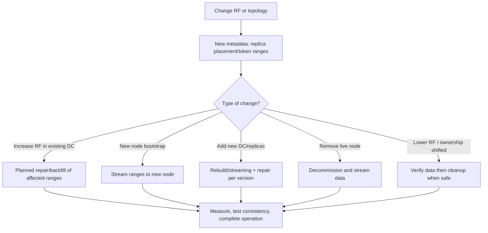
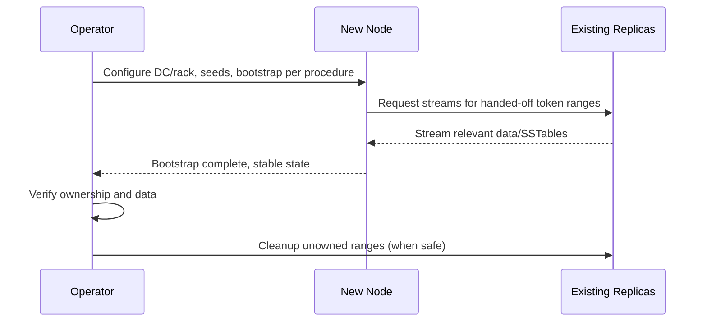
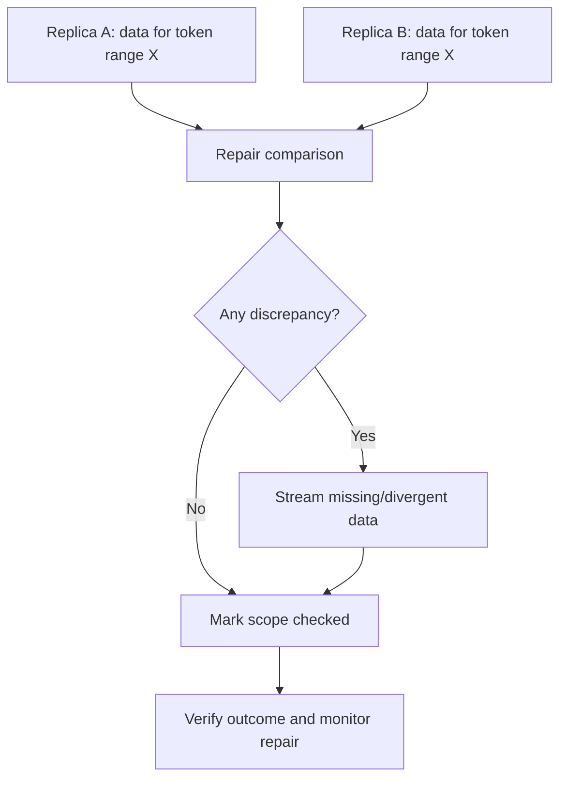

# Changing Replication Factor or Topology and Data Synchronization Requirements in Apache Cassandra

## 1. Why Is Changing RF or Adding a Node More Than Changing One Number?

In **Apache Cassandra**, a partition's data is placed on a set of **replicas** determined by token, topology (data center/rack), and the keyspace's **replication strategy**. Each replica stores data in its own commit log, memtables, and SSTables; replicas do not automatically become byte-for-byte identical copies at every instant. Cassandra is a distributed system whose read/write consistency level is chosen per request, while **repair** and **streaming** deliver historical data to the right replicas and reconcile differences.

Therefore:

- **Changing the replication factor (RF)** alters how many replicas are *expected to own* a token range in the keyspace.
- **Changing topology** (adding, replacing, removing nodes, adding a data center) can alter *which nodes* own that token range.
- **Updating schema/topology does not mean all historical data has been transferred, reconciled, and made safe to read** on new replicas.

This lesson belongs to the **Replica Synchronization** chapter of the `DATABASE_ENGINE_WIDE_COLUMN_CASSANDRA` module, spanning wide-column architecture, partition keys, query-driven table design, consistency levels, CQL, replication, compaction, repair, troubleshooting, and Java applications. The focus here is planning **data movement, repair, cleanup, and verification** when RF or topology changes.

### Objectives

After this lesson, learners can:

1. Explain the differences among **ownership**, **placement**, **RF**, **streaming**, **repair**, and **cleanup**.
2. Plan RF increases/decreases within a DC and assess the impact on `LOCAL_QUORUM`.
3. Distinguish **node bootstrap**, **decommission/removenode**, **replacement**, and **adding a DC**.
4. Know which step distributes historical data, which changes only metadata, and how to verify data synchronization.
5. Operate safely by protecting data integrity, maintaining disk headroom, limiting Java application impact, and preparing rollback plans.

## 2. Concepts to Distinguish

| Concept | Meaning | Must Not Be Confused With |
| --- | --- | --- |
| **RF (replication factor)** | Number of copies Cassandra intends to place per token range in a DC/keyspace per strategy | Total nodes in the cluster; number of replicas that already hold full history |
| **Token ownership / replica placement** | Which nodes are responsible for holding data in each token range | Bytes on disk; state of replica convergence |
| **Bootstrap / streaming** | Transferring required data ranges when a new node joins or topology shifts | Repairing all historical divergence |
| **Repair (anti-entropy)** | Comparing replica state across token ranges and streaming missing/divergent data | Local compaction or schema edits alone |
| **Cleanup** | Removing data a node no longer owns after valid ownership changes | A command to run immediately right after lowering RF |
| **Compaction** | Merging SSTables on a single node, reclaiming eligible data | Synchronizing data across nodes |
| **Hinted handoff** | Best-effort delivery of missed writes for a temporarily absent replica within config limits | A full backfill mechanism after RF/topology changes |
| **Read repair** | Reconciling discrepancies detected on eligible read paths | A repair schedule covering all token ranges |

**Replication does not fix a static consistency level.** An RF = 3 keyspace can still serve queries at `ONE`, `LOCAL_QUORUM`, or other levels; RF defines the replica set and quorum requirements, whereas CL defines how many and what kind of responses complete a request.

### How Is Placement Determined?

Suppose a keyspace uses `NetworkTopologyStrategy`:

```sql
CREATE KEYSPACE inventory
WITH replication = {
    'class': 'NetworkTopologyStrategy',
    'dc1': 3,
    'dc2': 2
};
```

With this illustrative configuration, Cassandra aims to place **three replicas in `dc1`** and **two replicas in `dc2`** for every token range, respecting topology/racks and cluster capacity. Each partition key is hashed by the partitioner into a token; not every node holds every partition.

Minimum meaningful operational requirements include having **enough suitable nodes in each DC**, accurate topology/snitch configuration, and rack/fault-domain planning. Setting RF higher than usable nodes in a DC does not conjure physical replicas out of thin air. Check actual Cassandra version behavior and placement/availability errors rather than trusting a successful `ALTER KEYSPACE` alone.

## 3. Two Distinct Processes: Metadata Changes vs. Data Movement



Two illustrative examples:

1. Raising RF `dc1: 2 → 3` **does not necessarily change the token ring**. Cassandra updates the rule picking the third replica, yet the node becoming the new replica may **lack earlier writes**. An appropriate **backfill/repair** workflow is needed to deliver historical data to the new replica.
2. Adding a node to a DC with unchanged RF shifts token-range ownership. **Bootstrap/streaming** transfers data to the new node; once ownership stabilizes, older nodes may need **cleanup** for ranges they no longer own.

No single command fits **every** situation. Classify the change before choosing `repair`, `rebuild`, `decommission`, `removenode`, or `cleanup`.

## 4. RF Affects Quorums and Fault Tolerance

With `NetworkTopologyStrategy`, within **one DC**, quorum is typically:

```text
LOCAL_QUORUM_required = floor(RF_of_local_DC / 2) + 1
```

| RF in Local DC | Responses Needed for `LOCAL_QUORUM` | Replicas That Can Temporarily Fail While Others Are Healthy |
| ---: | ---: | ---: |
| 1 | 1 | 0 |
| 2 | 2 | 0 |
| 3 | 2 | 1 |
| 4 | 3 | 1 |
| 5 | 3 | 2 |

For example, lowering RF from **3 to 2** changes `LOCAL_QUORUM` from **2/3** to **2/2**. Despite fewer copies and lower target storage usage, a `LOCAL_QUORUM` workload **loses availability whenever a single replica in the local DC becomes unavailable**. That is an **availability** change, not just disk savings.

**Multi-DC considerations:**

- `LOCAL_QUORUM` computes quorum **within the local DC** to which the coordinator/driver routes.
- `QUORUM` uses the quorum of participating replicas across the entire topology, potentially involving cross-DC communication.
- `EACH_QUORUM` is used for writes aligned with the replication strategy, enforcing quorum per DC; never treat it as synonymous with `LOCAL_QUORUM`.
- If an application switches local DC, quorum requirements and latency can change even when CQL statements do not.

Never switch consistency levels mid-migration just to make p99 charts look prettier without verifying historical backfill, business requirements, and fault tolerance. **CL does not create historical data on new replicas.**

## 5. Before Changing RF/Topology: Minimum Checklist

Every topology operation should have a **change ticket**, keyspace scope, backup/recovery plan, start/end window, owner, and rollback criteria.

| Check Group | What to Verify |
| --- | --- |
| **Cluster health** | All participating nodes are healthy (`UN`); no unreachable nodes or incomplete bootstraps/removals |
| **Schema & topology** | Cassandra version, `NetworkTopologyStrategy`, per-DC RF, datacenter/rack from snitch, token ring, schema agreement |
| **Maintenance window** | No competing repairs, topology changes, large snapshots, major compactions, or heavy streaming |
| **Capacity** | Expected transfer volume, free disk, and peak temporary space on both sources and targets |
| **Network** | Intra-DC and inter-DC bandwidth and latency; link stability for streaming/repair |
| **Consistency** | Most recent repair schedule, any long-offline replicas, TTL/`gc_grace_seconds`, and tombstone risk |
| **Workload** | Read/write CLs, client local DC, QPS, p95/p99, timeouts, driver timeout/retry policies |
| **Data evidence** | Set of verification partition keys/rows written **before** the change and samples written **during/after** |

Document the exact Cassandra version because `nodetool` flags, repair strategies, and streaming/rebuild behavior can vary. The commands below illustrate a **monitored runbook**, not scripts to paste blindly into production.

## 6. Increasing RF in One DC: Why Must Old Data Be Backfilled?

### 6.1. RF 2 → 3 Experiment

Assume at least three healthy nodes in `dc1` and a lab keyspace. **Do not** run this example if the DC has only two nodes or is not named `dc1`.

```sql
CREATE KEYSPACE IF NOT EXISTS rf_lab
WITH replication = {
    'class': 'NetworkTopologyStrategy',
    'dc1': 2
};

CREATE TABLE IF NOT EXISTS rf_lab.orders_by_id (
    order_id uuid PRIMARY KEY,
    status text,
    updated_at timestamp
);

INSERT INTO rf_lab.orders_by_id (order_id, status, updated_at)
VALUES (
    11111111-1111-1111-1111-111111111111,
    'CREATED',
    '2026-11-21T00:00:00Z'
);
```

This is **historical data** created while RF = 2. Next, change metadata:

```sql
ALTER KEYSPACE rf_lab
WITH replication = {
    'class': 'NetworkTopologyStrategy',
    'dc1': 3
};
```

After `ALTER KEYSPACE`, the keyspace's replica placement rule is RF = 3, yet you cannot conclude the third node already holds every historical version of `orders_by_id`. The engine **does not automatically backfill all historical data merely from updating RF**; a range synchronization plan is required after schema agreement.

### 6.2. Full Repair for Historical Data

A common choice after **increasing RF** is running a controlled **full anti-entropy repair** across affected keyspaces/token ranges:

```bash
# Illustrated on a node designated in the plan;
# one command on one node does not implicitly cover the whole cluster.
nodetool repair -full rf_lab
```

**Critical point:** schedule repair to **cover every token range** needing backfill. When using `-pr` or splitting jobs by node/range, a single run on one node **does not mean** the whole keyspace was repaired. You can schedule primary ranges across each node per version support and runbook, but verify coverage, active repair status, and completion reports.

- **Full repair** compares data across the scope, not just SSTables marked unrepaired.
- **Incremental repair** tracks repaired/unrepaired state with specific semantics; do not assume one incremental repair suffices to populate all historical records after an RF change.
- Repair **is not compaction**. It can stream missing data and trigger I/O and subsequent compaction.
- When RF increases while writes continue, manage the transition phase, new reads/writes, and consistency. Never call it "synchronized" just because `ALTER KEYSPACE` succeeded.

### 6.3. Verification After Increasing RF

1. Confirm `system_schema.keyspaces` reflects the new RF and all nodes agree on schema.
2. Check `nodetool status rf_lab` and endpoints/token ranges where supported by version.
3. Confirm full-range repair jobs **completed** with zero errors or skipped token ranges.
4. Read and verify datasets written **before increasing RF** and samples written afterward via representative access paths/CLs.
5. Monitor replica disk usage and read/write errors/latency; nodes absorbing extra data may show uneven disk growth by token.
6. Declare completion only after **data coverage**, availability, repair, and SLA invariants all pass.

**Never rely solely on a single `SELECT` at `LOCAL_QUORUM`.** A right answer may come from the original replicas; it does not prove the **individual** new replica holds complete historical data.

## 7. Lowering RF: Evaluate Lost Fault Tolerance and Safe Data Cleanup

Suppose RF in `dc1` is lowered from 3 to 2:

```sql
ALTER KEYSPACE rf_lab
WITH replication = {
    'class': 'NetworkTopologyStrategy',
    'dc1': 2
};
```

This alters target replica placement; **it does not mean excess data on nodes is deleted immediately**. Some nodes may retain SSTables for ranges they no longer own for that keyspace.

**Conceptual runbook:**

1. Confirm the reason for lowering RF, node count in the DC, SLOs, CLs, and new fault tolerance. At RF = 2, `LOCAL_QUORUM` requires 2 replicas—unable to tolerate even one replica failure.
2. Ensure required data exists on **the remaining selected replicas**; run needed repair/sync **before removing old copies**. Verify tested backups/restores exist.
3. Change RF in schema; wait for schema agreement, observe routing and app behavior during transition.
4. After placement stabilizes and safety is verified, consider `nodetool cleanup <keyspace>` on nodes holding data they no longer own, **per version guidelines and an approved plan**. Cleanup on nodes no longer owning ranges reclaims excess data; it **does not** repair missing data on surviving replicas.
5. Monitor bytes/disk space, tombstone/repair health, and p99/timeouts; never delete SSTables manually to "achieve RF = 2."

Cleanup can consume heavy disk I/O and time; after lowering RF, total disk usage may not drop right away. If a node fails or placement is unstable, **postpone cleanup**, because premature deletion can destroy one of the few remaining copies holding historical data.

## 8. Adding a Node in an Existing DC: Bootstrap, Streaming, Cleanup

Unlike raising RF, **adding a node** changes the number of nodes sharing token ranges in the ring. With vnodes, each node owns multiple token ranges; Cassandra uses the partitioner and topology info to determine the new replicas.



High-level workflow:

1. **Preparation:** the new node must have matching cluster name, snitch/DC/rack, seeds/contacts, hardware, and networking. Bootstrap steps vary by version, `num_tokens`, and token allocation method; never pick arbitrary tokens without analyzing placement.
2. **Bootstrap:** the new node streams data for ranges it will own from existing replicas. Monitor `nodetool netstats` and logs on both the new node and stream sources.
3. **Completion:** wait for the node to reach ready state, schema agreement, and completed streaming; test reads/writes and endpoint placement.
4. **Cleanup:** after adding the node succeeds, run `nodetool cleanup` on older nodes to drop ranges they no longer own, on an appropriate schedule.
5. **Follow-up repair:** maintain repair schedules and account for any missed writes/incidents during transition; bootstrap **does not replace** long-term anti-entropy needs.

**Do not shut down or upgrade multiple nodes simultaneously** without a supported topology procedure. Streaming competes with application requests for bandwidth, disk, and CPU, so plan for elevated p99/timeouts during bootstrap.

## 9. Removing or Replacing a Node: `decommission` vs. `removenode`

| Scenario | Conceptual Procedure | Risks to Watch |
| --- | --- | --- |
| **Live** node leaving the cluster as planned | `nodetool decommission` and monitor data ownership handoff | Ensure remaining nodes have disk space and receive streams before finishing |
| **Permanently dead** node, cannot decommission | `nodetool removenode` per dead-node procedure | Never run carelessly if the node might return; risks membership churn and data loss if remaining RF/replicas are insufficient |
| Failed node needing **replacement** with same role/address | Version-specific **replace-node** procedure and data streaming | Never allow old and replacement nodes to join simultaneously with conflicting identities |
| Node returning after prolonged outage | Evaluate reset/rebuild/replace and stale data per policy | Hints are bounded; tombstones/repair may make "restarting the old box" unsafe |

Illustrative command syntax:

```bash
# Run only within a maintenance plan on a live node being removed:
nodetool decommission

# When a node is permanently dead, use node ID and version-specific procedure:
# nodetool removenode <host-id>
```

These two operations are **not interchangeable**. Decommission works with a live node to hand off ranges; removenode updates membership when the target node is dead. Replacement typically requires dedicated startup flags and may preserve identity/logical address per version. Always follow instructions for your exact Cassandra release, prioritize backups, and practice in staging.

With small RF, removal/replacement can leave a token range with **insufficient valid data sources** for full recovery. If you suspect loss of the sole copy of any data, never claim "streaming succeeded so zero data was lost"; inspect remaining replicas, backups, and recovery bounds.

## 10. Adding a Data Center: Rebuild/Backfill Before Shifting Traffic

Adding a **new DC** differs from adding a node to an existing DC. Under `NetworkTopologyStrategy`, a keyspace defines **per-DC RF**. A new DC full of healthy nodes will not automatically hold any historical records for existing keyspaces.

Suppose previously only `dc1:3` existed and you want `dc2:3` for local reads in the second DC:

```sql
-- Before change (illustrative):
-- {'class':'NetworkTopologyStrategy','dc1':3}

ALTER KEYSPACE rf_lab
WITH replication = {
    'class': 'NetworkTopologyStrategy',
    'dc1': 3,
    'dc2': 3
};
```

**Do not immediately point new clients to read `LOCAL_ONE` or `LOCAL_QUORUM` in `dc2` assuming historical data is already there.** `ALTER KEYSPACE` does not automatically copy old rows to the new DC.

### Illustrative Operational Flow

1. Provision the new DC with matching DC/rack names and seed/snitch/network configuration per topology and Cassandra version. Confirm token/membership, node health, and zero schema errors.
2. Update the replication map of **every keyspace to expand**, not just one business keyspace if apps query other tables.
3. Run **`nodetool rebuild <source_dc>`** (exact syntax/conditions vary by version) on the new DC's nodes **when appropriate for the add-DC procedure** to stream historical data from the source DC, or follow the official streaming/repair workflow. Never assume normal bootstrap backfilled every keyspace whose RF was newly expanded.
4. Monitor `nodetool netstats`, transferred bytes, stream errors, compaction, and free disk; mark complete only when data coverage per keyspace/range is verified.
5. Complete repair/full reconciliation if required by your version plan, especially if any node was offline or old data diverged.
6. **After backfill and validation:** configure the Java driver's local DC for apps running in `dc2`, test `LOCAL_QUORUM`, and shift traffic gradually with monitoring.

Before backfill completes, **do not treat `dc2` as a production-ready read region**. A successful response in one DC does not prove replicas in the other DC are complete. Safety must be verified against real data and each application's access paths.

### Conversely, Removing a DC

When decommissioning a DC from topology, migrate traffic/clients away, check keyspace RFs in surviving DCs, ensure they hold historical data and sufficient capacity, and then follow the appropriate membership/DC removal procedure. Never drop a DC from replication settings while applications still read/write in that DC; never wipe data before having a recovery plan.

## 11. Repair, Streaming, Hinted Handoff, and Read Repair: Order of Priorities

A common operational question: "If hinted handoff is enabled, do we still need repair after changing RF?" The answer is **yes—you still need a proper synchronization plan**.

### 11.1. Hinted Handoff Has Limited Scope

Hints are temporarily held by coordinators when an intended write target replica is unavailable, then replayed when system/configuration conditions permit. Hints have time, disk, and environmental limits. **A replica added by raising RF** was not necessarily a write target for historical data, so there is no basis to assume hints contain the historical backfill.

### 11.2. Read Repair Does Not Cover the Whole Table

Read repair or read-path reconciliation mechanisms can heal discrepancies **within read data slices** per version/CL. They do not guarantee the entire token range was scanned or that unread partitions have converged.

### 11.3. Anti-Entropy Repair

Repair compares responsible replicas across selected token ranges (typically via Merkle trees or equivalent) and streams missing/divergent data. Repair can be full or incremental, subject to repaired/unrepaired/pending-repair SSTable rules in supported versions.



**Repair is not "run once and forget."** Writes can still be missed during node/network failures, and tombstones must propagate before safe purging. Scheduled periodic repair is part of operating Cassandra; details depend on `gc_grace_seconds`, version, and chosen sync strategy.

## 12. Verifying Data After Changes: Do Not Only Check `UN`

Health signals must be **combined**, not substituted for one another:

| Check | Tool / Measurement | Meaning | Limitation |
| --- | --- | --- | --- |
| Membership and DC | `nodetool status` | Node joined/transitioned, DC, and load | `UN` does not prove historical data is complete |
| Schema agreement | `nodetool describecluster` and schema queries | Nodes know the new RF/strategy | Metadata sync is not backfill |
| Replica placement | `nodetool getendpoints` (if supported), token/ring inspection | Confirms expected endpoints for sample keys | A responsible endpoint may still lack records |
| Stream progress | `nodetool netstats` and server logs | Tracks range data transfers | "No active streams" does not prove zero stream failures |
| Repair coverage | Repair logs/metrics and token-range schedule | Which ranges were checked and any errors | One successful task may not cover all ranges |
| Disk and SSTables | `nodetool tablestats`, filesystem free space | Data being written/stored on new nodes | Byte counts do not prove every partition synced |
| Business reads/writes | CQL/Java checks before–during–after transition | Verifies key records and SLOs | Finite sample reads do not prove full-range sync |

Example **inspection** commands:

```bash
nodetool status rf_lab
nodetool describecluster
nodetool netstats
nodetool tablestats rf_lab.orders_by_id
nodetool compactionstats

# getendpoints syntax depends on version and partition key shape.
# For a single-column primary key table, e.g.:
nodetool getendpoints rf_lab orders_by_id 11111111-1111-1111-1111-111111111111
```

Confirm replication map:

```sql
SELECT keyspace_name, replication
FROM system_schema.keyspaces
WHERE keyspace_name = 'rf_lab';
```

Never conclude "RF = 3 so every node has complete data." Storing three target copies and having every copy **backfilled/repaired** are two independent facts requiring separate verification.

### Evidence Structure for a Topology Change

```text
change_id / window / operator
Cassandra version, before/after per-DC RF, before/after nodes/racks
token ranges / node count / membership status
streaming sources and destinations, bytes streamed, task failures
repair strategy: full vs. incremental, per-range coverage, outcomes
keyspace/table, count of historical sample partitions/keys verified
read/write CL, p50/p95/p99, timeout/error rate, throughput
free disk per node, compaction backlog, network utilization
metadata/schema agreement, app local DC, cutover timestamp
rollback criteria and backup/restore locations
```

## 13. Java Driver: Avoid Reading a New DC Before Backfill

Java Driver 4.x supports configuring a **local datacenter**. In a multi-DC cluster, the driver must know which DC the application should target for local queries. With `LOCAL_QUORUM`, that directly dictates which replica set responds.

Java 17+ snippet (assuming the application already configured session, credentials, and local DC properly):

```java
import com.datastax.oss.driver.api.core.CqlSession;
import com.datastax.oss.driver.api.core.DefaultConsistencyLevel;
import com.datastax.oss.driver.api.core.cql.BoundStatement;
import com.datastax.oss.driver.api.core.cql.PreparedStatement;
import com.datastax.oss.driver.api.core.cql.Row;
import java.util.UUID;

// Only begin reading via a local DC=dc2 session after
// backfill/repair has finished and dc2 traffic is approved.
PreparedStatement query = session.prepare("""
    SELECT status, updated_at
    FROM rf_lab.orders_by_id
    WHERE order_id = ?
    """);

BoundStatement request = query.boundStatementBuilder()
    .setUuid(0, UUID.fromString("11111111-1111-1111-1111-111111111111"))
    .setConsistencyLevel(DefaultConsistencyLevel.LOCAL_QUORUM)
    .build();

long startNs = System.nanoTime();
try {
    Row row = session.execute(request).one();
    long latencyNs = System.nanoTime() - startNs;
    // Track row/null result, local DC, CL, and latency.
    // Compare against expected data from verified history.
} catch (RuntimeException error) {
    long latencyNs = System.nanoTime() - startNs;
    // Log timeouts/unavailable/read failures separately and alert per SLO.
    throw error;
}
```

**The code above does not perform repair.** It only proves the application access path works for a sample key, not that all token ranges have converged. With multiple DCs, provision separate **sessions/configs** for deployments in each DC as supported by the driver, avoid flipping local DC arbitrarily between requests, and avoid overwriting live config without testing.

### What to Monitor During Traffic Cutover

- Read/write p95/p99 latency and error rate **per DC**, not just cluster-wide.
- `Unavailable` or timeout errors if the new DC lacks quorum; unexpected `null` results for historical keys.
- Throughput and retries/spurious failures while streaming saturates network/disk.
- Cross-DC network latency if applications unintentionally query across DCs.
- Inspect row data/timestamps/TTLs—**not just row counts**—since tombstones and stale versions cause content mismatches.

**Never increase retries endlessly to hide an unbackfilled phase.** A DC lacking history cannot be fixed by normal retries on the same read path.

## 14. Common Operational Failures

| Symptom | Initial Hypothesis | Investigation and Action |
| --- | --- | --- |
| `ALTER KEYSPACE` succeeded, yet old records are "missing" on new replicas | RF/schema changed without backfill | Check repair coverage, streaming, sample keys, and endpoints |
| New node is `UN`, yet disk/row distribution looks off | Bootstrap did not transfer expected data or partition skew | Check `netstats`, logs, keyspace RF, token placement, repair |
| New DC reads `null` for historical data | Traffic cut over before `rebuild`/repair finished | Drain traffic, finish backfill, re-verify |
| RF lowered, `LOCAL_QUORUM` hits unavailable on one node failure | RF 2 requires 2/2 instead of RF 3's 2/3 | Re-evaluate RF/availability and capacity |
| Free disk drops sharply during streaming | New SSTables, compaction, temp files, temporary duplicate data | Calculate headroom, throttle streaming per version docs |
| Old data reappears after repair | Premature tombstone purge, long-offline replica, missed repair | Investigate zombie risk, backups, gc_grace, and topology history |
| Cleanup destroys recovery options | Executed before placement/repair stabilized | Halt further changes, check surviving replica sources and backups |
| Repair runs very slowly or fails | Saturated disk/network, many ranges, unstable nodes, timeouts | Collect metrics, split/schedule ranges, stabilize node health |
| Driver reads/writes wrong DC | Incorrect local DC, contact points, or routing policy | Inspect session config and driver-discovered topology |

A "successful" outcome must include **complete historical data on new replicas**, read/write SLO compliance, and expected fault tolerance. Checking `nodetool status` alone to see all nodes `UN` is insufficient.

## 15. Rollback-Capable Deployment Procedure

### Phase A — Baseline and Data Protection

1. Lock change scope: keyspace, current RF, target RF, DCs/nodes/racks, and affected partitions/token ranges.
2. Check cluster health, backups/restores, latest repair, and any tombstone states risking zombies if synchronization is incomplete.
3. Capture metrics: free disk, CPU, GC, network, read/write p95/p99, unavailable/timeouts, and hinted handoff/replay if active.
4. Select a verification keyset mixing historical and newly written keys; record expected values, timestamps, TTLs, and current CL outcomes.

### Phase B — Change and Synchronization

1. Execute the right procedure: `ALTER KEYSPACE`, bootstrap, decommission, rebuild, or replacement **matching the change type**.
2. Monitor streaming/repair tasks, bandwidth, compaction, free disk, node membership, and network errors.
3. Do not shift new-DC traffic or run data-deleting cleanup **before** verification criteria are satisfied.
4. On errors, **halt further scope expansion**; preserve source data and backups, avoiding "rollback" by deleting SSTables or flipping RF back and forth repeatedly.

### Phase C — Verification and Completion

1. Verify schema agreement, target RF/token placement, streaming sources/targets, and repair coverage.
2. Validate representative historical data, queries at production CLs in each DC, p99/error rates, and single-node fault tolerance if required by design.
3. Only afterward run cleanup on necessary nodes, complete traffic cutover, and update runbooks/monitoring.
4. Document actual outcomes, any unverified gaps, backup locations, and next actions for periodic repair schedules.

**Rollback is not simply running the reverse `ALTER KEYSPACE`.** If cleanup or decommission already ran, old data may no longer exist on the original nodes; a true rollback may require **streaming/repair/restore**, disk capacity, and maintenance time. Plan recovery *before* deleting data or removing nodes.

## 16. Practice Scenarios

### Scenario A: RF Increased, Historical Data Missing

A three-node cluster in `dc1` runs a keyspace with RF = 2. After changing to RF = 3, all nodes are `UN`. A batch of keys created last week appears missing when inspected on a new replica. Answer:

1. Why could `ALTER KEYSPACE` still succeed?
2. Can you rely on a single `SELECT` at `LOCAL_QUORUM` to prove the new replica is complete?
3. What full repair/streaming scope is needed, and what evidence must be recorded?
4. When can you mark the change complete and return the cluster to normal operations?

### Scenario B: Lowering RF Breaks Availability

Currently RF = 3, where `LOCAL_QUORUM` needs two responses. After lowering RF = 2, one replica in the local DC loses connectivity and many requests fail with unavailable:

1. Why did a space-saving change reduce fault tolerance?
2. Compare RF 3 (2/3) vs. RF 2 (2/2), distinguishing reads and writes across CLs.
3. Should you immediately downgrade CL to `ONE` to "fix" it? What is the consistency risk?
4. If planning to revert to RF = 3, why is a data synchronization plan still needed?

### Scenario C: Adding a DC and Rushing User Cutover

DC2 has three new nodes, and the keyspace was altered to `{'dc1': 3, 'dc2': 3}`. A Java app running in DC2 uses `LOCAL_QUORUM` yet queries for older keys return unexpected results:

1. Which `rebuild`/streaming/repair and verification steps may still be incomplete?
2. Why are `UN` status and a matching replication map not enough?
3. How do you verify data coverage, driver local DC, and p99 before canary traffic?

## 17. Self-Check Questions

1. Why does raising RF not immediately make all historical data appear on the newly added replicas?
2. How does bootstrapping a node differ from raising RF across the same node count?
3. When do you use `decommission` vs. `removenode`, and why are they not arbitrarily interchangeable?
4. How do hinted handoff, read repair, and anti-entropy repair differ in data scope?
5. Why must `nodetool cleanup` come **after** verifying placement and data coverage?
6. How do RF = 2 and RF = 3 impact `LOCAL_QUORUM` and node-failure tolerance?
7. Why does a node returning the right value at `LOCAL_ONE` not prove the entire DC is synchronized?
8. Before switching a Java client to a new DC, what data and metrics must be verified?
9. Why can lowering `gc_grace_seconds` to "purge tombstones quickly" increase risk during prolonged node outages?
10. When an RF/topology change fails mid-way, why shouldn't you repeatedly `ALTER` back without a recovery plan?

## 18. Conclusion

**Changing RF or topology changes replica storage responsibilities, not just schema.** Increasing RF requires **historical data synchronization** onto new replicas; adding a node requires **bootstrap/streaming**; adding a DC requires **backfill/rebuild and verification** before serving reads; lowering RF or removing nodes requires evaluating **fault tolerance and running cleanup only when safe**. Periodic repair, tombstones/TTLs, replication strategies, consistency levels, and Java driver routing all affect correctness during transitions.

A solid runbook answers four questions: **Who must hold data after the change? By what mechanism did old data get there? With what evidence is it verified? On failure, where do we recover from?** Only when all four are addressed is an RF/topology change truly complete operationally.
