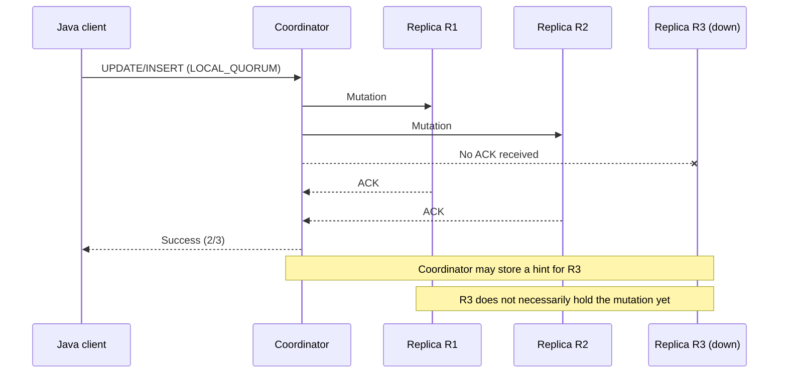
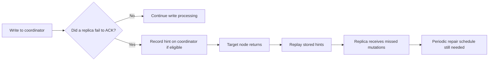
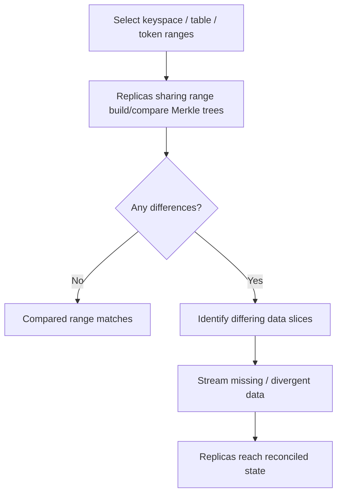
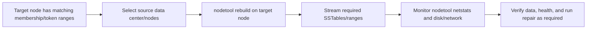

# Repair, Hint Replay, and Rebuild Solve Different Problems

> **Chapter:** Replica Synchronization  
> **Module:** `DATABASE_ENGINE_WIDE_COLUMN_CASSANDRA` — Apache Cassandra

Apache Cassandra stores data in a *distributed wide-column* model: partition keys determine tokens, the replication strategy defines which replicas own token ranges, and the **consistency level** governs how many responses are required per read/write request. When one replica temporarily loses connectivity, other replicas can still accept mutations; thus, once the node returns, their data may **not be completely identical**.

Three mechanisms often lumped together as "re-syncing data" actually solve distinct problems:

- **Hint replay / hinted handoff:** delivers to a recovered replica those mutations that coordinators **temporarily buffered** while the replica was absent.
- **Anti-entropy repair:** **compares** data across replicas sharing token ranges and synchronizes discrepancies. This is a required operational mechanism even when hints work.
- **Rebuild:** **streams large volumes of data from source nodes to a target node**, typically to populate data for token ranges the target node needs to own, such as pulling data from a source datacenter.

A `nodetool rebuild` command is not equivalent to `nodetool repair`; likewise, `resumehandoff` cannot synthesize mutations missed outside the hint storage window. Picking the wrong mechanism wastes I/O and prolongs incidents without achieving synchronization goals.

After this lesson, you can distinguish the mechanics, conditions, guarantees, and costs of each option; read recovery metrics; write CQL/Java to observe RF and CL effects; and build a runbook when a node disconnects or needs data repopulation.

## 1. Why Can Replicas Differ?

Consider a keyspace with **Replication Factor (RF) = 3** in datacenter `dc1`. With `LOCAL_QUORUM`, the coordinator needs **2 out of 3** replicas in that datacenter to acknowledge a write. If replica R3 is temporarily down, R1 and R2 can still confirm success to the client.



Points to understand accurately:

1. **Write success at a CL** does not prove all replicas finished writing. It only proves the acknowledgment threshold was met per the active protocol.
2. R3 **does not lose token range ownership** merely from temporary downtime. Upon returning, it must catch up on missed mutations.
3. Choosing `QUORUM`, `LOCAL_QUORUM`, or `ONE` shapes client responses and probability of seeing fresh data, without replacing repair schedules.
4. Read repair (when reading affected partitions and trigger conditions hold) can fix some **queried** discrepancies; it does not scan the cluster to replace full token-range anti-entropy repair.
5. If an application hits a write timeout, **you cannot assume the mutation definitely did not apply**. Some replicas may have applied it; retrying non-idempotent operations like counter increments can cause business corruption.

## 2. Quick Comparison of the Three Mechanisms

| Criterion | Hinted handoff / hint replay | Anti-entropy repair | Rebuild |
| --- | --- | --- | --- |
| **Core question** | "Which missed mutations for this node does the coordinator still hold?" | "Where do replicas sharing a token range currently differ?" | "From which source should this node pull data for its ranges?" |
| **Data source** | Hint files stored on coordinators that accepted the mutations | Data on replicas owning the range, compared via Merkle trees and streamed where different | SSTables/data streamed from source nodes to the target node |
| **Trigger** | Automatic after node recovery if hints exist and handoff is enabled | Scheduled/manual operational job (typically via `nodetool repair`) | Operational command on the **target node**, e.g., `nodetool rebuild` |
| **Scope** | Buffered mutations within hint creation/retention/delivery limits | Repaired token ranges/tables, full or incremental | Data for ranges/keys streamed to the target node |
| **Guarantee** | **Best effort**, not a complete reconciliation | Reconciles data discrepancies across participating repair replicas | Populates data from chosen sources, **not a cluster-wide anti-entropy diff** |
| **Main cost** | Disk holding hints; network, CPU, I/O during replay | Merkle trees, auxiliary scans/compaction, streaming, network, and disk I/O | Heavy streaming, network, and disk on both sources and target |
| **Does not solve** | Mutations lacking hints, pre-outage divergence | Recovering corrupted files/disks with no valid source; replacing backups | Finding discrepancies across source replicas or fixing invalid business writes |

**A helpful taxonomy:** hint replay **replays buffered records**, repair **compares and reconciles what replicas currently hold**, and rebuild **transfers data the target node needs from other nodes**. All three may stream or send mutations over the network, yet their goals and data paths differ.

## 3. Hinted Handoff: Fast After Brief Downtime, Yet Bounded

### 3.1. How Hints Are Created and Replayed

When a coordinator sends a mutation and one replica misses it, the coordinator can store a **hint** for that replica. The hint contains target info, mutation, and original timestamp, held temporarily in the coordinator's hints store. When the target node recovers, the coordinator replays surviving hints; the target applies them, and successfully delivered hint files are cleaned up per Cassandra's mechanism.



Key boundaries:

- Hints are **enabled by default** in standard configurations, though they can be disabled per node or per data center. Never assume from a node coming up that "hints definitely exist."
- `max_hint_window` caps the **downtime window during which coordinators keep creating hints** for a down endpoint; in Cassandra 5.0 docs, the default is typically **3 hours**. It is **not** a promise that "every mutation within 3 hours definitely has a hint" or "every hint survives exactly 3 hours then deletes."
- Hints are **best effort**: coordinators may fail to create/store them due to write conditions, storage limits, config, window caps, or other failures.
- Hints carry original timestamps, so replaying regular mutations does not magically override newer values written afterward. However, this **does not make application-level counter increments idempotent** when clients resend duplicate requests.
- If data diverged beforehand, or the node was down longer than hint creation limits, replaying what remains **still cannot prove replicas match**.

### 3.2. When Downtime Exceeds the Hint Window

Suppose R3 is down for 5 hours with a default 3-hour `max_hint_window`:

- During the allowed window, coordinators can store hints for mutations R3 missed.
- Once the endpoint passes the downtime limit, coordinators **stop creating new hints** for it. Subsequent mutations may lack hints for replay.
- R3 returns and receives surviving hints, yet un-hinted gaps remain.
- **Anti-entropy repair** is how you compare and synchronize data over the affected token ranges; you cannot wait for "replay finished" and declare the node consistent.

Never crank `max_hint_window` up huge as a substitute for repair: storing and replaying extra hints consumes disk and I/O; if coordinator disks approach capacity, that choice can trigger fresh outages.

### 3.3. Commands to Observe and Control Hints

Common inspection commands run on the node under observation:

```bash
nodetool status
nodetool statushandoff
nodetool getmaxhintwindow
nodetool netstats
```

`statushandoff` reports whether hint storage **for future writes on the current node** is enabled—it does not confirm pending hints finished delivering. `getmaxhintwindow` was added in Cassandra 4.0; verify your version before running it. `netstats` shows data-transfer activity and network stats, yet dashboard metrics for **HintsService / HintedHandOffManager** remain essential to track hints created/replaying/dropped.

If hint delivery was **intentionally paused**, you have:

```bash
# OPERATIONAL ACTION: run only after confirming delivery should resume.
nodetool resumehandoff
```

`resumehandoff` only **resumes delivering existing hints**; it does not create hints for lost intervals. Do not confuse it with `nodetool replaybatchlog`: batchlog replay is a batch recovery mechanism, **completely separate** from hinted handoff. Likewise, never run `truncatehints` to "clear a backlog": that deletes hints and discards the chance to recover missed writes.

## 4. Anti-Entropy Repair: Reconciling Divergence by Token Range

### 4.1. Mechanics

Repair compares data among replicas sharing **token ranges**. Cassandra can use **Merkle trees** (hash trees) to locate differing slices, then stream required differences between nodes.



Repair **differs from hint replay** because it needs no prior log of "which exact mutations were missed"; it examines actual data currently stored on replicas. Thus, repair covers divergence from long outages, lost hints, incomplete write history, and other gaps hinted handoff cannot finish.

Limitations to remember:

- Repair only reconciles **data still present on participating replicas**. It cannot recover a value vanished from *all* replicas and does not replace backups.
- Repair consumes CPU, network, disk, and time; never blast it across every node concurrently during disk-full, streaming-error, or heavy compaction-backlog incidents.
- If tombstones were reclaimed before a replica missing deletes was reconciled, stale data on that replica can resurface (**zombie data**). Run repair within `gc_grace_seconds` and expected replica downtime bounds.
- Repair does not fix bad partition key design, duplicate events from Java clients, business-incorrect writes, or misconfigured consistency levels.

### 4.2. Incremental and Full Repair

| Mode | Scope | When to Consider |
| --- | --- | --- |
| **Incremental repair** | SSTables/data not yet marked repaired since prior incremental runs; subsequent runs can focus on new data | Routine operations on a steady incremental schedule; default for `nodetool repair` on modern Cassandra releases |
| **Full repair** | Inspects all data in selected token ranges/tables, including data already marked repaired | Periodic full audits; recovery after major incidents, data loss, or replication changes needing broad verification |

Syntax examples, **illustrative only**, requiring operational privileges and a maintenance window:

```bash
# Incremental repair (default on modern Cassandra releases):
nodetool repair -pr telemetry sensor_events_by_day

# Full repair scoped to the running node's primary token ranges:
nodetool repair --full -pr telemetry sensor_events_by_day

# Preview estimated data exchange without streaming repairs:
nodetool repair --preview --full -pr telemetry sensor_events_by_day
```

- `-pr` repairs only the **executing node's primary token ranges**, avoiding redundant work. To cover the **whole cluster**, the repair schedule must run across all required nodes/data centers per your range coverage strategy; running on one node **does not repair the whole cluster**.
- Full repair inspects already-repaired data too; incremental repair tracks repaired state and can involve *anticompaction* with extra disk/I/O demands.
- Preview estimates streaming volume, yet building/comparing hash trees still consumes resources; it is not a "free" check.
- Across Cassandra versions, topologies, and orchestration tools, exact flags, schedules, and details vary. Check `nodetool help repair` on the **exact binary** before applying.

### 4.3. Repair and `gc_grace_seconds`

Tombstones are kept to stop deleted data from resurfacing on returning replicas. `gc_grace_seconds` is a **protection window** before tombstones become eligible for removal when compaction conditions hold—**not an auto-delete timer** firing at that exact second.

If a node stays offline longer than both the hint window and tombstone protection window, zombie data risk climbs. This drives an operational requirement: **the repair schedule must finish covering required replicas and token ranges frequently enough within the grace window**, budgeting headroom for downtime, failed repairs, and multiple data centers. For critical tables, review TTL design, tombstones, and repair policies together.

**Example:** `gc_grace_seconds` of 10 days does not mean "repairing once every 10 days at any moment is safe"; the schedule needs headroom to finish before grace expires without leaving absent nodes uncovered.

## 5. Rebuild: Repopulating a Target Node via Streaming

`nodetool rebuild` instructs the **node executing the command** to pull data via streaming from other nodes, similar to bootstrap data loading. Its typical goal is **populating data from a source data center** onto a node in a new data center or one already assigned proper tokens that needs its data reloaded.



**How it differs from repair:**

- Rebuild **actively loads data onto a target node** from sources, rather than starting with Merkle trees comparing all replicas to prove consistency.
- It can transfer **massive volumes**, even if only a fraction of data is missing; it requires healthy sources, target disk space, and bandwidth.
- If sources are missing/divergent or data changes mid-stream, rebuild **does not prove final cluster-wide consistency**. Follow-up repair/checks may be needed.
- Never treat rebuild as **dead-node replacement**: node replacement requires proper membership/token/host-identity procedures and streaming during replacement. Similarly, adding a new node uses **bootstrap** per topology-change procedures. Running `rebuild` alone does not handle those steps.

### 5.1. Rebuild Usage Example

Scenario: the cluster has source data center `dc1` and is initializing a properly tokenized node in `dc2` per a separate topology runbook. Once the target node is in a state permitting rebuild, the admin loads one keyspace from `dc1`:

```bash
# OPERATIONAL ACTION: run on the TARGET NODE,
# only after verifying replication, membership, disk space, and source DC.
nodetool rebuild --keyspace telemetry dc1

# Observe streaming progress:
nodetool netstats
nodetool status
```

Option syntax is checked against Cassandra 5.0. Some `nodetool rebuild` releases use a default source data center or support different token/source parameters; read `nodetool help rebuild` on your live version.

**Do not run rebuild just because a node was down for 10 minutes.** For brief downtime with intact disk data, bringing the node back cleanly, letting hinted handoff run, and following normal repair policies is far more appropriate.

### 5.2. When Must You Use Replace/Bootstrap Procedures?

- **Adding a new node for capacity:** bootstrap brings the new node into the token ring and streams owned data; `cleanup` may be needed afterward on nodes that lost range ownership.
- **Node lost its disk or entire machine:** follow the **replace dead node** procedure with version-appropriate flags and host/token identity; data streaming is part of replacement. Per topology-change docs, in some cases the replaced node may also require **repair** after replacement finishes, especially if downtime exceeded `max_hint_window`.
- **New data center with joined nodes needing data:** rebuild from the selected source data center once appropriate topology/membership steps are complete.

Never lump all three into "just run rebuild."

## 6. Choosing the Right Mechanism by Incident Scenario

| Real-World Scenario | First Action to Take | Why |
| --- | --- | --- |
| Replica restarted for 20 minutes, returning with intact disk data | Monitor **hint replay** and health; continue repair schedule | Hints likely hold recent missed mutations; downtime was brief. |
| Replica offline 5 hours with default 3-hour hint window | Recover node; replay remaining hints; **repair** relevant token ranges | Writes occurred past the hint window, so hints alone cannot suffice. |
| Replica online, yet data differs from peers after hints finished | **Repair** and investigate divergence root cause | Hints do not diff the full dataset; repair catches per-range differences. |
| Complete disk loss on an old node | **Replace/restore node** per runbook with streaming; assess repair afterward | Node lacks data and may need membership/identity handling. |
| Adding a new data center; target node has tokens/config but no data | **Rebuild from source DC** per plan | Bulk-loading ranges onto the target node. |
| Raising RF on an already-populated keyspace | Alter config per runbook, then run **full repair** to populate new replicas, or follow appropriate topology plan | New replicas need existing historical data; waiting for hints is insufficient. |
| Reading one specific partition shows a stale value | Check CL/replicas, read repair may heal read scope; run **repair** if divergence is broad | One read does not reconcile all token ranges. |
| Tombstones nearing grace expiry, repair schedule skipped nodes | Urgently evaluate **full/incremental repair** schedule and recovery options | Risk of deleted data resurrecting on replicas missing tombstones. |
| Disk full or severe I/O saturation | Stabilize storage first before pushing streaming/repair | Both repair and rebuild add I/O and can worsen the outage. |

### A Complete Decision Walkthrough

Suppose an order-processing app writes order events:

1. One replica is down; the remaining two acknowledge `LOCAL_QUORUM` successfully.
2. When the node returns within the hint window, you see the hint backlog draining.
3. Still **monitor** backlog, read/write latency, and complete the scheduled repair; hint replay does not prove all data converged.
4. If the node stayed down past the window or divergence appears, run **appropriately scoped** repair.
5. If the node lost its disk, do not wait for hint replay onto an empty node—execute replacement/restoration instead, and avoid deleting files to force rebuilds.

## 7. CQL and Java Applications: Consistency Levels Do Not Replace Repair

### 7.1. Query-Driven Table Example

Assume the real data center is `dc1` with three nodes eligible for RF=3; DDL statements below are **for a learning environment**—never alter production keyspaces directly:

```sql
CREATE KEYSPACE IF NOT EXISTS telemetry
WITH replication = {
    'class': 'NetworkTopologyStrategy',
    'dc1': '3'
};

CREATE TABLE IF NOT EXISTS telemetry.sensor_events_by_day (
    sensor_id text,
    event_day date,
    event_id uuid,
    reading double,
    PRIMARY KEY ((sensor_id, event_day), event_id)
);

INSERT INTO telemetry.sensor_events_by_day
    (sensor_id, event_day, event_id, reading)
VALUES ('sensor-07', '2026-11-21',
        11111111-1111-4111-8111-111111111111, 23.5);

SELECT event_id, reading
FROM telemetry.sensor_events_by_day
WHERE sensor_id = 'sensor-07'
  AND event_day = '2026-11-21';
```

The partition key `(sensor_id, event_day)` groups data by device and day. If one sensor emits too many events per day, adding a bucket/shard to the partition key is a **data modeling** concern independent of replication, hints, repair, or rebuild.

In `cqlsh`, you can set CL for test queries:

```sql
-- This is a cqlsh shell command, not a CQL DDL/DML statement.
CONSISTENCY LOCAL_QUORUM;
```

With RF=3 in `dc1` alone, `LOCAL_QUORUM` needs two ACKs in `dc1`. That keeps reads/writes available while one replica is temporarily down, yet a successful write still **does not prove every replica holds the data**.

### 7.2. Java Driver 4.x and Indeterminate Responses

```java
import java.time.LocalDate;
import java.util.UUID;

import com.datastax.oss.driver.api.core.CqlSession;
import com.datastax.oss.driver.api.core.DefaultConsistencyLevel;
import com.datastax.oss.driver.api.core.cql.BoundStatement;
import com.datastax.oss.driver.api.core.cql.PreparedStatement;

public final class SensorEventWriter {
    private final CqlSession session;
    private final PreparedStatement insertEvent;

    public SensorEventWriter(CqlSession session) {
        this.session = session;
        this.insertEvent = session.prepare(
            "INSERT INTO telemetry.sensor_events_by_day " +
            "(sensor_id, event_day, event_id, reading) VALUES (?, ?, ?, ?)");
    }

    public void write(String sensorId, LocalDate day,
                      UUID eventId, double reading) {
        // eventId must stay identical for the same event across retries.
        BoundStatement statement = insertEvent.bind(
                sensorId, day, eventId, reading)
            .setConsistencyLevel(DefaultConsistencyLevel.LOCAL_QUORUM)
            .setIdempotent(true);

        session.execute(statement);
    }
}
```

Here, `setIdempotent(true)` is valid only when the application guarantees the **same key and immutable payload** for an event and does not rely on shifting timestamps/TTLs across retries. For workflows needing retention windows or strict update ordering, use deterministic write timestamps or dedicated deduplication/reconciliation. Never blindly set `true` on counters, additions/subtractions, or side-effecting operations.

If `session.execute` times out, the application **cannot know for sure** which replicas applied the mutation. Cassandra may generate hints for timed-out writes under certain conditions, yet the app must still handle the **unknown outcome** per business rules. Raising CL or waiting for hint replay **does not** replace API/message-broker idempotency.

### 7.3. Testing in an Isolated Environment

To study these mechanisms, spin up an RF=3 **test cluster** in one data center and:

1. Write data at `LOCAL_QUORUM` with all three replicas healthy.
2. Cleanly stop one replica and write events with stable `event_id` values.
3. Start the replica, observe hinted handoff metrics and reads across appropriate CLs.
4. Compare against a replica down **past the hint window**, run scoped repair in the test environment, and record streamed bytes.
5. Test bootstrap/rebuild on a **dedicated test node** once topology design is finalized, observing `nodetool netstats`.

Never stop nodes, flip CLs, or run repair/rebuild in production just to "demonstrate" behavior.

## 8. Observation and Recovery Runbook

### Before Choosing an Action

1. **Scope the incident:** which node is down, for how long, is disk data intact, did host ID/tokens change, and which data centers are affected?
2. **Check replication and CL:** per-DC RF, application read/write CLs, and whether enough healthy replicas remain to serve traffic.
3. **Evaluate hint window:** are hints enabled, what is the actual `max_hint_window`, and what do created/dropped/backlog delivery metrics show?
4. **Check resources:** free disk, I/O, CPU, memtable/compaction backlog, network streaming; estimate impact before running repair/rebuild.
5. **Assess tombstone risk:** per-table `gc_grace_seconds` and last successful repair over affected ranges.
6. **Lock the objective:** do you need to replay missed mutations, compare replicas, or repopulate a target node?

### Read-Only Inspection Commands

```bash
nodetool version
nodetool status
nodetool describecluster
nodetool statushandoff
nodetool netstats
nodetool compactionstats
nodetool tpstats
```

Combine these metric groups:

| Group | What to Monitor | Meaning |
| --- | --- | --- |
| Hints | Created, dropped/unrecorded, pending, delivered/failed, delivery latency | Gauges replay catch-up progress; not proof of full data sync |
| Repair | Repaired ranges/tables, failed jobs, streamed bytes, per-node/DC progress | Verifies the repair schedule actually covers the cluster |
| Rebuild / streaming | `nodetool netstats`, disk read/write, network throughput, source node load | Detects stalled or incomplete streaming |
| Cluster health | `UN/DN`, request latency/timeouts, hinted handoff errors | Measures service impact during and after recovery |
| Tombstones | Repair age, `gc_grace_seconds`, tombstone warnings, TTL | Evaluates zombie risk after prolonged node outages |

**Never substitute one metric for another:** `nodetool status` showing `UN` only says the node is Up/Normal from an administrative view; it does not confirm "hints finished," "repair completed," or "SSTables rebuilt completely."

### After Taking Action

- Verify the required process ended cleanly via logs and metrics, not just one exit code.
- Check consistency on a representative set of queries by partition key, remembering spot-checks do not replace anti-entropy repair.
- Ensure the repair schedule keeps running and covers full ranges/replicas per SLA. Repair capability can degrade while nodes remain down.
- If source data no longer exists on any replica, evaluate **backup/restore**. Neither repair, hint replay, nor rebuild can conjure data with no valid source.
- Record root cause: downtime, missing hints, storage issue, network issue, operational limit, or mismatched CL policy.

## 9. Misconceptions to Avoid

| Misconception | Fact |
| --- | --- |
| "Once a node comes up, it automatically syncs completely." | The node may replay remaining hints, yet still needs periodic or incident repair. |
| "Hint replay and repair are two names for the same thing." | Hints send buffered mutations; repair compares replica data and streams differences. |
| "Once `max_hint_window` expires, all old hints are deleted." | The parameter caps the downtime window for **creating new hints**; do not assume all backlogs vanish at that exact mark. |
| "Running `resumehandoff` forces the replica to get every missed write." | It only resumes paused delivery; it cannot create hints that were never stored. |
| "Rebuild replaces repair for every replica." | Rebuild populates a target node; it does not perform cluster-wide anti-entropy checks. |
| "Running `nodetool repair` on one node repairs the whole cluster." | Repair covers token ranges handled by that command; you need schedules covering all nodes/DCs or ranges. |
| "`LOCAL_QUORUM` makes all RF=3 replicas identical." | It confirms enough two-replica ACKs per protocol; one replica can still lag behind. |
| "Run `replaybatchlog` to replay hints." | Batchlog replay and hinted handoff are two separate mechanisms. |
| "After replacing a disk, just restart." | When data/membership is lost, follow version-appropriate replace/restore/bootstrap/rebuild procedures and then reconcile. |
| "Repair fixes duplicate business writes." | Repair syncs Cassandra data; it cannot distinguish valid vs. buggy business event IDs or logic. |

## 10. Self-Check Exercises

**Q1.** RF=3 in `dc1`; a `LOCAL_QUORUM` write succeeds while R3 is down. Can you conclude R3 already has the data? If R3 returns after 20 minutes, which mechanism usually catches it up quickly?

**Q2.** R3 is down 6 hours with a 3-hour `max_hint_window`. After all remaining hints replay, an engineer plans to declare data synchronized. What is wrong, and what else is needed?

**Q3.** A node is initialized in `dc2` and needs data loaded from `dc1` for keyspace `telemetry`; it has planned membership/token ranges. Should you choose repair, hint replay, or rebuild?

**Q4.** An old node lost its entire data disk and must be replaced with new hardware. Should you run `nodetool rebuild` as the sole step before putting the new machine into the ring?

**Q5.** Why must `gc_grace_seconds`, tombstones, and the repair cadence be planned together?

**Q6.** A Java app incrementing a counter `+1` hits a write timeout. Should it retry automatically because the system "has hinted handoff"?

<details>
<summary>Reference Answers</summary>

1. **No**. Two healthy replicas suffice for write success; R3 may have missed the mutation. Upon returning quickly, **hint replay** typically catches up mutations coordinators buffered; a repair schedule is still required.
2. Hints stop being created once a node is down past the window; un-hinted mutations may still be missing. Scoped **anti-entropy repair** and outcome verification are needed.
3. **Rebuild** from `dc1` on the target node in `dc2`, after verifying topology, sources, and disk capacity. Monitor streaming and evaluate repair afterward.
4. **No**. Node replacement requires version-specific token/membership/host-identity and streaming procedures; repair may also be needed if writes were missed during replacement.
5. Tombstones must reach offline replicas before being safely purged. If repair runs too infrequently, stale data can resurrect from lagging replicas.
6. **No**. A timeout does not prove the write failed; counter updates are not idempotent. Hinted handoff does not deduplicate repeated client submissions.

</details>

## Takeaways

- **Hint replay:** replays temporarily buffered mutations automatically and quickly after brief outages; **best effort**, bounded by the hint creation window.
- **Repair:** compares replicas across token ranges and streams differences; the foundation of periodic reconciliation, directly tied to `gc_grace_seconds` and tombstones.
- **Rebuild:** streams required data from sources to a **target node**; suited for bulk-loading topology data, not a synonym for replace/bootstrap or repair.
- **RF and CL** govern replica sets and response thresholds; they do not guarantee every replica is synchronized after each successful write.
- During incidents, ask **whether disk data is intact, how long the outage lasted, whether hints exist, what the divergence scope is, and whether topology changed** before acting.
- Monitor hints, repair, streaming, read/write latency, and cluster health; if no valid source copy remains, **backup/restore** is required—none of the three mechanisms creates data out of thin air.

### Official Documentation

- [Apache Cassandra 5.0 — Hints and hinted handoff](https://cassandra.apache.org/doc/stable/cassandra/managing/operating/hints.html)
- [Apache Cassandra 5.0 — Repair](https://cassandra.apache.org/doc/stable/cassandra/managing/operating/repair.html)
- [Apache Cassandra 5.0 — nodetool rebuild](https://cassandra.apache.org/doc/latest/cassandra/managing/tools/nodetool/rebuild.html)
- [Apache Cassandra — Topology changes, bootstrap, and replace](https://cassandra.apache.org/doc/latest/cassandra/managing/operating/topo_changes.html)
- [Apache Cassandra — Streaming architecture](https://cassandra.apache.org/doc/stable/cassandra/architecture/streaming.html)
- [Apache Cassandra — Cassandra metrics](https://cassandra.apache.org/doc/stable/cassandra/managing/operating/metrics.html)
