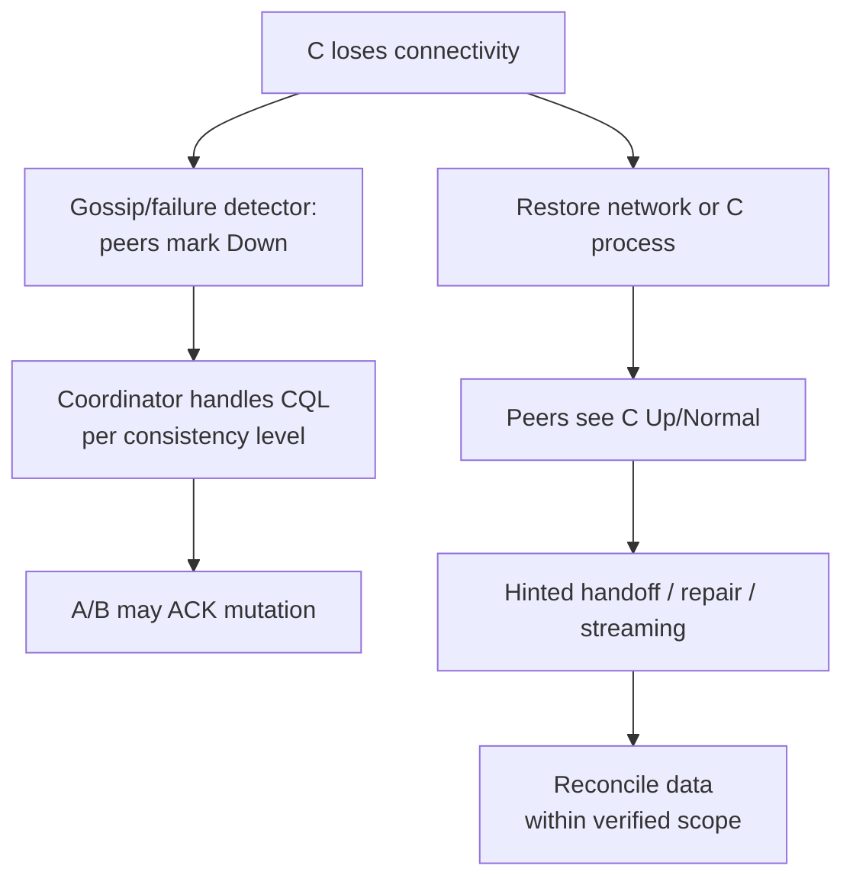

# Designing a Disconnect-and-Rejoin Cluster Scenario

**Chapter:** Replica Synchronization  
**Module:** `DATABASE_ENGINE_WIDE_COLUMN_CASSANDRA` — Apache Cassandra

Cassandra distributes partitions across multiple nodes and maintains replicas per the replication factor (RF). When a node loses connectivity, the coordinator can still acknowledge requests at an appropriate consistency level (CL) even though that replica has not received the mutation. The trickier part comes when the node **rejoins**: `UN` in `nodetool status` indicates the node is up and regarded as a normal member—it **does not prove** all missed mutations have been caught up.

This lesson fits into studying Cassandra's distributed architecture and wide-column model, partition keys, query-driven table design, read/write consistency levels, CQL, replication, compaction, repair, error handling, and Java connectivity. The topic is **designing a repeatable failure scenario** with a baseline, fault injection, response measurement, connectivity restoration, convergence checks, and impact assessment.

> Practice only on a dedicated test cluster where you hold administrative rights and a way to revert fault injection. Never stop/isolate nodes, change topology, delete data, or alter network configuration on a production cluster just for lab practice.

## 1. Learning Objectives

After this lesson, you will be able to:

1. Distinguish **network partitions**, **node/process outages**, and ring membership changes such as bootstrap/decommission/replace.
2. Predict the behavior of `ONE`, `LOCAL_QUORUM`, and `ALL` when one of three replicas is unresponsive.
3. Design experiments with a **verified baseline**, unique mutations per run, and a result tracking log.
4. Observe Down → Up transitions in the failure detector and separate a node being `UN` from data having converged.
5. Explain hinted handoff, read repair, anti-entropy repair, and streaming during recovery.
6. Read CQL outputs, `nodetool status`, `netstats`, and logs without claiming more than the evidence supports.
7. Handle the differences among success, `Unavailable`, timeouts, and **unknown write outcomes**.
8. Propose response procedures when a node disconnects for a long time, hints expire, or deletes/TTLs occurred.
9. Build post-recovery checks using the Java Driver and document the limits of that verification.

**Main hypothesis:** with RF=3 in a single datacenter, if node C is isolated, healthy nodes A and B can still acknowledge `LOCAL_QUORUM` writes. After C returns, replicas may converge via hinted handoff or repair, though latency and catch-up volume are not fixed.

## 2. Three Failure Modes Commonly Lumped Together as "Node Disconnected"

| Event | What Actually Happens | Effect on Ring Membership | Recovery Path |
| --- | --- | --- | --- |
| Network partition | Node keeps running, but peer communication is blocked (one-way or bidirectional) | Peers may mark node Down; token ownership does not vanish | Restore network, check gossip, hints, and repair if needed |
| Process/host outage | Cassandra process or host stops running | Peers mark Down after detection window; node stays an expected member | Start **the same node**, preserving host identity and data |
| Bootstrap / decommission / replace | Intentionally joining, leaving, or replacing an old replica | Token ownership/topology can change | Follow corresponding topology and streaming procedures |

In this lesson, **rejoin** means **the same node C** returning after a network/process outage with its token metadata and existing data intact. Do not use `replace_address`, `nodetool join`, deleting the data directory, or recreating a container with a new identity as a "quick recovery."

The failure detector may take a brief interval to notice an unreachable node; query errors during the transition window may be timeouts rather than `Unavailable`. When peers mark C Down, that is a statement about **reachability**, not that C's data was deleted.

### Two Axes to Record Independently



The `UN` milestone and the catch-up completion milestone **are not the same**. Hints sometimes finish very quickly, and repair may stream zero bytes; the diagram illustrates logical phases without prescribing a fixed internal sequence across every Cassandra version.

## 3. Topology and Consistency Level Matrix

The lab uses:

- `cassandra1` = A, `cassandra2` = B, `cassandra3` = C.
- One datacenter hypothetically named `datacenter1`.
- A keyspace using `NetworkTopologyStrategy`, RF=3 in this DC.
- Coordinator for CQL commands on A, avoiding isolated C.
- All three nodes Up/Normal before the experiment with no other concurrent writers modifying test keys.

With RF=3 in one DC, `LOCAL_QUORUM` requires two replicas to respond. `ONE` needs one, and `ALL` needs three.

| Replica State | `ONE` | `LOCAL_QUORUM` | `ALL` |
| --- | --- | --- | --- |
| A/B/C all responsive | Can succeed | Can succeed | Can succeed |
| C unresponsive, A/B healthy | Can succeed | Can succeed if A/B respond in time | Fewer than three replicas |
| B/C unresponsive, A healthy | Can succeed | Fewer than two replicas | Fewer than three replicas |
| No replica responsive | Unavailable | Unavailable | Unavailable |

The "Can" cells matter: CPU/GC/disk/network saturation, coordinator failure, or stale failure-detector views can still cause timeouts. Never turn this table into a guarantee that every run returns success or the exact same exception class.

### Distinguishing ACKs from Physical State

If A/B acknowledge a mutation at `LOCAL_QUORUM` while C is network-partitioned, the client can receive success. A/B met the CL condition; C may still hold the old value. `R + W > RF` within the same replica set improves consistency across quorum reads and writes when there are no concurrent writes, yet it is **not** a cross-replica transaction and does not guarantee `ONE` reads always see the new copy.

## 4. Experiment Plan and Per-Run Identifiers

Create a unique `run_id` per run; for example `r01` uses:

```text
test_key A = probe013-r01-a
test_key B = probe013-r01-b
test_key control = probe013-r01-control
baseline revision = 1
fault-window revision = 2
```

On the next run, change `r01` to `r02` across all commands and logs. Never reuse old keys, because writes from earlier runs can mask outcomes.

Define **baseline acceptance criteria** before injecting faults: all three nodes `UN`, DC/RF correct, baseline mutations ACKed at `ALL`, and zero concurrent writers. If any condition fails, fix the lab and start a fresh run instead of pushing through and drawing flawed conclusions.

### Minimum Information to Record

| Milestone | Action | Data to Collect |
| --- | --- | --- |
| T0 | Check nodes and write baseline | Version, topology, RF, CL, ACKs, values |
| T1 | Disconnect C | Fault type, timestamp, config, peers reporting Down |
| T2 | Write at `LOCAL_QUORUM` | Per-request response, timeouts, timestamps |
| T3 | Attempt read at `ALL` | `Unavailable`/timeout or actual result |
| T4 | Restore C | Network unblock / start timestamp and when C returns to `UN` |
| T5 | Read each key at `ONE`/`LOCAL_QUORUM` | Values, CL, errored vs. succeeded requests |
| T6 | Monitor hints/repair | Logs, repair status, streamed bytes if any |
| T7 | Post-recovery reconciliation | Logical conclusion and unverified scope |

Never fill in "revision 2" in the **observed** column merely because it was expected. Whenever something wasn't observed, explicitly record "not observed" and why.

## 5. Preparing a Three-Node Cassandra Cluster

Examples assume a Docker host with containers `cassandra1`/`cassandra2`/`cassandra3`. On Kubernetes or VMs, substitute equivalent commands instead of copying Docker commands verbatim.

```bash
docker exec cassandra1 nodetool status
docker exec cassandra2 nodetool status
docker exec cassandra3 nodetool status
docker exec -it cassandra1 cqlsh
```

In `cqlsh`:

```sql
SELECT data_center, release_version FROM system.local;
```

Confirm the datacenter name is accurate. If it is not `datacenter1`, update the replication clause below accordingly. RF=3 is meaningful in this exercise only if three replica nodes genuinely exist in the same datacenter.

Create the lab schema:

```sql
CREATE KEYSPACE IF NOT EXISTS lab_rejoin
WITH replication = {
    'class': 'NetworkTopologyStrategy',
    'datacenter1': 3
}
AND durable_writes = true;

CREATE TABLE IF NOT EXISTS lab_rejoin.probe_state_by_key (
    test_key text PRIMARY KEY,
    revision int,
    payload text,
    updated_at timestamp
);
```

`test_key` is the partition key. `revision` is an application-written version number for comparison; it does not create CAS/transactions. `updated_at` aids lab logging; Cassandra resolves mutation conflicts by internal cell timestamps and tombstone rules.

### Baseline ACKed by Every Replica

While all three nodes are healthy, write the baseline at `ALL`:

```sql
CONSISTENCY ALL

INSERT INTO lab_rejoin.probe_state_by_key
    (test_key, revision, payload, updated_at)
VALUES ('probe013-r01-a', 1, 'before-fault', '2026-11-21T00:00:00Z');

INSERT INTO lab_rejoin.probe_state_by_key
    (test_key, revision, payload, updated_at)
VALUES ('probe013-r01-b', 1, 'before-fault', '2026-11-21T00:00:00Z');

INSERT INTO lab_rejoin.probe_state_by_key
    (test_key, revision, payload, updated_at)
VALUES ('probe013-r01-control', 1, 'untouched', '2026-11-21T00:00:00Z');

SELECT test_key, revision, payload
FROM lab_rejoin.probe_state_by_key
WHERE test_key = 'probe013-r01-a';
```

Proceed only if **all three INSERTs** return successful ACKs at `ALL`. If any times out, never declare all replicas hold the baseline merely because a subsequent SELECT sees revision 1; log the incident and switch to a fresh keyset. The goal is knowing C definitely held the pre-fault state.

## 6. Inducing a Network Fault and Verifying Peers Detect Down

Two test options exist. **Pick only one option per run**, and record its name to prevent ambiguity.

### 6.1. Option A: Isolate C's Egress via `tc netem` (Conditional)

If containers run on Linux with `iproute2/tc` and `NET_ADMIN` capability, you can drop all outbound traffic from C. Because C cannot reply to peers, it models network isolation. This option **does not** stop the process.

Inspect before modifying:

```bash
docker exec cassandra3 ip -br link
docker exec cassandra3 tc qdisc show dev eth0
```

**Use `eth0` only after confirming it is the actual interface serving Cassandra traffic**; if critical network policies/qdiscs already exist, do not overwrite them. Prepare the revert command before isolating:

```bash
# In a lab with eth0, tc, and NET_ADMIN:
docker exec cassandra3 tc qdisc add dev eth0 root netem loss 100%

# Observe from healthy peer A; do not query status through C:
docker exec cassandra1 nodetool status
```

When applied cleanly, C keeps running but cannot reply to peers over the affected interface. The failure detector may take a short interval before marking C `DN`; **do not assume a fixed exact number of seconds**.

Revert command (used in section 8):

```bash
docker exec cassandra3 tc qdisc del dev eth0 root
```

`docker exec` runs via the container runtime on the Docker host, so it still works even when Cassandra traffic between containers is dropped. If `tc`/capabilities are missing or container networking is too complex, **skip Option A** and use B. Never grant extra capabilities to production containers for testing.

### 6.2. Option B: Stop Process/Node to Contrast Availability

If the lab does not support network isolation:

```bash
docker stop cassandra3
docker exec cassandra1 nodetool status
```

This is a **process outage**, not a true network partition. It still lets you practice quorum and rejoin, provided your report names it accurately. Recovery command (section 8):

```bash
docker start cassandra3
```

Never run `docker rm`, `docker compose down -v`, delete volumes/data directories, or reset host IDs. Those turn a "same-node rejoin" test into a replacement/bootstrap scenario.

### 6.3. Confirm Fault Injection Took Effect

Before sending mutations, log:

- Fault start time and Option A/B.
- C's status as seen from `nodetool status` on A/B.
- A/B remain `UN`, and coordinator A still accepts CQL.
- For Option A, confirm Cassandra traffic is blocked on the right interface. A successful `tc` command alone does not prove peers have no alternate network path.

## 7. Writing While C Is Unresponsive

In `cqlsh` on A (after peers mark C Down):

```sql
CONSISTENCY LOCAL_QUORUM

UPDATE lab_rejoin.probe_state_by_key
SET revision = 2,
    payload = 'written-while-c-isolated',
    updated_at = '2026-11-21T00:05:00Z'
WHERE test_key = 'probe013-r01-a';

UPDATE lab_rejoin.probe_state_by_key
SET revision = 2,
    payload = 'written-while-c-isolated',
    updated_at = '2026-11-21T00:05:00Z'
WHERE test_key = 'probe013-r01-b';

SELECT test_key, revision, payload
FROM lab_rejoin.probe_state_by_key
WHERE test_key = 'probe013-r01-a';
```

If A and B respond, both UPDATEs can ACK at `LOCAL_QUORUM` while C still holds revision 1. However, on timeout, `Unavailable`, or disconnect, **never** conclude the UPDATE was completely unapplied. It may be an **unknown outcome**: the request reached the coordinator and executed partially or fully while the response back to the client failed.

Test query behavior when all three replicas are required:

```sql
CONSISTENCY ALL

SELECT test_key, revision, payload
FROM lab_rejoin.probe_state_by_key
WHERE test_key = 'probe013-r01-a';
```

While C is genuinely unreachable, `ALL` normally hits `Unavailable` or timeout. That error indicates **failure to meet the CL**, not data loss. Do not automatically resend repeatedly or raise CL with fresh UPDATEs, as that obscures state and mutation counts.

## 8. Restoring C and Reading After Rejoin

### 8.1. Revert the Exact Fault Type

If `tc` was used, on the Docker host:

```bash
docker exec cassandra3 tc qdisc del dev eth0 root
```

If `docker stop` was used:

```bash
docker start cassandra3
```

Never run both if only one was applied. If `qdisc del` finds no policy, inspect the interface state before intervening further; never wipe network settings managed by other components.

Observe peers:

```bash
docker exec cassandra1 nodetool status
docker exec cassandra2 nodetool status
docker exec cassandra3 nodetool status
```

Record when C returns to `UN`. That is an **availability/cluster membership milestone**, not yet a data convergence milestone. If it fails to return to `UN`, inspect networking, startup logs, seed/listen address config, host ID/tokens, disk, and schema agreement; never change tokens or wipe data to force a node into the ring.

### 8.2. Reading Each Key and Recording CL

On A:

```sql
CONSISTENCY LOCAL_QUORUM

SELECT test_key, revision, payload
FROM lab_rejoin.probe_state_by_key
WHERE test_key = 'probe013-r01-a';

SELECT test_key, revision, payload
FROM lab_rejoin.probe_state_by_key
WHERE test_key = 'probe013-r01-b';

SELECT test_key, revision, payload
FROM lab_rejoin.probe_state_by_key
WHERE test_key = 'probe013-r01-control';

CONSISTENCY ONE

SELECT test_key, revision, payload
FROM lab_rejoin.probe_state_by_key
WHERE test_key = 'probe013-r01-a';
```

If both UPDATEs were ACKed with no concurrent writers, the **logical expectation** is A/B at revision 2 and control still at revision 1. A `ONE` read may return stale data if the coordinator picks a lagging replica, though that is not guaranteed to happen. A `ONE` read returning revision 2 likewise **does not prove** C holds the new copy: the coordinator may have read from A or B.

Connecting `cqlsh` directly to C **does not** force `SELECT` to read only C's SSTables. C acts as coordinator and can query peer replicas. Checking physical replica contents requires diagnostics/tracing/SSTable tools or version-supported inspection methods.

### 8.3. Why Can `UN` Still Miss Data?

After a network outage:

- C may have rejoined gossip and started accepting requests before receiving missed mutations.
- Hints may still be replaying or may have finished before you measured.
- Token-range repair may not have run yet; missing data beyond the three queried keys remains unverified.
- `LOCAL_QUORUM` reads usually succeed from the two up-to-date replicas, masking lagging copies.

Distinguish **node recovered** from **data reconciled in scope** in every report.

## 9. Hinted Handoff, Read Repair, and Anti-Entropy Repair

| Mechanism | Purpose | Key Limitation |
| --- | --- | --- |
| Hinted handoff | Temporarily buffers mutations for an unresponsive replica and delivers on return | Bounded by time/config window and resources; does not replace periodic repair |
| Read repair | Repairs discrepancies detected on certain reads within the queried slice, per version/config | Does not scan every partition in the keyspace |
| Anti-entropy repair | Compares participating replicas across token ranges and syncs differences | Needs network, CPU, disk, and proper scope/schedule |
| Streaming | Transfers data between nodes during repair, bootstrap, rebuild, or topology changes | Transferred bytes cannot be inferred solely from differing logical cell counts |

### 9.1. Hints Can Leave Repair with Zero Bytes to Stream

If C was absent briefly and hints were stored/delivered cleanly, C may receive revision 2 very soon after rejoining. The next repair still reads/compares the range yet **streams zero bytes** because replicas already converged. That is a valid outcome, not a failed experiment.

If the node was absent longer than hint retention limits, some mutations may not replay via hints. Anti-entropy repair or version-appropriate recovery is needed. Never treat `"hints pending = 0"` as proof that entire ranges match.

### 9.2. Running Controlled Repair in the Lab

Once all three nodes are healthy:

```bash
docker exec cassandra3 nodetool help repair

# Example full repair on the test table, if version supports --full:
docker exec cassandra3 nodetool repair --full lab_rejoin probe_state_by_key
```

In another terminal while repair runs:

```bash
docker exec cassandra3 nodetool netstats
docker exec cassandra1 nodetool netstats
docker exec cassandra2 nodetool netstats

docker exec cassandra3 nodetool compactionstats
docker exec cassandra3 nodetool tablestats lab_rejoin.probe_state_by_key
```

Log the exact command, scope, start/end timestamps, success/failure outcome, repair logs, sent/received bytes if any, and cluster health. A three-row dataset often finishes repairing too quickly to catch active streams; an empty `netstats` snapshot at one instant does not prove repair never streamed.

**A full repair on one node for one table does not mean the whole cluster, every datacenter, every token range, and every table was repaired.** Verify scope against replication topology, version, and repair schedules.

### 9.3. Varying Strength of Evidence

| Evidence | Valid Conclusion | What Remains Unproven |
| --- | --- | --- |
| C becomes `UN` | C is currently seen as Up/Normal | C holds every mutation |
| `SELECT ONE` returns revision 2 | One read retrieved revision 2 | All replicas match |
| `SELECT LOCAL_QUORUM` returns revision 2 | Logical value visible at quorum | Every SSTable on C is synchronized |
| Hints delivered | Hint delivery mechanism ran | All historical ranges are caught up |
| Repair reports success for table/range | Anti-entropy completed for selected scope | Whole cluster finished if scope was partial |
| Replica-specific diagnostics | Stronger evidence about a specific replica/range | All data and future states remain identical |

Even reading at `ALL` does not replace full replica audits: it checks only the queried key and may trigger version-dependent repair behavior.

## 10. Long Outages, Tombstones, and Resurrection Risk

### 10.1. Node Absent Beyond the Hint Window

If node C disconnects for an extended duration, hints may not be stored completely. In a separate disposable cluster, run multiple trials with varying downtimes, tracking hint metrics and repair outcomes rather than assuming short and long faults self-heal identically.

Never shorten hint windows or production repair intervals just to "force" a symptom in production. Once a node crosses safe tombstone protection bounds, follow version-specific assessment and recovery—potentially requiring rebuild/replace; **never** just restart it and assume all data is right.

### 10.2. DELETE/TTL While C Is Unresponsive

Tombstones record deleted data or expired TTLs. If C misses a tombstone and peer replicas purge deletion markers too early, old values on C can resurface when C reconnects.

Test separately on a fresh key with an `ALL` baseline while the cluster is healthy:

```sql
CONSISTENCY ALL

INSERT INTO lab_rejoin.probe_state_by_key
    (test_key, revision, payload, updated_at)
VALUES ('probe013-r02-delete', 1, 'must-disappear',
        '2026-11-21T01:00:00Z');

-- Isolate C in run r02, then issue:
CONSISTENCY LOCAL_QUORUM

DELETE FROM lab_rejoin.probe_state_by_key
WHERE test_key = 'probe013-r02-delete';
```

After recovery, query the key, inspect logs/hints, and run scoped repair. **Never treat an empty `SELECT` as proof every replica holds the tombstone.** Tombstone purging depends on `gc_grace_seconds`, repair, SSTable overlap, and compaction rules. Never lower grace or trigger unsafe compaction to rush a test, as that risks resurrecting old data.

### 10.3. Compaction Does Not Replace Replica Repair

- **Compaction:** merges SSTables/versions/tombstones inside each replica.
- **Hinted handoff:** delivers buffered mutations to a missed replica.
- **Repair:** compares and reconciles data across replicas.
- **Streaming:** transfers data when repair/bootstrapping/rebuilding needs it.
- **Consistency level:** governs how many replicas must answer a CQL request.

Increasing compaction throughput does not synchronize replicas. Likewise, repair cannot decide which value is "business-correct" if the app wrote bad timestamps or concurrent updates.

## 11. Test Variants and Risk Scope

| Code | Fault | Request During Fault | What It Verifies |
| --- | --- | --- | --- |
| F1 | C Down, A/B healthy | Write `LOCAL_QUORUM` | A/B can ACK even while C misses the write |
| F2 | C Down | Read/write `ALL` | Fewer than three replicas; write outcome may be unknown |
| F3 | B/C Down, only A healthy | `LOCAL_QUORUM` | Fewer than two replicas available |
| F4 | C outbound blocked, process alive | Write on A | Network loss differs from process shutdown, with failure-detection lag |
| F5 | C absent briefly | Write then recover | Hints can catch up before repair |
| F6 | C absent long / insufficient hints | Write then recover | Version-appropriate repair/recovery needed |
| F7 | C absent during DELETE | Tombstone on A/B | Resurrection risk if tombstones purge too early |
| F8 | Fault while A processes request | Timeout / connection lost | Cannot conclude write rolled back |
| F9 | Inter-DC link lost | Intra-DC / inter-DC CLs | Cross-DC availability and traffic differ from 1-DC labs |

Never run all variants simultaneously. F3/F6/F7/F8/F9 require a disposable cluster, dedicated runbooks, and deeper telemetry. A `docker stop` test demonstrates availability under node shutdown, **not** every one-way network partition scenario.

## 12. Observing Recovery Performance Impact

When C returns, it may simultaneously receive hints/streams, serve client traffic, and run compaction. Measure at least:

| Metric | Why Measure |
| --- | --- |
| `nodetool status` / schema agreement | How stable nodes and topology are |
| Hint metrics/logs | Whether missed mutations are replaying |
| `nodetool netstats` / stream bytes | Whether active transfer sessions and volume are observed |
| Free disk / write I/O / read I/O wait | Headroom and resource saturation while receiving data |
| CPU/GC and compaction backlog | Contention against the read/write path |
| Read/write p95, p99, error rate | Impact on client applications |
| Repair logs/result | Scope and outcome of completed reconciliation |

A few mutations will not guarantee a stream long enough to inspect. Benchmarking requires substantial data volume and tightly controlled read/write rates; never extrapolate 3-row test timings to hundreds of GiB.

If `B` bytes must transfer at effective throughput `V` bytes/second, the network-bound lower limit is roughly:

\[
T_{\mathrm{network}} \gtrsim \frac{B}{V}
\]

**Hypothetical example:** 20 GiB over an effective 80 MiB/s link has a floor around `20 × 1024 / 80 = 256` seconds; total recovery usually takes longer due to validation, disk read/write, compaction, overhead, and competing traffic. Never report hypothetical estimates as measured durations.

## 13. Java Driver: Checking Responses and Reconciling After Rejoin

Example uses Java Driver 4.x. Fault injection happens from the admin environment; the client only executes CQL reads/writes. In the lab, auto-retry is intentionally off to distinguish actual requests from errors.

```java
import com.datastax.oss.driver.api.core.CqlSession;
import com.datastax.oss.driver.api.core.DefaultConsistencyLevel;
import com.datastax.oss.driver.api.core.cql.PreparedStatement;
import com.datastax.oss.driver.api.core.cql.Row;

public final class RejoinProbe {
    public static void writeDuringFault(CqlSession session, String runId) {
        String key = "probe013-" + runId + "-a";
        PreparedStatement write = session.prepare(
            "UPDATE lab_rejoin.probe_state_by_key " +
            "SET revision = ?, payload = ? WHERE test_key = ?"
        );

        try {
            session.execute(
                write.bind(2, "written-while-c-isolated", key)
                    .setConsistencyLevel(
                        DefaultConsistencyLevel.LOCAL_QUORUM)
                    .setIdempotent(false)
            );
            System.out.println(key + " WRITE_ACK");
        } catch (RuntimeException ex) {
            System.err.println(key + " UNKNOWN_WRITE_OUTCOME: " + ex);
            // Log and inspect per runbook; never retry blindly.
        }
    }

    public static void readAfterRejoin(CqlSession session, String runId) {
        PreparedStatement read = session.prepare(
            "SELECT test_key, revision, payload " +
            "FROM lab_rejoin.probe_state_by_key WHERE test_key = ?"
        );

        for (String suffix : new String[]{"a", "b", "control"}) {
            String key = "probe013-" + runId + "-" + suffix;
            try {
                Row row = session.execute(
                    read.bind(key).setConsistencyLevel(
                        DefaultConsistencyLevel.LOCAL_QUORUM)
                ).one();

                System.out.println(key + " -> " +
                    (row == null ? "ABSENT" :
                        "revision=" + row.getInt("revision") +
                        ", payload=" + row.getString("payload")));
            } catch (RuntimeException ex) {
                System.err.println(key + " READ_ERROR: " + ex);
            }
        }
    }
}
```

In this lab, if you call `writeDuringFault` once for key A, do not expect key B to change too; the CQL in section 7 shows two separate UPDATEs. If a read fails, the code prints `READ_ERROR`—**never** treat a read error as an absent row.

Updating the same key with the same values can be made retry-safe when no concurrent writers exist. For counters, additive operations, or updates with complex timestamps, retrying after an unknown outcome requires different handling. Driver/application retries alter test behavior and must be logged.

## 14. Diagnosing Unexpected Outcomes

### C Does Not Turn Down Despite Using netem

Inspect the interface, capabilities, qdisc, alternate network paths, and failure-detector lag. `tc qdisc add` returning success only confirms the kernel applied the rule to the selected interface—not that all paths to peers are blocked.

### C Is `UN`, Yet a `ONE` Read Still Sees Revision 1

A replica may still be stale, hints may not have delivered yet, or concurrent writes/differing timestamps occurred. Record CL, timestamps, hints, logs, and repair status; avoid firing arbitrary corrective writes before finding the root cause.

### Quorum Reads Succeed, Yet Repair Streams Nothing

Normal if hints already caught up or peers converged. That does not mean periodic repair is unnecessary or that other tables are synced.

### Baseline `ALL` Times Out

The run failed entry conditions; start a fresh run once the cluster is healthy. A succeeding SELECT after a timeout does not substitute for a baseline ACKed at `ALL`.

### C Fails to Return to `UN`

Check network policies, Cassandra logs, disks, IP/seed configs, and host identity/token metadata. If data was lost or identity changed, this may require **replace/rebuild** rather than same-node rejoin.

### Repair Spikes p99 and Disk I/O

Inspect `netstats`, pending compactions, network throughput, disk queues, and application load. Tune schedule/throttles per runbook—never delete SSTables, reset the cluster, or uncap bandwidth blindly.

### DELETE ACKed, Yet Data Reappears

Preserve logs/snapshots for investigation; check tombstones, `gc_grace_seconds`, repair schedules, and node absence duration. Never lower grace for a "quick fix"; identify which data and replicas missed the delete.

## 15. Completion Criteria for One Test Run

A test run has sufficient evidence when:

- [ ] RF/CL/DC are verified; all nodes `UN` and baseline writes at `ALL` succeeded.
- [ ] Fault type (network isolation or process outage) and when peers saw C Down are logged.
- [ ] Every request during the fault window has logged success/timeout/unavailable/connection error and timestamp.
- [ ] `ALL` unavailability while C was unreachable was observed without mistaking it for data loss.
- [ ] Fault was reverted, and C returned to `UN` with its original identity/tokens.
- [ ] Keys A/B/control were read at explicit CLs post-rejoin without equating quorum reads with a physical audit of every replica.
- [ ] Hints and repair were inspected; repair scope, job status, and streamed bytes (if observed) were logged.
- [ ] Node health, disk/network, and client latency metrics were captured.
- [ ] If DELETE/TTL was tested, tombstone/grace/repair policies were evaluated separately.
- [ ] **Unverified** scopes were documented instead of claiming cluster-wide sync from three test keys.

**A node returning to `UN` proves only membership recovery.** Data state and replica convergence must be evaluated separately with explicit scope and evidence.

## 16. Self-Check Questions

1. With RF=3 and `LOCAL_QUORUM`, why can A/B ACK a mutation while C is Down?
2. Why does a timeout not prove a mutation was rolled back?
3. Which error classes and timestamps are needed in timeline T0–T7?
4. How do `docker stop` and `tc netem loss 100%` differ in experimental meaning?
5. Why must the baseline be written at `ALL` before isolating C?
6. C is `UN` and a quorum SELECT returns revision 2: what still remains unproven?
7. Why does connecting `cqlsh` to C not mean directly reading C's local disk?
8. When can hinted handoff leave repair with zero bytes to stream?
9. If C stays Down longer than hint retention limits, what extra procedure is required?
10. When a replica misses a DELETE, what risk arises if tombstones are purged too early?
11. Does a full repair for one table on one node cover the entire cluster?
12. If both B and C go Down, is `LOCAL_QUORUM` writing still available?
13. Which network/disk metrics show how rejoin impacts client p99?
14. If same-node rejoin fails due to lost host identity, which alternative procedure applies?
15. Design an additional run with fresh keys to distinguish a one-way network isolation from a node shutdown.

**Takeaway:** A Cassandra disconnect-and-rejoin scenario must separate three questions: **what quorum lets clients keep doing**, **what state the failure detector/gossip reports for the node**, and **across what scope hints/repair/streaming have caught up data**. A node rejoining the ring is the start of recovery, not proof that all replicas match.
