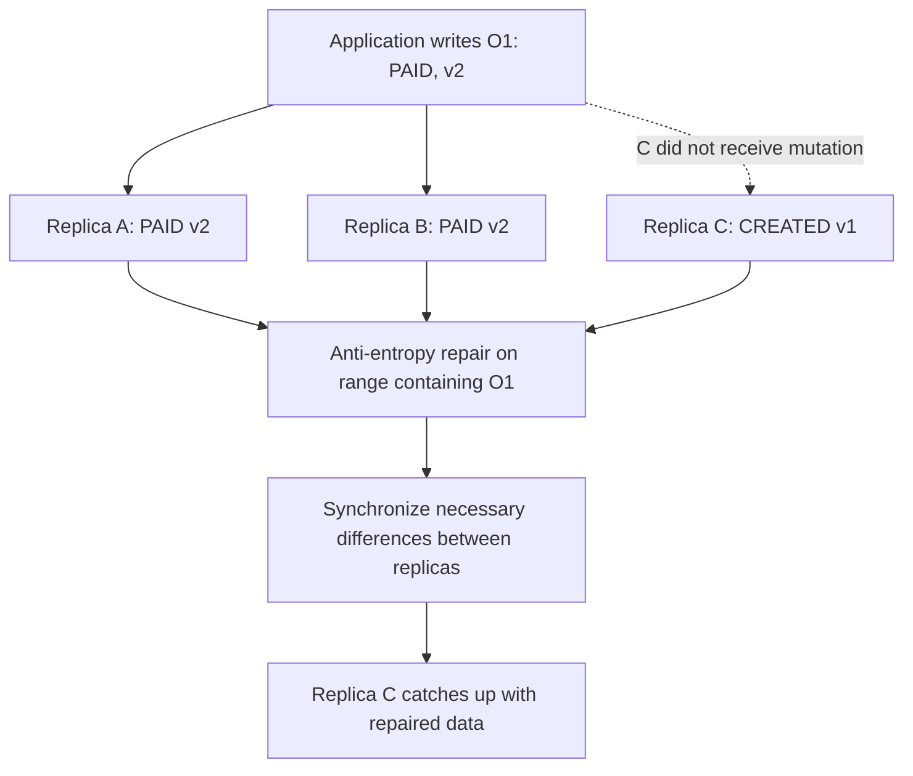
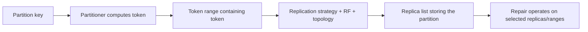
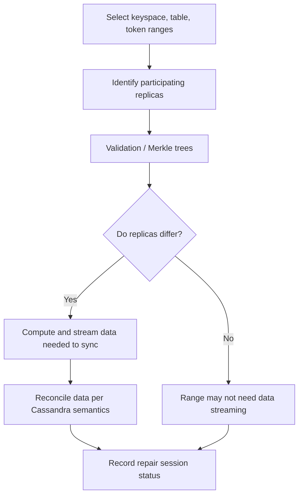
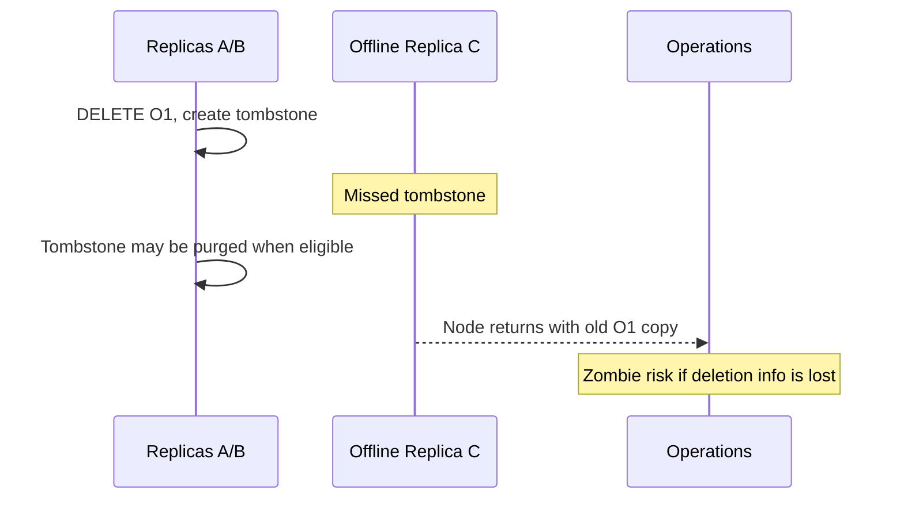

# Repair Objectives and Token/Table/Keyspace Scope in Apache Cassandra

## Learning Objectives

In the Apache Cassandra module, the **Repair** chapter focuses on making **replicas of the same data** converge again after periods of missed writes, disconnected nodes, or drift accumulated over time. This lesson answers two key questions:

1. **Why must repair be run if the cluster can still read and write?**
2. **Which data does a single repair run actually process when scoped by token range, table, or keyspace?**

After this lesson, you will be able to:

- Explain the purpose of *anti-entropy repair* and how it differs from **replication**, **hinted handoff**, **read repair**, **compaction**, and business data reconciliation across multiple tables.
- Understand the relationship between **partition key → token → token range → replica set** and the role of replication factor, datacenters, and vnodes in repair scope.
- Distinguish between **keyspace**, **table**, **token range**, and **primary range** scopes and the effects of combining them.
- Read and explain scoped `nodetool repair` commands; understand that running a command on **one node does not automatically repair the entire cluster**.
- Propose a safe repair plan, monitor status/errors, and recognize risks involving tombstones, `gc_grace_seconds`, and prolonged node absence.
- Use CQL and the Java Driver to inspect sample data, without mistaking data queries for a complete anti-entropy repair.

## 1. Objective: Replicas of the Same Partition Must Converge

Cassandra is a distributed **wide-column** database. A row is routed from its **partition key** through a partitioner algorithm to generate a **token**; the keyspace and its replication strategy determine which nodes store replicas for the corresponding token.

Suppose the `shop` keyspace uses `NetworkTopologyStrategy` with a replication factor (RF) of 3 in datacenter `dc1`. A partition with key `order_id = O1` may reside on three replicas: A, B, and C.

Initially, all replicas contain:

```text
O1, status = CREATED, version = 1
```

After updating the order to `PAID`:

- A and B received the mutation and contain `status = PAID, version = 2`;
- C was disconnected, so it still contains `status = CREATED, version = 1`;
- a write with an appropriate consistency level may have returned success even though C had not caught up.

When C comes back online, you cannot simply look at the `UN` (*Up/Normal*) cluster status and conclude that the data on C matches A and B. **Repair** is a mechanism to check and fix divergence between replicas for the selected token ranges and tables.



The objectives of repair include:

1. **Detecting disagreement:** identifying parts of data within the same token range that do not match across participating replicas.
2. **Data convergence:** exchanging/updating differing parts according to Cassandra's storage semantics so that replicas share a consistent state.
3. **Preserving delete safety:** ensuring replicas receive tombstones and handle deletions consistently, avoiding the risk of stale data reappearing when deletion markers are purged prematurely.
4. **Maintaining recoverability and reliability:** after a node or network failure, data is not merely "having enough replicas to answer queries" but is verified across the required replicas.

**Important limitation:** repair does not create data out of thin air. If all replicas have lost a piece of data or no valid copy remains, you must rely on backup/restore and investigate the root cause of data loss. Repair also does not guarantee that the application has enforced all business invariants correctly.

## 2. How Does Repair Differ from Other Mechanisms in Cassandra?

| Mechanism | Primary Purpose | Scans/compares broadly across token ranges? | What can it NOT replace? |
| --- | --- | --- | --- |
| **Replication** | Distributes mutations to replicas according to RF/topology | Not a periodic comparison process | Repair when a replica misses writes |
| **Hinted handoff** | Stores and replays some mutations for temporarily absent replicas within configured limits | Does not compare the full dataset | Repair when absent too long, or when hints are missing/expired |
| **Read repair** | Fixes some inconsistencies detected on the read path, depending on version/configuration | Not guaranteed to touch every partition | Anti-entropy repair covering data that is not read |
| **Anti-entropy repair** | Compares and synchronizes data across replicas for the selected scope | Yes, within the specified token/table scope | Reconciling business relationships between two logical tables |
| **Compaction** | Merges SSTables, reduces stored versions, and purges tombstones when safe | Does not compare data with other nodes by default | Repair between replicas |
| **Application reconciliation** | Compares a business source table with a derived read table or another system | According to application rules | Replacing repair between replicas of the same table |

For example, an application maintains two tables: `orders_by_id` and `orders_by_customer_month`. If `orders_by_id` has status `PAID` while the list table still has `CREATED`, the cause may be that **the application failed to propagate the change to the list table**. Repairing both tables **will not automatically turn** the status in the second table into `PAID`. It only synchronizes each table independently across its participating replicas.

Conversely, if the same row in `orders_by_id` differs between A and C, that is the exact type of divergence that anti-entropy repair is designed to fix.

### Does LOCAL_QUORUM Replace Repair?

With RF = 3 in a single datacenter, `LOCAL_QUORUM` typically requires acknowledgment from 2 out of 3 replicas. The overlap between read and write quorums improves consistency when prerequisites are met, **but the third replica can still miss mutations**. Infrequently accessed partitions may never trigger repair on the read path.

Therefore, **quorum does not mean every replica has been verified**. Proper repair scheduling remains an essential part of Cassandra operations.

## 3. Token: A Routing Unit, Not a Row Sequence Number

To understand repair scope, you must first distinguish between CQL keys and tokens.

Consider the table:

```sql
CREATE TABLE orders_by_id (
    order_id uuid PRIMARY KEY,
    customer_id uuid,
    status text,
    total_amount decimal,
    updated_at timestamp
);
```

Here, `order_id` is the partition key. The partitioner transforms this key into a token; in deployments using **Murmur3Partitioner**, tokens belong to the 64-bit signed integer space. Tokens do not represent order creation sequence, auto-incrementing IDs, or date ranges.

For another table:

```sql
CREATE TABLE orders_by_customer_month (
    customer_id uuid,
    order_month date,
    ordered_at timestamp,
    order_id uuid,
    status text,
    total_amount decimal,
    PRIMARY KEY ((customer_id, order_month), ordered_at, order_id)
) WITH CLUSTERING ORDER BY (ordered_at DESC, order_id ASC);
```

The partition key is **the pair `(customer_id, order_month)`**, not a single column. Thus, the token for this table is computed from **the entire composite partition key**.

In CQL, you can observe the token for a selected row:

```sql
-- Run in the keyspace containing the two example tables.
SELECT order_id, token(order_id) AS partition_token, status
FROM orders_by_id
WHERE order_id = 11111111-1111-4111-8111-111111111111;

SELECT customer_id, order_month,
       token(customer_id, order_month) AS partition_token
FROM orders_by_customer_month
WHERE customer_id = 22222222-2222-4222-8222-222222222222
  AND order_month = '2026-11-01'
LIMIT 1;
```

If the row does not exist, `SELECT` will return no results; the query above does not create data. The resulting token depends on the actual partitioner/key, and **you should never guess tokens from a UUID**.

### Token Ranges and Ownership

On the token ring, nodes are assigned segments of the token space. A segment is typically described by a **start token** and an **end token**, with boundary rules and potential **wrap-around** across the start/end of the ring.



Many clusters use **vnodes**: each node owns multiple tokens/ranges rather than a single contiguous segment. Consequently, "repair node A" does not simply mean "repair one fixed numeric interval." The actual scope consists of all ranges that A is responsible for storing according to ring metadata, together with the corresponding replicas for each range.

**Notably:** for the exact same token, keyspaces with different replication strategies or RFs can have **different replica sets**. You cannot determine a token range to repair while ignoring **the keyspace and topology**.

## 4. Three Dimensions of Scope: Token Range, Table, Keyspace

A `nodetool repair` command is understood as the **intersection of selection criteria**:

- **Which keyspace does the data belong to?**
- **Which table(s) within that keyspace?**
- **Which token ranges are included in the repair on the coordinating node?**

There are also **participating datacenter/host** scopes, repair modes (*incremental/full*), node states, and Cassandra version behaviors, though this lesson focuses on the three dimensions above.

### 4.1. Keyspace Scope

If you specify the `shop` keyspace, repair operates on **the selected tables within `shop`**, without crossing into another business keyspace such as `billing`.

For example, a keyspace might contain:

- `shop.orders_by_id`;
- `shop.orders_by_customer_month`;
- `shop.inventory_by_sku`.

Running repair in `shop` does not mean repairing every keyspace in the cluster. If no table is specified, the table scope within the keyspace is usually broader (all tables eligible under the command/version), so you should verify it before running in production.

**The keyspace also determines another critical factor:** the replication factor and `NetworkTopologyStrategy` configuration, which dictate which replicas must compare data together.

### 4.2. Table Scope

Specifying `shop.orders_by_id` lets you focus on **a single table**. This is useful when:

- One table recently experienced an outage or has a lagging replica.
- You need to split maintenance schedules by table groups to control duration and load.
- Certain large tables require their own dedicated repair windows.

However, if the keyspace also contains `orders_by_customer_month` and that table also has divergent replicas, **repairing `orders_by_id` alone will not fix it**. A read table that is inconsistent due to an application fan-out bug still requires **application reconciliation** even after each table's replicas match.

### 4.3. Token Range Scope

Specifying start/end tokens restricts repair to **partitions whose tokens fall within the selected range**, after intersecting with the ranges owned by the node and other command options.

Token-based repair is useful for:

- Splitting large workloads into manageable chunks.
- Retrying a failed segment without immediately re-running everything.
- Tracking progress and throttling work across token partitions.

Token ranges are **not equivalent** to `order_id`, `created_at`, or `customer_id` ranges. Two lexically close UUIDs can land in completely distant ranges. You cannot say "repair November's orders" simply by using a token range if the partition key does not encode the month accordingly; even with a composite key containing the month, hashing the token still does not partition sequentially by month.

### 4.4. Combined Scope Matrix

| Intended Command | Keyspace | Table | Token | Selection Result |
| --- | --- | --- | --- | --- |
| Repair `shop` on node A | `shop` | Tables covered by the command | Ranges A participates in under the chosen mode | Not automatically the entire cluster |
| Repair `shop.orders_by_id` on A | `shop` | Only `orders_by_id` | Selected ranges on A | Other tables are not repaired |
| Repair `shop` with `-pr` on A | `shop` | Eligible tables | **Primary ranges** of A | Only a portion of the full ring |
| Repair `orders_by_id` with start/end token | `shop` | `orders_by_id` | Intersection with the requested token interval | Only partitions in the intersected range |
| Repair another keyspace `billing` | `billing` | Tables in `billing` | Per node/mode | Does not affect `shop` data |

**Common mistake:** running `nodetool repair -pr shop` on **one node**, seeing the command succeed, and reporting "all of `shop` has been repaired." With `-pr`, that node only covers its own primary ranges. To cover the entire ring, you must schedule appropriately across **all required nodes**, accounting for topology/DCs and membership changes.

## 5. How Does the Anti-Entropy Repair Process Work?

Conceptually, anti-entropy repair on selected ranges involves the following phases:

1. **Determining scope and participating replicas:** the keyspace, tables, and token ranges are included in the repair session; the coordinator coordinates the required nodes based on replication/topology.
2. **Validation:** replicas inspect the data in the corresponding range, typically using a **Merkle tree** structure to represent and compare data contents.
3. **Comparing differences:** branches/ranges with mismatched digests are identified as needing synchronization.
4. **Streaming / synchronization:** necessary data is transferred and reconciled so that the participating replicas converge.
5. **Completion and state recording:** the repair session reports success/failure; incremental mode adds semantics for marking processed data as repaired/pending.



Details of validation, streaming, repair state, Merkle tree construction, and `repaired` metadata vary across Cassandra versions and execution modes. **Do not rely on this diagram to assume that repair creates transactional snapshots or always transfers only the exact changed rows at ideal granularity.**

### Repair Is Not Reading Every Row Through Java

A Java application can `SELECT` certain rows and compare them against a business source, but it cannot natively verify all replicas across all token ranges via normal CQL queries. Anti-entropy repair is a **cluster operations task**, typically invoked via `nodetool` or a compatible repair management tool, not a simple `SELECT` or `UPDATE` statement.

## 6. Practicing Scope with nodetool

**The commands below are for learning syntax and scope semantics, not instructions to run broadly in production right away.** Before using them, verify your Cassandra version, `nodetool` help output, topology, replication factor, available disk space, and maintenance window.

```bash
# Check help for the Cassandra version in operation.
nodetool help repair

# Check node health before scheduling.
nodetool status

# View ring/token and ownership information for the shop keyspace.
nodetool ring shop
```

### 6.1. Keyspace-Scoped Repair

```bash
# Repair tables in the shop keyspace according to the corresponding node/mode scope.
nodetool repair shop
```

The command is invoked on **one node**; its completion is not sufficient to infer that **all token ranges across the entire cluster** have been repaired. You must understand the selected ranges and how tooling or the operations team distributes the workload.

### 6.2. Table-Specific Repair

```bash
# Focus only on the orders_by_id table in the shop keyspace.
nodetool repair shop orders_by_id
```

When fixing a distributed inconsistency in a critical table, this scope is usually easier to evaluate than a keyspace with many very large tables. However, another list table in the same keyspace **is not automatically repaired** by running this command alone.

### 6.3. Primary-Range Repair with -pr

```bash
# Repair only the primary token ranges of the node running the command.
nodetool repair -pr shop orders_by_id
```

`-pr` stands for **primary range**. When scheduled to **run on each required node**, it helps avoid unnecessarily repairing the same range multiple times around the ring. However, running it on just one node means **only that node's primary ranges are covered**.

Scheduling across multiple nodes must account for cluster vnodes, datacenters, current topology, and avoid letting all nodes launch heavy repair sessions simultaneously. In certain versions or flag combinations, repair scopes across datacenters/hosts and primary ranges have specific rules; check `nodetool help repair` and your operational runbook accordingly.

### 6.4. Start/End Token Bounds

Some versions of `nodetool repair` provide `-st` (start token) and `-et` (end token) options, or their corresponding long-flag names.

```bash
# ILLUSTRATION ONLY: these two tokens are hypothetical numbers, unsuitable
# for running on a real cluster without checking ring/topology metadata.
nodetool repair -st 100000000000 -et 200000000000 shop orders_by_id
```

**Do not treat the two tokens above as defaults.** You must derive ranges from ring metadata, understand boundary handling and wrap-around, verify the partitioner type, and check option applicability in your version. An arbitrary token interval might also intersect very little—or not at all—with the ranges the current node participates in; in that case, the command will not achieve its intended goal.

### 6.5. Multi-Table Repair and Advanced Options

When you want to repair a keyspace with multiple tables, you can specify table names according to the syntax supported by your version, for example:

```bash
# Example when the version allows specifying a list of tables:
nodetool repair shop orders_by_id orders_by_customer_month

# Full repair, when this mode flag is supported:
nodetool repair -full shop orders_by_id
```

Notes:

- Options, incremental/full defaults, and flag combinations **can change across versions**.
- A repair command should not be interpreted as "having processed the entire keyspace on all nodes" without tracking scope and progress.
- Options that restrict datacenters or hosts must be used in accordance with topology, RF, and operational procedures; never arbitrarily exclude replicas from a plan while still claiming the whole cluster was checked.
- For large clusters, use a scheduler/token-range splitter capable of resuming work to avoid overlapping sessions or accidentally skipping ranges.

## 7. Full Repair and Incremental Repair Are Not "Token Scope"

Beyond the three scope dimensions, Cassandra also has **repair modes**:

- **Full repair**: checks and synchronizes data in the requested scope without restricting itself only to data not yet marked as repaired under the incremental mechanism.
- **Incremental repair**: uses `repaired` metadata/state to optimize repeated runs over data that has already been repaired, according to Cassandra version semantics. Repair sessions may involve `repaired`, `unrepaired`, or `pending repair` SSTables.

**These two choices do not replace the question "which keyspace, which table, which token range?"** A full repair applied to a single table on a single node still does not automatically cover every table and every range in the cluster.

| Selection Dimension | Example | Question Answered |
| --- | --- | --- |
| Keyspace | `shop` | Which namespace/replication policy does the data belong to? |
| Table | `orders_by_id` | Which table(s) undergo validation/sync? |
| Token | Primary ranges, a start/end interval | Which partitions are included in the scope? |
| Repair type | Full or incremental | Which dataset and repaired state are processed under version semantics? |
| Topology/DC | Relevant replicas/DCs | Which nodes need to coordinate to meet the consistency goal? |

**Do not mix full and incremental repair arbitrarily** without understanding SSTable states, your Cassandra version, and current operational procedures. Certain behaviors, default flags, and failed-repair recovery cases differ across Cassandra 3.x, 4.x, and newer versions. Therefore, production operations must rely on the documentation and `nodetool help` of the exact version running.

## 8. Scope on One Node Is Not the Whole Cluster

Suppose a cluster has nodes A, B, C, D, E, and F, RF = 3, all in a single datacenter and using vnodes.

A flawed assumption:

> "I logged into node A and ran `nodetool repair shop`; therefore all replicas of `shop` are now consistent."

The correct understanding:

- Node A participates in **the token ranges for which A is a replica**, not all token ranges belonging to other nodes.
- When repairing a range, the **relevant replicas** for that range coordinate together, but a single run on A does not automatically touch ranges in which A plays no role.
- `-pr` narrows the scope on A down to A's **primary ranges**; it certainly does not mean "repair the entire keyspace."
- When scheduling primary-range repair, you must ensure that **the combined runs across all required nodes cover the entire planned ring**, tracking completed ranges and failures.
- Vnodes create many ranges per node, so progress must be tracked by range coverage rather than just counting "how many machines it ran on."

### Visual Scope Example

Suppose a ring is divided into four conceptual primary range groups R1–R4. In this illustration, each group has one node with primary responsibility; the remaining replicas are determined by RF and topology.

| Primary Range | Hypothetical Primary Node | Selected if `-pr` is run only on A? |
| --- | --- | --- |
| R1 | A | May be selected |
| R2 | B | No |
| R3 | C | No |
| R4 | D | No |

In reality, Cassandra may use many vnodes and a much longer list of primary ranges. The table above only illustrates **range coverage**, not the exact ownership map of a 4-node cluster.

With multiple datacenters, the plan must also distinguish replicas in DC1/DC2, any DC-scoping options if used, and repair requirements per region. **Never infer cluster-wide RF from a single datacenter's RF.**

## 9. Tombstones, gc_grace_seconds, and Zombie Data Risks

For deletes, repair is not just about "which update is newer."

### Dangerous Scenario

1. Replicas A and B receive a `DELETE` for row O1 and store a **tombstone**.
2. Replica C is offline and thus retains the old O1 row.
3. Tombstones on A and B reach eligibility and are purged by compaction according to policy.
4. C comes back online after a prolonged absence, still holding the old data.
5. If no valid deletion marker remains for reconciliation, O1 risks **reappearing** (*zombie data*).



`gc_grace_seconds` is a key factor in tombstone retention duration, yet **it is not a timer that guarantees "definite deletion from disk"**: purging also depends on compaction and safety conditions. Operational strategy must ensure repair completes successfully at an appropriate frequency, preventing replicas from staying offline beyond the designed safety window.

If a node has been absent beyond the safe tombstone threshold, **do not assume simply restarting it and running a repair is enough**; you must evaluate replacement/rebuild/restore procedures and zombie-prevention steps appropriate to your version, data policy, and actual state.

### Do Not Confuse Repair with "Pushing Remaining Data to a New Node"

Repair is useful for comparing and fixing data between eligible replicas. Scenarios such as replacing a node, adding a datacenter, or recovering a node that lost all data may require dedicated **bootstrap/rebuild/replace/restore** workflows. Repair is not a universal substitute for backups or data-loss recovery.

## 10. Preparing a Controlled Repair Plan

### 10.1. Pre-Run Checks

1. **Version and topology:** document Cassandra version, partitioner, DC, rack, vnodes, node count, and any Down/Leaving/Joining nodes.
2. **Replication:** inspect the exact replication strategy/RF of each keyspace to repair; avoid assuming every keyspace uses RF = 3.
3. **Scope:** list keyspaces, tables, token ranges, `-pr` vs. explicit ranges, participating DCs, and initiating nodes.
4. **Completeness:** the aggregated plan must prove no required range or table is missed; a partial scope is only partial.
5. **Existing issues:** long-absent nodes, ongoing data streaming/movement, near-full disks, network errors, stream failures, compaction backlog.
6. **Cluster capacity:** bandwidth, disk I/O, CPU, free space, and impact on read/write p95/p99 latency.
7. **Deleted data:** offline duration relative to tombstone policy, lag since last repair, and potential need for separate zombie-data handling.
8. **Rollback/recovery capability:** backups/snapshots per policy and designated owners if repair encounters failures.

Never run a heavy `nodetool repair` across all nodes simultaneously just to "finish faster." Doing so can trigger overlapping validation/streaming tasks, spike disk and network load, and degrade application latency.

### 10.2. Single-Table Practice Runbook

Example: repairing `shop.orders_by_id`:

**Step A — Observe:**

```bash
nodetool status
nodetool ring shop
nodetool help repair
```

**Step B — Confirm scope:** choose to repair `orders_by_id` by primary ranges; list the nodes to run on, version, DC status, and a schedule that avoids overlap.

**Step C — Execute on a selected node from the plan:**

```bash
# Run on EACH node in the verified schedule;
# this command represents only one session on one node.
nodetool repair -pr shop orders_by_id
```

**Step D — Monitor:** track repair sessions, validation, streaming, timeout errors, and cluster impact; record node/range/table/start-end timestamps and outcome.

**Step E — Continue coverage:** proceed to the next scheduled session; aggregate completed ranges before declaring the table repaired across the entire ring.

**Step F — Verify:** review logs/metrics and range progress; for specific incidents, sample reads may be checked, **but a few SELECT queries do not prove all replicas/ranges match**.

### 10.3. Operational Observability Commands

Several useful commands, with availability and output formatting varying by version:

```bash
# Which nodes are alive and participating in the ring?
nodetool status

# Is any data streaming currently active?
nodetool netstats

# Compaction status—is there a backlog?
nodetool compactionstats

# Thread pool status / dropped messages when investigating load:
nodetool tpstats
```

Alongside CLI commands, inspect **repair logs**, JMX/metrics from your monitoring system, and disk/network alerts. Never treat the absence of active streams in `nodetool netstats` as proof that an entire repair session succeeded; a session may have failed during validation, been aborted, or covered only part of the scope.

## 11. Common Operational Mistakes

| Mistake | Consequence | How to Avoid |
| --- | --- | --- |
| Running `nodetool repair shop` on one node and reporting the whole cluster done | Ranges not owned by that node may remain unrepaired | Schedule coverage across nodes/token ranges |
| Running `-pr` on a single node only | Only that node's primary ranges are selected | Run across all required nodes per a full-ring plan |
| Mistaking `-pr` for "repair only one replica" | Misunderstands how replicas participate in repairing a range | Distinguish **selected range** from **replicas compared** |
| Repairing one table and assuming all tables in the keyspace are consistent | Other tables remain unchecked | Explicitly specify the table/keyspace list |
| Choosing tokens by ID or creation date | Misses the intended partitions | Understand the partitioner and read ring/token metadata |
| Assuming `LOCAL_QUORUM` or hints are sufficient | Long-absent replicas/cold partitions can still diverge | Maintain an anti-entropy repair schedule |
| Setting `gc_grace_seconds` shorter than repair capability | Risk of zombie data after deletes | Design to protect the tombstone/repair lifecycle |
| Mixing full/incremental arbitrarily without checking version | Unpredictable performance and repair state | Maintain version-specific runbooks |
| Running multiple heavy repairs concurrently | Spikes in validation, streaming, I/O, and latency | Limit concurrency and measure resources |
| Using repair to fix a list table not updated from source | Logical inconsistency remains even when same-table replicas match | Run application reconciliation from the source |
| Seeing a few matching reads and concluding the whole cluster is healthy | Leaves remaining ranges/partitions unverified | Check logs, sessions, and coverage |
| Using RF = 1 yet expecting repair to recreate lost data | No other replica exists to recover from | Verify RF/topology, backups, and restore procedures |

## 12. Java Driver: Limited Sampling, Not a Repair Substitute

The Java Driver 4.x is useful for observing **business outcomes via CQL**, but applications must never treat a handful of queries as a replacement for anti-entropy repair.

Example reading an order's status at `LOCAL_QUORUM`:

```java
import com.datastax.oss.driver.api.core.CqlSession;
import com.datastax.oss.driver.api.core.DefaultConsistencyLevel;
import com.datastax.oss.driver.api.core.cql.BoundStatement;
import com.datastax.oss.driver.api.core.cql.PreparedStatement;
import com.datastax.oss.driver.api.core.cql.Row;

import java.math.BigDecimal;
import java.util.UUID;

public final class OrderReadProbe {
    public record OrderState(UUID id, String status, BigDecimal total) {}

    private final CqlSession session;
    private final PreparedStatement selectById;

    public OrderReadProbe(CqlSession session) {
        this.session = session;
        this.selectById = session.prepare(
            "SELECT order_id, status, total_amount " +
            "FROM shop.orders_by_id WHERE order_id = ?");
    }

    public OrderState read(UUID orderId) {
        BoundStatement statement = selectById.bind(orderId)
            .setConsistencyLevel(DefaultConsistencyLevel.LOCAL_QUORUM);

        Row row = session.execute(statement).one();
        if (row == null) {
            return null; // Record is not present via this query.
        }

        return new OrderState(
            row.getUuid("order_id"),
            row.getString("status"),
            row.getBigDecimal("total_amount")
        );
    }
}
```

**Limitations of this example:**

- `LOCAL_QUORUM` requires the keyspace to have an appropriate RF/topology; otherwise the query may fail or not behave as intended.
- A valid row result does not prove every replica stores the same data; Cassandra may query different replicas or repair some discrepancies on read depending on mechanism/version.
- If `shop.orders_by_customer_month` still holds a different status, Java can compare the two read paths, but that is **logical cross-table reconciliation**, not anti-entropy repair.
- During cluster incidents, the application should log timeouts, consistency levels, policy-approved request tracing, and read timestamps; never silently downgrade to `CONSISTENCY ONE` and claim data is accurate just because the query succeeded.
- To run repair, use `nodetool` or an approved repair management system; do not attempt to scan every partition through a standard Java endpoint.

## 13. Practice Exercises

### Exercise A: Choosing Repair Scope

Suppose a cluster has six nodes A–F, RF = 3, single datacenter, using vnodes. Keyspace `shop` has three tables:

- `orders_by_id`;
- `orders_by_customer_month`;
- `inventory_by_sku`.

During a network incident, node C missed some writes to `orders_by_id`; simultaneously, an application bug caused `orders_by_customer_month` to miss some updates, though all replicas of the list table agree on that stale value.

Answer the following:

1. Which issue can repairing `shop.orders_by_id` resolve? Can it fix the missed-update bug in the list table?
2. If you only run `nodetool repair -pr shop orders_by_id` on node A, what cannot yet be concluded about other token ranges?
3. If you run `nodetool repair shop` on node A, how does the table scope change compared to naming only `orders_by_id`?
4. If you want to recover a suspect token range, where should you obtain the start/end tokens from? Why not use an order creation date range?
5. Which metrics/logs must be checked before announcing repair completion?

**Answer hints:** repairing the same table helps replicas converge within the selected scope; the derived-table update bug must be fixed at the application layer. `-pr` on A does not cover primary ranges of B–F. Repairing `shop` widens the table scope but still depends on the token scope of the initiating node. Tokens must come from ring/partitioner metadata; inspect logs/sessions, errors, and coverage.

### Exercise B: Scope and Tombstones

Product P1 was deleted while replica C was offline for a long period. A and B already hold tombstones. C returns after an absence exceeding the team's expected tombstone retention window and runs repair.

1. Why does this create a risk of stale data reappearing?
2. Does repairing **one table** help records belonging to **another table**?
3. If the necessary tombstones were purged before C returned, can you promise that running repair will definitely restore the deleted state?
4. What must be investigated: offline duration, `gc_grace_seconds`, repair schedule, compaction, SSTables, backups, and how the node was brought back?

**Hints:** a tombstone is deletion evidence that must propagate to the replica that missed it. Once lost before the stale replica is handled, repair has no guarantee of inferring "it was once deleted." Safe recovery/replacement procedures are needed rather than blindly re-running a command.

### Exercise C: Designing a Coverage Schedule

Suppose a keyspace has 12 tables, two of which are very large and receive heavy write load. Operations must complete repairs on a cycle aligned with tombstone policy.

1. Would you schedule by table, by token range, or a combination of both? Why?
2. How can you prove that **all primary ranges across the entire ring** have been covered?
3. During peak hours, how do you limit concurrency, I/O, network usage, and impact on query p99?
4. Under what conditions would you pause repair or switch to investigating a node instead of continuing?
5. If a session succeeds only partially, what details must a checkpoint record so backfill runs can resume cleanly?

**Hints:** record keyspace, table list, node/DC, token range, repair mode, timestamps, outcomes, and warnings. Track ranges/tables **not yet completed**, rather than merely storing a flag saying "repair ran on node A." Avoid running too many concurrent validation/streaming tasks; follow procedures suited to your version and cluster resources.

## Summary

**The goal of anti-entropy repair** in Apache Cassandra is to help **replicas of the same data** converge across selected scopes, especially after nodes miss mutations or when the system faces divergence or unsafe tombstone purging risks. Repair is distinct from replication, read repair, hinted handoff, compaction, and business reconciliation between derived tables.

To understand what a repair run actually accomplished, always identify **which keyspace, which tables, which token ranges, which nodes/datacenters, and which repair mode**. Partition keys determine tokens; replication strategy and RF determine replicas; vnodes make a single node's scope consist of multiple ranges. `nodetool repair -pr` on one node processes only that node's primary ranges and does not automatically synchronize the entire cluster. Proper repair also requires **a coverage schedule, status checks, performance monitoring, failure handling, tombstone/compaction alignment, and safe recovery procedures for long-absent nodes**. When a read table is wrong because the application failed to fan out updates, use **application reconciliation**—do not expect replica repair to fix business logic.
