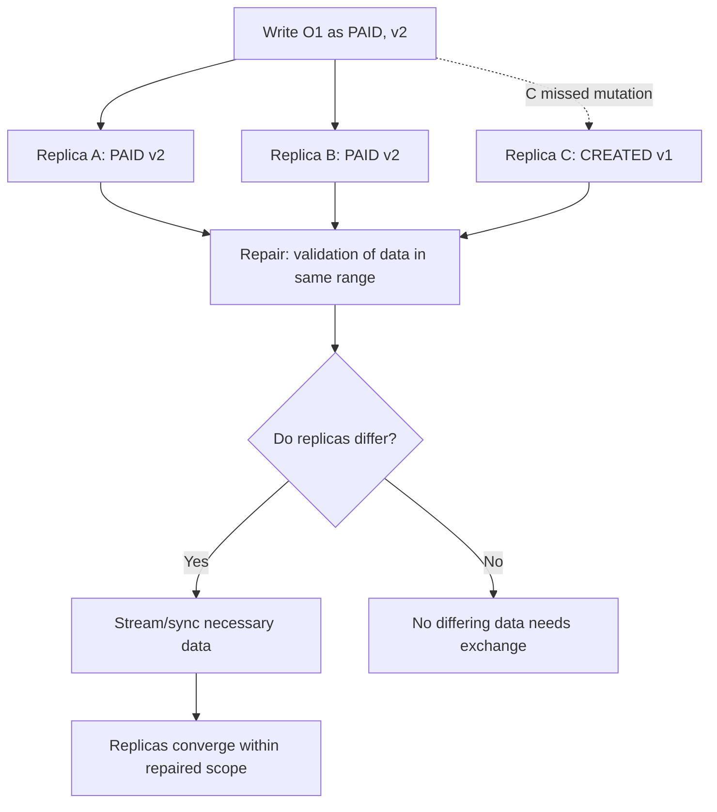
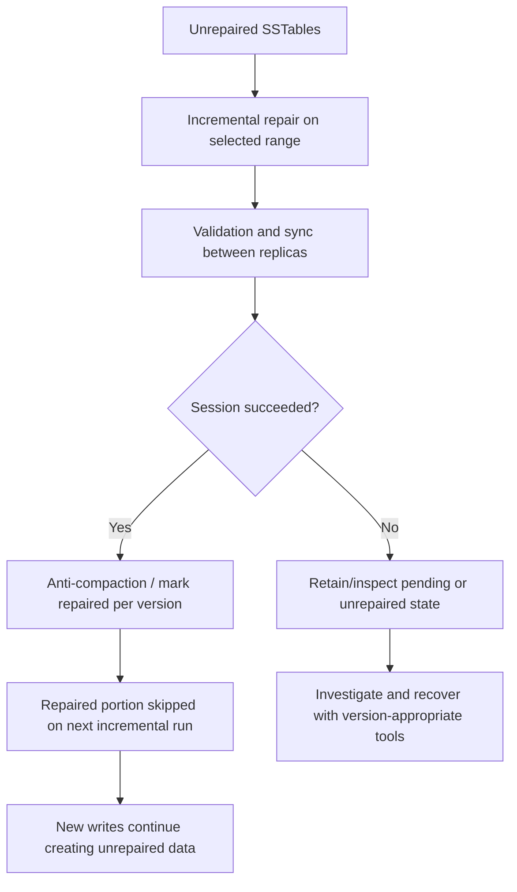
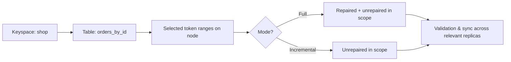
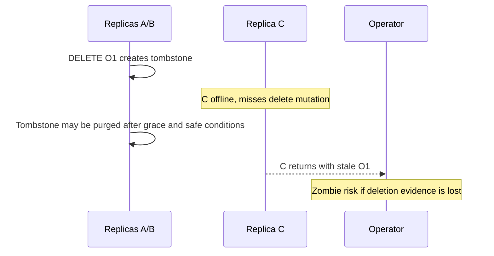

# Full Repair vs. Incremental Repair in Apache Cassandra

## Learning Objectives

In the **Repair** chapter of Apache Cassandra, both **full repair** and **incremental repair** aim to synchronize data across the replicas responsible for storing the same token range. However, they **differ in the dataset examined, post-repair SSTable state, resource overhead, and scheduling strategy**.

After this lesson, you will be able to:

1. Explain the *anti-entropy repair* mechanism and why replication, `LOCAL_QUORUM`, hinted handoff, or read repair do not automatically replace periodic repair.
2. Describe the **repaired**, **unrepaired**, and—in versions with the corresponding mechanism—**pending repair** states; understand the role of **anti-compaction** after incremental repair.
3. Compare full and incremental repair by data scope, I/O load, duration, coverage of historical data, and operational cost.
4. Read `nodetool repair` syntax, choose the right **keyspace/table/token ranges**, and avoid mistaking running on one node for completing the entire cluster.
5. Design a repair schedule based on **replication factor**, topology/datacenter, node offline duration, tombstone policy, and `gc_grace_seconds`.
6. Handle failed repair scenarios, nodes restored from snapshots, lingering `pending repair` data, and overlapping runs.
7. Distinguish inspection via CQL/Java from evidence that an anti-entropy repair session succeeded.

> **Version scope:** Cassandra has significantly changed how incremental repair is managed across versions, especially from 3.x to 4.x and later releases. The mechanism descriptions below build a mental model; before running actual commands, verify `nodetool help repair`, documentation for your exact version/distribution, and your cluster's policies. Do not assume the same flags or defaults behave identically across all environments.

## 1. Context: Why Can Replicas Diverge Even When Writes Succeed?

Cassandra is a distributed **wide-column** database. A **partition key** is transformed by the partitioner into a **token**; combining the token with the replication strategy and replication factor (RF), the system determines which nodes store replicas of the partition.

Suppose keyspace `shop` uses `NetworkTopologyStrategy` with RF = 3 in datacenter `dc1`. For the partition containing order O1, the three hypothetical replicas are A, B, and C.

```text
Initially:
  A: order O1 -> status = CREATED, version = 1
  B: order O1 -> status = CREATED, version = 1
  C: order O1 -> status = CREATED, version = 1

While C is disconnected, the application updates:
  A: order O1 -> status = PAID, version = 2
  B: order O1 -> status = PAID, version = 2
  C: order O1 -> status = CREATED, version = 1
```

If a write at `LOCAL_QUORUM` is acknowledged by 2 of the 3 eligible replicas, the application may have received a success response while C lagged behind. When C returns to `UN` (*Up/Normal*), the fact that the node is up **does not prove** all data on the node has converged.

**Anti-entropy repair** compares stored data versions across the participating replicas for the specified token range and synchronizes differences according to Cassandra's semantics.



### What Repair Does and Does Not Do

Repair targets consistency **across replicas of the same table and token range**; it does not enforce business rules spanning multiple tables.

| Mechanism | Helps Resolve | Does Not Automatically Guarantee |
| --- | --- | --- |
| Replication | Stores multiple copies and routes writes | Every replica always receives every mutation on time |
| Hinted handoff | Replays some missed writes within hint retention limits | Recovering all drift, especially after prolonged absence |
| Read repair | Fixes some discrepancies observed on the read path, depending on version/configuration | Scanning all partitions, including rarely read ones |
| Anti-entropy repair | Compares and synchronizes replicas within the requested scope | Verifying business JOINs or missing events between two logical tables |
| Compaction | Merges SSTables and removes eligible data/tombstones | Comparing data across nodes in place of repair |
| Application reconciliation | Compares a canonical source table with a derived table per application rules | Replacing repair across replicas of the same table |

If `orders_by_id.status` is already `PAID` while `orders_by_customer_month.status` is still `CREATED` on **all** replicas of the list table, running full repair on both tables still has no way of knowing the application should synchronize state between them. That is a **fan-out/projection** bug requiring application-layer reconciliation.

## 2. Storage Foundation: Memtable, SSTable, and Repaired State

To understand full vs. incremental repair, you need to know how Cassandra stores data.

A mutation is accepted into the commit log and memtable on the write path. Data in the memtable is flushed into immutable **SSTables**; multiple SSTables may hold different versions or tombstones for the same data. Compaction merges SSTables according to the configured strategy.

The repair mechanism uses SSTable metadata to distinguish several data subsets:

- **Unrepaired:** data/SSTables not yet marked as having completed an eligible incremental repair. New writes typically belong to this unrepaired set.
- **Repaired:** SSTables or data segments that have gone through a successful incremental repair and been marked accordingly; this is a **technical data state**, not "guaranteed business-correct."
- **Pending repair:** some Cassandra versions use a transient state for SSTables participating in an in-flight incremental repair session; if a session fails, inspection and cleanup procedures are needed for any remaining pending state.

Note that a single table can contain **both repaired and unrepaired data** at the same time. You should not treat "this table is repaired" as a permanent property of the entire table: after a repair finishes, new writes keep arriving and other token ranges may still remain unprocessed.

### What Is Anti-Compaction Used For?

During incremental repair, Cassandra may need to split participating SSTables into portions matching the repaired range, and then mark the repaired state once the session succeeds. This process is called **anti-compaction**.

Unlike regular compaction (merging files for read/storage efficiency), anti-compaction is tied to **splitting/marking data by repair state**. It carries I/O, disk, and metadata costs and can affect future SSTable layout and compaction behavior.



**Do not confuse:** anti-compaction is not a "replacement for repair," and the repaired flag is not an application-level validation constraint. Fixing data from a source of truth, replaying events, or comparing two logical tables are separate tasks.

## 3. What Is Full Repair?

**Full repair** instructs anti-entropy repair to inspect data belonging to the **selected keyspace/table/token scope**, including both portions **already marked repaired** and **unrepaired** portions under the respective repair model.

At its core:

1. Select the repair scope and identify responsible replicas.
2. Validate/compare data within the scope, typically using Merkle trees and version-specific coordination steps.
3. Synchronize necessary differences among participating replicas.
4. Record completion/failure status of the full repair session.

Full repair **does not turn the entire cluster into an atomic snapshot**, nor does it automatically repair ranges, tables, or keyspaces outside the selection.

### What Data Does Full Repair Look At?

Suppose within the same range there exist:

- Group **H:** older records residing in repaired SSTables from previous cycles.
- Group **N:** new writes not yet incrementally repaired, residing in unrepaired SSTables.

A full repair in the selected range targets **both H and N**, not just N. This is useful when you need to re-evaluate data previously marked repaired that now shows signs of divergence—for example, after a recovery incident or topology change that must be addressed per runbook.

**Key point:** A regular full repair **does not mark all unrepaired SSTables as repaired under the incremental mechanism** merely because the full session succeeded. If your operational strategy relies on repaired/unrepaired state for incremental repair, you must understand this effect.

### When to Consider Full Repair

- Suspecting **drift inside data already marked repaired**, not only recent writes.
- After a **recovery/restore** procedure that rendered incremental repair metadata or history untrustworthy, requiring re-verification of actual ranges.
- Investigating a hard-to-explain incident where incremental repair succeeds yet observed data remains suspect.
- Performing **policy-mandated periodic audits**, after budgeting for the full validation load.
- Repairing a specific scope where incremental repair is no longer appropriate given cluster/version state; decisions must be based on prior repair session states rather than guesswork.

Do not assume full repair "fixes all data loss." If no replica still holds valid data, repair has no source to reconstruct lost records; proper backup/restore is required. If delete tombstones were purged before an old replica returned, full repair cannot know the application's deletion history on its own.

## 4. What Is Incremental Repair?

**Incremental repair** focuses on data **not yet marked repaired** within the selected scope, avoiding re-validating the entire historical dataset already repaired in previous cycles.

Conceptually, an incremental repair cycle:

1. Identifies the keyspace, tables, token ranges, and participating replicas.
2. Selects data/SSTables belonging to the **unrepaired** subset within scope.
3. Validates and synchronizes across replicas per version semantics.
4. Upon successful completion, performs **finalization/anti-compaction/repaired marking** steps if required by the version and case.
5. Subsequent new writes continue creating unrepaired data for the next cycle.

Incremental repair can reduce repeated work when **most historical data is immutable/unchanged** and repairs run regularly and complete reliably. However, it still consumes CPU, I/O, network, and disk space during validation, streaming, and anti-compaction; it is not "free repair."

### Can Incremental Repair Skip Corrupted/Divergent Data?

An incremental repair run generally does not re-examine all **repaired data**. When repaired metadata is accurate and the system operates as expected, this is an intentional optimization. However, if data marked repaired **is not truly synchronized** due to an abnormal incident or restore, subsequent incremental runs may not be enough to re-evaluate that subset. A full repair on an appropriate scope can serve as a complementary tool when doubt exists.

On the other hand, do not conclude that "incremental always misses updates to old rows." A row residing in a repaired SSTable can be updated **by a new mutation**; that mutation typically enters the new unrepaired data subset and will be processed by incremental repair. You must distinguish a **business row** from **data inside an SSTable marked repaired**.

### When Incremental Repair Needs Special Monitoring

- Count/age of **unrepaired SSTables** grows because cycles fail to finish.
- Anti-compaction/compaction creates disk pressure or fragments data into many files.
- A failed session leaves `pending repair` state or sessions needing cleanup.
- Uncontrolled overlapping repairs cause sessions to contend for resources/ranges.
- Token ranges or tables are accidentally omitted from the schedule and stop getting repaired regularly.
- A node stays absent too long, leading to unsafe data/tombstone state beyond what simply starting a normal incremental repair can safely fix.

## 5. Full vs. Incremental Repair Comparison Table

| Criterion | Full Repair | Incremental Repair |
| --- | --- | --- |
| **Dataset examined** | Data in the selected scope, including both repaired and unrepaired | Primarily the **unrepaired** subset per repair metadata |
| **Operational goal** | Re-check the complete scope | Optimize recurring cycles over new/unrepaired data |
| **Effect on repaired state** | Typically does not mark unrepaired as repaired like incremental | Includes finalization/anti-compaction, marking repaired on success |
| **Validation** | Can be large if the scope holds lots of historical data | Can be smaller when unrepaired accounts for a small share |
| **Streaming of diffs** | Depends on actual differences between replicas | Depends on differences within participating data |
| **Disk I/O, CPU, network** | Often higher when scanning lots of historical data | May be lower, but adds anti-compaction/metadata overhead |
| **SSTable/compaction pressure** | From validation, streaming, and subsequent activity | In addition to validation/streaming, splits SSTables by repair state |
| **Risk when coverage is incomplete** | Full on one node/range does not help skipped ranges | Incremental on one node/range also does not help skipped ranges |
| **Risk of anomalous repaired data** | Can re-verify that portion within the selected scope | May skip re-checking data already marked repaired |
| **Periodic strategy** | Usable per policy, but requires an I/O budget | Commonly used for periodic cycles if version/cluster support it well and operations are stable |
| **After hard-to-diagnose failures** | Consider per version guidance and specific scope | Must handle leftover pending state/sessions rather than retrying blindly |
| **Cross-table business correctness** | Does not verify derived tables against source | Neither does incremental |

You cannot declare "full is always better" or "incremental is always faster" in every situation. When most SSTables are still unrepaired, incremental may do nearly as much work as full plus state-management overhead. When new data is tiny compared to history, incremental can save substantial validation work.

### Quantitative Validation Volume Example

Suppose a token range across replicas holds **1 TiB of data in scope** by your internal measurement, of which roughly **950 GiB** is in repaired state and **74 GiB** is in unrepaired state.

- A full repair may have to validate **a very large portion of 1 TiB**.
- An incremental repair on the same scope can focus on the **~74 GiB unrepaired portion**, plus version-specific overhead and required metadata.

Those two numbers are only to illustrate scale; **you cannot linearly extrapolate** runtime or stream traffic from them. Repair normally validates data locally at each replica, and **streams data only where differences exist**, rather than streaming every scanned byte. SSTable count, compaction state, concurrency, Merkle trees, hotspots, and inter-node network links can make actual cost diverge far from byte ratios.

## 6. Keyspace, Table, and Token Range Scope Are Independent of Repair Mode

Choosing **full or incremental** does not answer the question **where to repair data**.

A repair command has multiple selection dimensions:

- **Keyspace:** which namespace and replication policy the data belongs to.
- **Table:** which single table or set of tables.
- **Token ranges:** which partitions have tokens falling in the selected range, intersected with ranges owned by the node.
- **Node/datacenter/replica:** which members must coordinate per topology.
- **Mode:** full or incremental.



**Specifically:** Cassandra uses the partition key to compute tokens. Tokens are not creation dates, sequence numbers, or contiguous UUID intervals. A table with composite partition key `(customer_id, order_month)` has its token computed from **both** fields.

With **vnodes**, one node owns multiple token ranges. With `-pr` (*primary range*), the command selects **the initiating node's primary ranges**, which does not mean running on one node finishes the whole ring.

### CQL Illustrating Partition Keys and Tokens

```sql
-- Assume the shop keyspace is already selected.
CREATE TABLE orders_by_id (
    order_id uuid PRIMARY KEY,
    customer_id uuid,
    status text,
    total_amount decimal,
    updated_at timestamp
);

CREATE TABLE orders_by_customer_month (
    customer_id uuid,
    order_month date,
    ordered_at timestamp,
    order_id uuid,
    status text,
    total_amount decimal,
    PRIMARY KEY ((customer_id, order_month), ordered_at, order_id)
) WITH CLUSTERING ORDER BY (ordered_at DESC, order_id ASC);

-- Inspect tokens for rows with specific keys.
SELECT order_id, token(order_id) AS partition_token
FROM orders_by_id
WHERE order_id = 11111111-1111-4111-8111-111111111111;

SELECT customer_id, order_month,
       token(customer_id, order_month) AS partition_token
FROM orders_by_customer_month
WHERE customer_id = 22222222-2222-4222-8222-222222222222
  AND order_month = '2026-11-01';
```

If those rows do not yet exist, `SELECT` returns empty results; that is not an error of the token function. Tokens are determined by the partitioner and cannot be inferred directly from a UUID.

### Why Table Scoping Matters

A keyspace can hold both tiny tables and massive tables. If only `orders_by_id` has an issue, repairing that table alone can limit load and duration; however, a successful repair of that table does not guarantee `orders_by_customer_month` has been repaired or that business data across both tables matches.

If a row in the list table was missed because the application failed to write it, repairing both tables **still will not recreate that row** from the canonical source table. **Application reconciliation** is needed—not switching full to incremental or vice versa.

## 7. nodetool Commands: Explicitly Choose the Mode Before Running

**Operational warning:** the commands below illustrate common syntax in Cassandra versions using `nodetool repair`. Incremental/full defaults, option flags, and repair modes can vary by version/distribution. Never apply directly in production without verifying first:

```bash
nodetool help repair
nodetool status
nodetool ring shop
```

### 7.1. Full Repair of a Keyspace and Table

```bash
# Full repair within the table and token range scope of the target node.
nodetool repair -full shop orders_by_id
```

You can use the long form `--full` if confirmed by your version. Full here means **full across the dataset examined**, not full in the sense of automatically covering the entire cluster.

### 7.2. Incremental Repair

```bash
# Some modern Cassandra versions default to incremental.
# CHECK help/defaults before using this command in production:
nodetool repair shop orders_by_id
```

If your version supports an explicit incremental flag (such as `-inc` / `--inc`), you may use it after verifying help output and operational standards. **Do not infer** the mode solely from a bare `repair` command without checking your version and tooling.

### 7.3. Mode and Primary Range Are Two Separate Choices

```bash
# Primary ranges, version-default mode:
nodetool repair -pr shop orders_by_id

# Example of full repair on primary ranges if your version supports
# combining these options as shown in help:
nodetool repair -full -pr shop orders_by_id
```

To cover the entire ring with primary-range repair, you must **schedule across all necessary nodes and verify coverage**. Do not run `-pr` on node A and conclude all primary ranges of nodes B/C/D have been handled.

### 7.4. Start/End Token Bounds

In versions supporting `-st` and `-et`:

```bash
# The tokens below are ENTIRELY HYPOTHETICAL.
# Do not use as real values without reading ring/topology metadata.
nodetool repair -full -st 100000000000 -et 200000000000 shop orders_by_id
```

The command only processes token ranges intersecting the requested bounds and the ranges owned/participated in by the target node/replicas. Ring wrap-around and version-specific flag combination restrictions must be considered.

### 7.5. Why Not Run Broadly on All Nodes Simultaneously?

Launching many repair sessions across the entire cluster at once easily causes overlapping validation, streaming, CPU, and I/O spikes—especially when each node owns many vnodes. If scheduling by node/range, use an orchestrator capable of tracking completed ranges/tables and enforcing concurrent repair limits.

**Do not equate:** an exit code 0 on node A means that session reported completion for its selected scope—it does not prove the entire cluster was scanned, no data was lost, or all logical tables share consistent business state.

## 8. Full and Incremental in an Operational Cycle

A cluster with lots of mostly static historical data plus daily new writes can consider a periodic repair strategy built around incremental repair, combined with full repair at approved, load-budgeted intervals or incidents.

### Illustrative Cycle

| Timing | Activity | Reason |
| --- | --- | --- |
| Start of cycle | Check topology, RF, repair backlog, tombstones, and node health | Avoid running when the cluster is unhealthy |
| Daily or on *calculated* cadence | Non-overlapping incremental repair by table/token ranges | Process new unrepaired data within selected scope |
| On anomalies | Investigate pending repair, stream/validation errors, repaired/unrepaired backlog | Prevent failed sessions from looping endlessly |
| When repaired data is suspect | Full repair on a well-defined scope after assessment | Re-validate portions already marked repaired |
| After node recovery/restore | Follow version-specific recovery runbook; may need rebuild/replace/full repair | Repaired metadata and token ownership may no longer align |
| End of cycle | Aggregate coverage per keyspace/table/range and success status | Prove no ring segments were missed |

**Do not treat "daily incremental, monthly full" as a universal recommendation.** Actual cadence must be grounded in data volume, churn rate, measured runtime, tombstone/grace requirements, load tolerance, and Cassandra version.

### Simple Capacity Exercise

Suppose:

- Total data managed in scope is very large.
- Each day adds or modifies 2% of the range's data, roughly reflected in bytes of unrepaired SSTables.
- Each week has a limited maintenance window, and deletions must reach replicas within a safe timeframe.

Incremental repair can reduce repeated validation when most repaired data remains intact, yet that is not enough to claim cost is strictly 2% of full repair: compaction, tombstones, SSTable fragmentation, and write patterns can make unrepaired data exceed 2%. You should measure **bytes validated, bytes streamed, duration, SSTable counts, and disk I/O**.

Increasing incremental frequency too aggressively introduces fixed per-session startup overhead and overlap risks. Decreasing frequency too much grows the unrepaired backlog and elevates delete/offline-replica risks.

## 9. Tombstones and gc_grace_seconds: Why Repair Scheduling Is a Data Safety Issue

In Cassandra, `DELETE` and many TTL expirations generate **tombstones**. Tombstones are records that must be propagated to replicas so stale data does not resurrect. Compaction can drop tombstones when safety conditions allow, yet **`gc_grace_seconds` is not an exact guaranteed physical deletion timer**.

### Zombie Data Example

1. A and B receive a delete for row O1; tombstones exist on A and B.
2. C is offline and retains the old version of O1.
3. C fails to receive the tombstone within the required window.
4. Over time and under compaction conditions, tombstones on A and B may get purged.
5. C returns with the old data; since the required deletion evidence is gone, O1 risks reappearing.



### Is Full Safer Than Incremental Against Zombies?

There is no answer independent of scope and repair state:

- If the tombstone resides in **unrepaired data** and an incremental repair covers the right token/range, table, and participating replicas before the marker is purged, it can help converge the data.
- If the tombstone or affected data lies in a portion already marked repaired yet state is still wrong due to an anomaly, full repair can re-inspect a wider scope.
- If the tombstone **has already been lost across all relevant replicas** while an old copy persists on another node, neither full nor incremental repair **can reliably infer that the application once deleted that row**.

Thus, the safety requirement more fundamental than mode choice is that **every required replica completes repair successfully on an appropriate cadence before needed tombstones can be purged**, paired with procedures for nodes offline too long. When a node has been offline past the safety threshold, evaluate proper replace/rebuild/restore procedures rather than simply bringing the node back and trusting one repair to solve everything.

**Never lower `gc_grace_seconds` arbitrarily** just to reduce tombstones; any change must account for replica/repair strategy, maximum offline duration, topology, and version-appropriate guidance.

## 10. When Incremental Repair Fails

Do not just see a timed-out `repair` command and blindly re-run it. Incremental repair can involve `pending repair` metadata, repair sessions, or partial anti-compaction (depending on version). Distinguish carefully:

| Scenario | Risk | Controlled Action |
| --- | --- | --- |
| Validation timeout | Insufficient evidence to conclude range is synced | Record range/table/node, investigate load, retry exact scope per runbook |
| Streaming error / network drop | Replicas may not have received all needed data | Verify session state, restore network/disk stability before retrying |
| Incremental session fails during finalize | Data may remain in pending state or unmarked as repaired | Inspect logs and version-appropriate repair admin tools; do not hand-edit SSTable metadata |
| Node Down/Joining/Leaving | Replica set and ownership may shift | Pause/re-evaluate repair schedule against stable topology |
| Near-full disk / compaction backlog | Anti-compaction/streaming adds extra resource pressure | Shed load and resolve capacity before restarting |
| Overlapping repairs | Wastes I/O, obscures which scope is verified | Coordinate non-overlapping sessions, manage schedule by table/range |
| Data restored from old snapshot | Repaired metadata may not reflect actual cluster state | Follow recovery procedure; evaluate full repair/replace per version |
| Outage exceeded tombstone grace | Zombie risk if node is merely restarted | Investigate retention, repair history, rebuild/restore/replace |

### Runbook for Investigating an Anomalous Incremental Session

1. **Do not declare completion** after seeing only a subset of ranges succeed. Record table, node, datacenter, range, and session ID.
2. Check command output, repair logs, validation/streaming/anti-compaction errors, progress, and nodes missing data.
3. Check version-specific repair session management capabilities, such as repair admin tools if supported. Avoid manually editing SSTables or metadata files.
4. Cross-check free disk space, compaction backlog, network, JVM/GC pauses, and other active repair tasks.
5. Identify the scope **not yet completed**, fix the root cause, and run backfill with controlled mode and scope.
6. When repaired state is in doubt, consider a **scoped full repair** within your operational plan—do not treat it as an "absolute safety reset button."
7. Aggregate results and update schedules/alerts so no token ranges are silently dropped later.

## 11. Scheduling Repair to Guarantee Coverage

A solid runbook must answer precisely: **which token ranges of which tables/keyspaces have been repaired successfully, and which required replicas participated?**

### 11.1. Do Not Measure Coverage by "Number of Nodes Where the Command Ran"

With RF = 3 and vnodes, each node typically owns many token segments. One repair run on node A may coordinate A with the other replicas of each range A owns, but it does not automatically touch ranges unrelated to A.

`-pr` restricts a run on A to **A's primary ranges**, not "comparing A only with itself." If using a primary-range schedule, you must cover all primary ranges via runs on **all necessary nodes**, and account for token ownership changes when nodes are replaced or topology changes.

### 11.2. Per-Table/Range Coverage Ledger

You can maintain a maintenance tracking ledger such as (for operational illustration only):

| Keyspace | Table | Token Group | Initiating Node | Mode | Status |
| --- | --- | --- | --- | --- | --- |
| `shop` | `orders_by_id` | R1 | A | Incremental | Verified succeeded |
| `shop` | `orders_by_id` | R2 | B | Incremental | Pending execution |
| `shop` | `orders_by_customer_month` | R1 | A | Full | Completed, logged |
| `shop` | `orders_by_customer_month` | R2 | B | Full | Stream error, needs backfill |

Labels R1/R2 represent real ranges from ring metadata; **they are not fixed arbitrary tokens applicable to every cluster**. Plans must account for per-DC replication and valid flag combinations for your version.

### 11.3. Metrics to Monitor

- Time since **last successful repair** per table/range, not merely last repair started.
- Total bytes validated, bytes streamed, differences/failed repair sessions per node and table.
- Count, size, and age of **unrepaired SSTables**, where exposed by tools/version.
- **Pending repair** status and anti-compaction or compaction backlog where available.
- Free disk space, disk IOPS, network throughput, CPU, GC pauses, and timeouts during repair windows.
- Read/write p95/p99 latency and dropped messages to protect application workloads.
- Node downtime relative to tombstone policy and repair state in the relevant datacenter.

**Alert thresholds should be grounded in empirical baselines**, such as runtime exceeding thresholds for the same scope, an unrepaired backlog growing across multiple cycles, or a range repeatedly skipped.

## 12. A CQL and Java Driver Example for Observation, Not Replacing Repair

A Java application can query sample data to verify the read path after cluster remediation. It does **not** verify all replicas or transition SSTable repaired/unrepaired state.

### Creating Sample Data

Assuming keyspace `shop` already exists with an appropriate RF:

```sql
USE shop;

INSERT INTO orders_by_id (
    order_id, customer_id, status, total_amount, updated_at
) VALUES (
    11111111-1111-4111-8111-111111111111,
    22222222-2222-4222-8222-222222222222,
    'CREATED', 250000.00, '2026-11-21T01:00:00Z'
);

UPDATE orders_by_id
SET status = 'PAID', updated_at = '2026-11-21T01:03:00Z'
WHERE order_id = 11111111-1111-4111-8111-111111111111;
```

Reading by key:

```sql
SELECT order_id, status, total_amount
FROM orders_by_id
WHERE order_id = 11111111-1111-4111-8111-111111111111;
```

### Java Driver 4.x: Sample Read with LOCAL_QUORUM

```java
import com.datastax.oss.driver.api.core.CqlSession;
import com.datastax.oss.driver.api.core.DefaultConsistencyLevel;
import com.datastax.oss.driver.api.core.cql.BoundStatement;
import com.datastax.oss.driver.api.core.cql.PreparedStatement;
import com.datastax.oss.driver.api.core.cql.Row;

import java.math.BigDecimal;
import java.util.UUID;

public final class OrderRepairReadProbe {
    public record State(UUID id, String status, BigDecimal total) {}

    private final CqlSession session;
    private final PreparedStatement select;

    public OrderRepairReadProbe(CqlSession session) {
        this.session = session;
        this.select = session.prepare(
            "SELECT order_id, status, total_amount " +
            "FROM shop.orders_by_id WHERE order_id = ?");
    }

    public State read(UUID orderId) {
        Row row = session.execute(
            select.bind(orderId)
                .setConsistencyLevel(DefaultConsistencyLevel.LOCAL_QUORUM)
        ).one();

        if (row == null) {
            return null;
        }
        return new State(
            row.getUuid("order_id"),
            row.getString("status"),
            row.getBigDecimal("total_amount")
        );
    }
}
```

**Mandatory limitations to remember:**

- `LOCAL_QUORUM` only works with suitable RF/topology and available replicas; queries can fail when the cluster lacks replicas.
- Reading `PAID` does not prove every replica holds `PAID`. A few `SELECT` queries do not cover all token ranges.
- The Cassandra driver exposes no normal CQL API to "transition all SSTables to repaired state"; that is the job of repair operations tooling.
- If another list table is wrong because the application forgot to update it, neither full nor incremental repair of `orders_by_id` fixes that business projection.
- This Java code is a sample read probe—it does not construct `CqlSession`, inspect repair session status, or replace `nodetool` logs/metrics.

## 13. Exercises: Choosing Modes and Planning Repair

### Scenario A — Mostly Repaired Data

Keyspace `shop` has a large historical orders table. Within the planned repair scope:

- 900 GiB resides in SSTables already marked repaired.
- 100 GiB is newly generated unrepaired data.
- No divergence has been reported on historical data, and the cluster has a stable repair cadence.

**Questions:**

1. Looking strictly at validation volume, which mode can involve less work?
2. Why does incremental still require anti-compaction/metadata work and not necessarily finish in just 10% of full repair's time?
3. If a replica was restored from an old snapshot containing suspect repaired data, should you continue assuming incremental alone is enough?
4. Which metrics should be measured to decide when to switch to full repair for a scope?

**Hints:** incremental can save re-reading repaired data, yet performance also depends on SSTable count, hot partitions, diff streaming, and session state. When repaired metadata cannot be trusted, investigate and consider full/restore per runbook; do not decide solely from the 900/100 ratio.

### Scenario B — Is Repairing One Node Enough?

A cluster has six nodes A–F, RF = 3, single DC, using vnodes. An operator runs:

```bash
nodetool repair -pr shop orders_by_id
```

on node A and gets a successful result.

**Questions:**

1. Which ranges were selected on node A?
2. Does this result prove every token range of `orders_by_id` has been repaired?
3. If you change the flags to `-full -pr`, does the token scope automatically expand to the entire ring?
4. How do you track coverage across all remaining nodes and tables?
5. When `orders_by_customer_month` is inconsistent due to an application fan-out bug, will running full repair on that table automatically pull updates from `orders_by_id`?

**Hints:** `-pr` still selects node A's primary ranges; `-full` only changes which dataset is examined **within that scope**. You need scheduling across remaining nodes/ranges and application reconciliation for the derived table.

### Scenario C — Tombstones and Long-Offline Nodes

Replica C was offline beyond the duration operations designed for tombstones. The remaining replicas deleted several rows, and compaction may have purged the deletion info.

**Questions:**

1. Where does the risk of zombie data come from?
2. Can full repair automatically recreate lost tombstones?
3. How might incremental repair skip relevant repaired portions according to state?
4. Which records should be reviewed before putting C back into service?
5. When should you consider replace/rebuild/restore instead of merely starting a repair?

**Hints:** neither mode can "know" that a row was once deleted if no evidence remains to reconcile. Check grace settings, successful repair history, absence duration, topology, and recovery policy before deciding.

### Scenario D — Incremental Failure and Pending Repair

An incremental session is interrupted while processing SSTables. Monitoring reports unfinished sessions/ranges; the cluster also has a compaction backlog and low free disk space.

Draft a brief runbook answering:

1. Which jobs should be stopped or throttled first?
2. How should logs, session IDs, tables, nodes, scopes, and metrics be collected?
3. Why should you not hand-edit SSTable state or retry multiple overlapping sessions?
4. How do you determine the scope needing backfill, and when should full repair be considered?
5. Which conditions must be verified before reporting a repair cycle complete?

**Hints:** prioritize data safety and resource health; use version-appropriate repair session admin tools and track truly succeeded ranges/tables. Mark a cycle complete only once coverage, required replicas, and outstanding errors have all been evaluated.

## Summary

**Full repair** and **incremental repair** share the same foundational goal: helping **replicas of the same table and token range** converge. They differ in **which dataset is examined** and **post-repair SSTable state**: full repair can examine both repaired and unrepaired data within the requested scope, whereas incremental repair focuses on the unrepaired subset, typically accompanied by version-specific anti-compaction and repaired-state marking.

You cannot choose a mode purely from wanting the "fastest" or "safest" option. Decisions must weigh **repaired vs. unrepaired data volume, trustworthiness of repaired state, Cassandra version, RF/topology, keyspace/table/token scope, validation/streaming load, node offline duration, tombstones, and failure-handling readiness**. `-pr` and token ranges determine **where** coverage happens; full/incremental determines **which dataset** is inspected within that scope. Whichever mode you use, track coverage and success outcomes, monitor cluster impact, maintain a recovery runbook, and never confuse **replica repair** with **business reconciliation across derived tables**.
