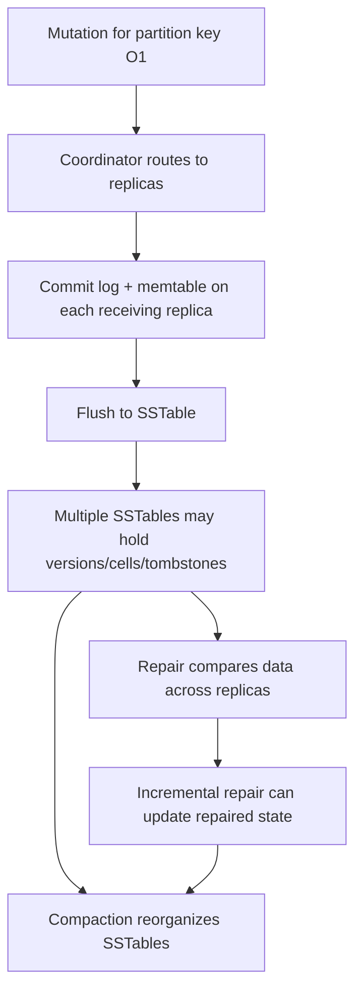
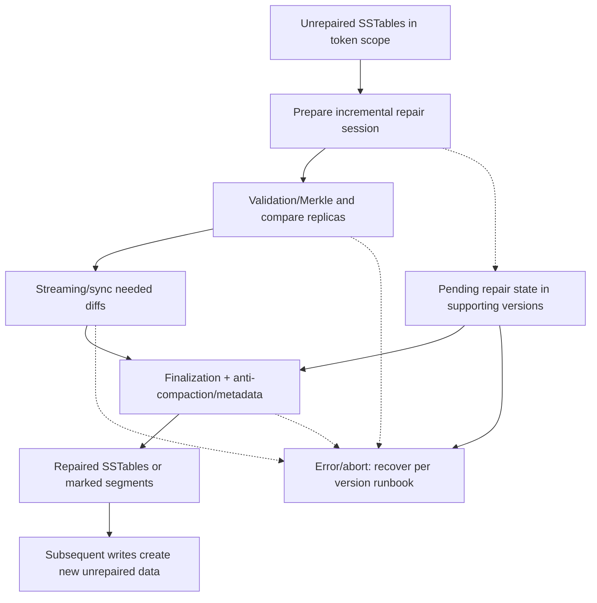
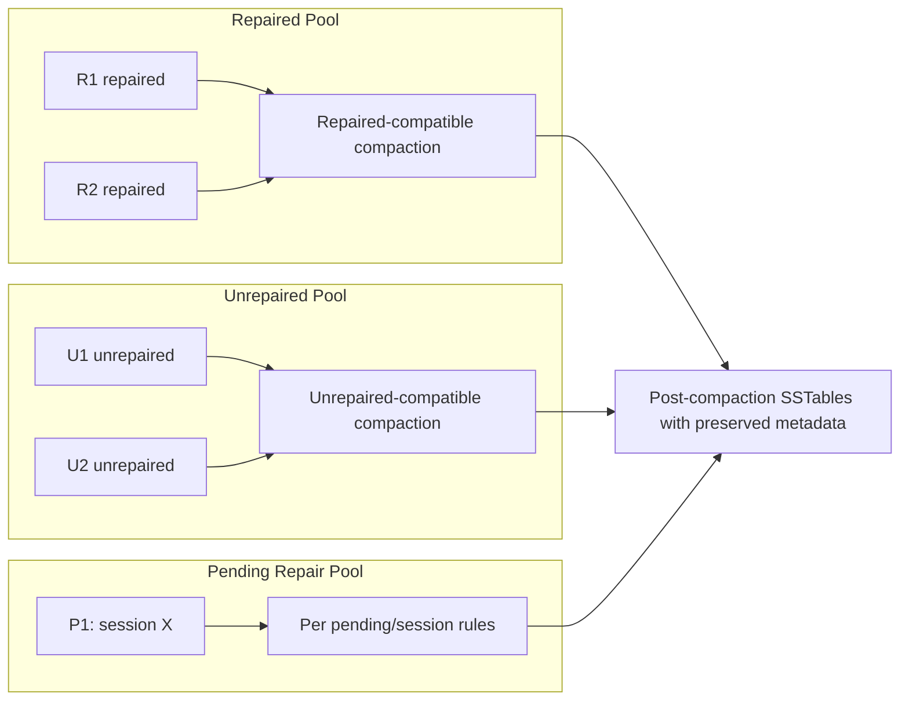
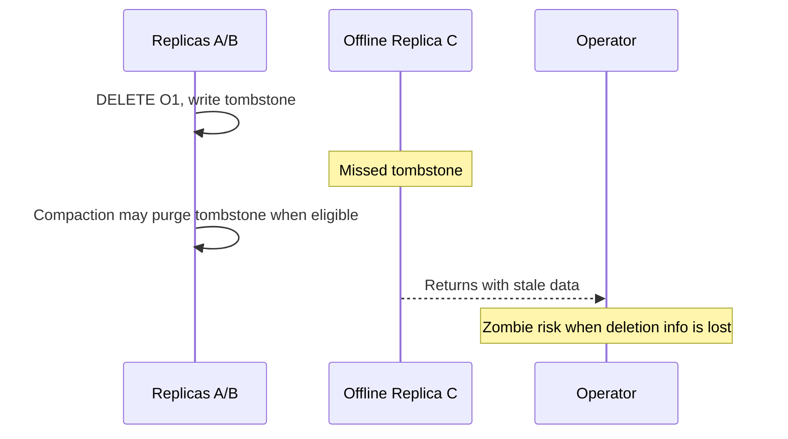

# Repaired/Unrepaired State and Its Relationship with Compaction in Apache Cassandra

## Learning Objectives

In Apache Cassandra, **anti-entropy repair** is not merely a one-off replica comparison. Especially when using **incremental repair**, the system also tracks which SSTables have participated in a completed repair session, which SSTables have not yet been verified, and—in versions with the corresponding mechanism—which SSTables belong to an unfinished repair session. Those states directly influence how **compaction** selects files to merge, how much data subsequent repair runs must examine, and how operations handle a failed repair session.

After this lesson, you will be able to:

1. Explain the differences between **repaired**, **unrepaired**, and **pending repair** at the SSTable metadata level, without confusing them with a row's business status or permanent synchronization across all replicas.
2. Describe the path **mutation → memtable → unrepaired SSTable → incremental repair → anti-compaction/finalization → repaired**.
3. Understand why compaction generally has to respect boundaries across repaired/unrepaired/pending groups, and the consequences for SSTable count, read amplification, disk space, and compaction speed.
4. Distinguish the effects of **full repair** and **incremental repair** on SSTable repaired metadata.
5. Analyze risks around **tombstones, `gc_grace_seconds`, and zombie data**, along with the limits of replication, hinted handoff, and read repair.
6. Use CQL, Cassandra operational commands, and Java Driver examples to illustrate data and monitor outcomes, without mistaking a SELECT query for proof that all replicas are repaired.
7. Build a runbook for measuring, handling pending repair, and scheduling repair in alignment with cluster compaction.

> **Version note:** Repair-state mechanics and incremental session management vary across Cassandra branches, notably from 3.x to 4.x/5.x and across distributions. Metadata names, finalization flows, `nodetool` flags, exposed metrics, and capabilities for resolving stuck sessions must be confirmed against **the documentation and tooling of the exact version running**. Examples in this lesson illustrate the operational model rather than commands to run verbatim in production.

## 1. From Partition Key to Multiple Replicas and Multiple SSTables

Cassandra is a **distributed wide-column** database. Applications read and write by **partition key**; the partitioner computes a token, and then the keyspace replication strategy and replication factor (RF) determine the replica set storing that partition.

Suppose keyspace `shop` is configured with **NetworkTopologyStrategy**, RF = 3 in datacenter `dc1`. For order partition O1, the hypothetical replicas are A, B, and C. When C loses connectivity, A and B can accept a new mutation while C keeps the old version:

| Replica | Initial Data | After Write While C Offline |
| --- | --- | --- |
| A | `CREATED` | `PAID` |
| B | `CREATED` | `PAID` |
| C | `CREATED` | `CREATED` |

At consistency level `LOCAL_QUORUM`, a write operation can be acknowledged by 2 of 3 eligible replicas without forcing C to have received the mutation. When C comes back online, **UN status** only indicates membership/ring state—it does not prove C has all mutations.

A new Cassandra mutation normally passes through the commit log and memtable before being **flushed** into an immutable SSTable:



Because SSTables are **immutable** and can hold data across multiple token ranges, a table does not simply consist of "one file holding all data." The system typically reads and reconciles information across multiple SSTables; compaction reduces the files and versions to inspect according to the configured strategy.

**Three levels must be distinguished:**

- **Row/partition level:** the `order_id` key and cells in application data.
- **Replica level:** the nodes storing copies for a token range.
- **SSTable/repair metadata level:** the files or file segments that have passed through a given incremental repair cycle.

The `repaired` attribute primarily belongs to the third level. It **does not mean** a business order is in a "fixed" state, or that every newer record belonging to that partition has already been repaired.

## 2. Repaired, Unrepaired, and Pending Repair States

### 2.1. Unrepaired: Data Not Yet Marked as Incrementally Repaired

An SSTable or data segment is considered **unrepaired** when it has not yet been marked as having passed through a successful incremental repair cycle under the active mechanism.

- A new SSTable produced by a normal flush normally belongs to the **unrepaired** group.
- A table that just finished repair continues receiving new mutations, and therefore **once again has unrepaired data**.
- A logical row can have an older version in a repaired SSTable and a newer mutation in an unrepaired SSTable.
- You should not conclude that unrepaired means the data copy is definitely wrong. It is an **unverified state** under the incremental repair mechanism, not a row-by-row audit result.

### 2.2. Repaired: Data Marked Based on Incremental Repair Results

An SSTable carries metadata indicating its data has gone through **a completed incremental repair process matching its scope**, commonly represented by a `repairedAt` marker or equivalent attribute.

- `repairedAt` is metadata for repair/compaction, **not a business update timestamp**.
- Repaired SSTables can still be affected by compaction and by newer mutations for the same partition in other files.
- Subsequent incremental repair runs typically focus on **unrepaired data** rather than re-validating the portion already acknowledged as repaired.
- Repaired metadata is a technical marker grounded in repair history. It is not a guarantee that data can never diverge after outages, restores, software bugs, or topology changes.

### 2.3. Pending Repair: Data Belonging to an In-Flight Incremental Session

In versions implementing **consistent incremental repair**, an SSTable can be associated with an active **repair session**, commonly via `pendingRepair` session-identifier metadata or an equivalent mechanism.

This state indicates that a piece of data is awaiting finalization; it **does not mean repaired**, nor should an operator ever modify the metadata manually. When the repair session succeeds, the system can complete marking it repaired; if it fails or is aborted, version-appropriate cleanup/finalization mechanics decide which state the data reverts to.

| State | Operational Meaning | Source Creating State | What to Avoid |
| --- | --- | --- | --- |
| **Unrepaired** | Not yet marked as having completed incremental repair | Flushes, new writes, data not yet through a valid cycle | Treating unrepaired as always wrong data |
| **Pending** | Data attached to an unfinished incremental session | Preparation/anti-compaction/finalization phases depending on version | Manually editing metadata files, running overlapping repairs |
| **Repaired** | Marked as part of a successfully incrementally repaired set | Session completion and metadata recording | Treating this as a permanent invariant of the entire partition |

### 2.4. Metadata Is Per-SSTable, Not a CQL Column

Conceptual layout:

```text
Partition O1:
  SSTable S1 (repaired)   : status = CREATED, older version/cells
  SSTable S2 (unrepaired) : status = PAID, new mutation
  SSTable S3 (pending)    : data belonging to a finalizing repair session

SELECT O1:
  Cassandra reconciles visible cells/versions
  from replica data per storage/consistency rules.

There is no statement like:
  SELECT * FROM ... WHERE repaired = true
to filter this SSTable state like a business column.
```

In this example, **a single partition can appear across multiple groups**. When reading O1, Cassandra does not simply pick the `repaired` group and ignore newer mutations. It must construct the correct result according to timestamps, tombstones, and storage rules.

## 3. Which States Does Incremental Repair Move Data Through?

An incremental repair run can be viewed as a **state machine** for the selected data scope.



**Exact phase ordering and anti-compaction timing vary by version**. The diagram only illustrates the relationship between validation/synchronization and the state marked after the final outcome; do not use it to assert that every version performs anti-compaction strictly at step D.

### 3.1. Selecting Unrepaired Data

Participating replicas coordinate over a set of token ranges matching the keyspace, RF, and topology. Incremental repair relies on metadata to restrict the dataset not yet marked repaired according to version mechanics.

Scope must still be specified:

- **Keyspace**: replication policy of the data being repaired.
- **Table**: which table(s) need validation/sync.
- **Token ranges**: which partitions are selected.
- **Replica/datacenter**: which nodes must participate to satisfy the scope's goal.
- **Mode**: incremental, not full.

Being incremental does not mean it automatically repairs the whole cluster or whole keyspace when the command is scoped to a single table or range.

### 3.2. Validation and Synchronization

Replicas compare data in scope using the anti-entropy mechanism, typically employing Merkle trees and validation work. Differing ranges may require streaming/syncing data across replicas.

**Validation bytes are not streaming bytes**:

- Validation may have to read a substantial amount of data to verify.
- Streaming transfers data needed to reconcile differences, not automatically all scanned bytes.
- A repair session can consume heavy I/O and CPU even when streamed bytes are small.

### 3.3. Anti-Compaction and Recording Repaired State

Because an immutable SSTable can contain data in **both the just-repaired range and unrepaired ranges**, Cassandra must reorganize files/metadata so repaired state accurately reflects only the eligible data.

**Anti-compaction** is the process of splitting/rewriting or partitioning SSTable data by scope and repair state, depending on version implementation. Illustrative example:

```text
Before:
  SSTable X (unrepaired)
    token ranges: [R1] [R2] [R3]

Only R1 and R2 belonged to the completed incremental session.

After reorganization:
  SSTable X_repaired   : portions in R1, R2 (repaired)
  SSTable X_unrepaired : portion in R3 (unrepaired)

The entire X must not be marked repaired just because R1/R2 succeeded.
```

This is why incremental repair requires not only **computing differences between replicas**, but also disk space, I/O, and metadata management to maintain repaired state.

### 3.4. Incremental Mode Failing Mid-Run

When validation, streaming, or finalization fails:

- Unfinished token ranges must not be treated as repaired just because part of the session succeeded.
- Pending repair state or sessions may remain and require handling via version-appropriate administrative procedures.
- Never manually alter `repairedAt`, `pendingRepair`, or SSTable files to "force completion."
- Collect the session ID, replica list, keyspace/table/range, validation/streaming/anti-compaction logs, and resource status.
- If repaired data is suspected to be inconsistent, a **full repair of the identified scope** is an option to evaluate—not an infallible data-rescue command.

## 4. How Does Full Repair Relate to Repaired/Unrepaired State?

**Full repair** inspects data across the **selected scope**, not just the unrepaired portion. This covers both portions already marked repaired and unrepaired portions, according to the running version's mechanics.

Example within a range:

| Group | Illustrative Size | Normally Examined by Incremental | Examined by Full |
| --- | ---: | --- | --- |
| Repaired SSTables from prior cycles | 900 GiB | Typically not re-validated | Yes |
| Newly generated unrepaired SSTables | 100 GiB | Yes | Yes |
| Pending repair from failed session | Session-dependent | Must resolve state per version | Should not ignore pending state when planning |
| Tables or ranges outside selection | Out of scope | No | No |

**Key takeaway:** full repair does not mean the entire cluster. It is **full over the dataset within the selected keyspace/table/token ranges**. When invoked on a single node, ring-wide coverage still requires scheduling across nodes/ranges and topology.

A standard full repair **does not convert all unrepaired SSTables into repaired under the incremental mechanism**. Thus, when scheduling both modes, do not assume running one full repair "clears" all unrepaired state for future incremental runs.

### Why Might Full Repair Be Needed Even with Regular Incremental Repair?

Incremental repair optimizes by skipping data already marked repaired. If an outage or restore leaves the repaired-marked subset untrustworthy, running incremental again may **not be enough to re-examine that dataset**. A scoped full repair is one tool for verification/remediation; you must still verify valid source copies remain and handle tombstones properly.

Full repair typically costs more validation when most data is already repaired, though duration should not be estimated solely from byte percentages. Disk, network, compaction state, file count, Merkle validation, and actual differences all matter.

## 5. Compaction Must Respect Repaired State

### 5.1. Why Can't All SSTables Be Merged Arbitrarily?

Suppose a table has two SSTables:

- `S1` is marked **repaired** from an earlier incremental cycle.
- `S2` is **unrepaired** from a recent flush.

If normal compaction merged S1 and S2 into one SSTable and marked it repaired, new data from S2 would be **marked as repaired without actually having gone through that process**.

Conversely, if it were always marked unrepaired, older previously repaired data would require unnecessary re-validation, eroding incremental repair's benefit.

Therefore, in Cassandra models using repaired/unrepaired metadata, **compaction typically segregates SSTable selection into compatible state pools**. Pending SSTables also have session-level constraints to avoid semantically mixing data from different repair sessions.



**Conceptual diagram:** actual compaction strategies and grouping structures vary by version; do not conclude that every group merges into a single output file, or that a pending file from any session can compact with every other pending file.

### 5.2. Consequence: Repaired and Unrepaired Coexist Long-Term

When an application writes continuously:

1. An incremental cycle marks existing data as repaired.
2. The application keeps writing, producing new unrepaired SSTables.
3. Compaction organizes files **within compatible state pools**.
4. The next incremental cycle processes the unrepaired pool again.
5. If repair lags or fails, unrepaired SSTables can accumulate, pending state can linger, and compaction still has to work within state boundaries.

This can reduce file-merging opportunities compared to a unified SSTable pool without repair-state boundaries, and increase the number of files the read path may touch.

### 5.3. Read Amplification and Disk Usage

Do not claim "having repaired/unrepaired makes every query slow." Impact depends on Bloom filters, partition index, caches, compaction strategy, key overlap, and query patterns.

However, specific cost drivers exist:

| Cost Source | Why It Happens | What to Measure |
| --- | --- | --- |
| **Multiple SSTable pools** | Repaired and unrepaired files cannot always compact together | SSTable count, SSTables per read |
| **Anti-compaction** | Splitting/rewriting data to maintain repair state | I/O, free disk, bytes rewritten, duration |
| **Prolonged pending repair** | Files may face session-scoped compaction limits | Pending SSTables, compaction backlog |
| **Same partition across pools** | New mutations sit in unrepaired, older versions in repaired | Read latency p95/p99, tombstone scans |
| **Too-infrequent repair** | Unrepaired backlog grows, heavy validation next run | Unrepaired bytes/age, repair duration |
| **Too-frequent/overlapping repair** | Fixed overhead, repeated validation/anti-compaction | CPU, I/O, concurrent sessions |
| **Streaming after mismatches** | Replicas transfer data to converge | Network throughput, streamed bytes |

In particular, **do not manually invoke major compaction merely to reduce SSTable count** without assessing its impact on disk, tombstones, repair state, and compaction strategy. On some workloads, major compaction incurs heavy I/O and can worsen latency or disk capacity.

## 6. Compaction Strategies and Repair State

Cassandra supports multiple compaction strategies. A strategy dictates how SSTables are selected for compaction by size, level, time window, or other criteria; **repair state is an additional constraining dimension** in versions implementing repaired/unrepaired/pending mechanics.

### 6.1. SizeTieredCompactionStrategy (STCS)

STCS typically groups SSTables by relative size for merging. When repaired and unrepaired are separated, each state pool has its own compaction candidates, leading to cases where:

- Repaired SSTables may not yet meet the count/threshold to compact.
- Unrepaired SSTables of differing sizes also wait for compatible peers.
- Total file count for the table can be higher than expected from an idealized compaction chain without repair-state boundaries.

This is not automatically an error; inspect compaction backlog, SSTable counts, and read latency together.

### 6.2. LeveledCompactionStrategy (LCS)

LCS organizes SSTables across levels to bound overlap under appropriate workloads. When repaired and unrepaired coexist, segregation can create **separate compaction hierarchies** rather than a single unified level chain across all data.

Accordingly, expectations like "LCS always reads only a fixed number of files" must be verified in a cluster actively running incremental repair. Churn rate, SSTable counts per pool, and partition overlap affect read amplification.

### 6.3. TimeWindowCompactionStrategy (TWCS)

TWCS is commonly chosen for time-series data, TTLs, and time-ordered write patterns. It organizes SSTables by time window rather than strictly by size.

Combining TWCS with repair state requires evaluating:

- Time windows holding a mix of repaired and unrepaired data.
- **Late-arriving** data or updates to older records that increase SSTable spread.
- TTLs/tombstones that must be retained and handled safely rather than magically vanishing just because a compaction window closes.
- Repair schedules aligned with deletion lifecycles and the possibility of a replica missing tombstones.

No compaction strategy "automatically solves repair" or guarantees all nodes are synchronized.

### 6.4. When Changing Compaction Strategy

Switching between STCS, LCS, or TWCS is a major operational decision—do not use it as a quick fix for broken repaired/pending metadata. Changing strategy can trigger massive compaction, alter SSTable counts/latency, and affect disk space. Design tests, maintenance windows, and impact monitoring rather than tweaking strategy just because `unrepaired` data exists.

## 7. Step-by-Step Example: One Partition Across Multiple Cycles

Suppose `shop.orders_by_id` holds partition O1 with RF = 3. Initially, all replicas hold mutation v1.

### Phase A — New Write and Flush

```text
Replica A:
  SSTable A1 (unrepaired): O1 = CREATED, v1
Replica B:
  SSTable B1 (unrepaired): O1 = CREATED, v1
Replica C:
  SSTable C1 (unrepaired): O1 = CREATED, v1
```

The unrepaired state **does not mean v1 differs across replicas**. All three replicas may already be identical yet simply have not gone through incremental repair for that range.

### Phase B — Incremental Repair R1 Completes

```text
Replica A:
  SSTable A1r (repaired): O1 = CREATED, v1
Replica B:
  SSTable B1r (repaired): O1 = CREATED, v1
Replica C:
  SSTable C1r (repaired): O1 = CREATED, v1
```

Names A1r/B1r/C1r are symbolic labels, not real filenames. In a cluster with multiple token ranges, a single SSTable may need anti-compaction to split into repaired and unrepaired portions.

### Phase C — Write v2 While Replica C Is Offline

```text
Replica A:
  A1r (repaired)  : O1 = CREATED, v1
  A2  (unrepaired): O1 = PAID, v2
Replica B:
  B1r (repaired)  : O1 = CREATED, v1
  B2  (unrepaired): O1 = PAID, v2
Replica C:
  C1r (repaired)  : O1 = CREATED, v1
  (missing v2)
```

A subsequent incremental repair, once C is back and participating in scope, can inspect the unrepaired subset containing v2 and sync the needed mutation to replica C. The v1 portion in repaired SSTables does not necessarily need re-validation.

### Phase D — Compaction After Multiple Mutations

If the application later updates `shipping_address` or another column of O1:

- The new mutation may reside in an unrepaired SSTable.
- Repaired files containing older cells can still exist.
- The read path reconciles data across relevant SSTable sources rather than relying solely on the repaired flag.
- Compaction can merge SSTables within compatible pools to reduce file count, but never automatically turns unrepaired data into repaired.

**Conclusion of the example:** repaired state is **the verification history of data organized on disk**, not a logical lock on O1. Seeing a single partition span multiple pools clarifies why repair and compaction directly affect one another.

## 8. Hands-On CQL: Writing, Updating, Deleting, and Observing Data

The following example assumes an existing `shop` keyspace with an appropriate replication factor. If using a fresh cluster for testing, configure datacenter names and RF based on actual topology; never copy an arbitrary `dc1` name into production.

```sql
USE shop;

CREATE TABLE orders_by_id (
    order_id uuid PRIMARY KEY,
    customer_id uuid,
    status text,
    total_amount decimal,
    updated_at timestamp
);
```

Create, update, and delete an order:

```sql
INSERT INTO orders_by_id (
    order_id, customer_id, status, total_amount, updated_at
) VALUES (
    11111111-1111-4111-8111-111111111111,
    22222222-2222-4222-8222-222222222222,
    'CREATED', 250000.00, '2026-11-21T01:00:00Z'
);

UPDATE orders_by_id
SET status = 'PAID', updated_at = '2026-11-21T01:05:00Z'
WHERE order_id = 11111111-1111-4111-8111-111111111111;

SELECT order_id, customer_id, status, updated_at
FROM orders_by_id
WHERE order_id = 11111111-1111-4111-8111-111111111111;

-- Only run DELETE when intentionally testing tombstone lifecycles.
DELETE FROM orders_by_id
WHERE order_id = 11111111-1111-4111-8111-111111111111;
```

### CQL for TTL Data

An `events_by_device_day` table can apply TTLs for transient events:

```sql
CREATE TABLE events_by_device_day (
    device_id uuid,
    event_day date,
    occurred_at timestamp,
    event_id uuid,
    payload text,
    PRIMARY KEY ((device_id, event_day), occurred_at, event_id)
) WITH CLUSTERING ORDER BY (occurred_at DESC, event_id ASC);

INSERT INTO events_by_device_day (
    device_id, event_day, occurred_at, event_id, payload
) VALUES (
    33333333-3333-4333-8333-333333333333,
    '2026-11-21', '2026-11-21T02:00:00Z',
    44444444-4444-4444-8444-444444444444,
    'sensor=23'
) USING TTL 86400;
```

TTL expires data over time and produces tombstones under storage semantics—it **does not automatically trigger a repair session**. When designing deletion policies, consider whether replicas might stay offline too long, how tombstones propagate, and whether the compaction strategy handles TTL windows appropriately.

### Observing Tokens and Business State

```sql
-- Partition token depends on the partitioner.
SELECT token(order_id) AS partition_token, status
FROM orders_by_id
WHERE order_id = 11111111-1111-4111-8111-111111111111;
```

If O1 has already been deleted, the query may return no rows. **There is no direct CQL SELECT** to tell which repaired or unrepaired SSTable holds O1. Inspecting file metadata and repair state requires node-level operational/inspection tools supported by your version.

## 9. Runbook for Observing Repair State and Compaction

**This is an observational runbook for learning, not a command sequence to run blindly in production.** Load-inducing actions such as repair, flush, major compaction, or SSTable operations must be approved by operations and checked against your version.

### 9.1. Inspecting Topology, Node Health, and Metrics

```bash
# Relatively common observational commands; verify help for your version.
nodetool status
nodetool ring shop
nodetool tablestats shop.orders_by_id
nodetool compactionstats
nodetool netstats
nodetool tpstats
```

These tools help identify:

- Nodes currently Down, Joining, or Leaving, which may be unsuitable for normal repair.
- Keyspaces/tables with high SSTable counts, large data volumes, or elevated read/write load.
- Compaction backlog, active streaming, and thread pool pressure.
- Symptoms such as rising disk I/O, read latency, or dropped messages while repair runs.

**Note:** `nodetool tablestats` or `compactionstats` do not automatically display full repaired/unrepaired/pending breakdowns in all versions. If tooling does not expose them, never guess repaired numbers from table size.

### 9.2. Checking Exact Version Repair Options

```bash
nodetool help repair

# Some versions include a repair session management tool:
# Check availability before using; do not assume the command exists.
nodetool help repair_admin
```

Depending on version/distribution, additional details about repair sessions, pending repair, or SSTable repair metadata may be exposed via logs, JMX/metrics, and inspection utilities. When using tools to inspect SSTable metadata, follow version safety guidelines and use snapshots or offline copies if needed; **never edit SSTable metadata manually**.

### 9.3. Running a Clearly Scoped Incremental Session

```bash
# Illustrates single-table scope on the primary ranges
# of the target node; default mode depends on version.
nodetool repair -pr shop orders_by_id
```

If your version supports an explicit incremental flag, check `nodetool help repair` and follow your runbook. Running repair on one node **does not automatically cover all token ranges across the entire cluster**. With `-pr`, you must schedule across all required nodes to cover the ring's primary ranges.

### 9.4. Full Repair When Repaired Data Needs Re-Verification

```bash
# Illustrates full repair on the selected table and node scope.
nodetool repair -full shop orders_by_id
```

Full repair brings repaired data within scope back into validation, however:

- It does not automatically fix business data in another derived table.
- It cannot recover data or tombstones lost across all replicas.
- It normally does not convert all unrepaired SSTables to repaired like incremental repair.
- You still must measure validation, streaming, I/O, and outcomes for the selected scope.

### 9.5. Things Never to Do Manually When Seeing Pending State

- Never delete pending SSTable files to "unblock compaction."
- Never manually edit `repairedAt` or `pendingRepair` values.
- Never launch multiple overlapping repairs on the same scope while a previous session's state is unclear.
- Never force whole-table compaction when disk space is running low hoping to fix metadata.
- Never declare success just because `netstats` shows no active streams.

When pending state persists, identify the **session ID**, participating replicas, version, error logs, and supported administrative mechanism before intervening.

## 10. Tombstones, Repaired State, and Zombie Data Risks

Cassandra uses **tombstones** to represent deletions and many TTL expirations. Tombstones must become known to replicas so old data does not "resurrect" after a node's absence.

### Scenario: A Replica Misses a Delete

1. Replicas A and B receive `DELETE O1` and write tombstones.
2. C is offline and thus retains the old O1 value.
3. A and B continue compacting; once required conditions are met, the tombstones may be dropped.
4. C returns with the old O1 value.
5. If the required tombstone no longer exists anywhere for reconciliation, O1 risks reappearing (*zombie data*).



### `gc_grace_seconds` Is Not an "Exact On-Time Tombstone Purger"

`gc_grace_seconds` helps define how long tombstones are retained so absent replicas have a window to sync. Physical purging also depends on compaction, involved SSTables, and safety rules. Never lower grace simply to have fewer tombstones unless you are certain repair can complete within the corresponding frequency and scope.

**Being repaired does not mean all future deletions are permanently safe.** If old data sits in a repaired SSTable while a new delete mutation lands in an unrepaired SSTable, you still need repair scheduling and tombstone management. An incremental cycle can propagate unrepaired data in scope; full repair can re-check repaired data if suspect. Yet if deletion evidence has been purged on all relevant replicas, **neither mode can infer lost deletion history on its own**.

### Compaction, Repaired State, and Tombstone Purging

Because compaction may have to preserve repaired/unrepaired/pending boundaries, a tombstone and the older shadowed data may not sit in the same easily mergeable pool. This can cause **tombstones and shadowed versions to persist longer** than the naive expectation of "compact all SSTables and purge."

Whether a tombstone can be purged depends on the compaction algorithm, SSTables potentially holding shadowed data, metadata, grace duration, and version configuration. **Do not claim** that `repaired = true` alone causes immediate tombstone purging, or that the repaired flag automatically protects against every zombie scenario.

If a node has been offline longer than the designed safety window, follow proper **replace/rebuild/restore** procedures before bringing it back into service; do not treat running one incremental repair after the node returns as an adequate guarantee.

## 11. Choosing a Compaction-Friendly Repair Schedule

An effective schedule balances **unrepaired data generation rate**, cluster capacity, validation/streaming/anti-compaction time, and delete-safety requirements.

### 11.1. Repairing Too Infrequently

When repair does not run for long stretches:

- Unrepaired SSTables accumulate.
- The next incremental run may have to validate a very large volume of data.
- If nodes go offline and the workload deletes frequently, the risk of missing tombstone propagation deadlines increases.
- Maintaining large diverging pools can make compaction and read amplification unpredictable.

### 11.2. Repairing Too Frequently or Overlapping

When running continuous short repair sessions:

- Repeated coordination, validation, and anti-compaction overhead builds up.
- Even modest new data can trigger many sessions with startup overhead.
- Sessions compete for disk and network and can push the compaction backlog higher.
- Pending state and error recovery become harder to manage without a proper scheduler.

### 11.3. A Balanced Model

| Factor | Question |
| --- | --- |
| Daily unrepaired data generated | How many GiB, how many SSTables, concentrated in which tables/ranges? |
| Stable repaired portion | Is avoiding re-validation via incremental repair worthwhile? |
| Anti-compaction | How long does it take, and how much free disk space does it require? |
| Compaction backlog | Is there enough headroom for compaction to catch up after a repair cycle? |
| Node downtime | What is the maximum tolerable offline duration for a node? |
| Tombstones/TTL | Do grace settings and delete rates align with repair coverage duration? |
| Topology/vnodes | Are all token ranges, DCs, and tables guaranteed to be covered? |
| Read/write SLOs | How much does p95/p99 latency rise during the repair maintenance window? |

There is no single formula like "daily incremental, weekly full" that fits every cluster. Cadences must be **measured and validated** against real RF, topology, data, and workload conditions.

### 11.4. Combining Full and Incremental in One Operational Program

A strategy may use incremental repair for regular cycles targeting unrepaired data, and scoped full repair when repaired state is suspected of drift or after recovery workflows requiring verification. You must understand metadata impacts and **never mix modes haphazardly over an unresolved failed session**.

Never treat full repair as a "quickest way to clear pending repair"; failed sessions and metadata must be handled via version-appropriate procedures. Likewise, never use incremental repair as an excuse to ignore known corruption in repaired SSTables.

## 12. Java Driver: Inspecting Data via CQL, Not Simulating Repaired State

A Java application using the **Apache Cassandra Java Driver 4.x** can check order state at an appropriate consistency level. That verifies the business read path after repair operations—it **does not tell whether SSTables on individual nodes are repaired or unrepaired**.

```java
import com.datastax.oss.driver.api.core.CqlSession;
import com.datastax.oss.driver.api.core.DefaultConsistencyLevel;
import com.datastax.oss.driver.api.core.cql.BoundStatement;
import com.datastax.oss.driver.api.core.cql.PreparedStatement;
import com.datastax.oss.driver.api.core.cql.Row;

import java.math.BigDecimal;
import java.util.UUID;

public final class OrderReplicaReadProbe {
    public record State(UUID orderId, String status, BigDecimal total) {}

    private final CqlSession session;
    private final PreparedStatement byId;

    public OrderReplicaReadProbe(CqlSession session) {
        this.session = session;
        this.byId = session.prepare(
            "SELECT order_id, status, total_amount " +
            "FROM shop.orders_by_id WHERE order_id = ?");
    }

    public State readAtLocalQuorum(UUID orderId) {
        BoundStatement query = byId.bind(orderId)
            .setConsistencyLevel(DefaultConsistencyLevel.LOCAL_QUORUM);
        Row row = session.execute(query).one();

        if (row == null) {
            return null;
        }
        return new State(
            row.getUuid("order_id"),
            row.getString("status"),
            row.getBigDecimal("total_amount")
        );
    }
}
```

**Limitations of this check:**

- `LOCAL_QUORUM` must match an appropriate RF and topology; missing replicas can cause failures.
- Reading one row accurately does not prove every replica of the table holds matching data.
- CQL exposes no regular API for an application to mark SSTable `repairedAt` directly.
- When `orders_by_customer_month` differs from `orders_by_id` in business state, that is likely a **derived-table synchronization bug**, not something solved by compaction or repaired flags.
- Use `nodetool`, metrics/logs, and approved SSTable inspection utilities to observe repair scope; use Java for application data, not to "fix" storage metadata.

## 13. Runbook for a Cluster with Excessive Unrepaired or Pending SSTables

A realistic incident: after a network outage and full disks, monitoring reports rising unrepaired backlog, several unfinished incremental sessions, and elevated read p99 following compaction waves.

### Step 1 — Freeze Risky Decisions

Do not start broad new repairs or major compaction just to "cut down file count." Stop overlapping overloaded tasks per authorized procedures; preserve logs and session IDs of failed sessions.

### Step 2 — Identify the True Scope

Collect:

- Cassandra version and compaction strategy per table.
- Keyspaces, RF, DC, and token range lists of executed sessions.
- Which tables/ranges repaired successfully and which did not.
- Whether any pending repair sessions remain and what admin tools support.
- Down/Joining/Leaving nodes, free disk space, streaming/compaction backlog.
- Node absence duration relative to tombstone/grace policy.

### Step 3 — Isolate Root Causes

| Symptom | Possibilities to Consider | Investigation Direction |
| --- | --- | --- |
| Unrepaired bytes steadily rising | Repair cadence slower than write rate | Repair schedule, throughput, skipped ranges |
| Pending SSTables not dropping after failure | Repair session needs finalize/abort/cleanup | Session ID, logs, and version-appropriate admin commands |
| Many files, rising read latency | Fragmented compaction pools, backlog, or hot workload | SSTable stats, compaction strategy, cache/IO |
| Streaming failures | Network/disk/replica ineligible | Netstats, logs, topology, capacity |
| Repaired data suspected stale | Prior restore/membership/repair incident | Evaluate scoped full repair |
| Zombies after prolonged node offline | Tombstones missed or purged before convergence | Grace settings, repair history, replace/restore procedure |

### Step 4 — Remediate Under Control

Restore storage capacity, network stability, and node health; resolve lingering repair sessions using **version-appropriate tools**; then execute missing repair sessions across monitorable schedules/token groups. Measure impact on p95/p99, anti-compaction, and compaction backlog rather than optimizing SSTable count in isolation.

### Step 5 — Verify Completion

Report success only when:

- Required repair sessions are confirmed complete with clear **keyspace/table/range/replica coverage**.
- No unresolved pending/error sessions remain per runbook.
- Unrepaired backlog returns to acceptable bounds or has a time-bound remediation plan.
- Compaction backlog, free disk, and latency are stable.
- Tombstone/prolonged-offline risks have been evaluated separately.
- There is no false assumption that a few valid `SELECT` queries prove cluster-wide convergence.

## 14. Practice Exercises and Scenario Questions

### Scenario A — Same Partition Appearing in Both Repaired and Unrepaired SSTables

Order O1 was at version 1 prior to incremental repair, and later updated to version 2.

1. Why can v1 data reside in a repaired SSTable while v2 resides in an unrepaired SSTable?
2. When reading O1, does Cassandra read only the repaired SSTable, or must it reconcile relevant data sources?
3. Which data portion should a new incremental repair focus on? Which portion does a full repair examine?
4. When compaction runs, why can't it simply merge any two SSTables with different repair states and mark the output repaired?

**Hints:** repaired is metadata on a dataset/SSTable per repair cycle. New mutations do not inherit the repaired flag of older mutations; full and incremental repair target different datasets within the same token range.

### Scenario B — Anti-Compaction Across a Subset of Token Ranges

An unrepaired SSTable contains data belonging to R1, R2, and R3. Only R1/R2 went through a successful incremental repair.

1. Which portion can be marked repaired?
2. What is the role of anti-compaction?
3. If the entire SSTable were marked repaired, what problem could arise for R3?
4. Which metrics should be monitored while anti-compaction runs on a large table?

**Hints:** repaired state must align with the token scope actually repaired. Splitting/rewriting data carries I/O and free-disk costs; unrepaired R3 data must not be skipped.

### Scenario C — Pending Repair After a Failed Session

An incremental session halts during the finalization phase. Monitoring shows the pending pool is not compacting alongside other pools.

1. Does `Pending` mean repaired?
2. Why can launching multiple new incremental repairs on the same scope complicate investigation?
3. Which metadata should be collected (session ID, range, replica, error, version)?
4. Why should `pendingRepair` or `repairedAt` never be edited manually?
5. When should full repair be considered, and when must the stuck session itself be resolved first?

**Hints:** pending is tied to repair session state; resolve via version-supported tools rather than using full repair as a shortcut to wipe failed sessions.

### Scenario D — TTL, Compaction, and Zombie Risk

An events table has a one-day TTL, whereas a replica may remain offline for several days.

1. What type of deletion record does TTL create in Cassandra?
2. Does `gc_grace_seconds` guarantee tombstones are purged at one exact fixed moment?
3. If old data and tombstones sit in SSTable pools with different repaired states, how can reads/compaction be affected?
4. Can incremental repair guarantee restoring a tombstone already lost across all replicas?
5. Under what conditions is a node replace/rebuild procedure more appropriate than just re-running repair?

**Hints:** TTL/tombstones, repaired metadata, and compaction are three interrelated mechanisms that do not replace one another. Only deletion evidence still present on eligible replicas can be synchronized; proper offline and repair-safety policies are required.

### Scenario E — Selecting a Repair Schedule

A cluster has:

- 90% of SSTable capacity marked repaired according to available reporting.
- 10% unrepaired, growing quickly during peak hours.
- Several TWCS tables with long TTLs, plus several LCS tables with heavy random reads.
- A maintenance window only long enough for range-scoped sessions.

Propose:

1. How to partition token ranges, keyspaces/tables, and nodes so coverage is never missed.
2. When to use incremental repair and when full repair is needed in suspect scopes.
3. Which disk/I/O/CPU/p95/p99 and SSTable backlog metrics to compare before and after.
4. Actions to take if the unrepaired backlog grows even though daily repair runs have not decreased.
5. How to verify that a session completed **for the intended scope and mode** rather than just checking exit code 0.

**Hints:** 90% repaired can make incremental attractive for validation savings, but does not prove it runs exactly 9x faster. Frequency and concurrency must account for write rate, anti-compaction, compaction strategies, application latency, and tombstone deadlines.

## 15. Misconceptions to Avoid

| Misconception | Accurate Understanding |
| --- | --- |
| "A repaired SSTable means the data can never be wrong again." | Repaired is cycle metadata; outages, restores, and new writes still happen. |
| "Once a partition is repaired, all its future mutations are repaired too." | New mutations may land in separate unrepaired SSTables. |
| "Incremental always costs only a tiny fraction of full repair." | Cost depends on unrepaired bytes, overhead, diffs to stream, compaction, and topology. |
| "Full repair automatically marks all SSTables as repaired." | Full repair typically does not produce repaired metadata like incremental does. |
| "Any compaction can merge repaired and unrepaired SSTables together." | Repair-state boundaries typically restrict which SSTables are compatible for compaction. |
| "Pending repair is a file error—just delete the SSTables." | Pending is tied to a session; resolve it using version-appropriate procedures. |
| "Setting `gc_grace_seconds = 0` is safe and eliminates tombstones." | Risks zombies if a replica misses deletes; compaction still has its own rules. |
| "`LOCAL_QUORUM` replaces periodic repair." | A replica can miss mutations even when quorum returns success. |
| "Running `repair -pr` on one node covers the full ring." | Only the initiating node's primary ranges are selected. |
| "If a read table disagrees with the source table, fix it with Cassandra repair." | That is usually **application reconciliation**, not replica repair. |
| "A drop in SSTable count proves repair succeeded." | You must verify session results, scope, and replicas—not just file counts. |

## Summary

In Cassandra, **repaired/unrepaired/pending** are technical states tied to **SSTables and incremental repair sessions**, not correctness labels on a business row. **Incremental repair** focuses on data not yet marked repaired and, per version mechanics, uses **anti-compaction/finalization** to manage repaired state. **Full repair** re-examines a broader dataset within the selected scope, including repaired data, without automatically marking all SSTables repaired.

These states interact closely with **compaction**: files generally must compact within metadata-compatible pools, making SSTable count, read amplification, anti-compaction I/O, and tombstone retention critical metrics. When repair fails with lingering pending sessions, investigate using version-appropriate tools rather than manually deleting or editing SSTables. When nodes stay offline too long, weigh `gc_grace_seconds`, tombstones, and zombie-data risk.

A responsible operational schedule must account for **which tables/keyspaces/token ranges were repaired, which replicas participated, how much repaired/unrepaired data remains, whether compaction is keeping up, and whether users experience latency spikes**. The ultimate goal is **measurable, recoverable, resource-safe** replica convergence—not merely getting a `nodetool repair` command to exit cleanly.
