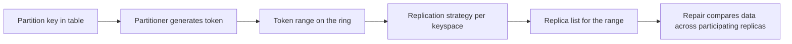
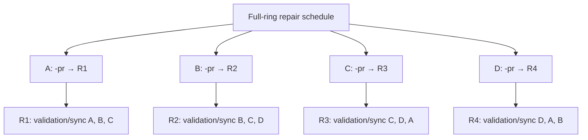
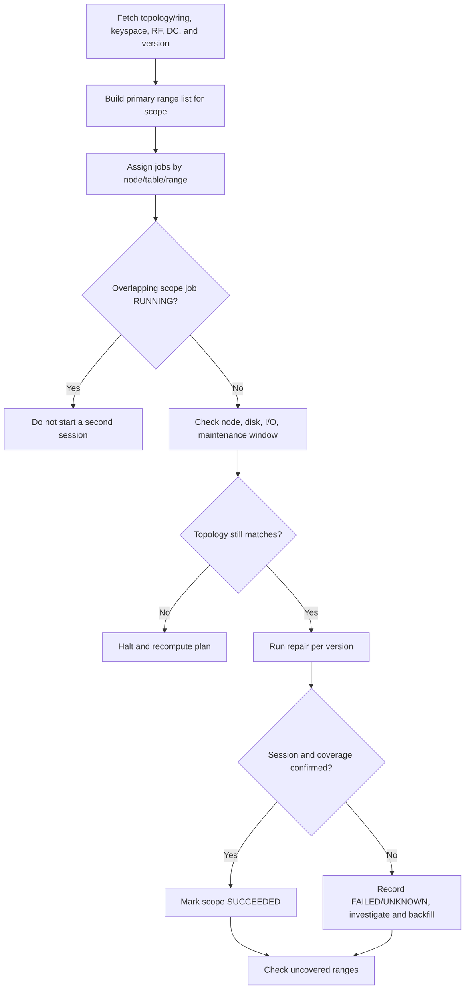
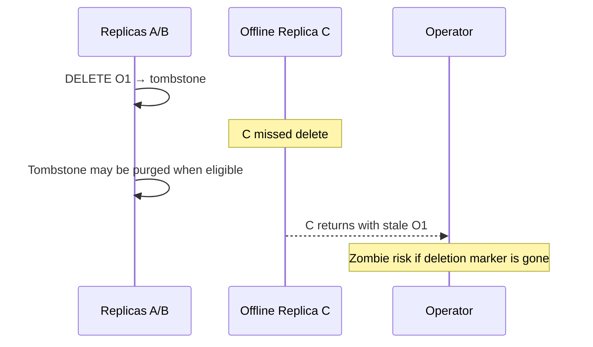

# Primary Range Repair and Avoiding Unnecessary Duplication in Apache Cassandra

## Learning Objectives

Apache Cassandra distributes data using **partition keys**, **tokens**, a **replication strategy**, and a **replication factor (RF)**. Because a single token range typically has multiple replicas, if every node runs repair on every range it stores, the same range can be entered into different repair sessions multiple times. **Primary range repair** uses the `-pr` option of `nodetool repair` to narrow the ranges *each initiating node* is responsible for coordinating, thereby supporting a repair schedule with less overlapping scope.

After this lesson, you will be able to:

1. Distinguish **primary ranges** from **all ranges for which a node stores a replica**, and distinguish **the repair coordinator node** from **the replicas participating in validation/sync**.
2. Explain how `-pr` helps avoid repeated checks on the same token ranges when scheduling across multiple nodes; do not mistake `-pr` for "repairing one replica."
3. Build a simple coverage table from an RF = 3 ring, then extend that reasoning to **vnodes**, multiple tables/keyspaces, and multiple datacenters.
4. Read `nodetool repair -pr` commands and control combinations with `-full`, keyspace/table scope, and version-specific token/DC options.
5. Design a repair schedule with **checkpoints, overlap prevention, missed-range detection, and handling for Down nodes/topology changes**.
6. Measure validation, streaming, I/O, and application latency to verify that avoiding duplication delivers real benefits while protecting tombstone/`gc_grace_seconds` policies.
7. Use CQL and the Java Driver to illustrate partition keys/tokens and bounded verification reads, without mistaking CQL for anti-entropy repair.

> **Version scope:** Cassandra versions and distributions can differ in repair options, full/incremental defaults, datacenter scope, and session management mechanisms. The `nodetool` examples below must be cross-checked against `nodetool help repair` on your actual cluster before execution. Never run large repair sessions merely because a sample command looks valid.

## 1. Why Can Repair Be Executed Redundantly?

Suppose keyspace `shop` uses `NetworkTopologyStrategy` with RF = 3 in datacenter `dc1`. Order partition `O1` is stored on three nodes: A, B, and C.

A mutation updating `status = PAID` might be received by A and B while C is offline and still holds `status = CREATED`. **Anti-entropy repair** compares data across replicas responsible for the same token range and synchronizes differences, typically via validation/Merkle trees and streaming when needed.

The issue arises when operating multiple nodes:

- Node A stores replicas for many ranges.
- Node B also stores a subset of those same ranges.
- Node C does as well.
- If you run `nodetool repair shop` on A, then B, then C using the default scope covering every range each node is involved in, certain ranges **can be repaired again** in the next run even though another session just processed them.

Repeating repair does not mean the commands are broken. However, validation consumes CPU and SSTable reads, the coordinator and replicas must participate in sessions, and whenever discrepancies exist, streaming incurs network and disk costs. Uncontrolled scheduling can cause **elevated read/write latency, compaction backlogs, and high disk I/O** without adding corresponding coverage.

**The goal of `-pr` is to reduce redundant range selection across scheduled nodes**, not to reduce RF from 3 to 1 or fix only the copy on the primary node.

### A Question to Ask Before Scheduling

"Do we want each **logical range** processed once as planned, or do we just want to run one command per **machine**?"

Those two goals are not equivalent. One machine owns many ranges; one range has many replicas; in a cluster using vnodes, each node can hold many small token segments.

## 2. Partition Key → Token → Range → Replicas

When CQL defines a primary key, the **partition key** determines how Cassandra routes the row to a token and replica set.

```sql
-- Assume the shop keyspace already exists.
USE shop;

CREATE TABLE orders_by_id (
    order_id uuid PRIMARY KEY,
    customer_id uuid,
    status text,
    total_amount decimal,
    updated_at timestamp
);

CREATE TABLE orders_by_customer_month (
    customer_id uuid,
    order_month date,
    ordered_at timestamp,
    order_id uuid,
    status text,
    total_amount decimal,
    PRIMARY KEY ((customer_id, order_month), ordered_at, order_id)
) WITH CLUSTERING ORDER BY (ordered_at DESC, order_id ASC);
```

In `orders_by_id`, the partition key is `order_id`. In `orders_by_customer_month`, the partition key is **the entire pair `(customer_id, order_month)`**; `ordered_at` and `order_id` are solely clustering columns.

With the common **Murmur3Partitioner**, the partition key is hashed into a token in the 64-bit signed integer space. **Tokens do not represent timestamps, UUID ordering, or business values**.



A token range is typically expressed with left and right bounds following token-ring conventions, usually understood as **(start, end]**. When a boundary crosses the end of the token space, the range can **wrap around**. Never partition ranges by raw numeric intervals without considering ring wrap-around, ownership, and the actual partitioner.

### Observing Tokens with CQL

```sql
-- Returns a token only if the queried row exists.
SELECT order_id, token(order_id) AS partition_token
FROM orders_by_id
WHERE order_id = 11111111-1111-4111-8111-111111111111;

SELECT customer_id, order_month,
       token(customer_id, order_month) AS partition_token
FROM orders_by_customer_month
WHERE customer_id = 22222222-2222-4222-8222-222222222222
  AND order_month = '2026-11-01'
LIMIT 1;
```

If you need to know the token of a key even when no row exists, you can set up an exercise with a pre-inserted sample row, or use partitioner/driver metadata appropriately. You should never guess a token from a UUID string and schedule repairs based on that guess.

### Why Does Repair Scope Also Depend on the Keyspace?

The exact same token can map to different replica sets across two keyspaces because RF or replication strategies differ. For example, if `shop` has RF = 3 while `analytics` has RF = 2, their repair coordination scopes **cannot be inferred from the token alone**. Record **keyspace + table + token range + topology** for every job.

## 3. What Is a Primary Range and How Does It Differ from Replica-Owned Ranges?

Conceptually, a token range has a **primary owner/primary replica** based on ring ordering and replication strategy, plus additional replicas to satisfy RF. When a node runs a normal repair over the ranges it stores, that scope can include **ranges for which it is the second or third replica**.

When running `nodetool repair -pr`, the primary range option limits **the ranges for which that node initiates repair** according to Cassandra's `-pr` semantics and topology. It is a tool for dividing the token ring into less overlapping tasks when scheduling.

| Concept | Meaning | Misconception to Avoid |
| --- | --- | --- |
| **Primary ranges of node A** | Ranges where A holds the primary role per relevant ring/topology | "Only A's data is compared" |
| **Replica-owned ranges of A** | All ranges for which A stores data due to replication | "A is primary for all of these ranges" |
| **Coordinating node** | Node receiving the command and orchestrating the repair session for the chosen scope | "The coordinator is the only participating replica" |
| **Participating replicas** | Nodes required for validation/sync of the selected range | "`-pr` skips the second/third replicas" |
| **Full-ring coverage** | Union of ranges completed in the schedule covering the target scope | "One successful command is enough" |

**Key point:** `-pr` changes **which subset of ranges is requested for repair when invoking the command on a node**. When the scope includes a range and its replicas must be compared, repair still coordinates **multiple replicas** according to replication policy and repair options.

### Simple Four-Node Ring Example, RF = 3

To make this concrete, assume **one DC, one token/node**, and four ring segments R1–R4. This is a learning model, not the metadata of a real cluster with vnodes.

| Logical Range | Hypothetical Primary Node | Hypothetical Replicas (RF = 3) |
| --- | --- | --- |
| **R1** | A | A, B, C |
| **R2** | B | B, C, D |
| **R3** | C | C, D, A |
| **R4** | D | D, A, B |

If you run repair over **all replica-owned ranges** on each node:

| Initiating Node | Ranges Where Node Stores a Replica |
| --- | --- |
| A | R1, R3, R4 |
| B | R1, R2, R4 |
| C | R1, R2, R3 |
| D | R2, R3, R4 |

Thus, if each node scans every range it stores in its own schedule, **each R can appear three times**. There are four logical ranges, yet the schedule contains 4 × 3 = **12 range selections** in total. This is a conceptual count—not the number of streamed files, nor the exact internal session count created by Cassandra.

If replaced with a **primary range** schedule:

| Node Running `-pr` | Assigned Range in Example |
| --- | --- |
| A | R1 |
| B | R2 |
| C | R3 |
| D | R4 |

The schedule drops to just **four logical range selections**. During the session processing R1 from A, replicas **B and C are still involved**; R1 is not merely compared on A alone.



Do not conclude that actual cost drops by an exact **factor of 3**. With incremental repair, repeated runs might see little unrepaired data anyway; with full repair, validation over large datasets can dominate. Real cost also depends on SSTable counts, divergence levels, streaming, vnodes, and Cassandra version.

## 4. How Do Vnodes Complicate the Coverage Problem?

Most Cassandra clusters do not assign a single token per node; instead, they use **virtual nodes (vnodes)**. One node can hold many tokens, corresponding to many range segments scattered around the ring.

For example, node A might own primary ranges `R1, R9, R17` while simultaneously storing replicas for many ranges whose primary owners are B, C, or D. When running `-pr` on A, the scope covers **the set of eligible primary ranges of A**, not a single contiguous token interval describable by one simple start/end pair.

Operational implications:

1. **One command can cover multiple ranges.** A summary saying "repair A succeeded" does not replace knowing which specific ranges/tables actually finished if an error occurs mid-run.
2. **Ownership shifts when topology changes.** Bootstrap, decommission, replace, move, or token changes can reassign a range previously primary on A to another node.
3. **Keyspace determines the replica set.** Never apply the same RF/replica assumptions across different keyspaces.
4. **Ranges vary in data size.** Tokens distribute hashes, yet one range may contain more SSTables, tombstones, or hot workloads than another.
5. **Per-DC scheduling requires understanding primary selection.** With multiple DCs and `NetworkTopologyStrategy`, primary scope and participating nodes depend on replication/topology and DC-scoping flags; never copy a single-DC schedule to multi-DC without verification.

Therefore, a repair orchestrator should track **a specific topology/ring snapshot and scheduling epoch**, and verify nodes/ranges before running. Never hard-code token ranges from months ago.

## 5. When Does `-pr` Reduce Duplication, and When Does Redundant Cost Remain?

### Duplication at the Range-Coordination Level

If every node independently runs full repair over all ranges it stores, ranges with RF > 1 are routinely selected redundantly across nodes. Primary-range scheduling reduces that overlap **provided the schedule covers every primary range in scope cleanly without spawning overlapping sessions**.

### Cost Does Not Disappear

A range with RF = 3 may still require all three replicas to participate in validation/sync, even though only the primary node coordinates it. You cannot take 12 → 4 range selections in the toy table and claim "bytes to validate dropped from three replicas down to one." Comparing replicas remains the entire point of repair.

### Cases Where Overlap Still Occurs

- Two schedulers or operations teams both launch `-pr` on a node or within the same window without a coordination lock.
- A `-pr` session is running while another repair task selects the same range via `-st`/`-et` or default selection.
- A schedule re-runs repeatedly in a short window without checking whether the previous session succeeded.
- Topology changes between job planning and execution; two different owners in two ring snapshots may both schedule the same range.
- Multiple datacenters use inconsistent repair scope flags, causing cross-replica/DC comparisons to overlap or be skipped.
- Two different keyspaces share numerically identical ranges; **they are not the same data unit**, so you must not "deduplicate" across distinct keyspaces.

**The true objective is avoiding unnecessary duplicate repair**, not banning all re-runs. Retrying is valid when a prior session failed, state is uncertain, or a **full repair** is needed to re-verify repaired data.

## 6. `nodetool repair -pr` Commands and Scope Selection

The commands below illustrate how to reason about scope. **Do not execute broadly in production** without a runbook, cluster health checks, and load limits.

### 6.1. Checking Version, Ring, and Cluster Status

```bash
# Check syntax and repair defaults for the actual version.
nodetool help repair

# Check node Up/Down status, DC, and ring health.
nodetool status

# Check ring/range information related to the shop keyspace.
nodetool ring shop

# Check streaming/compaction activity when assessing load.
nodetool netstats
nodetool compactionstats
```

`nodetool ring shop` helps observe tokens and the ring, though ownership output can be hard to interpret on clusters with many vnodes. Combine it with replication strategy, RF, DC/rack layout, and actual metadata; never infer coverage solely from an ownership percentage printed on one node.

### 6.2. Primary-Range Repair for a Single Table

```bash
# Run on ONE node assigned in the schedule.
# Selects only that node's primary ranges for the orders_by_id table.
nodetool repair -pr shop orders_by_id
```

To cover all of `shop.orders_by_id` around the ring, you must schedule across **all required nodes** per topology and verify every target primary range succeeded. Success on node A **does not** mean primary ranges of B, C, or D were processed.

### 6.3. Primary-Range Repair for a Keyspace

```bash
# Broader table scope, still restricted to the initiating node's primary ranges.
nodetool repair -pr shop
```

Unlike the single-table command, this can cover multiple tables in `shop` according to version semantics. Check the table count and size of each table; a keyspace with a very large table can turn a brief maintenance window into a long-running job.

### 6.4. Full Repair on Primary Ranges

```bash
# Full = selects dataset to validate;
# -pr = selects token ranges coordinated by this node.
nodetool repair -full -pr shop orders_by_id
```

The two options control **two independent dimensions**:

- `-full`: in supporting versions, requests repairing all data matching the chosen scope, including both repaired and unrepaired under version mechanics.
- `-pr`: restricts token scope to the coordinating node's primary ranges.

Do not interpret this command as "cluster-wide full repair." If your version restricts flag combinations or changes incremental/full defaults, follow the corresponding `nodetool help repair` output.

### 6.5. Start/End Token Repair Is a Different Option, Not Automatically Equivalent to `-pr`

Some versions support `-st`/`-et` to specify token bounds:

```bash
# ILLUSTRATION ONLY; tokens are not taken from a real cluster.
# This command omits -pr: bounded by explicit start/end tokens.
nodetool repair -full -st 100000000000 -et 200000000000 \
  shop orders_by_id
```

When selecting token ranges manually, verify the partitioner, boundary rules, wrap-around, eligible coordinating node, and participating replicas. **Do not combine `-pr` with `-st`/`-et` or DC/host filters unless your version's help confirms their semantics and compatibility.**

### 6.6. Summary Table

| Illustrative Invocation | Table Scope | Token Scope | What Must NOT Be Inferred |
| --- | --- | --- | --- |
| `repair shop orders_by_id` | One table | Default ranges for node/mode | Full ring covered |
| `repair -pr shop orders_by_id` | One table | Node's primary ranges | Only one replica's data checked |
| `repair -pr shop` | Selected tables of the keyspace | Node's primary ranges | All keyspaces repaired |
| `repair -full -pr shop orders_by_id` | One table | Node's primary ranges | Full ring just because `-full` is set |
| `repair -st … -et … shop orders_by_id` | One table | Manual token interval | Covers replicas/ranges outside the interval |

## 7. Full, Incremental, and the Impact of Repeated Repair

**Primary-range scheduling does not replace choosing the repair mode.**

### Incremental Repair

Incremental repair typically targets data **not yet marked repaired** in the selected scope, then manages SSTable repaired/unrepaired—and possibly pending repair—state. Repeated runs may avoid re-validating all repaired data, yet still carry coordination, unrepaired validation, and metadata costs.

If two incremental sessions overlap on the same range/table, they can contend for resources and hit active-session restrictions. Therefore, **never intentionally run overlapping sessions** thinking incremental "costs nothing extra."

### Full Repair

Full repair examines a broader dataset in scope, typically including portions already marked repaired, and can incur substantial validation/I/O. Running full repair on the same range across three nodes in an RF = 3 example risks repeating considerable work; this is where primary-range scheduling can save significant effort.

However, full repair on one node's primary ranges still requires scheduling to cover all other primary ranges. Nor does it automatically mark all unrepaired SSTables as repaired the way incremental repair does.

### An Estimate Not to Abuse

Suppose a ring has 100 primary ranges, RF = 3, and relatively even data distribution:

- A schedule scanning all replica-owned ranges on every node might involve roughly **300 range selections**.
- A proper primary-range schedule can reduce that to roughly **100 range selections**.

This is an estimate of **how many times a range is scheduled**, not a prediction of CPU, validated bytes, streamed bytes, or wall-clock duration. Duration still depends on range size, SSTables, replica divergence, overlap avoidance, compaction, network, and Cassandra version.

## 8. Scheduling with Coverage So No Range Is Missed

A responsible repair schedule must prove **which ranges have completed on which tables/keyspaces**, not merely "we SSHed into every node."

### 8.1. Defining the Unit of Work

A minimal schedule record can contain:

| Field | Meaning |
| --- | --- |
| `cluster_id`, `ring_epoch` | Cluster and topology/token ownership snapshot the schedule is based on |
| `datacenter_scope` | Actual DC/replica scope of the repair session |
| `keyspace`, `table` | Exact table to be verified |
| `range_start`, `range_end` or `range_id` | Logical token range, with boundary/wrap-around convention |
| `primary_coordinator` | Node assigned to initiate `-pr` or appropriate repair mechanism |
| `repair_mode` | Full or incremental per version |
| `state` | PLANNED, RUNNING, SUCCEEDED, FAILED, RETRY_REQUIRED |
| `started_at`, `finished_at` | Timestamps and deadlines |
| `session_id`/`command_id`, `attempt` | Traceability to execution session and retry count |
| `validated_bytes`, `streamed_bytes`, `error` | Operational telemetry and failure reason |

One `-pr` command can span **multiple ranges in a single run**, so the scheduler must map command results back to the expected set of ranges. On mid-run failures, never assume all ranges succeeded if only a subset was confirmed.

### 8.2. Three Coverage Conditions

For every target dataset, verify:

1. **No gaps:** the union of succeeded ranges must cover all token ranges requiring repair.
2. **No unnecessary overlap:** a single range should not have multiple concurrent overlapping sessions in the same mode/scope unless explicitly justified.
3. **Matching ring epoch:** token ownership, DC, and RF at execution time match the plan, or a re-evaluation workflow runs if they changed.

Conceptual expression:

\[
R_{\mathrm{target}}
\subseteq
\bigcup_{j \in \mathrm{SUCCEEDED}} R_j
\]

And for optimal scheduling, intersections among concurrently running `R_j` should be bounded by policy. Do not turn "no duplication" into a rigid rule that blocks **valid backfill runs** after failures.

### 8.3. Recommended Scheduler Flow



Key operational practices:

- Maintain **one authoritative scheduler/orchestrator** or an appropriate lock/lease mechanism. An in-memory lock on a single instance without failover support is insufficient.
- Fetch live topology **before** planning rather than copying stale token lists.
- Split jobs by table or table group if doing so helps throttle load.
- Cap concurrent validation/streaming sessions based on per-node, per-rack, and per-DC capacity.
- Mark `SUCCEEDED` only after session completion is reported and scope is reconciled—not merely because the process exited.
- If token membership changes, abort jobs with invalidated scope and recompute coverage.

### 8.4. Example Plan Table for a Four-Node Ring

| Keyspace | Table | Range | Coordinator | Mode | Outcome |
| --- | --- | --- | --- | --- | --- |
| `shop` | `orders_by_id` | R1 | A | Full | SUCCEEDED |
| `shop` | `orders_by_id` | R2 | B | Full | SUCCEEDED |
| `shop` | `orders_by_id` | R3 | C | Full | FAILED |
| `shop` | `orders_by_id` | R4 | D | Full | PLANNED |

You cannot declare the table repaired because **two out of four jobs succeeded**. Here, R3 needs investigation/backfill, and R4 has not run yet. Also, if `shop` contains other tables, coverage of `orders_by_id` does not substitute for covering those tables.

## 9. Multiple Datacenters and NetworkTopologyStrategy

In multi-DC Cassandra, a keyspace can specify a distinct RF per datacenter. One token range can have multiple replicas in `dc1` and multiple replicas in `dc2`, with corresponding roles and routing.

This is why you **must not blindly copy** a single-DC schedule:

- Application `LOCAL_QUORUM` only requires replicas in the local DC per that DC's RF; it does not mean every replica in other DCs received every mutation.
- Datacenter- or host-scoping repair flags or local repair options can alter **which replicas participate**. If cross-DC consistency is required, you cannot run local-only repairs and claim both DCs have converged.
- Primary ranges are determined by how metadata, replica placement, and repair options work in **the deployed version**. A simple single-DC model of "one global owner per range" cannot be lifted verbatim to infer multi-DC coverage.
- Cross-WAN repair incurs bandwidth, latency, and application-impact costs; restricting to one DC may be a deliberate decision, but you must document **which guarantees are left unverified**.
- When replacing nodes, adding a DC, or changing RF, use dedicated data/streaming/repair plans rather than just running `-pr` against an old node list.

For production, build a **keyspace × DC × replica scope × token range × mode matrix** from live topology, verify supported repair flags, and then choose the schedule. What matters is **the target consistency guarantee** and coverage proof, not the count of `nodetool` invocations.

## 10. When a Primary Node Is Absent or Topology Changes

### 10.1. Assigned Primary Node Is Down

Suppose R3 is assigned to node C, but C goes offline.

Do **not** mark job R3 as "completed" just because A and D (the other replicas) can still serve reads. C may be the very replica that missed writes, and when C returns it will need convergence per policy.

Steps to handle:

1. Mark the job `BLOCKED/RETRY_REQUIRED`, recording the Down timestamp and scope R3.
2. Investigate root cause; if the node can recover safely, restore cluster health first and then resume repair.
3. If coordination from another node is required, evaluate **token-range-scoped repair** or a version-supported dedicated procedure, verifying that the alternate node handles the right replica set and scope. Running `-pr` on A **does not turn C's primary range into A's primary range**.
4. If C stayed offline too long, separately evaluate tombstone/zombie risks and replace/rebuild/restore procedures rather than assuming one repair suffices.
5. After any topology change, **rebuild the coverage list**; the previous plan may no longer be accurate.

### 10.2. Replacing a Node or Changing RF

Starting from the original ring R1–R4, when node E is added or C is replaced, Cassandra can reassign ownership and replica placement. A `-pr` command on A from an earlier point in time is no longer guaranteed to map to the current primary ranges.

A schedule carrying `ring_epoch` / topology version helps detect drift:

- If topology remains unchanged, continue along the schedule.
- If it changed, reconcile already-succeeded ranges and repartition remaining tasks per current metadata.
- For bootstrap/decommission/rebuild, follow version-specific data runbooks; **repair does not replace every data-movement operation**.

### 10.3. Repair Session Failing Mid-Run

A repair session can fail during validation, streaming, or finalization. Particularly with incremental repair, lingering `pending repair` state and unfinished SSTable metadata may exist.

Do not handle this by repeatedly firing the same command across multiple nodes. Instead:

1. Record the command, mode, keyspace, table, token ranges, session ID, and participating nodes.
2. Inspect logs/metrics to pinpoint the failed phase, disk capacity, network health, and compaction state.
3. Separate the scope **confirmed succeeded** from portions still `FAILED/UNKNOWN`.
4. Resolve session/pending state using version-supported tools; never edit SSTable metadata manually.
5. Backfill only the uncompleted scope—do not re-run the entire ring over a single failure without evaluation.

## 11. Tombstones and Safe Repair Deadlines

Cassandra uses **tombstones** to represent row/cell/partition deletions and expired TTL data. Tombstones must persist and become known to replicas long enough so a replica that missed a delete cannot resurrect stale data.

Scenario:

1. A and B receive `DELETE O1`; C is offline.
2. A and B hold tombstones; C still holds the old O1 copy.
3. If tombstones on A and B are purged by compaction after time/safety conditions are met before C is synchronized, C can return with the old O1 copy.
4. Once the required deletion evidence is gone, O1 risks becoming **zombie data**.



`gc_grace_seconds` is one component of the tombstone retention policy. It is **not** a promise to "physically delete at exact time T": purging also depends on SSTables, compaction, and other safety conditions. Never lower grace just to cut tombstone counts if repair is not reliable enough.

### Primary-Range Scheduling and Tombstones

If you use a `-pr` schedule yet overlook primary range R3, **R3's replicas may go unsynchronized during the cycle**. That risk is not cured by repairing R1 and R2 over and over. Thus, avoiding duplication only has value when **coverage is complete** and finishes frequently enough relative to deletion safety policies.

When a node has been absent beyond the tombstone safety window, do not simply let it rejoin and run a single repair; evaluate replace/rebuild/restore workflows and check whether deletion markers still exist according to your actual version/cluster state.

## 12. Operational Cost: Avoiding Duplication Without Losing Coverage

A solid plan reduces **work that adds no value** while preserving safety and application quality.

### Key Metrics

| Category | Metric or Information | How to Use |
| --- | --- | --- |
| Coverage | Percentage of keyspace/table/token ranges `SUCCEEDED` | Detect unrepaired gaps |
| Redundancy | Count of overlapping-scope jobs and overlapping time windows | Spot off-schedule schedulers or ad-hoc commands |
| Repair duration | Duration per command/range/table | Size maintenance windows |
| Validation | Bytes validated, time to build/compare Merkle trees | Identify I/O-heavy ranges/tables |
| Streaming | Bytes streamed, throughput, network errors | Measure divergence and bandwidth |
| SSTables | Repaired/unrepaired/pending counts where supported | Analyze incremental and pending state |
| Cluster health | Free disk, compaction backlog, dropped messages | Assess repair headroom |
| Application | Read/write latency p95/p99, timeouts, error rate | Protect user experience |
| Tombstones | Age since last successful repair vs. grace policy | Alert on risk of replicas missing deletes |
| Topology | Epoch/node changes, RF, datacenter | Invalidate stale plans when needed |

### Do Not Infer Cost Solely from Session Count

Suppose a non-`-pr` schedule has 12 range selections and a `-pr` schedule has 4 in a four-node model. If validation per repair consumes heavy I/O, the new schedule **can yield substantial savings**. Yet if there are many tiny ranges, lots of repaired data, and little unrepaired data, real savings may be smaller; meanwhile, replicas still must participate in processing each selected range.

Compare across **the same dataset and coverage scope** under comparable load windows—never conclude purely from fewer commands. Compare p95/p99 latency, total bytes validated, bytes streamed, disk/network usage, duration, and failure counts.

### Mechanisms to Prevent Duplicate Runs

- Use **a single authoritative job dispatcher** and lock jobs appropriately by `cluster/ring_epoch/keyspace/table/repair_scope/mode`.
- Use **leases/fencing** on locks when running multiple schedulers or failover; permanent locks do not recover cleanly from dead workers.
- Never launch two overlapping-range jobs unintentionally, even on two different nodes.
- Maintain session logs to avoid equating "orchestrator timeout" with "repair definitely never ran."
- Once a scope has succeeded within a cycle, do not replay it just because a node was added to a list if actual ownership did not change; when topology changes, recompute cleanly.
- Enforce backfill policies and retry caps so transient errors do not turn into a validation/streaming storm.

## 13. Java Driver: Observing Rows, Not Simulating a Repair Scheduler

CQL and the Java Driver help verify the application read path and inspect partition keys. However, **no normal CQL SELECT query** replaces comparing data across every replica in a token range; anti-entropy repair belongs to cluster operations tooling.

### 13.1. Test Data via CQL

```sql
USE shop;

INSERT INTO orders_by_id (
    order_id, customer_id, status, total_amount, updated_at
) VALUES (
    11111111-1111-4111-8111-111111111111,
    22222222-2222-4222-8222-222222222222,
    'CREATED', 250000.00, '2026-11-21T01:00:00Z'
);

UPDATE orders_by_id
SET status = 'PAID', updated_at = '2026-11-21T01:05:00Z'
WHERE order_id = 11111111-1111-4111-8111-111111111111;
```

A read with an explicit partition key:

```sql
SELECT order_id, status, total_amount
FROM orders_by_id
WHERE order_id = 11111111-1111-4111-8111-111111111111;
```

### 13.2. Java Driver 4.x: Read Probe for One Partition

```java
import com.datastax.oss.driver.api.core.CqlSession;
import com.datastax.oss.driver.api.core.DefaultConsistencyLevel;
import com.datastax.oss.driver.api.core.cql.PreparedStatement;
import com.datastax.oss.driver.api.core.cql.Row;

import java.math.BigDecimal;
import java.util.UUID;

public final class OrderReplicaProbe {
    public record OrderState(UUID orderId, String status, BigDecimal total) {}

    private final CqlSession session;
    private final PreparedStatement select;

    public OrderReplicaProbe(CqlSession session) {
        this.session = session;
        this.select = session.prepare(
            "SELECT order_id, status, total_amount " +
            "FROM shop.orders_by_id WHERE order_id = ?");
    }

    public OrderState readAtLocalQuorum(UUID orderId) {
        Row row = session.execute(
            select.bind(orderId)
                .setConsistencyLevel(DefaultConsistencyLevel.LOCAL_QUORUM)
        ).one();

        if (row == null) {
            return null;
        }
        return new OrderState(
            row.getUuid("order_id"),
            row.getString("status"),
            row.getBigDecimal("total_amount")
        );
    }
}
```

- With appropriate RF/topology, `LOCAL_QUORUM` reads from a local quorum; without enough available replicas, the query can fail.
- Reading one row at quorum **does not prove** all replicas/ranges are repaired. Cassandra can serve a query from different replica subsets or perform read-path repair depending on configuration/version.
- The driver does not mark SSTables repaired, replace `nodetool repair`, or verify `-pr` coverage.
- A derived read table differing from the source because the application skipped fan-out needs **application reconciliation**, not running `-pr` hoping both tables will converge in business data.

### 13.3. Java 17: Verifying a Coverage Plan After Collecting Metadata

To illustrate **verifying complete range coverage**, the standalone snippet below checks a list of `rangeId` values defined from ring metadata against session outcomes collected by an orchestrator. It **does not read token topology or run repair itself**:

```java
import java.util.List;
import java.util.Map;
import java.util.Set;
import java.util.stream.Collectors;

public final class RepairCoverageCheck {
    public record JobResult(
        String keyspace,
        String table,
        String rangeId,
        String ringEpoch,
        String status
    ) {}

    // expectedRanges comes from the topology snapshot of the matching epoch
    // and matching keyspace/table/datacenter scope.
    public static Set<String> missing(
            String keyspace,
            String table,
            String ringEpoch,
            Set<String> expectedRanges,
            List<JobResult> results) {

        Set<String> completed = results.stream()
            .filter(j -> j.keyspace().equals(keyspace))
            .filter(j -> j.table().equals(table))
            .filter(j -> j.ringEpoch().equals(ringEpoch))
            .filter(j -> "SUCCEEDED".equals(j.status()))
            .map(JobResult::rangeId)
            .collect(Collectors.toSet());

        return expectedRanges.stream()
            .filter(range -> !completed.contains(range))
            .collect(Collectors.toSet());
    }

    public static void main(String[] args) {
        Set<String> expected = Set.of("R1", "R2", "R3", "R4");
        List<JobResult> rows = List.of(
            new JobResult("shop", "orders_by_id", "R1", "e42", "SUCCEEDED"),
            new JobResult("shop", "orders_by_id", "R2", "e42", "SUCCEEDED"),
            new JobResult("shop", "orders_by_id", "R3", "e42", "FAILED"),
            new JobResult("shop", "orders_by_id", "R4", "e42", "PLANNED")
        );
        System.out.println(missing(
            "shop", "orders_by_id", "e42", expected, rows));
        // [R3, R4] in Set iteration order (order not guaranteed).
    }
}
```

This example only illustrates **comparing nominal range sets**. In production, a single `-pr` command can cover multiple segments, token bounds can differ across epochs, and success may need confirmation per session/replica scope. Do not convert a single `SUCCEEDED` row into proof of full coverage when tooling does not report at the required range granularity. Furthermore, the expected range set must be built from **metadata matching the exact ring epoch**, never hard-coded as `R1–R4`.

## 14. Runbook for Deploying a Primary-Range Repair Schedule

### Step 1 — Establish Scope and Preconditions

Record:

- Cassandra version, distribution, partitioner, vnodes, and topology.
- Keyspaces/tables to repair; RF, strategy, and DC/rack layout.
- `UN` nodes, Down/Joining/Leaving nodes, and recently replaced nodes.
- Full/incremental mode and supported flags.
- Free disk space, compaction backlog, network health, p95/p99 read/write latency.
- Replica offline duration relative to tombstone grace and last successful repair.

### Step 2 — Design Coverage

Create primary-range jobs for each table/keyspace in target scope, tagged with ring epoch, coordinator, and replication/DC scope. Verify **no gaps and no unnecessary overlap**.

### Step 3 — Verify Commands on the Live Cluster

```bash
nodetool help repair
nodetool status
nodetool ring shop
```

Based on your version, choose a single-table command on one node, for example:

```bash
# Execute only after verifying preconditions and job assignment.
nodetool repair -pr shop orders_by_id
```

### Step 4 — Throttle and Monitor

- Cap concurrent repairs so multiple sessions do not contend over the same replica/rack.
- Monitor validation/streaming, compaction, disk/network, timeouts, and application p95/p99.
- Log session, scope, timestamps, exit status, and any errors encountered.
- If the cluster becomes overloaded, prioritize stability; never double up repair sessions just to push more commands through.

### Step 5 — Handle Failures and Reconcile Coverage

From each job outcome, identify uncompleted ranges. If a coordinator goes Down or topology changes, recompute the plan against current metadata; if an incremental session fails, resolve pending state with supported tools before launching more runs. Backfill only the scope confirmed incomplete.

### Step 6 — Close the Cycle

Report **coverage by keyspace/table/range/DC/mode**, retries, total bytes validated/streamed, and application impact. Compare against the repair deadline required before `gc_grace_seconds` becomes a hazard for any replica that missed deletes. Mark the cycle complete only when no unaddressed gaps remain.

## 15. Common Mistakes

| Mistake | Consequence | How to Avoid |
| --- | --- | --- |
| "`-pr` repairs exactly one replica." | Misunderstands multi-replica comparison goal | Distinguish coordinator/range selection from participating replicas |
| "Running `-pr` on A finishes the cluster." | Other nodes' primary ranges remain untouched | Schedule coverage across the entire ring |
| "Running on all nodes by schedule is enough; no need to log ranges." | Mid-run failures or topology shifts leave coverage gaps | Log scope, sessions, and per-part status |
| "Full repair + `-pr` means full cluster." | Only checks all data within that node's primary ranges | Understand `-full` is independent of `-pr` |
| "Since incremental already ran, repeating costs nothing." | Adds overhead/anti-compaction or contention | Prevent overlapping jobs and manage pending state |
| "Pick tokens from order timestamp range." | Selects wrong partitions and misses data | Compute tokens from partition key/partitioner |
| "RF = 3 means there are only three ranges on the ring." | Confuses replica count with token range count | Inspect tokens/vnodes and ownership |
| "DC1 has quorum so DC2 is synced." | Overlooks cross-DC divergence | Define proper DC/replica scope |
| "Primary node is Down, so run `-pr` on another node to fix its range." | `-pr` on another node picks that node's own primary ranges | Maintain token-range/recovery/topology runbooks |
| "`nodetool` finished running so every range succeeded." | Misses aborted or partial sessions | Check logs, sessions, and coverage |
| "Lower `gc_grace_seconds` to shorten repair intervals." | Risks zombies from early tombstone purging | Base settings on actual repair capability and offline limits |
| "Repair fixes a list table missing fan-out updates." | Business data remains inconsistent | Run application reconciliation |

## 16. Practice Exercises and Scenario Questions

### Scenario A — Counting Range Appearances in a Schedule

A single-DC cluster has four nodes A–D, RF = 3, one token/node as in the Section 3 model. There are four ranges R1–R4 and replica sets:

- R1: A, B, C;
- R2: B, C, D;
- R3: C, D, A;
- R4: D, A, B.

**Questions:**

1. List the ranges for which each node holds a replica.
2. If every node runs repair on all ranges it owns, what is the total count of range selections?
3. If each node runs only `-pr`, what is the total count of range selections in the model?
4. Can you conclude that streamed bytes drop by an exact 12/4 ratio? Why or why not?
5. When A coordinates repair for R1, do B and C still need to participate?

**Hints:** model selection counts are 12 vs. 4; R1's replicas do not vanish when using `-pr`. Actual cost depends on validation, diff streaming, and full/incremental mode.

### Scenario B — Vnodes and Scheduler

A cluster has 24 nodes, each with many vnodes. The job planner fetches the ring list at 8:00, but by 9:00 a node is replaced and token ownership shifts.

**Questions:**

1. Why is the pre-replacement `-pr` plan no longer reliable?
2. Which metadata should be stored to detect topology drift?
3. How can previously succeeded jobs be used when recomputing coverage?
4. How do you prevent two schedulers from running overlapping scopes simultaneously?
5. Why can't "each node ran the command once" count as sufficient coverage verification?

**Hints:** snapshot the ring per epoch, reconcile ranges and owners, enforce locks/leases, and credit only outcomes matching verified scopes.

### Scenario C — Multiple Datacenters

Keyspace `shop` uses `NetworkTopologyStrategy` with distinct RFs in `dc1` and `dc2`. Operations runs repair sessions restricted to `dc1` to save WAN bandwidth.

**Questions:**

1. What can they conclude about replicas inside `dc1`?
2. Can they conclude `dc2` has converged with `dc1`?
3. If applying `-pr`, can you lift a single-DC primary table verbatim?
4. Which metadata and repair options must be verified for a cross-DC goal?
5. What makes an accurate report of repaired scope?

**Hints:** datacenter/host scoping changes participating replicas; guarantees must be stated strictly for the selected scope rather than claiming whole-system sync after local-only runs.

### Scenario D — Failed Repair and Primary Down

Node C, assigned primary for R3 in the schedule, loses connectivity. Other replicas continue serving queries at `LOCAL_QUORUM`. An earlier incremental session reported a streaming error and left pending state.

**Questions:**

1. Can you mark R3 `SUCCEEDED` just because quorum reads still work?
2. Why does running `-pr` on A not automatically repair C's primary R3?
3. When should you evaluate token-range repair from another node or node replacement?
4. Why must the pending session be resolved before launching overlapping repairs?
5. If C has been offline longer than the designed grace window, what must be investigated before bringing C back?

**Hints:** quorum does not prove all replicas are synchronized; failed jobs must be recorded and recovered for their exact scope. Tombstones/replace/rebuild must be evaluated when nodes are absent for prolonged periods.

### Scenario E — Comparing Efficiency Before and After `-pr`

Operations previously ran full repair on every replica-owned range of each node. After switching to a primary-range schedule, they report "3x efficiency improvement" because range selections dropped from 300 to 100.

**Questions:**

1. Can that conclusion be accepted immediately?
2. Which metrics must be compared to measure true cost?
3. Why might an incremental session do less work than full repair?
4. If `-pr` misses some ranges because a node was omitted from the schedule, did efficiency genuinely improve?
5. Which application SLOs must be monitored during the repair window?

**Hints:** scheduled range count is a coverage/overlap metric, not equivalent to duration, validated bytes, or streamed bytes. Compare results only once the final scope achieves full coverage.

## Summary

**Primary range repair** uses `nodetool repair -pr` to restrict the token ranges for which a node initiates repair, enabling schedules that **reduce redundant overlap across nodes storing replicated data**. It **does not mean repairing a single replica**: required replicas still participate in validation and synchronization for every selected range.

To use `-pr` safely, distinguish **primary-owned ranges** from **replica-owned ranges** based on the actual partitioner, vnodes, keyspace RF, topology, and DC scope. A successful `-pr` run on node A does not cover primary ranges of other nodes. When full/incremental, token ranges, and keyspace/table are combined, each option governs a separate dimension of the work.

Real benefits are proven only when **coverage is complete, unnecessary overlapping sessions are prevented, gaps after topology changes are avoided, backfill runs exist for failures, and outcomes are measured via validation/streaming/I/O alongside application p95/p99 latency**. For deletions, coverage also ties directly to **tombstones, `gc_grace_seconds`, and zombie risks**. Repair remains a replica-level mechanism; when two logical tables diverge due to fan-out bugs, run separate application reconciliation instead of repeating repair over the same range.
