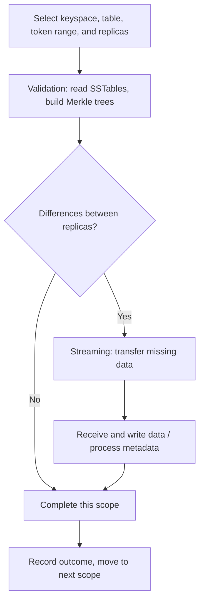

# Throttling Network, CPU, Disk, and Concurrency During Repair

## 1. Why Does Repair Need a Resource Budget?

Apache Cassandra stores multiple copies of each partition according to the keyspace's **replication factor (RF)** and replication strategy. When an application writes at a consistency level (CL) that does not require every replica to acknowledge, some replicas can miss mutations during network glitches or node downtime. **Anti-entropy repair** compares data across natural replicas by token range, detects discrepancies, and transfers needed data to bring them into convergence.

Repair does not sit on the execution path of normal `INSERT`/`SELECT` commands, yet it **shares CPU, memory, disk, and network** with those requests. Running too fast can drive up p95/p99 latency, trigger timeouts, or break CL availability for Java services; running too slowly leaves token ranges unreconciled too long, increasing risk when tombstones are purged after their protection window.

This lesson belongs to the **Repair** chapter of the `DATABASE_ENGINE_WIDE_COLUMN_CASSANDRA` module. Its scope links distributed/wide-column architecture, partition keys, replication, and read/write consistency with CQL, compaction, troubleshooting, and Java application connectivity.

After this lesson, learners should be able to:

1. Explain how the **validation phase** (reading data, building Merkle trees) and the **streaming phase** generate different resource loads.
2. Distinguish three throttling levers: **streaming throughput**, **compaction/validation throughput**, and **concurrency** across jobs and nodes.
3. Observe disk, CPU, network, and latency before deciding to change thresholds.
4. Understand the **node/keyspace/table/token range/DC** boundaries of repair commands.
5. Follow a reversible test runbook for raising/lowering load without trading data correctness for temporary speed.

## 2. Two Main Phases That Drive Resource Pressure

Conceptually, Cassandra repairs a set of token ranges by comparing data across responsible replicas:



**Validation is not merely a network request.** Each replica must read the relevant data from disk, decompress/scan records, compute hashes to build Merkle trees, and exchange comparison trees. For large datasets, this phase can elevate disk reads, CPU, and compaction-related work even when **zero bytes are streamed**.

**Streaming occurs when data needs transferring.** Source nodes read and send data while target nodes receive and write it, consuming network bandwidth, disk I/O, CPU/decompression, and potentially generating follow-on compaction. A repair session can stream 0 bytes yet still impose significant validation load.

| Phase / Activity | Network | CPU | Disk / Memory | Observable Signals |
| --- | --- | --- | --- | --- |
| Planning, control exchange | Small messages between coordinator and replicas | Coordination | Usually less than data phases | Repair sessions/logs and pending tasks. |
| **Validation/Merkle tree** | Tree/hash exchange | Hashing, decompression, partition scans | **SSTable reads**; cache, I/O, and memory for validation | Rising disk reads, `compactionstats`/validation tasks, high CPU. |
| **Streaming** | Intra-DC or inter-DC **data transfer** | Serialization/checksums/compression along data path | Reads on source, writes on target; may produce new SSTables | `netstats`, network throughput, streaming backlog. |
| Incremental repair/anti-compaction | Some transfer/metadata | SSTable and repaired-state processing | May rewrite SSTables, consume extra disk | Pending compaction, dropping free disk, rising output SSTables. |
| Concurrent foreground CQL | Client + inter-node traffic | Read/write/GC | Memtables, SSTables, commitlog | p95/p99, timeouts, queues, and disk latency. |

**Correct mental model:** There is no single "repair throttle" controlling all phases. Capping streaming bandwidth **does not directly cap** CPU or disk reads during Merkle tree construction; lowering job count **is not equivalent** to setting a hard MiB/s ceiling.

## 3. Before Throttling: Define Scope and Readiness

Suppose keyspace `shop_ks` uses `NetworkTopologyStrategy` with `dc1: 3` and `dc2: 3`. A table `orders_by_customer` partitioned by `customer_id` has natural replicas in both DCs. Repair can contact replicas holding token ranges for this table—completely different from a CQL update running at `LOCAL_QUORUM`.

```sql
SELECT keyspace_name, replication
FROM system_schema.keyspaces
WHERE keyspace_name = 'shop_ks';

SELECT keyspace_name, table_name, compaction, gc_grace_seconds
FROM system_schema.tables
WHERE keyspace_name = 'shop_ks'
  AND table_name = 'orders_by_customer';
```

Verify before running:

- **Per-DC RF, healthy node count, and application CL.** When multiple replicas are busy or down simultaneously, `LOCAL_QUORUM` can still time out even though repair itself does not alter RF/CL.
- **Unit of data to repair:** keyspace, table(s), which token ranges, and incremental vs. full repair.
- **Active schedules:** cron, Reaper, or Auto Repair (if supported by version/configuration). Never stack manual repairs on top without confirming job ownership.
- **Time remaining before reconciliation deadline:** based on `gc_grace_seconds`, outages, last successful job time, and cluster-wide coverage; never let repair drag indefinitely.
- **Available resources:** free disk space, CPU, disk latency, inter-DC links, concurrent compaction/streaming, and application SLOs.

`nodetool repair` is invoked on **one coordinating node**, processing scopes it is responsible for and contacting relevant replicas; it **does not** mean a single command repairs the entire cluster. Running `-pr` (primary ranges) on one node processes only that node's primary ranges; a cluster-wide plan needs all corresponding nodes and DCs.

## 4. Network Throttling: Streaming Throughput

The commands below are node administration commands, **not CQL**. Check `nodetool help ...` for the exact running version before using. Examples use hypothetical node name `cassandra-node-1`.

### 4.1. Read Current Thresholds First

```bash
nodetool -h cassandra-node-1 help getstreamthroughput
nodetool -h cassandra-node-1 getstreamthroughput
nodetool -h cassandra-node-1 getinterdcstreamthroughput
nodetool -h cassandra-node-1 netstats
```

- `getstreamthroughput` shows the node's **overall streaming** limit.
- `getinterdcstreamthroughput` shows the **inter-datacenter streaming** limit.
- `netstats` helps inspect active send/receive streams, streaming sessions, and progress. It is a **point-in-time snapshot**, not a replacement for time-series dashboards.

In documented Cassandra 5.0 versions, `nodetool setstreamthroughput` and `setinterdcstreamthroughput` accept values in **megabits per second (Mbit/s)** by default; the `-m`/`--mib` option allows setting in **MiB/s**. The `get...` commands have corresponding options. **1 MiB/s ≈ 8.39 Mbit/s**; confusing the two units can skew limits by more than eightfold. Some configuration files also use different units than `nodetool` syntax, so never copy numbers without units.

### 4.2. Example Limiting Outbound Streaming on One Node

```bash
# LAB TEST EXAMPLE: explicitly use MiB/s units.
nodetool -h cassandra-node-1 setstreamthroughput -m 16
nodetool -h cassandra-node-1 getstreamthroughput -m

# Separate inter-DC streaming limit, also in MiB/s.
nodetool -h cassandra-node-1 setinterdcstreamthroughput -m 8
nodetool -h cassandra-node-1 getinterdcstreamthroughput -m
```

The values **16 MiB/s** and **8 MiB/s** are solely illustrative for reading the commands—**not defaults or production recommendations**. The inter-DC limit sits inside the overall streaming budget; avoid setting it higher than the overall streaming limit if you want predictable allocation.

The command adjusts **the targeted node**, does not directly change limits on other nodes, and applies to node-wide streaming rather than **just one specific repair session**. Bootstrap, replacement, rebuild, or other streaming operations may be affected. Applying a limit across many nodes requires an admin plan and per-node verification; never push bulk changes without controlling scope.

**Special warning:** a value of `0` in throughput-throttling commands usually means **disable throttling**, **not** pause streaming. Never set `0` intending to "block network traffic" on a heavily loaded cluster.

### 4.3. A Streaming Cap Does Not Guarantee Actual Speed

A 16 MiB/s limit sets an **expected ceiling**, not a promise that repair will achieve 16 MiB/s: validation may occupy most of the runtime; the receiving node may be disk-bound, the network may be capped at the infrastructure layer, multiple connections may share links, or other tasks may compete for I/O. Conversely, a per-node limit is not an aggregate bandwidth cap for **the entire cluster**.

For inter-DC traffic, observe **both send and receive directions** along with latency, packet loss, and application traffic. Never assume "we capped outbound on node A so the inter-DC link cannot saturate" when multiple nodes are sending simultaneously.

## 5. CPU and Disk: Validation, Compaction Throughput, and Free Space

In many Cassandra versions, repair validation runs tasks on the compaction infrastructure. `compaction_throughput` settings and `nodetool setcompactionthroughput` can affect **compaction/validation bandwidth**, though they are not absolute CPU limiters.

```bash
nodetool -h cassandra-node-1 getcompactionthroughput
nodetool -h cassandra-node-1 compactionstats
nodetool -h cassandra-node-1 tpstats

# ONLY an illustrative controlled change in lab:
nodetool -h cassandra-node-1 setcompactionthroughput 32
nodetool -h cassandra-node-1 getcompactionthroughput
```

In Cassandra 5.0 documentation, `setcompactionthroughput` takes **MiB/s**; `0` means **unthrottled**. The value `32` is a technical example, not an optimal setting for every disk. This threshold also affects **normal node compaction** outside repair, so any change must be measured for both **pending compactions** and subsequent read amplification.

**Why is disk frequently the bottleneck?**

- Validation scans SSTables to compute hashes, contending for bandwidth/IOPS with foreground reads.
- Streaming reads data from source nodes and writes to target nodes, especially costly when large diffs must transfer.
- Incremental repair can trigger **anti-compaction** and rewrite SSTables to separate repaired/unrepaired data; this requires free disk space.
- Snapshots/hard links and compaction can keep old SSTables around, delaying disk reclamation.
- When disks are nearly full, increasing concurrency usually makes failure risk **higher**, rather than simply finishing faster.

There is no universal rule like "always need exactly 2× table size" for every repair. Space needs depend on divergence volume, repair mode, Cassandra version, SSTable sizes, compaction strategy, snapshots, and overlapping tasks. **Measure actual free disk** on every source/target node and maintain environment-appropriate headroom thresholds.

**Indirect CPU throttling:** If `tpstats`, host CPU, and GC all climb during validation, lower the number of repair jobs or avoid overlapping sessions. Never raise `-j` just because metrics show few streamed bytes: most of the work may be hashing SSTables rather than network transfer.

## 6. Concurrency: Repair Jobs, DCs, Token Ranges, and Multiple Nodes

### 6.1. The `-j` Parameter Is Not the CPU Core Count for Repair

`nodetool repair -j N`/`--job-threads N` configures **the number of concurrent repair jobs**, typically representing how many tables/column families are repaired concurrently. In Cassandra 5.0 tool documentation, the default is **1** and the maximum is **4**. Other versions may differ, so never apply that number blindly to every cluster.

```bash
nodetool help repair

# Safe starting example in lab: one job at a time.
nodetool -h cassandra-node-1 repair -j 1 repair_lab_ks events_by_device

# Intentional comparison in a test environment, NOT run concurrently:
nodetool -h cassandra-node-1 repair -j 2 repair_lab_ks events_by_device
```

With **a single table**, raising `-j` may **not change effective concurrency** as expected. `-j` does not directly control CPU cores, network bytes/sec, or per-node concurrent streams. Actual load depends on range splitting, topology, schedulers, jobs on other nodes, and validation/streaming stages.

### 6.2. Repair Ordering and DC Scoping

Options in supporting versions:

| Option | Meaning | Operational Note |
| --- | --- | --- |
| `-seq`/`--sequential` | Runs repair sequentially instead of the default parallelism | Usually reduces peak contention but can lengthen completion time. |
| `-dcpar`/`--dc-parallel` | Runs datacenters in parallel in DC-aware mode | Can raise aggregate load; monitor WAN links and nodes in every DC. |
| `-local`/`--in-local-dc` | Compares only against nodes in the local DC | **Restricts comparison scope**; does not prove DCs are synced with each other. |
| `-dc <dc>` | Selects specific DCs per supported list | Needs a full coverage plan; do not confuse a load filter with cluster-wide repair. |
| `-pr`/`--partitioner-range` | Only the initiating node's primary token ranges | Used when coordinating across nodes to cut duplicate work; does not mean one node fixes all ranges. |
| `-j <n>` | Number of concurrent repair jobs | Increasing can saturate validation, compaction, disk, and network. |
| `--full` | Full repair covering all data in the specified scope | Can cost more than incremental; it is a data-scope choice, **not a speed-up button**. |

```bash
# Example reducing load via sequential ordering on a lab table.
nodetool -h cassandra-node-1 repair -seq -j 1 repair_lab_ks events_by_device

# Process only this node's primary ranges (requires a plan covering other nodes):
nodetool -h cassandra-node-1 repair -pr -j 1 repair_lab_ks events_by_device
```

Never use `-local` or `-dc` just to make repair "faster" while forgetting that they **change the participating replica set**. If data must converge across DCs, build a proper reconciliation strategy covering all DCs and track results per segment. Likewise, skipping down replicas to force a session through can leave unrepaired ranges; never declare completion when coverage is incomplete.

### 6.3. Concurrency Across **Multiple Commands** Matters More Than `-j`

A single node can simultaneously absorb load from:

1. Repair launched by cron/Reaper/Auto Repair.
2. Manual repair on node A.
3. Another repair initiated from node B that also contacts replica A.
4. Bootstrap/replace/rebuild streaming and background compaction.
5. Normal CQL traffic.

Therefore, **one command with `-j 1` does not mean a node has only one repair job running in practice**. Measure concurrency across **cluster, DC, rack, node, and disk**. Avoid running token ranges with overlapping replicas simultaneously when resources are tight; stagger across DCs/racks to keep enough healthy replicas for application CLs.

## 7. Budget Around SLOs, Not "Repair as Fast as Possible"

Suppose a Java service requires read p99 below an application-defined threshold; there is no single universal threshold for every system. Before maintenance, agree on:

- **Resources reserved for foreground traffic:** CPU, IOPS, disk latency, and bandwidth preserved for customer-facing CQL.
- **Repair ceilings:** streaming/validation throughput, job counts, and concurrent participating nodes.
- **Safety limits:** minimum free disk, healthy replicas for RF/CL, and max acceptable p99/timeouts/queues.
- **Completion deadline:** enough time to repair all required token ranges/tables/DCs with headroom inside `gc_grace_seconds` to prevent deleted data from reappearing.
- **Config rollback readiness:** record **prior throttle values**, change approvers, and restoration steps.

Diagnostic matrix (illustrative figures, not real benchmarks):

| Observation | Assessment | Throttling Direction |
| --- | --- | --- |
| Network near saturation while disk/CPU have headroom | Streaming is contending with CQL/application links | Lower `streamthroughput` or inter-DC cap; re-measure transfer rate and latency. |
| High CPU/GC during validation, very low network | Hashing/reading SSTables or background tasks may be the bottleneck | Reduce jobs, avoid overlapping repairs; check compaction throughput/CPU/GC. |
| High disk await, growing pending compactions, worsening read p99 | I/O contention; raising network caps will not help | Lower concurrency and/or compaction/streaming caps; check free disk. |
| Repair finishes fast yet read/write timeouts spike | Configuration over-prioritizes maintenance | Reduce repair load; adjust schedule and concurrent nodes. |
| Repair cannot finish coverage before deadline | Throttling too tight, scope too large, or under-provisioned | Plan scope partitioning, maintenance windows, or added capacity; never stretch endlessly ignoring tombstone risk. |

Before changing a parameter, state a **falsifiable hypothesis**. For example: "Lowering streaming from the current setting to a lower ceiling on sending nodes will reduce outbound bandwidth and client p99 without pushing completion past deadline." After changing, verify both **intended effect and side costs**.

## 8. Observational Commands That Should Accompany Every Throttle Change

### Node, Repair, and Streaming Status

```bash
nodetool status
nodetool netstats
nodetool tpstats
nodetool compactionstats
nodetool tablestats repair_lab_ks.events_by_device
```

These commands **do not** give you full application p95/p99 or aggregate cluster bandwidth. `nodetool` connects to one admin node; in multi-DC clusters, gather metrics across **all participating nodes** over the same time window.

### Dashboards/JMX and Host Telemetry

| Metric | Diagnostic Purpose |
| --- | --- |
| Repair duration, completed/failed range count, bytes streamed | Track true coverage and velocity, not merely sessions started. |
| Outbound/inbound throughput, retransmits, errors per node/DC | Determine whether WAN/intra-DC links are saturated or one node is slow. |
| User/system CPU, GC pauses/heap, task queues | Detect validation/hashing/compaction starving query CPU. |
| Free disk, read/write bytes/s, IOPS, disk p95/p99 latency | Spot streaming sources/targets saturating disks or running out of space. |
| Pending/active compactions, validation jobs, SSTable count | Track scheduler impact and rewrite backlogs. |
| ClientRequest read/write p95/p99, timeouts, failures | Protect application experience throughout maintenance. |
| Threads/queues/dropped messages | Catch internal bottlenecks even when aggregate bandwidth sits below cap. |

Cassandra metric names, units, and aggregation vary by version and JMX exporter; verify your cluster's exact metric catalog. Cumulative counters require taking **rates/deltas**, and histograms require knowing units and bucket bounds. Never compare counters from a freshly restarted node against a node up for months to infer current speed.

### Query Tracing and CQL Read Outcomes

A query trace of a slow `SELECT` can help spot which replica responded late during repair. However, CQL tracing **does not replace** repair logs/metrics; it only shows read-path impact for that specific request. Use tracing **selectively**, never enabled broadly, because tracing itself adds I/O.

## 9. Six-Step Runbook for a Controlled Change

### Step 1 — Lock Scope and Capture Baseline

Record node, DC, keyspace/table, repair mode (incremental/full), token ranges, active schedules, and version. Capture baselines:

```bash
nodetool help repair
nodetool getstreamthroughput
nodetool getinterdcstreamthroughput
nodetool getcompactionthroughput
nodetool netstats
nodetool compactionstats
```

Also record CPU, free disk, disk read/write latency, outbound/inbound network, and CQL p95/p99 over the same observation window. Know the **initial values** so you can revert after testing.

### Step 2 — Pick One Variable and a Safe Threshold

For instance, if the bottleneck is **inter-DC throughput**, leave `-j` and compaction caps untouched and test **lowering inter-DC throughput on sending nodes**. If the bottleneck is validation CPU, first consider lowering job/concurrent session counts; tweaking streaming caps may have no effect.

**Never change multiple variables at once**—streaming cap, compaction throughput, `-j`, application CL, and repair node count—or you will not know which change caused the effect.

### Step 3 — Test in Lab or on One Designated Node

Example command for **lab**, assuming approval and an 8 MiB/s inter-DC cap:

```bash
nodetool -h cassandra-node-1 getinterdcstreamthroughput -m
nodetool -h cassandra-node-1 setinterdcstreamthroughput -m 8
nodetool -h cassandra-node-1 getinterdcstreamthroughput -m
```

Because this is a **node-level** setting, other streaming flows on the node are also affected. Never apply identical caps across every node without measuring traffic direction and disk health on each node.

### Step 4 — Run a Small-Scope Repair and Observe

```bash
# In a lab environment with selected table and non-overlapping schedule:
nodetool -h cassandra-node-1 repair -seq -j 1 repair_lab_ks events_by_device

# During repair:
nodetool -h cassandra-node-1 netstats
nodetool -h cassandra-node-1 compactionstats
nodetool -h cassandra-node-1 tpstats
```

`repair -seq -j 1` is a cautious command-level starting point; it **does not** guarantee the whole cluster runs sequentially if another scheduler is active. Never simulate down nodes or launch overlapping token-range repairs in production.

### Step 5 — Decide Whether to Keep, Lower, or Abort the Test

If client p99/timeouts, disk latency, or free disk cross **agreed thresholds**, reduce concurrency or throttle further in the safe direction, or defer the session per maintenance plan. Stopping/aborting a repair task must follow your version's tooling and runbook; an aborted task can leave **unfinished ranges** requiring re-repair and must never be reported as succeeded.

If repair causes negligible application impact and ample headroom remains, you may step capacity up **in small increments** one variable at a time, re-checking both **completion speed and SLOs**. Never use `0` thinking it reduces load, as `0` typically **disables** throttling.

### Step 6 — Complete Coverage, Restore Config, and Report

When repair finishes, verify **completion by range/table/DC and session**, not just `netstats` showing zero streams. Restore throughput caps to original values or newly approved values; verify via `get...` commands. Record:

- Repaired nodes and scopes, owner, start/end times, repair mode.
- Throttle settings before/during/after; concurrent jobs and nodes.
- Bytes streamed, succeeded/failed ranges, effective repair rate.
- CPU, disk, network, and Java service latency/timeouts before and after.
- Remaining token ranges/DCs and deadline ahead of `gc_grace_seconds`.

**If range coverage is incomplete, the operational status is "repair still required,"** even after throttles are reverted and service timeouts subside.

## 10. Hands-On CQL and nodetool in a Test Cluster

Prepare an isolated test keyspace; example DC is `dc1` (adjust to match topology, ensuring enough nodes for RF):

```sql
CREATE KEYSPACE repair_lab_ks
WITH replication = {'class': 'NetworkTopologyStrategy', 'dc1': '3'}
AND durable_writes = true;

CREATE TABLE repair_lab_ks.events_by_device (
    device_id text,
    bucket_day date,
    event_ts timestamp,
    event_id uuid,
    payload text,
    PRIMARY KEY ((device_id, bucket_day), event_ts, event_id)
);

INSERT INTO repair_lab_ks.events_by_device
    (device_id, bucket_day, event_ts, event_id, payload)
VALUES
    ('sensor-7', '2026-11-21', '2026-11-21T08:00:00+0000',
     11111111-2222-3333-4444-555555555555, 'sample');

SELECT event_ts, event_id, payload
FROM repair_lab_ks.events_by_device
WHERE device_id = 'sensor-7'
  AND bucket_day = '2026-11-21';
```

**Note:** a handful of rows in a lab will barely move metrics; the goal is practicing observation and parameter verification, not proving "`-j 2` is twice as fast as `-j 1`." Never generate synthetic stress or alter throttles on a production cluster just to get prettier graphs.

**Scenario A — Heavy validation, minimal streaming:** Use an already synced table and run a full table repair in lab; observe disk reads/CPU alongside potentially 0 bytes streamed. Explain why raising `setstreamthroughput` does not speed up SSTable reading/hashing.

**Scenario B — Cross-DC streaming:** If a lab has multiple DCs with intentionally unsynced data under safe test conditions, compare inter-DC caps on the source node while tracking target nodes and latency. Never test this in production by causing network partitions or taking replicas down.

**Scenario C — Concurrency:** Test the same **repair plan spanning enough tables/ranges** at `-j 1` and then `-j 2` in separate windows with comparable load/data; collect CPU, disk, streaming, duration, and timeouts. With only a single table, note why `-j` may not be the deciding variable.

### Measurement Worksheet Template

| Field | Before | During Repair | After Completion |
| --- | --- | --- | --- |
| Node / DC / keyspace / table | Fill in | Keep scope fixed per plan | Confirm coverage |
| Streaming cap / inter-DC cap / compaction cap | Record value and unit | Record approved changes | Confirm reverted / new value |
| Repair job threads & cluster-wide job count | Record | Actual count incl. cron/Reaper/Auto Repair | No stray jobs left |
| Network send/recv, CPU, disk latency, free disk | Baseline | Peak and p95/p99 | Stabilized back to baseline |
| Client read/write p95/p99, timeouts | Baseline | Peak impact | Compare at matching load |
| Bytes streamed, failed/completed ranges | N/A | Progress | Verify final outcome |

## 11. Quick Diagnosis by Symptom

| Symptom | Do Not Jump to Conclusion | Check and Direction |
| --- | --- | --- |
| Repair runs for hours with near-0 network | "Network is too slow" | Inspect validation tasks, disk reads, CPU, Merkle trees, compaction throughput, and range count. |
| Network at 100%, frequent client timeouts | "Increase `-j` to finish sooner" | Inspect sending/receiving nodes, CQL traffic, streaming/inter-DC caps; prioritize protecting SLOs. |
| High CPU, long GC pauses, normal disk | "Throttling streaming will fix everything" | Inspect validation/compaction and job counts; lower concurrency, check heap/GC. |
| Free disk drops sharply during incremental | "Repair lost data" | Inspect anti-compaction, output SSTables, snapshots, incoming streams, and disk headroom. |
| No improvement when raising `-j` | "Cassandra ignores config" | A single table may lack parallel sub-jobs to saturate threads; bottleneck may be another resource. |
| Only one node runs `-j 1` yet cluster saturates | "Concurrency is already minimal" | Check other schedulers, repairs on other nodes, and shared replicas. |
| `netstats` shows no streams yet repair hasn't reported done | "Already finished syncing" | Check final validation, anti-compaction, logs, and range/session status. |
| Throttled too hard, many ranges past deadline | "Slower is always safer" | Plan capacity/load spreading, prioritizing coverage within tombstone and SLO limits. |

### Operational Scenario: RF = 3, CL = `LOCAL_QUORUM`

A cluster in `dc1` has three replicas A, B, and C. Both A and B are under heavy repair validation load; C is healthy. An application reading at `LOCAL_QUORUM` needs two timely responses. If both A and B slow down from disk/CPU load, clients can time out **even while all three nodes remain `UN`**. Reducing streaming on C does not fix the root cause if A and B are busy building Merkle trees.

Resolution direction: check traces/read latency and `compactionstats`/disk/CPU **on A and B**, reduce parallel repairs touching those two nodes, and protect read/write budgets. Afterward, check remaining repair time and schedule unfinished ranges. Never arbitrarily downgrade application CL as a workaround to hide the incident.

## 12. Java Driver Context: Monitor Impact, Do Not Control Repair from CQL

Repair is a cluster admin task, **not** a CQL statement the Java Driver sends per request. The driver continues routing queries by partition key using the configured consistency level. Example measuring read latency with Java Driver 4.x in lab:

```java
PreparedStatement ps = session.prepare(
    "SELECT payload FROM repair_lab_ks.events_by_device " +
    "WHERE device_id = ? AND bucket_day = ?"
);

BoundStatement statement = ps.bind(
    "sensor-7", LocalDate.of(2026, 11, 21)
).setConsistencyLevel(DefaultConsistencyLevel.LOCAL_QUORUM);

long startNs = System.nanoTime();
ResultSet rs = session.execute(statement);
int rows = 0;
for (Row row : rs) {
    row.getString("payload");
    rows++;
}
long elapsedNs = System.nanoTime() - startNs;
System.out.printf("rows=%d elapsedMs=%.2f%n",
    rows, elapsedNs / 1_000_000.0);
```

This snippet assumes an active `session` and driver 4.x/`LocalDate` imports. The measured time **includes iterating fetched pages**, yet represents only a single call; in real environments track p50/p95/p99 across many requests, timeout/retry counts, and result sizes. Against a matching-load baseline, if latency climbs during repair, locate slow replicas using traces and metrics rather than assuming the entire repair has a logic bug.

Never embed `nodetool` flags into CQL strings or trigger admin actions from HTTP request handlers. Maintenance automation must manage permissions, schedules, concurrency, logs, and abort conditions separately.

## 13. Self-Check Questions

1. Why can a repair consume high CPU/disk even while streaming 0 bytes? Which throttle affects that phase?
2. What is the difference between `setstreamthroughput`, `setinterdcstreamthroughput`, and `setcompactionthroughput`? How do `Mbit/s` and `MiB/s` differ?
3. Why is setting `setstreamthroughput 0` dangerous when the goal is *reducing load*?
4. Why does `repair -j 2` not equal two CPU cores or double the repair speed of a single table?
5. What are the pros/cons of `-seq`, `-dcpar`, and `-local`? Which option changes **comparison scope**?
6. If cron/Reaper and manual runs both start repair with `-j 1`, why can the whole cluster still become overloaded?
7. When incremental repair reduces free disk space, list activities that can create/retain SSTables and how to verify them instead of deleting files manually.
8. Why can over-throttling repair throughput threaten data correctness after `gc_grace_seconds`?
9. After adjusting throttles, what evidence is required to report that a repair completed **across all intended ranges/tables/DCs**?

**Completion criteria:** learners clearly separate validation from streaming, control each resource using the right parameters and units, recognize concurrency at the **cluster** level rather than a single command, use dashboards to prove application p99 impact, and maintain a runbook ensuring repair coverage has no gaps.

## 14. References

- [Apache Cassandra — Repair](https://cassandra.apache.org/doc/stable/cassandra/managing/operating/repair.html): full/incremental repair, scheduling, and repair scope.
- [Apache Cassandra — nodetool repair](https://cassandra.apache.org/doc/latest/cassandra/managing/tools/nodetool/repair.html): `-j`, `-seq`, `-dcpar`, `-local`, `-pr`, and scope-limiting options.
- [Apache Cassandra — setstreamthroughput](https://cassandra.apache.org/doc/latest/cassandra/managing/tools/nodetool/setstreamthroughput.html) and [getstreamthroughput](https://cassandra.apache.org/doc/latest/cassandra/managing/tools/nodetool/getstreamthroughput.html): streaming limits and `Mbit/s`/`MiB/s` units.
- [Apache Cassandra — setinterdcstreamthroughput](https://cassandra.apache.org/doc/latest/cassandra/managing/tools/nodetool/setinterdcstreamthroughput.html): inter-DC streaming limits.
- [Apache Cassandra — setcompactionthroughput](https://cassandra.apache.org/doc/latest/cassandra/managing/tools/nodetool/setcompactionthroughput.html) and [cassandra.yaml](https://cassandra.apache.org/doc/latest/cassandra/managing/configuration/cass_yaml_file.html): compaction and validation budgets.
- [Apache Cassandra — nodetool diagnostics](https://cassandra.apache.org/doc/stable/cassandra/troubleshooting/use_nodetool.html): `netstats`, `tpstats`, `compactionstats`, and I/O bottleneck investigation.

**Conclusion:** Safe repair requires **capping load enough to keep serving CQL, while running fast enough to finish reconciliation on time**. Streaming throttles protect the network, compaction throttles and job counts affect CPU/disk, and per-node/per-DC scheduling governs true aggregate concurrency. No single knob replaces measuring p99, free disk, throughput, range status, and the system's ability to satisfy CLs.
