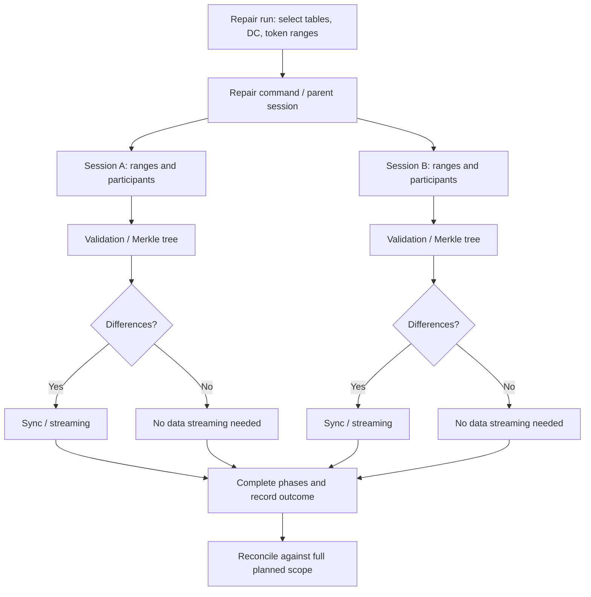

# Repair Sessions, Progress Tracking, and Completion Verification Criteria

In Apache Cassandra, replication stores a partition on multiple nodes, yet **does not guarantee all replicas are identical at every moment**. A node can miss mutations during network drops, expired hinted handoff, or write failures; upon returning, its data may differ from the remaining replicas. **Anti-entropy repair** compares replica data and synchronizes missing portions. Proper repair operations do not stop at running a `nodetool repair` command: administrators must know **which sessions ran on which replicas, which token ranges and tables were covered, what streamed, what failed**, and what evidence authorizes declaring completion.

This lesson belongs to the **Repair** chapter of the **DATABASE_ENGINE_WIDE_COLUMN_CASSANDRA** module, connecting distributed architecture, partition keys, replication, consistency, CQL, compaction, tombstones, incident troubleshooting, and Java applications. The goal is to establish a verifiable procedure for production or lab clusters, avoiding false conclusions from a single "success" message or `nodetool status` showing every node `UN`.

## 1. Learning Objectives

After this lesson, you will be able to:

1. Explain the relationships among **repair job/parent session, repair session, token range, participants, validation, and streaming**.
2. Distinguish **full repair**, **incremental repair**, **primary-range repair**, and repairs scoped by DC, host, table, or token range.
3. Track progress via **`nodetool` commands, coordinator/participant logs, streaming, and metrics**, even when one phase is no longer actively displayed.
4. Define acceptance criteria across **scope coverage**, **per-task outcomes**, **data state**, and **post-repair operational stability**.
5. Diagnose timeouts, validation failures, streaming errors, stuck sessions, and the impact of interrupted repairs.
6. Plan repairs to curb zombie-data risks when tombstones pass `gc_grace_seconds`.
7. Verify a missed-write replica scenario with CQL while understanding the limits of SELECT-only verification.

## 2. What Problem Does Repair Fix?

Every partition has a **replica set** determined by the partition key's token and the replication strategy. For example, in a keyspace using `NetworkTopologyStrategy` with RF = 3 in `dc1`: a `LOCAL_QUORUM` mutation can succeed when two replicas respond while the third replica is down or temporarily unresponsive.

When the third replica returns:

- **Commit log replay** recovers only mutations that node itself **had already received and logged** before crashing.
- **Hinted handoff** may replay missed mutations, subject to configuration, time limits, hint storage constraints, and delivery success.
- **Read repair** (depending on version and read path) can converge **data touched by queries**, without providing proactive sync across all partitions.
- **Anti-entropy repair** is responsible for **comparing replicas across token ranges** and synchronizing discrepancies within the selected scope.
- **Backups/snapshots** serve data recovery per backup policies; repair cannot reconstruct mutations lost across **all** replicas if no copy retains them.

Repair is an operational task that **reads data, computes diffs, and transfers needed data**. It does not fix bad partition keys, enforce a UNIQUE constraint, make LWTs faster automatically, or provide an instant transactional snapshot for concurrent writers.

### Two Distinct Questions

| Question | Corresponding Evidence |
| --- | --- |
| "Do the replicas of **partition X** still hold record Y?" | Targeted reads across eligible replicas, consistency levels, and tracing when needed. |
| "Have all **intended token ranges/tables/DCs** been repaired successfully?" | Work ledger by range/participant and final outcomes of all repair sessions—not just a single SELECT. |

A `LOCAL_QUORUM` read can return the right answer even when one replica still lacks data. That is an availability benefit of replication, and also why **a single successful query** cannot serve as proof of cluster-wide repair.

## 3. From Job to Repair Session: The Big Picture

Terms like "job," "parent session," and "session" are sometimes used differently across monitoring tools and versions. When reading logs, distinguish at least four layers:

| Layer | Logical Meaning | Information to Track |
| --- | --- | --- |
| **Run / schedule** | Plan launched by humans or automation; may span multiple commands on multiple nodes. | Ops system's Run ID, target DC/keyspace/table, planned start/end. |
| **Repair command / parent repair session** | A single repair invocation, which may split into multiple range groups and tasks; usually logged with an identifier. | Coordinator, parent/command ID if present, options, assigned token ranges, final outcome. |
| **Repair session / child task** | Work over a range group and participating replicas, covering validation and sync phases. | Session ID, participants, range, phase, bytes/tasks, errors or timeouts. |
| **Validation / sync / streaming task** | Computing data digests and transferring differences. | Specific progress, streaming success/failure, retries, peer/disk errors. |

Do not force a rigid **one command = one session** model: vnodes give each node many ranges, and repair schedulers can spawn multiple tasks. Nor should one succeeded session be taken as the entire command completing; other sessions may have failed or not yet run.

### Conceptual Flow



The diagram illustrates **phase semantics**. Exact ordering of preparation, validation, sync, anti-compaction, and finalization varies by **Cassandra version and full/incremental mode**; never treat the diagram as a strict guarantee of line-by-line log order.

## 4. Merkle Trees, Validation, and Streaming

To avoid comparing every row across the network, Cassandra uses **Merkle trees** during repair: replicas compute hash trees representing data in the token range. Differing sub-ranges are identified to synchronize the relevant data. During this process, nodes may read many SSTables, use CPU to build trees, and stream data between replicas.

A repair pass typically consists of these work phases:

1. **Prepare and identify participants:** coordinator determines replicas responsible for the token ranges, checks membership/topology, and prepares the session.
2. **Validation:** replicas generate comparison digests (typically Merkle-tree based). This step can drive disk reads, CPU, and compaction impact.
3. **Sync:** differing peers synchronize data ranges/SSTables via streaming or an appropriate mechanism.
4. **Metadata finalization:** for incremental repair, **anti-compaction/finalization** may be required to handle repaired/unrepaired/pending-repair SSTable state. Details vary by version.
5. **Completion:** the repair command and sessions must reach an error-free final state; orchestration tooling records coverage.

### Is Zero Streamed Bytes an Error?

**No.** If validation finds no differences needing transfer, a successful repair can record **0 bytes streamed**. That is not evidence repair was skipped. Conversely, a session that streamed gigabytes **is not guaranteed succeeded** if finalization errored or the session failed at the end. Always inspect **the final status of every session** and verify planned scope.

### Repair Does Not Triple Data When RF = 3

RF = 3 means each partition has three replicas across distinct nodes (in a single-DC example). Repair reconciles and brings each replica to its required state; it **does not** create three duplicate business events in CQL results or increase RF.

## 5. Full, Incremental, and Repair Scopes

CLI options and defaults vary across Cassandra 3.x, 4.x, 5.x, and managed distributions. **Always run `nodetool help repair` on the exact version** before scheduling; commands below are controlled examples.

| Mode / Scope | Meaning | When to Consider |
| --- | --- | --- |
| **Full repair** | Reconciles data in the requested scope, even if SSTables were previously marked repaired by incremental repair. | Restoring confidence after incidents, data audits, periodic runs per cluster policy. |
| **Incremental repair** | Relies on repaired/unrepaired state to skip repeating some work in subsequent waves. | Recurring maintenance on clusters/versions with stable incremental workflows. |
| **Primary-range repair** (`-pr` / `--partitioner-range` per CLI) | Operates only on primary token ranges assigned to the node in the partitioner map. | Scheduling **across all required nodes** to avoid overlapping range repairs. |
| **Keyspace/table-scoped repair** | Compares data only for the specified keyspace or table(s). | Isolating incidents and measuring impact, without claiming other tables are repaired. |
| **DC/host-scoped repair** | Includes only participants in the chosen group, per CLI flags. | Per-DC scheduling, limiting WAN traffic; must track remaining unrepaired scopes. |
| **Token-range-scoped repair** | Processes only token intervals passed via start/end token flags. | Targeted repair or splitting schedules; must log every range accurately to avoid gaps. |
| **Preview repair** (if supported) | Estimates/checks divergence without performing normal synchronization. | Diagnostics/measurement before intervention; **does not** count as completed repair. |

**Incremental and full differ in how data is selected and marked**, not "incremental fixes a few rows while full definitely repairs the whole cluster." A `--full` command on **one node, one table, one DC, or one token range** still covers only **the specified scope**. Conversely, scheduling multiple `-pr` runs across the proper node/range plan achieves broad coverage.

### Notes When Using Incremental Repair

- **Pending repair SSTables**, repaired/unrepaired states, and anti-compaction can appear; data may have transferred while completion metadata is not yet finalized.
- Commands aborted/interrupted mid-run can leave work needing recovery/cleanup per **your version's runbook**. Never delete pending files or edit SSTable metadata by hand.
- Concurrent repairs on overlapping scopes, or unplanned mixing of full and incremental, can spike resource usage and muddy repaired-data history.
- Incremental scheduling requires logging **end-to-end success per wave**, not merely that a job scheduler triggered.

## 6. Building a Coverage Matrix Before Running

Suppose `dc1` has three nodes `n01`, `n02`, and `n03` with RF = 3. Each node can own many **virtual-node token ranges**, and partitions in those ranges map to corresponding replica sets. Running a command on `n01` typically does not represent a complete plan across all keyspaces and DCs.

Create an assignment ledger **before execution**:

| Planned Unit | Scope | Expected Participants | Required Outcome |
| --- | --- | --- | --- |
| R1 | `dc1`, `ks.table`, first token range group | Replicas for R1 ranges | All sessions/phases succeeded |
| R2 | `dc1`, `ks.table`, second token range group | Replicas for R2 ranges | All sessions/phases succeeded |
| R3 | `dc1`, `ks.table`, remaining ranges | Replicas for R3 ranges | All sessions/phases succeeded |
| Total | All planned ranges of `ks.table` in `dc1` | All required replicas | No unverified ranges or participants |

Labels R1/R2/R3 are **scheduling groups**, not three fixed token ranges; a real token ring can have many ranges due to vnodes. With multiple DCs, expand the matrix by **DC, table, participants, and cross-DC repair policy**.

### Coverage Rule

The condition to declare **"the entire table has been repaired for the intended scope"** is:

```text
Planned = set of (keyspace, table, DC/replica scope, token range)
          defined before the repair wave.
Succeeded = set of corresponding units with evidence of repair completion
            after required validation/sync/finalization.

Coverage passes when:
    Planned ⊆ Succeeded
    AND no sessions remain failed/running/unknown for Planned units
    AND completion is confirmed across all required participants.
```

This is an **operational audit model**, not a CQL statement or automatic metric from one Cassandra version. When using `--local` or `-dc dc1`, document the **DC boundary**: success in `dc1` must not be reported as "multi-DC synchronized" if `dc2` was never included in the plan and verified.

### `-pr` Does Not Exempt Running on All Required Nodes

When choosing **primary-range repair**, calling `nodetool repair -pr ...` on just one node **does not cover every primary range around the token ring**. Every primary range needing repair must be scheduled on **the node owning that primary range** and verified against live topology. With multi-DC, topology changes, or transient replication, range/participant partitioning must follow the capabilities and guidance of your exact version.

## 7. Operational Preparation Before a Repair Wave

Before running production repair, establish:

1. **Current topology**: per-DC keyspace RF, snitch, up/down nodes, racks/AZs, vnodes, and any recently bootstrapped/decommissioned/rebuilt nodes.
2. **Table schema**: partition key (for verification queries), compaction strategy, TTLs, and `gc_grace_seconds`.
3. **Load headroom**: CPU/GC, disk IOPS/latency, free disk, network bandwidth, read/write p95/p99, compaction backlog, and active streaming/backups.
4. **Repair history**: last completed repair, longest outage, failed/pending tasks, grace settings, and tombstone retention to protect.
5. **Target coverage**: full/incremental, keyspaces/tables, DCs, nodes/ranges, time window, and concurrency limits.
6. **Abort/rollback criteria**: rising timeouts, filling disks, multiple nodes down, latency SLA breaches, or failing repair participants.
7. **Evidence and storage**: where to record `run_id`, commands/options, start/end timestamps, logs, metrics, per-range outcomes, and sign-off owner.

Pick a window with ample headroom, avoiding simultaneous large snapshots, rebuilds, streaming, heavy compaction, and overlapping repairs. Repair can combine **heavy SSTable reads + hashing + streaming + writes + anti-compaction**; pushing throughput too high easily impacts user requests.

### Read-Only Baseline Commands

```bash
nodetool help repair
nodetool status
nodetool describecluster
nodetool tablestats repair_lab.events_by_device_day
nodetool compactionstats
nodetool netstats
nodetool tpstats
```

Some commands and output labels vary by version. `nodetool status` reports `UN` (Up/Normal), yet **does not** say replicas share identical data. `netstats` shows active streaming rather than a complete history of all streamed bytes. `compactionstats` may reflect validation/anti-compaction or backlogs, yet zero pending tasks **is not enough** to confirm full-scope repair.

## 8. CQL Lab: A Replica Misses a Mutation

This experiment uses a lab cluster with **one DC named `dc1`**, at least three healthy nodes, and keyspace RF = 3. Stop/start actions apply strictly to **a test node** after confirming exact replica endpoints; never stop production nodes.

### Step 1 — Create Keyspace and Query-Driven Table

```sql
CREATE KEYSPACE IF NOT EXISTS repair_lab
WITH replication = {
  'class': 'NetworkTopologyStrategy',
  'dc1': 3
}
AND durable_writes = true;

CREATE TABLE IF NOT EXISTS repair_lab.events_by_device_day (
  device_id text,
  event_day date,
  event_id uuid,
  event_type text,
  PRIMARY KEY ((device_id, event_day), event_id)
);
```

The partition key `(device_id, event_day)` lets reads target a single device/day and avoids full table scans. On the nodes, `nodetool status` confirms DC/rack, UP nodes, and cluster state; never assume RF = 3 guarantees replicas span independent AZs/fault domains automatically.

### Step 2 — Write Baseline Record While All Three Replicas Are Healthy

```sql
CONSISTENCY LOCAL_QUORUM;

INSERT INTO repair_lab.events_by_device_day
  (device_id, event_day, event_id, event_type)
VALUES ('dev-01', '2026-11-21',
        11111111-1111-4111-8111-111111111111,
        'before-outage');

SELECT event_id, event_type
FROM repair_lab.events_by_device_day
WHERE device_id = 'dev-01' AND event_day = '2026-11-21';
```

Use a deterministic `event_id` to verify the exact row rather than `now()`, which generates new rows on retries. Querying after a successful `LOCAL_QUORUM` write gives an application-level baseline; it **does not** directly measure per-replica state.

### Step 3 — Simulate One Replica Down and Write a New Event

1. Use version-appropriate tooling to find the endpoints for partition `('dev-01', '2026-11-21')` (such as `nodetool getendpoints` / token-range tools where supported), cross-checked with `nodetool status`.
2. Pick **a replica that actually owns the partition** and stop Cassandra on that lab node via the service manager; wait until it transitions to `DN`.
3. From a **live** coordinator, send a new INSERT at `LOCAL_QUORUM`:

```sql
CONSISTENCY LOCAL_QUORUM;

INSERT INTO repair_lab.events_by_device_day
  (device_id, event_day, event_id, event_type)
VALUES ('dev-01', '2026-11-21',
        22222222-2222-4222-8222-222222222222,
        'written-during-outage');
```

4. With RF = 3, the two surviving replicas **can** satisfy quorum for a successful write. If responses are insufficient, handle per actual state and never assume a write failed solely from a timeout.
5. Restart the stopped replica, wait for it to become `UN`, and record the recovery timestamp.

**Lab caveat:** hinted handoff or read repair may have already delivered the new event before you start repair, so repair might stream zero bytes for this key. That **does not invalidate the exercise**: the goal here is learning to monitor and verify repair sessions, not forcing divergence every time. Never alter/delete SSTables or disable safety mechanisms just to fabricate drift.

### Step 4 — Run Scoped Repair

Check exact syntax before running:

```bash
nodetool help repair
```

Example on one lab node (common CLI flags):

```bash
# Full repair for the table scope coordinated by the chosen node.
nodetool repair --full repair_lab events_by_device_day
```

This is a single **repair command**, not proof that all token ranges on all cluster nodes were covered. To orchestrate a primary-range pass across the entire DC, schedule appropriately **across all relevant nodes/ranges** while avoiding unnecessary overlapping runs:

```bash
# Example per-node command in a coordinated schedule; do not run simultaneously on every node.
nodetool repair --full -pr repair_lab events_by_device_day
```

Depending on Cassandra version, flag order/names and incremental/full defaults vary. For a **single-table** experiment, document that it is the sole accepted scope; other tables in `repair_lab` are not covered.

### Step 5 — Observe While Repair Runs

On the coordinator and participating replicas:

```bash
nodetool status
nodetool compactionstats
nodetool netstats
nodetool tpstats
nodetool tablestats repair_lab.events_by_device_day
```

Simultaneously inspect **Cassandra logs and repair command output** to capture session/parent IDs, phases, error messages, bytes streamed, and completion timestamps. Do not check `nodetool netstats` only at the end: finished streams vanish from the active table, whereas logs and historical metrics prove they occurred.

### Step 6 — Read Data After Completion

```sql
CONSISTENCY LOCAL_QUORUM;

SELECT event_id, event_type
FROM repair_lab.events_by_device_day
WHERE device_id = 'dev-01'
  AND event_day = '2026-11-21';
```

Both `before-outage` and `written-during-outage` events are expected to appear once the cluster is healthy. This is a **representative data check** supplementing session/coverage evidence; it does not prove every replica across all token ranges matches. Reading at `ONE` or `LOCAL_QUORUM` does not automatically force independent reads from every single replica.

## 9. Tracking Progress Phase by Phase

A useful tracking view combines **status** with **meaningful scope and progress**:

| Phase | Signals to Track | What Cannot Be Concluded Yet |
| --- | --- | --- |
| **Scheduled / queued** | Run ID, command, and selected node; job started per schedule | No repair has executed on data yet. |
| **Preparing** | Valid participants, session ID, range, table, peer connections | No proof validation succeeded yet. |
| **Validating** | Validation logs, progress/CPU/disk reads, Merkle tree build time | "Tree created" does not prove diffs were synced. |
| **Syncing/streaming** | Bytes/files transferred, streaming sessions, network throughput, peer/timeout errors | 100% stream on one participant does not mean all sessions finished. |
| **Finalizing** | Sync outcome, anti-compaction/repair metadata if incremental, no remaining pending state per version | "No active streams" does not prove finalization succeeded. |
| **Succeeded** | All tasks under the command reached final success; completion timestamp logged | Covers only **the ranges/participants in that command**. |
| **Failed/aborted/unknown** | Exceptions, timeouts, dropped participants, cancelled commands, or missing logs | Scope cannot be added to repaired coverage. |

### Useful Commands and Metrics

- `nodetool status`: confirms availability and topology, not repair progress.
- `nodetool compactionstats`: shows SSTable/validation/anti-compaction tasks and backlogs depending on version.
- `nodetool netstats`: shows **active streaming** progress, useful when differences exist.
- `nodetool tpstats`: highlights blocked executors/queues to detect resource-starved nodes.
- JMX/Prometheus metrics: read latency, disk I/O, network bandwidth, pending repair/streaming/compaction, heap/GC, and succeeded/failed task counts (metric names/paths vary by version/exporter).
- Cassandra logs and repair orchestrator (if present): **primary source** linking parent/session IDs, errors, final outcomes, and retries.

**Never fabricate progress percentages solely from streamed bytes.** Before syncing, validation can consume significant time with zero bytes streamed; different sessions also vary widely in data/range size. "50% of sessions" likewise does not mean "50% of bytes" or "50% of runtime."

## 10. Sample Repair Session Audit Record

An orchestration system should record **one row per auditable unit**, such as command + range + participant set:

| Field | Illustrative Example | Note |
| --- | --- | --- |
| `run_id` | `repair-lab-2026-11-21` | Operations-assigned identifier. |
| `scope` | `dc1 / repair_lab.events_by_device_day` | Never write "full cluster" for a single table. |
| `mode` | `full`, primary-range scheduling | Record actual flags rather than inferring from job name. |
| `coordinator` | `n01` | Node receiving `nodetool repair` for that command. |
| `parent/session IDs` | Taken directly from output/logs | Never invent UUIDs to stand in for Cassandra session IDs. |
| `token_ranges` | Taken from plan/token topology | May span multiple ranges due to vnodes. |
| `participants` | Endpoint list for those ranges | Cross-check with RF/DC and topology changes. |
| `phase_status` | Validation/sync/finalization | Log both succeeded and failed tasks. |
| `start/end` | UTC timestamps from logs | Distinguish retries from new sessions. |
| `result` | `SUCCEEDED / FAILED / UNKNOWN` | UNKNOWN must never be treated as SUCCESS. |
| `evidence` | Internal links to logs/metrics/tracing | Collect completely before log rotation. |

Example **internal report format** (not actual Cassandra CLI output):

```text
RUN_ID: repair-lab-2026-11-21
SCOPE: dc1, repair_lab.events_by_device_day
MODE: full; primary range jobs over planned nodes
PLANNED_RANGES: 128 groups                 # hypothetical example
SUCCEEDED_RANGES: 127
FAILED_RANGES: 1
UNRESOLVED_SESSIONS: 1
FINAL_RESULT: INCOMPLETE
REQUIRED_ACTION: retry/diagnose failed range, verify participants, re-audit
```

Even with **127/128 groups** succeeded, the overall run is **incomplete**. That ratio reflects coverage of defined units only; it does not say 99.2% of data converged or that lowering `gc_grace_seconds` is safe.

## 11. When Can "Repair Completed" Be Confirmed?

Define acceptance gates prior to execution; include at least five verification gates:

### Gate 1 — Accurate Scope

- Confirm keyspaces/tables, token ranges, DCs/hosts, and mode ran **as planned**.
- Coverage has no missing ranges, no omitted expected nodes/racks/DCs, and no misunderstandings of `-pr` or `--local`.
- Jobs queued or retrying but unfinished do not count as succeeded.

### Gate 2 — Per-Session Outcomes

- All required parent commands, repair sessions, and phases **reached a successful final status**.
- No `FAILED`, `ABORTED`, `RUNNING`, or `UNKNOWN` state remains **for the scope under sign-off**.
- No validation/stream/finalization errors were masked by an outer wrapper returning exit code 0.

### Gate 3 — Participant and Data State

- Required participating replicas remained healthy and reachable throughout repair; any node/network glitches were investigated.
- No unresolved abnormal streaming or pending repair metadata remains per version mechanics.
- Sample reads of critical keys—especially mutations/deletes occurring during downtime—return expected state. This is **supplementary** verification, not a substitute for the coverage matrix.

### Gate 4 — Operational Safety

- CPU/disk/network, compaction backlog, and read/write p95/p99 have returned within reasonable operational bounds.
- No leftover temporary repair files or excessive disk pressure; finishing repair does not mean all background compaction has finished.
- No "stuck" repair tasks lacking confirmed final status; session errors have been tracked.

### Gate 5 — History and Tombstone Commitments

- Record **last successful completion timestamp** for all protected scopes along with scope/version/topology.
- Compare successful repair interval, node offline duration, and `gc_grace_seconds`; margin must exist so deletion markers reach replicas before purging.
- Schedule the next repair wave and configure overdue/failure alerts. **One success today does not guarantee future safety** if repair stalls for weeks afterward.

If **any gate lacks evidence**, report `INCOMPLETE` or `NEEDS_INVESTIGATION`—never attach a blanket SUCCESS label. Always separate **"command exited"** from **"full plan completed and signed off."**

## 12. Repair and `gc_grace_seconds`: Why Deadlines Matter

Tombstones record logical deletions. If replicas A and B receive DELETE while C is down holding old data, after `gc_grace_seconds` and compaction, tombstones on A and B can be dropped; when C returns, old data risks **zombie/resurrection**.

```text
t0: A, B, C all hold X
t1: C goes down; A/B receive DELETE X at LOCAL_QUORUM
t2: C stays absent; no successful repair yet
t3: tombstones on A/B become eligible to drop after gc grace
t4: C returns with old X
t5: repair/read path risks propagating X if needed deletion evidence is gone
```

Successful repair **within the safety deadline**, while tombstones still exist, delivers deletion info to absent replicas. Merely **scheduling** before the deadline is insufficient if jobs fail or miss ranges.

Operationally, maintain:

- **Successful** repair cadences frequent enough relative to grace, with margin for outages, retries, streaming, and slow runs.
- Tracking for **longest node downtime**, repair SLA, failed sessions, and missed scopes.
- Runbooks for prolonged-absence nodes requiring **replace/rebuild** from healthy replicas or proper restores; never simply bring an old node back and trust one passing SELECT.
- Appropriate compaction/TTL policies. **Local compaction** never propagates tombstones to other replicas.

In specialized topologies and workloads like time-window TTLs, grace choices may differ, yet safety conditions must still be proven for your exact version and operations; never default grace = 0 or treat weekly scheduler triggers as completion proof.

## 13. Common Repair Errors and Proper Responses

| Symptom | Possible Cause | Investigation / Action |
| --- | --- | --- |
| **Validation very slow** | Large SSTables, saturated disk I/O, dense tombstones, GC, or competing load | Check disk/CPU/GC, `compactionstats`, read latency; cap concurrency and split ranges sensibly. |
| **Streaming stalled or timed out** | Packet loss, full/slow disk, peer down, tight stream bandwidth cap | Check `netstats`, logs on both peers, disk space, and network; retry failed scope after fixing root cause. |
| **One session FAILED while others SUCCEEDED** | Peer/range unavailable, schema mismatch, timeout | Log exact session/range; **do not** sign off the entire run. |
| **Repair command silent for a long period** | Long validation, scheduler backlog, or deadlock/error | Inspect logs/metrics for progress; never infer success or failure from silence alone. |
| **Node goes DN during repair** | Process/network/host failure | Identify impacted quorum and session scope; recover node and reschedule under control. |
| **Expected data missing after repair** | Wrong range/DC repaired, TTL/deleted data, wrong CL/query, or lost across all replicas | Check partition key, timestamps/tombstones, coverage/participants, and surviving sources. |
| **Incremental repair terminates mid-way** | Interrupted anti-compaction/finalization or pending repair state | Use version-supported tools/runbooks to inspect/recover; never hand-edit SSTable state. |
| **Repair finished yet disk usage climbed** | Streamed SSTables, anti-compaction, compaction backlog, snapshots | Check tablestats/disk/compaction; never manually delete SSTables. |
| **Command returned SUCCESS yet ranges were skipped** | Flawed primary-range/DC plan, missed node/command | Diff Planned vs. Succeeded matrix and backfill exact missing scopes. |

### Never Retry the Exact Same Failure Infinitely

If streaming fails due to a full disk, immediately re-running the same command makes things worse. Instead:

1. Classify **resource failure, topology failure, timeout, or data/metadata failure**.
2. Separate **already succeeded scopes** from failed scopes; ensure no overlapping runs remain active.
3. Fix the root cause (node, network, capacity, config) before retrying.
4. Re-run using version-supported methods and log a new ID; never assume an old session can "resume from the last byte" after a restart.
5. Reconcile full-run scope against the acceptance matrix once all fixes finish.

Intervening in pending repair state, cancelling sessions, forcing completion, or altering SSTable metadata are **specialized operational actions** that vary by version. Never apply a single "magic cleanup command" blindly across every Cassandra release.

## 14. Impact on CQL and Java Applications

Repair runs server-side on nodes—**it is not a CQL statement Java applications send per request**. Applications continue querying by partition key, using chosen consistency levels, handling timeouts, and logging anomalies to detect missing data after outages.

Example with Java Driver 4.x, `CqlSession session` already connected to the proper local datacenter:

```java
import java.time.LocalDate;
import com.datastax.oss.driver.api.core.ConsistencyLevel;
import com.datastax.oss.driver.api.core.cql.PreparedStatement;
import com.datastax.oss.driver.api.core.cql.BoundStatement;
import com.datastax.oss.driver.api.core.cql.ResultSet;
import com.datastax.oss.driver.api.core.cql.Row;

PreparedStatement prepared = session.prepare(
    "SELECT event_id, event_type " +
    "FROM repair_lab.events_by_device_day " +
    "WHERE device_id = ? AND event_day = ?");

BoundStatement query = prepared.bind(
        "dev-01", LocalDate.of(2026, 11, 21))
    .setConsistencyLevel(ConsistencyLevel.LOCAL_QUORUM);

ResultSet result = session.execute(query);
for (Row row : result) {
    // Compare event_id against expected data in the lab exercise.
}
```

**Three limitations of this Java probe**:

1. A `LOCAL_QUORUM` result observes enough replicas to satisfy CL, yet **does not independently confirm all replicas** hold the data.
2. Concurrent writes keep mutating data while repair runs. Never treat a successful repair as a point-in-time transactional snapshot of the whole table.
3. Java-side timeouts from network/coordinator delays or read latency do not mean repair failed. Correlate **repair session logs/IDs** with application telemetry before drawing conclusions.

When Java **writes** during repair, continue using prepared statements and idempotent timeout handling: keep **the same operation ID, primary key, and payload** across retries rather than generating a fresh UUID per attempt for one event. Repair does not make non-idempotent writes (counters, external side effects) retry-safe.

## 15. Building a Recurring Repair Schedule, Not a One-Off Run

Large clusters must treat repair as a **monitored recurring process**, not an action taken only after missing data is discovered. Schedules must reflect RF/DC, token ranges, data volume, mutation rate, tombstone grace, and hardware capacity.

### Post-Wave Checklist Template

| Item | Mandatory Question |
| --- | --- |
| **Scope** | Were all intended keyspaces/tables/DCs/ranges included? |
| **Coverage** | Are any ranges or participants still lacking a succeeded session? |
| **Outcome** | Were there failed/aborted/unknown sessions, retries, or partial finishes? |
| **Consistency** | Do targeted reads of critical keys succeed, especially mutations from outages? |
| **Tombstones** | Did successful repair finish well before `gc_grace` risk? |
| **Resources** | Have app latency, disk, network, GC, and compaction returned to normal? |
| **History** | Are run IDs, start/end times, parent/session IDs, logs, and next schedule saved? |

### Useful Operational Alerts

- **Repair overdue**: no fully covered successful wave completed within the grace-derived allowance.
- **Repair incomplete**: Planned units do not match Succeeded, or failed/unknown units remain.
- **Progress stalled**: session shows no progress for a duration abnormal for the dataset/workload, verified across multiple signals rather than streamed bytes alone.
- **Resource saturation**: low free disk, spiking latency/GC, pending compactions, or saturated network during repair.
- **Participant instability**: nodes/racks/DCs flapping during repair, risking incomplete repair across scopes.

Alert thresholds (hours, days, bytes/s, latency) must be **measured and calibrated against actual SLAs**; there is no single magic number valid for every cluster.

## 16. False Conclusions to Avoid

| Flawed Claim | Technical Rebuttal |
| --- | --- |
| "`nodetool status` shows all UN, so data is repaired." | UN reports membership/node liveness only; replica data is unverified. |
| "One `nodetool repair` succeeded, so the cluster succeeded." | Applies only to that command's scope; other tables, nodes/DCs, or primary ranges may remain unrun. |
| "Zero streamed bytes means repair didn't run." | Validation may have found replicas already identical, needing no stream. |
| "Streaming hit 100%, so the job succeeded." | Finalization, other sessions, and post-stream failures still matter. |
| "A `LOCAL_QUORUM` SELECT returns fresh data, proving all replicas match." | Two replicas can return fresh data while the third still lags. |
| "Incremental repair by default covers all keyspaces/DCs." | Repair mode is distinct from **specified scope** and scheduler coverage. |
| "Repairing after tombstones are deleted everywhere still knows what to delete." | Once deletion evidence is gone, stale rows risk resurrecting. |
| "Repair is the same as compaction." | Repair syncs **across replicas**; compaction organizes data **on one replica**. |
| "The scheduler triggered enough times to satisfy gc grace." | You need **fully covered successful completions**, accounting for failures/retries and outages. |
| "We have hinted handoff, so repair isn't needed." | Hints have retention/scope limits and do not guarantee all mutations were delivered. |
| "Retrying after a timeout gives the same result as the original call." | The write may or may not have persisted; Java needs idempotency. |

## 17. Comprehensive Exercises

### Exercise A — Scoping Repair

A keyspace `orders` has table `orders_by_customer`. The cluster spans two DCs, each with RF = 3 and multiple vnodes. The current schedule runs `nodetool repair -pr orders orders_by_customer` on **one node in `dc1`** weekly and reports "cluster fully repaired."

Tasks:

1. Identify the **actual scope** covered by a single primary-range command on one node.
2. Design a matrix with DC, node/range, participants, and outcome.
3. Describe a schedule covering every required range with failure tracking and without unnecessary overlapping work.
4. List the docs/version flags to check before choosing `--local`, `-dc`, or cross-DC repair.

### Exercise B — Progress Does Not Equal Completion

A run has 20 sessions: 18 succeeded, 1 is validating, and 1 failed streaming. The dashboard reports "90% completed."

Answer:

- Can you report `COMPLETED`? **No**, because 20/20 final success outcomes are not confirmed.
- Does 90% of sessions equal 90% of bytes or 90% of runtime? **No**, because sessions vary in workload.
- Which evidence must be collected to retry the failed session and verify the active session?

### Exercise C — Node Missed Deletes and `gc_grace`

RF = 3, node C is down for 11 days, and table grace is 10 days. A and B acknowledge DELETE at quorum while C is down. Compaction may subsequently drop tombstones on A/B before C catches up.

Outline the zombie-data timeline, why a repair run **after sources lost tombstones** can be too late, and safe handling when C returns (evaluate/replace/rebuild per runbook rather than letting stale data re-enter the cluster).

### Exercise D — Auditing Repair Outcomes

Given a hypothetical log:

```text
Run R42, table telemetry.events_by_device_day, dc1
Session S1: range-set A, validation success, stream success, final success
Session S2: range-set B, validation success, no diff, final success
Session S3: range-set C, streaming timeout, final FAILED
Session S4: range-set D, coordinator lost response, final UNKNOWN
Run scheduler: process exited
```

Produce a per-range status report. Distinguish **no diff (S2)** from **failure (S3)** and **unknown (S4)**. State what must happen before the run label can change to `COMPLETED`.

### Exercise E — Proposing an Operational Schedule

For a cluster with heavy daytime disk I/O, `gc_grace_seconds` = 10 days, daily backups, and a past 4-day node outage, propose a repair schedule with **failure buffers**, concurrency limits, logs/metrics to store, and overdue alerts. Do not invent arbitrary day counts without knowing full-coverage runtime; state which measurements must be gathered first.

### Completion Criteria

Learners meet the bar when they demonstrate all four simultaneously:

1. **Accurate scope:** tables, DCs, token ranges, and participants are inventoried and covered.
2. **Clean session termination:** required validation, streaming, and finalization complete with zero unresolved failed/unknown sessions.
3. **Healthy data and cluster:** sample checks, logs/metrics, no abnormal repair backlog, and load back within limits.
4. **Safety deadlines respected:** evidence shows **fully covered successful repairs** completed before tombstone protection deadlines on a repeating schedule.

## 18. Self-Assessment Questions

1. Why can the coordinator of a single repair command spawn multiple repair sessions?
2. What problem do Merkle trees solve? Why can validation consume CPU/disk even with zero bytes streamed?
3. When can you conclude "session success" yet not "run success"?
4. How does full repair differ from incremental repair? Why does `--full` still not guarantee the whole cluster was repaired?
5. Why does primary-range repair require scheduling across **all primary ranges**, not just running on one node?
6. Why is `nodetool netstats` showing no active streams at the end insufficient proof of completion?
7. If a node stays down longer than grace and misses DELETEs, why might repair be too late?
8. When repair is streaming heavy data, which Java application and system metrics help prevent overloading the cluster?

## 19. Further Reading

- [Apache Cassandra — Repair](https://cassandra.apache.org/doc/latest/cassandra/managing/operating/repair.html): repair, full/incremental, operational traits, and version limits.
- [Apache Cassandra — Anti-entropy repair](https://cassandra.apache.org/doc/latest/cassandra/architecture/anti_entropy.html): Merkle tree concepts and replica comparison.
- [Apache Cassandra — Nodetool](https://cassandra.apache.org/doc/latest/cassandra/managing/tools/nodetool/nodetool.html): repair commands, status, streaming/compaction, and version-verified syntax.
- [Apache Cassandra — Tombstones](https://cassandra.apache.org/doc/latest/cassandra/managing/operating/compaction/tombstones.html): relationship among repair, tombstones, and `gc_grace_seconds`.
- [Apache Cassandra — CQL](https://cassandra.apache.org/doc/latest/cassandra/developing/cql/): keyspace RF, table schemas, and consistency levels.

**Takeaway:** Technically, a repair completes when **every required session/phase of the chosen scope terminates successfully**; operationally, a **repair campaign is signed off** only when you also prove **no missing tables/DCs/token ranges/participants**, targeted data is verified, the system is stable, and completion stays inside tombstone protection windows. Logging and coverage matrices are part of operational correctness, not after-the-fact paperwork.
