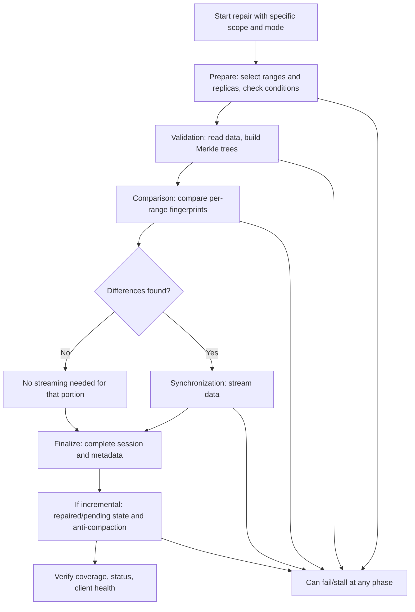
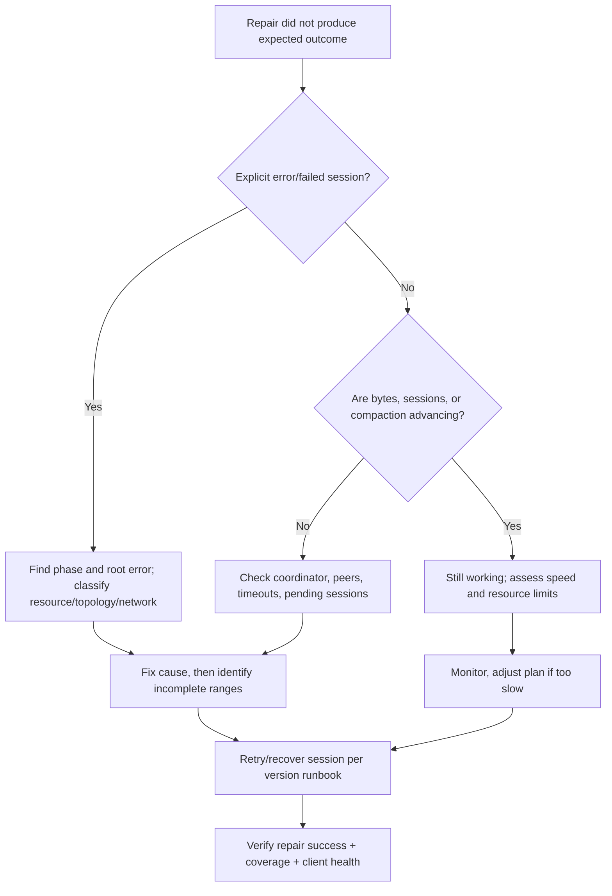

# Interrupted, Failed, or Stalled Repairs

> **Chapter:** Repair  
> **Module:** `DATABASE_ENGINE_WIDE_COLUMN_CASSANDRA` — Apache Cassandra, a distributed wide-column database.  
> **Goal:** Detect interrupted, failed, or seemingly stalled repairs; pinpoint the exact phase, root cause, and unsynchronized scope; recover safely without losing deletion markers or overloading the cluster.

Cassandra **repair** compares data across replicas of the same token range and synchronizes differences. It is essential when nodes go down, miss writes/deletes, hinted handoff is insufficient, or replicas drift over time. Repair can consume heavy disk I/O, CPU, and network bandwidth; when steps are interrupted, there is no reason to assume all ranges were synchronized.

A repair task can encounter three distinct situations:

- **Interrupted:** the orchestrating process, admin connection, node, or active session terminates before the task is confirmed complete.
- **Failed:** the system reports an explicit error during preparation, validation, comparison, streaming, or finalization.
- **Stalled (not progressing):** the task still reports as active, yet meaningful progress signals do not advance over a reasonable observation window. Alternatively, it may **merely be running slowly** because it is scanning a very large table.

Never use a percentage figure, a "started" line, or nodes showing `UN` as proof of successful repair. Cross-check **repair command/session IDs, token ranges, participating replicas, per-phase status, and final outcomes**.

> **Version scope:** Operational examples are based on repair mechanics and `nodetool` commands documented for Apache Cassandra 4.x/5.x. Syntax, metric names, incremental session states, and external orchestration tools can vary by version/distribution. Always verify `nodetool help` and your cluster runbook before running in production.

## 1. Learning Outcomes

After this lesson, you will be able to:

1. Describe the flow **prepare → validation/Merkle tree → comparison → streaming → finalize/anti-compaction** and pick appropriate checks for each phase.
2. Distinguish **slow repair**, **genuinely stalled repair**, **partially failed repair**, and **mere loss of admin client connection**.
3. From logs/metrics, identify the node, keyspace/table, token range, DC, session, and step preventing repair completion.
4. Understand why incremental repair has its own pending/finalized states; avoid deleting metadata or launching overlapping repairs.
5. Plan scoped retries for incomplete ranges and schedules, especially when `gc_grace_seconds` is running low.
6. Run representative CQL/Java checks and correlate them with operational state without confusing a successful read for a synchronized cluster.
7. Write an incident report complete with traces, actions, completion criteria, and remaining risks.

## 2. What Does Repair Actually Do?

### 2.1. Token Ranges, Replicas, and Data to Compare

From a CQL table's partition key, Cassandra computes a token and uses the replication strategy to select replicas. A repair is only meaningful when copies **jointly responsible for the selected token interval** participate in comparison.

Suppose RF = 3 in `dc1`, and A/B/C are the three replicas for range R. If C is Down while A and B write a new record at `LOCAL_QUORUM`, the client can still receive an ACK (two full replicas form a quorum of three). C will not necessarily have the mutation. When C returns, anti-entropy repair compares R across replicas and transfers the divergent data.

**Repair does not blindly copy an entire table from A to B.** It selects ranges/replicas, uses Merkle trees to locate divergent regions, and performs appropriate streaming/reconciliation. Repair cannot recreate a mutation lost across **all** sources.

### 2.2. Phases and Typical Failure Modes



| Phase | Main Work | Common Causes of Failure or Slowdown | Evidence to Collect |
|---|---|---|---|
| **Prepare** | Identify ranges, peers, schema, session | Replica Down, topology shift, schema mismatch, JMX/cluster disconnect | `nodetool status`, DC/rack metadata, prepare logs, peer list |
| **Validation** | Scan SSTables and build Merkle trees | Slow disk reads, large tables, dense tombstones/big partitions, compaction contention, high GC | Validation logs, bytes/partitions validated, disk I/O, compaction stats |
| **Comparison** | Compare Merkle trees | Peer has not sent tree, network/GC timeout, session interrupted | Repair session ID, tree-compare logs, validation outcomes per peer |
| **Streaming** | Transfer differing subranges | Network error, peer down, full target disk, stream timeout, throttling | `nodetool netstats` on source and target, stream logs, network/disk |
| **Finalize / incremental** | Mark repaired and finalize/anti-compact | Pending repair sessions, out of temp disk space, slow/failed anti-compaction | `nodetool repair_admin list`, `summarize-pending`, compaction, repaired state |
| **Completion reporting** | Record job success and total coverage | Scheduler disconnect, misrecording, missed ranges | Exit status, coordinator logs, job ID, succeeded range/session list |

Actual phases and log class names depend on Cassandra version; some flows run in parallel or have extra version-specific steps. This table is a **diagnostic model**, not a rigid packet sequence across all releases.

## 3. How Does "Interrupted" Differ from "Failed"?

### 3.1. Losing the `nodetool` Session Does Not Automatically Prove Repair Failed

A terminal running `nodetool repair` can drop due to lost SSH, a killed shell, an admin tool timeout, or an interrupted JMX connection. That alone **is insufficient** to conclude all server-side work either stopped or finished.

Verification sequence:

1. Record the **timestamp**, coordinating node, command and repair options, and job/session ID if known.
2. Check Cassandra processes/logs on the coordinator and peers, active repair session states, and active streaming.
3. Verify whether each node is still executing validation, streaming, or anti-compaction.
4. Only after establishing actual state should you decide whether to re-run, cancel the session, or recover from an error.

Saying "SSH dropped so I immediately re-ran the command" can accidentally spawn **two repairs fighting over disk/network** or complicate pending-session diagnostics.

### 3.2. Repair Reports an Explicit Error

Examples of root causes seen in logs (illustrative descriptions, **not mandatory verbatim log lines**):

```text
[repair-job-a1] PREPARE failed: a replica is unavailable
[repair-job-a1] VALIDATION failed: I/O error reading SSTable
[repair-job-a1] STREAM failed: peer disconnected during transfer
[repair-job-a1] FINALIZE failed: pending incremental session cannot finalize
```

When you see an error:

- Determine whether it is **the initial root-cause error** or a cascading symptom.
- Gather timestamp-aligned logs from **the coordinator, source, and target**.
- Extract keyspace, table, token range, peer, session ID, exception, and before/after states.
- Never infer from a single exception that Cassandra lost data; equally, never treat a "retryable" error as safe enough to skip missing ranges.

### 3.3. Stalled Repair: Confirm with Multiple Signals

A progress bar sitting at 0% or 85% for a while **does not by itself prove a hang**. Validation may be scanning a huge SSTable without emitting a new milestone; range counts also do not scale linearly with bytes.

Take **two or more metric snapshots** separated by an observation interval suited to table size and system load, then compare:

- Bytes/partitions validated and validation compaction status.
- Count of sessions/ranges completed or advancing phases.
- Streaming bytes sent/received and active sessions.
- Disk read/write bytes, CPU, GC, and compaction activity.
- New errors/timeouts in logs, Down nodes, or topology changes.

If nothing advances over time, **active error signals** appear, or a peer stops responding, classify as suspected stalled. If metrics continue advancing even slowly, it is a **degraded/slow repair**; analyze the bottleneck instead of killing it prematurely.

## 4. Observational Commands Before Intervening

The commands below prioritize **read-only status checks**. Run on nodes with admin access per your version's runbook:

```bash
# 1. Membership, DC/rack, replica health
nodetool status
nodetool describecluster

# 2. Current streaming on each peer
nodetool netstats

# 3. Compaction and thread pools
nodetool compactionstats
nodetool tpstats

# 4. Health and size of the target table
nodetool tablestats lab_repair.events_by_account

# 5. On versions supporting incremental session management
nodetool repair_admin list
nodetool repair_admin summarize-pending
```

**Why check multiple nodes?** `netstats` on the coordinator may not show everything happening on peers; `repair_admin` and metrics reflect per-node state. Use node/peer/range/session IDs to correlate clues instead of staring at a single summary dashboard.

| Signal | What to Record | Do Not Jump to Conclusion |
|---|---|---|
| `nodetool status`: `UN` | Node Up/Normal, right DC/rack | All replicas are synchronized |
| `netstats` shows no streams | No active streams on that node right now | Repair finished; may be validating or had no mismatch |
| `compactionstats` | Pending/active, validation/anti-compaction, bytes | Active compaction guarantees repair will succeed |
| `tpstats` | Active, pending, blocked, completed per stage | Rising completed counter means all token ranges repaired |
| `repair_admin list` | Incremental sessions and related states | Pending sessions can be harmlessly deleted/forced |
| Logs | First error, session ID, peer, token ranges | A "validation finished" line means sync completed |
| Client p99/error rate | Impact on reads/writes per CL | Successful CQL reads mean repair covered the whole cluster |

Some newer Cassandra releases include **Auto Repair**, though triggers and orchestration vary by version and config. If the cluster uses Auto Repair or an external orchestrator, inspect job history/units in **that tool** alongside `nodetool`. Never assume repair is always automatic or always purely manual.

## 5. Identifying the Task Precisely: Repair Scope and Mode

Before handling a failure, document **which data the job intended to repair**. A task can "succeed" while covering only a slice of the cluster.

Verify:

- **Keyspace and table**: e.g., `lab_repair.events_by_account`.
- **Replica placement**: RF per DC, tokens/vnodes, nodes/racks owning the scope.
- **Token/range bounds**: `-pr`, `-st`, `-et`, selected DCs/hosts.
- **Repair mode**: incremental (default in Apache Cassandra 4.x/5.x docs for plain `nodetool repair`), or full when adding `--full`.
- **Scheduler**: tool, schedule, retries, session IDs, start time, and deadline.
- **Concurrent changes**: bootstrap, decommission, replace, RF change, schema change, or datacenter outage.

### 5.1. Full and Incremental Have Different Consequences When Interrupted

| Trait | Full Repair | Incremental Repair |
|---|---|---|
| Data examined | All data in the selected scope, including repaired data per version semantics | Normally data not yet marked repaired since the prior incremental run |
| Purpose | Deep reconciliation, cases requiring re-verification of repaired data | Reducing repeated work on clusters with regular schedules |
| State metadata | Does not use incremental finalization in the same way | Can involve **pending repair sessions**, finalization, repaired metadata, anti-compaction |
| When interrupted | Must identify finished ranges and scopes needing re-run | Must inspect **pending/finalized/failed sessions**; never delete metadata manually |
| Limitation | Substantial I/O cost | Incremental does not automatically re-check data previously marked repaired |

If an incremental session looks stuck, `nodetool repair_admin list` and `nodetool repair_admin summarize-pending` help trace it on supporting versions. `cancel`/`cleanup` commands mutate state; **never** run them as a blanket cure before identifying the exact session and version guidance.

### 5.2. `-pr` Scope and the "Job Succeeded Yet Coverage Is Missing" Trap

Per Apache Cassandra documentation, a repair command repairs only **token ranges matching the coordinating node and chosen options**. `-pr` restricts to primary ranges to avoid duplicate work; covering the whole cluster requires a coordinated schedule across all relevant nodes/DCs.

If repair on A succeeds while B/C or other ranges were never scheduled, a "job done" indicator proves only **that job**—not cluster-wide data consistency.

Likewise, `--in-local-dc`/`-dc` restricts peers; in multi-DC clusters, verify cross-DC sync scope per policy. **Never enable `--force` to skip Down nodes and treat repair as complete**: skipping a peer may get past an immediate error while leaving that peer's scope unsynchronized.

## 6. Causes by Phase: Prepare and Validation

### 6.1. Prepare Failure Because a Replica Is Unavailable

**Scenario:** Coordinator A selects ranges to compare with B/C, but C is Down/Joining, inter-node addresses are unreachable, or topology is unstable.

Check in order:

1. `nodetool status` across nodes, DC/rack, host IDs, and membership.
2. Gossip/peer connection logs, DNS/broadcast addresses, inter-node SSL/authentication.
3. Whether bootstrap, replace, decommission, or schema/RF changes are underway.
4. Disk capacity and availability of surviving replicas.
5. Whether enough healthy sources exist to recover the data needing repair.

**Resolution:** restore availability and topology stability first, then re-run for the needed scope. If a node stayed Down too long relative to tombstone grace, review the zombie-risk section; never bring an old disk image back into the cluster unconditionally.

### 6.2. Validation Scanning SSTables Too Long

**Scenario:** Job stays at 0% or shows no streaming yet, while disk reads climb and logs show no errors.

This may be a repair **genuinely working**. Validation must read and hash data for assigned ranges; large tables or dense tombstones take time. Slowdown factors include:

- Large SSTables, oversized partitions, many cell versions/tombstones.
- Disk read IOPS/bandwidth exhausted by client traffic or compaction.
- JVM GC, CPU saturation, thread pool backlogs.
- Nearly full disks, I/O/SMART errors, file corruption.
- Repair scope too wide or too many concurrent jobs.

**Resolution:** measure bytes validated over time, inspect compaction and resources. If progressing slowly, narrow concurrency/job scope for **subsequent runs** via supported tools; do not kill an active validator without a safe abort runbook.

### 6.3. Validation Fails with SSTable or I/O Errors

If logs report unreadable SSTables or hash/validation failures, determine:

- Hardware/disk fault or corrupted SSTable data?
- Do other replicas still hold recoverable copies?
- Are valid backups/snapshots available for investigation?
- What is the data impact of SSTable repair utilities?

Actions like scrub, deleting SSTables, editing repaired markers, or altering files manually can lose data. **Never apply them ad hoc** just to make repair "get past an error"; follow version-specific recovery runbooks and trusted data sources.

## 7. Causes by Phase: Comparison and Streaming

### 7.1. Comparison Waiting on Peers or Mismatched Merkle Trees

If Merkle trees were built on A yet the job has not moved to streaming, check whether trees/validation arrived from **all peers**. One peer may still be scanning or hit a GC/network timeout.

Differing hashes only indicate the range diverged and needs synchronization; **there is no "row-by-row copy list"** in every case. If some peers finish validation while one peer fails, the job still cannot complete.

### 7.2. Streaming Not Progressing

Inspect `nodetool netstats` on **both sending and receiving sides**, paired with stream logs:

| Observation | Diagnostic Direction |
|---|---|
| Cannot connect to peer | Inter-node address, DNS, TLS, firewall, node Down |
| Stream session exists but bytes stay flat | Network congestion, target disk bottleneck, stream throttling, I/O timeout |
| Bytes sent climb yet receive fails | Network reset, target out of disk, checksum/read error, retry mechanics |
| Stream advances then repeatedly fails | Peer flapping, timeouts, resource limits, version bugs to check |
| No streaming even though trees match | Can be **normal** when there is no mismatch |
| No streaming while validation unfinished | Still in earlier phase; not yet a streaming fault |

Repair streaming shares the same network/disk serving reads and writes and can contend with bootstrap or hint delivery. Tune throughput strictly using real metrics and **version-appropriate** knobs—never set "unlimited" to mask disk or GC problems.

### 7.3. Target Out of Disk Space

Even when syncing only differences, streaming and compaction can require temporary files; incremental anti-compaction can also rewrite SSTables. When disk headroom is insufficient:

1. Identify which partition/filesystem is full, active SSTable size, snapshots, and compaction temp usage.
2. Check concurrent tasks and why bytes are growing.
3. Protect data integrity; plan capacity expansion or clean snapshots per retention policy.
4. Re-run repair only once headroom covers **the full lifecycle**, not just incoming streamed bytes.

**Never delete tombstones or lower `gc_grace_seconds` to free space immediately.** That risks resurrecting deleted data when an old replica returns.

## 8. Incremental Repair: Pending Sessions, Finalize, and Anti-Compaction

### 8.1. Why Track Session State?

Incremental repair can separate SSTables into **repaired/unrepaired/pending** during processing; after repair succeeds, data state is marked/split per version mechanics. Anti-compaction can generate extra files and disk I/O to isolate repaired ranges.

If a session is interrupted after validation/streaming yet before finalization, nodes can retain **pending repair** data. An operator who checks only "streaming finished" and assumes everything is done will miss this state.

Diagnostic commands documented under `nodetool repair_admin`:

```bash
# List active repair sessions
nodetool repair_admin list

# Where supported, include completed/failed sessions as well
nodetool repair_admin list --all

# Summarize pending and repaired data volumes
nodetool repair_admin summarize-pending
nodetool repair_admin summarize-repaired
```

**Note:** subcommand/option names and output details depend on version. These are **observational commands**; never put `cancel` or `cleanup --force` into an automated script merely because pending data exists.

### 8.2. When a Session Stays Pending for Hours

Distinguish carefully:

- **Possibly still working:** anti-compaction is processing large SSTables, disk writes are climbing.
- **Blocked by compaction:** long backlog, lacking resources or needed file locks.
- **Coordinator or peer died:** session cannot finalize as expected.
- **Dangling metadata after failure:** pending session remains after workflow failed; handling depends on Cassandra version.

Safe steps:

1. Collect `repair_admin list` across involved nodes along with the session ID.
2. Record per-peer state, ranges, and repaired/pending stats.
3. Correlate prepare/validation/sync/finalization logs with compaction stats.
4. Determine whether the job is still alive or already failed; avoid spawning overlapping jobs.
5. If cancelling or cleaning up is required, run the **exact command and preconditions for your deployed version**, following backups, runbooks, and ops approval.
6. Afterward, **re-run the incomplete scope and verify** rather than manually marking the whole table repaired.

### 8.3. `repair_admin cancel` Is Not a Universal Stop Switch for All Repairs

In Apache Cassandra 5.0 documentation, `repair_admin cancel --session <id>` cancels the corresponding **incremental repair session**; `--force` has strict conditions when invoked from a non-coordinator. `cleanup` handles pending data in specific situations.

These operations **mutate system state**—they are not read-only diagnostic tools. Using the wrong session ID, wrong timing, or forcing cancellation can complicate recovery. When unsure, preserve logs/session IDs and consult the runbook instead of running commands across all sessions.

### 8.4. What Do Preview/Validate Help Diagnose?

`nodetool repair` documentation supports variants such as:

```bash
# Estimate scope and potentially streamable data only; does not stream to repair
nodetool repair --preview --full lab_repair events_by_account

# Check consistency of repaired data per version options;
# does not stream to repair
nodetool repair --validate lab_repair events_by_account
```

`--preview` and `--validate` **still build and compare Merkle trees, which can incur significant I/O**. They are pre- or post-repair checks in a defined scope, **not replacements for actual repair**. If a system is already disk-bound, even preview can worsen pressure; pick an appropriate time.

## 9. Time Risk: `gc_grace_seconds` and Down Replicas

An interrupted repair becomes a **data correctness** issue when a replica misses a `DELETE` or update while tombstones on healthy replicas approach GC eligibility.

Suppose RF=3, A/B accept a DELETE while C is Down, and `LOCAL_QUORUM` ACKs. C holds the stale value. `gc_grace_seconds` commonly defaults to 864000 seconds (10 days), though you must read **each table's actual value**.

Directional operational budgeting rule:

\[
T_{\mathrm{down}} + T_{\mathrm{repair\_finish}} + T_{\mathrm{margin}} < T_{\mathrm{grace}}
\]

This is **not** a mathematical proof of safety under all conditions: individual tombstone ages, peers and DCs, compaction/purge rules, repair mode, and concurrent faults all matter. Still, if a node has been Down 8 days, repair is projected to take 3 days, and grace is only 10 days, **reliable time headroom no longer exists**.

| Scenario | Risk | Action |
|---|---|---|
| Repair fails while node Down 1 hour | Usually ample time to recover | Fix fault, re-run needed scope, verify completion |
| Repair fails repeatedly for days | Unsynchronized ranges grow stale | Prioritize RCA and recovery ahead of grace deadline |
| Node Down beyond grace still holding old data | **Zombie data** risk if tombstones purged | Do not rejoin old node unconditionally; evaluate replace/rebootstrap from trusted sources |
| Repair succeeded in only one DC | Replicas in another DC may still lack deletes | Check policy and cross-DC coverage |
| Tombstones lost on all sources | Repair cannot infer "deletion intent" | Use audits/backups to identify data needing business-layer cleanup |

Never extend `gc_grace_seconds` as a knee-jerk reaction during a failing repair while ignoring existing tombstone age, disk pressure, and sync capacity. Config changes must accompany data-lifecycle evaluation and recovery plans.

## 10. Triage and Incident Remediation Runbook

### 10.1. Step 1 — Preserve Evidence

Before restarting or re-running:

- Record command/options, Cassandra version, coordinator, and timestamp.
- Save job ID/session ID, keyspace/table, token ranges, peers, and datacenters.
- Gather relevant logs from the coordinator and participating nodes over the same timeframe.
- Snapshot node status, `netstats`, `compactionstats`, `repair_admin`, I/O, and disk headroom.
- Record client timeouts/unavailables, p95/p99, and ongoing writes/deletes.
- If using a scheduler, save retry/cancel state and queued tasks.

This prevents losing root-cause traceability if repair unexpectedly recovers or gets re-run.

### 10.2. Step 2 — Determine True State



### 10.3. Step 3 — Match Remediation to Root Cause

| Confirmed Symptom | Preferred Action | What NOT to Do |
|---|---|---|
| Peer Down, topology unstable | Restore availability/topology, recompute repair scope | Run `--force` and treat skipped peer as repaired |
| Lost SSH/JMX while server still running | Monitor server-side jobs and sessions | Immediately re-run the exact same job |
| Slow validation, bytes still climbing | Check I/O, GC, compaction, size; manage schedule | Kill task just because UI shows 0% |
| Stream timeout due to network | Fix inter-node path and bandwidth, verify peer health | Blindly crank concurrency/throughput |
| Out of disk space | Add safe headroom, manage snapshots per policy | Arbitrarily delete SSTables or tombstones |
| Incremental stuck pending, finalize failing | Inspect `repair_admin` and anti-compaction; use matching recovery flow | Cancel/wipe all sessions indiscriminately |
| Corrupted SSTable | Check trusted sources, backups, and recovery procedures | Scrub/delete files without data impact review |
| Job repaired only partial ranges | Complete the missing coverage | Flip status badge to "complete" for the whole cluster |

### 10.4. Step 4 — Decide on Retrying

Not all retries are equally safe:

1. **If repair is still active:** do not launch a new overlapping run.
2. **If the job failed:** separate succeeded vs. failed sessions/ranges; clean pending state **only if** version mechanics require it under a clear runbook.
3. **If root cause is unfixed:** re-running usually repeats the failure and adds load.
4. **If grace deadline is near:** prioritize reliable replica recovery rather than treating endless retries as a data-safety strategy.
5. **If full repair is needed:** verify full disk/network capacity since it also processes data previously marked repaired.
6. **After retry:** confirm every scope completed rather than trusting one `nodetool` exit line.

Coordinate retry scopes across token ranges, nodes, and DCs to avoid gaps and redundant work; never guess ranges by intuition when vnodes exist.

## 11. CQL Example Illustrating Data Needing Repair

Create a test keyspace in a cluster with **at least three nodes in `dc1`**:

```sql
CREATE KEYSPACE IF NOT EXISTS lab_repair
WITH replication = {
    'class': 'NetworkTopologyStrategy',
    'dc1': 3
};

CREATE TABLE IF NOT EXISTS lab_repair.events_by_account (
    account_id uuid,
    event_id timeuuid,
    occurred_at timestamp,
    payload text,
    PRIMARY KEY ((account_id), event_id)
) WITH CLUSTERING ORDER BY (event_id DESC)
  AND gc_grace_seconds = 864000;
```

In `cqlsh`:

```sql
CONSISTENCY LOCAL_QUORUM;

INSERT INTO lab_repair.events_by_account
(account_id, event_id, occurred_at, payload)
VALUES (
    11111111-1111-1111-1111-111111111111,
    7c627d5a-a6b0-11ef-8ae8-0242ac120002,
    '2026-11-21 08:00:00+0000',
    'created'
);

SELECT event_id, payload
FROM lab_repair.events_by_account
WHERE account_id = 11111111-1111-1111-1111-111111111111;
```

When simulating a Down replica in lab, you can write/delete at `LOCAL_QUORUM` so a replica may miss a mutation (depending on hints). Example:

```sql
DELETE FROM lab_repair.events_by_account
WHERE account_id = 11111111-1111-1111-1111-111111111111
  AND event_id = 7c627d5a-a6b0-11ef-8ae8-0242ac120002;

SELECT event_id, payload
FROM lab_repair.events_by_account
WHERE account_id = 11111111-1111-1111-1111-111111111111;
```

**A `SELECT` returning empty does not prove repair finished.** It could be served by replicas that received the tombstone while another replica still retains the stale value. Track node status, repair state, and coverage together.

## 12. Lab Exercise: Distinguishing Slow, Failed, and Interrupted Repairs

All fault injection below **must be done solely in a lab cluster with snapshots/backups and an environment reset plan**. Never induce node or network faults in production to learn.

### 12.1. Prepare Baseline

1. Create `lab_repair.events_by_account` and populate data across **many `account_id` values** so samples touch multiple token ranges.
2. Record Cassandra version, per-DC RF, `gc_grace_seconds`, and `nodetool status`.
3. Run a well-scoped lab full repair:

```bash
# Check nodetool help repair before running
nodetool repair --full lab_repair events_by_account
```

4. Capture stdout, exit code, coordinator logs, session IDs, duration, and `netstats`/`compactionstats`.
5. Confirm the job truly succeeded with no pending errors in the target scope.

### 12.2. Scenario A — Slow Validation Still Making Progress

- Populate a sufficiently large lab table and run repair under controlled load.
- Capture bytes validated, disk read throughput, active compaction, and logs twice.
- If data is still being scanned, classify as **slow**, not **stalled**, merely because the percentage has not moved.
- Assess objectively: elapsed time, bytes/sec, client latency, and projected time against the repair schedule.

### 12.3. Scenario B — Admin Disconnect

- Start repair in a test environment with logging and session IDs.
- Drop **only the terminal/admin connection** in a lab-safe way, avoiding unintended server errors.
- Afterward, inspect server-side repair sessions, logs, `netstats`, and final outcome.
- Observe cases: job continues, job aborts, or outcome unclear from a single node.
- Retry only after confirming the prior job ended/failed and session state handling is clear.

### 12.4. Scenario C — Peer Down Causing Repair Failure

- In an RF=3 lab cluster, intentionally isolate one peer per lab fault-injection procedures.
- Observe prepare/validation/streaming errors, collecting session IDs and peer logs.
- Recover the peer before grace expires and compare data/repair coverage.
- Re-run the missing scope per runbook and confirm the new run succeeds.

### 12.5. Scenario D — Incremental Finalize Stuck

- Environment must support incremental repair and session admin tools.
- Create a controlled failure state in lab; collect `repair_admin list`, `summarize-pending`, and compaction backlog.
- Determine whether the job is still active or the session failed; **do not** force cancel/cleanup just because pending exists.
- Practice the version-documented recovery procedure, then check pending data and repair coverage.

### 12.6. Lab Result Sheet

| Field | Information to Record |
|---|---|
| Cassandra version & topology | Version, nodes, DC/racks, RF |
| Test case | Slow validation / JMX drop / peer Down / pending incremental |
| Command, options, job ID | Exact command string and session IDs |
| Scope | Keyspace, table, token ranges, participants |
| Before/after evidence | Logs, netstats, compactionstats, repair_admin |
| Outcome | Success, failed, partial, or still unknown |
| Retries performed | Method, scope, timing |
| Coverage & risks | Completed ranges, remaining tombstone grace |

## 13. How to Verify "Recovered" After an Incident

A re-run repair must not be considered complete simply because the command returned exit code 0 without checking coverage.

Use this checklist:

1. **Topology:** target replicas are Up/Normal; no unplanned Down/Joining nodes remain.
2. **Sessions:** coordinator and peers have no unresolved failed/pending repair sessions outside policy.
3. **Data phases:** validation/comparison/sync/finalization are confirmed complete in logs/job history.
4. **Coverage:** the right keyspaces/tables, token ranges, and DCs/replicas were covered by repair; previously failed parts were remediated.
5. **System health:** compaction/backlogs, disk, network, GC, and client p95/p99 returned to acceptable ranges.
6. **Data correctness:** CQL spot checks on representative partitions (covering inserts, updates, deletes, TTLs) at required CL pass, alongside business reconciliation for critical data.
7. **Grace:** repair schedule still retains safety margin; nodes Down too long were handled from trusted data sources.
8. **Reporting:** save error history and last repair completion time; update schedules and alerts.

**Limitation:** a few passing `SELECT` samples do not prove every row across the cluster is right; repair synchronizes data present on selected replicas—it cannot recreate mutations lost from all sources or fix identical application bugs across every copy.

## 14. How Should Java Applications React When Repair Impacts Services?

Repair is an admin task, not an API business services should trigger whenever a CQL call times out. While validation/streaming keeps disk and network busy, Java applications may observe higher read/write p99 or `UnavailableException`/`DriverTimeoutException`.

Example **Java Driver 4.x** reading by partition key at `LOCAL_QUORUM`:

```java
import com.datastax.oss.driver.api.core.CqlSession;
import com.datastax.oss.driver.api.core.DefaultConsistencyLevel;
import com.datastax.oss.driver.api.core.cql.PreparedStatement;
import com.datastax.oss.driver.api.core.cql.BoundStatement;
import com.datastax.oss.driver.api.core.cql.ResultSet;
import java.net.InetSocketAddress;
import java.util.UUID;

public final class RepairAwareReader {
    public static void main(String[] args) {
        UUID accountId =
            UUID.fromString("11111111-1111-1111-1111-111111111111");

        try (CqlSession session = CqlSession.builder()
                .addContactPoint(new InetSocketAddress("127.0.0.1", 9042))
                .withLocalDatacenter("dc1")
                .build()) {

            PreparedStatement ps = session.prepare(
                "SELECT event_id, occurred_at, payload " +
                "FROM lab_repair.events_by_account " +
                "WHERE account_id = ? LIMIT 20");

            BoundStatement query = ps.bind(accountId)
                .setConsistencyLevel(DefaultConsistencyLevel.LOCAL_QUORUM)
                .setPageSize(20);

            ResultSet result = session.execute(query);
            result.forEach(row ->
                System.out.println(row.getUuid("event_id")));
        }
    }
}
```

This snippet assumes the lab keyspace/cluster from Section 11 is ready and configured for the right DC. Application metrics to watch: **query shape, read/write QPS, p95/p99 latency, timeouts/unavailables, retry count, page count, and per-node errors**.

Response guidelines:

- Design partition keys and CQL for query shapes to reduce expensive scans during repair.
- Set CL/timeouts per business requirements; never downgrade `LOCAL_QUORUM` to `ONE` to mask repair load without understanding consistency trade-offs.
- Avoid unbounded retries that cause retry storms; for mutations with side effects, a timeout does not prove the write failed, so retries require idempotency.
- Separate **client availability** dashboards from **repair completion** dashboards; API availability does not mean replicas are fully synchronized.
- If repair breaches SLOs, coordinate with operations to lower concurrency or reschedule via supported tools rather than patching data from the app.

## 15. Mistakes to Avoid

### "Progress at 0% for half an hour means repair is hung"

Validation may be scanning a large SSTable. Compare metrics over time and check logs before concluding.

### "SSH dropped and the command vanished, so repair definitely stopped"

Losing the client control session does not prove internal task state. Inspect coordinator/peer logs and session IDs.

### "Repair returned success on node A, so the whole cluster is repaired"

Repair is scoped by node, ranges, tables, DCs, and flags. Verify cluster-wide schedule coverage.

### "No streaming means repair was useless or broken"

If Merkle trees match, zero streaming is a valid outcome. If validation has not finished yet, no streaming is also normal.

### "Enabling `--force` to skip a Down node makes it safe"

An excluded peer can retain stale data. `--force` does not fix consistency on skipped replicas.

### "Clearing all pending sessions fixes the error"

Pending incremental state matters in the repair lifecycle; improper cancel/cleanup complicates incidents. Know which session and why before mutating state.

### "Setting `gc_grace_seconds = 0` keeps repair from being blocked by tombstones"

That creates zombie-data risk, not a repair fix. Deletion markers must survive so replicas that missed DELETE still have a chance to receive them.

### "Successful repair is enough—no need for backups"

Repair does not protect against accidental deletes replicated everywhere, total loss across all copies, or application bugs. Backups and audits remain essential.

## 16. Scenario Exercises

**Exercise 1 — Checking progress.** Repair sits at 0% for 45 minutes. Bytes validated rose from 100 GiB to 260 GiB, disk reads remain high, and there are no errors. Do you classify this as stuck or slow? What else should you inspect to estimate completion time?

**Exercise 2 — Lost control.** SSH to the coordinator disconnects while repair is running. What must you verify before re-issuing the exact same command?

**Exercise 3 — Pending incremental.** `repair_admin list` still shows a pending session while `netstats` shows no active streams. Can you run `cancel --force` immediately? Which evidence must be collected?

**Exercise 4 — Past grace.** RF=3, C is Down for 12 days, and `gc_grace_seconds` is 10 days. A and B received DELETEs with no successful repair for C. Why does simply starting C and running full repair not guarantee safety?

**Exercise 5 — Zero streaming.** A full repair finishes with zero streaming. Give two explanations: one valid and one needing investigation.

**Exercise 6 — Missing coverage.** A cluster has two datacenters; the scheduler only ran `-pr` on a few nodes in `dc1`. Can you declare `dc2` synchronized? What verification ledger is needed?

**Exercise 7 — Reads look fine yet repair failed.** The app reads `account_id=X` at `LOCAL_QUORUM` and sees expected data, while validation on C failed. Should the incident be closed?

**Exercise 8 — Disk full during streaming.** A target peer has only 2% free disk left; streaming fails. Why is raising retry concurrency dangerous, and which storage consumers must be inspected?

### Answer Hints

1. **Slow, making progress.** Inspect byte/s rate, total scope, GC, I/O, p99, compaction, and schedule/grace deadline feasibility.
2. Check coordinator/peer logs, session IDs, validation/stream/`repair_admin` state; avoid overlapping jobs.
3. **No.** Identify phase, job owner, repaired/pending state, anti-compaction, root error, and version guidance.
4. Tombstones may already be purged, leaving C with stale data and zombie risk; isolate and evaluate rebuild/replacement from trusted sources.
5. Valid: Merkle trees matched. Needs investigation: job did not truly run/cover the scope, or validation terminated early.
6. **No.** You need coverage of all token ranges, peers/DCs, tables, job IDs, and session statuses per policy.
7. **Not yet.** Sample reads do not prove replica C or other ranges were fixed; restore repair and verify.
8. Risks filling disk during SSTable writes/anti-compaction; inspect active files, snapshots, compaction temp, free headroom, disk errors, and concurrent load.

## 17. Incident Response Checklist for Your Runbook

**Upon detection:**

- [ ] Record timestamp, owner, job/session ID, command, and Cassandra version.
- [ ] Classify interrupted/failed/stalled/slow using logs and metrics.
- [ ] Capture `status`, `netstats`, `compactionstats`, `tpstats` on coordinator and peers.
- [ ] Check pending incremental sessions if supported by version.
- [ ] Identify table(s), ranges, DCs/replicas, full/incremental mode, and all scope flags.
- [ ] Assess disk, CPU, GC, network, compaction, client SLOs, and Down nodes.

**During remediation:**

- [ ] Fix root cause; never start overlapping repairs while the old job is still alive.
- [ ] Never manually delete SSTables, repaired markers, or pending session metadata.
- [ ] Use cancel/cleanup/force strictly per version runbook on the exact session.
- [ ] Compare Down-node age + repair backlog against `gc_grace_seconds`.
- [ ] If zombie risk exists, isolate the stale node and identify trusted recovery sources.

**When closing the incident:**

- [ ] Confirm repair session completed in the intended mode.
- [ ] Verify all required token ranges, tables, and DCs were covered.
- [ ] Confirm no unresolved pending/failed state remains per policy.
- [ ] Confirm cluster state, compaction, and client p99 have stabilized.
- [ ] Run representative CQL checks and business reconciliation when needed.
- [ ] Record RCA, logs, completion timestamp, actions taken, and preventive alerts.

## 18. Version Reference Documentation

- [Apache Cassandra — Repair: full/incremental, scope, and operational scheduling](https://cassandra.apache.org/doc/stable/cassandra/managing/operating/repair.html).
- [Apache Cassandra — nodetool repair: full, preview, validate, scope options](https://cassandra.apache.org/doc/latest/cassandra/managing/tools/nodetool/repair.html).
- [Apache Cassandra — nodetool repair_admin: list, pending, cancel/cleanup](https://cassandra.apache.org/doc/latest/cassandra/managing/tools/nodetool/repair_admin.html).
- [Apache Cassandra — nodetool netstats: observing streaming](https://cassandra.apache.org/doc/latest/cassandra/managing/tools/nodetool/netstats.html).
- [Apache Cassandra — Monitoring: validation, synchronization, anti-compaction metrics](https://cassandra.apache.org/doc/stable/cassandra/managing/operating/metrics.html).

Public documentation may correspond to a different version or build than your running cluster. At execution time, **exact syntax and behavior must be verified against your Cassandra version, `nodetool help`, and internal cluster runbooks**.

## 19. Takeaways

- Repair has multiple phases; **validation finishing does not mean synchronization/finalization finished**.
- To tell if repair is stuck, **compare real progress over time** and find the root error; percentages alone are insufficient.
- Lost SSH/JMX, coordinator faults, and server-side failures cannot be diagnosed from a single generic symptom.
- Incremental repair carries **pending/repaired** states requiring management; never force-cancel, clean up, or delete metadata without understanding the session.
- Retries help **only after fixing the root cause**, and you must confirm **range/replica/DC coverage** of completed work.
- Tombstone grace turns failing repairs into a data correctness hazard: a replica missing DELETEs for too long can reintroduce zombie data.
- CQL/Java clients can keep returning right answers while repair fails; **availability and replica synchronization are two distinct monitoring axes**.
