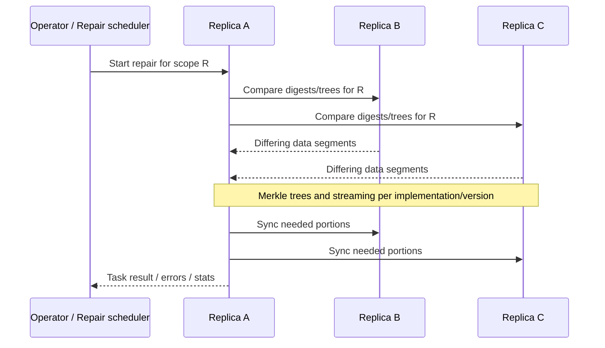
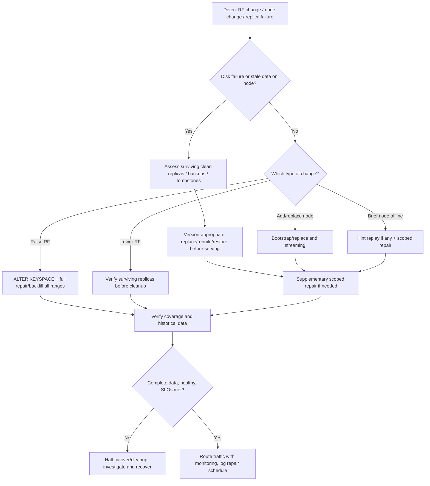

# Repair After RF Changes, Node Replacements, or Replica Failures in Apache Cassandra

## 1. The Real Problem: Healthy Nodes Do Not Mean Replicas Are Synchronized

In **Apache Cassandra**, a partition is identified by its **partition key**, mapped to a token, and placed on **replicas** according to the keyspace's replication strategy. Each replica maintains its own commit log, memtable, and SSTables. When writing at a consistency level such as `LOCAL_QUORUM`, a request can succeed even if one replica missed the write. If a node disconnects or storage ownership shifts, replicas can hold divergent versions.

**Repair (anti-entropy repair)** is the process of comparing data among replicas responsible for a token range, detecting differences, and transferring needed data to converge. It is critical in the three scenarios covered in this lesson:

1. **Increasing/decreasing replication factor (RF):** the target replica list changes, yet metadata alone does not put historical data onto new owners.
2. **Replacing/adding/removing nodes:** streaming transfers data to a new node, yet verification and repair plans are still required for missing or divergent scopes.
3. **Replica failures:** offline replicas, network partitions, write failures, or restores from stale snapshots can leave inconsistent data—especially dangerous with tombstones and TTLs.

This lesson belongs to the **Repair** chapter of the `DATABASE_ENGINE_WIDE_COLUMN_CASSANDRA` module, spanning distributed wide-column architecture, partition keys, query-driven table design, consistency levels, CQL, replication, compaction, failure operations, and Java Driver connectivity.

### Learning Objectives

After this lesson, learners can:

- Distinguish **repair**, **bootstrap/streaming**, **hinted handoff**, **read repair**, **cleanup**, and **compaction**.
- Explain why **raising RF** typically requires **full repair/backfill** for historical data rather than just running `ALTER KEYSPACE`.
- Choose the right runbook for new nodes, dead nodes needing replacement, short-offline nodes, and long-absent returning nodes.
- Schedule repair with **complete token-range coverage**, monitor progress, verify results, and limit impact on application traffic.
- Recognize scenarios where **repair cannot be treated as safe enough**, especially the risk of deleted data resurrecting (*zombie data*).

## 2. Mechanisms Frequently Confused with Repair

| Mechanism | Primary Job | Important Limitation |
| --- | --- | --- |
| **Anti-entropy repair** | Compares replicas for selected token ranges/keyspaces/tables; streams diffs | Covers only **scopes that ran and succeeded**; incurs CPU/I/O/network cost |
| **Bootstrap/streaming** | Transfers data to a new node or a node gaining ranges | Does not prove all historical cluster-wide discrepancies were fixed |
| **Rebuild** | Loads data from an eligible source, commonly during DC additions/recovery | Must choose right source, version, and flow; does not replace all validation |
| **Hinted handoff** | Replays missed writes within configured time/storage limits | Not a historical backfill after raising RF; does not replace periodic repair |
| **Read repair** | May fix discrepancies on the read path depending on version/CL | Does not scan partitions/ranges that are never read |
| **Compaction** | Merges SSTables **on one node**, organizing versions/tombstones | Does not compare replicas on other nodes |
| **Cleanup** | Deletes data on a node no longer owning token ranges after topology shifts | Does not populate missing data onto newly chosen replicas; early cleanup can be dangerous |
| **Snapshot/backup/restore** | Provides data recovery points | Restoring can revert a node to stale state; convergence workflows remain necessary |

Remember: **repair concerns data contents**, whereas `ALTER KEYSPACE` changes **placement rules**, `nodetool status` reports **membership**, and compaction manages **local SSTables**. One signal cannot substitute for all three.

## 3. What Does Repair Do Conceptually?

For token range R, replicas can hold different cell versions, deletion markers, and TTLs. Repair inspects data state so responsible replicas synchronize per Cassandra semantics rather than merely comparing row counts.



This diagram illustrates **reconciliation intent**, not exact message ordering across all releases. In traditional Cassandra implementations, **Merkle trees** locate differing subranges; execution may involve validation, streaming, and session finalization. Depending on version, repair may use different algorithms/optimizations; track **task state** rather than assuming every repair works like a full-table copy.

### Example of Divergent Data

Suppose order `order_id=K` was written at time t1:

| Replica | At t1 | After Update at t2 |
| --- | --- | --- |
| A | `status=CREATED` | `status=PAID` |
| B | `status=CREATED` | `status=PAID` |
| C | `status=CREATED` | Offline, still `CREATED` |

Writing at `LOCAL_QUORUM` with RF = 3 succeeds because A and B respond, even though C missed the update. When C returns, hints may catch it up under suitable conditions; anti-entropy repair reconciles what C missed **even when no hints exist**. Repair must honor timestamps and tombstones—not simply "copy from whichever node has more rows."

## 4. Full Repair vs. Incremental Repair: Choose by Goal

| Criterion | Full Repair | Incremental Repair |
| --- | --- | --- |
| Data examined | Applicable scope, **including already repaired SSTables** per version mechanics | Dataset **not yet marked repaired** per incremental state |
| Typical goal | Comprehensive reconciliation after placement/RF shifts, severe drift, or recovery | Periodic maintenance reducing repeated work on repaired data |
| Cost | Can be huge with large datasets and broad scopes | Can involve less work, yet still consumes substantial resources |
| Constraints | Must plan scope, participating nodes, concurrency, and disk/network | Managing repaired/unrepaired/pending-repair SSTables and failure recovery |
| Suitable after raising RF? | Usually the choice to **backfill historical data** onto new replicas | **Not sufficient by default**, since old data may already be marked repaired |

Example on supporting `nodetool` versions:

```bash
# Illustrates full repair for a keyspace within the initiating node's scope.
# Does not automatically cover every token range across the cluster.
nodetool repair --full repair_lab

# Repairs only this node's primary ranges; requires a schedule covering
# primary ranges across all relevant nodes.
nodetool repair --full -pr repair_lab
```

**Details to verify per Cassandra version:**

- The **default** mode of `nodetool repair` may be incremental in modern releases, so never rely on memory. When full is required, pass the flag **explicitly**.
- `-pr` (*primary range*) limits scope for **the initiating node**; running it once on one node **does not mean** every primary range in the cluster is covered.
- A full repair on one node may coordinate with other replicas to repair data in those ranges, yet **does not mean** every token range across the entire cluster was checked.
- Flags scoping keyspaces/tables, DCs, hosts, ranges, and job threads vary across versions; inspect `nodetool help repair` on your exact version and log the true scope.
- Failed or interrupted incremental repairs can leave **pending repair** state needing resolution per version runbook. Never edit repaired metadata or delete SSTables manually.

### Quick Decision Rule

**If historical data is not guaranteed to sit in the "unrepaired" pool**, or if topology/RF shifts changed the responsible replica set, plan **full reconciliation/repair** over the affected scope rather than running incremental blindly and declaring completion.

## 5. Token-Range Coverage Is the Real Proof of Completion

With **vnodes**, each node owns many token ranges. One successful repair task does not automatically equal "the entire keyspace is repaired." Define the required scopes beforehand and record results afterward:

```text
keyspace = repair_lab
scope     = dc1 (NTS, RF=3)
goal      = full repair after RF 2 -> 3

range_group_01: token ranges ... ; source/participants ... ; SUCCESS
range_group_02: token ranges ... ; source/participants ... ; SUCCESS
range_group_03: token ranges ... ; source/participants ... ; FAILED

result = INCOMPLETE (do not mark job finished)
```

This is a **planning template**, not real CLI syntax. Do not assume three range groups suffice: range counts and placement depend on partitioner, topology, vnode/token layout, and version.

Scenarios that must be reported as **unverified coverage**:

1. Running `nodetool repair -pr` on **one** node out of many.
2. Repairing only one table while the application uses multiple tables and keyspaces.
3. Passing `-dc`/`-hosts` filters that omit a newly added replica or DC needing backfill.
4. One or more tasks failed, or logs show streaming failures, timeouts, or aborts, while summary reports still say "done."
5. Jobs ran **before** the new RF took effect/reached schema agreement, checking the wrong post-change replica set.

Declare completion only once **planned coverage is met**, corresponding tasks succeed, and data/SLOs are independently verified.

## 6. Scenario A — Raising RF: Full Repair for Historical Data

### 6.1. Lab CQL on a Single DC

Assume `dc1` has at least three healthy nodes, Cassandra uses `NetworkTopologyStrategy`, and a lab keyspace exists. Never apply the example RF to a DC with only two nodes.

```sql
CREATE KEYSPACE IF NOT EXISTS repair_lab
WITH replication = {
    'class': 'NetworkTopologyStrategy',
    'dc1': 2
};

CREATE TABLE IF NOT EXISTS repair_lab.order_by_id (
    order_id uuid PRIMARY KEY,
    status text,
    updated_at timestamp
);

INSERT INTO repair_lab.order_by_id (order_id, status, updated_at)
VALUES (
    11111111-1111-1111-1111-111111111111,
    'CREATED',
    '2026-11-21T00:00:00Z'
);

-- After historical data exists and baseline is verified:
ALTER KEYSPACE repair_lab
WITH replication = {
    'class': 'NetworkTopologyStrategy',
    'dc1': 3
};
```

**What happens:** metadata now specifies three replicas instead of two for each token range. The third node may not yet hold `status=CREATED` written prior to raising RF. New writes after the RF change can reach the third replica, yet that **does not automatically backfill all history**.

### 6.2. Runbook for Raising RF

1. **Before the change:** verify RF, DC/rack/snitch, node availability, application CLs, disk space, backups, repair history, and sample keys with historical data.
2. **Update metadata:** run `ALTER KEYSPACE` including all DCs in the replication map; wait for schema agreement and healthy membership. Do not combine multiple topology changes at once.
3. **Identify backfill ranges:** compare before/after placement and nodes newly becoming replicas. Schedule full repair/streaming per **your exact Cassandra version's** mechanics.
4. **Run scoped full repair:** you may use `nodetool repair --full` with a `-pr`/range coverage plan; record per-task status, failures, and controlled retries.
5. **Verify historical data:** query keys written **before** raising RF and verify endpoints on new replicas through proper inspection/reconciliation; avoid relying on a `SELECT` that happened to read from an old replica.
6. **After completion:** check p95/p99, timeouts, free disk, SSTables/streaming, repair coverage, and cluster health. Record the sign-off report.

Observational commands:

```bash
nodetool status repair_lab
nodetool describecluster
nodetool netstats
nodetool compactionstats
nodetool tablestats repair_lab.order_by_id
```

And verify schema:

```sql
SELECT keyspace_name, replication
FROM system_schema.keyspaces
WHERE keyspace_name = 'repair_lab';
```

**Never treat `nodetool status` showing all `UN` nodes as proof data has converged.** It reports only node-level membership/liveness.

### 6.3. Raising RF Across Multiple DCs

With `NetworkTopologyStrategy`, RF is configured **independently per DC**. When adding RF for a DC with zero historical data, you may need **rebuild/streaming** per add-DC procedures followed by repair/verification, rather than just running one full repair in the old DC. In particular, **never point Java applications in the new DC to read old data at `LOCAL_ONE` or `LOCAL_QUORUM` before backfill completes**.

## 7. Scenario B — Lowering RF: Targeted Repair and Cleanup Must Happen in Order

Lowering RF from 3 to 2 makes fewer replicas responsible, yet redundant SSTables do not vanish automatically.

```sql
-- Lab: run only after verifying data and SLOs.
ALTER KEYSPACE repair_lab
WITH replication = {
    'class': 'NetworkTopologyStrategy',
    'dc1': 2
};
```

Checks needed:

- **Do surviving responsible replicas hold complete data?** If prior writes used quorum only, a remaining replica could have missed values; verify and synchronize before dropping the node holding historical data.
- **Fault tolerance changes:** at RF = 3, `LOCAL_QUORUM` needs 2/3 replicas; at RF = 2, `LOCAL_QUORUM` needs 2/2. Losing one replica with RF = 2 can make `LOCAL_QUORUM` unavailable.
- **Cleanup differs from repair:** `nodetool cleanup` removes token ranges a node no longer owns; it never populates missing data onto newly retained replicas.

**Recommended principle order:** verify/reconcile data on replicas that will continue serving → alter RF with an appropriate availability plan → wait for schema agreement and verify new placement → **run cleanup only once safe**. If RF is lowered before repair, never assume Cassandra automatically preserves every critical version; confirm backup/recovery paths.

Never run `nodetool cleanup` immediately just to reclaim disk space. Premature range deletion can destroy the last remaining historical copy needed for recovery.

## 8. Scenario C — Replacing a Dead Node or Failed Disk

### 8.1. Distinguishing Replace from Decommission/Removenode

| Node State | Conceptually Appropriate Action | Role of Repair |
| --- | --- | --- |
| Healthy node, planned removal | `nodetool decommission` per topology procedure; streams handoff ranges | Baseline/reconciliation repair if data had gaps; verify before/after |
| Dead node, cannot decommission cleanly | `nodetool removenode` and/or replacement per **version runbook** | Repair fixes diffs when full sources exist; cannot recreate lost data |
| Node needing same-role replacement | **Replace node** procedure (startup/ID flags per version), streaming from live replicas | Post-replace validation and repair to verify data and fix remaining drift |
| Brief offline node, disks intact | Restart node, receive hints if applicable, run scoped repair | Repair supplements missed writes outside hint window |
| Total disk loss, RF = 1 | Only backup/restore sources if available | Repair **cannot** recover data with no valid replica/source |

**Replacement must never be done by running the old and new nodes simultaneously with the same identity/IP arbitrarily.** Know host IDs, tokens, DC/rack, version, bootstrap/replace parameters, and replication. Prevent a stale replaced node from rejoining later.

### 8.2. Steps After Replacement

1. Confirm the old node is truly gone and no longer in the ring; verify surviving healthy replicas hold complete data, snapshots, and disk headroom.
2. Execute **replace/streaming per your Cassandra version**; never spin up an empty node expecting `repair` to replace the entire bootstrap workflow.
3. Monitor `nodetool netstats`, stream logs, bytes received, connection errors, schema, disk usage, and pending compactions on both sources and target.
4. Wait for the new node to reach valid state, verify placement and sample records written **prior to node failure**, then evaluate full repair for impacted scopes if gaps, divergence, or version guidance require it.
5. Resume periodic incremental/full repair per policy without overlapping multiple heavy repairs that saturate disk/network.

An `UN` node means only that it joined and appears ready in membership—**it does not prove streaming succeeded for every key**. Conversely, streaming can succeed while historical data was already lost across **all remaining sources**; repair cannot recreate what exists on no valid source.

## 9. Scenario D — Node Offline and Returning: Outage Length Dictates Risk

### 9.1. Brief Outage, Data and Hints Still Valid

A replica can miss writes while offline. Upon returning, hinted handoff may replay part of the missed writes within configured limits. **Repair** remains valuable for reconciling older data, unhinted writes, or unread ranges.

```text
t0: A/B/C all hold order K = CREATED
t1: C goes offline
t2: A/B receive status = PAID, LOCAL_QUORUM write succeeds
t3: C returns
t4: Hint replay (if any) + appropriate repair + validation
```

Never rely solely on replayed hint counts to declare "whole table synced." Writes, TTLs, and tombstones outside the hint window can still be missing.

### 9.2. Outage Longer Than Delete Safety Window

The critical hazard when a replica stays offline too long involves `gc_grace_seconds` and **tombstones possibly having been purged** on other replicas:

```text
t0: A/B/C all hold customer K = ACTIVE
t1: C goes offline
t2: A/B receive DELETE K (creating tombstones)
t3: A/B compact and may purge tombstones once eligible
t4: C returns with old ACTIVE without ever seeing the delete marker
t5: Improper sync risks resurrecting ACTIVE ("zombie")
```

Passing `gc_grace_seconds` does not guarantee tombstones are gone; purging also depends on SSTables and safety rules. However, **once deletion markers have been purged on healthy copies**, a returning node with stale data can resurrect deleted records if reintroduced improperly.

**Safe runbook for a long-offline node:**

- Check outage timestamp, last repair, repair schedule, TTLs/tombstones, and `gc_grace_seconds` for **affected tables**.
- Never simply start a stale node to rejoin the ring if the safety window may have been exceeded; evaluate **rebuild/replace from clean replicas or trusted backups** per version procedures.
- Check whether surviving sources still retain needed data and tombstones. If not, this is a **data-recoverability incident**, not something fixed by running one more `nodetool repair`.
- Allow the node back into serving traffic only once synchronization is evidenced and operations accepts any residual risk.

**Note:** never set `gc_grace_seconds = 0` just to save space or "skip repair"; doing so removes tombstone protection in systems requiring periodic repair.

## 10. Repair After Write Errors, Timeouts, or Flapping Connections

`WriteTimeout` does not specify which replicas succeeded; a write succeeding at a consistency level below RF can also miss replicas. If the coordinator received enough ACKs for `LOCAL_QUORUM`, the remaining replica may sync late. If clients retry blindly with freshly generated timestamps, unintended versions or business side effects can result.

To investigate:

1. Identify the time window of network partitions, down nodes, dropped messages, and `WriteTimeout`/`Unavailable` errors.
2. Narrow down keyspaces/tables and relevant token ranges/replicas; compare the Java app's **local DC** with the failing replica's DC.
3. Inspect hints status, logs, and repair metrics; do not stop at `nodetool status` once the node is up.
4. Run scoped repair appropriately, record coverage, and verify keys written **before, during, and after** the incident.
5. If sync errors persist, halt further topology changes and fix the root cause before running parallel repairs.

Post-incident read failures can also stem from nodes lacking historical data, tombstones, mismatched RF/CL expectations, bad partition-key queries, or cluster saturation. **Repair is no substitute for fixing CQL queries or data models.**

## 11. Planning Repair with Resource Limits

Repair scans data, builds comparison trees, and may stream SSTables over the network. It competes with reads/writes, compaction, and other tasks.

| Resource | Impact During Repair | What to Monitor |
| --- | --- | --- |
| Disk read I/O | Reads SSTables/partitions per range | Disk utilization, throughput, latency |
| Network | Streams diffs, exchanges validation trees | Bandwidth, packet loss, retries/failures |
| CPU/heap/GC | Builds/compares hash trees, allocates buffers | CPU, heap, GC pauses |
| Free disk | May write new SSTables and extra compactions | Free disk, temp space, snapshots |
| Threads/repair sessions | Multiple jobs contending on the same node | Active/pending repairs, thread pools |
| Application | Tail latency, timeouts, throughput impacted | Read/write p50/p95/p99, failures, retries |

Never force cluster-wide full repair during peak traffic just because a cron fired if disk/network capacity is insufficient. Equally, never defer indefinitely as tombstone protection deadlines approach; build a **prioritized, scoped, and resource-budgeted schedule**.

### Before Starting

1. Record Cassandra version, topology, RF/CL, node health, keyspaces/tables, and repair goal.
2. Confirm **no conflicting topology changes, bootstraps, replacements, or repairs** are running; if any are, align with cluster synchronization procedures.
3. Budget disk space, bandwidth, time windows, and safety buffers; avoid exhausting free disk.
4. Choose **full vs. incremental** deliberately; define initiating nodes, primary-range/keyspace/table scope, participating DCs, and max concurrent jobs.
5. Prepare a **coverage ledger** and STOP conditions: failed task count, latency SLA breaches, low free disk, or unreachable nodes.

### While Running

```bash
# Monitor cluster, streaming, and compaction.
nodetool status repair_lab
nodetool netstats
nodetool compactionstats
nodetool tpstats

# Version-specific syntax/options help.
nodetool help repair
```

Server logs and monitoring should capture validation/streaming progress, succeeded/failed range/task counts, throughput, and replica downtime. A `repair` command returning exit code 0 is an important signal, **but does not replace plan-wide coverage proof**.

### After Running

- Reconcile succeeded ranges/tasks against planned scopes; log any skipped ranges.
- Confirm `nodetool netstats` shows no abnormal lingering streams; compaction backlogs may continue draining post-repair.
- Compare table size, SSTable counts, and read/write p95/p99 before and after; disk growth after repair **can be normal** when a lagging replica receives missing data.
- On failed incremental repairs, inspect pending repair state using version-appropriate tools before retrying; **never delete metadata manually**.
- Verify sample keys and business queries, then resume regular periodic repair schedules.

## 12. Quick Triage Flow: Which Step Comes First?



This diagram shows **decision ordering**, not automated execution. Complex recovery must follow your actual version and infrastructure runbooks; an unsafe stale node must never be pushed straight into a "repair fixes everything" path.

## 13. Post-Repair Verification: Three Layers of Evidence

**Layer 1 — Metadata and Placement**

```sql
SELECT keyspace_name, replication
FROM system_schema.keyspaces
WHERE keyspace_name = 'repair_lab';
```

Node inspection commands:

```bash
nodetool status repair_lab
nodetool describecluster
nodetool tablestats repair_lab.order_by_id

# Illustrating UUID partition key lookup; syntax depends on version.
nodetool getendpoints repair_lab order_by_id 11111111-1111-1111-1111-111111111111
```

`getendpoints` identifies target replicas for a key—it is **not** proof that every replica already holds identical contents. `status` and `describecluster` verify membership/schema agreement, not data completeness.

**Layer 2 — Repair and Streaming Evidence**

- Count of reconciled token ranges vs. planned ranges, and participating nodes/replicas.
- Confirmation of validation/streaming completion, plus any failed/aborted tasks and their handling.
- For replacements/bootstraps, bytes streamed and outcomes on source/target nodes.
- Full/incremental repair state and pending sessions, especially after timeouts.

**Layer 3 — Data and Application SLOs**

```sql
SELECT status, updated_at
FROM repair_lab.order_by_id
WHERE order_id = 11111111-1111-1111-1111-111111111111;
```

Testing should span keys **written before the event**, keys updated/deleted **during the event**, keys created **post-recovery**, critical TTL/tombstone records, and token regions distributed across multiple replicas. Critical business datasets may require a separate checksum/validation pipeline for higher confidence. **A single passing `SELECT` at quorum does not prove all replicas are right**; it is only one sample check at a specific CL.

If post-repair data cannot be verified, mark status `INCOMPLETE`, list unproven scopes, and apply protective safeguards—never conclude success from "all nodes are UN."

## 14. Hands-On with Java Driver 4.x: Measuring Outcomes at the Right CL

Java applications do not execute `nodetool repair` via CQL. The driver connects and executes business queries while allowing measurement of **latency, anomalous values, and errors** during recovery. Example using Java Driver 4.x and Java 17+ (text block):

```java
import com.datastax.oss.driver.api.core.DefaultConsistencyLevel;
import com.datastax.oss.driver.api.core.cql.BoundStatement;
import com.datastax.oss.driver.api.core.cql.PreparedStatement;
import com.datastax.oss.driver.api.core.cql.Row;
import java.util.UUID;

// CqlSession session: configured with contact points, local DC, and credentials.
PreparedStatement ps = session.prepare("""
    SELECT status, updated_at
    FROM repair_lab.order_by_id
    WHERE order_id = ?
    """);

UUID id = UUID.fromString("11111111-1111-1111-1111-111111111111");
BoundStatement statement = ps.boundStatementBuilder()
    .setUuid(0, id)
    .setConsistencyLevel(DefaultConsistencyLevel.LOCAL_QUORUM)
    .build();

long startedAtNs = System.nanoTime();
try {
    Row row = session.execute(statement).one();
    long elapsedNs = System.nanoTime() - startedAtNs;
    // Log: run_id, local DC, CL, duration, missing/unexpected status.
    if (row == null) {
        // Do not treat "null" as proof repair finished or data was deleted.
    }
} catch (RuntimeException ex) {
    long elapsedNs = System.nanoTime() - startedAtNs;
    // Classify Unavailable/ReadTimeout/ReadFailure rather than treating all errors identically.
    throw ex;
}
```

When switching an application's DC after a rebuild, point to the **right local DC for the target environment**, verify both historical and recent data, and watch p95/p99, timeouts, and retries. Never downgrade CL from `LOCAL_QUORUM` to `ONE` just to cut errors while a new DC still lacks historical data; that masks divergence instead of solving it.

## 15. Two Sample Scenarios for Reasoning Practice

### Scenario 1: Raising RF Then Running Only Incremental

A cluster has three nodes in `dc1`; keyspace increases from RF = 2 to 3. Last month's data was already marked repaired under the old cycle. A DBA runs one incremental repair on one node, sees it succeed, and declares backfill complete.

**What is wrong?**

- Incremental repair can skip data **already marked repaired** before the third node became a replica.
- One task on one node may not cover all token ranges.
- Command success and `LOCAL_QUORUM` `SELECT` results can come purely from the old replicas.

**Fix plan:** verify new placement, schedule full repair across all token ranges needing backfill, record per-scope outcomes, verify historical data on newly assigned replicas, and validate SLOs.

### Scenario 2: Node Offline Too Long Still Holding Stale Data

RF = 3. Node C was offline through a wave of `DELETE`s; A and B ran compaction and purged tombstones. An operator plans to start C immediately and run `nodetool repair`.

**Risk:** if C holds old data while A/B no longer hold deletion markers, convergence can introduce **zombie data**. Repair is not magic that recreates tombstones purged across all sources.

**Resolution:** investigate offline/repair timestamps and `gc_grace_seconds`, keep C out of serving traffic, inspect surviving sources/backups, choose rebuild/replace if C is confirmed unsafely stale, and verify delete semantics before cutover.

## 16. Common Operational Mistakes

| Mistake | Why Is It Wrong? | How to Prevent |
| --- | --- | --- |
| "RF changed, so data fills itself in" | Schema differs from historical data backfill | Scoped repair/streaming and validation |
| "Node is `UN`, so no repair needed" | Membership differs from data convergence | Check tasks, token ranges, and sample keys |
| "One `-pr` covers the whole cluster" | Covers only the chosen node's primary ranges | Schedule coverage across all eligible nodes/ranges |
| "Incremental always substitutes for full" | Old repaired SSTables may be skipped by incremental | Use full when comprehensive verification is needed after RF/topology shifts |
| "Hint replay covers all old writes" | Hints are bounded by window/config and old targets | Anti-entropy repair and historical verification |
| "Running cleanup right away fixes errors" | Cleanup deletes unowned ranges; it adds no missing data | Validate placement/data before cleanup |
| "Repairing a long-stale node is safe" | Purged tombstones can cause zombie data | Weigh outage vs. grace and use clean sources/replace |
| "Running more parallel repairs is faster" | Disk/network/CPU contention can degrade p99 | Throttle jobs/concurrency and monitor |
| "Use CL ONE to verify every replica" | Reading from one replica does not verify full data | Planned repair coverage and validation |
| "Modify SSTables directly" | Wrong metadata/file edits/deletions risk data loss | Use supported Cassandra tools and backups |

## 17. Operational Repair Report Template

```text
CHANGE / INCIDENT:
  id, owner, time_window, cause (raise RF / replace / outage)
  Cassandra version, DC/rack, before/after RF, node membership

GOAL:
  token ranges/keyspace/table synchronized
  full vs. incremental and rationale
  historical data/tombstones to preserve, remaining valid sources

PRECHECK:
  backup/restore status, outage duration, gc_grace_seconds
  UN/DN nodes, free disk, network bandwidth, last repair
  p50/p95/p99, timeouts, throughput, Java client CL and local DC

EXECUTION:
  commands and initiating nodes, task ids, token range coverage
  validation/streaming completed, failures, pending state
  bytes streamed, peak free disk, network, CPU/GC

VALIDATION:
  schema agreement/placement confirmed
  % planned ranges completed (do not use % if full scope is unknown)
  sample keys: before/during/after incident, updates/deletes/TTLs
  read/write SLOs and error rates stable

DECISION:
  COMPLETED or INCOMPLETE, remaining gaps
  traffic/cutover/cleanup approved or deferred
  rollback/restore plan, next repair schedule
```

**Note:** numbers, timestamps, token ranges, and replica names must come from live system telemetry; a report template never replaces execution evidence. Whenever data is missing or any token range failed, mark **INCOMPLETE** to avoid false assurance.

## 18. Self-Check Questions

1. Why can changing RF from 2 to 3 leave the third replica missing history even after `ALTER KEYSPACE` succeeds?
2. How does full repair differ from incremental repair on already-repaired data, and why does that matter after raising RF?
3. Why does running `nodetool repair --full -pr repair_lab` on one node not prove the entire cluster is finished?
4. When a new node shows `UN` after bootstrap, what evidence is still needed to confirm it holds complete data?
5. Can hinted handoff replace periodic repair, especially after a long outage?
6. Should a long-offline node rejoin before evaluating tombstones and `gc_grace_seconds`?
7. After lowering RF, why must surviving replicas be verified before running cleanup?
8. What happens if both surviving copies lack a record and no backup exists? Can repair recreate that record?
9. During full repair, which resources must be monitored to protect read/write p99?
10. Why does a correct `SELECT` result at `LOCAL_QUORUM` not prove all replicas have converged?

## 19. Conclusion

**Repair after RF/topology changes or replica failures is about ensuring historical data resides on the right replica set**, not merely getting every node to show `UN`. After **raising RF**, you typically need **full anti-entropy repair/backfill across all token ranges**; after **replace/bootstrap**, confirm streaming and fix any remaining drift; after **outages**, distinguish safely returning nodes from stale nodes risking deleted-data resurrection. **Cleanup** runs only after target replicas and data have been verified.

A sound operational plan combines **placement/schema, repair/streaming state, data validation, and Java application SLOs**, while preserving backups and rollback conditions. Whenever coverage or tombstone safety cannot be proven, the honest answer is **incomplete**—never keep raising RF, lowering CL, or firing heavy commands blindly.
