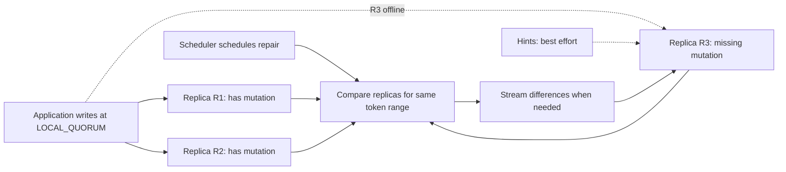
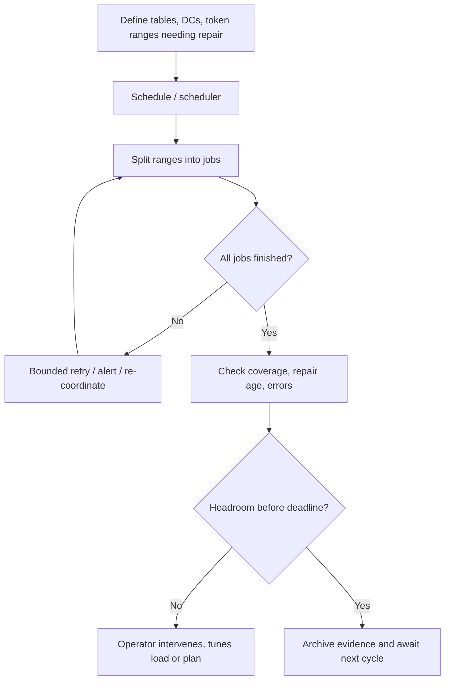
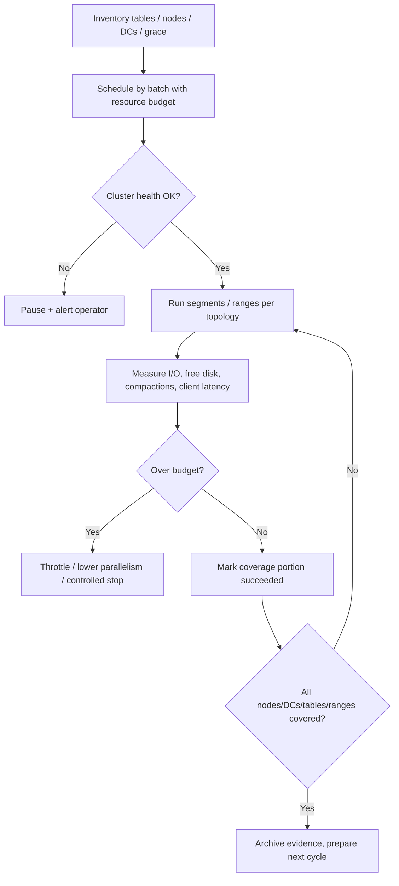

# Repair Scheduling Tools and the Boundary with Operator Responsibilities

> **Chapter:** Repair  
> **Module:** `DATABASE_ENGINE_WIDE_COLUMN_CASSANDRA` — Apache Cassandra

Apache Cassandra is a distributed *wide-column* database. Partition keys determine tokens, the replication strategy determines which replicas hold data, and consistency levels (CL) determine how many responses applications require when reading and writing. A write acknowledged at `LOCAL_QUORUM` can still miss a replica. When a node goes down, hints and read repair can help catch up partially, yet **anti-entropy repair** must still run on a planned schedule to detect and resolve discrepancies between replicas.

The question in this lesson is not just "what day should `nodetool repair` run?" but also **where do a scheduling tool's responsibilities end, and what must the operator still guarantee?** A scheduler can trigger jobs, split token ranges, track progress, throttle load, and retry on failures. It cannot automatically decide retention policies, verify business correctness, resolve full disks, or guarantee cluster-wide reconciliation merely because a job reports status "completed."

After this lesson, you will be able to:

- Explain why repair schedules require **coverage** across nodes, token ranges, keyspaces, tables, and datacenters.
- Compare self-managed `nodetool` schedules, **Cassandra Reaper**, and built-in **Auto Repair** in supporting Cassandra releases.
- Distinguish incremental repair, full repair, and preview; relate them to `gc_grace_seconds` and zombie-data risks.
- Define the scheduler's role versus the operator's verification, monitoring, and remediation duties.
- Write a runbook covering preflight checks, resource limits, monitoring, completion criteria, and handling slow or failed repairs.
- Understand impacts on Java applications and identify what drivers and consistency levels cannot replace regarding repair.

## 1. What Does Repair Do and Why Must It Repeat?

When a replica is offline, remaining replicas can still accept mutations. For example, in a keyspace with replication factor (RF) 3 in one datacenter, writing at `LOCAL_QUORUM` needs 2 ACKs. If R3 is down, R1 and R2 can succeed while R3 misses the mutation.

**Anti-entropy repair** compares data across replicas owning the same token range (typically via Merkle trees), then streams differing portions needed to converge. Repair reads SSTables, builds hash trees, transfers data, and triggers background work; thus it consumes CPU, memory, network, and I/O.



Boundaries to keep in mind:

- **Hinted handoff** attempts to replay mutations buffered by coordinators within window and storage limits; it does not audit the full dataset.
- **Read repair** can fix discrepancies encountered when reading relevant partitions per version behavior; it is not a full-token-range scanner.
- **Repair** synchronizes data *that still exists on participating replicas*. It does not recreate data lost across all replicas; that requires backups/restores.
- Repair does not deduplicate an event a Java app sent twice, fix hot partition-key models, or guarantee correctness of business transactions external to Cassandra.

A scheduler helps run repairs **regularly, within proper scope, and under control**, yet a scheduler's mere presence is insufficient proof that all replicas are synchronized.

## 2. "Scheduled" Differs from "Coverage Completed"

Distinguish three levels:

1. **Schedule configured:** the tool has a saved schedule for the table/keyspace.
2. **Run completed:** an execution finished; individual tasks may have succeeded, been skipped, or partially failed.
3. **Required coverage achieved:** all required token ranges and replicas of the dataset were processed successfully within the required timeframe.

Only level **3** answers the critical operational question: "Which data was repaired recently enough not to breach its safety deadline?"



Especially in multi-datacenter clusters: a repair command on **one node** does not cover the entire cluster. Apache documentation recommends `-pr` (primary token range) to minimize duplicate work, and it must run across **all required nodes in all relevant datacenters** per the designed schedule.

### Why Is `gc_grace_seconds` an Operational Deadline?

`DELETE` and expired TTLs create tombstones. Tombstones tell replicas that missed deletions not to let stale data reappear. `gc_grace_seconds` is the minimum protection window before compaction can reclaim tombstones if other conditions hold—**not** a stopwatch guaranteeing physical deletion down to the second.

If a replica misses tombstones and is not repaired before tombstones become eligible for collection on other replicas, stale data can **resurrect (zombie data)**.

Illustrative example:

- A table has `gc_grace_seconds = 864000` (10 days).
- An incremental schedule is set to run **every 2 days**, with periodic full repairs checking already-repaired data too.
- If the scheduler stalls for 8 days, **the schedule on paper still says 2 days**, yet actual coverage is overdue; you must inspect absent replicas, unprocessed token ranges, and tombstone risk.
- Timing must be measured from **the last successful repair completion for the required scope**, not from the last time cron fired.

Never apply one global schedule number across the entire system without checking **per-table** `gc_grace_seconds`, full-ring repair completion duration, node faults, data volume, and buffer time. Apache Cassandra documentation suggests baseline cadences (e.g., incremental every 1–3 days and periodic full), yet those are **starting points to tune**, not universal SLAs for every cluster.

## 3. Incremental, Full, and Preview: Scheduling the Right Job Type

| Type | Comparison Scope | Strength | Operational Consideration |
|---|---|---|---|
| **Incremental repair** | Data not yet marked repaired since prior incremental runs | Can reduce processed volume when run regularly | Must maintain cadence; does not replace auditing data previously marked repaired. |
| **Full repair** | All data in selected token ranges/tables, including repaired data | Helps catch drift from disk faults, ops mistakes, or pre-existing issues | Typically heavy on reads, hashing, network, and I/O; fit to windows and cluster capacity. |
| **Preview repair** | Builds/compares digests to estimate streamable diffs per options | Useful ahead of big full repairs or during investigations | **Does not stream to fix** and still costs compute/I/O; does not count as repaired data. |

In modern Cassandra releases, `nodetool repair` defaults to incremental repair while `--full` requests full repair. When using incremental repair, SSTables can be marked repaired and split via anti-compaction; account for extra disk space and compaction interactions.

**Running incremental forever without considering full repair is not a sound plan.** Incremental does not automatically re-check data marked repaired in earlier rounds; beyond missed writes, clusters can suffer silent corruption, operator errors, or bugs.

### Illustrative `nodetool` Commands

```bash
# Observational; run on an eligible node with JMX/admin privileges configured.
nodetool version
nodetool status
nodetool describecluster
nodetool compactionstats
nodetool netstats

# Test in a controlled environment with verified scope:
nodetool repair -pr telemetry sensor_events_by_day

# Full repair on this node's primary ranges:
nodetool repair --full -pr telemetry sensor_events_by_day

# Preview: diagnostic estimation, NOT a substitute for repair:
nodetool repair --preview --full -pr telemetry sensor_events_by_day
```

These are **resource-consuming operational commands** (except the initial read-only group). Production requires job caps, I/O budgets, schedules, and stop criteria. Flags can vary by version; verify `nodetool help repair` on the exact binary before running.

`-pr` limits scope to **the executing node's** primary ranges. Achieving cluster-wide coverage requires coordinating across all required nodes/DCs, or using tooling that understands full topology and repair state. Never mistake one command finishing on one node for "the entire keyspace is repaired."

## 4. Repair Scheduling Approaches and Functional Boundaries

### 4.1. Self-Managed Cron / Job Scheduler + `nodetool`

The simplest approach is having an ops runner (cron, Kubernetes CronJob, internal job scheduler) invoke `nodetool repair` on nodes. This can suit small clusters or labs, yet whoever builds the scheduler must handle:

- Selecting **the exact list of nodes, datacenters, keyspaces, tables, and token ranges**.
- Preventing two repair jobs from contending on the same replica or overlapping ranges needlessly.
- Throttling cadence, capping resource usage, and stopping when disk/network headroom is insufficient.
- Recording outcome history **by scope**, not merely script exit codes.
- Bounded retries, recovery after coordinator/scheduler restarts, and alerts for missed cycles.
- Updating node lists when adding/removing nodes, changing RF, or shifting topology.

Never deploy a naive cron like "run `nodetool repair -pr` on every node simultaneously every night": that piles overlapping tasks onto shared replicas and degrades read/write latency. Cron **only triggers execution time**; orchestration and coverage must be built separately.

### 4.2. Cassandra Reaper

**Cassandra Reaper** is an open-source tool built to **orchestrate and schedule repairs**, offering a web UI, API, and CLI. It splits work into **token-range segments**, manages per-keyspace/table schedules, tracks progress, throttles repair aggressiveness (*intensity*), and supports pause/resume/cancel plus parallelism or datacenter-awareness options depending on version.

A Reaper schedule typically includes:

| Field / Config | Meaning | Question the Operator Must Answer |
|---|---|---|
| Cluster, keyspace, tables | Repair scope | Did we omit critical tables or pick the wrong cluster? |
| Start time and interval | Timing, cadence | Enough time to finish before `gc_grace_seconds` while avoiding peak load? |
| Repair type | Full vs. incremental | Balanced cost against re-verifying already-repaired data? |
| Segment count / range splitting | Granularity of work units | Segments too large risk timeouts; too small add coordination overhead? |
| Parallelism, DC-aware, repair threads | Concurrent tasks allowed | Are replicas sharing I/O scheduled into contention? |
| Intensity | Pacing between segments | Does the cluster retain enough headroom for apps and compaction? |
| Owner/notes, schedule state | Audit trail and pause/resume | Who receives alerts and who is authorized to edit schedules? |

**Compatibility note:** Reaper supports many Cassandra releases, yet you must choose a Reaper version and connection setup compatible with **your exact Cassandra release, security setup, and topology**. Some combinations like incremental + DC-aware have version-specific limits in Reaper; never copy configs from another cluster without checking docs and testing.

A typical Reaper UI scheduling workflow per tool docs:

1. Add the cluster and confirm Reaper reads health/topology accurately.
2. Create schedules for **prioritized tables**, setting start/interval, repair type, segments, parallelism, and intensity.
3. Run a small-scope test while watching segment states and CQL latency.
4. Enable alerts for unrun schedules, rising backlogs, repeated segment timeouts, or coverage age breaches.
5. Whenever topology, datacenters, or retention change, **re-evaluate** schedules and Reaper access.

Never assume "Reaper shows schedule active" equals "all tables were reconciled recently."

### 4.3. Built-In Cassandra Auto Repair (Version-Dependent)

Recent Cassandra documentation describes **Auto Repair** per CEP-37—a scheduler running **inside Cassandra itself**, tracking repair history and coordinating token-range splitting, retries, concurrent node limits, and full/incremental/preview modes.

Version conditions **must be stated clearly**:

| Apache Cassandra | Built-In Auto Repair | Operational Direction |
|---|---|---|
| 4.x and 5.0 releases **before 5.0.8** | No officially documented Auto Repair feature | Use `nodetool`/external tooling per version. |
| **5.0.8 and later in the 5.0 branch** | CEP-37 **backported**, requires explicit opt-in workflow | Verify config, upgrade consequences, and monitoring readiness. |
| **6.0 and later** | Feature introduced in the 6.0 branch | Check release notes, defaults/flags, and exact version docs before use. |
| Vendor distros or managed services | Behavior may differ from OSS | Consult vendor docs and cluster control privileges. |

**Specifically on Cassandra 5.0.8:** official docs require setting JVM property `-Dcassandra.autorepair.enable=true` at node startup to add required schema components, **before enabling the scheduler** in `cassandra.yaml` or via JMX. Enabling this property is **irreversible** on the documented branch: never enable it casually as a quick test in production. Review full upgrade, compatibility, and operational guidance before committing.

When running a supporting release, check documented commands:

```bash
# Meaningful only on Cassandra versions supporting Auto Repair.
nodetool getautorepairconfig
nodetool autorepairstatus -t incremental
nodetool autorepairstatus -t full
```

Orchestration parameters to review include `min_repair_interval`, enabled repair types, token-range splitter, `number_of_repair_threads`, concurrent node limits, and whether replicas may repair concurrently. Dynamic changes via `setautorepairconfig` may **apply only to the targeted node and not persist across restarts**; store canonical configuration in configuration management.

Auto Repair eliminates maintaining an external scheduler process, yet never removes operator responsibilities for selecting schedules, monitoring historical data, preserving disk headroom, handling node failures, and deciding when full repair or backup restores are required.

### Choosing Among Options

| Solution | Advantages | Costs and Control Points |
|---|---|---|
| Cron + `nodetool` | Simple, easy to test in lab; no extra dedicated repair product | Must build locking, retries, auditing, coverage tracking, and topology awareness yourself. |
| Cassandra Reaper | Scheduling, segmentation, progress tracking, intensity/parallelism tuning, UI/API | Must operate Reaper, state storage, security, and compatible versions; monitor Reaper uptime. |
| Built-in Auto Repair | Native scheduling/coordination inside Cassandra on **supporting versions** | Feature-enablement constraints, version/upgrade prerequisites; still requires owners and resource limits. |

**Choose based on operational maturity, actual version, and cluster scale**, not merely UI button count.

## 5. Division of Responsibility: What the Scheduler Can Do vs. What the Operator Must Do

A practical division is: **the scheduler executes the configured policy**, while **the operator owns the policy's soundness and its results**.

| Task | Scheduler / Reaper / Auto Repair | Operator |
|---|---|---|
| Trigger jobs on time | Yes, if scheduler is healthy | Choose schedule, detect missed cycles, assign owner |
| Split token ranges and pace parallelism | Yes, if supported by tool | Set safe node/rack/DC limits, monitor hot spots |
| Retry transient errors | Can handle automatically | Distinguish transient glitches from full disks, long-down nodes, or schema mismatches |
| Record progress/logs | At tool-supported granularity | Audit true coverage, ensure logs/metrics persist and alert |
| Set `gc_grace_seconds` and retention | Does not decide business requirements | Finalize SLAs/retention, verify per-table safety margins |
| Repair when a replica is absent or lost data | May defer or fail | Assess risk, pick replacement/rebuild/restore/repair per workflow |
| Maintain disk space, monitor I/O | May throttle via metrics | Capacity planning, resolve bottlenecks, coordinate compaction/streaming |
| Handle multi-DC / topology shifts | Tool may detect topology | Verify new/old nodes, RF, DCs, and post-change repair scope |
| Guarantee business data correctness | No | Design models/queries, enforce idempotency and app-layer reconciliation |
| Manage backups/recovery and total loss risk | Does not replace backups | Maintain backups, test restores, and enforce RPO/RTO |

**Example of misplaced blame:** Reaper is configured to run every 48 hours, yet a newly added keyspace was never added to the schedule. Reaper runs cleanly as configured while **the new table is never repaired**. That is an inventory/change-management failure, not proof the tool "doesn't know how to repair."

## 6. Designing a Sufficiently Safe Repair Schedule

Consider a sample cluster with two datacenters `dc1` and `dc2`, each with three replicas under `NetworkTopologyStrategy` for keyspace `telemetry`. Table `telemetry.sensor_events_by_day` has `gc_grace_seconds` set to 10 days, storing daily events queried primarily by partition key `(sensor_id, event_day)`.

### 6.1. Defining Input Parameters

| Parameter | Example Entry for Runbook | Rationale |
|---|---|---|
| Scope | Keyspace `telemetry`, table `sensor_events_by_day`, all relevant DCs/token ranges | Avoid partial repair mistaken for complete. |
| Grace | `gc_grace_seconds = 864000` (verify in live schema) | Tombstone safety deadline. |
| Incremental cadence | E.g. **every 48 hours** | Keep unrepaired data small and leave margin before grace. |
| Full cadence | E.g. **every 14 days** if I/O allows; may vary per table | Periodically re-verify data already marked repaired. |
| Load window | Outside peak ingest/backup hours | Repair consumes I/O and network. |
| Concurrency | Start low; avoid concurrent repairs on contending replicas | Preserve headroom for app p95/p99. |
| Stop conditions | Node down, low disk headroom, large compaction backlog, p99 breaching SLO | Prevent cascading incidents. |
| Alerts | Table/range overdue coverage, repeated segment failures, repair cycle unable to finish | Lets owners intervene ahead of deadlines. |

The intervals above **are solely examples for trial design**. Never enforce 14-day full repair on every cluster without weighing data size, network cost, failure rate, and incremental cadence. If a repair wave takes multiple days to finish, account for **completion time**, not just intervals between start times.

### 6.2. A Mental Model Formula for Safety

Let:

- `G`: shortest grace duration among tables needing repair.
- `C`: duration to complete a coverage cycle under realistic high load.
- `D`: reserve buffer for scheduler/node faults or maintenance.
- `I`: planned interval from the prior fully covered successful repair to the next.

A conservative condition to evaluate is:

\[
I + C + D < G
\]

This is a **planning principle**, not an inequality enforced automatically by Cassandra. In reality, track **age since last successful repair per table/range and replica**, missed downtime gaps, and when tombstones become eligible for collection. Dashboards should therefore display coverage age and time remaining before deadline—not merely daily job counts.

### 6.3. Avoiding Load Collisions Across Replicas and DCs



Enforce separate caps per DC or replica group instead of one global parallelism setting blind to topology. When repair and compaction overlap, incremental anti-compaction adds extra disk pressure; ensure enough space for output files and streaming.

## 7. Runbook When the Scheduler or Repair Fails

### Before Running

1. Check version and cluster health: `nodetool version`, `status`, `describecluster`, schema agreement, node/DC states, and storage devices.
2. Verify `gc_grace_seconds`, TTLs, and the inventory of tables needing repair; catch newly created or dropped tables.
3. Inspect in-flight repairs, compaction state, streaming, free disk headroom, network throughput, and application latency.
4. Confirm the orchestrator (Reaper or Auto Repair) can connect and read topology accurately, persists history, and has no overlapping schedules.
5. Lock load windows, budgets, on-call owner, and stop/rollback criteria.

### While Running

Monitor **two layers**: *tool events* (jobs/segments) and *Cassandra health* (nodes, disks, latency).

```bash
# General observational commands:
nodetool status
nodetool compactionstats
nodetool netstats
nodetool tpstats

# Only on versions supporting built-in Auto Repair:
nodetool autorepairstatus -t incremental
```

| Signal | Common Interpretation | Action |
|---|---|---|
| Scheduler alive yet zero runs | Schedule disabled, not yet due, health gate failing, wrong timezone, or orchestration bug | Check schedules, history, and tool logs; do not just restart blindly. |
| Segments timing out repeatedly | Segments too large, lost node, network/disk saturation, or stuck repair service | Shrink segments/lower concurrency after finding cause; inspect retries. |
| Rising pending compactions, disk near full | Repair/anti-compaction/streaming adding I/O and temp space | Throttle down, pause expanding repairs; restore disk headroom first. |
| One DC shows no progress for days | Tool missing nodes, running single-DC only, or recent topology change | Audit range coverage, credentials, and DC settings. |
| Job "completed" yet many ranges lack evidence | Reporting bug or checking high-level job status only | Reconcile per-range/per-table history; escalate alerts if deadline is near. |
| App write/read timeouts climbing | Repair contending for resources with live workload | Lower intensity/parallelism; review run hours and latency. |

### When Failures Persist

- **Do not conflate repair errors with client timeouts:** repair can fail from down nodes or full disks; raising CQL timeouts in Java will not fix that.
- **Never let multiple schedulers manage the same scope** without explicit deduplication and ownership (e.g., cron + Reaper + Auto Repair all repairing one table).
- **Never delete repaired state or SSTables manually** to "retry cleanly." Mistakes can corrupt data and break incremental mechanics.
- **Never set `gc_grace_seconds` to 0** to shed tombstones while repair is lagging; that elevates zombie-data risk.
- After recovering a node, determine whether **appropriately scoped full repair**, node replacement/rebuild, or backup restore is required. Repair never recovers data lost across every source.

### After Completion

1. Read detailed results: completed ranges/tables/DCs, retried or skipped segments, and true last-success timestamp.
2. Correlate Cassandra logs/metrics with tool state; confirm anti-compaction, disk, and client latency settle back to normal.
3. Update dashboards and reports with evidence: "max coverage age" per table/cluster, not just run counts.
4. File tickets for any remaining gaps or grace-breach risks, noting owner and deadline.
5. Revisit policies whenever retention, RF, topology, or workload changes. A plan that fit earlier may fail after data doubles.

## 8. CQL and Java: Touchpoints with the Repair Schedule

### 8.1. Verifying Schema and Consistency Levels

In a learning environment, keyspace and table may be created as follows. **Never run DDL in production** without checking actual topology and replication settings:

```sql
CREATE KEYSPACE IF NOT EXISTS telemetry
WITH replication = {
    'class': 'NetworkTopologyStrategy',
    'dc1': '3'
};

CREATE TABLE IF NOT EXISTS telemetry.sensor_events_by_day (
    sensor_id text,
    event_day date,
    event_id uuid,
    reading double,
    PRIMARY KEY ((sensor_id, event_day), event_id)
) WITH gc_grace_seconds = 864000;

SELECT keyspace_name, table_name, gc_grace_seconds
FROM system_schema.tables
WHERE keyspace_name = 'telemetry'
  AND table_name = 'sensor_events_by_day';
```

Partition key `(sensor_id, event_day)` fits querying one device for one day; if a device generates too many events per day, adding a bucket/shard is a separate data-modeling decision. Neither repair nor compaction makes an oversized partition inherently efficient.

If an application writes at `LOCAL_QUORUM` with RF=3 in one DC, it can receive success while one replica still lacks the mutation. Later, repair syncs replicas in that scope; **choosing a higher CL does not replace a repair schedule**.

### 8.2. Java Driver 4.x Example

```java
import java.time.LocalDate;
import java.util.UUID;

import com.datastax.oss.driver.api.core.CqlSession;
import com.datastax.oss.driver.api.core.DefaultConsistencyLevel;
import com.datastax.oss.driver.api.core.cql.BoundStatement;
import com.datastax.oss.driver.api.core.cql.PreparedStatement;

public final class SensorEventStore {
    private final CqlSession session;
    private final PreparedStatement insert;

    public SensorEventStore(CqlSession session) {
        this.session = session;
        this.insert = session.prepare(
            "INSERT INTO telemetry.sensor_events_by_day " +
            "(sensor_id, event_day, event_id, reading) " +
            "VALUES (?, ?, ?, ?)");
    }

    public void write(String sensorId, LocalDate eventDay,
                      UUID eventId, double reading) {
        // Keep the same eventId and payload across retries for the same event.
        BoundStatement stmt = insert.bind(
                sensorId, eventDay, eventId, reading)
            .setConsistencyLevel(DefaultConsistencyLevel.LOCAL_QUORUM)
            .setIdempotent(true);

        session.execute(stmt);
    }
}
```

`setIdempotent(true)` here makes sense only for **immutable events with stable keys and no duplicate side effects on replay**. If exact TTL/timestamp semantics or cross-system event deduplication are required, add explicit design controls. For counter `+1` updates, never mark statements idempotent just to enable retries.

**The Java Driver does not schedule anti-entropy repair**: that is the cluster and ops tooling's responsibility. Applications can report timeouts/latency, retain IDs for reconciliation, and log unacknowledged events; they must never automatically invoke `nodetool repair` on every write timeout. Repair is not a per-request real-time execution path.

## 9. Practice Scenario: Tooling Runs Cleanly Yet Data Still Faces Risk

**Context:** a 12-node cluster across two DCs, with a table using a 30-day TTL and 10-day `gc_grace_seconds`. Reaper is configured for a 48-hour incremental schedule plus periodic full repair. This week a node in `dc2` has been offline for 9 days; the scheduler still reports "schedule enabled." Several segments show failed because the node has not returned.

Questions to answer:

1. **Is "Schedule enabled" safe enough?** No; `dc2` nodes/tokens may miss full coverage before grace expires.
2. **Can we just wait for hints to replay everything?** No. Hints have finite limits and do not sync all divergence after long downtime.
3. **Should we multiply parallelism by 10× once the node returns?** Not by default. Account for disk/network, compaction, streaming, pending ranges, and p99 impact.
4. **When must we escalate?** Immediately when coverage age plus projected recovery time risks exceeding grace, or an absent replica blocks repair completion.
5. **Who fixes the root cause?** Tooling retries segments and keeps the schedule running; operators must resolve the down node, evaluate repair/full repair/restore, and verify post-recovery data.

A sound runbook brings the node back through proper workflows, checks health, delivers remaining hints, audits lagging token ranges, runs coordinated repair, and monitors completion and zombie risk. If data was lost across all replicas, backups/restores are required—no scheduler can recreate data with no surviving source.

## 10. Self-Check Questions

**Question 1.** Why does scheduling `nodetool repair -pr` on one node every week **not mean** the entire RF=3 cluster is repaired?

**Question 2.** An incremental schedule runs every two days, yet 15% of ranges have failed continuously for 9 days. `gc_grace_seconds` is 10 days. Can the plan be considered compliant because jobs launch regularly?

**Question 3.** Compare Reaper vs. plain cron when a cluster spans multiple datacenters, holds large datasets, and must avoid concurrent repairs on the same replica.

**Question 4.** A Cassandra 5.0.7 cluster wants to use built-in Auto Repair. Can you run `nodetool autorepairstatus` right away? What is special about upgrading to 5.0.8?

**Question 5.** When Reaper reports a scheduled full repair succeeded, what should operators verify beyond the job status?

**Question 6.** A Java service hits a write timeout on `UPDATE views = views + 1`. Should it trigger `nodetool repair` or retry indefinitely to compensate?

<details>
<summary>Answer Hints</summary>

1. `-pr` covers only the executing node's primary ranges; you need a schedule covering all relevant nodes/datacenters and tables per actual topology.
2. **No.** Check coverage age and zombie risk for the unfinished ranges; investigate nodes, disk/streaming, and intervene before the deadline.
3. Reaper provides segmentation, scheduling, intensity/parallelism controls, stats, and pause/resume; cron requires building all coordination and observability yourself.
4. 5.0.7 lacks documented built-in CEP-37 Auto Repair. 5.0.8 includes the backport, yet requires enabling a JVM property via an **irreversible** step, then enabling the scheduler in config and checking compatibility.
5. Table/range/DC scope, skipped/retried segments, last-success timestamps, cluster health/performance, disk/network, and coverage age vs. grace.
6. No. A timeout does not prove the write failed, and counters are not idempotent. Repair is not business-level compensation; use event IDs and proper-layer retry/reconciliation.

</details>

## Takeaways

- Operate repair around **coverage with deadlines**, not just cron timestamps; require proof that ranges/tables/DCs finished successfully.
- Incremental repair cuts recurring load, yet policy-driven full repairs remain essential to re-verify data marked repaired.
- **Cassandra Reaper** provides scheduling, segmentation, orchestration, and progress tracking; **Auto Repair** is native from Cassandra 6.0 and backported to **5.0.8**, with strict enablement prerequisites.
- Schedulers own **executing policy**; operators own **picking the right policy, keeping the cluster healthy, auditing coverage, handling failures, and ensuring recoverability**.
- Repair directly ties into `gc_grace_seconds`, tombstones, and zombie data. Never use repair to replace hints, rebuild/replace, backups, or Java idempotency.
- Revisit schedules whenever topology, replication, retention periods, or workloads change.

### References

- [Apache Cassandra — Repair: incremental, full, primary range, and scheduling guide](https://cassandra.apache.org/doc/stable/cassandra/managing/operating/repair.html)
- [Apache Cassandra — Auto Repair (CEP-37, supported versions, and enablement requirements)](https://cassandra.apache.org/doc/latest/cassandra/managing/operating/auto_repair.html)
- [Apache Cassandra — Configuring cassandra.yaml and Auto Repair](https://cassandra.apache.org/doc/latest/cassandra/managing/configuration/cass_yaml_file.html)
- [Cassandra Reaper — Documentation](https://cassandra-reaper.io/docs/)
- [Cassandra Reaper — Scheduling a Cluster Repair](https://cassandra-reaper.io/docs/usage/schedule/)
- [Cassandra Reaper — Running a Cluster Repair](https://cassandra-reaper.io/docs/usage/single/)
