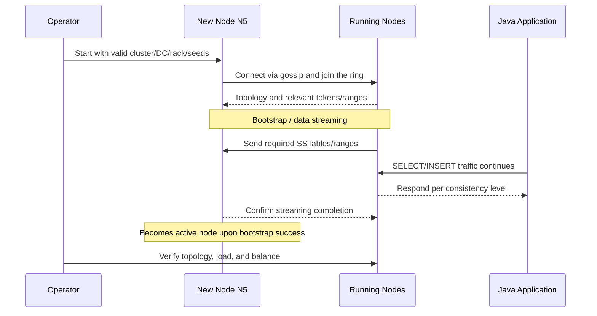
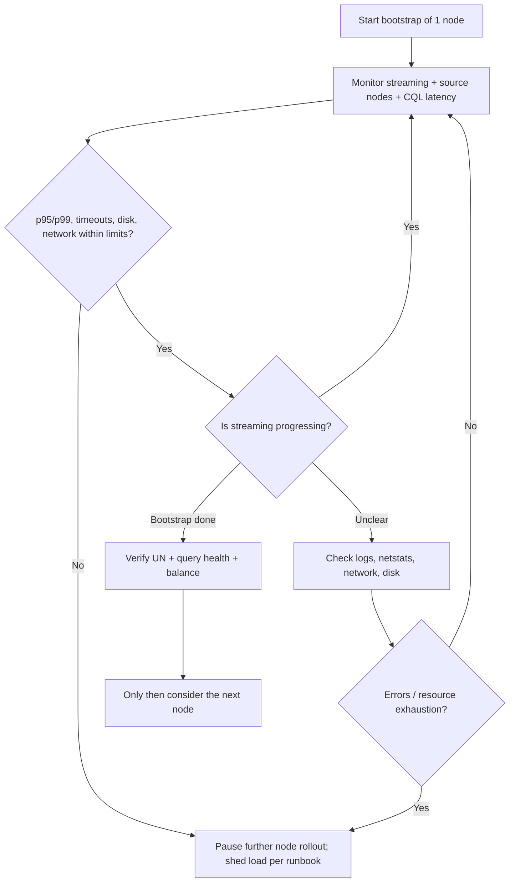

# Adding a Node to a Running Cassandra Cluster and Protecting Business Workloads

## 1. The Problem: Scaling Out While Serving Queries

Apache Cassandra is a **distributed wide-column** database. Each row is identified by a **partition key** and mapped to a token on the distribution ring; replicas are chosen according to the keyspace's replication strategy. Java applications query via CQL and use a **consistency level (CL)** to specify how many replicas must respond.

As data volume, query rate, or write load grows, one way to scale is **adding a node to an active cluster** (*scale out*). This is not merely launching a new Cassandra process: the node must join the ring, receive the data share it becomes responsible for, and be recognized as a valid member by other nodes and clients.

Throughout this process, the cluster still needs to serve requests such as:

- `INSERT`/`UPDATE` writing new data via commit log and memtable.
- `SELECT` reading by partition key and reconciling data across multiple replicas.
- Queries using `LOCAL_QUORUM`, `QUORUM`, or another CL per business requirements.
- Background work such as flushes, compaction, repair, and pre-existing streaming.

**Operational objective:** increase capacity and balance data without pushing p95/p99 latency, timeout rates, or quorum availability past acceptable thresholds.

## 2. What Happens When a New Node Bootstraps?

In a standard node addition, **bootstrap** is the process where a new node joins the cluster and **streams data from existing replicas** to acquire the token ranges it will own. Token selection, pending ranges, and optimizations depend on the Cassandra version, topology, and use of virtual nodes (*vnodes*).



This diagram illustrates the principle; Cassandra may use multiple streaming sources and coordinate mutations while ownership is shifting. **Do not manually edit data or steer traffic based on assumed internal step states.**

Common states in `nodetool status`:

| Illustrative State | Observed Meaning | Action |
| --- | --- | --- |
| `UN` | Node Up and Normal | Also inspect streaming, logs, token ranges, and metrics |
| `UJ` | Node Up and Joining | Bootstrap/membership change may be in progress; monitor progress |
| `DN` | Node Down and Normal per observing node | Investigate connectivity/health before continuing rollout |
| `UL` | Node Up and Leaving | Node is leaving the ring; do not confuse with adding a node |

Seeing `UN` once must not be taken as proof that the entire rollout succeeded operationally. You must also verify data transfer, source node stability, latency, error rates, and post-bootstrap checks.

### "Adding a Node" Does Not Mean "Increasing RF"

For a keyspace with `RF = 3` in a DC, adding a fifth node **does not automatically make RF 4 or 5**. Each partition still has three replicas per replication rules; replica placement shifts to spread load across more nodes.

If you want to change RF or add a DC to hold new copies, that is an **additional replication/topology change** with its own data synchronization procedure. Never merge both kinds of changes into one unplanned operation.

## 3. Estimating Benefits and Costs Before Scaling

Suppose a DC has four identical nodes, a keyspace with RF = 3, and relatively uniform token distribution. For total logical data `D`, ignoring overhead and skew:

```text
Total replica storage required ≈ D × RF = 3D

Average with 4 nodes ≈ 3D / 4 = 0.75D / node
Average with 5 nodes ≈ 3D / 5 = 0.60D / node

Ideal average reduction per old node:
(0.75D - 0.60D) / 0.75D = 20%
```

The **20% figure is only an ideal example**, not a precise forecast for every cluster. Actual results depend on token/vnode count, partition sizes, data skew, compression, tombstones, rack placement, disk headroom, and background tasks.

Furthermore:

1. **During bootstrap:** the new node receives data while source nodes still hold it, so temporary storage and network traffic can increase.
2. **After bootstrap:** old nodes may still contain SSTables for token ranges they no longer own; that data does not necessarily vanish right away.
3. **During cleanup:** reclaiming data no longer owned by a node requires extra I/O and must be scheduled separately after bootstrap completes safely.

Always verify **free disk space on both the new node and source nodes**, not just the size of the new disk.

## 4. Topology Settings That Must Be Right from the Start

Safe bootstrapping requires the new node to specify the correct cluster, DC, rack, and reachable addresses. Exact property names depend on the Cassandra version and deployment model (VMs, bare metal, Kubernetes/operators).

| Component | Purpose | Misconfiguration Risk |
| --- | --- | --- |
| `cluster_name` | Joins the intended cluster | Matches wrong cluster or fails config check |
| Seed provider / seed addresses | Bootstrap addresses to find existing cluster via gossip | Pointing only to the new node or unreachable seeds |
| `listen_address` / broadcast address | Inter-node Cassandra communication | Non-routable address across nodes/DCs |
| CQL/native transport address, port | Client/driver access to node | Advertising an address unreachable by the application |
| Datacenter and rack | Replica placement per snitch/topology | Wrong DC/rack defeats fault-isolation goals |
| Tokens / `num_tokens` | Share of the token ring held by the node | Uneven data distribution, inconsistent config |
| `auto_bootstrap` (if version-supported) | Controls automatic bootstrap of a new node | Disabling without a data plan can cause missing data |
| Storage/data paths | Disks for SSTables, commit log, caches | Reusing data dir/host identity from an old node |
| TLS, auth, firewall, gossip/streaming ports | Security and inter-node connectivity | Gossip works while streaming is blocked |

**A seed node is not a primary/master.** It primarily helps new members discover existing members and does not hold authority over all partitions. Specify healthy, reachable seeds; do not mechanically turn every new node into a seed.

### DC/Rack Is a Fault-Tolerance Decision

If the cluster uses `GossipingPropertyFileSnitch`, an illustrative snippet of `cassandra-rackdc.properties` is:

```properties
dc=dc1
rack=rack2
```

These two lines are **not a complete Cassandra configuration**. They only illustrate that the node must receive the right DC/rack for the existing topology. Do not move a live node from one DC/rack to another by editing these two lines and restarting; that is a different topology change requiring its own procedure.

### Difference Between Add Node and Replace Node

Adding a new node to the cluster with a new host ID/token ownership **differs from** replacing a dead node. Replacement uses version-appropriate startup options or tooling, preserving the identity and token rules of the node being replaced. Never use an old data directory, forced tokens, or replacement flags as a "shortcut" for adding a node.

## 5. Preflight: Verify Sufficient Headroom and Cluster Health

Before adding a node, collect a baseline **per DC and per node** over a representative window:

| Check Group | Details |
| --- | --- |
| Membership | Required nodes are Up/Normal, with no incomplete join/leave/move operations |
| Quorum | Given current RF and CL, enough ready replicas exist to serve reads/writes |
| Disk | Free space on new and source nodes; disk throughput/latency |
| CPU/GC/memory | Headroom for streaming, SSTable parsing, memtables, and CQL |
| Network | Intra-DC/inter-DC bandwidth, packet loss, throughput, and firewall for streaming |
| Compaction/flush | Pending compactions, memtable flush backlog, commit log health |
| Latency | CQL read/write p50/p95/p99, retries, timeouts, unavailables, dropped requests |
| Replication | Keyspace RF, DC/rack mapping, and data drift requiring repair |
| Application | Peak QPS, hot partitions, SLA/SLO, Java Driver retry policy |

Inspection commands on a running node:

```bash
nodetool status
nodetool describecluster
nodetool netstats
nodetool compactionstats
nodetool tpstats
```

Each command provides only **one viewpoint**. For instance, `nodetool status` may show a node Up without proving disk latency is healthy; `nodetool netstats` may show streaming without measuring overall application p99.

**Do not start bootstrap when the cluster is already at the edge of disk exhaustion or failing quorum** without a risk assessment. A new node that has not yet received its data is not an instant cure for failing source nodes or full disks.

## 6. Step-by-Step Rollout Procedure on a Live Cluster

### Step 1 — Finalize the Plan and Stop Thresholds

Document clearly:

- How many nodes to add, in which DC/rack, and why.
- Hardware spec, disks, network, and compatible Cassandra version.
- Window able to absorb additional streaming I/O; current baseline SLAs.
- **Pause/abort** thresholds: e.g., read/write p99 persistently exceeding SLO, surging timeouts, free disk dropping below required headroom, or stalled streaming.
- Rollback/recovery steps based on **actual bootstrap state** and the version runbook.

Never rely on a single static threshold across all organizations. For example, if an API has a p99 SLO of 150 ms, evaluate early when multiple measurement windows exceed 150 ms; waiting until widespread failures to halt rollout is usually too late.

### Step 2 — Prepare the New Node Without Actively Serving Traffic

Configure cluster name, seeds, DC/rack, listen/broadcast addresses, tokens, TLS/auth, disks, and operational policies. Ensure the gossip-advertised address is reachable from other nodes. If using an orchestrator, verify persistent volume and identity configuration.

Do not manually add the new node to the application's contact points list to "force" it to serve traffic before it has successfully joined. Normal Cassandra drivers update topology from metadata; **contact points are primarily initial addresses to locate the cluster**, not a static load-balancing node list.

### Step 3 — Start One New Node

For a standard node addition, use Cassandra's native bootstrap mechanism for the running version; do not disable `auto_bootstrap` to skip streaming.

Right after startup, observe from **multiple source nodes**:

```bash
nodetool status
nodetool netstats
```

The node may appear in Joining state while data streams. Some versions/deployments have distinct bootstrap or resume phases; use logs and version docs to distinguish "making progress" from "stuck".

### Step 4 — Monitor Streaming and Business Load Simultaneously



**Avoid bootstrapping multiple nodes concurrently** unless you have verified the cluster has sufficient bandwidth/disk headroom and supportive orchestration. Each new node may pull streams from multiple sources, stacking load atop foreground requests.

### Step 5 — Confirm the Node Is Operating Stably

Once the node enters Normal state:

1. Check `nodetool status` from multiple different nodes to detect inconsistent membership views.
2. Check `nodetool netstats` and logs to confirm bootstrap/streaming completed with no failed sessions.
3. Compare token counts, data load, disk free space, and ownership distribution across nodes.
4. Compare CQL p95/p99, timeouts/unavailables, and retries against the initial baseline.
5. Observe the application long enough to confirm cluster stability after streaming ends.

Only then proceed to the next node or post-bootstrap tasks. Observation duration depends on workload and SLA, not merely a single command returning success.

## 7. Protecting p95/p99 and Quorum Availability During Streaming

Bootstrap streaming consumes network, disk, and CPU on **both source and destination nodes**, while source nodes continue serving coordinator requests. This is a prime source of tail latency.

| Load/Signal | Why Is It Affected? | How to Protect |
| --- | --- | --- |
| CQL read p99 | Stream reading SSTables competes for read I/O | Throttle streams, schedule off-peak, monitor disk latency |
| CQL write p99 | Stream SSTable writes/compaction share resources with commit log/flush | Track disk busy, flushes, queues, and write timeouts |
| Timeout/unavailable | Slow or unavailable replicas fail to ACK within deadline | Keep quorum healthy; never restart multiple replicas together |
| Network latency | Streaming saturates bandwidth, growing packet queues | QoS/throttling per runbook; monitor intra-DC and WAN networks |
| Disk free | Destination receives data; source may not reclaim immediately | Maintain disk headroom; run cleanup only after safety verified |
| Compaction backlog | New SSTables and streaming raise background work | Watch `compactionstats`; do not blindly raise compaction |

### Throttling Streaming Throughput

Cassandra provides streaming throttle configs/commands depending on version. Some versions offer:

```bash
nodetool getstreamthroughput
nodetool help setstreamthroughput
```

There may also be separate inter-DC stream throttling parameters. **Check `nodetool help` and version-specific documentation**, especially units (MB/s vs. MiB/s), interactions between intra-DC/WAN limits, and target node scope.

Principles:

- If streaming saturates bandwidth and raises application p99, **reduce streaming throughput** where supported by your version.
- If streaming is too slow while disk/network still have headroom, **raise the limit incrementally** and re-measure.
- Never set very high throughput on all nodes at once just to finish bootstrap early.
- Aim to balance **bootstrap duration and foreground SLA**, not to maximize "bytes streamed/second" in isolation.

### Shaping Load from the Application

If your organization has safe mechanisms to throttle ingest, **non-urgent** workloads can be deferred to off-peak hours or have their concurrency reduced during bootstrap. However:

- Never automatically downgrade `LOCAL_QUORUM` to `ONE` just to mask timeouts. That alters consistency guarantees.
- Never infinitely retry timed-out mutations, especially **LWT** or operations with external side effects. A timeout leaves commit state indeterminate.
- Never disable application error checks to manufacture a fake "success rate".
- Choose deadlines and backoff based on business requirements, avoiding retry storms that pile extra load onto streaming nodes.

## 8. Monitoring Metrics: Topology Status Alone Is Insufficient

A rollout dashboard should display **three metric layers simultaneously**:

| Layer | Metrics/Tools | Questions |
| --- | --- | --- |
| **Membership & data** | `nodetool status`, `netstats`, token ownership, bootstrap logs | Has the new node joined, finished streaming, and split ranges reasonably? |
| **Node & resources** | Disk free, IOPS, disk latency, CPU/GC, network, `tpstats`, `compactionstats` | Do source/destination nodes still have headroom? |
| **Application SLO** | CQL read/write p50/p95/p99, request errors, timeouts, retries, unavailable | Are customers impacted? |

**Hypothetical** metrics table example:

| Time | N5 | Streaming | Source Node Disk Util | CQL Read p99 | Timeouts/5 min |
| --- | --- | --- | ---: | ---: | ---: |
| 09:00 | not joined | 0 | 48% | 62 ms | 0 |
| 09:10 | UJ | rising | 79% | 95 ms | 2 |
| 09:20 | UJ | ongoing | 96% | 210 ms | 38 |
| 09:30 | UJ | throttled | 73% | 88 ms | 3 |
| 10:15 | UN | complete | 54% | 65 ms | 0 |

If the p99 SLO is 150 ms, the 09:20 window breaches the limit; pre-defined throttling/pause policies must trigger then, **not waiting until the new node reaches `UN`** to realize the application suffered.

These are simulated numbers for learning analysis, not default Cassandra benchmarks. Avoid blaming a new node as the sole cause from correlation alone; also check hot queries, GC, disk issues, and concurrent maintenance tasks.

### Understanding "Owns (effective)" in `nodetool status`

Ownership metrics may depend on keyspace/RF and version formatting. You can specify a keyspace for a clearer view:

```bash
nodetool status orders_lab
```

Do not sum effective ownership percentages across nodes as if data were unreplicated and expect them to equal 100%. With RF greater than 1, **multiple nodes share responsibility for storing replicas of token ranges**.

## 9. CQL Practice: The Data Model Must Still Hold When Adding Nodes

Assume a DC named `dc1` with at least three active nodes before running. Substitute DC/RF names per your actual topology; do not run directly in production without verifying configuration and permissions:

```sql
CREATE KEYSPACE IF NOT EXISTS orders_lab
WITH replication = {
  'class': 'NetworkTopologyStrategy',
  'dc1': 3
}
AND durable_writes = true;

CREATE TABLE IF NOT EXISTS orders_lab.orders_by_id (
    order_id uuid PRIMARY KEY,
    customer_id text,
    status text,
    updated_at timestamp
);
```

Querying by partition key:

```sql
INSERT INTO orders_lab.orders_by_id
    (order_id, customer_id, status, updated_at)
VALUES (
    11111111-1111-4111-8111-111111111111,
    'customer-42',
    'PENDING',
    '2026-11-20 09:00:00+0000'
);

SELECT status, updated_at
FROM orders_lab.orders_by_id
WHERE order_id = 11111111-1111-4111-8111-111111111111;
```

In `cqlsh`:

```text
CONSISTENCY LOCAL_QUORUM;
```

Adding a node to the same DC does not require the application to rewrite every `SELECT` or change its primary keys. Cassandra uses updated topology metadata and token mappings to locate partition replicas.

**Do not change schema and partition keys at the same time as a bootstrap** without a dedicated migration plan: if latency or timeouts occur, separating topology-change effects from query-change effects becomes much harder.

## 10. Java Driver Applications: Discovering Topology Without Changing Semantics

Java Driver 4.x uses **contact points** for initial connection, then discovers topology and selects nodes matching the datacenter, load-balancing policy, and connection state.

Illustrative example:

```java
import java.net.InetSocketAddress;
import java.util.Optional;
import java.util.UUID;

import com.datastax.oss.driver.api.core.CqlSession;
import com.datastax.oss.driver.api.core.DefaultConsistencyLevel;
import com.datastax.oss.driver.api.core.cql.BoundStatement;
import com.datastax.oss.driver.api.core.cql.PreparedStatement;
import com.datastax.oss.driver.api.core.cql.Row;

public final class OrderReader {
    private final CqlSession session;
    private final PreparedStatement selectStatus;

    public OrderReader(CqlSession session) {
        this.session = session;
        this.selectStatus = session.prepare(
            "SELECT status FROM orders_lab.orders_by_id WHERE order_id = ?"
        );
    }

    public Optional<String> findStatus(UUID orderId) {
        BoundStatement stmt = selectStatus.bind(orderId)
            .setConsistencyLevel(DefaultConsistencyLevel.LOCAL_QUORUM);
        Row row = session.execute(stmt).one();
        return row == null || row.isNull("status")
            ? Optional.empty()
            : Optional.of(row.getString("status"));
    }

    public static CqlSession openExampleSession() {
        return CqlSession.builder()
            .addContactPoint(new InetSocketAddress("10.0.0.10", 9042))
            .withLocalDatacenter("dc1")
            .build();
    }
}
```

The IP address and `dc1` are **illustrative values**. In production you must configure TLS, authentication, redundant contact points, routing, and connection limits per environment. Sessions should be reused; never create a new session per request.

Things to preserve during rollout:

- Same keyspace schema and `RF` when only **adding a node to the same DC**.
- Business CL such as `LOCAL_QUORUM` is not lowered to dodge timeouts.
- Retry policy does not retry infinitely or generate duplicate requests with side effects.
- Verify the driver sees the new node after bootstrap, without forcing routing to a node still Joining.

If the driver cannot see the new node even though `nodetool status` shows `UN`, check broadcast CQL address, ports, firewalls, certificates, and metadata refresh. This is a **connectivity/topology discovery** issue, not a reason to create a new primary key or enable `ALLOW FILTERING`.

## 11. After Bootstrap: Cleanup, Repair, and Data Balance

When token ownership shifts, old nodes may still hold SSTables containing data for ranges they **no longer own**. Cassandra provides administrative tools such as `nodetool cleanup` to reclaim data no longer belonging to that node's responsibility:

```bash
# Consider on old nodes ONLY AFTER the new node finishes bootstrapping.
# Verify scope and usage for your version:
nodetool help cleanup
```

**Never run cleanup on source nodes while bootstrap is incomplete.** First ensure the new node has received its data and ownership is stable. Cleanup consumes I/O and can degrade p99; schedule it separately and measure impact. It does not replace repair or backups.

If scenarios occurred where replicas missed data, back-to-back topology changes happened, or data rows diverged, evaluate an **anti-entropy repair** schedule per current procedures and version. Do not reflexively run full cluster-wide repair right after bootstrap without assessing scope, duration, and load impact.

Distinguish:

| Activity | When? | Purpose |
| --- | --- | --- |
| Bootstrap streaming | While the new node is joining | Supplies data for new ownership |
| Cleanup | After ownership stabilizes, per schedule | Removes old data no longer owned by node |
| Compaction | Background per SSTable strategy | Merges SSTables on each replica |
| Anti-entropy repair | Scheduled or recovery scenarios | Reconciles/fixes discrepancies across replicas |
| Snapshot/backup | Per data policy | Supports post-incident recovery |

**Completing bootstrap does not mean these other activities complete automatically for one another.**

## 12. When Bootstrap Fails: Handle by State, Don't "Delete the Node to Go Fast"

Common failures:

| Symptom | Possible Causes | Initial Handling |
| --- | --- | --- |
| New node does not appear in membership | Seed/gossip network, DC/rack, cluster name, wrong TLS | Check configuration, firewall, logs, and reachability |
| Prolonged `UJ`, stream not progressing | Network drop, slow/full disk, stream throttling, overloaded source | Compare `netstats`, logs, network/disk on both sides |
| Destination runs out of space | Incoming SSTables larger than expected or low disk free | Fix capacity; do not manually delete data files |
| Heavy read/write timeouts on source nodes | Streaming competing with foreground I/O | Apply pre-defined stop/throttle thresholds |
| Some clients cannot reach new node | Broadcast address, TLS, CQL port, routing | Check driver logs, metadata, and network |
| Data imbalance after join | Vnodes/tokens, hot partitions, RF/rack placement | Assess per-keyspace ownership, partition sizes, and workload |

### Recovery/Rollback Principles

1. **Record evidence:** host ID, IP, `nodetool status` state, tokens, DC/rack, logs, streaming progress, and metrics before changing anything.
2. **Never manually delete the data directory, SSTables, or commit log** on the new or source node to "start over from scratch".
3. **Never run `removenode`/`decommission` out of habit**: they have distinct semantics and fit only specific node states.
4. **Distinguish failures before join, during bootstrap, and after reaching Normal**. Each phase has a different recovery path.
5. Check resume/bootstrap retry mechanisms or node replacement procedures supported by your **Cassandra version** before acting; escalate to incident runbooks when needed.

`nodetool removenode` is a membership operation for a dead node in specific cases; `nodetool decommission` relates to removing a live node from the ring. Neither is a **universal "undo" button** for an incomplete bootstrap. Never operate on production before confirming exact node state and token ownership impact.

## 13. Common Misconceptions

| Misconception | Correct Understanding |
| --- | --- |
| "Starting a new node immediately adds capacity" | Useful only after joining, receiving data, distributing load, and driver discovery |
| "Adding a node automatically increases RF" | RF is set by keyspace replication; adding nodes changes placement, not RF |
| "`UN` guarantees production is healthy" | Must also verify streaming, disk, read/write latency, and error rates |
| "Seeds are master nodes" | Seeds are membership discovery contacts; Cassandra has no data master like that |
| "Bootstrapping many nodes together is always faster" | Safe only when cluster and runbook account for concurrent streaming load |
| "Lowering CL fixes the root cause of timeouts" | Lowering CL changes consistency guarantees; the infrastructure cause remains |
| "Run cleanup during streaming to save disk" | Risks purging data prematurely; cleanup belongs after ownership stabilizes |
| "Maxing out stream throughput is always best" | Can degrade foreground p99 and network latency |
| "Driver must add new node to every query" | Driver discovers topology; queries still use partition keys |
| "Replacing a dead node and adding a new node are identical" | Replacement and addition have different identity/token semantics |

## 14. Scenario Exercises

### Exercise 1 — Five Nodes and RF = 3

A DC has four nodes, RF = 3. A fifth node is added. How many replicas of a partition exist after scaling completes? Why might old nodes' disk usage not drop immediately?

**Hint:** Still **three replicas** per partition. Adding a node shifts placement; old data for moved token ranges is not necessarily deleted from source nodes until safe cleanup runs.

### Exercise 2 — Bootstrap Raises p99

Before bootstrap, read p99 is 70 ms, SLO is 150 ms. During streaming, p99 hits 240 ms, source node disks approach saturation, and timeouts rise. Should you bootstrap two more nodes to finish faster?

**Hint:** No. Halt **further scaling** and protect active workloads; review stream throttling, non-urgent write load, disk latency, and throttling mechanisms per runbook. Never kill bootstrap or downgrade CL without analysis.

### Exercise 3 — New Node Is `UN` but App Reports Connection Errors

`nodetool status` shows the new node `UN`. Java Driver still reports it cannot connect to the advertised CQL address. Where is the data, and what should be checked?

**Hint:** `UN` does not prove the CQL endpoint is reachable from every client. Check broadcast RPC/native transport address, firewall/port 9042, TLS/auth, local DC, and driver topology metadata. Never alter partition keys to solve connectivity errors.

### Exercise 4 — Adding a Node in Another DC

A cluster currently has one DC `dc1`; ops wants to add a node in `dc2` to serve clients near a new region. Is this equivalent to adding a node in `dc1`?

**Hint:** No. Adding a DC requires designing per-DC RF, minimum node count, locality, network, consistency, and appropriate data seeding/repair procedures. Never just copy `dc=dc1` config and hope it automatically becomes a dc2 replica.

## 15. Checklist Before, During, and After Adding a Node

**Before starting**

- [ ] Cluster is healthy; source nodes meet quorum and no other topology operations are mid-flight.
- [ ] Confirmed RF, DC/rack, tokens/vnodes, seeds, broadcast addresses, TLS/auth, and disk paths.
- [ ] Source/destination nodes have **enough headroom** for streaming, compaction, and foreground traffic.
- [ ] Baseline captured for p95/p99, timeouts, unavailable, CPU/GC, disk, and network.
- [ ] Pause/abort thresholds and version-matched bootstrap failure recovery procedure ready.

**During bootstrap**

- [ ] Add nodes sequentially or at proven concurrency; do not overload source nodes.
- [ ] Monitor `nodetool status`, `netstats`, logs, and metrics on both source and destination.
- [ ] Track application SLOs alongside streaming progress; throttle if needed.
- [ ] Never change RF, lower CL, or modify partition keys arbitrarily.
- [ ] Never delete data files, force cleanup, or run removenode while state is unclear.

**After the node stabilizes**

- [ ] Verify Normal membership, completed streams, and driver awareness of new topology.
- [ ] Check ownership, disk usage, hotspots, read/write p99, and error rates.
- [ ] Schedule safe cleanup on old nodes when appropriate.
- [ ] Review repair/backup schedules and replica status per runbook.
- [ ] Proceed to the next node only once cluster and workload are stable.

**Remember:** Adding a Cassandra node is a **live data-distribution change**, not merely increasing process count. Bootstrap requires streaming from existing replicas and can raise I/O contention, network load, and p99 latency. A successful scale-out must simultaneously achieve **accurate membership, valid data/ownership, unchanged RF/CL unless intended, and protected Java application SLOs**.
