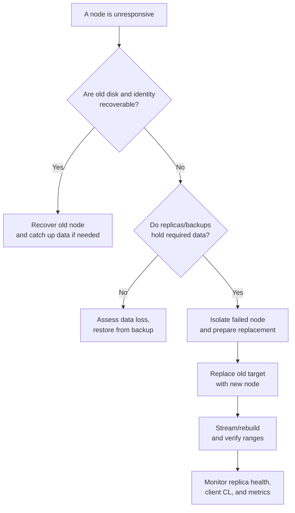
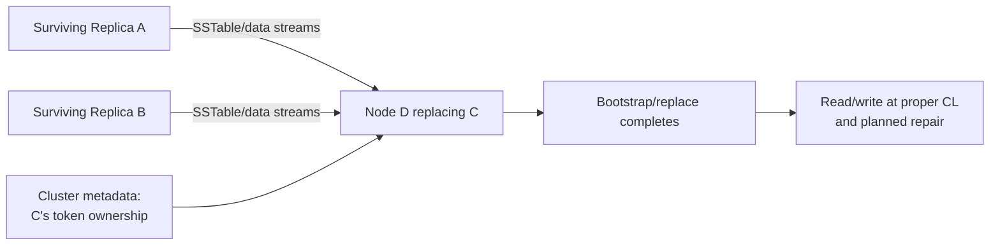

# Replacing a Node with Lost Data and Identity/Address Requirements

**Chapter:** Topology Changes  
**Module:** `DATABASE_ENGINE_WIDE_COLUMN_CASSANDRA` — Apache Cassandra

Apache Cassandra is a distributed wide-column database: the partition key determines data placement on the token ring; replication factor (RF) determines the number of replicas; consistency level (CL) determines how many replicas must respond to a read/write. When a node loses all its local data (for example, a lost volume), you cannot simply spin up a machine with the same hostname and IP and assume it automatically has the data. Cassandra must know **which existing member this new node is replacing**, whether the old node is still running, which **token ownership** the new node will assume, and which replicas it can stream data from.

This lesson sits within the scope of understanding distributed architecture, partition keys, query-driven table design, read/write consistency levels, replication, compaction, repair, error handling, and Java client connectivity. The focus is on **replacing a node that lost its data**, especially conditions around **node identity (host ID)**, **network addresses**, **datacenter/rack**, **tokens**, and **replica states**. Topology-changing operations can disrupt service; examples are intended strictly for a test cluster you control.

> **Version scope:** This guide uses general concepts for Apache Cassandra 4.1/5.x. JVM option names, container configuration, address-replacement mechanics, streaming speed, and IP reuse behavior can vary by version or distribution. Every node replacement must be cross-checked against the documentation and runbook of the **actual version** before executing on a cluster serving users.

## 1. Learning Outcomes

Upon completing this lesson, you will be able to:

1. Distinguish **restart/rejoin** of a node with intact data from **replace** of a data-loss node, **bootstrap** of a capacity-expansion node, and **removenode/decommission**.
2. Explain host ID, endpoint address, token ownership, datacenter/rack, seeds, and their relationship to replication.
3. Identify the old node's address used as the **replace target** separately from the new machine's own address.
4. Assess recovery preconditions: whether surviving replicas still hold the data, RF/CL, tombstones, downtime, disk space, and bandwidth.
5. Design a node replacement workflow across milestones: isolate failed node → snapshot ring state → prepare new node → replace/bootstrap streaming → verify → return to service.
6. Use `nodetool status`, `info`, `gossipinfo`, `netstats`, and CQL to record evidence without inferring that one successful query proves all replicas are identical.
7. Recognize dangerous scenarios: the old node unexpectedly returning, duplicate IP/host ID, wrong datacenter/rack, seed misconfiguration, RF lacking a data source, and insufficient disk space.
8. Design verification steps via the Java Driver and a failure/rollback handling plan for an interrupted replacement.

## 2. First, Choose the Right Operation Type

Not every `DN` (Down/Normal) node needs to be replaced.

| Actual State | Typically Appropriate Operation | Why |
| --- | --- | --- |
| Brief network outage; old disk intact, node can start | Restore connectivity, restart/rejoin **the same node** if needed | Old node data and identity remain intact; hints/repair can catch up missed mutations |
| Lost volume or unrecoverable host failure; other replicas still hold needed data | **Replace** old node with a new node | New node must receive the ranges the old member was responsible for |
| Want to expand cluster capacity; no node lost | **Bootstrap/add node** | Re-splits token ownership and streams to the additional member |
| Want to permanently remove a dead node with no direct replacement machine | Appropriate **removenode** procedure per version | Alters membership/ownership; not a replacement for the same slot |
| Live node (`Up`), proactively retiring it from the cluster | Controlled **decommission** | Live node can participate in transferring data before leaving the ring |
| Data across all replicas for a partition is lost with no backup | No in-cluster source to restore that partition via replace | Must use snapshots/backups or accept data-loss bounds |

**Decision rule:** never replace a node merely because you see `DN`. Verify whether **data was truly lost** or it is just a fixable outage. When a node still retains its volume and identity, replacing it with an empty node creates unnecessary streaming work and risks membership conflicts.

### Procedure Selection Flowchart



Never run `replace` and `removenode` concurrently against the same old address. Pick one procedure compatible with the current ring state, keep logs, and evaluate if an error occurs mid-way.

## 3. What Is Node Identity and Which Addresses Matter?

A Cassandra cluster has multiple kinds of "names" or identifiers. They are not interchangeable.

| Component | Role | Requirement During Replace |
| --- | --- | --- |
| **Host ID** | UUID identifying a member in metadata/gossip | New node must have a valid identity; never arbitrarily clone `host_id` from a corrupt data directory or copy the entire `system` keyspace from an old node |
| **Listen address / broadcast address** | Address nodes use for internode traffic, recognized by peers | New node's address must be routable/policy-compliant and must not create endpoint conflicts |
| **RPC/native transport address** | Endpoint clients/drivers use for CQL connections | Must match application network, certificates/firewalls/contact points |
| **Tokens / token ranges** | Partition ownership division on the ring | Replacement must assume responsibility for the replaced node's ranges via a supported replace procedure |
| **Datacenter and rack** | Topology attributes provided by snitch, affecting replica placement | Must verify new node placement matches RF/placement plan; wrong rack/DC can alter replica sets |
| **Cluster name / partitioner / schema version** | Context for joining the right cluster | Prevent new node from forming a separate cluster or joining with incompatible settings |
| **Seeds** | Endpoints supporting peer/gossip discovery | Must include live, reachable seeds; avoid seed lists missing peers or pointing to wrong network |
| **Node filesystem/data directory** | SSTables, commit log, and internal node metadata | Replacement with a fresh disk must use fresh-node config; never copy system data arbitrarily from another node |

### 3.1. Three Concepts to Separate Clearly

Suppose failed node **C** is known to peers under endpoint `10.42.0.13`. Replacement machine **D** uses a new endpoint `10.42.0.23`.

- **Replace target address**: `10.42.0.13` — endpoint of the dead member known in cluster metadata.
- **New node's own address**: `10.42.0.23` — address that D uses to communicate with peers.
- **New node's host identity**: managed by Cassandra through the initialization/replacement procedure; never manually assigned by copying `system.local` from the old node.

Version-specific replace mechanisms take **the failed node's address as a parameter** (for example, JVM option `cassandra.replace_address_first_boot`). This parameter does **not** mean setting D's `listen_address` to C's IP. Reusing **the exact same old IP** requires a dedicated runbook because gossip, DNS, caches, TLS, and the possibility of the old node returning can cause conflicts; never assume reusing the IP is the simplest path.

### 3.2. Host ID and Tokens Are Not the Same Thing

Host ID distinguishes a node in metadata; tokens specify the **partition ranges** a node is responsible for. Replacement inherits the failed node's required ranges through the replacement procedure. Do not try to copy the entire `system` keyspace or manually set tokens to "look identical to the old machine" unless explicitly required by a version-specific procedure.

The goal of replace is to **restore valid replica placement**, not pretend the new machine is the old machine by faking the entire filesystem/UUID.

### 3.3. Why Do Rack/Datacenter Matter?

With `NetworkTopologyStrategy`, replication factors can differ per datacenter, and replica placement considers rack/topology. If C was in one rack while D is configured in another rack, resulting placement and fault domains may deviate from expectations. Therefore, before replacing, record:

- DC/rack of C and of D.
- RF per datacenter and token/ownership list.
- Number of live nodes still holding data and ability to tolerate another failure during streaming.
- Policies preventing two replicas from accidentally landing in the same fault domain (host/volume/rack).

Never treat "the new machine can run CQL" as proof that post-replacement topology is correct.

## 4. Prerequisite: Do Surviving Sources Have Data to Stream?

Suppose a DC has three nodes A/B/C and RF=3. C loses its disk completely; A/B still hold data. Assuming no further failures and that A/B hold the data needing recovery, new node D can stream data from those surviving replicas. However, risks must be categorized:

| State | Assessment |
| --- | --- |
| RF=3, two live replicas hold required mutations | Basis exists for replace/streaming; still verify range coverage and tombstone state |
| RF=3, one of the two live replicas is also missing data | Must evaluate divergence/repair, source viability, and write CL history; do not claim replace will automatically recover every mutation |
| RF=1, sole replica lost its disk | Replace cannot recreate lost data by itself; backup or external source is required |
| Tombstones purged while another replica holds stale values | Resurrection risk exists; evaluate repair schedule, downtime, `gc_grace_seconds` |
| Node C not confirmed permanently dead | Must isolate C so it cannot unexpectedly come online while D replaces it |
| Insufficient disk/network headroom | Replacement/streaming may fail or severely degrade application latency |

**Consistency level does not recover lost bytes.** A successful `LOCAL_QUORUM` write at RF=3 while C was Down indicates two replicas satisfied the write condition at that moment; it does not prove every past mutation still exists on a live source if A/B also suffered faults or data loss.

**Repair is not backup.** If all copies of a partition are lost, Merkle trees and streaming cannot conjure values back; snapshots, backups, or business-level reconstruction are required.

## 5. Lab Model: One Node Loses All Data

This lab exercise uses a **disposable cluster** with three nodes A/B/C in datacenter `datacenter1`. Simulate **node C dying permanently**, then replace it with node D using a fresh volume and a new IP. Never delete real data in a shared lab; ideally spin up a disposable cluster from scratch and prepare node D separately. Only perform volume destruction steps in a disposable scenario with backups/verified ownership.

```text
Before failure:
  cassandra1  10.42.0.11  A  UN
  cassandra2  10.42.0.12  B  UN
  cassandra3  10.42.0.13  C  UN  <- later loses data volume

After failure:
  cassandra1  10.42.0.11  A  UN
  cassandra2  10.42.0.12  B  UN
  cassandra3  10.42.0.13  C  DN  <- must remain offline
  cassandra4  10.42.0.23  D  ... <- replace target C

Keyspace:
  RF = 3 in datacenter1
```

The IPs are **illustrative** for the diagram: never copy them verbatim into Docker Compose/VMs. Obtain real addresses from `nodetool status` and your cluster's actual network config.

### 5.1. Check Version and Topology Before the Incident

On each active node:

```bash
nodetool status
nodetool describecluster
nodetool info
nodetool gossipinfo
```

In `cqlsh`:

```sql
SELECT cluster_name, partitioner, release_version
FROM system.local;

SELECT data_center, rack, host_id, broadcast_address
FROM system.local;
```

System column names, broadcast endpoint semantics, or `nodetool` output can vary by version. The goal is to **record evidence** of version, real hostnames/IPs, datacenter, rack, host IDs, token ownership, schema agreement, and node health. Never edit `system.local` directly.

Create the lab keyspace/table (only if your datacenter is actually named `datacenter1`):

```sql
CREATE KEYSPACE IF NOT EXISTS lab_topology
WITH replication = {
  'class': 'NetworkTopologyStrategy',
  'datacenter1': 3
}
AND durable_writes = true;

CREATE TABLE IF NOT EXISTS lab_topology.orders_by_id (
    order_id uuid PRIMARY KEY,
    customer_id uuid,
    state text,
    amount_cents bigint,
    updated_at timestamp
);
```

Write three baseline rows while the cluster is healthy, at CL `ALL`:

```sql
CONSISTENCY ALL

INSERT INTO lab_topology.orders_by_id
    (order_id, customer_id, state, amount_cents, updated_at)
VALUES (
    20000000-0000-4000-8000-000000000101,
    10000000-0000-4000-8000-000000000001,
    'CREATED', 100000, '2026-11-21T01:00:00Z'
);

INSERT INTO lab_topology.orders_by_id
    (order_id, customer_id, state, amount_cents, updated_at)
VALUES (
    20000000-0000-4000-8000-000000000102,
    10000000-0000-4000-8000-000000000002,
    'CREATED', 150000, '2026-11-21T01:00:00Z'
);

INSERT INTO lab_topology.orders_by_id
    (order_id, customer_id, state, amount_cents, updated_at)
VALUES (
    20000000-0000-4000-8000-000000000103,
    10000000-0000-4000-8000-000000000003,
    'CREATED', 180000, '2026-11-21T01:00:00Z'
);
```

Proceed only if **all three** INSERTs are ACKed at `ALL`. If any times out, you cannot assume every replica received it; fix the environment and use a fresh set of keys rather than proceeding on an uncertain baseline.

### 5.2. Observing When One Replica Is Absent

In the disposable cluster, stop node C while **keeping its volume initially** to contrast outage vs. data loss:

```bash
# On the lab Docker host, if using matching container names:
docker stop cassandra3
docker exec cassandra1 nodetool status
```

While A/B are alive and peers view C as Down, update one row at `LOCAL_QUORUM`:

```sql
CONSISTENCY LOCAL_QUORUM

UPDATE lab_topology.orders_by_id
SET state = 'PAID', updated_at = '2026-11-21T01:05:00Z'
WHERE order_id = 20000000-0000-4000-8000-000000000101;

SELECT order_id, state
FROM lab_topology.orders_by_id
WHERE order_id = 20000000-0000-4000-8000-000000000101;
```

If A/B respond, the write can be ACKed even though C did not receive the mutation. In this scenario, if you restart **the same C with its old disk**, that is merely a **rejoin**, not a replace. To test replace, you need a new node D with a fresh data directory and **ensure old C never starts again** throughout D's replacement lifecycle.

There is no need to include a volume-deletion command in this lesson. Simulating disk loss can be prepared on separate disposable infrastructure. Everything needed for learning can be verified from the C Down event and the fresh D node receiving replica ranges.

## 6. Replacement Preflight: Non-Negotiable Checklist

Before powering on node D for the first time:

1. **Verify node C is truly unrecoverable or slated for replacement:** C is isolated at VM/container/network level; an owner confirms C cannot auto-return.
2. **Record C's peer-known address:** obtained from `nodetool status` and current topology. This serves as the *replace target*.
3. **Verify the cluster still has enough live replicas:** sources A/B must be reliable nodes capable of supplying C's ranges.
4. **Record old token/host ID as evidence:** for post-change comparison, **not for manual assignment** to D.
5. **Prepare D with a clean data directory:** volume contains no metadata/host ID from another node; Cassandra config is compatible with the cluster.
6. **Select new endpoints:** valid listen/broadcast addresses, native transport, and firewall rules; check DNS/TLS certificates if applicable.
7. **Check datacenter/rack:** matches the replica placement strategy and fault-tolerance goals.
8. **Seed list:** D must reach live peers; avoid a seed list containing only dead node C.
9. **Capacity and bandwidth:** sufficient disk to receive ranges, plus headroom for compaction and ongoing writes.
10. **Pause/rollback plan:** know what to do if D boots wrong or streaming fails; there is no automatic rollback to a disk-lost C.

This preflight is complete only when each item has **concrete recorded values** in the log. A line saying "checked" without endpoints/DC/version is insufficient for production work.

## 7. Node Replacement Configuration and Meaning of Replace Address

On Apache Cassandra versions supporting the traditional mechanism, the new node can be started **on first boot** with the JVM property:

```text
-Dcassandra.replace_address_first_boot=<endpoint address of dead node C>
```

In the lab example:

```text
-Dcassandra.replace_address_first_boot=10.42.0.13
```

The address on the right is **C's endpoint as known by gossip/ring**, not D's IP `10.42.0.23`. The property must be passed in the exact way the running **Cassandra release's** JVM consumes it; Docker images/Helm charts/distributions use varying environment-variable conventions. Never assume a similarly named shell variable automatically takes effect.

**Never leave this flag permanently configured across all restarts.** This is the replacement initialization path for a new node. After node D finishes bootstrapping successfully, subsequent restarts must use **D's** persistent data directory and identity per version procedures. If the process fails mid-way, never wipe all of D's data and loop this option blindly; inspect logs and ring state first.

### 7.1. Addresses of C and D Can Differ

| Property | Dead C | Replacement D |
| --- | --- | --- |
| Internode endpoint | `10.42.0.13` | `10.42.0.23` |
| Host ID | Old Host ID recorded in log | Valid identity of D managed by initialization |
| Token responsibility | Ranges C was responsible for | D assumes C's responsibility via replace |
| Datacenter/rack | `datacenter1` / old rack | Verify match with replica placement plan |
| Data directory | Lost or corrupted | Empty, clean, dedicated to D |
| Final state | C does not return | D completes bootstrap, reaches `UN` |

Some deployments impose special requirements/constraints if D uses **the exact same IP** as C. Never conclude changing an address is trivial: Cassandra peers, firewalls, DNS, client contact points, and TLS certificates may depend on the endpoint. When reusing the same IP is mandatory, follow a version-supported runbook and guarantee C cannot run with a conflicting address.

### 7.2. What Happens If You Forget the Replace Option?

If D boots as a **normal new node** instead of a replacement, Cassandra may attempt to bootstrap an additional member or hit topology conflicts. That **does not accomplish replacing C**. If caught early, stop the plan, preserve logs, and assess current ring state before retrying. Never run a string of `removenode`/`decommission`/`cleanup` commands to "make it fit" without knowing what D has already done.

### 7.3. Never Let Node C Resurrect

Once D begins replacement, C must be guaranteed **unable to auto-return** via auto-restart, cloud autoscaling, or watchdogs. If C comes back with its old endpoint/token metadata after D has taken over, the cluster can suffer membership/replica conflicts. Infrastructure-level fencing and old-host retirement procedures are mandatory.

The requirement "C is confirmed Down" is a procedural safety invariant, not merely a way to avoid a command error.

## 8. Streaming During Replacement

During replacement, D must fetch data corresponding to the ranges C was responsible for. Sources are chosen from suitable surviving replicas. Cassandra uses **streaming** to transfer data; this can consume substantial network and disk I/O.



This diagram is conceptual; it does not assert that both A and B send the exact same ranges or equal byte counts. Ranges, stream sources, and algorithms depend on topology and version.

### 8.1. Transfer Volume Does Not Equal "Missing Row Count"

D starts with a fresh data directory, so it may need to receive nearly the entire volume C was responsible for—**different** from an anti-entropy repair that synchronizes only deltas. Actual bytes transferred depend on token ranges, compression, SSTable contents, overhead, version, and streaming mechanics.

Bottleneck estimate:

\[
T_{\mathrm{network}} \gtrsim \frac{B_{\mathrm{transferred}}}{V_{\mathrm{effective}}}
\]

Where `B_transferred` is bytes to transfer and `V_effective` is remaining effective throughput available to streaming over the constrained network link. As a **hypothetical** example, 120 GiB over an effective 100 MiB/s link needs at least roughly:

\[
\frac{120 \times 1024\ \mathrm{MiB}}{100\ \mathrm{MiB/s}}
=1228.8\ \mathrm{s} \approx 20.5\ \mathrm{minutes}
\]

This bound accounts only for network, **excluding** disk reads/writes, bootstrap metadata, compaction, timeouts, retries, or CQL traffic. Never use it to promise production node-replacement times.

### 8.2. Checking Capacity

D needs space for streamed data, metadata, and post-bootstrap compaction headroom. A/B must also serve stream reads alongside application queries. If D's free disk is smaller than expected incoming data, replacement risks failing even on a healthy network.

Record **per node**: free disk, SSTable bytes, CPU, read/write I/O wait, compaction backlog, and network throughput. An aggregate "cluster has 40% free disk" is insufficient because a single node can run out of disk first.

### 8.3. Observing Progress

In the lab, while D is replacing the node and its process is running:

```bash
nodetool status
nodetool netstats
nodetool compactionstats
nodetool tablestats lab_topology.orders_by_id
```

Run commands on D and appropriate peers; how you attach to containers/VMs depends on infrastructure. `netstats` shows active streaming sessions, files/sections, and progress if provided by the version. Never use a single "no streams" snapshot as proof replacement finished: streaming may not have started yet, may have finished, or the job may have failed.

Bootstrap/replace logs, `nodetool status` from **peers**, time-series metrics, and disk/network indicators are all sources to cross-check.

## 9. Verifying the New Node Has Taken Over Its Responsibilities

Mark success only after passing **multiple verification layers**:

### 9.1. Membership/Topology Layer

- Peers see D as `UN` in the ring after bootstrap/replace completes.
- C is no longer active, nor does its old endpoint/identity reappear unexpectedly.
- Token ownership/ranges align with the replacement plan and exact RF.
- DC/rack match, schema agreement is stable, and seeds/gossip work.
- D did not accidentally join as an unrelated capacity-expansion node leaving C as an unresolved Down member.

### 9.2. Streaming and Operational Layer

- Replacement logs end in a clean completion state; no failed streams/sessions remain pending that the runbook requires handling.
- D holds SSTables/load consistent with its received ranges.
- Disk headroom remains acceptable, with no unbounded compaction backlog growth.
- Network/client latency returns to normal ranges after streaming ends.
- Hints/repair and anti-entropy policy are evaluated; never assume bootstrap completion means all historical mutations across replicas have been audited.

### 9.3. Logical Data Layer

With the lab dataset, verify keys by primary key. Once D operates stably, test at `LOCAL_QUORUM`:

```sql
CONSISTENCY LOCAL_QUORUM

SELECT order_id, state, amount_cents
FROM lab_topology.orders_by_id
WHERE order_id = 20000000-0000-4000-8000-000000000101;

SELECT order_id, state, amount_cents
FROM lab_topology.orders_by_id
WHERE order_id = 20000000-0000-4000-8000-000000000102;

SELECT order_id, state, amount_cents
FROM lab_topology.orders_by_id
WHERE order_id = 20000000-0000-4000-8000-000000000103;
```

If the `PAID` write while C was Down was ACKed and no competing write occurred, row 101 is expected to have `state='PAID'`; rows 102/103 remain `CREATED`. Once all replicas are ready, you can test reading at `ALL` to verify responsiveness of the replica group for **those keys**:

```sql
CONSISTENCY ALL

SELECT order_id, state
FROM lab_topology.orders_by_id
WHERE order_id = 20000000-0000-4000-8000-000000000101;
```

`ALL` failing while bootstrap is still incomplete **does not prove data loss**; it may simply demand more replicas than are ready. Conversely, a single successful read at `ALL` does not prove **every partition across the whole cluster** is consistent. When comprehensive assessment is needed, use repair/validation per proper scope and version.

## 10. Java Driver: Verifying the Read Path After Node Replacement

Java Driver 4.x uses multiple contact points and node discovery; when topology changes, the driver can receive endpoint-change events and adjust connections automatically. Still, the application must tolerate transient timeouts/reconnects while the cluster shifts state.

```java
import com.datastax.oss.driver.api.core.CqlSession;
import com.datastax.oss.driver.api.core.DefaultConsistencyLevel;
import com.datastax.oss.driver.api.core.cql.PreparedStatement;
import com.datastax.oss.driver.api.core.cql.Row;

import java.util.List;
import java.util.UUID;

public final class ReplacementReadCheck {
    public static void verify(CqlSession session) {
        PreparedStatement query = session.prepare(
            "SELECT state, amount_cents FROM lab_topology.orders_by_id " +
            "WHERE order_id = ?"
        );

        List<UUID> ids = List.of(
            UUID.fromString("20000000-0000-4000-8000-000000000101"),
            UUID.fromString("20000000-0000-4000-8000-000000000102"),
            UUID.fromString("20000000-0000-4000-8000-000000000103")
        );

        for (UUID id : ids) {
            try {
                Row row = session.execute(
                    query.bind(id)
                         .setConsistencyLevel(
                             DefaultConsistencyLevel.LOCAL_QUORUM)
                ).one();

                if (row == null) {
                    System.out.println(id + " -> ABSENT");
                } else {
                    System.out.println(id + " -> " +
                        row.getString("state") + ", " +
                        row.getLong("amount_cents"));
                }
            } catch (RuntimeException ex) {
                // A request error is a different outcome from a successful SELECT returning empty.
                System.err.println(id + " -> READ_ERROR: " + ex);
            }
        }
    }
}
```

Java output is a **logical read observation at the chosen CL**; it does not replace `nodetool netstats`, bootstrap logs, host ID/token metadata, or physical replica audits. Never attempt a "fix" by blindly re-sending mutations from the application during replacement; especially non-idempotent counters/increments can corrupt values.

For latency-sensitive workloads, applications should configure per-request retry policies, deadlines, error metrics, and driver node-change listeners. Contact points, native transport endpoints, and certificate SANs must match D if clients connect directly to the new node.

## 11. Common Mistakes During Node Replacement

| Symptom | Likely Cause | Diagnosis/Response |
| --- | --- | --- |
| Replace rejected because target endpoint is still Up | C is not truly isolated; watchdog auto-restarted it | Fence C, check status from peers and logs; never force-replace a live node |
| D cannot reach peers | Wrong seeds, IP/listen/broadcast address, firewall/TLS | Inspect logs, reachability, DC/rack, seed list, and internode ports |
| D comes up as a fresh node, not replacing C | Omitted or misconfigured first-boot replace flag | Halt plan, preserve logs, assess ring; avoid arbitrary remove/cleanup commands |
| Two nodes appear to share identity/endpoint | Data directory copied from another host or duplicate IP | Isolate conflicting process; use version-specific metadata recovery |
| C reappears while D is replacing | Auto-restart/old VM not disabled | Block C from running, inspect membership and logs before continuing |
| D fails to receive all SSTables / read timeouts | Streaming errors, unhealthy source replica, insufficient disk/network | Check `netstats`, bootstrap logs, free disk, CL, and token ranges |
| Node in wrong rack/datacenter | Snitch/config mismatch | Hold off declaring success; fix placement plan per version |
| Cluster runs but some data is missing | Data lost on all live sources, tombstones/TTL, or un-ACKed writes | Check key-by-key, snapshots/backups, write CL, timestamps, repair/restore |
| Target disk fills up during streaming | Underestimated size, snapshots/compaction extra overhead | Add capacity per runbook; never manually delete system SSTables |
| Application p99 rises during bootstrap | A/B serve clients while streaming, CPU/disk/network contention | Throttle streams, schedule off-peak, monitor metrics, prioritize SLA |

**Never re-run the same startup flags in a blind loop** whenever D hits an error. Replacement is stateful; before retrying, inspect what host ID/metadata the node acquired, which token ranges it received, which files it wrote, and how peers currently view membership.

## 12. Deleted Data, TTL, and Node Absence Duration

A node C that missed DELETEs or TTLs may still retain older versions. If live replicas purged tombstones too early and are then used as recovery sources, results may contradict deletion intent. Cassandra uses timestamps/tombstones and repair to reconcile, but this depends on `gc_grace_seconds`, repair cadence, node offline duration, and overall replica state.

The replacement procedure must answer:

- How long was C absent? Did it exceed the safety window allowed by the runbook?
- Were heavy DELETEs/TTLs executed during that period?
- Were surviving replicas repaired on schedule and across sufficient scope?
- Are reliable snapshots/backups and retention policies in place?
- Is there risk of mixing old and new data due to client-supplied bad write timestamps?

Do not shrink `gc_grace_seconds` or force major compaction just to save disk before replacement. Nor should you treat a quorum read as proof that no tombstones or replica divergence remain.

If no valid data copy remains or repair history is unreliable, you must **assess potential data loss** before declaring node replacement complete.

## 13. Distinguishing Replace, Removenode, Decommission, and Rebuild

| Procedure | Goal | When Appropriate |
| --- | --- | --- |
| **Replace** | A new node takes over a dead node's responsibility, typically on clean disk via streaming | Old node lost ability to serve, suitable replica sources exist |
| **Rejoin/restart** | Old node returns with intact data and valid identity | Brief outage, volume intact |
| **Decommission** | Live node leaves the ring gracefully, transferring ownership before stopping | Shrinking node count while node is still healthy |
| **Removenode** | Removes dead node from membership so ring adjusts ownership | Not doing direct replacement, or topology runbook requires it |
| **Rebuild** | Rebuilds data on a node from a source DC/scope in supported scenarios | Specialized recovery/sync procedure; do not arbitrarily swap for replace |
| **Bootstrap/add** | Brings in a new node to expand capacity/split tokens | No failed node needing immediate replacement |

**Never mix these procedures carelessly** on the same target. For instance, once `removenode` completes, the old address may no longer be a valid replace target; a new node then requires a different joining workflow matching current topology.

## 14. Replacement Log and Decision Milestones

Use a structured template so results can be audited:

| Milestone | Event | Evidence to Record |
| --- | --- | --- |
| T0 | All nodes present, baseline ready | Cassandra version, RF/CL, tokens/DC/rack, node status, baseline ACKs |
| T1 | C loses data | Volume/host failure type, decision against rejoin, snapshots if any |
| T2 | Fence C and preflight | C seen DN by peers, old endpoint, old host ID, sources A/B, disk/network |
| T3 | Prepare D | New identity, new IP, rack/DC, seeds, config, empty data dir |
| T4 | D starts replace | Version-accurate target parameter, bootstrap/logs, ring state |
| T5 | Streaming | `netstats`, bytes sent/received, throughput, errors, free disk |
| T6 | D completes and `UN` | Gossip/membership, token ownership, schema agreement |
| T7 | Read/repair verification | Per-key results at CL, job logs, and reconciled scope |
| T8 | Application load stabilization | Read/write p95/p99, error rate, compaction, and capacity |
| T9 | Incident closure | Archive report, old C infrastructure decommissioned, ongoing repair/backup plan |

Quick log template:

```text
INCIDENT_ID:
CASSANDRA_VERSION:
DATACENTER / RACK / RF:
OLD_ENDPOINT:
OLD_HOST_ID:
OLD_TOKEN_RANGES:
OLD_NODE_FENCED_AT_UTC:
REPLACEMENT_ENDPOINT:
REPLACEMENT_HOST_ID:
REPLACEMENT_RACK:
REPLACE_TARGET_PARAMETER:
BOOTSTRAP_START_AT_UTC:
BOOTSTRAP_RESULT:
STREAM_BYTES_SENT / RECEIVED:
MINIMUM_DISK_FREE:
P95_P99_CLIENT_LATENCY:
SCHEMA_AGREEMENT:
RING_MEMBERSHIP_AFTER:
READ_CL_AND_EXPECTED_VALUES:
REPAIR_SCOPE_AND_RESULT:
UNRESOLVED_DATA_RISKS:
OWNER_AND_NEXT_ACTION:
```

Any unmeasured field must be recorded as "not observed" instead of filling in estimates as if they were real data. Use this template only after verifying actual topology/version; never copy illustrative addresses or host IDs from this lesson.

## 15. Reasoning Practice: Six Scenarios

### Case A — C Lost Volume, A/B Alive, RF=3

D with a new IP needs to take over C's responsibility. Preflight must include C's gossip-known address, cluster health, rack/DC, and stream sources. After bootstrap, verify token ownership and read at the right CL. Never turn C back on.

### Case B — C Down but Disk Intact

Prioritize fixing the network/host cause and rejoining with the old identity. Replacing in this situation causes unnecessary streaming and conflict risk if C returns on its own.

### Case C — RF=1 and Sole Replica Lost Data

There is no in-cluster streaming source to restore lost partitions. Node replacement can bring membership/ownership back to a healthy state, but data must be restored from backup or another business source. Never claim replace recovers records automatically.

### Case D — D Uses Wrong Datacenter/Rack

D may serve CQL queries while placement is incorrect. Hold off declaring success, inspect metadata and distribution constraints; never change rack mid-bootstrap expecting replica sets to remain unaffected.

### Case E — D Starts Receiving Streams, Then Runs Out of Disk

Preserve logs and state, address capacity/throttling per runbook. Never arbitrarily delete newly streamed SSTables, and never restart with the replace flag repeatedly without understanding bootstrap progress.

### Case F — C Unexpectedly Powers Back On After D Finishes

This demonstrates missing fencing. Stop C from returning, compare ring/host IDs/tokens, and follow a controlled conflict-resolution procedure. Never let both nodes advertise the old role and wait for Cassandra to "self-heal".

## 16. Self-Check Questions

1. Why is seeing `DN` in `nodetool status` insufficient to decide a replace is needed?
2. What is the difference between a network outage and complete disk loss on the same node?
3. With C at `10.42.0.13` and D at `10.42.0.23`, which address is the *replace target*? Which address is D's *listen/broadcast endpoint*?
4. Why must you never copy `system.local` or the entire data directory from another node to D just to get a host ID/tokens?
5. How does Host ID differ from token ownership? Why is preserving range responsibility more important than "impersonating" the same UUID?
6. In NTS, how does a wrong rack/datacenter on D affect replica selection strategy?
7. With RF=1 and the sole replica losing disk, can replace automatically recover records?
8. When C is Down and A/B are alive at RF=3, can a `LOCAL_QUORUM` write ACK? What does that say about the data on C?
9. If D boots as a normal new node instead of a replacement, which metadata must you inspect before retrying?
10. Why can a single successful `SELECT` at `ONE` not serve as proof that all replicas have converged?
11. When streaming 120 GiB over an effective 100 MiB/s link, what is the minimum time due to bandwidth alone? Why is real-world duration longer?
12. Why is **fencing node C** mandatory before and during replacement?
13. Distinguish replace from decommission, removenode, and bootstrap.
14. Why must node offline duration, repair cadence, TTLs, and tombstones be evaluated together?
15. Build a T0–T9 table for a node that lost its volume and mark which milestones prove membership vs. which prove data.

### Checklist Before Approving Replacement Completion

- [ ] Proved the old node cannot/should not rejoin with its current disk.
- [ ] Old node is fenced and cannot auto-restart during/after replacement.
- [ ] Recorded old node's endpoint, host ID, tokens, DC/rack, and Cassandra version.
- [ ] Correctly distinguished **replace target address** from **new node address**.
- [ ] Verified replication strategy/RF and surviving data sources.
- [ ] D's disk is clean, identity valid, network/TLS/seeds/partitioner config aligned.
- [ ] Replacement JVM option matches version and is applied only for the first-boot procedure.
- [ ] No conflicting removenode/decommission/bootstrap is running.
- [ ] Measured disk headroom, network throughput, compaction, and p99 before streaming.
- [ ] Reviewed bootstrap/replacement logs, `netstats`, and error states.
- [ ] D appears `UN` on peers with accurate ownership and schema agreement.
- [ ] Ran CQL checks on sample keys at defined CL, distinguishing read errors from absent rows.
- [ ] Assessed repair/hints/tombstones and any unverified ranges.
- [ ] Documented data-integrity caveats, application impact, and ongoing backup/repair plan.

**Remember:** Replacing a Cassandra node that lost data means replacing **the responsibility of a ring member**, not merely swapping hardware. Success requires identifying the **exact old node**, preventing it from returning, bringing the new node in with a **valid address and identity**, streaming sufficient data from surviving replicas, and verifying both topology and data post-recovery. `UN` is a necessary condition for availability, not a certificate that all replicas have converged.
