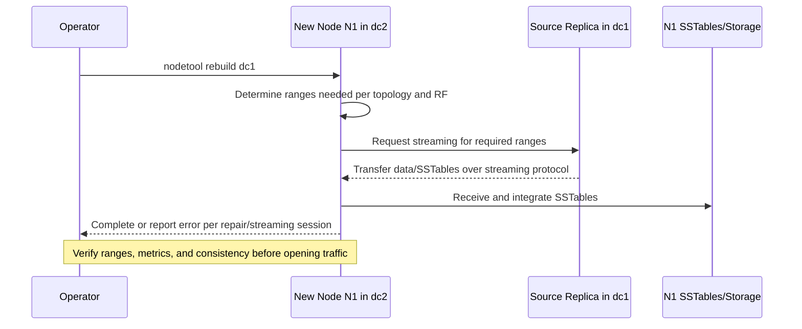

# Rebuilding Data from Replicas or Another Datacenter

> **Chapter:** Topology Changes  
> **Scope:** Apache Cassandra, a *wide-column* distributed database. This lesson focuses on rebuilding data a node/datacenter must own by **streaming from surviving replicas**, especially when expanding into a new datacenter. Includes CQL examples, `nodetool`, consistency verification, and Java Driver 4.x.

## 1. The Problem: How Does a New Datacenter Get Historical Data?

Suppose a Cassandra cluster is running in datacenter `dc1`. Keyspace `shop` uses `NetworkTopologyStrategy` with **RF=3 in dc1**, and three replicas have held order data for months.

Due to disaster recovery requirements or bringing the application closer to another region, ops adds `dc2`. The new nodes can join the cluster, receive tokens, see the schema, and report `UN` (Up/Normal), yet **that does not prove they hold all historical data needed to serve traffic**.

The goal is to populate replicas on `dc2` nodes matching the keyspace's token ranges and replication factor. Cassandra can **stream SSTables/data from suitable source replicas** to fill the missing pieces. When provisioning a new datacenter, `nodetool rebuild` is the command typically used per the running Cassandra version's procedure.

```text
Initially:
dc1                                dc2
  R1 ─┐                            (does not yet hold historical data)
  R2 ─┼─ 3 replicas of keyspace
  R3 ─┘

After configuring topology/replication and successful streaming:
dc1                                dc2
  R1 ─┐                              N1 ─┐
  R2 ─┼─ RF=3 in dc1   STREAMING →   N2 ─┼─ RF=3 in dc2
  R3 ─┘                              N3 ─┘

Each node owns only its required token ranges.
Not every node receives the entire keyspace.
```

**Rebuild in this context means bringing a replica to the state where it holds the data required by its token ownership**, not restoring yesterday's backup, not replaying all initial CQL statements, and not replacing long-term repair routines.

## 2. Concepts Determining Data Sources and Destinations

### Token Range and Partition Key

Cassandra hashes the **partition key** into a token. The token ring and replication strategy determine which replicas store each partition. With the wide-column model, query-driven table design enables reading exact partitions; during topology changes, those partitions must be distributed to the new replica set.

A node added to the cluster **does not mean it must download all data from all other nodes**. It only needs the data falling within the token ranges assigned to it by the new topology under current RF and placement.

### Per-Datacenter Replication Factor

`NetworkTopologyStrategy` configures replica counts independently per datacenter. For example:

```cql
CREATE KEYSPACE shop
WITH replication = {
  'class': 'NetworkTopologyStrategy',
  'dc1': 3
};
```

When expanding the system with a target of three replicas in each datacenter, the desired schema might be:

```cql
ALTER KEYSPACE shop
WITH replication = {
  'class': 'NetworkTopologyStrategy',
  'dc1': 3,
  'dc2': 3
};
```

This is a **schema example**, not an instruction to execute directly in production. The ordering of node prep, racks, token ownership, altering RF, launching streaming, and enabling traffic must follow the **runbook for your running version**. Changing replication metadata **does not automatically backfill historical rows** onto the new replicas.

### Destination Node and Source Datacenter

- **Destination node:** where data is needed for the token ranges the node currently owns. When opening `dc2`, the `dc2` nodes themselves are rebuild destinations.
- **Source replica:** a node already holding the corresponding data, typically in a populated datacenter such as `dc1`.
- **Source DC:** parameter indicating the source datacenter when using `nodetool rebuild <source_dc>` where supported by the version. `source_dc` is **where data comes from**, not the destination datacenter name.

Misspelling the DC name or setting the wrong RF can leave a node without a valid stream source, fail streaming, or finish missing expected ranges.

## 3. Distinguishing Rebuild from Bootstrap, Replace, Repair, and Restore

These operations all involve inter-node data, yet cannot be swapped arbitrarily:

| Operation | When Used | What Happens | Critical Limitation |
| --- | --- | --- | --- |
| **Bootstrap** | Adding a node to existing topology via node init procedure | Distributes tokens/ranges and receives appropriate data as node joins | Never assume bootstrapping one new node automatically populates historical data for an entire new DC |
| **`nodetool rebuild`** | Populating data on a node already in the cluster, typically when adding a new DC | Streams ranges the node must own from source replicas | Does not fix wrong ownership/schema and does not replace periodic repair |
| **Replace node** | Old node permanently lost and another needs to take over identity/ownership | Executes Cassandra's replace procedure so new node fetches data | Never spin up an empty node and run rebuild arbitrarily, bypassing node replacement mechanics |
| **Repair** | Reconciling replicas already owning the same ranges, including after outages | Compares data and streams deltas | Does not configure a new DC/RF or design new tokens |
| **Restore snapshot/backup** | Recovering from managed backups | Restores files/data per point-in-time and backup procedure | May require replay/restore or reconciling later mutations; not synonymous with live streaming |
| **Decommission/removenode** | Removing a node from topology | Adjusts ownership and ensures data movement per procedure | Cluster-shrinking operation, not a way to trigger rebuild on a destination node |

**Rule:** identify why a node lacks data before picking a command. An "empty node" could stem from a newly opened DC, an incomplete node bootstrap, disk loss, wrong RF schema, or unfinished streaming. Each case has a different runbook.

### When a Node Loses Its Entire Disk

If an existing replica loses all its local data, first evaluate **version-supported replace/rebuild procedures**, node state, tokens, and healthy replicas. Manually wiping system directories and running `nodetool rebuild` can produce broken topology or data loss.

If **all replicas of a partition lost their data**, rebuild cannot conjure those values out of thin air. At that point you need a backup/restore strategy and RPO/RTO evaluation.

## 4. What Does Rebuild Do in the Distributed Path?

Conceptually, the destination node knows the token ranges it is responsible for under current topology. It requests data from suitable source replicas and receives it via Cassandra's **streaming** mechanism.



This model is intentionally simplified: source sets, file/section transfers, stream verification, endpoint selection, and SSTable handling depend on version, configuration, and token ownership.

### Things Rebuild Does Not Directly Do

- **Does not** automatically alter `NetworkTopologyStrategy` or keyspace replication factors.
- **Does not** route Java clients to a different datacenter.
- **Does not** create a backup or guarantee a multi-table point-in-time consistent snapshot.
- **Does not** turn mutations that never reached source replicas into recoverable data.
- **Does not** change the meaning of request consistency levels.
- **Does not** prove every range has complete data just because a node shows `UN`.

## 5. Preflight Before Expanding a Datacenter

Before changing topology, gather verifiable facts. The goal is to establish **which data will move, from where, and under what conditions**.

| Area | What to Verify | Why |
| --- | --- | --- |
| **Version** | Cassandra version, inter-node compatibility, `nodetool rebuild` syntax | Streaming and DC-addition order can differ across releases |
| **Topology** | Actual DC/rack names, snitch, token placement, `UN` status | Nodes could accidentally land in the wrong DC/rack |
| **Replication** | `NetworkTopologyStrategy` and RF of **every keyspace** in dc1/dc2 | Data to stream depends on each keyspace and RF |
| **Sources** | Health of dc1 replicas, repair history, offline nodes, tombstones/TTL | Stale/incomplete sources are unsafe rebuild foundations |
| **Capacity** | SSTable bytes, disk headroom, projected growth on dc2 | Streaming needs storage space and triggers compaction |
| **Load** | Read/write p95/p99, CPU, disk I/O, compaction backlog | Rebuild competes for resources with live queries |
| **Network** | Routing, inter-DC latency/bandwidth, firewalls, streaming TLS/ports | Streams can be blocked/throttled even when CQL 9042 works |
| **Rollback ability** | Backups/snapshots, partial-stream handling runbook, traffic cutover points | Must have a way to validate and revert read flows |
| **Special data** | TTLs, tombstones, LWT, indexes/materialized views if used | Data and auxiliary structures must be assessed post-stream |

### Do Not Confuse Replication with Node Count

If `'dc2': 3` is set, datacenter dc2 must have enough **eligible replicas** matching rack/placement configuration and cluster policy. Having only two nodes with a target RF of 3 cannot create three truly independent replicas. Before running rebuild, resolve RF and node count so topology can meet the target.

### Why Care About Tombstones and Source Repair?

Suppose a replica in dc1 missed a `DELETE` for an extended period. If tombstones were already purged on remaining sources while an old replica still holds the value, rebuild/streaming or repair can risk resurrecting stale data. Before major topology changes, check offline nodes, repair cadence, and `gc_grace_seconds` on tables with heavy deletes/TTLs.

Rebuild is not an arbiter of which business value is "more trustworthy" if the source cluster already carries zombie-data risk.

## 6. Estimating Streaming Volume and Duration

Each destination node only needs data for **the ranges it owns**; do not mechanically multiply total cluster size by node count.

Suppose a keyspace has roughly **1.5 TiB of logical data** and dc2 wants RF=3. Assuming uniform distribution, replica footprint in dc2 conceptually approaches **4.5 TiB before compression, duplicate SSTables, and metadata**. This only gauges provisioning scale, not exact bytes crossing the wire.

In practice, distinguish:

- **Logical bytes:** business data size.
- **Stored bytes:** compressed SSTables, tombstones, metadata, and compaction artifacts.
- **Bytes streamed:** depends on range scope, sources, target state, transfer method, duplicates, and checks.
- **Peak disk usage:** during streaming/compaction can exceed final resting data size.

Rough planning model:

```text
Minimum bandwidth time ≈ total bytes to transfer / effective network throughput
Actual duration        = stream time + validation/resource waits
                       + retries/compaction + safety buffer
```

Never treat theoretical WAN link bandwidth as a completion promise. Source disk reads, destination disk writes, CPU, TLS, network congestion, and concurrent stream count are usually the bottlenecks.

### Concurrency Limiting Example

If dc1 is serving latency-sensitive API p99s, running rebuild on all dc2 nodes at once can force multiple dc1 sources into simultaneous reads/streams. A cautious approach is **testing one destination node first**, measuring stream throughput and load, then raising parallelism only to levels that preserve SLOs.

However, strictly sequential execution can also stretch DC expansion time. Decisions should be driven by metrics and deadlines, not a fixed "1 node or 3 nodes" rule across all clusters.

## 7. Framework Practice: Opening `dc2` from `dc1`

This section is an **illustrative scenario**, not a copy-paste production procedure. The exact order of adding nodes, bootstrap mode, rack/seed setup, and replication updates must come from your Cassandra version's runbook; wrong choices at that stage can give nodes wrong tokens or incomplete data.

### Step A — Record Pre-Change Structure

On healthy nodes:

```bash
nodetool status
nodetool describecluster
```

From a CQL client with metadata permissions:

```cql
DESCRIBE KEYSPACE shop;
```

Confirm `dc1` actually holds the required data, current RF, and tables serving key queries. Notably, maintain an explicit list of **application keyspaces needing rebuild**; never assume one operation fixes every keyspace for every service.

### Step B — Prepare and Join Nodes into dc2

Before dc2 serves historical data, the new nodes must have:

- **Correct DC/rack** matching snitch and desired topology.
- Sufficient networking for internode messaging and **streaming**, not just the CQL port.
- Compatible disk, CPU, network, and security policies.
- Tokens/ownership following supported DC-addition procedures.
- Consistent cluster config and schema.

For each version, verify the exact **bootstrap mode** appropriate when introducing the new DC's nodes and when to enable the corresponding RF. Never toggle `auto_bootstrap` on/off or introduce empty nodes into production based on an unverified generic guide.

### Step C — Set Target Replication for the Keyspace

Once topology preconditions are met per the version-specific procedure, target schema:

```cql
ALTER KEYSPACE shop
WITH replication = {
  'class': 'NetworkTopologyStrategy',
  'dc1': 3,
  'dc2': 3
};
```

Cassandra uses this schema to compute replica placement for every range. **Changing RF updates metadata/placement; it does not mean old data has been copied.**

If the cluster has multiple application keyspaces, define and execute the corresponding procedure per keyspace. Never alter system keyspaces or replication policies outside the designed scope.

### Step D — Stream from Source DC to Each Destination Node

On a **ready destination node in dc2** per the runbook:

```bash
nodetool rebuild dc1
```

In common syntax, `dc1` in the command above is the **source datacenter**. Verify `nodetool help rebuild`, version, and optional flags before running in practice. Never execute this command on a source node in dc1 merely because the command mentions `dc1`.

Monitor while the command runs:

```bash
nodetool netstats
nodetool tpstats
nodetool compactionstats
```

When one node finishes **and valid data/metrics are confirmed**, proceed with remaining destination nodes per your concurrency plan. If the command reports success yet logs show failed ranges/sessions or a node dropped mid-way, cross-check streaming events before considering the goal achieved.

### Step E — Verify Before Opening Applications to dc2

Once all relevant nodes finish:

```bash
nodetool status
nodetool tablestats shop.orders_by_id
nodetool netstats
```

Metrics such as SSTable counts, live disk space, streaming sessions, pending compactions, read latency, and node state help prove data actually transferred.

Next, you must:

1. **Reconcile critical partitions** against the source by partition key; intentionally sample old data, recent data, and data near TTL/deletion boundaries.
2. **Verify token range coverage** each dc2 node must own; do not check total row counts alone.
3. **Run appropriate repair/reconciliation procedures** if required by the runbook and concurrent writes, noting DC scope and replica consistency.
4. **Test queries from a client configured with local DC = dc2** at desired consistency levels, measuring p95/p99.
5. Shift partial or full traffic only after checks pass; continue monitoring.

A `SELECT` returning rows from one node does not prove the entire DC is fully populated: the request could have been served by another replica, or merely queried a partition that already had data.

## 8. Rebuilding While Applications Continue Writing Data

Topology changes usually happen on live clusters. As the source continues accepting writes, new data can arrive **while streaming is underway**.

This creates two layers to handle:

- **Pre-streaming data:** must be transferred completely to new replicas for their token ranges.
- **Mutations arriving during/after streaming:** must be distributed per active replication and topology, or reconciled via repair/reconciliation if gaps exist.

Never assume rebuild is a "perfect transactional point-in-time snapshot" across a cluster taking writes. Traffic cutover depends on reconciliation outcomes and your version's concurrent-write behavior, especially for rapidly mutating tables.

### Race Condition Example

```text
10:00:00  N1(dc2) starts rebuilding range X from dc1.
10:00:04  Application updates order_id=42 to PAID.
10:00:05  N1 receives an older streamed data segment.
10:00:10  N1 reports completion of requested stream.
10:00:15  Ops prepares to switch readers to dc2.
```

You cannot conclude order 42 is definitely `PAID` on every dc2 replica solely from the "stream complete" timestamp. You must check ownership, post-topology-change mutation distribution, consistency level, and reconciliation to avoid reading stale state.

If the workload uses **LWT/`IF`**, note that it is a conditional write path with its own protocol. Changing DC/RF alters participating replicas, and verifying state integrity must follow version-appropriate procedures; never trust a single random `SELECT`.

## 9. Java Driver: Testing with Local DC and Consistency Level

Cassandra Java Driver 4.x picks coordinators via its routing policy. In multi-datacenter setups, configuring the right **local datacenter** is critical to avoid unintended cross-WAN reads/writes.

Example of a data-check helper with a `CqlSession` **already configured to use dc2**:

```java
import java.util.UUID;

import com.datastax.oss.driver.api.core.CqlSession;
import com.datastax.oss.driver.api.core.DefaultConsistencyLevel;
import com.datastax.oss.driver.api.core.cql.BoundStatement;
import com.datastax.oss.driver.api.core.cql.PreparedStatement;
import com.datastax.oss.driver.api.core.cql.Row;

public final class RebuildReadCheck {
    private final CqlSession session;
    private final PreparedStatement getOrder;

    public RebuildReadCheck(CqlSession session) {
        this.session = session;
        this.getOrder = session.prepare(
            "SELECT order_id, state, updated_at " +
            "FROM shop.orders_by_id WHERE order_id = ?"
        );
    }

    public String readState(UUID orderId) {
        BoundStatement statement = getOrder.bind(orderId)
            .setConsistencyLevel(DefaultConsistencyLevel.LOCAL_QUORUM)
            .setIdempotent(true);

        Row row = session.execute(statement).one();
        return row == null ? null : row.getString("state");
    }
}
```

This snippet does not configure `CqlSession` itself; the person running the test must verify **driver profile/local DC = dc2**, contact points, RF, and access permissions. `LOCAL_QUORUM` requires a quorum of RF **within the coordinator's DC**, without requiring immediate cross-sync with `dc1` at read time.

Therefore, after rebuild:

- Test with a client whose local DC is **dc2**, rather than only reading from a dc1 client.
- Compare a known set of partitions against results from dc1 and expected business state.
- Verify read consistency, write consistency, and actual routing.
- Monitor error rates, latency, timeouts, and data mutations after shifting traffic.

**Never use a full-table `SELECT COUNT(*)` as a completeness check.** Full scans are expensive and yield only an aggregate number, hiding missing ranges or stale row versions. Prefer verification by token ranges and meaningful partition samples.

## 10. Rebuild Is Not Repair: Checking Consistency After Streaming

Streaming delivers data to nodes owning new ranges. Repair **reconciles replicas currently owning the same ranges**.

A node can receive all SSTables from a source yet still differ on mutations that occurred during the topology window or pre-existed in the source cluster. Where needed, the runbook must include a repair reconciliation step scoped to the relevant token ranges/DC.

Concepts to distinguish:

| Condition | How Far Rebuild Goes | Next Step |
| --- | --- | --- |
| dc2 node lacks historical data for new ranges | Streaming from source fills the data | Measure stream completion, verify placement |
| dc1 replicas already diverged due to past node downtime | Rebuild does not guarantee resolving source divergence | Check repair history and reconcile source/target |
| Mutations occurred while streaming ran | May need reconciliation per cluster procedure | Repair/verify consistency during cutover |
| All replicas lost a partition | No live source to stream that partition | Backup/restore or recover from business source |
| DC-addition sequence misconfigured RF/snitch | Rebuild cannot fix placement via streaming alone | Fix topology/schema per runbook first |

### Tombstones and `gc_grace_seconds`

Deleted data may exist as tombstones on healthy replicas. If a node was absent too long or source replicas were not repaired before tombstones were purged, old values can return (*zombie data*).

Expanding to a new DC from a source with unreliable repair history does not erase this problem. Review table `gc_grace_seconds`, replica offline history, read/write CLs, and compaction timing before concluding rebuilt data is accurate.

## 11. Troubleshooting Errors During Rebuild

### Error 1 — Command Reports No Suitable Source Found

**Symptom:** no source replicas for target ranges, wrong source DC, or invalid RF/token placement.

**Check:** actual DC/rack names, `NetworkTopologyStrategy`, version, node count and token ownership, and source replica health. Do not randomly try changing source DC names until the error goes away.

### Error 2 — Streaming Starts Then Halts Due to Network Issues

**Symptom:** `nodetool netstats` shows failed sessions or stalled progress; node logs show timeouts/connection errors.

**Check:** internode connectivity, inter-DC links, ports/TLS, bandwidth throttling, packet loss, and source availability. Fix root cause, inspect partial state, then follow your version's retry/resume procedure. Never wipe the data directory yourself.

### Error 3 — Destination Node Runs Out of Disk

**Symptom:** storage grows rapidly; compaction/streaming logs SSTable write errors.

**Check:** actual logical vs. stored data, RF, overhead while SSTables coexist, snapshots, and compaction needs. Expand storage or adjust scheduling appropriately. Never manually delete SSTables or commit logs.

### Error 4 — Sources Overloaded, API p99 Spikes

**Symptom:** dc1 reads/writes slow down; disk I/O and network surge while dc2 streams.

**Fix:** reduce concurrent destination rebuilds, tune version-appropriate stream throttling, shift maintenance window, clear compaction backlog, and monitor until SLOs stabilize.

### Error 5 — Node Is `UN` but dc2 Queries Miss Data

**Symptom:** gossip state looks normal, yet test partitions are incomplete or return stale state.

**Check:** whether rebuild truly completed on all nodes/ranges, right source DC, replication metadata covers dc2, driver local DC is set properly, and consistency level used. Reconcile and repair appropriately before opening traffic.

### Error 6 — Destination Holds Old Data from a Failed Attempt

**Symptom:** node previously belonged to the cluster, holds SSTables from old topology, and a new rebuild yields unexpected results.

**Principle:** rebuild is not a "format data and reinstall node" command. Re-establish the node's identity, tokens, and held data, then follow a version-supported replace/rebuild/restore procedure. Never reset tokens or delete system files to try your luck.

## 12. Things You Must Never Do to "Speed Up Rebuild"

- **Manually deleting data/commitlog or `system` keyspace:** easily destroys recovery evidence and node-identifying metadata.
- **Setting RF higher than eligible node count:** cannot produce enough physical replicas.
- **Switching all clients to dc2 the instant one node reports `UN`:** gossip health does not equal sufficient data.
- **Running rebuild on every node and DC simultaneously:** risks saturating source network/disks; always size to actual capacity.
- **Using `ALLOW FILTERING` or full-table `COUNT(*)` to "check everything":** huge cost, poor proof of range coverage.
- **Treating "stream completed" as a replacement for repair:** risks missing source divergence and concurrent mutations.
- **Replacing backups with rebuild:** cannot recover data lost across all replicas.

## 13. Post-Datacenter-Expansion Handover Checklist

| Item | Required Evidence |
| --- | --- |
| Accurate topology | `nodetool status` shows node DCs/racks and states matching design |
| Accurate RF/schema | All required application keyspaces hold target replication config |
| Trusted stream sources | Source replicas healthy, no unaddressed repair gaps or offline nodes |
| Streaming complete | Each destination node has successful logs/sessions, no hanging errors |
| Token coverage | Ranges owned by dc2 have verified data, not just a couple queries |
| Stable storage | Disk headroom, SSTable counts, compaction/streaming backlog acceptable |
| Consistency | Critical partitions verified and necessary repair/reconciliation run |
| Application | Driver local DC accurate, appropriate `LOCAL_QUORUM`/CL, canary meets p95/p99 |
| Operations | Node/stream/repair alerts, backups, rollback, and owners clearly defined |
| Cutover | Timestamp and criteria recorded for moving readers/writers to dc2 |

### Short Role-Based Workflow

1. **Architecture:** align on RF/DC, racks, capacity, required data, and deadlines.
2. **Cluster ops:** check sources and topology; prepare destination nodes per version-specific runbook.
3. **Streaming:** execute rebuild in controlled destination batches, logging per-node/range outcomes.
4. **Reconciliation:** prove range coverage, required repair, and critical query correctness.
5. **Java application:** set target local DC/consistency and canary traffic before broad rollout.
6. **Monitoring:** track compaction, disk, network, p99, and repair schedule after topology changes.

## 14. Common Misconceptions

**"Once the new node is `UN`, historical data is complete."** False. `UN` describes a live node in topology, not proof that all required SSTables were streamed.

**"`nodetool rebuild dc1` means rebuild the nodes of dc1."** False in a DC-addition scenario: `dc1` is the **source DC**; the command runs on the **destination dc2** node.

**"Setting `'dc2': 3` in `ALTER KEYSPACE` automatically copies three historical replicas."** False. Replication metadata and transferring data to new replicas are two separate tasks.

**"Rebuild copies the entire dataset to every destination node."** False. Each node receives data for the token ranges it owns.

**"Rebuild equals restoring a snapshot."** False. Rebuild streams data from suitable live replicas; restoring from backup has different source and point-in-time semantics.

**"Once rebuild finishes, repair is no longer needed."** False. Replicas can still drift over time and require scheduled anti-entropy repair.

**"An application using `LOCAL_QUORUM` automatically reads data from both dc1 and dc2."** False. `LOCAL_QUORUM` evaluates quorum within the coordinator's local datacenter and does not cross-compare DCs automatically.

**"If all replicas lost data, picking another stream source can recover it."** False. Having no replica with data means you need another recovery source (backups or business systems).

**"Disabling compaction always makes rebuild faster."** No guarantee. Streaming, compaction, and disk headroom are tightly coupled; configuration changes must be measured for your version and workload to avoid prolonged compaction debt.

## 15. Practice Exercises

1. A cluster has `dc1` at RF=3 and opens `dc2` at RF=3. Name **three distinct steps**: updating replication metadata, bringing dc2 nodes into topology, and streaming historical data.
2. Why is `nodetool status` showing `UN` insufficient to confirm dc2 replicas hold all orders?
3. With `nodetool rebuild dc1` executed on a dc2 node, is `dc1` the source or destination? Why?
4. Compare the actions needed when **adding dc2** vs. when **a dc1 node loses its disk**. Why shouldn't both use the same runbook?
5. A keyspace has 2 TiB of logical data and RF=3 in dc2. Why can you not deduce exact streamed bytes from `2 × 3` alone?
6. Several dc1 replicas were offline longer than `gc_grace_seconds`. Before using them as sources, what must you verify?
7. When streaming pushes p99 from 80 ms to 250 ms, at which layers will you shed load and which metrics will you watch?
8. Rebuild reports success at 10:00, yet the application kept writing continuously until 10:05. Why is reconciliation needed before enabling traffic in dc2?
9. Java Driver has local DC set to dc1, yet the app wants to test dc2. Does a successful `SELECT` prove dc2 is healthy?
10. If streaming fails due to disk full, why must you never manually delete old SSTables and re-run?

## 16. Operational Conclusion

```text
Add DC or rebuild replicas
          |
          v
Check sources + RF + DC/rack + token ownership
          |
          v
Prepare destination node per version procedure
          |
          v
Stream/rebuild from right source, right ranges, throttled load
          |
          v
Verify completion + repair/reconcile if needed
          |
          v
Canary Java Driver targeting destination local DC + proper CL
          |
          v
Open traffic and maintain monitoring/periodic repair
```

**Remember:** `nodetool rebuild` is a tool that **brings data from source replicas to a node missing data for the token ranges it must own**, prominent when opening a new datacenter. Data is truly ready to serve only when **topology, replication, streaming, consistency, and application routing** are all verified. Never treat `UN` or a completed stream command as a substitute for thorough validation and repair.
