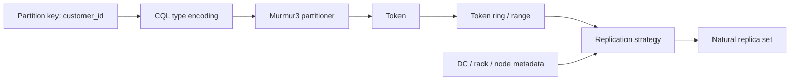
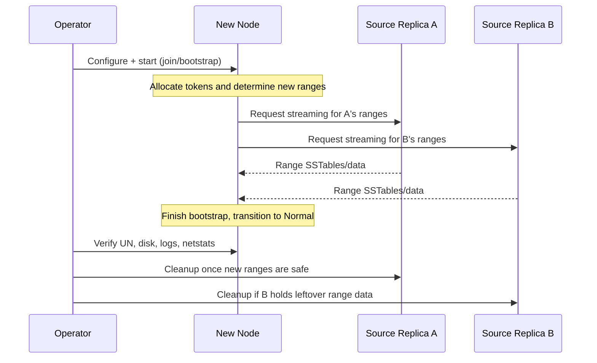

# Changing Tokens or Node Placement and Version-Specific Constraints

## 1. The Practical Problem: Moving a Node Is Not Just Editing a Number

Apache Cassandra distributes **wide-column** partitions by computing a **token** from the partition key, determining the token range, and selecting **natural replicas** per the replication strategy and topology (datacenter, rack). When changing tokens, adding/removing nodes, or relocating nodes, **token ranges are reassigned** and data may need to **stream** between replicas. Java services still send CQL as before, yet request paths, disk/network load, and the ability to satisfy consistency levels (CL) can shift during the transition.

In the `DATABASE_ENGINE_WIDE_COLUMN_CASSANDRA` module, the **Topology Changes** chapter connects distributed architecture, query-driven table design, partition keys, and replication to CQL operations, compaction, repair, error handling, and the Java Driver. This lesson answers: **When you want to change tokens or node placement, which operations are actually supported, what is their blast radius, and how do constraints depend on the Cassandra version?**

After this lesson, learners should be able to:

1. Distinguish **token ownership**, **replica placement**, **actual stored volume**, and **node state**.
2. Know when `nodetool move` can be used and why **not** to use it on nodes with multiple vnodes.
3. Compare **bootstrap**, **decommission**, **removenode**, **replace**, and **cleanup** workflows.
4. Understand the constraints of `num_tokens`, `initial_token`, and token allocators across version lines.
5. Follow a safety checklist to measure before/after, coordinate streaming, protect RF/CL, and recover when a change stalls incomplete.

> Lesson scope: common Cassandra token-ring mechanics and administrative tools. **No single token/node-changing command works across every version and every cluster.** Always cross-check documentation, `nodetool help`, and the runbook matching the **exact deployed version** before executing data-mutating operations.

## 2. Token Ring, Partition Key, Vnodes, and Natural Replicas

With the common `Murmur3Partitioner`, Cassandra hashes the **full encoded partition key** into a signed 64-bit integer token. Nodes own tokens or sets of **virtual nodes (vnodes)**; each token is a boundary on the ring, and a node is typically responsible for token intervals of the form **(previous token, current token]** per ring rules.

Example table for customer-based queries:

```sql
CREATE TABLE lab_ks.orders_by_customer (
    customer_id text,
    order_id uuid,
    state text,
    updated_at timestamp,
    PRIMARY KEY ((customer_id), order_id)
);
```

Here `customer_id` is the **partition key**, while `order_id` is the **clustering key**. The token is computed from `customer_id` and **does not** change when `state` or `updated_at` changes. Every time token ownership changes, the system must recalculate the natural replica set responsible for partitions in affected ranges.



**Three points never to confuse:**

- A keyspace's **RF** specifies the *desired* replica count per DC; tokens/placement determine **which nodes** hold those copies. `ALTER KEYSPACE` changing RF is a replication metadata change and **does not automatically copy all historical data**.
- **`Owns (effective)`** in `nodetool status <keyspace>` is the ownership share **accounting for replication**, which can sum above 100% across the cluster; it is not CPU usage, disk usage, or row count of a node.
- **Vnodes** mean one node holds **multiple tokens/ranges**. `num_tokens: 1` is the single-token model; `num_tokens > 1` is the multi-vnode model. The two models have different movement constraints.

### Illustrative Example of One Node Changing Token

Suppose a DC has four nodes A/B/C/D, one token each; the diagram below illustrates token ordering only, **not actual placement algorithms**:

```text
Before:
     ... -> A(-80) -> B(-20) -> C(40) -> D(100) -> [wraps to A]

After moving B to token 70:
     ... -> A(-80) -> C(40) -> B(70) -> D(100) -> [wraps to A]
```

Range boundaries shift and **natural replica sets per RF/rack can also change**. Nodes that previously held ranges no longer under their responsibility may still hold old SSTables. Cassandra prioritizes avoiding data loss during range movements, so **cleanup is a separate step run only after the new topology stabilizes**.

## 3. Operational Goals Lead to Different Operations

| Goal | Appropriate Approach | What to Strictly Avoid |
| --- | --- | --- |
| **Add storage/CPU capacity** | Bootstrap a **new node** with auto-allocated or planned tokens | Editing `num_tokens` on an old node and restarting hoping it redistributes. |
| **Retire a live node** | `nodetool decommission` on the **leaving node** | Shutting down the host and deleting metadata manually instead of transferring data. |
| **Remove a dead, unrecoverable node** | `nodetool removenode` from a live node with exact host ID and healthy source replicas | Using `decommission` when node is dead; using `assassinate` as a routine step. |
| **Replace hardware for a dead node** | **Replace dead node** procedure, letting replacement bootstrap data | Letting the old node and replacement run concurrently with overlapping identity/tokens. |
| **Move token of a single-token node** | `nodetool move <new-token>`, when version conditions and `num_tokens: 1` hold | Using `move` on a multi-vnode node. |
| **Relocate a vnode-based node** | Plan **decommission + bootstrap new node** or explicitly supported rebalancing tools | Forcing `initial_token` or `num_tokens` edits onto an existing data directory. |
| **Change physical/rack/DC placement** | Topology-shift procedure accounting for snitch, replication, and streaming | Only editing `cassandra-rackdc.properties` and assuming data auto-moves to the new rack/DC. |
| **Change keyspace RF** | Update replication metadata + sync procedure for new topology | Treating `ALTER KEYSPACE` as an atomic operation that moves all data automatically. |

These operations are **not equivalent** and cannot be substituted with CQL `UPDATE` statements; at the partition level, Cassandra uses partition keys/tokens as before, while the **token → node mapping** changes.

## 4. When Can `nodetool move` Actually Be Used?

According to Apache Cassandra 3.11/4.x/5.0 operational documentation, **`nodetool move` is supported for nodes with `num_tokens: 1`**. The command takes **one new target token**. For a node holding multiple tokens, a single `<new token>` argument cannot describe the entire vnode set; the operation cannot proceed via the standard mechanism.

```bash
# READ-ONLY COMMANDS: inspect first, do not alter topology.
nodetool status lab_ks
nodetool info
nodetool ring lab_ks
nodetool help move

# ILLUSTRATIVE SYNTAX, DO NOT RUN IN PRODUCTION WITHOUT APPROVAL:
# nodetool -h cassandra-node-b move 700000000000000000
```

Verify each condition:

1. **`num_tokens: 1`**: check the **actual configuration of the joined node** and the token count shown in the ring, rather than trusting a freshly downloaded sample config.
2. **Valid/unoccupied target token**: compute ring boundaries, natural replicas, DC/rack topology, imbalance, and bytes to stream. Never pick a random token to fix a high-load graph.
3. **Healthy node and streaming sources**: new ranges must fetch data from existing replicas; if a source replica is unavailable, consistent range movement may fail to complete.
4. **Sufficient disk/bandwidth and maintenance window**: the receiving node may see increased disk load while other nodes stream data and serve CQL.
5. **Post-move monitoring and cleanup**: only after confirming `move` finished and the new topology is valid; run cleanup **on nodes holding excess ranges**, not blindly on every node.

**Never change tokens by editing `initial_token` on a node that already holds data and restarting.** `initial_token` is an initialization/bootstrap token-assignment parameter in supported cases; editing a config file cannot replace range-movement procedures and cluster-recorded metadata.

### `move` Subcommand May Exist Yet Still Be Unusable

Seeing `nodetool help move` print syntax **does not mean** your cluster supports moving a node holding 8/16/256 vnodes. Do not infer multi-token move capability merely from the command's existence. If your cluster uses vnodes, adjust capacity via **bootstrap/decommission/replace** per runbook instead of hunting for a single token to pass to `move`.

## 5. Adding Nodes: How Does Bootstrap Change Ownership?

When adding a node to a cluster, Cassandra typically:

1. **Establishes the new node's identity** with matching cluster config, seeds, snitch/DC/rack, networking, and storage.
2. **Selects tokens**: based on `num_tokens` and the active allocator, or an intentionally specified `initial_token` list.
3. **Transitions the node into Joining/Bootstrap state**. The cluster determines the token ranges for which it becomes a new replica.
4. **Streams data** from corresponding source replicas for the new ranges; these transfers compete for disk, CPU, and network with CQL.
5. **Completes joining and enters Normal state**. Once data invariants are verified, schedule `cleanup` on nodes that lost ownership of some ranges.



### Automatic vs. Manual Token Allocation

Relevant parameters:

| Parameter | Meaning | Warning |
| --- | --- | --- |
| `num_tokens` | Expected token/vnode count assigned to **a node at initialization** | Not an RF booster or a runtime rebalance command for already-joined nodes. |
| `initial_token` | Explicit list of one/more tokens **assigned manually** where bootstrap/restore supports it | Avoid collisions and skew; never edit on an existing node for a "quick move". |
| `allocate_tokens_for_keyspace` | Optimizes token allocation from replica/load distribution of a chosen keyspace in supported versions | Tied to the replication-aware allocator; not a command to run on live nodes. |
| `allocate_tokens_for_local_replication_factor` | Allocates tokens by local RF rather than a single named keyspace, in supported versions | Check version and real RF distribution; do not pick 3 as an "always default" if the DC uses another RF. |

Apache Cassandra 4.1 documentation notes that legacy defaults used many vnodes (e.g., 256), whereas newer production configs and recommendations may use **fewer tokens** and replication-aware allocators. Therefore **never hardcode `num_tokens: 256` or `num_tokens: 16` from another example into a live environment**. Inspect **actual binary/config values** and evaluate load, node count, token ranges, rack/DC, and RF.

**Safety note on failed bootstrap:** In versions with `nodetool bootstrap resume` and `cassandra.reset_bootstrap_progress`, resuming may reuse previously streamed data or force re-streaming. Choosing the wrong flag can retain incomplete/stale data. Never wipe the data directory or toggle reset flags by guesswork; check exact version docs, logs, range state, and recovery runbooks before acting.

## 6. Removing Nodes: `decommission` vs. `removenode`

### 6.1. Retiring a Live Node: Decommission

When a node is healthy and connected to the cluster, **decommission** transfers token/range responsibilities and needed data to remaining nodes and removes the node from the ring. Example:

```bash
# TOPOLOGY-CHANGING COMMAND — RUN ONLY PER APPROVED RUNBOOK:
# nodetool -h cassandra-node-b decommission

# Independent observation commands:
nodetool status lab_ks
nodetool -h cassandra-node-b netstats
```

- `decommission` runs **on the leaving node itself**, or via `-h` pointing to that node.
- Enough receiving nodes/replicas must exist to preserve RF and satisfy CL. Never use the **force** option as a routine step; it can drop replicas below configured RF.
- After leaving the ring, the data directory on the old machine **does not vanish automatically**. Never reuse data/tokens/host ID of a decommissioned node to rejoin without a clean new-node preparation procedure.

### 6.2. Permanently Dead Node: Removenode

If a node is down and cannot execute decommission, the system must **drop that member's metadata** and rebuild replication coverage from surviving replicas. `removenode` is run on **a live node** with **the dead node's host ID** (never pass an IP arbitrarily as the ID parameter):

```bash
# Inspect status and host ID first:
nodetool status
nodetool help removenode

# ILLUSTRATIVE SYNTAX, DO NOT RUN WITHOUT CONFIRMING HOST ID:
# nodetool removenode 11111111-2222-3333-4444-555555555555
```

**Risk:** If surviving replicas do not hold all latest data, removing the dead node may fail to recover every mutation. Check hints, outage duration vs. `gc_grace_seconds`, repair coverage, streaming capacity, and backups. Never use `assassinate` to "quickly resolve" routine cases, as it is a forced action that can bypass data re-replication safeguards.

### When Should You Replace Instead of Just Removing?

If you need to keep the current node count and token ownership while a node's hardware died, **replace** is usually better than removing then adding, because the new node can assume the dead node's responsibilities through a supported workflow.

## 7. Replacing a Dead Node: Preserving Topology Identity Properly

Across Cassandra 3.11/4.x/5.0 lines, operational docs describe replacing a node via the JVM startup flag:

```text
-Dcassandra.replace_address_first_boot=<IP-of-dead-node>
```

This is a **first-boot replacement configuration**, not a `nodetool move` command and not something entered in `cqlsh`. Address, seeds, rack/DC, remaining local disk state, and IP scope **must be checked against your version's runbook**.

Principles:

- **The old node must truly be stopped** and must never return with the same identity while the replacement is receiving ranges.
- The replacement node streams data from surviving replicas. Behavior regarding mutations arriving during bootstrap can differ between **reusing the same IP** and **using a new IP**.
- If the outage exceeded the hints generation/retention window, or same-IP replacement lasted beyond the relevant hints window, documentation requires **repair** to catch up missed mutations.
- Seeing `UN` after replacement does not prove all replicas are consistent; check `netstats`, logs, repair history, and test queries at appropriate CLs.

Never start a new node by copying another node's data directory to "clone quickly" without a compatible restore/clone procedure. Those files encode host ID, tokens, schema, SSTable metadata, version, and repair state.

## 8. Rack/DC, Snitch, and Replication Strategy: Node Placement Differs from Tokens

Tokens can stay identical while **replica placement still shifts** if datacenter/rack labels, snitch, or RF change. With `NetworkTopologyStrategy`, topology labels participate in replica selection to spread copies across racks for fault tolerance.

Example:

```sql
CREATE KEYSPACE lab_ks
WITH replication = {
    'class': 'NetworkTopologyStrategy',
    'dc1': 3
};
```

Suppose nodes A and B share rack `r1`, while C is in `r2`. "Moving B to rack r2" is not merely changing a label in a dashboard:

1. Distinguish **physically moving a host** to another rack, **relabeling** a rack, or **migrating to another DC**.
2. Check the configured snitch and how DC/rack are resolved. With `GossipingPropertyFileSnitch`, settings typically reside in `cassandra-rackdc.properties` and propagate via gossip.
3. Evaluate **before/after** natural replica placement across keyspaces with different RFs. Changing labels does not guarantee SSTables automatically stream to new replicas in every version.
4. Plan streaming/repair/cleanup per **topology-transition documentation**; never edit a file on a live node assuming data will converge on its own.

In particular, **changing DC** affects write/read CLs like `LOCAL_QUORUM`, Java Driver local-DC resolution, client routing, and inter-DC bandwidth. When standing up a new DC, **provision nodes in the new DC, update replication strategy/RF per plan, complete streaming/rebuild/repair**, and only then shift traffic. Never edit the DC of a data-bearing node as the sole way to relocate an entire data region.

### Changing RF Does Not Mean Data Has Arrived

```sql
-- Illustrative metadata-change example only, DO NOT RUN on production keyspaces:
ALTER KEYSPACE lab_ks
WITH replication = {
    'class': 'NetworkTopologyStrategy',
    'dc1': 3,
    'dc2': 2
};
```

This statement updates **replication requirements**, yet historical data for `dc2` must be synchronized via an appropriate procedure. Reading `system_schema.keyspaces` shows metadata only—not proof that new nodes have received all SSTables/partitions.

## 9. Version-Specific Constraints: Operator Decision Matrix

| Version Line / Feature | Implications for Tokens and Topology | How to Verify |
| --- | --- | --- |
| **Cassandra 3.11 and legacy clusters** | May use single-token or multi-vnode; docs describe `move` only for `num_tokens: 1`, `initial_token` for supported scenarios. Some parameters/units and recovery steps differ from newer releases. | 3.11 docs, `nodetool help`, live config, and ring inspection. |
| **Cassandra 4.0/4.1** | Retains bootstrap, decommission, removenode, replace, `move` for single-token. Token allocators, bootstrap progress resume/reset steps, and operational bugfixes can vary by minor patch. | Patch-specific docs and release notes; verify `num_tokens` before move. |
| **Cassandra 5.0** | Official docs still describe `move` for `num_tokens: 1`; includes local-RF token allocation and updated production vnode recommendations; do not assume 4.x defaults. | 5.0 docs, running `cassandra.yaml`, `nodetool help`. |
| **Newer lines/upgrades with new metadata engine** | Some lines introduce **Transactional Cluster Metadata / Cluster Metadata Service (TCM/CMS)** and new upgrade/metadata rules. During transition, you may have to **freeze bootstrap/decommission/move** until metadata is initialized and consistent. | Follow release notes of the **exact binary**, confirm metadata status and rolling-upgrade rules; never mix runbooks across lines. |

**Subtlety:** A command sharing the same name across two versions **does not necessarily share the same preconditions, flags, recovery flow, or semantics**. `nodetool move` still exists in 5.0 docs, yet only single-token nodes can use it under that workflow. Proposed or in-development features on future branches are not evidence that your current production cluster supports them.

**Never apply unverified internal parameters**, such as:

- `auto_bootstrap: false` can skip streaming on join, intended only for special restore/migration cases; never a normal speedup.
- `cassandra.consistent.rangemovement=false` can bypass guarantees of fetching data from proper replicas if a source is down, risking missing data; never use as a default "fix".
- `cassandra.reset_bootstrap_progress` has version-dependent reset/reuse semantics; missetting it can reuse incomplete streamed ranges or retain stale data on disk.

These flags require operational sign-off and concrete verification/recovery plans.

## 10. Operational Procedure for Changing Tokens or Node Placement

### Step 1 — Define the Exact Objective

Clarify whether you need to **scale out**, **scale in**, **replace a dead node**, **move a single-token node**, **change rack/DC**, or **adjust RF**. Each objective has a distinct method. Record problem evidence: full node, disk skew, unmet RF/CL, flawed rack failure domain, or rising request p99.

If a single table is hot due to a poor partition key (e.g., all events share one `device_id` without time bucketing), moving tokens **cannot fix a logical hot partition**: one partition still lives on one replica set per RF. Revisit query-driven schema design and partition distribution.

### Step 2 — Capture Current Topology and Workload

```bash
# Read-only, run on an appropriate node:
nodetool version
nodetool describecluster
nodetool status lab_ks
nodetool ring lab_ks
nodetool describering lab_ks
nodetool info
nodetool netstats
nodetool compactionstats
```

Also capture: host IDs, IPs, DC/rack, snitch, keyspace replication, `num_tokens`, `initial_token` (if used), ready replica counts, free disk, snapshots, per-node data load, streaming throughput, and client read/write p95/p99.

**Most critical data:** not just "node A holds 25% of the ring", but **which replicas of which keyspaces A holds, how much disk it uses, and whether it carries hot workload traffic**. `Load` and `Owns (effective)` are not equivalent.

### Step 3 — Plan New Placement and Streaming Sources

For each critical keyspace:

1. Compute/estimate **before/after token ranges** and natural replicas for a representative set of partitions, per rack/DC.
2. Check RF and local quorum in affected DCs; ensure availability holds if one node slows down or enters maintenance.
3. Estimate bytes to stream and free space on receiving nodes; budget for snapshots and generated SSTables/compactions.
4. Assess intra-DC/inter-DC network speed, off-peak windows, active repairs/backups, and safe concurrent change limits.
5. Lock in owners, **abort/rollback** thresholds, version-specific contingencies, and post-change repair/cleanup plans.

Never change multiple nodes or DCs concurrently merely to shrink total duration unless you can prove RF/CL and bandwidth remain safe.

### Step 4 — Execute **One** Change per Runbook

For a new node: bootstrap. For a live node leaving: decommission. For a dead node: removenode or replace per goal. For a single-token node needing boundary adjustment: `move` if preconditions hold. For rebalancing a vnode node: prefer **streaming membership changes** over editing tokens on the old node.

During execution, monitor:

```bash
nodetool status lab_ks
nodetool netstats
nodetool tpstats
nodetool compactionstats
```

Watch logs on participating nodes; monitor `UJ` (Up/Joining), `UL` (Up/Leaving), `UM` (Up/Moving) if displayed by version, and errors for `Bootstrap`, `Streaming`, `Unavailable`/`Timeout`. **A node can be Up yet not Normal**; never begin cleanup while range movement is incomplete.

### Step 5 — Verify Topology and Data

After the change, verify from **more than one node**:

- Expected IP/host ID, DC/rack, and `UN` status once expected to be Normal.
- Token/range sets and natural replicas in keyspace metadata match the plan.
- Streaming completed; no remaining errors/pending ranges or severe metadata discrepancies.
- Specific partition-key CQL queries return accurate data at appropriate CLs across sample keyspaces/partitions.
- Read/write p95/p99, timeouts, disk/net/CPU, and load skew re-measured once traffic stabilizes.

**Important:** Spot data checks do not replace **repair/anti-entropy** on ranges requiring reconciliation. Bootstrap/replacement does not guarantee mutations missed during a prolonged outage automatically exist on every replica.

### Step 6 — Post-Transition Cleanup and Reconciliation

Once the new topology is stable and data scope is verified:

```bash
# Example keyspace/table cleanup on a node that previously held now-unowned ranges:
# nodetool -h cassandra-node-a cleanup lab_ks orders_by_customer

# Before running:
nodetool help cleanup
nodetool status lab_ks
```

`cleanup` deletes local data **no longer owned by the node**; it is an SSTable/disk I/O operation, **not** repair. Never run it before bootstrap/decommission/move completes or while metadata is still changing. A new node typically does not need cleanup on newly assigned ranges, whereas source/neighbor nodes may.

Repair is a separate step to synchronize inconsistent replicas; schedule it based on replacement, RF changes, outage duration vs. hints, and tombstone grace. Never claim "every replica holds accurate data" merely because `cleanup` or `compactionstats` finished.

## 11. Lab Practice: Inspecting Tokens and Predicting Impact Before Acting

### 11.1. Safe Read-Only Lab

Assuming `lab_ks` already exists with data and a table keyed by `customer_id` of type `text`:

```bash
nodetool status lab_ks
nodetool ring lab_ks
nodetool describering lab_ks
nodetool getendpoints lab_ks orders_by_customer cust-42
nodetool help move
nodetool help decommission
nodetool help removenode
nodetool help cleanup
```

`getendpoints` lists natural replicas for a **specific partition key**, not proof that all of them hold the latest value. Next, determine:

1. How many tokens does each node hold? Does any node hold one token, or do all use vnodes?
2. On which replicas is `cust-42`'s partition expected to reside?
3. On an RF = 3 cluster with exactly three healthy nodes in one DC, why can `Owns (effective)` be near 100% for **each** node?
4. To relocate a node with 16 vnodes, why is `nodetool move` with one target token wrong?
5. If a node is added, after bootstrap which nodes might still hold SSTables for ranges they lost ownership of?

### 11.2. Topology-Changing Lab (Dedicated Test Cluster Only)

On a multi-node non-production test cluster with snapshots/rebuildability:

1. Capture baseline: RF, ring/rack, disk, application p95/p99, idle streaming state.
2. Add **one new node** configured with valid DC/rack and token allocation to bootstrap per the **running binary's** procedure. Do not set `auto_bootstrap: false` just to shorten the lab.
3. Monitor `Joining → Normal`, `netstats`, and logs; run no other changes while streaming is incomplete.
4. Re-check ring and `getendpoints` for sample partitions; compare before/after replica lists and CQL outputs.
5. Schedule cleanup on nodes that lost ranges after proving data and membership stability; watch free disk/CPU/compaction.
6. Close with p99/timeout/disk skew metrics and the list of ranges still needing repair.

It is **not** mandatory to run `move`, decommission, or dead-node replacement to finish the lab. Those carry data risk and need separate runbooks; the lab can meet its objectives by **analyzing token layout and simulating a change plan**.

## 12. Common Failure Scenarios

| Symptom | Possible Cause | Investigation Path |
| --- | --- | --- |
| `nodetool move` reports multi-token node unsupported | Node has `num_tokens > 1` | Verify ring; switch to vnode-appropriate procedure, do not force tokens. |
| Node fails to join properly after editing `initial_token` | Existing tokens/metadata conflict with config and data | Halt ad-hoc edits; recover per version runbook, never manually delete data. |
| Bootstrap hangs/fails | Source replica down, low disk, network, timeouts, or recorded stream state | Check `netstats`/logs and bootstrap state; never blindly toggle reset/consistent flags. |
| New node is `UN` yet old nodes still use disk | Unowned range data remains in source SSTables | Confirm join/streaming succeeded, then run controlled cleanup on right nodes. |
| Decommission triggers client timeouts | Receiving nodes overloaded or insufficient replicas for CL | Reduce concurrent movements, measure read/write/streaming and RF, check skew. |
| Replacement node shows Up yet misses recent data | Old node was down long, hints expired, or replacement missed writes during bootstrap | Run repair per docs, check consistency and sample data. |
| WAN latency rises after rack/DC change | Placement, local-DC routing, or snitch/RF changed | Check snitch, driver local DC, replicas, CL, and new topology. |
| `Owns (effective)` mismatches disk ratios | Ownership includes RF and ignores partition size/hot keys | Check `Load`, disk, token count, partition size, workload, and compression. |
| Some nodes see different rings post-change | Metadata/gossip unconverged or operation failed mid-way | Inspect logs/`describecluster`, node states, and versions; do not start next change. |
| Metadata errors changing topology mid-rolling-upgrade | Incompatible metadata versions/generations or incomplete upgrade state | Halt topology change, follow release notes/upgrade runbook; never mix workflows across lines. |

## 13. Connection to Java Driver and Consistency

Changing tokens/ranges is a cluster operational task; Java applications **must not attempt to change tokens via CQL**. The driver needs accurate topology and DC awareness, prepared statements, and appropriate CLs. Java Driver 4.x example:

```java
PreparedStatement ps = session.prepare(
    "SELECT state FROM lab_ks.orders_by_customer " +
    "WHERE customer_id = ? AND order_id = ?"
);

BoundStatement query = ps.bind(
    "cust-42",
    UUID.fromString("11111111-2222-3333-4444-555555555555")
).setConsistencyLevel(DefaultConsistencyLevel.LOCAL_QUORUM);

long startedNs = System.nanoTime();
Row row = session.execute(query).one();
double ms = (System.nanoTime() - startedNs) / 1_000_000.0;

System.out.printf("state=%s; queryLatencyMs=%.2f%n",
    row == null ? "<missing>" : row.getString("state"), ms);
```

This snippet assumes `session`, test schema, and imports exist. The driver typically updates topology metadata via discovery/events; however, during bootstrap/decommission, requests can retry, see higher latency, or time out if chosen replicas are slow. A single successful read **does not** prove all ranges have finished streaming and repairing. Collect p50/p95/p99 metrics and errors for **the same request type before/after**, and verify the driver's local datacenter when adding/switching DCs.

Specifically, if `LOCAL_QUORUM` in DC A still works while DC B was newly added, that does not guarantee DC B already holds historical data; verify streaming/repair and serving coverage before shifting traffic.

## 14. Self-Check Questions

1. What are the differences between **a node's token count**, **a keyspace's RF**, **`Owns (effective)`**, and **disk `Load`**?
2. Why is `nodetool move` valid for a `num_tokens: 1` node yet unusable for changing one token of a multi-vnode node under standard procedures?
3. What should you do if the goal is changing vnode placement to reduce disk skew rather than moving a single token?
4. Why does editing `initial_token` or `num_tokens` on an old node not move data automatically?
5. Compare **decommissioning a live node**, **removing a dead node (`removenode`)**, and **replacing a dead node** in terms of streaming data sources.
6. After bootstrap, why might source nodes still consume heavy disk? When does `cleanup` become appropriate and why not run it early?
7. Why can changing rack/DC or RF alter natural replicas even when `customer_id` and the partition's token stay unchanged?
8. On a cluster upgrading to a version with a new metadata engine, what conditions must be verified before bootstrap/decommission/move?
9. If a replacement node is Up yet the prior outage exceeded the hints window, why might repair still be needed?
10. With RF = 3 and `LOCAL_QUORUM`, what can happen if two replicas undergo heavy streaming/disk I/O simultaneously during a topology change?

**Completion criteria:** Learners identify the right operation for the goal and version limits; never change runtime tokens by editing config files; distinguish single-token vs. vnode setups, inspect per-keyspace natural replica maps, protect RF/CL during streaming, and plan cleanup/repair/data checks before declaring the new topology stable.

## 15. References

- [Apache Cassandra — Adding, replacing, moving and removing nodes (5.0)](https://cassandra.apache.org/doc/5.0/cassandra/managing/operating/topo_changes.html): bootstrap, token allocation, single-token move, decommission/removenode, replace, cleanup, and resume constraints.
- [Apache Cassandra — Topology changes (4.1)](https://cassandra.apache.org/doc/4.1/cassandra/operating/topo_changes.html): cross-checking 4.x behavior, automatic token allocation, and restore.
- [Apache Cassandra — nodetool move](https://cassandra.apache.org/doc/5.0/cassandra/managing/tools/nodetool/move.html): target parameter for token move operations.
- [Apache Cassandra — Configuration (5.0)](https://cassandra.apache.org/doc/5.0/cassandra/managing/configuration/cass_yaml_file.html): `num_tokens`, `initial_token`, local-RF token allocator, and snitch.
- [Apache Cassandra — Production recommendations](https://cassandra.apache.org/doc/stable/cassandra/getting-started/production.html): trade-offs among vnode count, load balancing, and cluster scaling.
- [Apache Cassandra — nodetool status / troubleshooting](https://cassandra.apache.org/doc/stable/cassandra/troubleshooting/use_nodetool.html): explaining `Up/Down`, `Joining/Leaving/Moving`, effective ownership, and multi-node checks.
- [Apache Cassandra — Snitch](https://cassandra.apache.org/doc/stable/cassandra/managing/operating/snitch.html): DC/rack meaning and replica selection.

**Conclusion:** Changing tokens or node placement in Cassandra means **moving token-range ownership and replica data**, not editing a number in a config file. `nodetool move` fits only single-token nodes per version documentation; vnode clusters generally require membership/streaming workflows. Whether choosing bootstrap, decommission, removenode, replace, or rack/DC changes, always verify RF/CL, per-keyspace topology, data, and streaming before running cleanup or declaring the change complete.
