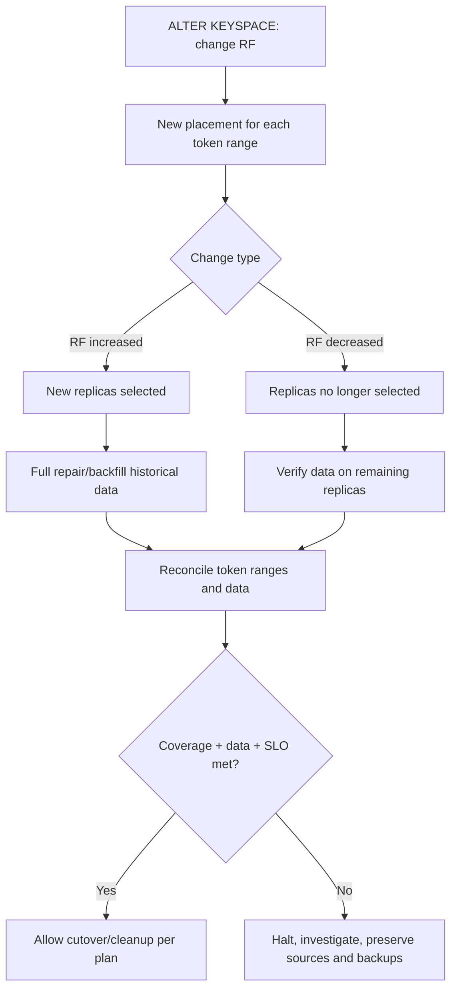
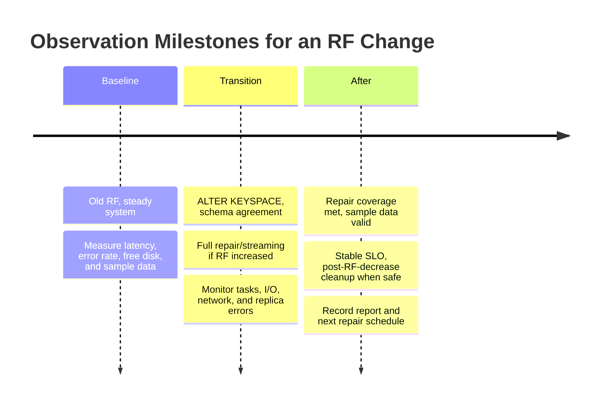

# Changing RF and Post-Change Repair/Verification Plans in Apache Cassandra

## 1. Context: Changing Replication Factor Does Not Mean Data Has Been Copied

In **Apache Cassandra**, a partition key is mapped to a **token**, and then the keyspace's replication strategy together with topology (datacenter, rack, node) determines which replicas are responsible for storing the data. Each replica has its own commit log, memtable, and SSTables. Replicas can temporarily diverge because write requests only require responses matching the **consistency level**, nodes can go offline, or networks can partition.

**Replication factor (RF)** specifies the **target number of copies**, not a guarantee that every selected node already holds all historical records. Consequently, `ALTER KEYSPACE` changes **replica-selection metadata**, whereas a **full repair/backfill** or appropriate data-transfer procedure brings missing historical data onto the new replicas. Conversely, lowering RF makes some copies **redundant**, yet they can only be safely reclaimed after verifying the remaining replicas.

This lesson belongs to the **Topology Changes** chapter of the `DATABASE_ENGINE_WIDE_COLUMN_CASSANDRA` module. Foundational concepts include the wide-column model, partition keys, query-driven table design, read/write consistency levels, CQL, replication, compaction, repair, incident handling, and Java applications. This lesson focuses on **planning RF changes, executing properly scoped repairs, measuring, and verifying before closing the change ticket**.

### Objectives

After studying this lesson, you will be able to:

1. Explain the impact of increasing/decreasing RF on replica placement, durability, and quorum.
2. Distinguish **schema changes**, **full repair**, **streaming**, **cleanup**, and **data verification**.
3. Build a safe RF-increase runbook with full repair covering all token ranges.
4. Build an RF-decrease runbook incorporating availability assessment and cleanup preconditions.
5. Verify via schema agreement, replica endpoints, repair coverage, historical data, latency, and client errors.
6. Define **GO / NO-GO / ROLLBACK** criteria rather than treating `UN` nodes or a successful `ALTER KEYSPACE` as sufficient.

## 2. Distinguishing Placement, Existing Data, and Serving Readiness

A system can have accurate metadata while data is still missing:



Three axes must be controlled independently:

| Axis | Question | Appropriate Evidence |
| --- | --- | --- |
| **Placement** | Under the new topology, which nodes *should* hold a partition? | `system_schema.keyspaces`, `nodetool status`, `getendpoints`, DC/rack/snitch |
| **Data coverage** | Have the new replicas *received* historical data and needed tombstones? | Successful full repair and streaming across all ranges, data checks |
| **Availability / SLO** | Does the Java app still meet CL, latency, and error targets? | Client read/write p95/p99, `Unavailable`, timeouts, error rates, throughput |

**Do not confuse** `nodetool status` showing all nodes `UN` with synchronized data. `UN` is Up/Normal membership status, not the result of a keyspace-wide anti-entropy repair.

## 3. Decision Map: Increasing RF, Decreasing RF, or Opening a DC?

| Operation | Metadata Changed | Data Work to Consider | Key Risk |
| --- | --- | --- | --- |
| **Increase RF in a DC with existing nodes** | More target replicas per token range | Properly scoped **full repair** to backfill history; monitor streaming | New replicas may lack older rows/tombstones |
| **Decrease RF in a DC** | Fewer target replicas per token range | Reconcile remaining sources **first**; `cleanup` excess copies **after** verified safe | Reduces fault tolerance; risks removing the only surviving copy |
| **Increase RF of a new DC** | Keyspace begins placing replicas in another DC | May need `rebuild`/streaming per DC-addition workflow, then repair/validation | Shifting traffic to the new DC before historical data arrives |
| **Decrease RF of an active serving DC** | Fewer copies in that DC | Check client local DC, availability, data placement before cleanup | `LOCAL_QUORUM` lacks enough responses if one replica fails |
| **Add nodes while keeping RF** | Node count/token ownership shifts | Bootstrap/streaming, situational repair, old-node cleanup | Topology membership change, **different** from simply editing RF |

In production, avoid lumping "increase RF, add nodes, change consistency level, and migrate applications" into a single un-checkpointed change. Without clear checkpoints, isolating whether an issue stems from metadata, streaming, repair, the driver, or networking becomes difficult.

### Cases Requiring Separate Specialized Runbooks

- **Transient replication**, e.g., RF syntax `3/1` on supported versions, has different repair/cleanup requirements from standard full-replica setups. This lesson assumes **full replicas** using `NetworkTopologyStrategy`.
- Tables with **materialized views**, secondary indexes, or **LWT/Paxos** workflows may require corresponding extended checks/procedures; never reduce all mechanisms to one basic repair command.
- States where **nodes are bootstrapping, leaving, moving, or long-down** complicate placement; **do not** alter RF until those underlying transitions are resolved per plan.

## 4. Recalculating Quorum Before Changing RF

In a DC using `NetworkTopologyStrategy` where all replicas are full replicas, local quorum for `LOCAL_QUORUM` is:

```text
required_acks = floor(RF_local_dc / 2) + 1
```

| RF in App's DC | ACKs Needed for LOCAL_QUORUM | Replicas That Can Temporarily Fail While Remaining Stay Healthy |
| ---: | ---: | ---: |
| 1 | 1 | 0 |
| 2 | 2 | 0 |
| 3 | 2 | 1 |
| 4 | 3 | 1 |
| 5 | 3 | 2 |

Two examples:

- **Increasing 2 → 3:** `LOCAL_QUORUM` still requires 2 responses, yet the target replica set changed. A request can complete while the new replica still lacks historical data; that is why full repair and verification are mandatory.
- **Decreasing 3 → 2:** `LOCAL_QUORUM` shifts from 2/3 to 2/2. Even though target storage drops, the system **can no longer tolerate losing a single replica** in the local set and still satisfy `LOCAL_QUORUM`.

**`QUORUM` differs from `LOCAL_QUORUM`.** In multi-DC keyspaces, `QUORUM` counts total replicas across the replication scope; `LOCAL_QUORUM` counts only the request's local DC. `EACH_QUORUM` has its own semantics for multi-DC writes. Never alter consistency levels to mask missing data without verifying product SLAs and consistency requirements.

Another frequently misused formula is `R + W > RF` to infer replica overlap; it relies on assumptions about stable placement and consistent data. **Response overlap does not substitute for historical data synchronization**, especially while a new replica set has not yet converged.

## 5. Pre-Change Plan: Proving the System Is Ready

### 5.1. Goals, Scope, and Owners

A solid change ticket minimally includes:

| Field | Must Record |
| --- | --- |
| **Change target** | Keyspace, before/after RF **per DC**, rationale, schedule |
| **Topology** | Cassandra version, nodes/DC/rack, snitch, tokens/vnodes, up/down nodes |
| **Application** | Query shapes, read/write CLs, local DC, driver version, retries, critical endpoints |
| **Data inventory** | Tables, storage sizes, TTLs, tombstones, partition sizes, historical data samples |
| **Recovery sources** | Backups/snapshots and restore viability, which replicas actually hold data |
| **Repair plan** | Why full/incremental, token ranges, where run, concurrency, timing |
| **Safety** | Free disk/headroom, network, CPU, GC, p95/p99, error-rate thresholds |
| **Go/no-go** | Criteria to start, halt, cut over, clean up, roll back, and approver |

There is no rule that running `nodetool repair` once on one node automatically covers every token range across the cluster. If using `-pr` (*primary range*), you must schedule coverage across all appropriate primary ranges on nodes and confirm every task finishes.

### 5.2. Cluster Health and Baseline

On each node in change scope:

```bash
# Observation only, writes no data
nodetool status
nodetool describecluster
nodetool netstats
nodetool compactionstats
nodetool tpstats
nodetool tablestats rf_change_lab.orders_by_id
```

The final command assumes the lab table already exists. In production, substitute your real keyspace/table and collect metrics from **all relevant nodes/DCs**. Some metric names vary by version.

Start only when required nodes/ranges are healthy and no unexplained conflicting bootstrap, repair, decommission, or streaming is active. Record **schema agreement**, free disk, compaction backlog, throughput, read/write p95/p99, timeout rates, and most recent repair history. Never rely solely on `Load` from `nodetool status` to estimate bytes needing transfer.

### 5.3. Backups, Tombstones, and Maintenance Window

- Verify backups are **restorable**, not merely present as snapshot filenames.
- Check how long replicas were offline, `gc_grace_seconds` policy, TTLs, and delete markers; stale nodes can resurrect zombie data if tombstones were purged on remaining replicas.
- Ensure disk headroom for new SSTables, streams, and post-repair compactions. Never schedule when volumes are near full and never manually delete SSTables to free space.
- Audit replica placement across **DC/racks**; three nodes in the same rack do not equal three independent failure domains.
- Notify the Java application ops team about the transition window when latency/timeouts may rise.

## 6. CQL Practice: Increasing RF from 2 to 3

This example is **strictly for a lab** with at least three healthy nodes in a DC named `dc1`; do not run on a two-node cluster. `NetworkTopologyStrategy` suits DC-aware topology; use the actual DC name reported by your snitch.

```sql
-- Step A: initial schema
CREATE KEYSPACE IF NOT EXISTS rf_change_lab
WITH replication = {
    'class': 'NetworkTopologyStrategy',
    'dc1': 2
};

CREATE TABLE IF NOT EXISTS rf_change_lab.orders_by_id (
    order_id uuid PRIMARY KEY,
    status text,
    updated_at timestamp
);

-- Write before RF increases: historical data needing backfill.
INSERT INTO rf_change_lab.orders_by_id (order_id, status, updated_at)
VALUES (
    11111111-1111-1111-1111-111111111111,
    'CREATED',
    '2026-11-21T00:00:00Z'
);

-- Record baseline at an appropriate consistency level.
SELECT status, updated_at
FROM rf_change_lab.orders_by_id
WHERE order_id = 11111111-1111-1111-1111-111111111111;

-- Step B: alter RF only after preflight passes
ALTER KEYSPACE rf_change_lab
WITH replication = {
    'class': 'NetworkTopologyStrategy',
    'dc1': 3
};
```

Immediately after `ALTER KEYSPACE`, target replica placement changes to three replicas. **Never assume rows written prior to that moment will magically appear on the added replica.** New writes post-change and reads at certain CLs may succeed right away while older data remains un-backfilled.

For keyspaces spanning **multiple DCs**, always specify **the full RF of every DC to keep** in the `ALTER KEYSPACE` map. Never copy a map containing only `dc1` if the keyspace also includes `dc2`: you could accidentally alter replication for the other DC.

### Preconditions to Proceed to Repair

1. `system_schema.keyspaces` reflects the exact target replication map.
2. Schema agreement holds across required nodes.
3. Target replicas are active with no abnormal joining/leaving nodes.
4. Disk/network can support anti-entropy repair and streaming.
5. The runbook lists all token ranges to cover and how evidence will be collected.

## 7. Full Repair After Increasing RF: Why Not Just Incremental?

In Cassandra, **full repair** reconciles data within the repair scope, including SSTables already marked repaired. **Incremental repair** focuses on data not yet marked repaired per version mechanics. When RF increases, historical data may already be marked **repaired under the old placement**, yet the new replica lacks it. A single incremental repair **does not guarantee complete backfill**.

Official Apache Cassandra documentation recommends a **full repair when increasing RF**, after `ALTER KEYSPACE`. Specify `-full` explicitly instead of relying on defaults:

```bash
# Example of a single task on one node only: scope depends on token ranges it serves.
nodetool repair -full rf_change_lab

# If the plan splits by primary token ranges across nodes:
# run per schedule covering all nodes/ranges, NOT just one node.
nodetool repair -full -pr rf_change_lab
```

**Important:** the commands above illustrate syntax on supported versions; `-pr` does not mean "repair the entire keyspace cluster-wide"—it selects only the primary ranges of the node running the command. With RF changes across multiple DCs, options restricting DCs/hosts can **accidentally omit new replicas**, so avoid `-dc` or `-hosts` unless you fully understand the replica participant set and coverage plan.

### 7.1. How to Schedule a Rolling Repair

A viable runbook:

1. Identify keyspaces/tables and the range set needing full repair under the new placement.
2. Choose coordinator/scheduler nodes and task order, avoiding overlapping repairs on the same replica set.
3. Launch each task with bounded concurrency, recording node, start/end timestamps, options, and range counts.
4. Monitor validation, streaming, anti-compaction if applicable, disk I/O, CPU, heap/GC, network, and app p99.
5. If a task fails, mark it **FAILED**; identify uncovered ranges, fix the root cause, and retry under control.
6. Proceed to validation/cutover only when **every planned range** succeeds.

### 7.2. Token Range Tracking Table

| Scope | Participating Replicas | Repair Mode | Status | Evidence |
| --- | --- | --- | --- | --- |
| Range group R1 | Replicas matching R1 under new RF | full | SUCCESS | Task ID, completion log |
| Range group R2 | Replicas matching R2 under new RF | full | SUCCESS | Task ID, validation/streaming |
| Range group R3 | Replicas matching R3 under new RF | full | FAILED | Error, retry plan |

This is a **sample table**, not an implication that a cluster has exactly three ranges. If R3 fails, the entire change remains **INCOMPLETE**. Never turn "two out of three tasks succeeded" into "fully repaired".

### 7.3. Diagnostic and Limiting Helper Commands

```bash
# Inspect options for the running version.
nodetool help repair

# Preview expected data volume to stream for the repair scope.
# Run on planned nodes/ranges; preview does not modify data.
nodetool repair -prv -full rf_change_lab

# Monitor transfer streams and background load.
nodetool netstats
nodetool compactionstats
nodetool tpstats
```

**`-prv` preview** helps estimate streaming work without transferring data itself; predictive precision is limited and it still consumes validation resources. **`-vd` validate** on supported versions checks already-repaired data, not proof that all unrepaired data is synchronized. `-full`, `-pr`, `-prv`, `-vd`, and valid combinations must be verified via `nodetool help repair` on your cluster's version.

## 8. CQL Practice: Decreasing RF from 3 to 2

Decreasing RF requires less streaming than increasing RF when data is clean, yet it **can destroy recovery sources** and reduce availability. Never look only at byte savings.

```sql
-- Change in lab only after verifying remaining replicas.
ALTER KEYSPACE rf_change_lab
WITH replication = {
    'class': 'NetworkTopologyStrategy',
    'dc1': 2
};
```

### RF-Decrease Runbook

1. **Before `ALTER`:** confirm data integrity on existing replicas, run appropriate repair, and verify restorable backups. List which replicas will continue holding data under the new placement.
2. **Assess CL and fault tolerance:** at RF = 2, `LOCAL_QUORUM` needs 2/2; if one replica fails, reads/writes at that CL may fail with `Unavailable`. Obtain SLO owner approval.
3. **Update metadata:** apply `ALTER KEYSPACE` with the full DC map; wait for schema agreement; do not run other topology changes concurrently.
4. **Verify after metadata update:** check new placement, node availability, historical data, and ongoing writes; if evidence is incomplete, **defer purging excess data**.
5. **Cleanup once safe:** run `nodetool cleanup rf_change_lab` on **each required node**, per runbook and load-isolation schedule. It purges token-range data the node no longer owns; cleanup **is not repair**.
6. **Measure outcomes:** SSTable footprint, free disk, compaction, read/write p95/p99, timeouts, `Unavailable`, and actual fault tolerance.

```bash
# Do not run in production before passing coverage verification.
# Cleanup is an operation THAT CAN DELETE physical data.
nodetool cleanup rf_change_lab
```

**Ordering is central.** If a surviving replica lacked some older versions that a replica slated for cleanup still held, premature cleanup can eliminate the only repair source for that data. **Rollback after cleanup** is not simply reversing `ALTER KEYSPACE`; it may require **full repair/streaming** to rebuild removed copies. If backups are the sole remaining source, a restore is needed. Therefore, **prepare backups and verify source data before cleanup**, rather than waiting until errors appear to figure out recovery.

Lowering RF does not necessarily shrink disk usage the instant `ALTER` finishes. SSTable files remain until cleanup and file reclamation complete. In some topologies, a node still retains most data due to token ranges across multiple keyspaces; measure **per-keyspace/per-node**, never guess from node count.

## 9. Adding or Increasing RF for Another DC: Avoid Opening Traffic Too Early

Suppose the application initially runs in `dc1` with RF 3, and you want three replicas in `dc2`:

```sql
-- Assumes dc2 was already added via proper topology workflow,
-- with new nodes having valid versions, racks, and addresses.
ALTER KEYSPACE rf_change_lab
WITH replication = {
    'class': 'NetworkTopologyStrategy',
    'dc1': 3,
    'dc2': 3
};
```

**New metadata does not backfill historical data to dc2.** Adding a DC may require **`nodetool rebuild`/streaming** from the source DC per version docs, followed by appropriate repair/validation. **Do not switch Java clients to `dc2` to read at `LOCAL_ONE` or `LOCAL_QUORUM` before historical data is verified.**

In multi-DC changes:

- Confirm DC/rack names from the snitch; `dc1` and `dc2` are examples, not defaults.
- Evaluate network links, cross-DC bandwidth, disk capacity, and rebuild cost.
- Keep the source DC's RF in the replication map if data is still needed there.
- Any repair must explicitly specify participating DCs/replicas; never restrict with `-local` when the goal is verifying data in the newly added DC.
- Measure application latency and error rates **from each DC** after cutover; a correct read in dc1 does not prove dc2 holds complete data.

Never combine add-DC, RF change, and failover into one un-checkpointed step: during rollback, you might not even know which token ranges finished streaming.

## 10. Post-RF-Change Verification: Four Mandatory Layers

### Layer A — Schema Agreement and Replica Placement

```sql
SELECT keyspace_name, replication
FROM system_schema.keyspaces
WHERE keyspace_name = 'rf_change_lab';
```

```bash
nodetool status rf_change_lab
nodetool describecluster

# Example for a single UUID partition key. Syntax may vary by version.
nodetool getendpoints rf_change_lab orders_by_id 11111111-1111-1111-1111-111111111111
```

`getendpoints` reports **nodes chosen by placement**, not proof that each of those nodes holds complete data. `describecluster` helps inspect schema versions, yet one tool is insufficient: verify schema agreement using all capabilities and tools of your running version.

### Layer B — Repair/Streaming Scope and Outcomes

Record:

```text
change_id: CHG-EXAMPLE-009
keyspace: rf_change_lab
RF_before: dc1=2
RF_after:  dc1=3
repair_type: full
scope: keyspace / tables / token ranges
per_task: node, session_id, range_set, participants, start, finish
per_task_status: SUCCESS / FAILED / CANCELLED / PENDING
uncovered_ranges: (if any, list explicitly; never leave blank when unchecked)
streamed_bytes: from actual collected metrics
cluster_readiness: NOT_READY until zero uncovered ranges remain
```

`nodetool repair` returning success for one repair session is positive, yet **does not mean** the scheduler covered every range/table or every DC. Also inspect validation logs, streaming failures, unrun range gaps, and repaired/unrepaired/pending repair states per version.

### Layer C — Before-and-After Data Content Checks

```sql
-- Record created before RF increase
SELECT status, updated_at
FROM rf_change_lab.orders_by_id
WHERE order_id = 11111111-1111-1111-1111-111111111111;
```

Verification must span **multiple token ranges**, not a single key:

- Records created **before the RF change** to verify history was distributed.
- Records updated/written **during the change window** to verify no lost updates.
- Records written **after the change** to verify the new write path works.
- Records `DELETE`d or past TTL expiration to detect zombie data or invalid stale rows.
- Verify accuracy of timestamps, values, checksums/business semantics, not merely `COUNT(*)`.

**Running a single `SELECT` at `LOCAL_QUORUM` does not prove every replica is accurate.** The coordinator may have fetched results from older replicas that already held data. Standard CQL is not a tool that guarantees you queried every new replica individually; use repair coverage/validation, logs, and proper verification tools.

### Layer D — Serving Readiness and Resources

| Metric | Verification Target |
| --- | --- |
| Java-side read/write p50/p95/p99 | Does not breach application SLO under equivalent workload |
| Timeouts, `ReadFailure`, `Unavailable` | Do not rise beyond pre-defined thresholds |
| Offered RPS and successful RPS | Do not "beautify latency" by dropping served request count |
| Free disk / live SSTable bytes | Sufficient headroom during repair and post-cleanup |
| CPU/heap/GC, disk I/O, network | No sustained bottlenecks caused by streaming/repair |
| Compaction backlog | Returns to steady state or has a handling plan |
| Driver local DC and routing | Requests hit expected DC, especially post add-DC |

A change may be marked **COMPLETED** only when all four layers pass; if evidence is missing for any layer, report **INCOMPLETE** rather than inferring success from another layer.

## 11. Java Driver 4.x: Verifying from the Application Perspective

The Java Driver does not replace `nodetool repair`, yet it measures **real client experience**. The example below uses Java 17+ (text block). Assume `CqlSession session` is already configured with appropriate contact points, credentials, and local DC.

```java
import com.datastax.oss.driver.api.core.DefaultConsistencyLevel;
import com.datastax.oss.driver.api.core.cql.BoundStatement;
import com.datastax.oss.driver.api.core.cql.PreparedStatement;
import com.datastax.oss.driver.api.core.cql.Row;
import com.datastax.oss.driver.api.core.servererrors.ReadFailureException;
import com.datastax.oss.driver.api.core.servererrors.ReadTimeoutException;
import com.datastax.oss.driver.api.core.servererrors.UnavailableException;
import java.util.UUID;

PreparedStatement ps = session.prepare("""
    SELECT status, updated_at
    FROM rf_change_lab.orders_by_id
    WHERE order_id = ?
    """);

BoundStatement statement = ps.boundStatementBuilder()
    .setUuid(0, UUID.fromString("11111111-1111-1111-1111-111111111111"))
    .setConsistencyLevel(DefaultConsistencyLevel.LOCAL_QUORUM)
    .build();

long startedNs = System.nanoTime();
try {
    Row row = session.execute(statement).one();
    long latencyNs = System.nanoTime() - startedNs;
    // Emit latencyNs, hasRow, expectedValueMatch, localDC, CL
    // along with change_id and dataset version to metrics.
    if (row == null) {
        // Investigate missing record; do not assume tombstone or lost data.
    }
} catch (UnavailableException | ReadTimeoutException | ReadFailureException error) {
    long latencyNs = System.nanoTime() - startedNs;
    // Distinguish errors in SLO reporting; do not retry infinitely.
    throw error;
}
```

For reliable p99 latency measurement, collect histograms across enough requests/windows while holding query shape, concurrency, page size, CL, and load constant between baseline and after. **Never downgrade CL to `ONE` just to cut timeouts** while new replicas lack data; doing so alters consistency guarantees and invalidates comparisons.

Note when changing DCs: **the driver's local DC must match where the application runs and the DC that has been backfilled**. Driver versions configure this differently; the snippet above does not configure local DC itself and cannot prove data exists on every replica from one successful query.

## 12. Monitoring the Transition Phase and Rollback Viability

RF changes can make **latency and disk usage worse before they get better**: repair reads SSTables, streams data, writes new files, and increases compaction load. Therefore separate three phases:



| Risk | Stop/Throttle Point | Response |
| --- | --- | --- |
| Repair/streaming pushes p99 past SLO | Task concurrency and maintenance window | Reduce parallelism, pause next steps using supported mechanisms |
| Free disk drops below headroom | Source/target SSTables may coexist simultaneously | Halt rollout, add capacity, or free space via safe procedures |
| A repair range is FAILED | Do not open traffic/cleanup as if finished | Inspect logs, fix root cause, retry exact failed range |
| New DC reads missing historical data | Metadata right, yet backfill incomplete | Drain traffic from new DC, finish streaming/repair/validation |
| RF reduction triggers `Unavailable` | Quorum shifted or replica fault | Re-evaluate RF/CL per business needs; never mask errors |
| Tombstone zombie risk | Long-offline replica and early purge | Keep stale node out of service, verify clean sources, backup/replace |
| Premature cleanup | Final copy of data may be purged | Stop cleanup, check remaining sources and restore plan |

### Rollback Is Not Simply Reversing ALTER

If you increased RF and have not run cleanup yet, reverting metadata to the old configuration may be considered **per plan**, after verifying data placement and application behavior. However, new replicas that already received data and schema state will still need management; there is no risk-free "automatic rollback".

If you decreased RF **and already ran cleanup**, restoring the prior RF may require **full repair/streaming** to recreate purged copies. If backups are the sole remaining source, a restore is required. Hence, **prepare backups and verify source data before cleanup**, never wait for errors to invent recovery.

## 13. Periodic Post-Change Repair Schedules Still Matter

**A full repair after increasing RF is a transition milestone**, not a substitute for periodic repair policies. New writes can still be missed on a replica due to timeouts, network glitches, or offline nodes; hints have time and capacity limits, while read repair only touches rows read along supported read paths.

If using **incremental repair** for routine maintenance, document in the runbook:

- Distinguish repaired/unrepaired/pending-repair SSTables; never edit metadata or delete files manually.
- After an abnormal incident, decide **full vs. incremental** based on the likelihood of missing already-repaired data, not habit.
- Ensure token ranges are reconciled before tombstones can be purged; cadence must account for `gc_grace_seconds`, downtime, and version.
- Track completed tasks, failed tasks, bytes streamed, read/write latency, and disk I/O/CPU/network limits.
- In multi-DC clusters, clearly define repair DC scope; "ran repair on dc1" does not prove dc2 data converged.

Lowering `gc_grace_seconds` to reclaim disk faster increases **zombie data** risk if an offline replica missed deletes and other replicas already purged tombstones. Never adjust this setting merely to clean up after an RF change.

## 14. Diagnosing Unexpected Outcomes

| Symptom | Hypothesis | Investigation |
| --- | --- | --- |
| `ALTER KEYSPACE` done yet old keys return `null` | New replica lacks history; query/CL may also contribute | Schema, endpoints, full repair coverage, sample data |
| `nodetool status` all `UN` yet data incomplete | Membership does not prove data convergence | Repair logs, failed ranges, token coverage |
| One `repair -pr` task succeeded yet wrong keys remain | Other ranges uncovered, or data source missing | Repair plan for all primary ranges and token-based samples |
| Incremental repair finishes unusually fast after RF increase | May have skipped previously repaired SSTables | Full repair per version documentation |
| Total disk used increases after RF increase | Additional replicas received data/compaction running | `tablestats`, `df`, snapshots, transient peaks |
| Disk does not drop after RF decrease | Cleanup not yet run or files still referenced | Check per-node cleanup completion and disk space |
| `LOCAL_QUORUM` unavailable after RF 3 → 2 | RF 2 requires 2/2 responses | SLO and node health; decide whether to keep/revert RF |
| p99 spikes during repair | Disk, CPU, GC, network contention | Task overlap, concurrency, throughput, workload |
| Deleted data reappears | Tombstones purged before stale replica synced | Outage duration, `gc_grace_seconds`, backups, repair history |
| DC2 reads miss rows while DC1 is fine | Incomplete rebuild/backfill or wrong driver local DC | DC2 streaming/repair, placement, and driver config |

A core debugging question is: **"Where did the missing data exist before the change, and which mechanism was supposed to deliver it to the target replica?"** If no replica or backup holds valid data, repair cannot create it out of nothing.

## 15. Sample Change Report and GO/NO-GO Criteria

```text
CHANGE:
  id, owner, timestamp, Cassandra version, cluster/DC/racks
  keyspace, RF_before, RF_after, affected topology/ranges

PRECHECK:
  schema agreement, UN/DN, running topology tasks
  backup/restore tested, tombstone/gc_grace/repaired state
  read/write CL, local DC, p95/p99, error rate, offered RPS
  free disk per node, network throughput, compaction backlog

EXECUTION:
  ALTER KEYSPACE timestamp and full replication map
  repair type (full), node/scheduler, ranges, participant replicas
  session IDs, bytes streamed, success/failure/cancelled
  coverage percentage only when a defined range list exists

VALIDATION:
  schema agreement and placement OK?
  every planned range SUCCESS?
  old / transition / new writes tested? delete/TTL tested?
  read/write p95/p99 + error rate within SLO?
  replication/availability target achieved?
  disk headroom acceptable? dc-specific traffic tests OK?

POST-CHANGE:
  cleanup required? if yes, only after data safety validated
  backup/rollback plan, on-call owner, repair schedule
  final: COMPLETED / INCOMPLETE / ROLLED_BACK
```

**GO** only when pre-change conditions pass. **NO-GO** if a replica needing repair is down, disk headroom is lacking, backup state is unclear, topology is unstable, or there is no way to measure data coverage. **COMPLETED** only when repair covered the full target scope, historical data is verified, and the application meets SLOs. Never confuse "task ran" with "outcome verified".

## 16. Practice Exercises

### Exercise 1: RF 2 → 3 Yet Spot Checks Look Good

A three-node cluster in dc1 has a keyspace populated last month at RF 2. A DBA runs `ALTER KEYSPACE ... 'dc1': 3` and reads 20 keys at `LOCAL_QUORUM`. All 20 return right; the DBA wants to close the ticket.

**Question:** Why is that insufficient? Design a scoped full-repair plan and name at least three pieces of evidence proving new replicas received history.

### Exercise 2: Lowering RF to Save Disk

dc1 RF drops from 3 to 2; the application uses `LOCAL_QUORUM`. After `ALTER`, one node turns flaky and `Unavailable` rises. Ops wants to run cleanup immediately to free disk.

**Question:** How many ACKs does `LOCAL_QUORUM` require at RF 2? Which preconditions must pass before cleanup? Describe rollback accounting for cleanup already having run.

### Exercise 3: Adding RF for a New DC

DC2 has three nodes; NTS replication just changed from `{'dc1': 3}` to `{'dc1': 3, 'dc2': 3}`. Java apps in dc2 start reading at `LOCAL_ONE` and see missing older orders.

**Question:** What did metadata guarantee, and what did it not guarantee? Design the rebuild/streaming, repair/validation, and canary traffic cutover flow.

### Exercise 4: Interpreting Metric Data

**Hypothetical** illustrative measurements on one node (not a real benchmark):

| Metric | Before RF Increase | During Full Repair | After Stabilization |
| --- | ---: | ---: | ---: |
| Live SSTable bytes | 140 GiB | 188 GiB | 190 GiB |
| Pending compactions | 0 | 24 | 0 |
| Client read p99 | 41 ms | 130 ms | 44 ms |
| Client write p99 | 27 ms | 89 ms | 30 ms |
| Free disk | 400 GiB | 278 GiB | 343 GiB |

**Question:** Why is the jump in live SSTable bytes not necessarily an error? Why not treat latency **during full repair** as steady-state operational performance? What additional metrics are needed before declaring the RF change successful?

## 17. Knowledge Self-Check

1. What changes immediately after `ALTER KEYSPACE`, and what must wait for repair/backfill?
2. Why does increasing RF typically require `nodetool repair -full`, whereas incremental repair can miss historical data?
3. How does `-pr` limit scope? Why is one task on one node insufficient to cover the entire keyspace?
4. After RF 3 → 2, how do `LOCAL_QUORUM` response requirements and fault tolerance change?
5. What does `nodetool cleanup` do, and when must it never be run?
6. Why is `getendpoints` for a partition key not proof that new replicas hold the right content?
7. In which cases must you use a rebuild/streaming plan for a new DC instead of only changing RF?
8. Which categories of test data should be checked to detect discrepancies in old records, updates, and deletes?
9. Which conditions require halting a change even when schema agreement has been reached?
10. Why does lowering consistency level or increasing retries from Java fail to fix missing historical data?

## 18. Official Documentation for Version Cross-Checking

- [Apache Cassandra FAQ – changing keyspace replication factor](https://cassandra.apache.org/doc/stable/cassandra/overview/faq/index.html): states clearly that **increasing RF requires full repair**, **decreasing RF requires cleanup**, and recommends rolling repair.
- [Apache Cassandra – Repair](https://cassandra.apache.org/doc/stable/cassandra/managing/operating/repair.html): full/incremental repair, `-pr`, preview, validate, and operational notes.
- [Apache Cassandra – nodetool repair](https://cassandra.apache.org/doc/latest/cassandra/managing/tools/nodetool/repair.html): syntax and options for the corresponding release.

Syntax/verification commands may differ by Apache Cassandra version or distribution. Before running commands in production, always check `nodetool help <command>` and the exact **version** documentation.

## 19. Conclusion

**Changing RF is a replica-placement topology change, not a complete data-copy operation.** When **increasing RF**, plan **full repair/historical backfill across all token ranges**; when **decreasing RF**, protect remaining replicas' data and availability before running **cleanup** on excess data. For a **new DC**, never switch clients to local reads before streaming/rebuild and validation complete.

Evaluate success across four evidence layers: **metadata/placement**, **repair/stream coverage**, **data content**, and **Java application SLOs**. If any layer remains unproven, the change is still **INCOMPLETE** even if `ALTER KEYSPACE` succeeded or nodes show `UN`. That is how you keep data safe and turn an RF change into an auditable, explainable, and recoverable operational workflow.
