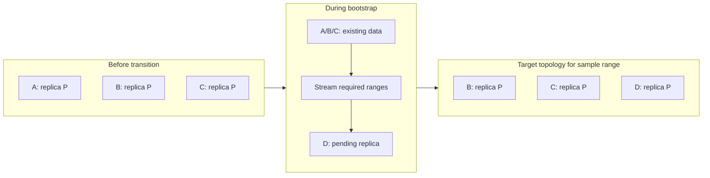
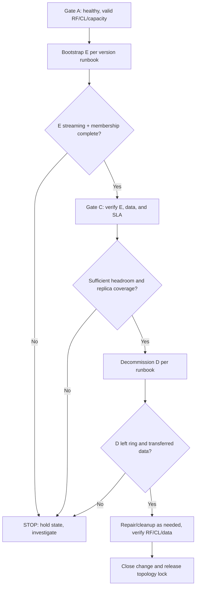

# Concurrent Topology Movements and Safety Conditions

In Apache Cassandra, **topology** is how nodes, tokens, and replicas are arranged across datacenters (DCs), racks, and failure domains. When adding a node (*bootstrap*), retiring a live node (*decommission*), replacing a failed node (*replace*), removing a lost node (*remove*), or moving token ownership (*move*, where config/version supports it), the cluster must transfer data across replicas. During that window, **the token ring is in transition**: old replicas, new replicas, and moving token ranges may all participate in serving reads and writes.

Things become much harder if **two topology changes run concurrently**, or if a deployment system triggers a second change before the first finishes. A node showing `UN` does not by itself prove data streamed completely or every partition meets the desired replication factor (RF). To protect data and availability, changes must be managed as **a bounded workflow with preconditions, monitoring signals, and acceptance criteria**.

This lesson belongs to the **Topology Changes** chapter in the **DATABASE_ENGINE_WIDE_COLUMN_CASSANDRA** module. It combines distributed architecture, partition keys, replica placement, CQL consistency levels, replication/streaming, compaction, repair, error handling, and Java connectivity to answer: **when is a topology movement safe, and why must you never automatically launch the next movement merely because the first command was submitted?**

## 1. Learning Objectives

After this lesson, you will be able to:

1. Explain the difference between **current token ownership**, **pending replicas**, and **target ownership** during topology changes.
2. Distinguish bootstrap, decommission, remove, replace, move, and RF changes; identify dangerous concurrent combinations.
3. Assess **RF, consistency levels, node-loss tolerance, rack/DC, streaming capacity, and disk headroom** before changing topology.
4. Design **gates** to block subsequent operations when joining/leaving/moving, streaming/repair errors, or unconverged replicas exist.
5. Monitor with `nodetool status`, `ring`, `netstats`, logs, metrics, and verify CQL data.
6. Handle timeouts/unknown states, mid-bootstrap/decommission node disconnects, and safe Java retry planning.
7. Author a sequential node-transition runbook with acceptance evidence across tables, token ranges, and failure domains.

## 2. Foundational Concepts

### The Token Ring Is Not a Simple Node List

A partition key is hashed to yield a **token**. Replication strategy, RF, and DC/rack placement determine which nodes are **natural replicas** for a token range. Clusters using **virtual nodes (vnodes)** may assign many token ranges to a single node; thus adding/removing *one* node can alter ownership across **many ranges** scattered around the ring.

| Concept | Operational Meaning to Keep in Mind |
| --- | --- |
| **Natural replica** | Node chosen by the replication strategy to hold data for a partition in a given topology. |
| **Pending replica / pending range** | Replica or range preparing to receive ownership during a topology movement; accounted for when ensuring writes and data handoff. |
| **Bootstrap / joining** | New node enters the cluster, receives tokens, and streams required data before becoming a steady serving member. |
| **Leaving / decommission** | Live node proactively exits the ring; data and ownership must transfer per target topology. |
| **Moving** | Changing a node's token/position, where supported by token assignment and the specific version. |
| **Replace** | Using a new node to replace a failed node and assume its corresponding replica ranges; not adding an independent extra replica. |
| **Remove** | Purging metadata of a node that can no longer decommission; may require streaming from surviving replicas and ensuring no sole copy is lost. |
| **Streaming** | Transferring SSTables/data between nodes for bootstrap, decommission, replace, repair, or rebuild. |
| **Schema agreement / topology agreement** | Members must share consistent required metadata; topology coordination varies by version, especially Cassandra 5.x with **Cluster Metadata/TCM**. |

### "Concurrent" Takes Several Forms

1. **Two simultaneous membership movements**: e.g., two nodes bootstrapping together or one node decommissioning while another is being replaced.
2. **Movement + RF/DC topology change**: replica placement metadata shifts while token ranges are also shifting.
3. **Movement + heavy repair/streaming**: not two membership operations, yet both compete for network bandwidth, disk I/O, and SSTable state.
4. **Movement + third-node failure**: while bootstrap streams, a source node goes down, preventing completion or breaking quorum.
5. **Movement + application deployment**: client pools/token-aware routing lag behind topology updates, increasing timeouts and coordinator pressure.

**Do not conclude every Cassandra version permits or forbids the exact same command combinations in the same way.** Topology coordination mechanisms evolve across releases; Cassandra 5.x manages metadata/topology differently from older releases. The **safe operational rule** remains executing only one coordinated primary topology change at a time, waiting for completion evidence, and re-evaluating cluster health before starting the next—unless a workflow is explicitly proven for concurrency in version docs and real testing.

## 3. Ownership Movement Viewed from One Partition

Suppose `dc1` has RF = 3 and partition `P` initially lives on A, B, and C. Adding node D can give certain token ranges a **target** replica set different from before; not every partition moves. For one illustrative range, target topology may select B, C, and D.



This diagram illustrates **one token range**, not an exact ownership calculation from just four node names. Cassandra can stream from multiple source nodes, and how writes route to natural/pending endpoints during transitions depends on version and state. Never assume A can purge old data the instant D starts bootstrapping.

During transition:

- **Write routing** must account for replica/metadata state so mutations are not dropped while ownership shifts from source to destination. Exact guarantees depend on the running Cassandra protocol and consistency.
- **Read routing** and chosen replicas can shift, so read results from one coordinator/CL do not prove all nodes are synchronized.
- **Streaming data** consumes disk, network, and time; membership completion must not be equated with finished post-checks, repair, or cleanup.
- **Unexpected failures** while multiple ranges move concurrently can create operational blind spots: unclear which operation owns which range, which data sources remain valid, and what needs retrying.

Hence runbooks must govern both **cluster state** and **data coverage**.

## 4. Distinguishing Change Types and Risks

| Operation | When Used | How Data/Metadata Changes | Key Warning |
| --- | --- | --- | --- |
| **Bootstrap** | Expand cluster with a new node | New node gets tokens and streams data for ranges it will own. | Until streaming finishes, do not treat the new node as steady capacity/replica. |
| **Decommission** | Proactively retire a **live node** | Node leaves ring, handing ownership/data to target replicas. | Must have enough capacity/RF after removal; never force-kill mid-transition. |
| **Replace** | Failed node needs replacement with a new node | New node assumes old node's role/token ownership per version procedure. | Never let old and new nodes share identity/address or serve concurrently by mistake. |
| **Remove** | Permanently failed node, cannot decommission | Drops old node membership, redistributes data from surviving replicas. | If the old node held the sole copy of unconverged data, remove cannot magically recover it. |
| **Move** | Change a node's token position | Ownership of affected ranges shifts. | Support depends on vnodes and version; not a universal command. |
| **Change RF** | Change replica count for keyspace/DC | Target replica placement changes; data must be redistributed per plan. | `ALTER KEYSPACE` does not prove streaming/repair met the new RF. |
| **Change snitch/rack/DC** | Alter failure domains/node location labels | Affects how NetworkTopologyStrategy selects replicas. | Highly sensitive; never tweak "for neatness" while streaming/repair or metadata are unsettled. |

### Non-Equivalent Substitutions

- **Decommission** is for a node healthy enough to leave the ring properly. For a permanently lost node, use **replace/remove** per documentation and data conditions.
- **Replace** is not **adding a normal node with a different IP** and hoping data picks up the old ownership; ensure the new node runs in the proper replacement role.
- **Remove** is not a fix for "a JOINING node taking a bit long": it can tangle membership state further. Check logs/phase and the version runbook.
- **Repair** is not a membership operation and does not replace bootstrap streaming; **cleanup** only reclaims unowned ranges **after** topology and target data are verified.

## 5. Concurrency Risk Matrix

| Concurrent Situation | Primary Risk | Handling Principle |
| --- | --- | --- |
| **Two bootstraps at once** | Multiple pending ranges, stream contention, constantly shifting data sources/routing. | Version/testing must explicitly support it; default to **sequential one-by-one** with acceptance checks between turns. |
| **Bootstrap + decommission** | Source/target ownership shift together; raises stream overlap and miscalculated capacity risk. | Avoid overlap; finish and stabilize bootstrap before retiring nodes. |
| **Decommission + remove dead node** | Retiring another replica while already short on sources; degrades quorum and stream sources. | Prioritize restoring RF/quorum and auditing surviving replicas before a second action. |
| **Replace + old node returns on its own** | Two identities or members fight for the old slot, reading/writing stale sources. | Fence/lock out old node per runbook; allow return only after resolving identity and membership. |
| **RF change + membership change** | Target replica count, token ownership, and actual data diverge. | Split into separate phases with repair/streaming and RF acceptance per phase. |
| **Topology change + full repair on same scope** | Disk/network and SSTable tasks contend; peers/ranges shift during validation/streaming. | Usually defer large repairs to steady state, unless required for recovery under a tested runbook. |
| **Topology change + heavy compaction/backup** | Shrinking disk headroom, saturated I/O, prolonged streaming and read/write tail latency. | Bound concurrency, schedule cleanly, keep headroom; never force major compaction. |
| **Topology change + third node goes down** | Lost quorum or missing stream sources, raising availability/data-loss risk. | Freeze all new changes, evaluate RF/CL health, and recover in proper order. |

**An operation automatically rejected with "operation already in progress" is a signal to investigate**, not an excuse to pass `force` to bypass the guard. Some commands offer forced options depending on version, but they require special runbooks and data-loss risk assessment.

## 6. RF, Consistency, and Failure Domains Come First

### Quorum by Replica Count in One DC

With `NetworkTopologyStrategy` and **RF = 3 in dc1**, `LOCAL_QUORUM` requires:

```text
quorum = floor(RF / 2) + 1 = floor(3 / 2) + 1 = 2

RF=3, LOCAL_ONE    -> requires 1 matching replica to respond.
RF=3, LOCAL_QUORUM -> requires 2 replicas in dc1 to respond.
RF=3, ALL          -> requires all 3 replicas in query scope.
```

**Quorum does not equal total cluster UP nodes.** If an UP node is not a replica for the queried partition, it cannot substitute for a required replica response. When changing topology, evaluate **each keyspace/DC and token range**; counting "4 UP nodes left" does not guarantee every partition has 2 available replicas.

### Counterexample: Retiring a Node When RF Becomes Unachievable

A DC has only **three nodes** with RF = 3. If you decommission one node without adding capacity, the DC has only two nodes left to store three distinct copies. It can no longer satisfy **three replicas on three separate nodes** as before. Even if some SELECTs still respond, that does not prove the target topology is valid.

A more appropriate workflow:

1. Add a new node in the approved DC/rack with validated placement and capacity.
2. Wait for bootstrap, streaming, and post-checks to complete.
3. Confirm RF, replica coverage, disk usage, and read/write SLAs stabilize.
4. Only then begin decommissioning the old node.
5. Re-verify and run post-change cleanup once safe.

### Failure Domains Cannot Be Ignored

Three replicas on three nodes in **the exact same rack/AZ** do not provide the rack/AZ fault tolerance of three replicas spread across independent failure domains. Inspect snitch, DC/rack labels, placement, and config uniformity across nodes. Token arrangement does not substitute for rack-aware replication design.

With multiple DCs, `LOCAL_QUORUM` checks quorum only in the request's local DC; another disconnected DC can keep falling behind. Never turn a single-DC bootstrap/failover success into a "globally synchronized" claim.

## 7. Three Safety Gates: Before, During, and After Every Movement

### Gate A — Before Starting

| Must Confirm | Minimum Evidence |
| --- | --- |
| **No other topology movement active** | `nodetool status/ring`, logs/metadata, and orchestrators show no unresolved joining/leaving/moving/removing. |
| **Cluster metadata in agreement** | Check metadata/schema state per version mechanism; no DC/rack/token drift or unfinished membership tasks. |
| **RF/CL remains viable post-change** | Per-keyspace/DC analysis, replicas per failure domain, quorum math under one extra failure. |
| **Data has surviving sources** | Identify replicas holding ranges to stream; never delete/retire the sole source before recovery. |
| **Disk capacity and network speed suffice** | Free disk, estimated stream + compaction overhead, headroom for errors/retries. |
| **Application load within bounds** | Read/write p95/p99, timeouts, GC, disk latency, and streaming/compaction backlog within agreed limits. |
| **Backups/repair and runbook ready** | Latest repair status, valid backups, halt/recovery plan if failure hits. |
| **Target node properly configured** | Cluster name, DC/rack, seeds, auth, version, config, address/identity matching intended operation. |

Never use **"every node is UN"** as the sole gate. It says nothing about data consistency, streamability from valid sources, disk headroom, or post-change RF config.

### Gate B — During Movement

1. **Lock topology change scheduling** in your orchestrator/change management; prevent other workflows from issuing concurrent bootstrap/decommission/replace/remove commands.
2. Monitor node states and metadata, streaming, CPU/GC, disk/network, compaction, timeouts/availability, and data protection on critical partitions.
3. Watch **streaming sources and destinations**. If a source node goes down, destination disk nears full, or streams error out, stop **launching any further operations** and classify the failure before intervening.
4. Keep application retries **idempotent**; never downgrade consistency just to "make it pass" while a replica is temporarily short.
5. Record run ID, commands, version, affected nodes/token ranges, start/end times, logs/metrics, owner, and any unplanned events.

### Gate C — After Completion

- New/target node is in the appropriate **Normal** state, departed node is cleanly absent from membership, and topology metadata is consistent.
- No **pending topology transitions or failed streams** remain for the executed work; final status in orchestrators and logs is unambiguous.
- Evaluate **replica coverage/RF** for the target scope, not merely counting UP nodes.
- Test reads/writes on representative partitions at approved CLs; verify convergence via repair/hints/streaming and required token ranges.
- Disk usage, SSTable/compaction backlog, GC, read/write p95/p99, and timeouts have returned to steady thresholds.
- If post-change **repair/cleanup** is required, finish per version-specific runbook before declaring the entire operational phase closed.
- Produce a completion record; mark any unchecked ranges/nodes as **INCOMPLETE**, never default to SUCCESS.

**If any gate fails, never automatically advance to the next step.** Document the exact reason, impacted scope, and recovery plan or halt at a defined safe state.

## 8. Illustrative CQL: Partition Keys and Acceptance Data

Moving nodes/tokens is performed by operational tools, **not CQL ALTER TABLE**. CQL is useful for validating data across known partitions before and after changes.

Example keyspace for a **lab** with datacenter `dc1`, at least three nodes, NetworkTopologyStrategy, and RF = 3:

```sql
CREATE KEYSPACE IF NOT EXISTS topology_lab
WITH replication = {
  'class': 'NetworkTopologyStrategy',
  'dc1': 3
}
AND durable_writes = true;

CREATE TABLE IF NOT EXISTS topology_lab.events_by_tenant_day (
  tenant_id text,
  event_day date,
  event_id uuid,
  event_type text,
  PRIMARY KEY ((tenant_id, event_day), event_id)
);

CONSISTENCY LOCAL_QUORUM;

INSERT INTO topology_lab.events_by_tenant_day
  (tenant_id, event_day, event_id, event_type)
VALUES ('tenant-lab', '2026-11-21',
        11111111-1111-4111-8111-111111111111,
        'baseline-before-topology-change');

SELECT event_id, event_type
FROM topology_lab.events_by_tenant_day
WHERE tenant_id = 'tenant-lab'
  AND event_day = '2026-11-21';
```

**Why use fixed keys?** When running test writes post-movement and retries hit timeouts, reusing the same `event_id` lets you reconcile one exact mutation rather than generating multiple rows with fresh `now()`/UUIDs on each attempt. Business applications also need proper idempotency if external side effects exist outside Cassandra.

**Testing limitation:** a correct read at `LOCAL_QUORUM` **does not prove every replica across all token ranges is synchronized**. Reconcile data across **multiple representative partitions/token ranges**, streaming/repair logs, and placement metadata. For full verification, use version-appropriate tools and runbooks to inspect endpoint/token ranges instead of guessing from `tenant_id`.

## 9. Commands for Observing Topology and Streaming

The following **read-only** commands can be run on each Cassandra node with proper admin access:

```bash
nodetool status
nodetool ring
nodetool describecluster
nodetool netstats
nodetool compactionstats
nodetool tpstats
nodetool info
```

| Tool | What It Shows | What It Cannot Replace |
| --- | --- | --- |
| `status` | UP/DOWN and Normal/Joining/Leaving/Moving when displayed; DC/rack/load/tokens. | Insufficient to confirm streaming, RF coverage, and data convergence. |
| `ring` | Token/ownership info and node presence around the ring. | Not an acceptance record per stream/range. |
| `describecluster` | Cluster metadata/schema versions depending on release. | Does not prove topology transition or all SSTables finished moving. |
| `netstats` | Active streaming transfers; mode depends on release. | Completed streams may disappear; requires historical logs/metrics. |
| `compactionstats` | Pending/running compactions, SSTable/repair pressure. | 0 pending does not equal completed membership transition. |
| `tpstats` | Executor/queues and internal processing pressure. | Does not directly prove data accuracy. |
| `info` | Node status/internal metrics. | Does not replace cluster-wide operational logs. |

In Cassandra status output, common codes are **UN = Up/Normal**, **UJ = Up/Joining**, **UL = Up/Leaving**, **UM = Up/Moving**; exact formatting depends on version/command. A node showing **UN** post-bootstrap may satisfy only part of Gate C; still check streaming errors, repair/handoff, and service stability. If two tools show conflicting states, halt automation and inspect version-specific logs/metadata.

### When Additional Errors Appear

- **Streaming stalls**: check both sender and receiver, network links, backlog, full disks, token ranges, and connection errors.
- **SSTables/compaction spike**: streaming creates new files and triggers compaction; preserve headroom and never force major compaction "to clean up fast".
- **Read/write timeouts rise**: identify partition/CL/DC instead of just raising timeouts or lowering CL. With two replicas left at RF3, one more failure can make `LOCAL_QUORUM` unavailable.
- **Schema/metadata drift**: pause token/rack/RF changes; resolve metadata and schema agreement first.
- **Ambiguous streaming status**: distinguish `100%` progress on one stream from **completion of the entire topology operation**.

## 10. Safe Sequential Schedule Example: Add Node Then Retire Node

Lab scenario: `dc1` has four nodes A/B/C/D, RF = 3, and we want to replace D with E without reducing serving node count during the main phase. D is alive and healthy enough to decommission. Each step below is a **gate**, not blindly chained commands:



**Recommended procedure:**

1. Capture baseline: topology, DC/rack, RF, CPU/disk ratios, p99, repairs/backups, critical partitions.
2. Confirm E uses **valid cluster identity, compatible version, rack/DC, network/security**, and the release's bootstrap procedure. Never copy D's data directory/system keyspace to E unless required by a runbook with verified identity rules.
3. Let **E** join/stream **alone**; do not concurrently decommission D or edit RF.
4. Watch E reach Normal with zero stream errors; verify disk usage, placement, and sample data in ranges E received.
5. Let the cluster stabilize with enough capacity and quorum for **D** to leave. Use **decommission** since D is alive, following exact version documentation.
6. Once D exits completely, verify node membership, replica coverage, data, and p95/p99; run **cleanup** on nodes retaining unowned ranges at the right time per runbook.
7. Ensure required repair/convergence within change scope finishes before closing the ticket; schedule post-change incident watch.

**Dangerous** command example, executed ONLY on **live node D in the lab** after Gate A/B/C and runbook checks:

```bash
# Syntax learning only: run on the exact node D needing to leave the ring.
nodetool decommission
```

Never run this on a production node merely because it appears in this lesson. It is not a read-only check and alters data ownership. For a permanently lost node D, follow a **dedicated replace/remove scenario** rather than standard decommission.

## 11. Failure Scenario: Mid-Bootstrap Failure While Operator Wants to Replace Another Node

Suppose node E is Joining and still streaming ranges from B/C. Right then B loses connectivity. Another automation sees "B down" and prepares to replace B, while a scheduler tries to decommission D.

| Decision | Outcome / Risk |
| --- | --- |
| Proceed to replace B and decommission D now | Risks starving streaming sources/quorum; overlapping ownership shifts become hard to recover. |
| Force E to Normal because SSTable files exist | Does not guarantee all token ranges/metadata finished; risks data gaps. |
| Downgrade `LOCAL_QUORUM` to `ONE` to bypass errors | Weakens application data/consistency guarantees without fixing missing replicas or failed streams. |
| **Lock new operations, assess health, and finish/recover the first movement per runbook** | Keeps incident scope investigable and avoids further reducing available replicas. |

### Controlled Incident Response Procedure

1. **Halt issuing new topology operations**; record exact commands, parent operation/transition IDs, and states of E, B, and D.
2. Collect `nodetool status/ring/netstats`, logs from E/B/C, keyspace RFs and CLs; identify token ranges missing sources.
3. Distinguish a transient disconnect on B from permanent loss. Never decide `replace`/`remove` for a node that could return without identity fencing.
4. If the version natively supports resume/cancel, use **the exact official mechanism**, preserving logs and data. Never delete data directories, SSTables, or manually edit tokens to "unstick" it.
5. Once topology reaches a clear terminal state, verify replica placement and scoped repair/hints; **only then** open the gate for the next operation.
6. If replicas are insufficient for committed CLs, trigger dedicated availability/incident procedures rather than stacking more topology changes.

**There is no universal "force resume" command across all Cassandra releases.** Cassandra 5.x and older lines differ in metadata management; recovery steps must consult the exact version/runbook, never guessing subcommand names or chaining recovery actions in a blind script.

## 12. Changing RF or DC/Rack: A Separate Phase

For example, a keyspace previously had `dc1: 3` and needs `dc2: 3` added. Changing the replication map via CQL is a **declarative change**; it does not mean data has been placed across all new replicas.

```sql
-- Illustrative syntax. Do not run in production without a plan.
ALTER KEYSPACE topology_lab
WITH replication = {
  'class': 'NetworkTopologyStrategy',
  'dc1': 3,
  'dc2': 3
};
```

Before changing:

1. Ensure `dc2` already has sufficient nodes/racks joined **stably** into the cluster per runbook.
2. Verify inter-DC networking, access controls, snitch/DC labels, versions, and streaming capacity.
3. Execute `ALTER KEYSPACE` as its own phase, then run **rebuild/repair/streaming** steps to populate new replicas per version docs.
4. Verify data in the new DC, actual RF/CL, post-checks, and Java driver readiness.
5. Only after acceptance, open corresponding traffic/CLs or proceed to decommission/replace/rack changes.

**Adjusting RF must never be treated as a hotfix when a bootstrap is stuck.** Running them concurrently changes both target sets and sync mechanics while data sources are already moving.

## 13. Java Applications During Topology Changes

Java Driver 4.x uses topology/metadata, routing, and load-balancing to pick coordinators; **local datacenter** config is critical in multi-DC clusters. Membership changes can require the driver to update its endpoint/routing lists. Applications must handle network errors/timeouts without trying to "help Cassandra" by editing tokens or writing directly to specific replicas.

Example partition-key read in Java Driver 4.x:

```java
import java.time.LocalDate;
import com.datastax.oss.driver.api.core.ConsistencyLevel;
import com.datastax.oss.driver.api.core.cql.PreparedStatement;
import com.datastax.oss.driver.api.core.cql.BoundStatement;
import com.datastax.oss.driver.api.core.cql.ResultSet;
import com.datastax.oss.driver.api.core.cql.Row;

PreparedStatement select = session.prepare(
    "SELECT event_id, event_type FROM topology_lab.events_by_tenant_day " +
    "WHERE tenant_id = ? AND event_day = ?");

BoundStatement query = select.bind(
        "tenant-lab", LocalDate.of(2026, 11, 21))
    .setConsistencyLevel(ConsistencyLevel.LOCAL_QUORUM);

ResultSet result = session.execute(query);
for (Row row : result) {
    // Log expected event_id, latency, and exceptions by operation ID.
}
```

### Retrying When Coordinators or Replicas Shift State

- **Read timeout**: bounded retries if business logic tolerates them; inspect replica availability and CL first. Unlimited retries worsen congestion on streaming nodes.
- **Write timeout**: does not mean the mutation was not written; keep **the same primary key, payload, and idempotency key** across retries. Never generate a fresh UUID per retry of the same event.
- **Counters, LWT, and side effects**: never mark non-idempotent business operations as idempotent; handle unknown results/reconciliation per their protocols.
- **Local DC**: never assume the driver auto-fails over DCs or lowers consistency when a coordinator drops. Cross-DC failover requires an explicitly designed consistency policy and scope.
- **Observability**: log topology version/change ID, DC/endpoint when available, error type, retry count, and read/write latency. Avoid launching extra bulk loads while the cluster lacks headroom.

An application returning a right `SELECT` during bootstrap is a good sign for **that single query path**, not proof that the topology movement finished across all ranges.

## 14. Acceptance by Scope and Evidence

A change log should treat each topology operation as a **tracked change ID** with multiple gates:

| Field | What to Record |
| --- | --- |
| `change_id` | Unique ID assigned by ops; operation type (bootstrap/decommission/replace/remove/RF change). |
| `version/tooling` | Cassandra version, nodetool/distribution, and exact flags used. |
| `before/after topology` | DC/rack/node/token ownership, RF of each critical keyspace. |
| `scope` | Source/destination nodes, affected ranges, tables/keyspaces, failure domains. |
| `preflight` | Node health, repair/backups, disk/network headroom, SLAs, and baseline snapshot. |
| `transition evidence` | Logs, command outcome, topology/metadata status, streaming completion. |
| `data validation` | Pre/post sample partitions, token range coverage, required hints/repair. |
| `postflight` | Quorum/availability, p95/p99, disk, GC, backlog, remaining errors. |
| `final status` | `COMPLETED / INCOMPLETE / FAILED / UNKNOWN` and approver. |

### Illustrative Report Template

```text
CHANGE: topology-lab-2026-11-21-01
ACTION: bootstrap E, dc1
BASELINE: A/B/C/D Normal, RF=3, LOCAL_QUORUM healthy
TRANSITION: E joined; streams tracked across required ranges
RESULT: command reported success, E Normal
CHECKS: token/replica placement PASS; validation keys PASS
METRICS: read/write p99 within agreed threshold; disk headroom PASS
POST-ACTIONS: cleanup/repair according to runbook completed or tracked
FINAL: COMPLETED
NEXT GATE: decommission D may be scheduled after independent preflight
```

This is a **self-designed audit template**, not automatic Cassandra output. Never mark `COMPLETED` when only "node up" was observed without streaming/topology/data validation or while unresolved errors remain.

## 15. Practice Exercises and Scenario Questions

### Exercise A — Safety Matrix

Given a DC with four nodes, RF = 3, and `LOCAL_QUORUM` writes. The operator plans to add E while retiring D and changing C's rack label.

Build a table covering:

1. Replica sets/failure domains and token ranges potentially affected.
2. Operations that must be sequential and criteria to open the next gate.
3. Quorum loss risk if a streaming node suddenly goes down.
4. Metrics to measure and how to verify data placement after each phase.

**Expectation:** do not collapse those three changes into one "parallel deployment to save time".

### Exercise B — Incomplete Bootstrap

Node E shows Joining, and `netstats` shows streams still running. Node B, a stream source, loses connectivity; the scheduler proposes replacing B.

Explain why **freezing all new topology operations**, collecting E/B logs, evaluating RF/CL, and recovering per runbook is safer than starting replace concurrently. List three pieces of evidence required before reopening the schedule.

### Exercise C — Quorum Is Not Total UP Nodes

Two DCs have RF `dc1:3, dc2:3`. A partition in dc1 is missing one replica; `LOCAL_QUORUM` needs two responses. Show what happens if another replica in dc1 fails during decommission/streaming, even while dc2 has three UN nodes. Contrast `LOCAL_QUORUM` with cross-DC consistency strategies.

### Exercise D — RF Changed Before Data Arrived

A team just ran `ALTER KEYSPACE` adding `dc2:3` and immediately switched apps to read in dc2. Reads return missing data; the team wants to lower consistency and continue decommissioning a node in dc1.

Identify the **plan flaw**: new RF metadata does not prove data was populated/repaired in dc2. Design the sequence of steps and checks needed before shifting traffic.

### Exercise E — Performance Graph Review

During bootstrap, read p99 climbs from normal to high, disk utilization nears full, pending compactions grow, and streams barely progress. Provide likely causes and a safe load-shedding/recovery plan. **Do not** propose major compaction, infinite timeouts, or running another bootstrap as a "quick fix".

### Passing Criteria

A plan is considered safe enough when the learner provides:

1. **Change scope map**: nodes, tokens/ranges, RF, DC/rack, and source/destination data.
2. **Start preconditions**: healthy cluster, no other movements, sufficient quorum/capacity/disk/network.
3. **Completion criteria**: evidence for membership/metadata, streaming, replica coverage, and verification queries.
4. **Failure fallback**: lock new topology changes, diagnose incomplete state, follow version-supported recovery, never manually delete/edit SSTables or tokens.

## 16. Self-Check Questions

1. Why is seeing all `UN` in `nodetool status` insufficient to prove a bootstrap is data-complete?
2. How does a pending replica differ from a natural replica in the final topology?
3. Why should you not decommission a node when a DC has RF = 3 and only three available nodes remain?
4. When changing `RF` in a keyspace, does `ALTER KEYSPACE` copy all data immediately on its own?
5. Contrast replacing a dead node vs. decommissioning a live node.
6. Why can bootstrap + heavy repair/compaction stall streaming even when topology syntax is valid?
7. If an old node returns after replacement, what are the identity/ownership risks?
8. Does one `SELECT` returning the right row prove all token ranges have converged?
9. Why must you record the Cassandra version before picking a recovery command for a stuck topology change?
10. What three gates would you design so automation never starts a second topology change before the first is accepted?

## 17. Further Reading by Version

- [Apache Cassandra documentation](https://cassandra.apache.org/doc/latest/): select your **exact version** and consult Operating Cassandra / topology changes, bootstrap, decommission, replace, and remove.
- [Apache Cassandra — Architecture](https://cassandra.apache.org/doc/latest/cassandra/architecture/): token ring, partitioning, NetworkTopologyStrategy, and read/write paths across replicas.
- [Apache Cassandra — nodetool](https://cassandra.apache.org/doc/latest/cassandra/managing/tools/nodetool/): syntax for `status`, `ring`, `netstats`, `decommission`, and supported operational commands.
- [Apache Cassandra — Repair](https://cassandra.apache.org/doc/latest/cassandra/managing/operating/repair.html): scope and limits of repair after replica/topology changes.
- [Apache Cassandra — CQL](https://cassandra.apache.org/doc/latest/cassandra/developing/cql/): keyspace replication, primary keys, CL, and acceptance data.

**Remember:** a topology movement is **a change in live data ownership**, not merely an add/remove-host command. Even though newer Cassandra versions coordinate metadata better, running multiple concurrent movements still makes streaming, quorum, capacity, and recovery hard to control. Design workflows as **one coordinated movement → observe → verify data/replicas/SLAs → accept → only then open the next movement**; whenever state is UNKNOWN, the safest first rule is **do not issue further topology changes**.
