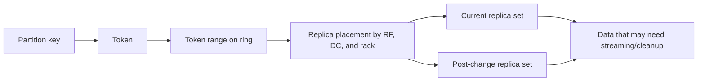
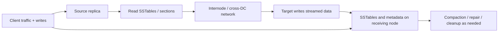

# Storage Redistribution, Streaming Network, and Temporary Space Requirements

> **Chapter:** Topology Changes  
> **Module:** `DATABASE_ENGINE_WIDE_COLUMN_CASSANDRA` — Apache Cassandra, a distributed wide-column database.  
> **Focus:** Estimating data movement, streaming bandwidth, and disk space **throughout** adding, removing, or replacing nodes; building operational and testing plans before changing production topology.

Cassandra divides partitions into **token ranges**, distributing them across nodes according to the partitioner and replication strategy. When changing topology, the cluster must alter **the responsible replica set** for many token ranges. Thus "adding a node to reduce disk load" is not just racking a new server: replicas must stream data to new owners, old nodes may temporarily retain unowned copies, compaction/repair generate I/O, and data does not balance instantaneously.

Three tightly coupled problems arise:

1. **Storage redistribution:** After a topology change, how many bytes must each node/DC hold, and will skew/hotspots occur?
2. **Streaming network:** How many bytes must travel over which network links; what is the effective speed while still serving reads/writes?
3. **Temporary disk space:** During the transition, input SSTables, compaction outputs, snapshots, commit logs, indexes, and un-cleaned old data may **coexist**; how much free space is needed to avoid hitting disk-full?

**Core lesson:** Calculating storage *after rebalancing* is not enough. You must budget for **peak storage and peak I/O during the transition**, with safety margins and completion criteria.

## 1. Learning Objectives

After studying this lesson, you will be able to:

- Explain how partition keys, tokens/vnodes, RF, and DC/rack topology drive data re-streaming.
- Distinguish **bootstrap**, **decommission**, **remove dead node**, **replace**, and RF changes.
- Calculate estimated average storage before/after changing node count and spot the limits of averages.
- Build a budget for **network ingress/egress, disk read/write, compaction, repair, and free space**.
- Estimate streaming duration from **effective throughput**, not nominal 10/25 GbE NIC ratings.
- Monitor `nodetool status`, `netstats`, `compactionstats`, `tablestats`, and client metrics.
- Create a preflight → streaming → post-verification runbook, knowing when to pause/isolate nodes without corrupting data.
- Connect back to query-driven table design, consistency levels, CQL, and Java Driver behavior during topology changes.

## 2. Data Model and Foundational Concepts

### 2.1. Which Replicas Own a Token Range?

Cassandra uses the partition key to compute a token. With the configured replication strategy, the token ring determines a partition's replica set. **RF (replication factor)** is the desired number of copies within the corresponding datacenter, not an extra byte multiplier added to *every* node.

Example events table:

```sql
-- Use ONLY in a lab with a datacenter named dc1 and enough nodes for RF=3.
CREATE KEYSPACE IF NOT EXISTS lab_topology
WITH replication = {
    'class': 'NetworkTopologyStrategy',
    'dc1': 3
};

CREATE TABLE IF NOT EXISTS lab_topology.events_by_tenant_day (
    tenant_id uuid,
    event_day date,
    event_time timestamp,
    event_id timeuuid,
    event_type text,
    payload text,
    PRIMARY KEY ((tenant_id, event_day), event_time, event_id)
) WITH CLUSTERING ORDER BY (event_time DESC, event_id DESC);
```

All rows sharing `(tenant_id, event_day)` belong to **one partition** and share the same token. Columns `event_time` and `event_id` govern ordering within the partition and do not affect replica placement.

A query matching the read path:

```sql
SELECT event_time, event_id, event_type
FROM lab_topology.events_by_tenant_day
WHERE tenant_id = 11111111-1111-1111-1111-111111111111
  AND event_day = '2026-11-21'
LIMIT 50;
```

Supplying the full partition key enables token-aware routing by the coordinator/driver. Yet while **topology is changing**, replica placement metadata, streaming, and node availability are also shifting; therefore monitor the driver/nodes instead of assuming every query keeps its prior latency.

### 2.2. Vnodes and the Difference Between a "Node" and a "Token Range"

With **virtual nodes (vnodes)**, a node can own multiple tokens and hold replicas for many non-contiguous intervals. Adding or removing a single node can change replica sets for many ranges.



**Never confuse "a node has 100 tokens" with "a node stores 100 equal slices".** Storage distribution also depends on per-partition byte size, token density, compaction, indexes, dead data/tombstones, TTLs, and tenant skew.

### 2.3. Four Core Topology Operations

| Operation | What Changes | Typical Data Movement Direction |
|---|---|---|
| **Bootstrap** new node | New node assumes a share of replica ownership | Healthy replicas stream SSTables/ranges to the new node |
| **Decommission** live node | Node exits ring gracefully; ownership shifts to remaining nodes | Leaving node and/or other replicas supply needed data to new replicas |
| **Remove dead node** | Removes an unserviceable node from the ring | Surviving nodes rebuild/stream data to restore RF when healthy sources exist |
| **Replace** failed node | New node takes over the old node's responsibilities | Replacement node bootstraps/streams corresponding data from healthy replicas |

**Changing RF** (e.g., increasing RF in a DC) is a different problem: total target replicas change, potentially requiring a separate data-population procedure after schema update. Do not treat raising/lowering RF as simply adding or removing nodes.

## 3. Steady-State Storage Estimation Formulas

### 3.1. Pick Units and Scope First

To simplify calculations, define:

- \(L\): total size of *one logical copy of live data*, converted to **equivalent stored bytes** under active compression/encoding (GiB). Excludes replica multiplier.
- \(r\): desired full replicas in the datacenter under consideration.
- \(N\): number of healthy data nodes in that datacenter able to share planned ownership.
- \(D_{\text{steady}}\): live replica bytes **per node on average**, before adding tombstones, stale versions, indexes, snapshots, commit logs, and temporary files.

Assuming nearly even replica sizes, no special transient replication, and considering **one DC**:

\[
D_{\text{steady}} \approx \frac{L \times r}{N}
\]

If the cluster spans multiple DCs, calculate each DC separately using **that DC's own RF and N**. Never sum all nodes across DCs and divide data by a single RF.

**This is a capacity approximation**, not a replica-selection algorithm or exact streaming byte count. Partition size skew and placement rules can push individual nodes well above the average.

### 3.2. Example: Adding One Node, from 6 to 7 Nodes

Suppose in `dc1`:

- Single-copy equivalent live data: \(L=1200\ \text{GiB}\).
- RF in DC: \(r=3\).
- Initial node count: \(N_0=6\).
- Post-bootstrap node count: \(N_1=7\).
- Each node has **usable filesystem capacity** \(C=1024\ \text{GiB}\).

Estimated total replicated live data:

\[
D_{\text{DC,live}}=1200\times3=3600\ \text{GiB}
\]

Before adding:

\[
D_{\text{old,avg}}=\frac{3600}{6}=600\ \text{GiB/node}
\]

After adding (idealized):

\[
D_{\text{new,avg}}=\frac{3600}{7}\approx514.3\ \text{GiB/node}
\]

**Ideal average reduction per old node**:

\[
\Delta_{\text{old,ideal}}=600-514.3\approx85.7\ \text{GiB}
\]

The new node must receive roughly **514.3 GiB** of live data under perfect balance.

| Metric | 6 Nodes (Before) | 7 Nodes (After, Ideal) |
|---|---:|---:|
| Total DC live replicas | 3,600 GiB | 3,600 GiB |
| Average live/node | 600 GiB | 514.3 GiB |
| Live / 1,024 GiB ratio | 58.6% | 50.2% |
| Total nodes | 6 | 7 |

**These numbers are not exact forecasts of streaming bytes or immediate disk usage.** New token ownership may skew, replicas may not be identical, SSTable files overlap, and senders may read/stream more than net final growth.

### 3.3. Why Do Old Nodes Not Immediately Drop by 85.7 GiB?

An old node may **still retain SSTables containing ranges for which it is no longer a replica** post-bootstrap. Cassandra provides a `cleanup` procedure to remove unowned data once the ring stabilizes.

Therefore distinguish:

- **New ownership:** ring metadata has changed.
- **Streamed data:** receiving node has obtained needed replicas.
- **Disk reduced:** unowned files were removed via cleanup/compaction when appropriate, old snapshots do not pin blocks, and the filesystem freed the bytes.

Before cleanup, old nodes may still use nearly 600 GiB or more due to temporary files and new writes. **Never promise ops that adding a node will instantly free 85.7 GiB on every old node.**

### 3.4. Skew: The Average Is Not the Heaviest Node

With a very large tenant, hot partition, varying tombstone counts, or token imbalance, one node can be heavier than average.

Estimate with a skew factor purely for **stress testing**:

\[
D_{\text{max,estimate}} = D_{\text{avg}}\times k_{\text{skew}}
\]

Given a 514.3 GiB target average:

| Assumed Factor | Estimated Heaviest Node |
|---|---:|
| \(k=1.00\) | 514.3 GiB |
| \(k=1.20\) | 617.2 GiB |
| \(k=1.40\) | 720.0 GiB |

`k` **is not a default Cassandra constant**. Derive it from observed ownership, `Load`, per-table bytes, top partitions, and actual workload. If one huge/hot partition cannot be split by tokens, adding nodes will not cure that hotspot. You then need **query-driven partition/bucketing redesign**, not merely more nodes.

## 4. Estimating Data Movement: Net Change Differs from Actual Traffic

### 4.1. Lower Bound Under Balanced Model

In the 6 → 7 node scenario:

- The new node at steady target needs roughly **514.3 GiB** of live data under ideal assumptions.
- That is the **bootstrap data scale**, not an assertion that NICs will transmit exactly 514.3 GiB.
- Old nodes drop roughly 514.3 GiB of net live ownership combined, yet **they do not automatically free those bytes right away**.
- Actual streaming can involve multiple senders, retries, metadata, SSTable sections, compression effects, and concurrent incoming mutations.

In practice, total job network traffic depends on moved token ranges, replica placement, source selection strategy, pre-existing data, SSTable format, and transfer errors. Never deduce exact bytes from \(Lr/N\).

### 4.2. Add Node, Remove Node, and Replace Differ

**Add node:** the new node receives data from healthy replicas. Other nodes keep taking writes, retain old copies, wait for ring stability, and only then clean up unowned slices.

**Decommission:** the leaving node hands responsibility to target replicas. With unchanged RF, **remaining nodes must store more data**; a major risk is target disks filling up mid-stream before the old node finishes leaving. The leaving node must remain alive/healthy until the process completes.

**Remove dead node:** differs from decommission because that node **cannot stream its data**. The cluster must rely on surviving healthy replicas; if data existed only on the dead node with no other source/backup, no streaming algorithm can conjure it out of thin air.

**Replace:** the new node assumes the failed node's responsibilities; initial storage may need to hold roughly the old node's replica share. Typically **there is no capacity-relief benefit on surviving nodes** like in a scale-out.

### 4.3. Example: Removing One Node, from 6 to 5 Nodes

With the same assumptions \(L=1200\) GiB and RF=3:

\[
D_{\text{after,avg}}=\frac{3600}{5}=720\ \text{GiB/node}
\]

Compared to before (600 GiB), each surviving node must absorb **an average of 120 GiB more live replicas** assuming perfect balance.

| Metric | Before: 6 Nodes | After: 5 Nodes |
|---|---:|---:|
| Average live/node | 600 GiB | 720 GiB |
| Live / 1,024 GiB ratio | 58.6% | 70.3% |
| Net increase per surviving node (ideal) | — | +120 GiB |

70.3% at **steady state** still excludes tombstones, indexes, snapshots, compaction output, and skew. If internal policy demands larger headroom, shrinking nodes may be **unsafe even if RF still fits**.

Each destination node may also need extra room for **incoming streams and concurrent compaction**. Never look at 120 GiB and claim exactly 120 GiB of free space is enough.

## 5. Which Resources Does Streaming Traverse?

### 5.1. More Than NIC Bandwidth



A streaming flow must pass multiple bottlenecks:

- **Source disk read:** reading SSTables can compete with client reads and compaction.
- **Internode network:** NICs, switches, rack uplinks, firewalls/TLS, packet loss, per-peer limits, and QoS.
- **Target disk write:** writing received files can compete with commit log/flush/compaction.
- **CPU/compression/checksums:** transfer processing and reads/writes consume CPU.
- **Subsequent repair/compaction:** merely receiving bytes does not mean the node is instantly healthy with zero backlog.
- **Existing traffic:** app reads/writes, hints, CDC, backups, and other streams still consume resources.

**Effective throughput** is dictated by the real bottleneck, not the "10 Gbps NIC" on a server spec sheet.

### 5.2. Estimating Minimum Time from Bytes and Throughput

Define:

- \(B_{\text{move}}\): GiB to transfer along **one measured path** (e.g., total inbound to the new node).
- \(v_{\text{eff}}\): measured **effective aggregate** MiB/s on that path, after reserving client capacity.
- \(T_{\text{transfer}}\): data transfer seconds, excluding prep, retries, topology changes, compaction, or post-checks.

\[
T_{\text{transfer}}\approx\frac{B_{\text{move}}\times1024}{v_{\text{eff}}}
\]

Example: new node needs roughly **514 GiB** with **80 MiB/s** effective inbound throughput:

\[
T\approx\frac{514\times1024}{80}
=6579\ \text{seconds}\approx1.83\ \text{hours}
\]

**This is an ideal estimate for byte transfer alone**, not a guaranteed bootstrap completion time. If throughput dips, retries fire, or actual bytes are larger, duration grows. Add buffers for prep, stream setup, indexes/compaction, and membership verification steps.

### 5.3. Bottleneck Diagnosis Formula

Under a simple model:

\[
v_{\text{eff}}\lesssim\min(
v_{\text{source-read}},
v_{\text{network-usable}},
v_{\text{target-write}},
v_{\text{configured-limit}}
)
\]

With multiple senders, examine **aggregate resources on the destination node** and shared links. One destination can receive from A/B/C simultaneously, so total inbound may cap throughput even while each source has spare network. A shared rack/DC uplink can also saturate when summing multiple sessions.

When measuring, compare **byte rate over time** (MiB/s) against actual disk I/O and NIC stats—do not rely only on percentage progress in `netstats`.

### 5.4. Intra-DC vs. Inter-DC Networking

In a multi-DC cluster:

- Replication strategy assigns RF per DC.
- Adding a node in DC1 does not alter DC2's live data distribution using a two-DC combined node total.
- Repair/streaming/hints may generate cross-DC traffic depending on topology and version, so **measure rather than assume**.
- WAN/inter-DC links typically carry distinct latency, cost, and throttling limits.
- Calculate transfer time using **actually usable bandwidth during peak load**, not WAN circuit marketing names.

Changing RF and node count in the same window makes isolating causes and traffic very hard: plan separate phases whenever possible.

## 6. Disk Headroom: Budget for Peak Usage, Not Just Target State

### 6.1. Components That Must Be Counted

Budget model at any node:

\[
P_{\text{peak}}
\approx
D_{\text{existing}}
+ D_{\text{inbound}}
+ D_{\text{compaction-temp}}
+ D_{\text{other-temp}}
+ D_{\text{growth}}
- D_{\text{actually-reclaimed}}
\]

Where:

- \(D_{\text{existing}}\): **actual** disk occupancy of files/data (not just live bytes), including relevant indexes/tombstones.
- \(D_{\text{inbound}}\): incoming streamed bytes **before any deduction/deletion**.
- \(D_{\text{compaction-temp}}\): compaction outputs that may coexist alongside inputs.
- \(D_{\text{other-temp}}\): unshared snapshot blocks, repair/anti-compaction, index builds, spill/temp files, etc.
- \(D_{\text{growth}}\): new writes arriving during the topology change.
- \(D_{\text{actually-reclaimed}}\): bytes confirmed freed by the filesystem, **not** bytes "planned to be cleaned up later".

Ensure:

\[
P_{\text{peak}}+H_{\text{reserve}}<C_{\text{usable}}
\]

where \(C_{\text{usable}}\) is **truly usable** filesystem capacity and \(H_{\text{reserve}}\) is the organization's required operational reserve. No single reserve figure like 10%, 20%, or 30% fits all systems; it depends on workload, compaction strategy, SSTable sizes, failure budgets, and disk-pressure policies.

### 6.2. Why Does Temporary Disk Space Matter During Streaming?

**Compaction** in an LSM-tree reads multiple SSTables and writes new SSTables before inputs are dropped. With STCS, merging large files can require substantial temporary output. With LCS/UCS, multiple compaction groups can run concurrently. TWCS can retain older/expired-window SSTables and snapshots.

**Incremental repair** may use anti-compaction, impacting disk and I/O; post-bootstrap/replace repairs can raise space needs further. **Cleanup** may rewrite files/indexes to drop unowned data.

Temporary overhead therefore depends on **overlapping concurrent tasks**, not just incoming stream volume.

### 6.3. New Node Disk Budget Example

Continuing the 6 → 7 node case: ideal target **514.3 GiB live** on the new node, 1,024 GiB usable filesystem. Hypothetical plan:

| Component on New Node | Sample Capacity |
|---|---:|
| SSTables received to meet target ownership | 514 GiB |
| Peak compaction/repair/index/temp overhead | 110 GiB |
| Ongoing application write growth during transition | 20 GiB |
| Unusable reserve per internal policy | 180 GiB |
| **Total required budget** | **824 GiB** |

Under these assumptions, 1,024 GiB suffices: roughly **200 GiB margin beyond reserve**. Yet if actual data skews up to 720 GiB, **the same 110 + 20 + 180 = 310 GiB overhead** demands **1,030 GiB**, exceeding 1,024 GiB. The plan must then change: larger disks, different node sizing, lower peak concurrency after measurement, better token distribution, or fixing schema/hot partitions.

Numbers 110, 20, and 180 GiB are **budgeting examples only**, not Cassandra defaults.

### 6.4. Distinguish "Space Used" from "Live Useful Data"

When budgeting, inspect separately:

| Concept | What It Is Used For | What It Leaves Out |
|---|---|---|
| **Live data estimate** | Estimating steady-state replica storage | Excludes stale SSTables/tombstones |
| **SSTable disk used** | Measuring table file footprint | May exclude commit logs and filesystem reserves |
| **Total disk used** | Measuring true filesystem state | Does not distinguish data, snapshots, logs, temp |
| **Snapshots/hard links** | Detecting pinned blocks | Hard links do not double-count blocks sharing an inode |
| **Pending compactions** | Measuring work that triggers rewrites | Does not predict exact output bytes |
| **Stream bytes received** | Measuring data arrived at node | Does not guarantee cleanup/compaction finished |

Never use the `Load` column of `nodetool status` as the sole number for disk capacity planning. `Load` is a helpful indicator, yet can differ from actual filesystem footprint and does not account for full headroom.

## 7. Dedicated Plans for Each Topology Operation

### 7.1. Bootstrap: Adding a Node to Scale Out

**Before bootstrap:**

1. Confirm the new node's DC/rack and version; configure network, storage, snitch, seeds/contact points, and replication strategy matching the cluster.
2. Verify cluster health, schema agreement, reliable replica sources, and no overlapping topology changes.
3. Estimate target token ranges, inbound size, and per-peer bandwidth.
4. Check usable disk and headroom on the new node; never bootstrap onto a near-full disk.
5. Budget for write traffic, compaction, and retries if a stream peer goes Down.

**During bootstrap:**

- Observe the node passing through joining and receiving SSTables; use `nodetool status` and `netstats` for ground truth.
- Track bytes/s, streaming sessions, network, disk, and client p99.
- Do not treat an open CQL port as readiness to serve full ownership.
- Avoid changing tokens, RF, or running concurrent decommission/replace unless explicitly supported by the runbook.

**After bootstrap:**

- Confirm `UN` state, ownership/ranges, finished streaming, and zero session errors.
- Check client requests, latency, and replica availability at target CL.
- Execute post-checks, including cleanup of unowned data on old nodes **once topology is stable and the runbook permits**.
- Inspect disk on both new and old nodes, snapshots, and compaction backlog; declare scale-out complete only when actual resources match the plan.

### 7.2. Decommission: Retiring a Live Node

**First requirement:** surviving nodes must have **capacity and health** to absorb additional replica ranges while still meeting DC RF and availability goals.

Checklist:

- Compute live byte growth per survivor plus **max/skew estimate**, not just averages.
- Compute peak inbound + temporary compaction space on destination nodes.
- Check RF and failure domains: do remaining nodes/racks still satisfy desired placement?
- Confirm the leaving node is healthy and able to stream; follow the version's exact `decommission` procedure.
- While running, monitor source disk reads, target inbound, client p99, and stream errors.
- Remove infrastructure/nodes from inventory only after decommission completes and the ring stabilizes.

**Never** use `removenode` as a shortcut for a live node capable of decommissioning; semantics and recovery flows differ.

### 7.3. Remove Dead Node: Node Already Dead

An inactive node cannot stream its ranges itself. To preserve RF, live nodes may need to pull data from **other healthy replicas**.

Risks to clarify:

1. Do enough copies holding critical data and tombstones remain?
2. How long was the node Down relative to `gc_grace_seconds` and repair history?
3. Did multiple replicas lose the same range simultaneously?
4. Do peers have enough disk capacity and bandwidth to receive data?
5. Do backups/audits exist to recover missing data?

Use `nodetool removenode` per runbook **only after verifying the exact host ID and dead node state**, checking fallback options if removal hangs. Never issue node removal without knowing which replica sources preserve the data.

### 7.4. Replace: Replacing a Failed Node

During replace, the new node generally must receive all replica ranges the old node handled. Plan for:

- **Ingress to replacement node:** may equal the old node's full pre-failure footprint, not merely a scale-out delta.
- **Stream sources:** peers holding valid data/tombstones that are healthy enough.
- **Recovery time:** under competition from client traffic and compaction.
- **Ring identity:** host ID, token replacement, IP/address, and config per exact Cassandra version.
- **Failed node's old data:** never bring a long-disconnected disk image back into the cluster; zombie risk exists.
- **Repair/post-checks:** ensure healthy replication with zero uncovered ranges.

Replace/address/first-boot mechanics **differ across Cassandra versions**; never grab a JVM flag from an Internet snippet without checking the version-matched runbook. Never allow old and replacement nodes to claim the same role concurrently.

### 7.5. Changing RF or Adding a Datacenter

If altering `NetworkTopologyStrategy` to raise RF in a DC, you cannot simply run `ALTER KEYSPACE` and assume new copies materialized completely. Follow version-appropriate bootstrap/rebuild/repair workflows to populate new replicas.

For a new DC, transfer volume can be massive and cross inter-DC links. Measure WAN capacity, egress cost, target RF, security/networking, seeds/discovery, and failover; phased rollout may be required.

## 8. Balancing Streaming Bandwidth and Application SLOs

### 8.1. When the Network Is Fast Yet CQL Latency Climbs

Streaming competes with:

- Read requests to replicas.
- Write replication per CL.
- Hints and repair traffic.
- Disk-I/O-heavy compaction.
- Java Driver connection pools, topology refreshes, and application retries.

Hence a job finishing in 2 hours on an idle benchmark can spike client p99 if run during peak QPS. Operational targets usually seek **fast enough transfer within resource limits left over for serving**, not maximum raw throughput.

### 8.2. Rate Limits and Throttling

Cassandra versions offer tools/settings to inspect or cap streaming throughput, such as `nodetool getstreamthroughput` and `setstreamthroughput` on supported releases. Separate options may exist for inter-DC traffic. Names, units, and defaults vary by version.

Safe procedure:

1. Measure baseline network/disk throughput on sources and targets without streaming.
2. Pick a **remaining budget** for streaming that keeps client p95/p99 within SLO.
3. Apply the cap via supported tooling, recording old and new values.
4. Observe effective throughput across multiple nodes, not just one node's CLI output.
5. Adjust incrementally; if failures stem from saturated disks or a Down peer, raising limits will not fix the cause.
6. Restore policy limits once the topology change completes.

**Never assume the throughput cap equals exact real-world bytes/s.** It is one control in a broader chain of bottlenecks.

### 8.3. Calculating from the Destination Node's Perspective

If bootstrap pulls from 4 sources sending 60 MiB/s each, **theoretical total** inbound is 240 MiB/s. However:

- The target NIC may only have 150 MiB/s effective capacity left under client traffic.
- The target disk may sustain under 130 MiB/s writes during compaction.
- One source may carry heavy read traffic and fail to sustain 60 MiB/s.
- Shared rack uplinks may cap multiple concurrent streams.

In this example real throughput cannot sustain 240 MiB/s, and **the bottleneck may be ~130 MiB/s target disk writes** rather than source NICs.

### 8.4. Multi-Layer QoS Monitoring

| Layer | Metrics to Watch | Warning Signs |
|---|---|---|
| Client | p50/p95/p99, timeouts/unavailables, retries | SLO breached |
| Driver | Per-query latency, pool exhaustion, topology changes | Growing queues, routing errors |
| Cassandra | Read/write latency, dropped messages, GC | Overloaded coordinator/replicas |
| Streaming | Sessions, bytes sent/received, throughput, failures | Stalled progress or heavy retries |
| Network | NIC in/out, drops, retransmissions, inter-DC utilization | Saturation or packet loss |
| Disk | Read/write MiB/s, IOPS, latency, free space | Compaction/stream blocking each other |
| Compaction | Active/pending tasks, throughput, errors | Continuously growing compaction debt |
| Topology | `UN/UJ/UL/DN`, ownership, ring agreement | Unstable ring |

## 9. Direct Observation with nodetool

### 9.1. Core Commands

```bash
# On an appropriate cluster node:
nodetool status
nodetool describecluster
nodetool describering lab_topology

# Monitor streaming bytes and sessions on source/target:
nodetool netstats

# Monitor compaction and thread pools:
nodetool compactionstats
nodetool tpstats

# SSTable storage / table metrics:
nodetool tablestats lab_topology.events_by_tenant_day
```

Syntax and formatting vary by version. `nodetool status` reflects membership and estimated load; `netstats` reflects active streaming progress on the queried node; `tablestats` provides per-table metrics. **No single command certifies that topology is balanced, data is repaired, and temporary disk is reclaimed.**

### 9.2. Collect Metrics Over Time

A single snapshot cannot distinguish stalled from slow. Collect samples at regular intervals, for example:

| Time | Target Received | Effective Rate | Target Free Disk | Pending Compactions | Client p99 |
|---|---:|---:|---:|---:|---:|
| T0 | 0 GiB | — | 900 GiB | 2 | 20 ms |
| T+10 min | 40 GiB | ~68 MiB/s | 853 GiB | 5 | 24 ms |
| T+20 min | 78 GiB | ~65 MiB/s | 808 GiB | 7 | 30 ms |
| T+30 min | 78 GiB | 0 | 808 GiB | 7 | 100 ms |

**Numbers in this table are hypothetical illustrations**, not benchmark results. At T+30, inspect `netstats`, logs, and disk/network/peer health to separate paused streams, phase transitions, failed jobs, or resource blocks.

Free disk drops can exceed streamed bytes alone due to logs, temporary compactions, and new writes; isolate causes instead of assuming data loss.

### 9.3. The cleanup Command: Conditions and Limits

After bootstrap, some older nodes hold data they are no longer responsible for. Once topology stabilizes, you can use:

```bash
# Run ONLY when the runbook confirms node stability and valid scope.
nodetool cleanup lab_topology events_by_tenant_day
```

Verify clearly:

1. The node finished bootstrapping/receiving new ranges, and the ring is no longer shifting state.
2. Required data resides on target replicas; backup/repair policies are satisfied.
3. Sufficient disk/CPU/I/O headroom exists for cleanup.
4. Execute on **the nodes retaining unowned data** per plan.
5. Watch actual disk freed; snapshots/hard links may retain bytes.

**Never run cleanup while bootstrap is incomplete** or before understanding new ownership. Cleanup can be I/O-heavy and should run incrementally.

## 10. Combined Scenario: Scale-Out Still Hits Disk Pressure

Revisit the 6 → 7 node example:

- New live data on the added node is estimated at 514 GiB.
- Old nodes ideally shed 85.7 GiB/node after redistribution.
- Yet **right after bootstrap**, the new node already absorbed ~514 GiB while old nodes may still keep un-cleaned files.
- Source nodes must read SSTables while taking client writes; the destination must write SSTables and run background tasks.
- If compaction already had a backlog or many snapshots exist, **cluster-wide peak disk usage can rise** before it falls.

Hence scale-out can **temporarily worsen disk pressure** on certain nodes even though the long-term goal is relief. If a cluster already sits near 95% disk, a "just add a node to magically make room" plan can fail **before enough data moves to save the cluster**.

### 10.1. Decisions When a Cluster Is Already Too Full

Options to evaluate by risk:

- **Safely expand disk capacity** or temporarily add capacity on source/destination nodes.
- **Controlled throttling of ingestion/backfills** if business rules allow, preventing further free-disk depletion.
- **Purge old snapshots per retention policy** after verifying backups no longer need them (never manually delete SSTable files).
- **Work down compaction backlog** via I/O-friendly policy; never run reckless major compactions when short on space.
- **Add nodes stepwise** after securing enough headroom for streaming and post-checks.
- **Redesign the data model** if a few massive/hot partitions cause the issue, since adding nodes cannot split one partition.

**Never** lower `gc_grace_seconds`, delete tombstones, or tamper with SSTable metadata just to reclaim space during a topology change; that risks resurrecting deleted data.

## 11. Interactions with Consistency Level, Repair, and Tombstones

### 11.1. Streaming Is Not Repair

| Mechanism | Purpose |
|---|---|
| **Bootstrap/decommission/replace streaming** | Delivers data to replicas responsible under topology |
| **Anti-entropy repair** | Reconciles and syncs replicas sharing the same token ranges |
| **Compaction** | Merges local SSTables, reclaims files/tombstones when safe |
| **Cleanup** | Drops data no longer owned by the node under the new ring |
| **Hinted handoff** | Replays certain missed mutations within the hints window |

A node can finish bootstrapping yet inherit **pre-existing divergence** from sources; streaming does not repair mutations already lost across all replicas. A node can also reach `UN` after replace yet still require repair/post-checks per runbook.

### 11.2. RF, CL, and Availability During Transitions

With RF=3 and `LOCAL_QUORUM`, clients typically need two full-replica ACKs in the local DC. While nodes join/leave or peers fail:

- Not all old/new replicas are ready simultaneously.
- Coordinators can hit timeouts/unavailable if responding replicas fall below threshold.
- Latency rises from disk/network contention, not necessarily data loss.
- The driver must track topology metadata and retry policies; never casually lower CL to hide errors.

**CL viability must be calculated for intermediate states too**, not just after nodes finish adding or leaving.

### 11.3. Long-Down Old Nodes and Zombie Risk

If a failed node missed DELETEs and returns past `gc_grace_seconds`, tombstones on healthy replicas may already have been purged. That old node's stale rows risk re-propagating.

For replace or remove dead node:

- Determine Down duration and last completed repair.
- If Down exceeded tombstone grace or data sources are untrusted, **never let the old disk image rejoin the cluster**.
- Prefer replace/rebootstrap from healthy replicas, backups, and reconciliation per version guides.
- Never treat one successful `SELECT` as proof replicas are safe.

## 12. CQL and Java Driver During Topology Changes

### 12.1. Use Partition-Key-Aligned Queries

Application CQL should maintain stable query shapes and leverage exact partition keys:

```sql
CONSISTENCY LOCAL_QUORUM;

INSERT INTO lab_topology.events_by_tenant_day (
    tenant_id, event_day, event_time, event_id, event_type, payload
) VALUES (
    11111111-1111-1111-1111-111111111111,
    '2026-11-21',
    '2026-11-21 08:00:00+0000',
    7c627d5a-a6b0-11ef-8ae8-0242ac120002,
    'order-created',
    'demo'
);

SELECT event_time, event_id, event_type
FROM lab_topology.events_by_tenant_day
WHERE tenant_id = 11111111-1111-1111-1111-111111111111
  AND event_day = '2026-11-21'
LIMIT 50;
```

Queries supplying full partition keys enable token routing; while the cluster shifts ownership, still monitor timeouts, unavailables, retry counts, and latency. Never run broad `ALLOW FILTERING` scans to "check all data" mid-stream, as that adds needless load.

### 12.2. Java Driver 4.x Example

```java
import com.datastax.oss.driver.api.core.CqlSession;
import com.datastax.oss.driver.api.core.DefaultConsistencyLevel;
import com.datastax.oss.driver.api.core.cql.BoundStatement;
import com.datastax.oss.driver.api.core.cql.PreparedStatement;
import com.datastax.oss.driver.api.core.cql.ResultSet;
import java.net.InetSocketAddress;
import java.time.LocalDate;
import java.util.UUID;

public class TenantEventReader {
    public static void main(String[] args) {
        UUID tenantId = UUID.fromString(
            "11111111-1111-1111-1111-111111111111");
        LocalDate day = LocalDate.of(2026, 11, 21);

        try (CqlSession session = CqlSession.builder()
                .addContactPoint(new InetSocketAddress("127.0.0.1", 9042))
                .withLocalDatacenter("dc1")
                .build()) {
            PreparedStatement ps = session.prepare(
                "SELECT event_time, event_id, event_type " +
                "FROM lab_topology.events_by_tenant_day " +
                "WHERE tenant_id = ? AND event_day = ? LIMIT 50");
            BoundStatement stmt = ps.bind(tenantId, day)
                .setConsistencyLevel(DefaultConsistencyLevel.LOCAL_QUORUM)
                .setPageSize(50);

            ResultSet result = session.execute(stmt);
            result.forEach(row ->
                System.out.println(row.getString("event_type")));
        }
    }
}
```

This snippet assumes lab keyspace/DC configuration and enough full replicas for CL. In production, use reliable contact points, topology-aware/connection-pool driver configs, proper timeouts, and retries; monitor request metrics instead of relying on a single `127.0.0.1`.

**Never use a single successful `SELECT` as "topology validation".** The app only reads one partition; ownership, streaming, and other replicas must be verified with operational tools.

### 12.3. Retry Rules During Topology Changes

- Mutation timeouts can happen **after some replicas already wrote successfully**; careless retries can trigger side effects or new timestamps.
- For idempotent requests, mark idempotence where supported by the API/driver and choose bounded retry policies.
- For LWTs, counters, payment workflows, or non-idempotent operations, never retry arbitrarily.
- Correlate errors by node/DC and topology event timing to separate connectivity issues from resource bottlenecks.
- If quorum is unavailable, **never drop CL to `ONE`** without explicit acceptance of business consistency trade-offs.

## 13. Runbook from Preflight to Post-Verification

### 13.1. Preflight — Before Touching Topology

**Data and placement**

- [ ] Know Cassandra version, partitioner, snitch, vnodes/tokens, RF per DC/rack.
- [ ] Measure per-node used/free disk via filesystem and SSTable/table stats; include skew ratios.
- [ ] Estimate live replica bytes per DC and actual inbound/egress volumes.
- [ ] Check tables for large/hot partitions, heavy tombstones, TTLs, or space-amplifying indexes.
- [ ] Verify latest repair, Down nodes, and tombstone/grace risks.

**System and load**

- [ ] Stream sources healthy, ring and schema stable, no risky repair/topology jobs active.
- [ ] Target streaming bandwidth set, source-target network paths verified, throughput measured.
- [ ] Disk headroom ready for inbound, compaction, stream retries, snapshots, and growth.
- [ ] p95/p99, timeout/unavailable, GC, compaction, disk/network metrics, and alert thresholds ready.
- [ ] Backups/audits and version-appropriate rollback/recovery runbooks ready.
- [ ] RF/CL can still serve the application in intermediate states; avoid losing a critical failure domain.

### 13.2. During Transition

1. Start the exact bootstrap/decommission/replace/removenode procedure for the **running version**.
2. Record timestamps, node/host IDs, token ranges, source peers, `UN/UJ/UL/DN` states, and owners.
3. Sample streaming bytes every 5–15 minutes depending on workload size (frequency is illustrative); check logs if bytes stall.
4. Update peak capacity projections using **actual disk usage**, not just average plans.
5. Watch client p99, error rates, network, disk, compaction, and GC; throttle streams if SLOs are approached.
6. Never concurrently remove nodes, alter RF, run cleanup, or make other topology changes until the workflow is verified safe.
7. If errors occur, preserve evidence before retrying; avoid running duplicate uncontrolled stream jobs over the same ranges.

### 13.3. Post-Verification — Close Change Only After Criteria Pass

- [ ] Nodes/ring reached steady state; no abnormal joining/leaving remains.
- [ ] Required streaming sessions completed; no unresolved retries/failures.
- [ ] Replica placement/ownership matches target RF and DC/rack; no uncovered ranges remain.
- [ ] Post-bootstrap cleanup ran on the right nodes/timing and disk reclamation is confirmed.
- [ ] Post-change repair/reconciliation ran as needed per policy and version.
- [ ] Disk used/free, snapshots, compaction backlog, and streaming traffic stabilized.
- [ ] Java/CQL application p95/p99, timeouts, and availability are normal at desired CL.
- [ ] Documented moved bytes, peak network/disk, duration, variance from forecast, and follow-up tasks.

**Measurable completion criteria**: "ring `UN`" is necessary but insufficient; "disk dropped per forecast and cleanup/repair succeeded" are the required follow-up proofs.

## 14. Four Troubleshooting Scenarios

### 14.1. Bootstrap Stuck at 70%, `netstats` Not Increasing

Possible causes: source peer Down, source disk read bottleneck, target disk write errors, network timeouts, session awaiting another phase, or aborted stream.

Check:

1. `netstats` on both source and target, plus streaming logs at the exact timestamp.
2. Network retransmissions, per-peer throughput, internode TLS/firewalls.
3. Free disk, disk latency, CPU/GC, `compactionstats`.
4. Topology/host IDs and whether the job is genuinely still active.

**Do not** restart/re-bootstrap right away without knowing if the old session is active or the node holds partial ranges.

### 14.2. Node Added Successfully Yet Old Nodes Stay Near Full

Old SSTables may still hold unowned data, cleanup has not run, snapshots pin blocks, compaction has not finished, or balancing assumptions failed due to skew.

Check ring ownership, table disk usage, snapshots, filesystem usage, and cleanup logs. Run cleanup only after bootstrap/replication stabilize. If the old node remains a replica for many heavy partitions, analyze token distribution/schema.

### 14.3. Decommission Causes Disk-Full on a Live Node

The destination node must accept new ranges while already holding data/tombstones/indexes and compaction backlog. Calculated **steady-state** size may be under limit while peak from streaming + temporary files breaches capacity.

This is why you must forecast **max target node** and worst-case headroom rather than inferring from total DC free disk. Address disk capacity, workload, or snapshots, or revise the capacity plan before continuing; never delete SSTables or lower grace to firefight.

### 14.4. Node Replacement Done, App Still Times Out at `LOCAL_QUORUM`

Possible causes:

- New replica is still bootstrapping/repairing and not as ready as assumed.
- Another replica is also Down or overloaded.
- GC/disk/network slowed by streaming; quorum ACKs miss timeout.
- Driver still refreshing topology metadata or connection pool unsettled.
- Token/rack placement differed from expectations.

Check RF/CL, `status`, `netstats`, logs, peer health, and per-node p99. Never lower CL before analyzing consistency requirements.

## 15. Calculation and Simulation Exercises

### Exercise 1 — Storage After Scale-Out

A DC has \(L=900\) GiB, RF=3, scaling from 5 to 6 nodes. Assuming even data distribution and identical encoding, compute average live replica bytes before and after. Why do freed bytes on old nodes not appear immediately?

### Exercise 2 — Removing a Node and Skew

A DC has 3,600 GiB of live replicas across 6 nodes, each with 1,024 GiB usable. If shrinking to 5 nodes and the heaviest node sits 25% above average, estimate the heaviest node and compare to 80% capacity. Which costs are still omitted?

### Exercise 3 — Streaming Duration

A new node must receive 600 GiB. Effective aggregate inbound throughput measures 75 MiB/s. Compute the ideal minimum transfer time using `B × 1024 / v`. Why can real-world duration be longer?

### Exercise 4 — Headroom Calculation

A destination node currently uses 450 GiB actual; it is projected to receive 230 GiB more, compaction temp may reach 120 GiB, growth 25 GiB, policy reserve 170 GiB, usable 1,024 GiB. What is the projected peak + reserve total? Is any margin left?

### Exercise 5 — Sources vs. Destination

Three sources can each send 90 MiB/s, yet target writes cap at 150 MiB/s. Can you expect sustained 270 MiB/s inbound? If user traffic rises and target disk drops to 100 MiB/s, which estimates change?

### Exercise 6 — Choosing Between Bootstrap and Partition Key Redesign

One tenant generates 40% of traffic and one massive single partition. Will adding four nodes automatically split this partition into four pieces? Which data modeling options should be considered?

### Exercise 7 — Node Down for Days

A node was Down longer than `gc_grace_seconds`. Why must you never bring back the old disk before having a replacement/rebuild plan and evaluating repair history?

### Exercise 8 — Completion Criteria

After bootstrap, `nodetool status` reports `UN` and `netstats` is empty, yet old nodes sit at 85% full, compaction backlog is high, and app p99 is elevated. Should the change be closed? What else must be done?

### Answer Key

1. Total replicas = 2,700 GiB; before \(2700/5=540\) GiB/node, after \(2700/6=450\) GiB/node; old files await cleanup/compaction/snapshot release.
2. Post-removal average \(3600/5=720\) GiB; 25%-skewed node is ~900 GiB, or 87.9% of 1,024 GiB, exceeding 80%; excludes temporary compaction, snapshots, and growth.
3. \(600\times1024/75=8192\) seconds, roughly 2.28 hours; excludes prep, retries, bottlenecks, repair/compaction.
4. \(450+230+120+25+170=995\) GiB; leaves 29 GiB beyond assumed reserve, quite thin if estimates shift.
5. No; target disk caps around 150 MiB/s before overhead. Dropping to 100 MiB/s degrades effective throughput and ETA proportionally.
6. No, partition key determines a single token; consider bucketing/sharding aligned with queries and bounded fan-out.
7. The node may hold DELETEd records whose tombstones healthy sources already purged; bringing stale disks back risks zombie data.
8. Not yet; check cleanup, actual disk usage, snapshots, backlog, client SLOs, replica placement, and post-change repair.

## 16. Key Takeaways

- **Changing topology changes token-based replica ownership**, not a simple byte division by machine count.
- Formula \(L\times RF/N\) helps estimate **average live replica bytes in a DC**, but does not predict skew, old SSTables, streaming traffic, or peak disk.
- Bootstrap usually requires **the new node to absorb large storage before old nodes clean up**; decommission concentrates data onto survivors; replace must re-absorb lost replica shares.
- **Real streaming throughput** depends on source disk reads, network, target disk writes, CPU, and client budget; base ETAs on effective MiB/s.
- **Disk headroom must budget for peaks**, including inbound, compaction/repair, snapshots, indexes, new writes, and reserves; never subtract data "to be cleaned up later" before it is actually freed.
- `nodetool status`, `netstats`, `compactionstats`, and CQL/Java metrics are complementary views; no single command proves work is complete.
- Streaming, repair, cleanup, and compaction serve different purposes and need separate schedules and post-check criteria.
- Good workflows always include **capacity preflight**, monitoring during transition, stop thresholds on SLO/disk pressure, and **postflight verification of replicas/disk/client health**.
