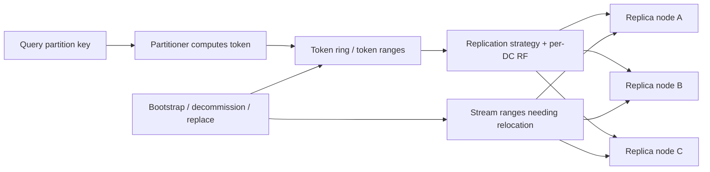
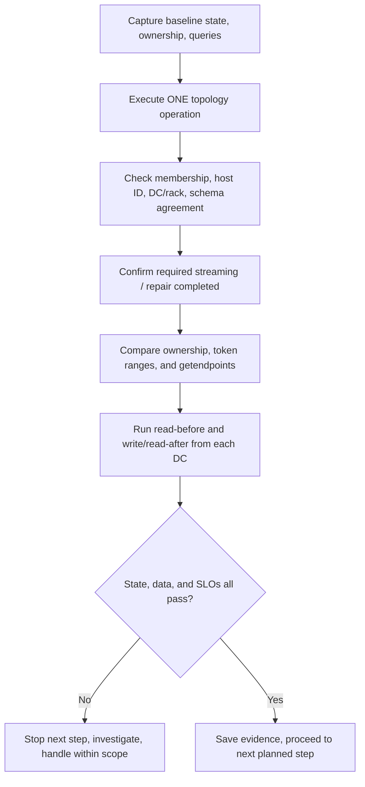

# Checking State, Ownership, and Queries After Every Operation

> **Chapter:** Topology Changes  
> **Module:** `DATABASE_ENGINE_WIDE_COLUMN_CASSANDRA` — Apache Cassandra

**Topology changes** in Apache Cassandra change how nodes participate in the cluster, own token ranges, and store data replicas: adding nodes (bootstrap), retiring live nodes (decommission), removing dead nodes (removenode), replacing nodes, moving tokens, adding datacenters, or changing replication factors. Because Cassandra is a *distributed wide-column* database, topology directly affects **partition key → token → replicas**, read/write query consistency levels (CL), and streaming/repair data flows.

An operation may return a success exit code while the application still fails: a new node may appear in `nodetool status` while still streaming; replicas may still lack data after increasing RF; the Java driver may not yet connect to a new DC; or some partition-key queries still time out. Therefore, after **every topology operation**, verify three layers:

1. **State:** which nodes are Up/Down, Joining/Leaving/Moving/Normal, is schema agreed, did streaming finish, and are nodes healthy?
2. **Ownership:** which nodes hold the keyspace's token ranges, do replica counts match RF/DC, and where will a specific partition route?
3. **Queries:** do representative `SELECT`/`INSERT`/`UPDATE` queries return expected results at the desired consistency level from served DCs?

This lesson establishes a repeatable verification procedure after every change. Illustrated commands follow common Apache Cassandra 4.1/5.0 syntax; **run `nodetool help <command>` on your exact binary** when deploying, since certain flags and behaviors differ across versions or managed products.

## 1. Model: Tokens, Replicas, and Node States

Cassandra uses a **partitioner** to map partition keys into tokens. Nodes receive one or more tokens (usually vnodes); a replication strategy such as `NetworkTopologyStrategy` selects replicas within each datacenter. A membership change can assign part of the token ranges to a new node, causing older nodes to yield ownership and **stream** SSTables to the new replicas.



Common states in `nodetool status`:

| Code | Meaning | Operational Conclusion |
| --- | --- | --- |
| `UN` | **Up / Normal** | Node is alive and in Normal state; **insufficient** to conclude data across all replicas is synchronized. |
| `UJ` | **Up / Joining** | Node is joining the ring; usually still bootstrapping/streaming. |
| `UL` | **Up / Leaving** | Node is alive but exiting the ring via ownership transfer. |
| `UM` | **Up / Moving** | Node is relocating token position where supported by version/topology. |
| `DN` | **Down / Normal** | Node is recorded in the ring but currently unreachable from the queried node's perspective. |
| `D*` | **Down / corresponding state** | Down combined with an incomplete membership state; inspect logs/streaming. |

Gossip can cause nodes to temporarily **see different topologies**. Therefore, when investigating anomalies, collect `nodetool status` from **at least two healthy nodes in different racks/DCs**, not just one node. `describecluster` checks cluster name, partitioner, snitch, and schema versions; if schemas lack agreement, subsequent checks may not reflect a stable state.

### "Owns (effective)" Is Not a Disk Percentage

`nodetool status <keyspace>` and `nodetool ring <keyspace>` report ownership accounting for replication of **the selected keyspace**. The `Owns (effective)` column shows the share of the token space a node can hold as a replica; it is **not** percentage of stored data bytes, nor is it free disk space.

With RF=3, each portion of the token space is assigned to **three replicas**, so summing effective ownership percentages across nodes can **exceed 100%**. Do not diagnose "data loss" merely because a node's `Owns` percentage drops after adding a node. To understand physical load, inspect the `Load` column, SSTable sizes, disk capacity, read/write throughput, and partition size skew.

## 2. Capturing a Baseline Before Operating

Without a baseline, you cannot distinguish a pre-existing fault from one caused by the topology change. Before each step, save these evidence groups:

| Group | Data to Capture | Purpose |
| --- | --- | --- |
| Cluster & membership | Per-node version, `UN/DN/UJ/UL`, host ID, DC/rack, tokens | Cross-check appearing/disappearing nodes, locations, and versions. |
| Schema & replication | Schema agreement, `NetworkTopologyStrategy`, and RF of relevant keyspaces | Know expected logical topology and avoid RF mistakes. |
| Ownership | `status <keyspace>`, `ring <keyspace>`, `describering <keyspace>`, and sample endpoints | Confirm before-and-after token/replica distribution. |
| Streaming & background | `netstats`, `compactionstats`, pending tasks, free disk, network utilization | Know active background tasks and streaming headroom. |
| Queries & business checks | Sample keys across multiple token ranges, expected data, read/write p95/p99, timeouts, unavailable | Prove clients can access data post-transition. |
| Recovery | Backup state, hints, repair history, `gc_grace_seconds` | Prepare for replicas that missed data or lost sources. |

The following **read-only observation** commands are a starting point. Log into a node with operational/JMX privileges; sample name `telemetry` assumes that keyspace already exists:

```bash
# Collect from multiple healthy nodes; save output with timestamps and node identity.
nodetool version
nodetool status
nodetool status telemetry
nodetool describecluster
nodetool ring telemetry
nodetool describering telemetry
nodetool netstats
nodetool compactionstats
nodetool tpstats
```

**How to interpret these commands:**

- `status`: list of nodes, DCs, racks, host IDs, states, and load. Pass `telemetry` to inspect replication-aware ownership for that keyspace.
- `ring telemetry`: token ring and ownership per keyspace; with many vnodes output can be long, so extract relevant sections.
- `describering telemetry`: inspect token ranges and endpoints belonging to the keyspace; used to compare ownership shift scope.
- `describecluster`: inspect schema versions; avoid making further changes while cluster schemas are unsettled.
- `netstats`: monitor streaming activity from bootstrap, replace, decommission, or removenode. "No active streams" **does not itself prove** data is valid or a prior process succeeded.
- `compactionstats` and `tpstats`: inspect I/O contention and backlogs that can affect post-operation queries.

`nodetool` flags, column names, and output formats can vary by version. On managed clusters, JMX access or these commands may be restricted; use equivalent provider telemetry in that case.

## 3. Checking Replicas for **a Specific Partition**

Ownership averages often hide hotspots: the same subset of nodes can carry heavy partitions despite equal token-space percentages. To verify the real routing of a key, use `nodetool getendpoints` with **keyspace, table, and partition key**:

```bash
# Example table events_by_bucket with a single text partition key.
nodetool getendpoints telemetry events_by_bucket sensor-07_2026-11-21
```

This returns node endpoints per the keyspace's replication rules. Run it with the same key before/after the operation and compare endpoints:

- After **bootstrap**, keys in ranges shifted to the new node may show an updated replica list.
- After **decommission/removenode**, the old node's endpoint must disappear once metadata updates finish.
- After **replace**, the responsible node's address/host ID is swapped per replacement procedure, while tokens/ranges must match the plan.
- After changing **RF**, replica count per datacenter must reflect the new RF if enough valid nodes exist, while still verifying **old data was streamed/repaired**.

**Note on composite keys:** the 5.0 syntax `getendpoints <keyspace> <table> <key>` takes **a single key argument**. For multi-column partition keys or binary/UDT types, do not naively join strings with commas assuming the endpoint is accurate: partition key serialization depends on drivers and data types. Verify support for your exact tool version or use driver/token-aware tracing and schema-based token mapping.

**Never compare replica counts alone.** Verify replicas sit in the **expected DC/rack**, have accurate host IDs, and no two nodes share tokens/identities due to VM cloning or misconfiguration. Nor should you assume `Owns (effective)` must split perfectly evenly: vnodes, real data skew, and replication strategy all affect it.

## 4. A Data Model Sample for Read and Write Verification

Post-topology-change verification queries must **target exact partition keys**, have known expected values, and be safe to run repeatedly. Below is a dedicated lab probe table; **never create this table/keyspace in production without authorization and verifying actual topology**.

Suppose the lab cluster has datacenter `dc1` with three nodes and matching replication:

```sql
CREATE KEYSPACE IF NOT EXISTS telemetry
WITH replication = {
    'class': 'NetworkTopologyStrategy',
    'dc1': 3
};

CREATE TABLE IF NOT EXISTS telemetry.events_by_bucket (
    bucket_id text,
    event_id uuid,
    payload text,
    created_at timestamp,
    PRIMARY KEY ((bucket_id), event_id)
);
```

Here `bucket_id` is a single stable-format partition key `sensor-07_2026-11-21`. It groups one device's events per day to avoid an unbounded partition; if one device produces millions of events/day, use a smaller bucket or add a shard. Choosing a query-driven primary key is a data modeling concern independent of bootstrap/decommission.

**Before the change**, write sample records with fixed keys and payloads, then record read outputs:

```sql
INSERT INTO telemetry.events_by_bucket
    (bucket_id, event_id, payload, created_at)
VALUES (
    'sensor-07_2026-11-21',
    11111111-1111-4111-8111-111111111111,
    'probe-before-change',
    '2026-11-21T09:00:00Z'
);

SELECT event_id, payload, created_at
FROM telemetry.events_by_bucket
WHERE bucket_id = 'sensor-07_2026-11-21'
  AND event_id = 11111111-1111-4111-8111-111111111111;
```

**After the change**, run two independent checks:

1. **Read-before:** query the key created before the change, confirming `payload` and returned values. Only writing/reading a *new* key can miss unstreamed historical data.
2. **Write-after + read-after:** use a **new event_id** and fixed payload, then read back using the same partition key. Ensure no duplicates arise from non-idempotent retries.

```sql
-- Execute ONLY on an authorized probe/lab table.
INSERT INTO telemetry.events_by_bucket
    (bucket_id, event_id, payload, created_at)
VALUES (
    'sensor-07_2026-11-21',
    22222222-2222-4222-8222-222222222222,
    'probe-after-change',
    '2026-11-21T09:15:00Z'
);

SELECT event_id, payload
FROM telemetry.events_by_bucket
WHERE bucket_id = 'sensor-07_2026-11-21'
  AND event_id IN (
    11111111-1111-4111-8111-111111111111,
    22222222-2222-4222-8222-222222222222
  );
```

In `cqlsh`, set the consistency level matching the system under verification:

```sql
-- Interactive cqlsh command, not CQL DDL:
CONSISTENCY LOCAL_QUORUM;
```

With RF=3 in `dc1`, `LOCAL_QUORUM` requires a local majority of replicas (2/3). A successful `LOCAL_QUORUM` check **does not prove every replica holds the exact same value**; the coordinator may serve a reconciled result from the subset of replicas answering CL. Monitor streaming and **repair** to reconcile remaining replica drift.

With multiple DCs, run probes **from the exact target DC using a session/driver configured with the corresponding local datacenter**, verifying CL and actual routing. Querying successfully in `dc1` alone does not prove `dc2` has been populated.

### Picking Meaningful Sample Keys

Do not check just one easily cached key. Pick a known set of keys from:

- Partitions existing **before** the change in token ranges that moved.
- Partitions remaining on older replica groups, as a control group.
- Partitions written during the **streaming or node-down window**, since they risk needing hints/repair.
- Partitions containing tombstones/TTLs if real workloads depend on deletes.
- Large partitions, hot-write keys, and heavily used paging/limit queries.

Avoid `SELECT * FROM <table>` without a partition key to "check everything": that query pattern does not scale in Cassandra. Cluster-wide reconciliation must rely on repair plans, partitioned/bucketed scans, or trusted external verification sources—not a few ad-hoc `SELECT`s.

## 5. Verification Gate After **Every** Topology Operation

Regardless of change type, enforce a **checkpoint** before starting the next step:



Sample checkpoint result table:

| Check | Pass Criteria (PASS) | Stop Signals |
| --- | --- | --- |
| Membership | Expected node/host ID/DC/rack; node settled in `UN` or exited ring | Unexplained prolonged `UJ/UL/UM`, unexpected `DN`, duplicate host ID |
| Schema | Identical schema version across relevant nodes | Prolonged post-operation schema disagreement |
| Streaming | Planned tasks finished cleanly, no stream errors remain | Failed streams, disk full, stalled progress |
| Ownership | Token ranges/endpoints reflect planned change and RF | Sample key points to deleted node or insufficient replicas |
| Read-before | Old key returns right payload across required DCs/CLs | Missing or wrong value, timeouts |
| Write-after | New probe acknowledged per CL and readable | Persistent write timeouts/unavailable, wrong read-after |
| SLO and node health | Latency/errors, I/O, heap, compaction within set limits | Backpressure, disk/CPU/network saturation |
| Repair & backup | Repair/cleanup steps defined and scheduled | RF increased without full repair, zombie risk, missing source data |

**Never mark complete** just by seeing all `UN` in `nodetool status`. `UN` is a necessary condition for many scenarios, yet insufficient for correctness and application performance.

## 6. After Bootstrap (Adding a Node)

**Goal:** the new node receives token ranges and required data ownership, while other nodes shrink their ownership scope accordingly. Cassandra bootstrap selects sources from existing replicas and streams range data.

**Checks in order:**

1. As the new node joins, its state may be `UJ`; check `nodetool netstats` on both new and source nodes to observe streaming. If stuck in Joining, read logs and check source replicas, network, and disk before intervening.
2. Once finished, the new node must show `UN` from multiple viewpoints, with the right host ID, DC/rack, and schema agreement.
3. `nodetool status telemetry` and `ring telemetry` reflect redistributed ownership; `getendpoints` for sample keys may include the new node.
4. Check **old keys** falling in ranges the new node assumed and a newly written key post-bootstrap. Run from a real client/driver and watch p95/p99.
5. Once confident the new node serves properly, schedule `nodetool cleanup` on nodes **that lost ownership of some ranges** to free excess data. Cleanup consumes disk I/O; never run it before proving the new node holds the data.

Per Cassandra documentation, **while bootstrap is incomplete, do not start the next topology step**; enabling flags to "bypass consistent rangemovement" or manually deleting partial bootstrap data is risky and must follow version runbooks. If bootstrap fails, `nodetool bootstrap resume` has specific conditions; inspect history and version docs instead of blindly resetting progress.

| Outcome | When to Mark PASS |
| --- | --- |
| New node | `UJ → UN` complete, schema agreed, zero failed streams |
| Ownership | Ranges moved to new node reflected in ring/endpoints |
| Queries | Pre-change keys readable, new keys writable and readable, no error spike |
| Cleanup | Cleanup run only after verifying new node and sufficient disk headroom |

## 7. After Decommission (Retiring a Live Node)

Run `nodetool decommission` on the **live node** you intend to remove from the cluster. It streams data needing relocation to other replicas under the new topology; while leaving, the node may appear as `UL`.

Post-operation:

- The departed node is **no longer in the ring** and no longer appears as an endpoint for sample keys once metadata settles.
- Nodes taking over new responsibilities finished streaming and are not overloaded.
- RF in each DC still has **enough physical nodes**; if node count drops below RF, you cannot assume prior CLs still work reliably.
- Queries for keys formerly owned by the old node still succeed. If app contact points or seed/configs still reference the departed node, update them per plan.
- Data disks on the decommissioned node are **not automatically wiped**. Never treat data on that node as an active serving source post-decommission.

```bash
# On another node still in the cluster, after decommission finishes:
nodetool status telemetry
nodetool ring telemetry
nodetool netstats
```

**Especially important:** mark PASS only after confirming **the node left the ring and required data reached surviving replicas**. If an operator stops Cassandra on a node slated for decommission before it finishes, the situation may turn into dead-node removal requiring a different runbook.

## 8. After Removenode (Removing a Dead Node)

`nodetool removenode <host-id>` is used when a node is dead and **cannot decommission directly**. Data is streamed from surviving replicas instead of the removed node. Because data sources may be scarce, verification must be stricter than for decommission.

Verification steps:

1. Record the dead node's exact **host ID** from the baseline; confirm it is the intended node, not a wrong IP/new node.
2. Run removal per runbook and watch `nodetool removenode status` alongside `netstats` from a healthy node. Never invoke `removenode force` merely because progress looks slow; skipping unfinished steps can leave data un-redistributed.
3. Once removal finishes, the old host ID vanishes from the ring/endpoint list; surviving replicas satisfy planned RF in each DC.
4. Check keys written **while the node was dead** and keys with older data on ranges formerly owned by that node, at the matching CL/DCs.
5. Evaluate scoped repair and backups/restores if any replica lacked data, especially after prolonged downtime or exceeding the hinted handoff window.

```bash
# Observe on a healthy node during removal:
nodetool removenode status
nodetool netstats
nodetool status telemetry
```

**Note:** if data existed only on the lost node with no valid replica/backup copy, neither removenode nor repair **can recreate the data**. Never use `assassinate` as a shortcut since it is a last-resort measure that can bypass data redistribution; a dedicated recovery process is needed.

## 9. After Replace (Replacing a Dead Node)

Replacement differs from "adding a brand-new node": the replacement node must assume **the exact token/range role of the old node** per your version's replacement mechanism. Cassandra provides dedicated startup flags, such as `cassandra.replace_address_first_boot` in 5.0 topology docs, while IP, token, and host identity settings must follow your running version's runbook.

Checkpoints:

- Before: old node confirmed Down; backups/replicas available; never boot old node and replacement concurrently with shared ownership.
- During: `nodetool netstats` on the replacement node **matters more than `status` alone**, because topology views may temporarily differ across perspectives.
- After: replacement node reaches `UN` with zero failed stream sessions; tokens/ranges **match expected role**, host ID/IP managed per replacement procedure; no ghost nodes in the ring.
- Queries: pre-incident keys, downtime keys, and post-replacement keys are all verified.
- Repair: if time from old node death to replacement completion **exceeded the hints window**, or reusing the old IP dragged beyond that window, Cassandra docs require **repair** because writes before/during streaming may have been missed. Never skip that step just because `UN` appeared.

Schedule cleanup/compaction only after understanding range roles and data state. Never manually delete SSTables/commit logs to "fix" a host ID or reuse a node directory.

## 10. After Token Move, Replication Changes, and Datacenter Expansion

### 10.1. Moving Tokens

`nodetool move` is available only under matching configurations/versions, typically when `num_tokens: 1`. During the move the node may show `UM`. Afterward:

- `UM → UN`, streaming complete, ring and sample-key endpoints reflect the new token.
- No overlapping ranges or wrong tokens remain. Track before/after load and hot partitions.
- Run `nodetool cleanup` **after verifying data on new owners**, on nodes retaining unowned data.

For clusters using multiple vnodes, never apply single-token `move` examples. You typically need alternatives like coordinated node addition/retirement.

### 10.2. Increasing Replication Factor

For example, keyspace `telemetry` in DC `dc1` currently has RF=2 and wants RF=3 with three healthy nodes available:

```sql
-- Schema-altering DDL example; run only after approval.
ALTER KEYSPACE telemetry
WITH replication = {
    'class': 'NetworkTopologyStrategy',
    'dc1': 3
};
```

After `ALTER KEYSPACE`, **the schema may show RF=3 while existing data copies are not yet fully distributed** to the new replica. Therefore:

1. Check schema agreement along with `nodetool status telemetry`, `ring telemetry`, and `getendpoints` on sample keys.
2. Execute a properly scoped **full repair** coordinated across nodes/DCs to propagate historical data to the new replica; do not rely solely on incremental repair, which may skip already-repaired data.
3. Monitor streaming/repair completion, disk headroom, and client latency.
4. Run read-before and write/read-after at the target consistency level once new data is distributed.

```bash
# ILLUSTRATIVE resource-intensive command, ONLY within a repair plan:
nodetool repair --full -pr telemetry
```

Running `-pr` on **one** node covers only that node's primary ranges. A cluster-wide full repair plan must coordinate **all relevant nodes/DCs**, avoiding overlaps or dumping all I/O at once.

### 10.3. Decreasing Replication Factor

After lowering RF, nodes may hold excess data. Confirm schema and endpoints match the new RF; once certain those copies are no longer needed, run `nodetool cleanup` per node schedule to reclaim unowned SSTables. Before cleanup, always verify backups and exact RF semantics, because lowering RF also shrinks fault-tolerance margin.

### 10.4. Adding a Datacenter

Adding nodes to `dc2` does not automatically populate data for `dc2` if the keyspace only configures `dc1`. Once valid topology exists:

- Confirm each node appears in the **right DC/rack**, not just `UN`.
- Update `NetworkTopologyStrategy`/RF per plan and **stream/rebuild/full repair** data for new replicas in the new DC per version runbook; never assume creating nodes populates data.
- `status telemetry` and `getendpoints` must show replicas in **every DC declared in RF**.
- Run probes using **sessions routed to both dc1 and dc2** with accurate local datacenter settings; `LOCAL_QUORUM` in dc1 does not prove dc2 data is ready.
- Verify inter-DC networking, TTL/tombstone/repair schedules, and read/write capacity before shifting traffic.

## 11. Java Driver: Verifying the Right Path and CL

Java Driver 4.x detects topology and chooses coordinators via its load-balancing policy; applications must declare the exact **local datacenter** where they run. After topology changes, a service might still connect yet see slow or failing queries due to stale seeds/contact points, broken network paths to new nodes, wrong DC mapping, or missing data replicas.

Example reading a probe with a fixed ID:

```java
import java.util.Objects;
import java.util.UUID;
import com.datastax.oss.driver.api.core.CqlSession;
import com.datastax.oss.driver.api.core.DefaultConsistencyLevel;
import com.datastax.oss.driver.api.core.cql.PreparedStatement;
import com.datastax.oss.driver.api.core.cql.Row;

public final class TopologyReadProbe {
    private final CqlSession session;
    private final PreparedStatement statement;

    public TopologyReadProbe(CqlSession session) {
        this.session = session;
        this.statement = session.prepare(
            "SELECT payload FROM telemetry.events_by_bucket " +
            "WHERE bucket_id = ? AND event_id = ?");
    }

    public void verify(String bucketId, UUID eventId, String expectedPayload) {
        Row row = session.execute(
            statement.bind(bucketId, eventId)
                .setConsistencyLevel(DefaultConsistencyLevel.LOCAL_QUORUM)
                .setIdempotent(true)
        ).one();

        if (row == null || !Objects.equals(expectedPayload, row.getString("payload"))) {
            throw new IllegalStateException(
                "Topology readback mismatch for event " + eventId);
        }
    }
}
```

This example assumes `CqlSession` is built with proper credentials, accurate local DC, and keyspace `telemetry` having sufficient RF for `LOCAL_QUORUM`. Never hardcode passwords in source code.

When using probes in a real system:

1. Run from each **DC the application uses**, through the application's own session configuration.
2. Record read latency, exceptions (timeout/unavailable), coordinator/host metadata when provided by the driver, and request IDs; avoid logging sensitive payloads.
3. Compare against baseline for both **old keys and new keys**. Pick keys from moved ranges to avoid a "false PASS because the node happened not to change".
4. Cross-check routing scope against `nodetool getendpoints` or token metadata; if a new local DC lacks enough replicas, `LOCAL_QUORUM` can fail.
5. On write timeouts, **never conclude the write failed**. For counters, increments/decrements, or other side effects, retries can apply twice. Topology repair/streaming does not solve business idempotency.

A single successful `SELECT` **does not prove** full-dataset repair/streaming finished. Probes catch severe regressions on real query paths; cluster-wide coverage still requires telemetry and repair/streaming tools.

## 12. When a Checkpoint Fails: Root-Cause by Layer

| Symptom | Causes to Check First | Next Action |
| --- | --- | --- |
| Node stuck `UJ`, streaming halted | Source replica down, network error, disk full, stale bootstrap state | Check `netstats` and logs; fix source; follow version resume/bootstrap guidance. |
| New node `UN` yet old-key `SELECT` fails | Incomplete range stream, metadata skew, quorum/timeouts, pre-existing missing data | Compare endpoints, schema, logs, baseline snapshot; scoped repair if sources exist. |
| `status` differs across nodes | Gossip unconverged, network partition, down node | Hold further changes; inspect gossip/network and per-node state. |
| Ownership % uneven after adding node | Vnodes/token allocation, RF, skewed data distribution | Check per-keyspace ring, load, and hot partitions; do not jump to error conclusions. |
| `getendpoints` still includes retired node | Decommission/removenode unfinished or metadata unsynced | Monitor removal status/streaming, check host IDs; do not purge data yet. |
| `LOCAL_QUORUM` errors in new DC | New DC lacks replicas/data or wrong driver local DC | Check replication, streaming/repair, DC/rack, and driver config. |
| Queries succeed yet p99 rises | Streaming/repair/compaction I/O/network contention, hot partition | Throttle background jobs cleanly; monitor SLOs and traffic. |
| After RF increase, old data missing on new replica | Metadata updated only, no full repair to distribute history | Coordinate full repair and verify coverage before shifting traffic. |
| Data missing after cleanup | Cleanup ran before ownership/streaming were verified | Halt changes, check surviving sources/backups; trigger recovery workflow. |

Never use `nodetool removenode force`, `assassinate`, `reset_bootstrap_progress`, or manual SSTable/commit-log deletion as default fixes. Those actions can make recovery far harder before exact range states and data copies are known.

## 13. Short Operator Checklist

Attach this table to the ticket for **each topology step**, recording verifier and evidence:

| Check | Before Operation | After Operation |
| --- | --- | --- |
| Host ID, IP, DC/rack | Saved node mapping and version | Matches plan, no duplicate host/tokens |
| Cluster status | Recorded any abnormal `UN/DN` | No unplanned `UJ/UL/UM` remaining |
| Schema agreement | Baseline captured | Agreed across relevant nodes |
| Ring/ownership | Recorded keyspace token ranges | Shifted as intended matching RF/DC |
| Streaming/repair | No dangerous backlog | Required tasks succeeded; zero errors left |
| Old key query | Saved ID and expected payload | Readable at required CL and DC |
| New key query | N/A | Write/readback succeeded with stable ID |
| Client SLO | Recorded p95/p99/error rate | Within limits, no sustained timeout spike |
| Disk/compaction | Headroom verified | No disk exhaustion or abnormal backlog |
| Cleanup and backup | Safeguards confirmed | Cleanup run only once ownership is safe |
| Go/No-go | Owner assigned | Halt if any checkpoint fails |

**Rule:** *one change → one checkpoint → certify PASS → only then advance*. This makes faults easy to isolate and prevents multiple concurrent streaming/repair flows from overloading the cluster.

## 14. Scenario Exercises and Self-Check Questions

**Exercise 1.** An RF=3 cluster just added a fourth node. `nodetool status` shows four `UN` nodes, yet an old key in a range transferred to the new node fails to read. Can you declare bootstrap done? What must you check first?

**Exercise 2.** `nodetool status telemetry` reports `Owns (effective)` summing near 300% across nodes. Does that mean data was erroneously duplicated or occupies 300% of disk? Explain.

**Exercise 3.** A dead node underwent `removenode`. Output still shows the old ID in `getendpoints` on another node, while the coordinating node reported command completion. What should ops do?

**Exercise 4.** After raising RF from 2 to 3, `status telemetry` shows three replicas per range and new writes read fine. Is last week's data guaranteed present on the third replica? Which operation must be evaluated?

**Exercise 5.** A node was replaced and reached `UN`. The old node had been down longer than `max_hint_window`. Can you skip repair because `LOCAL_QUORUM` reads on a few keys succeeded?

**Exercise 6.** A cluster added `dc2`; Java apps in `dc1` read fine at `LOCAL_QUORUM`. When shifting traffic to `dc2`, some requests time out. List checks in order.

**Exercise 7.** After bootstrap, ops plans to run `nodetool cleanup` immediately cluster-wide before checking streaming and readback results. Why is that unsafe?

<details>
<summary>Answer Hints</summary>

1. Insufficient. Check logs/`netstats`, schema, endpoints/ranges, data sources, and old/new probe results; investigate streaming or repair before passing the checkpoint.
2. No. Effective ownership counts **all replicas per RF**, not actual byte ratios or disk usage.
3. Halt further actions; check gossip/schema from multiple nodes, `removenode status`, ring, and host IDs; proceed only once metadata converges and the old endpoint vanishes as planned.
4. Not guaranteed. Altering RF changes only replica placement policy. Scoped full repair is needed to distribute historical data and verify streaming/pre-change keys.
5. No. Downtime exceeding the hint window can miss mutations; run repair per Cassandra runbook requirements and check coverage rather than relying on a few `SELECT`s.
6. Verify DC/rack, `dc2` RF, schema, ownership/endpoints, streaming/rebuild/repair in the new DC, driver local DC and load balancing, network latency, and direct probes from `dc2`.
7. Cleanup can delete data on old nodes before the new node has received and reconciled everything. Verify bootstrap, ownership, and readback first; cleanup also generates I/O requiring scheduling and headroom.

</details>

## Key Takeaways

- After **every** topology operation, verify three layers: **status + ownership + queries**, before starting the next change.
- `UN` only states the node is Up/Normal; it **does not** prove streaming, repair, and data across all replicas are accurate.
- Use `status <keyspace>`, `ring <keyspace>`, `describering <keyspace>`, and `getendpoints` to cross-check **tokens/ranges/replicas** per keyspace—never infer data bytes from ownership percentages.
- Query probes must cover both **keys existing before the change** and **keys written after the change**, run at the Java application's real CL, DC, and partition keys.
- After bootstrap/decommission/removenode/replace, verify streaming; after **increasing RF, run full repair**; after decreasing RF or yielding ranges, consider cleanup **once data safety is assured**.
- Repair, hints, and backups address distinct recovery needs; never substitute a handful of successful queries for thorough reconciliation.

### Official References

- [Apache Cassandra — Adding, replacing, moving and removing nodes](https://cassandra.apache.org/doc/latest/cassandra/managing/operating/topo_changes.html)
- [Apache Cassandra — Using Nodetool to check cluster status](https://cassandra.apache.org/doc/stable/cassandra/troubleshooting/use_nodetool.html)
- [Apache Cassandra — nodetool status](https://cassandra.apache.org/doc/stable/cassandra/managing/tools/nodetool/status.html)
- [Apache Cassandra — nodetool ring](https://cassandra.apache.org/doc/stable/cassandra/managing/tools/nodetool/ring.html)
- [Apache Cassandra — nodetool describering](https://cassandra.apache.org/doc/stable/cassandra/managing/tools/nodetool/describering.html)
- [Apache Cassandra — nodetool getendpoints](https://cassandra.apache.org/doc/stable/cassandra/managing/tools/nodetool/getendpoints.html)
- [Apache Cassandra — nodetool removenode](https://cassandra.apache.org/doc/stable/cassandra/managing/tools/nodetool/removenode.html)
- [Apache Cassandra — Repair and changing RF](https://cassandra.apache.org/doc/stable/cassandra/managing/operating/repair.html)
