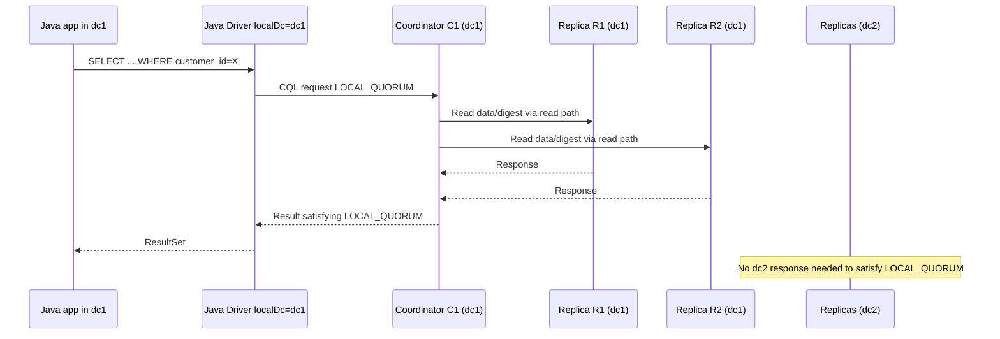

# Driver Local Datacenter and Request Routing Paths

> **Chapter:** Multi-Datacenter Deployment  
> **Scope:** Apache Cassandra, a *wide-column* distributed database, alongside applications using Java Driver 4.x. This lesson explains how to configure the **local datacenter** to route requests to an appropriate coordinator, and then distinguishes the **client → coordinator** path from the **coordinator → replica** path in a multi-datacenter cluster.
>
> **Learning outcomes:** Explain why setting a local DC does not mean data is only written in that DC; choose consistency levels with the right scope; verify driver routing with Java code, CQL, and metrics; and design a controlled DC failover workflow.

## 1. The Problem: Why Do Queries Still Cross the WAN with Two Datacenters?

Suppose an organization deploys Cassandra across two datacenters:

- `dc1`: three nodes serving applications near Region A.
- `dc2`: three nodes serving applications near Region B.
- Keyspace `orders` uses `NetworkTopologyStrategy` with **RF=3 in each DC**.

A Java service runs right next to `dc1`. If the driver connects to a coordinator in `dc2` for every query, the client–coordinator connection must traverse the WAN. This can increase latency, introduce inter-DC network dependency, and make response times unstable.

The Cassandra Java Driver uses the **local datacenter** to determine which datacenter the application prefers when selecting coordinators. Under the driver's default load-balancing policy, an application should set its local DC to match the datacenter where the instance runs or is designed to serve.

However, that is only the **first half of the path**:

```text
Java application in Region A
        |
        | 1. Driver selects a COORDINATOR in dc1
        v
     dc1/C1 (coordinator)
        |
        | 2. Cassandra determines REPLICAS by token + RF
        |
        +----> dc1/R1, R2, R3 (partition replicas)
        |
        +----> dc2/R4, R5, R6 (partition replicas)
                       (when required by request/mechanism)
```

**Important rule:** `local datacenter` is a **driver routing property**, not a command meaning "store data only in this DC." How data is distributed to replicas is determined by the **partition key, replication strategy, RF, and consistency level**.

## 2. Three Roles Not to Confuse

| Concept | Role | Who Decides? |
| --- | --- | --- |
| **Driver's local datacenter** | The DC where the driver prefers selecting a **coordinator** node for application calls | Java Driver config / load-balancing policy |
| **Coordinator** | The node receiving CQL from the driver, identifying replicas, collecting responses, and returning the result | Driver picks the receiving node; Cassandra on that node coordinates |
| **Replica** | A node holding a copy of a partition's data according to token placement | Replication strategy, RF, token ranges, and topology |

A node can act as coordinator for a query even if it is **not itself a replica for the partition being read**. When the driver knows the routing key and token, the *token-aware* policy typically prefers an **eligible replica in the local DC** as coordinator; if none is available, it can still choose another local node to coordinate.

This separates two types of network distance:

1. **Client → coordinator:** influenced by local DC, load balancing, contact points, and connection health.
2. **Coordinator → replicas:** influenced by replication topology, partition key, CL, and how Cassandra executes the read/write path.

Optimizing type 1 does not automatically guarantee that type 2 never crosses the WAN.

## 3. Sample Model with Per-Datacenter RF

Create a sample lab keyspace `shop_md` with three replicas in each DC:

```cql
CREATE KEYSPACE IF NOT EXISTS shop_md
WITH replication = {
    'class': 'NetworkTopologyStrategy',
    'dc1': 3,
    'dc2': 3
};
```

Then create a table modeled after the order-history query pattern:

```cql
CREATE TABLE IF NOT EXISTS shop_md.orders_by_customer (
    customer_id uuid,
    created_at timestamp,
    order_id uuid,
    status text,
    total decimal,
    PRIMARY KEY ((customer_id), created_at, order_id)
) WITH CLUSTERING ORDER BY (created_at DESC, order_id ASC);
```

Query with an explicit partition key:

```cql
SELECT order_id, created_at, status, total
FROM shop_md.orders_by_customer
WHERE customer_id = aaaaaaaa-aaaa-4aaa-8aaa-aaaaaaaaaaaa
LIMIT 20;
```

For **a specific partition**, Cassandra selects its replica set based on the token of `customer_id`. Suppose that set contains three nodes in `dc1` and three nodes in `dc2`. **Do not assume every node in the datacenter is a replica** if the DC has more than three nodes; only nodes chosen by placement for that partition are replicas.

### What Happens When an App in `dc1` Sends a SELECT?

Basic path:

1. The driver discovers topology and prefers a coordinator in `dc1`.
2. The driver sends CQL to the chosen coordinator.
3. The coordinator computes the replicas for `customer_id`.
4. The coordinator sends the appropriate read requests to satisfy CL; with `LOCAL_QUORUM` and `dc1` RF=3, it needs **two valid responses from `dc1`**.
5. The coordinator reconciles results, enforces validity/consistency along the read path, and returns the response.
6. The driver delivers the result to the Java application.

If the local coordinator is also an eligible replica, the intra-DC network path can be shorter. Even so, a fixed hop count is never promised: coordinator selection, speculative reads, digests, read repair, and replica health all affect the actual path.

## 4. Configuring Local DC in Java Driver 4.x

### Method 1 — Specifying Directly When Building the Session

This example uses **192.0.2.10** from the documentation IP range, not a real node address:

```java
import java.net.InetSocketAddress;
import com.datastax.oss.driver.api.core.CqlSession;

public final class CassandraSessionFactory {
    public static CqlSession connectToDc1() {
        return CqlSession.builder()
            .addContactPoint(new InetSocketAddress("192.0.2.10", 9042))
            .withLocalDatacenter("dc1")
            .withKeyspace("shop_md")
            .build();
    }
}
```

In a real system, replace the contact point with reachable cluster addresses and configure proper authentication and TLS. In Java Driver 4.x, calling `withLocalDatacenter("dc1")` tells the routing policy the intended local DC.

**A contact point is not the same as the local DC.** Contact points are addresses used to connect and discover the cluster during session startup. Once topology metadata is discovered, the driver learns about many other hosts. Contact points should prioritize nodes aligned with your intended local DC and real topology; do not point at a `dc2` address and blindly assume every request will always behave as intended in `dc1`.

### Method 2 — Configuring in `application.conf`

A Java Driver 4.x configuration example:

```hocon
datastax-java-driver {
  basic.load-balancing-policy.local-datacenter = "dc1"
  basic.request.consistency = LOCAL_QUORUM
}
```

Property syntax and extension policies must be verified against your exact driver version. Never configure `dc1` in config alongside `withLocalDatacenter("dc2")` in code without explicitly verifying precedence. Each deployment environment should have **one clear local DC** from tested configuration.

### DC Names Must Match Cassandra Topology

The driver does not create datacenters and does not rename DCs on the server. Names like `dc1`/`dc2` are metadata from the snitch and node configuration.

You can check with:

```bash
nodetool status
nodetool describecluster
```

Find the exact datacenter/rack names and node states, and confirm contact points belong to the intended cluster. If Java specifies a non-existent DC name, the routing policy may find no eligible hosts or fail with configuration/connection errors.

**Do not casually rename a DC on a node to "fix" the driver.** Changing a DC name affects placement, RF, and topology—it is a major cluster change requiring a dedicated runbook.

## 5. Consistency Levels Decide Which Replicas Must Reply

Assume a keyspace has RF=3 in `dc1` and RF=3 in `dc2`, meaning **six total replicas** per partition.

| Consistency Level | Minimum Response Requirement | Needs Inter-DC Network to Complete? |
| --- | --- | --- |
| `LOCAL_ONE` | One replica in the coordinator's local DC | Does not need a response from the remote DC |
| `LOCAL_QUORUM` | Two of three replicas in the local DC | Does not need a response from the remote DC |
| `ONE` | One valid replica across the full replica set | Can complete via a local replica; lacks `LOCAL_ONE`'s local constraint |
| `QUORUM` | Four of six total replicas | Usually needs responses from both DCs if each DC only has three replicas |
| `ALL` | All six replicas | Must wait for all, including remote DC replicas |
| `EACH_QUORUM` | Quorum in **each DC** (two in `dc1` **and** two in `dc2`) | Yes; used for **writes**, not regular read consistency |

**Important detail:** `LOCAL_QUORUM` is calculated according to the **coordinator's datacenter**, not an independent client variable named `localDc`. When the driver routes to a `dc1` coordinator, `LOCAL_QUORUM` requires two `dc1` replicas. If execution shifts to a `dc2` coordinator during a properly configured failover procedure, the same CL name requires two `dc2` replicas.

Never apply `QUORUM = 4` to every topology either. That number only holds for total RF = 6: global quorum is `floor(6/2)+1 = 4`. For `LOCAL_QUORUM` in a DC with RF=3, it is `floor(3/2)+1 = 2`.

### Scope of LWT / Serial Consistency

For conditional CQL statements (`IF`), Cassandra adds a Paxos consensus phase and **serial consistency** levels (such as `SERIAL`, `LOCAL_SERIAL`). This is a separate layer from regular read/write response consistency. Never pick `LOCAL_SERIAL` just as a substitute for `LOCAL_QUORUM` on unconditional `SELECT`s.

When business rules require strict cross-DC state invariants, evaluate **LWT consensus scope** alongside RF, CL, WAN latency, and failover mechanics; do not assume `LOCAL_QUORUM` turns two DCs into a global transaction.

## 6. Read Path: Does a Local Coordinator Only Read Local Replicas?

Suppose a Java client in `dc1` queries `customer_id = X` at `LOCAL_QUORUM`:



This illustrates the normal path, not an exact trace of every internal message. When copies diverge, the coordinator may run additional reconciliation steps depending on version and policy. When speculative retry triggers, a backup read replica may be contacted.

`LOCAL_QUORUM` avoids **depending on responses** from a remote DC to complete reads, but it is **not an absolute network filter** for maintenance, repairs, tracing, or other cluster mechanisms.

### What If the Client Chooses Global QUORUM?

With RF 3+3, `QUORUM` requires four responses, so it cannot complete using only the three replicas in `dc1`. The coordinator must obtain a valid response from a replica in the other DC. That creates a major difference in latency and availability during WAN disruptions.

### Role of Caches and the Wide-Column Model

Good local-DC routing cannot fix a query that misses the partition key:

- Queries specifying the full partition key can target the right token/replicas.
- Broad filters or `ALLOW FILTERING` can incur heavy reads even when all nodes are local.
- Caches, SSTables, compaction, and tombstones on replicas drive much of read tail latency.

If an API needs "the 20 most recent orders for customer X," design a table with the right partition/clustering keys first and then tune routing—never invert the order hoping local DC or caching will rescue a poor schema.

## 7. Write Path: A Local Coordinator Still Sends to Both DCs

For an `INSERT` or `UPDATE` into an RF=3+3 keyspace:

1. The driver from `dc1` sends the mutation to a local coordinator.
2. The coordinator identifies the six natural replicas via placement.
3. Cassandra distributes the mutation to replicas in both DCs along the write path according to connection state; unreachable replicas may trigger hints where supported.
4. The coordinator waits for enough responses **to satisfy the request's CL** before returning an ACK.
5. Replicas that have not yet acknowledged may still be receiving/applying the mutation; repair is needed later to resolve long-term divergence.

```text
Client in dc1
    |
    v
Coordinator C1 in dc1
    |
    +----> dc1: R1 ---- ACK
    |      dc1: R2 ---- ACK      LOCAL_QUORUM met with 2 dc1 ACKs
    |      dc1: R3 ---- ...      -> client may receive SUCCESS
    |
    +----> dc2: R4 ---- ...      mutation still distributed/synced
           dc2: R5 ---- ...      but dc2 ACKs are not required for
           dc2: R6 ---- ...      LOCAL_QUORUM in dc1
```

**"Write succeeded at local quorum" does not mean "the other DC is already updated."** Under WAN delay or replica faults, a client in `dc2` can read stale state for a period of time, even when that client itself uses `LOCAL_QUORUM`.

### Why `LOCAL_QUORUM` in Both DCs Does Not Guarantee Cross-DC Read-After-Write

Suppose a write in `dc1` completes at `LOCAL_QUORUM` after R1 and R2 acknowledge. An immediate read in `dc2` using `LOCAL_QUORUM` may receive responses from R4 and R5 **before those replicas receive the mutation**.

With RF=3 per DC:

```text
Write quorum in dc1 = {R1, R2}
Read quorum in dc2  = {R4, R5}
Intersection        = empty
```

The quorum intersection rule requires evaluating **the same replica set**. Two local quorums in two different DCs have no forced intersection, so they offer no immediate cross-DC freshness promise.

When an API requires immediately reading a just-written value from another region, you must design consistency levels, regional routing, latency budgets, and potentially application-level synchronization. Simply calling `withLocalDatacenter` does not solve that requirement.

## 8. Token-Aware Routing and Prepared Statements from Java

The Java Driver is **token-aware** when it knows the partition key. This helps it prefer coordinators close to the target partition within the allowed local DC.

Java Driver 4.x example with a query supplying the full partition key `customer_id`:

```java
import java.math.BigDecimal;
import java.net.InetSocketAddress;
import java.time.Instant;
import java.util.UUID;

import com.datastax.oss.driver.api.core.CqlSession;
import com.datastax.oss.driver.api.core.DefaultConsistencyLevel;
import com.datastax.oss.driver.api.core.cql.BoundStatement;
import com.datastax.oss.driver.api.core.cql.PreparedStatement;
import com.datastax.oss.driver.api.core.cql.ResultSet;
import com.datastax.oss.driver.api.core.cql.Row;
import com.datastax.oss.driver.api.core.metadata.Node;

public final class MultiDcDemo {
    public static void main(String[] args) {
        // 192.0.2.10 is a documentation address only; replace with a real contact point.
        try (CqlSession session = CqlSession.builder()
                .addContactPoint(new InetSocketAddress("192.0.2.10", 9042))
                .withLocalDatacenter("dc1")
                .withKeyspace("shop_md")
                .build()) {

            PreparedStatement query = session.prepare(
                "SELECT order_id, created_at, status, total " +
                "FROM orders_by_customer WHERE customer_id = ? LIMIT ?"
            );

            UUID customerId =
                UUID.fromString("aaaaaaaa-aaaa-4aaa-8aaa-aaaaaaaaaaaa");

            BoundStatement statement = query.bind(customerId, 20)
                .setConsistencyLevel(DefaultConsistencyLevel.LOCAL_QUORUM)
                .setIdempotent(true)
                .setPageSize(20);

            ResultSet result = session.execute(statement);

            Node coordinator = result.getExecutionInfo().getCoordinator();
            System.out.println("Coordinator DC: " +
                (coordinator == null
                    ? "no metadata"
                    : coordinator.getDatacenter()));

            for (Row row : result) {
                UUID orderId = row.getUuid("order_id");
                Instant createdAt = row.getInstant("created_at");
                String status = row.getString("status");
                BigDecimal total = row.getBigDecimal("total");
                System.out.printf("%s %s %s %s%n",
                    orderId, createdAt, status, total);
            }
        }
    }
}
```

In this example:

- `withLocalDatacenter("dc1")` guides coordinator selection.
- `LOCAL_QUORUM` defines the ACK condition **in the coordinator's DC**.
- The prepared statement gives the driver schema metadata and the routing key for queries filtering by `customer_id`, enabling local replica selection.
- `getExecutionInfo().getCoordinator()` helps verify the **execution coordinator**; this metadata does not prove all participating replicas were in the same DC.
- `setIdempotent(true)` declares retry safety for `SELECT`; it does not enable speculative execution on its own, which also depends on driver policy/configuration.

This code assumes the keyspace exists, contact points are reachable, and auth/TLS and topology are properly configured. Never deploy `192.0.2.10` into a real environment.

### When the Driver Does Not Know the Routing Key

If a statement omits the partition key, uses certain index queries, or lacks routing metadata in the driver, the policy may pick **an arbitrary local coordinator**. That node computes the replicas and forwards the request to the right place. Local-DC routing is still preserved, though the coordinator is no longer chosen preferentially for owning the partition's token.

Therefore monitor both **routing policy** and **query shape**; do not just turn on a token-aware flag and assume every `SELECT` is optimal.

## 9. Does Local DC Automatically Switch When an Entire Datacenter Fails?

**Do not assume it does.** With an explicit local DC and Java Driver 4.x default policies, applications strictly prefer hosts in the local DC; nodes in remote DCs are not an automatic failover target for every request.

Scenario where all of `dc1` loses connectivity:

```text
App A localDc=dc1
        |
        +--> No eligible dc1 coordinator left
                 |
                 +--> Requests fail / no available nodes
                 |
                 +--> DOES NOT switch localDc to dc2 by default
```

Moving an application from `dc1` to `dc2` is a **system failover decision**, not just a per-request retry feature:

1. Confirm `dc2` has enough replicas and **holds the required data**.
2. Verify network endpoints, authentication, DNS/service discovery, and access permissions.
3. Initialize or switch to a session/client profile with **local DC = `dc2`** per the failover design.
4. Evaluate CL, `dc2`'s RF, LWT status, replication lag, and data that may not yet have arrived from `dc1`.
5. Monitor read/write errors, duplicate retries, p95/p99, and resynchronization when `dc1` recovers.

Services can run **active-active**, with each regional deployment holding its own local-DC session; you still must manage concurrent writes to the same keys and cross-DC consistency policies. Never assume that because Cassandra replicates data, the business logic already handles concurrency conflicts.

### Retry Risks During Failover

If a write times out in `dc1` and the application retries it in `dc2`, **it is unknown** which replicas received the first write. For non-idempotent operations (counters, time-dependent mutations, external side effects, or conditional state transitions), blind retries can corrupt results.

Use stable business keys, idempotency keys, reconciliation mechanisms, or LWTs when strict invariants apply. For data with TTLs, timestamps, and expiration, retrying at a later time can even shift expiration timestamps.

## 10. Setting Local DC in a Multi-Region System

A straightforward layout:

| Component | Deployment Location | Driver Local DC | Typical Read Path |
| --- | --- | --- | --- |
| Service A | Region A | `dc1` | `dc1` coordinator → `dc1` replicas for `LOCAL_QUORUM` |
| Service B | Region B | `dc2` | `dc2` coordinator → `dc2` replicas for `LOCAL_QUORUM` |
| Admin tools | Designated host/bastion | DC matching inspection goal | Do not infer production read paths from an admin session |
| Failover of Service A to B | After regional failover decision | `dc2` after config/session switch | Must verify data, routing, and capacity |

Whether this works well also depends on RF, actual locality, WAN latency, table modeling, and user requirements. "Put a DC near clients" optimizes network cost, but **does not promise that every request uses resources from only one DC**.

## 11. Practice: Verifying Request Paths

### Step A — Verify Schema and Topology

In the lab:

```cql
DESCRIBE KEYSPACE shop_md;
DESCRIBE TABLE shop_md.orders_by_customer;
```

On a node with operator access:

```bash
nodetool status
nodetool describecluster
```

Ensure DC/rack names are recognized accurately by Cassandra and that node count and RF support your goals. RF=3 `LOCAL_QUORUM` requires two responsive local replicas; if `dc2` has only one available replica, do not assume applications can still serve `LOCAL_QUORUM` in `dc2`.

### Step B — Write and Read by Partition Key

```cql
CONSISTENCY LOCAL_QUORUM;

INSERT INTO shop_md.orders_by_customer
    (customer_id, created_at, order_id, status, total)
VALUES (
    aaaaaaaa-aaaa-4aaa-8aaa-aaaaaaaaaaaa,
    '2026-11-21T09:00:00Z',
    11111111-1111-4111-8111-111111111111,
    'PAID',
    250.00
);

SELECT order_id, created_at, status, total
FROM shop_md.orders_by_customer
WHERE customer_id = aaaaaaaa-aaaa-4aaa-8aaa-aaaaaaaaaaaa
LIMIT 20;
```

In `cqlsh`, `CONSISTENCY LOCAL_QUORUM` sets the CL for the `cqlsh` session; it **does not change** the Java Driver's default consistency or keyspace replication. A `cqlsh` session's local DC depends on which coordinator `cqlsh` connects to. To test each DC, connect to a node belonging to that DC, rather than just changing CL.

### Step C — Observe Coordinators from Two Applications

Run the same prepared `SELECT` from a service configured for `dc1` and a service configured for `dc2`. Record:

- The coordinator's DC via `ExecutionInfo`.
- The statement's CL.
- p50/p95/p99 latency and timeouts.
- Results for each tested partition, especially newly written mutations.
- Replica states, WAN link health, and read/write/streaming metrics.

Expected outcome when healthy: the `dc1` service typically receives a `dc1` coordinator; the `dc2` service typically receives a `dc2` coordinator. However, **do not** compare two immediate reads after a local write and declare a system bug if cross-DC replication has not yet completed.

### Step D — Observe CQL Tracing in the Lab

```cql
TRACING ON;

SELECT order_id, created_at, status, total
FROM shop_md.orders_by_customer
WHERE customer_id = aaaaaaaa-aaaa-4aaa-8aaa-aaaaaaaaaaaa
LIMIT 20;

TRACING OFF;
```

Tracing helps reveal the coordinator and replica exchanges; exact trace event details vary by version and read path. Enable tracing sparingly because it adds overhead. Never sever networks or kill production nodes just to demonstrate topology.

### Step E — Safely Test Failure Behavior

In a lab cluster, simulate a slow or unresponsive local replica and verify whether `LOCAL_QUORUM` still meets the two-local-replica condition. Separately test **losing an entire DC** using your application failover plan. Never assume the driver finds the other DC on its own, and never alter production topology just for observation.

## 12. Metrics That Confirm Local DC Is Working Correctly

| Layer | Metric / Evidence | What It Answers |
| --- | --- | --- |
| Driver | Request counts by coordinator host/DC, latency, timeouts, pool/connections | Is the driver executing primarily in the intended DC? |
| Statement | Actual CL, routing key, idempotency/speculative policies | Does the query carry enough info for token-awareness and safe retries? |
| Cassandra | Read/write latency, pending tasks, dropped messages per node | Which replicas are slow and how loaded are coordinators? |
| Network | Inter-DC throughput and latency, packet loss, connection errors | Is there unexpected WAN dependency or replication backlog? |
| Topology | Per-DC RF, token ownership, node status | Does the DC have enough replicas for the chosen CL? |
| Replica health | Repair history, hints, tombstones/compaction, disk | Are data and read paths in each DC reliable? |
| Application | Regional API p95/p99, error rates, required data freshness | Are users actually benefiting from local routing? |

Do not rely solely on pinging contact points. A successful ping or CQL TCP connect does not prove coordinator selection, replica placement, or query consistency levels are right.

## 13. Typical Incidents and Diagnostic Approaches

### 13.1. Driver Configured with Wrong Local DC Name

**Symptoms:** no eligible hosts, session initialization failure, or requests failing to find nodes.

**Check:** DC names reported by `nodetool status`, snitch settings, `withLocalDatacenter`/HOCON, and contact points. Fix **the client-side name** when the client is wrong; do not alter cluster placement.

### 13.2. Application in `dc1` Seeing Coordinators in `dc2`

**Symptoms:** `ExecutionInfo.getCoordinator().getDatacenter()` reports `dc2` when the service is meant to serve in `dc1`.

**Check:** whether a custom load-balancing policy is used, whether local DC is truly `dc1`, contact points and profile overrides, or whether another session is being used. Inspect both logs and metrics to avoid drawing conclusions from a single request sent through a different code path.

### 13.3. `LOCAL_QUORUM` Read in `dc2` Sees Stale Data Right After `dc1` Write

**Symptoms:** local write in `dc1` succeeds; local read in `dc2` does not yet see the mutation.

**Explanation:** the two local quorums operate on two distinct replica sets with no forced intersection. Check replication status, network/hints/repair, and business cross-DC freshness requirements.

**Design direction:** if strong immediate visibility after cross-DC writes is required, adjust CL or consistency flows based on actual RF and latency—do not simply add more contact points.

### 13.4. Using `QUORUM` Increases Latency Even Though the Driver Is Local

**Symptoms:** p99 rises with WAN latency or issues in the other DC.

**Explanation:** with RF 3+3, `QUORUM` requires four replicas; local `dc1` only has three, so it must wait for at least one response from `dc2`.

**Resolution:** choose CL according to data and availability needs; do not switch to `LOCAL_QUORUM` if the business requires cluster-wide quorum intersection without assessing the consequences.

### 13.5. Entire `dc1` Fails and Service Does Not Switch to `dc2`

**Symptoms:** the driver reports no local coordinators available, even though `dc2` is healthy.

**Explanation:** local DC is not an automatic datacenter-switching mode. You need application/traffic failover policies, a `dc2` session, and verification of data completeness and appropriate CLs.

### 13.6. Query Uses the Right DC Coordinator but Remains Slow

**Symptoms:** local coordinator, very high p99, tombstones/compaction, or hot partitions.

**Explanation:** local DC only optimizes part of the network path; the query and storage path may be the bottleneck. Inspect partition keys, clustering ranges, SSTables, caches, and read amplification rather than switching DCs.

## 14. Misconceptions to Avoid

**"Calling `withLocalDatacenter("dc1")` means only `dc1` stores data."** False. Replicas are placed by `NetworkTopologyStrategy`, RF, and tokens.

**"Contact points in `dc1` mean local DC is always `dc1`."** False. Contact points bootstrap cluster discovery; always declare local DC explicitly and verify policies, especially across multiple DCs.

**"The coordinator is always a replica holding the partition."** Not always. Token-awareness prefers eligible replicas, but another local node can still act as coordinator.

**"`LOCAL_QUORUM` means two responses cluster-wide."** False. It means quorum **within the coordinator's DC**, and the count depends on that DC's RF.

**"A successful `LOCAL_QUORUM` write means `dc2` immediately has the new data."** Not guaranteed. `dc2` replicas may not have received/applied the mutation when the client gets the `dc1` ACK.

**"Two local quorums in two DCs always intersect."** False. They can have completely disjoint replica sets.

**"`QUORUM` is always as fast as `LOCAL_QUORUM` if the driver sets local DC."** False. `QUORUM` is calculated over the cluster-wide replica set and may wait across the WAN.

**"The driver automatically fails over to `dc2` when `dc1` dies."** Not by default. Switching DCs requires explicit availability and consistency design.

**"Token-aware routing fixes a query with the wrong partition key."** False. It depends on having the routing key; query-driven table modeling remains the foundation of Cassandra performance.

**"Changing local DC changes overall data consistency guarantees."** False. Changing coordinators shifts `LOCAL_*` scope, while replication, LWTs, and cross-DC semantics still require dedicated design.

## 15. Self-Check Exercises

1. With RF=3 in `dc1` and RF=3 in `dc2`, determine the minimum responses required by `LOCAL_QUORUM`, `QUORUM`, and `EACH_QUORUM` for a write mutation.
2. Why is choosing the Java Driver's local DC different from choosing a replication strategy in CQL?
3. Under what circumstances does the driver pick a coordinator in `dc1` that is not a replica for the partition being read?
4. Why does a `LOCAL_QUORUM` write in `dc1` not guarantee that a `LOCAL_QUORUM` read in `dc2` immediately sees the new value?
5. When the driver knows the partition key, what benefit does token-aware routing provide beyond using the local DC?
6. If an operator changes contact points from `dc1` to `dc2` while keeping `withLocalDatacenter("dc1")`, what can happen and which tools should verify it?
7. Why can `LOCAL_QUORUM` continue serving during a WAN outage while `QUORUM` with RF=3+3 can fail?
8. A write times out in `dc1` and the service fails over to `dc2`. Why must it not automatically retry counters or non-idempotent mutations?
9. How do you use `ExecutionInfo`, driver metrics, and CQL tracing to distinguish coordinator selection from replica contacts?
10. If a local API remains slow even with a coordinator in the right DC, what will you inspect regarding partition keys, SSTables, caches, tombstones, and compaction?

## 16. Operational Rule

```text
Application in dc1
     |
     v
Driver localDc=dc1
     |
     +--> chooses a coordinator in dc1 (prefers local replica when token is known)
             |
             v
      Cassandra computes replicas by partition key + per-DC RF
             |
             +--> READ LOCAL_QUORUM: needs enough dc1 replica ACKs
             |
             +--> WRITE LOCAL_QUORUM: distributes mutation per replication
             |                        but only waits for dc1 quorum ACKs
             |
             +--> QUORUM/ALL/EACH_QUORUM when used:
                  may require ACKs from dc2 and depend on WAN

Entire dc1 lost?
     |
     +--> Does not change localDc inside the session by default.
          Requires an application failover runbook + dc2 data verification.
```

**Key takeaway:** **Local datacenter controls where the driver picks coordinators; replication and consistency levels control where data lives and which replicas must respond.** In multi-DC Cassandra, optimizing read/write latency requires coordinating **the right partition keys, right driver local DC, per-DC RF, appropriate CLs, repair, and tested failover**. Never treat a Java configuration flag as a guarantee that every request, replica, and byte of data stays inside one datacenter.
