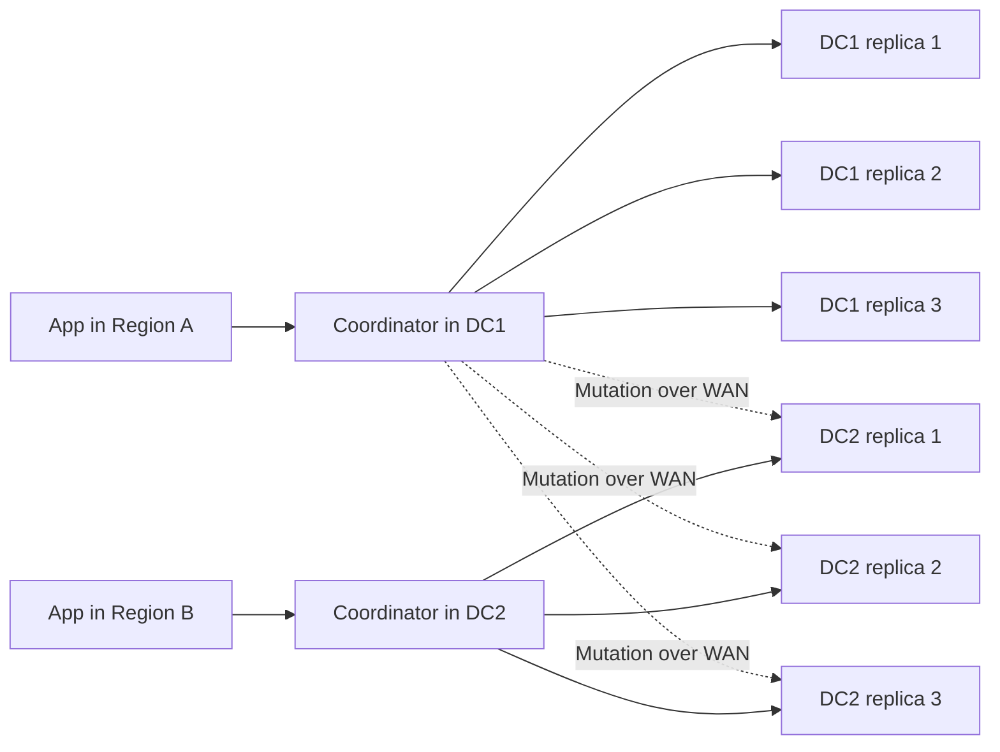
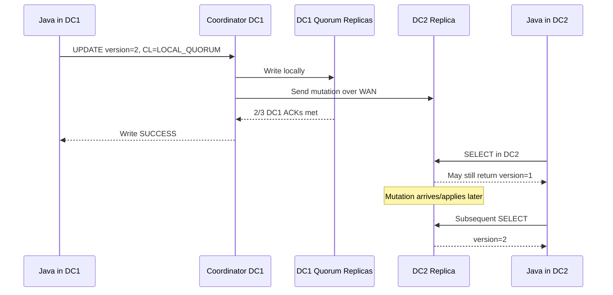

# Cross-Region Replication Delay and Fresh-Read Requirements in Apache Cassandra

## 1. The Problem: After Writing in Region A, Will a Read in Region B See the New Data?

An e-commerce application runs across two datacenters (**data center**, DC) in two geographic regions. A user updates an order status through a Java application in DC1 and is immediately routed to an application server in DC2. A query in DC2 may return the stale status, even though the earlier write operation reported **success**.

This is not necessarily a network bug or Cassandra losing data. The write may have met the requested **consistency level (CL)** within DC1, while forwarding the mutation to replicas in DC2 is still in flight or experiencing disruption. Cassandra lets you choose consistency **per request**; a success acknowledgment at a CL weaker than what the business workflow expects does not promise that every DC already sees the record.

This lesson belongs to the **Multi-Datacenter Deployment** chapter of the `DATABASE_ENGINE_WIDE_COLUMN_CASSANDRA` module. It combines distributed and wide-column architecture, partition keys, query-driven table modeling, consistency-level reads/writes, replication, repair, error handling, and **Java Driver** connectivity. The focus is on three practical questions:

1. **When** is a write in DC1 considered successful, and **when** do replicas in DC2 actually hold the data?
2. When requirements demand **reading the latest data** or cross-region **read-your-writes**, how should you choose CLs, read routing, or application protocols?
3. How do you **measure and verify cross-DC visibility delay** instead of merely checking network ping or write p99?

### Expected Outcomes

After this lesson, you will be able to explain read and write paths across multiple DCs; prove via quorum intersection when a newly written value must be visible; distinguish **write acknowledgment**, **remote visibility**, and **end-to-end latency**; design an experiment tracking time-to-visibility; and design Java access paths plus a runbook for when a DC is slow, unreachable, or has not yet backfilled historical data.

## 2. Architecture: One Cluster, Multiple DCs, No Fixed Primary

Cassandra follows a **multi-primary** model: there is no single primary node for all writes. A client sends CQL to a **coordinator**; the coordinator determines which replicas must store the data based on the partition key/token and the keyspace's replication strategy. With `NetworkTopologyStrategy`, replica counts are specified **per DC**.

Illustrative example:

```sql
CREATE KEYSPACE IF NOT EXISTS commerce_geo
WITH replication = {
    'class': 'NetworkTopologyStrategy',
    'dc1': 3,
    'dc2': 3
};
```

This configures **3 replicas per DC**, totaling **6 target replicas** per partition in this example, assuming enough full-replica nodes and valid topology. In production, the names `dc1`/`dc2` must match the snitch; rack selection and failure domains also matter. Configuring RF **does not guarantee** newly added DC nodes automatically hold historical data: opening a DC requires a streaming/rebuild/repair plan and verification.



**Common misconception:** Cassandra normally **sends mutations to all target replicas**, not just the replicas required for CL. However, **CL decides how many ACK responses—and from where—the coordinator must wait for before returning success**. If a client writes at `LOCAL_QUORUM` in DC1, the coordinator does not have to wait for a quorum in DC2. Sometimes DC2 has already updated before the client receives the ACK; other times DC2 lags behind or misses it. **No fixed cross-region replication latency can be inferred from CL.**

## 3. Distinguishing Three Types of Timing

When discussing "replication latency," define the measurement endpoints—otherwise comparisons become misleading.

| Term | From Where to Where? | Guaranteed by a Successful Write in DC1? |
| --- | --- | --- |
| **Client write latency** | Java sends INSERT/UPDATE → receives ACK/failure per chosen CL | Measures only **that request's** wait threshold |
| **Remote apply/visibility delay** | Mutation written/processed at source → enough replicas in DC2 can return the new version under the chosen read CL | **No**, if the write only waited for `LOCAL_QUORUM` in DC1 |
| **End-to-end read-after-write latency** | User clicks save → a subsequent read in DC2 returns the expected value | Depends on write CL, read CL, routing, network, read timing, and write contention |

*Remote visibility delay* and *read latency in DC2* are distinct. For example, data might already reside on two DC2 replicas while the Java server waits on a queue/network or retries, making the client experience slow reads. Conversely, a `LOCAL_ONE` read hitting an early-updated replica may see the new value **before DC2 replicas converge**.

### 3.1. Timeline of a `LOCAL_QUORUM` Write in DC1

Assume RF = 3 in each DC; a client writes `version=2` in DC1 at `LOCAL_QUORUM`:



This diagram intentionally highlights slow remote apply for illustration; **not every write follows this exact ordering**. Remote ACKs can arrive early, and a real `LOCAL_QUORUM` read contacts replicas along the coordinator's read path; a single arrow to one replica in the diagram is symbolic only.

**Bottom line:** the moment the client receives `SUCCESS` marks completion of the **requested CL**, not the moment "every DC is synchronized."

## 4. Consistency Levels in Multi-DC: What the Coordinator Waits For

Assume `NetworkTopologyStrategy` with `dc1=3` and `dc2=3`, using **full replicas** only to keep the math clear. Transient replication requires separate formulas and documentation.

| CL | ACKs/Responses Required in Example | Core Property |
| --- | --- | --- |
| `LOCAL_ONE` | One replica in local DC | Low latency; no guaranteed intersection with write local quorum |
| `LOCAL_QUORUM` | Two of three replicas **in local DC** | Suited for per-DC read/write paths; does not wait for remote DC quorum |
| `QUORUM` | Four of six replicas **across all DCs** | May pull WAN responses into the completion path depending on which replicas reply |
| `EACH_QUORUM` | For **writes**, two ACKs from **each DC**: 2/3 DC1 and 2/3 DC2 | Waits for all DCs; increases latency/WAN dependency and availability exposure |
| `ALL` | All six replicas | Highest replica availability requirement; fails easily if any replica is slow/down |
| `ONE` | One replica across the full set (not restricted to local DC) | Requires understanding routing; not equivalent to `LOCAL_ONE` |

`EACH_QUORUM` is designed primarily for **multi-DC writes**; do not plan to run `SELECT` with `EACH_QUORUM` as an "all-DC" read. To read fresh data, pair a **write CL + read CL** whose quorum sets intersect in the required scope.

**Intra-DC quorum formula:** `Qdc = floor(RFdc / 2) + 1`. With RF=3, `Qdc=2`. A write receiving two ACKs in DC1 and a read collecting two responses in DC1 **must** share at least one replica in common, provided replica placement did not change between the two requests.

### 4.1. Is `LOCAL_QUORUM` "Strong"?

The pair **DC1 `LOCAL_QUORUM` write → DC1 `LOCAL_QUORUM` read** has intersecting replica sets within **DC1**. It enables reading the acknowledged version under standard quorum assumptions, timestamp reconciliation, and absence of contending writes altering the logical version.

However, the pair **DC1 `LOCAL_QUORUM` write → DC2 `LOCAL_QUORUM` read** involves **two quorums over two disjoint node sets**. They are **not** guaranteed to intersect. This is the root risk behind "just saved in Region A, switched to Region B and read stale data."

### 4.2. Why Cluster-Wide `QUORUM` Is Not the Same as `LOCAL_QUORUM` in DC2

With 3+3 full replicas, a `QUORUM` write ACKed by **4/6** replicas can be distributed as:

```text
QUORUM write ACKs:          DC1 = [A1,A2,A3], DC2 = [B1]    (4/6)
LOCAL_QUORUM read in DC2:         [B2,B3]                   (2/3)
Intersection of sets:       empty
```

Thus, **a cluster-wide `QUORUM` write does not automatically guarantee a `LOCAL_QUORUM` read in DC2 intersects with the write**. Conversely, **cluster-wide `QUORUM` write + `QUORUM` read** at total RF 6 do intersect because `4 + 4 > 6`; however, both can incur WAN latency and failures.

**Never mechanically apply `R+W>RF` by adding a quorum from one DC to a quorum from another DC.** You must examine the **actual replica sets** from which the two operations await responses.

## 5. Matrix of Fresh-Read Requirements After a Write

| Write (Already ACKed) | Subsequent Read | Intersection Guaranteed? | Conclusion About Seeing the Just-Completed Write |
| --- | --- | --- | --- |
| `LOCAL_QUORUM` DC1 (2/3) | `LOCAL_QUORUM` DC1 (2/3) | **Yes, in DC1** | Normally guarantees seeing the ACKed version in the same DC absent concurrent writes |
| `LOCAL_QUORUM` DC1 (2/3) | `LOCAL_ONE` DC1 (1/3) | **No** | May hit a replica that has not yet received the write |
| `LOCAL_QUORUM` DC1 (2/3) | `LOCAL_QUORUM` DC2 (2/3) | **No, different DC** | **Can be stale** while remote has not caught up |
| Cluster `QUORUM` (4/6) | `LOCAL_QUORUM` DC2 (2/3) | **Not guaranteed** | Can be stale; e.g., 3+1 write and reading the other 2 DC2 replicas |
| Cluster `QUORUM` (4/6) | Cluster `QUORUM` (4/6) | **Yes, cluster-wide** | Intersects; may require cross-region responses |
| `EACH_QUORUM` write (2/3 each DC) | `LOCAL_QUORUM` DC2 (2/3) | **Yes, in DC2** | Read can see the ACKed version per Cassandra reconciliation |
| `EACH_QUORUM` write (2/3 each DC) | `LOCAL_ONE` DC2 (1/3) | **Not guaranteed** | Can hit the third replica before it receives the mutation |

This table assumes unchanged RF, all full replicas, and no concurrent mutation winning by timestamp. **Cassandra's "latest read" follows Cassandra's version/timestamp rules, not business wall-clock ordering under concurrent writes or clock skew.**

### 5.1. When Is Eventual Consistency Acceptable?

For product catalogs, dashboards, or analytics data, the requirement may be "normally shows new data within a few seconds, occasionally lagging with alerting." A DC1 `LOCAL_QUORUM` write paired with DC2 `LOCAL_ONE`/`LOCAL_QUORUM` reads can meet latency/availability targets **if the product accepts a measured and monitored staleness window**.

For payment confirmations, settlement states, ticket issuance, or workflows requiring **cross-DC read-after-write immediately after ACK**, never implicitly assume DC2 is as fresh as DC1 when writing only at `LOCAL_QUORUM`. Choose **stronger guarantees** or design an application-level confirmation protocol.

## 6. Business Requirements and Design Choices

Before selecting CLs, write down **what users expect**:

| Requirement | Design Direction | Trade-offs |
| --- | --- | --- |
| Reads and writes **within the same DC** must see the ACKed write | `LOCAL_QUORUM` for writes and reads; keep session/requests in home DC | Avoids WAN on critical path; DC failover needs explicit rules |
| Reads in another DC right after a write must see the **ACKed version** | Write `EACH_QUORUM` then read `LOCAL_QUORUM` in target DC, given suitable RF/placement | Write latency pays WAN RTT; if target DC fails, writes can fail |
| Need cluster-wide quorum rather than per-DC | Pair `QUORUM` write + `QUORUM` read | Global intersection, but requests may wait on WAN |
| App tolerates staleness within an SLO window | Read/write locally, measure time-to-visibility, alert above threshold | Simpler, lower latency; no immediate cross-DC read-your-writes |
| Need read-your-writes for **a user session** across DCs | Maintain **home DC/session affinity**, or version/fence with read orchestration; switch regions only once data is confirmed | Complex routing/failover; must define timeouts and "not ready" states |
| Need strict linearizability for contended updates | Evaluate LWT/Paxos with `SERIAL`/`LOCAL_SERIAL` matching your version and business architecture | High protocol cost; does not itself prove every DC received the mutation |

### 6.1. Option A: Keep the User on a Home DC

If the requirement is "a user who just made an edit must see their own edit," a low-complexity approach is:

1. Route related writes and reads to **the same home DC** using intersecting CLs, e.g., `LOCAL_QUORUM`/`LOCAL_QUORUM`.
2. Route subsequent requests of that user session to the home DC until regional handoff completes.
3. When failing over to another DC, **do not assume fresh-read guarantees carry over unconditionally**. Temporarily reject freshness-critical actions, display a syncing status, or verify target-DC readiness first.

**Sticky sessions** alone do not solve complete source-region loss or clients failed over to a DC that missed writes. Define explicit fallback behavior.

### 6.2. Option B: Wait for Quorum in Every DC

With RF=3 per DC and a successful `EACH_QUORUM` write, the coordinator has received at least 2 ACKs in **each DC**. A `LOCAL_QUORUM` read in DC2 using 2/3 replicas will intersect with at least one replica that ACKed in DC2.

This technique satisfies **cross-DC visibility of completed writes** under the stated assumptions. The cost is that **the write critical path must wait for the WAN and the slowest DC required to ACK**. During an inter-DC network partition, `EACH_QUORUM` writes may **fail completely** even while DC1 is fully healthy.

Do not enable `EACH_QUORUM` for every operation without classifying workloads; the latency and availability costs may be unacceptable.

### 6.3. Option C: Application-Layer Version Confirmation

A practical pattern is attaching a **version/operation ID** to records so that upon switching regions, the application can verify it sees **at least the confirmed version**. For instance, store a system-coordinated `version`. When a user writes version 42 in DC1 and moves to DC2:

- DC2 reads `version >= 42`: safe to serve under that version contract.
- DC2 reads `version=41`: do not serve it as "guaranteed latest"; either wait briefly up to a deadline, route back to origin, or report unsynced state.
- Deadline expires: return a "data updating" status or product-defined consistency error—**never** pretend success with stale data.

This is an **application protocol**, not a free guarantee of `SELECT`. With concurrent writers, the application must issue versions reliably (e.g., via LWT or a dedicated serializer) and handle idempotency, timestamps, and rollbacks. Never use per-region `+1` increments without conflict resolution.

## 7. Where Does Cross-Region Replication Delay Come From?

| Factor | How It Impacts Delay | How to Measure / Check |
| --- | --- | --- |
| **WAN RTT, jitter, packet loss** | Mutations/ACKs traverse inter-region links; delay or loss slows apply | RTT, retransmissions, per-link network errors |
| **Coordinator and queues** | Coordinator overload, backpressure, or dropped messages stall mutation forwarding | CPU, thread pools, dropped messages, write latency |
| **Remote replicas** | Commit log/memtable, CPU, GC, disk, and write queues govern apply time | GC, disk latency, thread pool pending, write metrics |
| **Node/DC unavailable** | Remote misses writes initially; may only catch up via hints/repair | Node status, logs, hints, and anti-entropy repair |
| **Retry/timeout systems** | A timed-out write has unknown state; retries can add work if non-idempotent | Client error/retry metrics and request IDs |
| **Topology/RF changes** | New replicas lack historical data; placement shifts | Schema agreement, streaming/rebuild, full repair coverage |
| **Timestamps, concurrent writes** | Cassandra's winning value may differ from business order | Check write timestamps, clock skew, writer identity |

**There is no single "replication offset" like a streaming-log system** where you can compute `remote_offset - local_offset` as Cassandra's universal lag metric. Each partition, replica, CL, and access path can progress differently. WAN ping is an infrastructure signal, **not a direct measure of fresh-data visibility delay**.

### 7.1. Hinted Handoff and Repair Do Not Provide a Freshness Deadline

When a replica is unavailable, coordinators may store **hints** and replay them once the node returns. Hints are bounded by time, disk space, and policy; they are **best effort**, not a guarantee that all missed data eventually reaches every replica. **Anti-entropy repair** must be operated to reconcile missed mutations, including tombstones.

For a requirement like "must become visible within 200 ms" (an example SLO), you cannot satisfy it by saying "just rely on hinted handoff/repair." Those are fault-recovery convergence mechanisms, not per-mutation consistency deadlines. You need a CL contract or a controlled application protocol.

## 8. Distinguishing Three Seemingly Similar Scenarios

### 8.1. Remote Replicas Are Healthy but Have Not ACKed Yet

A `LOCAL_QUORUM` write in DC1 succeeded; the mutation is in flight to DC2 or has reached one of three replicas. A `LOCAL_ONE` read in DC2 may return stale or fresh data depending on the chosen node. A `LOCAL_QUORUM` read in DC2 can also be stale if not enough replicas carry the new version yet; **avoid concluding from one lucky read** that all replicas have converged.

### 8.2. WAN Is Partitioned While Each DC Remains Healthy

DC1 and DC2 cannot communicate:

- `LOCAL_QUORUM` writes in DC1 can still succeed if 2/3 DC1 replicas are healthy. DC2 has **no guarantee of seeing** those new DC1 writes until the network heals and convergence runs.
- `EACH_QUORUM` writes struggle or fail due to missing DC2 quorum ACKs. In return, the guarantee "success means both regions confirmed" is not silently weakened.
- Both regions continuing to write **the same key** while disconnected can create version conflicts. Cassandra uses timestamps and reconciliation rules to pick a winner; the result may not match "last edit" by user wall clock.

Thus you must define the priority: **availability when one region disconnects** versus **cross-region freshness before returning success**. You cannot unconditionally promise both across every network partition.

### 8.3. A New DC Opens Without Historical Data Backfilled

If you just added DC2 and updated `NetworkTopologyStrategy`, DC2 nodes may still lack records written before DC2 existed. This is **not merely a few milliseconds of lag** on new mutations. You need **streaming/rebuild/full repair** following topology-change procedures and verified coverage before letting clients read historical data from DC2.

Do not run a time-to-visibility experiment on a few fresh writes and claim historical backfill is complete.

## 9. CQL Lab: Creating Versioned Data to Measure Visibility

Practice on a test cluster with **two real DCs**, each with at least three healthy nodes and a verified Cassandra version. Running this on a single DC cannot test cross-region delay.

```sql
CREATE KEYSPACE IF NOT EXISTS geo_lab
WITH replication = {
    'class': 'NetworkTopologyStrategy',
    'dc1': 3,
    'dc2': 3
};

CREATE TABLE IF NOT EXISTS geo_lab.order_state_by_id (
    order_id uuid PRIMARY KEY,
    revision bigint,
    write_id uuid,
    status text,
    updated_at timestamp
);
```

`revision` and `write_id` are **application-managed columns for observability**, not Cassandra-generated global sequences. In the lab, **only one writer updates each `order_id`** to avoid contention. If multiple writers update the same row, you need a revision-issuing protocol and proper concurrency semantics—never treat client-computed `revision + 1` as atomic.

Prepare a fixed key:

```sql
INSERT INTO geo_lab.order_state_by_id
    (order_id, revision, write_id, status, updated_at)
VALUES (
    11111111-1111-1111-1111-111111111111,
    1,
    22222222-2222-2222-2222-222222222222,
    'CREATED',
    '2026-11-21T00:00:00Z'
);

SELECT revision, write_id, status
FROM geo_lab.order_state_by_id
WHERE order_id = 11111111-1111-1111-1111-111111111111;
```

Before measuring, verify that `revision=1` is present as expected in **both DC1 and DC2** via proper repair/validation. Do not test against a DC2 missing historical data due to a skipped rebuild and misreport it as "replication latency."

### 9.1. Controlled Experiment Design

1. Create Java client **A** with local DC=`dc1` and client **B** with local DC=`dc2`, keeping contact points, driver version, CL, and networking fixed.
2. Client A updates `revision=2` and a new `write_id`, writing at `LOCAL_QUORUM`. Measure time from send to ACK.
3. Immediately after ACK, client B loops `SELECT` in DC2 at `LOCAL_ONE` or `LOCAL_QUORUM` per test case; stop upon observing the new `write_id` or hitting a deadline. Record **read attempts, first-seen timestamp, errors, and timeouts**.
4. Repeat across multiple partition keys, spaced far enough apart not to overlap versions. Measure under varying load levels, daytime/peak hours, and active compaction.
5. Run a separate pass with **`EACH_QUORUM` writes** and **DC2 `LOCAL_QUORUM` reads** to compare write latency and visibility. Do not compare two runs if offered RPS/concurrency, dataset, or configuration differ.

You do not need to force a network partition for a basic lab. If testing WAN faults, do so only in an isolated environment with a recovery plan and operational authorization—never disrupt production intentionally.

## 10. Measuring "Time-to-Visibility" Properly

Because there is no shared replication-offset clock, pick **reproducible measurement points**. A simple metric:

```text
t_ack          = when Java writer receives write success
t_seen_dc2     = when Java reader B first observes the matching write_id
delay_post_ack = max(0, t_seen_dc2 - t_ack)
```

If writer and reader run in **two separate processes**, do not subtract `System.nanoTime()` across processes or hosts. Use **a single controller** recording both timestamps against one monotonic clock, or record times on synchronized hosts and report measurement error bounds. `System.nanoTime()` is only meaningful for elapsed intervals **within the same JVM**; wall clocks suffer from clock skew/NTP drift.

**Critical interpretation notes:**

- `delay_post_ack` does not measure total time since the mutation left the coordinator. DC2 may already have received the data **before** the ACK reached the DC1 client, making the first read fresh and the metric near 0.
- If polling every 50 ms, the true instant DC2 got the data lies **between the last stale read and the first fresh read**, not to exact millisecond precision.
- If the deadline expires without seeing the data, that is a **censored observation** or failure—never drop it from statistics to make p99 look prettier.
- If a write fails or times out, do not assume nothing was written: Cassandra may have applied the mutation on some replicas before timing out. Classify those cases separately.
- If the reader uses `LOCAL_ONE`, seeing the version does not mean all DC2 replicas are updated; if `LOCAL_QUORUM`, the result reflects the active quorum, not an individual check of every replica.

### Example Results Report (All Numbers Hypothetical)

| Metric | DC1 `LOCAL_QUORUM` Write → DC2 `LOCAL_QUORUM` Read | `EACH_QUORUM` Write → DC2 `LOCAL_QUORUM` Read |
| --- | ---: | ---: |
| Client write p50 | 8 ms | 42 ms |
| Client write p99 | 23 ms | 130 ms |
| Post-ACK visibility p50 | 18 ms | 0–1 polling cycle |
| Post-ACK visibility p99 | 240 ms | 0–1 polling cycle |
| Reads exceeding 1 s deadline | 0.8% | 0.0% in test run |
| Write success when DC2 disconnects | Can still succeed | Lacks DC2 quorum → may fail |

These figures are **not real Cassandra benchmarks** and do not represent default SLAs. With `EACH_QUORUM`, post-ACK delay for a same-DC `LOCAL_QUORUM` read is typically very low because quorums intersect, yet you must still report **poll interval**, errors, concurrent writes, and data correctness. A 0% failure rate in one test run is not an invariant guarantee at all times.

### Defining Business SLAs

An example specification (not a universal recommendation for every product):

```text
Cross-DC read-after-write for confirmed actions:
  - 99.9% of read requests must see the ACKed write_id
  - Deadline: 300 ms after write success
  - On miss: explicit "PENDING_SYNC" state; do not return stale data
  - Separately report write failures, read timeouts, observed stale, and cancelled

Eventual-consistency dashboard:
  - 99% of mutations readable in DC2 within 5 seconds
  - Display "last refreshed" timestamp; bounded staleness acceptable
```

SLOs are only meaningful when measured using **explicit write IDs**, with defined sample counts, load, and DC scope. An `INSERT` p99 latency chart alone does not prove cross-region freshness SLOs.

## 11. Java Driver 4.x: Separating the DC1 Write Path and DC2 Read Path

The Cassandra driver uses a **local datacenter** to prefer coordinators/replicas close to the application. Never run a `dc1`-configured session from an app host in `dc2` and assume you are measuring local DC2 reads. For clear verification, create two separate sessions/configs matching the lab setup.

The example below uses Java 17+ (text blocks), Java Driver 4.x, and `CqlSession`. IPs and hostnames are illustrative; replace them with real reachable contact points, ports, credentials, and TLS in your system.

```java
import com.datastax.oss.driver.api.core.CqlSession;
import com.datastax.oss.driver.api.core.DefaultConsistencyLevel;
import com.datastax.oss.driver.api.core.cql.PreparedStatement;
import com.datastax.oss.driver.api.core.cql.BoundStatement;
import com.datastax.oss.driver.api.core.cql.Row;
import java.net.InetSocketAddress;
import java.util.UUID;

// In production, create long-lived sessions and close on shutdown.
// Two sessions here serve only to measure both local DCs in a lab.
try (
    CqlSession dc1 = CqlSession.builder()
        .addContactPoint(new InetSocketAddress("127.0.0.1", 9042))
        .withLocalDatacenter("dc1")
        .build();
    CqlSession dc2 = CqlSession.builder()
        .addContactPoint(new InetSocketAddress("127.0.0.2", 9042))
        .withLocalDatacenter("dc2")
        .build()
) {
    UUID orderId = UUID.fromString(
        "11111111-1111-1111-1111-111111111111");
    UUID writeId = UUID.randomUUID();

    PreparedStatement update = dc1.prepare("""
        UPDATE geo_lab.order_state_by_id
        SET revision = ?, write_id = ?, status = ?
        WHERE order_id = ?
        """);
    PreparedStatement select = dc2.prepare("""
        SELECT revision, write_id, status
        FROM geo_lab.order_state_by_id
        WHERE order_id = ?
        """);

    BoundStatement write = update.boundStatementBuilder()
        .setLong(0, 2L)
        .setUuid(1, writeId)
        .setString(2, "PAID")
        .setUuid(3, orderId)
        .setConsistencyLevel(DefaultConsistencyLevel.LOCAL_QUORUM)
        .build();

    long startWriteNs = System.nanoTime();
    dc1.execute(write);
    long ackNs = System.nanoTime();

    long deadlineNs = ackNs + 1_000_000_000L;
    boolean observed = false;
    int attempts = 0;
    do {
        attempts++;
        Row row = dc2.execute(
            select.boundStatementBuilder()
                .setUuid(0, orderId)
                .setConsistencyLevel(DefaultConsistencyLevel.LOCAL_QUORUM)
                .build()
        ).one();
        if (row != null && writeId.equals(row.getUuid("write_id"))) {
            long observedNs = System.nanoTime();
            long postAckNs = observedNs - ackNs;
            observed = true;
            // Record write_latency=ackNs-startWriteNs,
            // postAckNs, attempts, CL, run_id into a histogram.
            break;
        }
        Thread.sleep(50); // Lab: 50ms polling; control load carefully.
    } while (System.nanoTime() < deadlineNs);

    if (!observed) {
        // Record deadline-exceeded and the closest observed value.
        // Never exclude failed samples from freshness reports.
    }
}
```

**Limitations of this example:**

- Loopback addresses `127.0.0.1` and `127.0.0.2` are **placeholders** only; they do **not** create two real datacenters. Labs need reachable contact points mapped to real DCs.
- Because one JVM drives both sessions, `System.nanoTime()` can measure elapsed duration. Across two separate regional apps, use a single controller or tracing system with proper time synchronization.
- `Thread.sleep(50)` is bounded polling for demonstration; do not multiply it into thousands of polling loops per second in production.
- When a write times out, it may have applied on some replicas; this lab snippet does not handle timeouts, idempotency, or retry policies. Real systems must isolate `WRITE_UNKNOWN` requests and investigate.
- If multiple writers update one `order_id`, `revision=2` and `write_id` do not automatically resolve conflicts or enforce business "last write" ordering. Use an appropriate coordination protocol or LWTs.
- The experiment only proves each `write_id` is readable at a specific CL; it does not check full-DC convergence or historical data after adding a DC.

### 11.1. Testing `EACH_QUORUM` for Writes

Change one line:

```java
.setConsistencyLevel(DefaultConsistencyLevel.EACH_QUORUM)
```

in the **write statement**, keeping the DC2 read at `LOCAL_QUORUM`. Compare write p99, success rate, and polling attempts. During WAN faults, `EACH_QUORUM` writes may time out or return unavailable; **never retry infinitely** without idempotency and verification of whether the earlier write succeeded.

## 12. Contention on the Same Key and Clocks: Separate from Replication Delay

Cassandra generally picks a cell's winning version by **write timestamp**, not "whichever request hit the replica last" or "whichever request returned an ACK to the client last" in all cases.

Suppose:

```text
DC1: writer A updates status="APPROVED" with timestamp=1000
DC2: writer B updates status="CANCELLED" with timestamp=999
The two mutations arrive at each DC in different orders.
After convergence, timestamp=1000 can win.
```

If business rules state "a cancellation after approval must win" yet the two writers' timestamps do not reflect that order, Cassandra can converge to an unintended outcome. This **is not solved by waiting a few extra seconds** or merely switching `LOCAL_QUORUM` to `EACH_QUORUM`.

For conditional concurrent updates, evaluate **lightweight transactions (LWT)/Paxos**, `SERIAL` or `LOCAL_SERIAL`, and their consistency scopes for your version. `LOCAL_SERIAL` is a local-scope option that **does not automatically ensure** all DCs share a single global business ordering. Ultra-strict multi-region updates may require a business coordinator, key ownership, sagas, or a dedicated transactional system depending on requirements.

**Clock-skew warning:** misusing `USING TIMESTAMP` or running hosts with skewed clocks can let a "business-wise older" record win in Cassandra. Never fix freshness bugs by artificially bumping timestamps, as that can shadow valid future writes.

## 13. Observing on the Cluster: What Tools Do and Do Not Measure

### 13.1. Status and Replication Strategy

```sql
SELECT keyspace_name, replication
FROM system_schema.keyspaces
WHERE keyspace_name = 'geo_lab';
```

```bash
# Monitor node/DC/rack and token ownership, not per-write latency.
nodetool status geo_lab
nodetool describecluster

# Data streaming during bootstrap/repair, NOT a general queue
# measuring every cross-region mutation on the normal write path.
nodetool netstats

# Detect queues, errors, and compaction competing for resources.
nodetool tpstats
nodetool compactionstats
nodetool tablestats geo_lab.order_state_by_id
```

`nodetool netstats` primarily reports active **streaming** (bootstrap, repair, and similar tasks). Do not see "no active streams" and conclude "zero replication delay," because **normal mutation replication is not exposed as a single streaming queue**.

### 13.2. Metrics Collection Table

| Layer | Metric | Purpose |
| --- | --- | --- |
| **Java writer DC1** | Write p50/p95/p99, timeouts, errors, ACK CL, offered RPS | Application wait time and write completion rate per CL |
| **Java reader DC2** | Read p50/p95/p99, stale reads, deadline exceeded | Read quality and ability to observe new writes |
| **Freshness by write ID** | Post-ACK visibility p50/p95/p99, missed-deadline count | Directly measures cross-DC business requirements |
| **Cassandra nodes** | Pending/dropped messages, read/write latency, heap/GC, disk latency | Diagnoses server queues and bottlenecks |
| **WAN** | RTT/jitter/loss/retransmits, network throughput | Identifies slow inter-region transport |
| **Hints/repair** | Pending/aged/delivered hints, repair coverage/failures | Tracks convergence when replicas miss writes |
| **Topology** | Node `UN/DN`, schema agreement, DC/rack placement | Rules out missing replicas in a DC |

In Cassandra versions supporting `ideal_consistency_level` and related metrics, you can evaluate **the rate at which writes satisfy an "ideal" consistency level** (such as `EACH_QUORUM`) beyond the client's requested CL. However, that is **not a per-partition replication lag clock**—check your release documentation and metric definitions. Never infer "ideal consistency met" means every replica is instantaneously synchronized.

Before building dashboards, verify whether each metric is a cumulative counter, gauge, histogram, or ratio. For p99 across multiple nodes/DCs, **never average p99 values directly**; use proper histograms/samples and keep failed requests in the report.

## 14. Runbook When Users Read Stale Data in Another Region

### 14.1. Incident Triage

| Symptom | First Hypothesis | What to Check |
| --- | --- | --- |
| DC1 just ACKed write; DC2 reads stale for tens of ms then updates | DC1 `LOCAL_QUORUM` write; remote apply lagging | Write/read CL, local DC, write ID, and post-ACK delay |
| DC2 reads stale for minutes; a node was offline | Hint/replay delayed or dropped; repair needed | Node status, hints, repair, and logs |
| DC2 consistently misses history after adding the DC | Rebuild/full repair did not cover all token ranges | Replication map, streaming, and data coverage |
| `EACH_QUORUM` writes time out during inter-DC link issues | Not enough ACKs in target DC | WAN, node health, timeouts, and client write-unknown |
| Both DC1 and DC2 read unexpected state even after converging | Concurrent timestamps, clock skew, data model | Client timestamps, writer ordering, LWT/conditions |
| Read p99 is bad while values are always correct | Read/I/O bottleneck, GC, load, or WAN path | Node metrics, query/partition model, driver routing |
| Only specific keys are stale | Hot partition, replica-specific backlog, update races | Token placement, per-key write ID, range sample |

### 14.2. Six-Step Remediation

1. **Confirm the contract:** does the business require **immediate cross-DC fresh reads** or tolerate up to X seconds of staleness? Record exact write/read CL, local DC, and affected region.
2. **Collect traces:** write IDs, anonymized partition keys, client ACK timestamps, read timestamps, request IDs, p99, and errors. Never rely on a single screenshot lacking timestamps.
3. **Check topology/schema:** NTS replication map, node states, DC/racks, recent startups/streams, repair/backfill after RF changes.
4. **Diagnose queues and WAN:** RTT/loss, pending/dropped messages, hints, CPU/GC/disk, read/write timeouts, compaction, and competing streams.
5. **Mitigate impact:** for freshness-critical flows, keep traffic in the home DC if safe; block or return `PENDING_SYNC` when the target DC is not ready rather than silently serving stale data as synced. Cap retries and polling.
6. **Fix root cause and verify:** pick the right CL or version/fence protocol; if replicas missed data, run repair/backfill; re-run the same test and compare freshness p99 and availability.

Never "fix" missing data in DC2 by lowering the read consistency level, as that can make staleness even more unpredictable. Never lower `gc_grace_seconds` to force convergence: tombstones need retention time and safe repair, and premature purging can cause zombie data.

## 15. Failover and Disaster Recovery: Write Down the Data Contract

A two-region architecture typically defines two targets:

- **RTO (Recovery Time Objective):** how long does it take to shift operations to the other DC when the primary region fails?
- **RPO (Recovery Point Objective):** how much data already ACKed by the primary region can be lost/missing at failover time?

If the application writes at `LOCAL_QUORUM` in DC1, DC1 can report success before DC2 has sufficient copies. If DC1 fails completely right after an ACK, DC2 risks missing some of those writes. **Never promise RPO=0 across DCs based solely on `LOCAL_QUORUM`.**

With `EACH_QUORUM`, a write that **truly received a successful ACK** achieved quorum in each DC under the active configuration/assumptions, at the cost that writes may be rejected when the target DC or WAN is unavailable. **Timed-out/unknown-outcome** writes must be investigated separately; never silently treat them as definitely failed or definitely succeeded.

Before cutover:

1. Verify the target DC has been bootstrapped/rebuilt and repaired for historical data; `UN` nodes do not prove coverage.
2. Lock down **watermarks/write IDs** or verification workflows for critical data required in the target DC, per business contract.
3. Verify the driver local DC and client routing in the target region; run canary checks with real CLs.
4. State the policy for writes uncertain to have reached the target DC: wait, report incomplete status, reconcile upon failback, or accept the defined RPO.
5. Rehearse recovery during network partitions, not just single-node shutdowns; include staleness and timeout metrics in drill results.

Never treat `EACH_QUORUM` as a label for "absolute strong consistency under every race." For concurrent writes, timestamp semantics and LWT scope remain separate problems.

## 16. Choosing a Strategy by Workload and Cost

| Workload | Initial Choice | What to Monitor Closely |
| --- | --- | --- |
| Events/telemetry tolerating a few seconds lag | Local `LOCAL_QUORUM` or SLA-matched writes, local reads; measure freshness | Stale p99, repair/hints, WAN outages |
| Cached product pages with batch updates | Eventual consistency and versioned/TTL caches may fit | Cache invalidation vs. replication |
| Orders that creator must see right after writing | Keep home DC; use same-DC `LOCAL_QUORUM` writes/reads | Session affinity and proper failover |
| Orders requiring immediate view in **any DC** after confirmation | Consider `EACH_QUORUM` write + `LOCAL_QUORUM` read or app confirmation protocol | WAN write p99, errors when DC is down, SLA cost |
| Flows requiring cluster-wide quorum reads/writes | `QUORUM`/`QUORUM` pair with full replication | WAN reachability, availability, read/write p99 |
| Multi-region concurrent edits on one key | Key ownership, LWT/appropriate coordination mechanism | Clock skew, timestamps, idempotency, conflict policy |

There is no single "best" CL independent of SLAs. Configurations favoring latency and availability reduce cross-region freshness guarantees; configurations demanding multi-region ACKs can block writes when the WAN fails.

## 17. Practice Exercises and Self-Check Questions

### Exercise A: Prove `QUORUM` Is Not Enough for a Local Read in DC2

An NTS keyspace has `dc1=3, dc2=3`. A `QUORUM` write receives four ACKs: A1, A2, A3 in DC1 and B1 in DC2. A `LOCAL_QUORUM` read in DC2 uses B2 and B3.

1. Do the two ACK/response sets intersect?
2. Do a cluster-wide `QUORUM` write and cluster-wide `QUORUM` read intersect?
3. If a DC1 write must **guarantee** a `LOCAL_QUORUM` read in DC2 sees the version, which CL pair can you choose and what trade-off must you accept?

### Exercise B: Measure Two Types of "Latency"

Write a Java lab with two sessions for DC1/DC2; write a new `write_id` and poll DC2:

1. Measure p50/p95/p99 client write latency and post-ACK visibility latency separately.
2. Test `LOCAL_ONE`/`LOCAL_QUORUM` for DC2 reads and `LOCAL_QUORUM`/`EACH_QUORUM` for writes.
3. Increase load in a controlled way; record poll counts, deadline misses, request timeouts, and compaction events.
4. Explain why a 0 ms post-ACK value does not prove all replicas in DC2 received the mutation.

### Exercise C: Region B Loses Connectivity

Suppose the WAN between DC1/DC2 is partitioned for one minute. Clients in DC1 keep writing at `LOCAL_QUORUM` successfully. Operations wants to fail users over to DC2:

1. Can you promise RPO=0? Why or why not?
2. How should requests behave if they must read a version just ACKed in DC1?
3. Why won't continuous retries or changing the read CL to `ONE` guarantee the new data appears?
4. Once the network recovers, how do you verify hints/repair and historical data?

### Quick Questions

1. In Cassandra, does CL specify how many replicas *are sent the mutation* or how many ACKs to wait for before reporting success?
2. Does a `LOCAL_QUORUM` write in DC1 have to wait for DC2?
3. Why don't two local quorums in DC1 and DC2 intersect, even though each quorum uses two replicas?
4. Is an `EACH_QUORUM` write followed by a `LOCAL_ONE` read in DC2 guaranteed to see the new write?
5. Why can cluster-wide `QUORUM`/`QUORUM` be slower than local reads/writes when the other DC is far away?
6. Does `nodetool netstats` directly measure replication lag for every CQL mutation?
7. Why is subtracting `System.nanoTime()` values across two different hosts inaccurate?
8. Does hinted handoff replace periodic repair or historical data backfill when opening a new DC?
9. Is a timed-out write in DC1 guaranteed not to be saved on any replica?
10. Why can a higher timestamp win even if that mutation is "older" in business logic?

## 18. Apache Cassandra Reference Documentation

- [Apache Cassandra – Dynamo architecture and Tunable Consistency](https://cassandra.apache.org/doc/stable/cassandra/architecture/dynamo.html): replication strategies, sending mutations to replicas, and quorum intersection conditions.
- [Apache Cassandra – Hinted handoff](https://cassandra.apache.org/doc/stable/cassandra/managing/operating/hints.html): missed-write compensation and best-effort limits.
- [Apache Cassandra – Repair](https://cassandra.apache.org/doc/stable/cassandra/managing/operating/repair.html): anti-entropy repair, full/incremental, token range scope.
- [Apache Cassandra – cassandra.yaml configuration](https://cassandra.apache.org/doc/stable/cassandra/managing/configuration/cass_yaml_file.html): metric-related settings such as `ideal_consistency_level` by version.

Before adopting a CL or specialized feature in production, check documentation for **your exact Cassandra version, driver, replication strategy, and replica types**. Examples in this lesson use NTS full replicas and do not replace capacity planning or real network fault testing.

## 19. Conclusion

**Cross-region replication delay** is not a constant and cannot be inferred from an `INSERT` returning success. Cassandra normally sends writes to replicas in all DCs, yet `LOCAL_QUORUM` only makes the coordinator wait for quorum **within the local DC**. Therefore, an immediate read in another DC may see stale data. If a read must see an ACKed write in a target DC, **choose a write/read CL pair with intersecting response sets** (such as `EACH_QUORUM` write and `LOCAL_QUORUM` read in the target DC) or use **application protocols** like home-DC affinity and version fencing, with clear awareness of latency and availability costs.

Measure quality using **write IDs, post-ACK time-to-visibility, stale/deadline-miss rates, read/write p99, and cluster health**—not just WAN pings or `nodetool status`. When a DC disconnects, explicitly define RPO/RTO and handling for uncertain outcomes; when adding a new DC, backfill historical data before shifting traffic. A strong multi-region solution is one with **an explicit freshness contract, measured evidence, and pre-defined failover behavior**.
