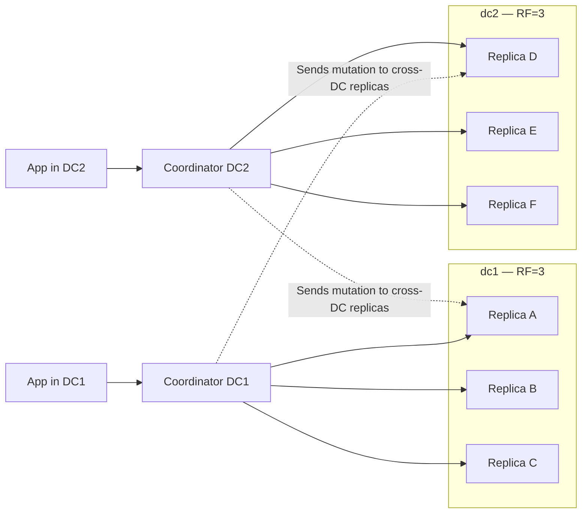
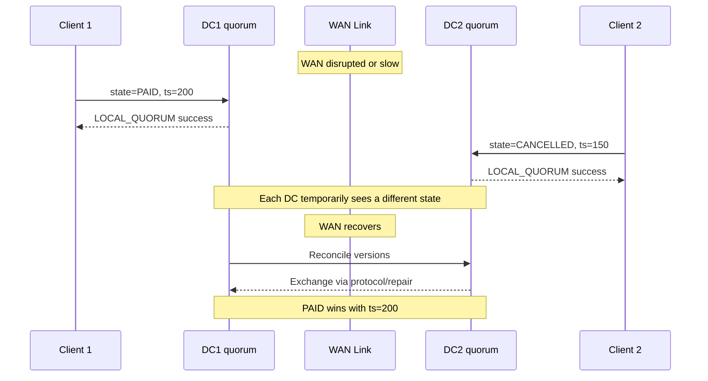

# Multi-Datacenter Writes, Timestamps, and Conflicting Updates

An application deployed across two datacenters (DCs) can let users write to their nearest DC to reduce latency. In Apache Cassandra, each DC can hold replicas of the same partition and accept writes via a local coordinator. This enables **active-active traffic**, while also creating situations where two writers update **the same cell** across two DCs nearly simultaneously. Cassandra does not merge values using business rules automatically: for regular writes, versions are reconciled by **cell timestamp** (*last-write-wins*, LWW), not by packet arrival order at a node.

Suppose an order is marked `PAID` in DC1 and `CANCELLED` in DC2 while the inter-DC link is disrupted. Both requests can succeed at `LOCAL_QUORUM` in their respective DCs. Once connectivity returns, one version wins according to timestamp rules; **"later update as perceived by the user" does not necessarily win**, and the two updates cannot be treated as two valid sequential transactions merely because Cassandra synchronizes them.

This lesson belongs to the **Multi-Datacenter Deployment** chapter of the **DATABASE_ENGINE_WIDE_COLUMN_CASSANDRA** module. We connect replica placement and partition keys with consistency, CQL, timestamps, tombstones, repair, error handling, and the Java driver so multi-DC writes have **explicit business semantics**, instead of assuming replication decides correctly on the application's behalf.

## 1. Learning Objectives

After this lesson, you will be able to:

1. Distinguish **DC-local acknowledgment**, inter-DC replication, and data visibility in another DC.
2. Explain `NetworkTopologyStrategy` together with `LOCAL_QUORUM`, `QUORUM`, `EACH_QUORUM`, and `ALL` in a multi-DC cluster.
3. Describe how Cassandra compares **cell** timestamps, including why out-of-order arrivals do not let an older-timestamp version win.
4. Identify clock skew, client/server-assigned timestamps, tombstones, TTLs, and partial-column updates as sources of unexpected outcomes.
5. Practice CQL from coordinators in both DCs, read `WRITETIME`, and verify conflicts.
6. Distinguish **single-writer/fencing**, **immutable events**, **cross-DC LWT/CAS**, and external reconciliation strategies.
7. Write Java driver code with explicit consistency and timestamps/idempotency, and define an active-active acceptance test suite.

## 2. Multi-DC Replication Does Not Mean Synchronous Writes in Every DC

Cassandra places replicas according to the **token** of the partition key. With `NetworkTopologyStrategy` (NTS), replica counts are specified per DC. For example:

```sql
CREATE KEYSPACE IF NOT EXISTS multi_dc_lab
WITH replication = {
  'class': 'NetworkTopologyStrategy',
  'dc1': 3,
  'dc2': 3
}
AND durable_writes = true;
```

Once both DCs have enough nodes/failure domains and topology has been populated properly, each partition has **three replicas in `dc1`** and **three replicas in `dc2`**. Six copies are six physical storage locations of the **same logical data**, not six separate business rows. `durable_writes = true` governs commit-log writes on replicas, while actual durability still depends on sync policies, disk failures, and consistency levels.



The diagram shows **logical relationships**; connection counts and how coordinators send over inter-DC links are implementation details that vary by version. Key points to remember:

- A write at **`LOCAL_QUORUM` in `dc1`** waits for the required replicas **within `dc1`**. It **does not wait for quorum in `dc2`**.
- The coordinator still participates in distributing data to replicas in the topology, though mutations can arrive in the other DC late or hit network errors.
- A write at **`LOCAL_QUORUM` in `dc2`** can be acknowledged independently while the two DCs cannot exchange data.
- A `SELECT` in the other DC can observe an older version until replicas there receive and reconcile the mutation.
- **Hinted handoff and repair** help converge replicas that missed writes. They do not replace business conflict-resolution rules.

### Coordinator, Replicas, and Partition Key

A Java application normally connects to a coordinator chosen by the driver. That coordinator **does not have to be a replica** holding the partition; it uses token metadata to locate the right replica set. If the partition key is `order_id`, all versions of **one `order_id`** map to the same logical replica layout, though they may temporarily differ across DCs while writes are propagating.

Query-driven table design still matters. Even with two DCs, Cassandra will not turn `SELECT ... WHERE state = 'PAID'` on a non-key column into an efficient query. You must have a fitting partition key and query design; replication does not replace data modeling.

## 3. Consistency Level Reference for Two DCs

Assume **`dc1`: RF=3, `dc2`: RF=3**, with no transient replicas or active topology transitions. These numbers illustrate quorum math:

| Consistency Level | Primary Write Requirement | Key Point to Remember |
| --- | --- | --- |
| `LOCAL_ONE` | 1 replica in local DC | Lower latency, but risks reading stale versions if other replicas lack the data. |
| `LOCAL_QUORUM` | `floor(3/2)+1 = 2` replicas in **local DC** | Does not confirm the other DC has received the mutation. |
| `QUORUM` | `floor((3+3)/2)+1 = 4` replicas out of total RF=6 | Four responses **total**, not necessarily two in each DC. |
| `EACH_QUORUM` | 2 replicas **in `dc1`** and 2 replicas **in `dc2`** | Intended for **writes**; raises WAN cost/dependency and reduces write availability when a DC disconnects. |
| `ALL` | All six replicas | Demands full availability of every replica; sensitive to node/network faults. |

**`EACH_QUORUM` is not a regular read consistency level**: in Cassandra CQL, it is used for **writes**. For `SELECT`, evaluate `LOCAL_QUORUM` or `QUORUM` according to goals and topology.

### Important Case: DC1 Writes LQ, DC2 Reads LQ

```text
t0: DC1 app writes order=P at LOCAL_QUORUM (A/B ACKed).
t1: DC2 has not yet received the new mutation due to WAN lag/outage.
t2: DC2 app reads order=P at LOCAL_QUORUM (D/E).
Result may be STALE data or row not found yet.
t3: Mutation reaches DC2 / repair catches up.
t4: Read in DC2 now observes the new version.
```

This **does not violate `LOCAL_QUORUM`'s contract**. Each DC has its own quorum; the write quorum in DC1 and the read quorum in DC2 **are not required to intersect**.

If a write is acknowledged at `EACH_QUORUM` (two replicas in **each DC**), then a subsequent `LOCAL_QUORUM` read (two of three) in either DC **intersects on at least one replica** with the ACKed set in that same DC, assuming stable topology/replica sets and no newer writes. That gives a basis for reading the confirmed update under Cassandra's reconciliation semantics, **not** a guarantee that every replica received it and **not** serialization of competing writers.

### `R + W > RF` Must Be Applied in the Right Scope

The quorum intersection rule only applies when reads and writes examine **the same replica set**. Never mechanically apply cluster-wide `R+W>RF` when two operations use `LOCAL_QUORUM` in **two different DCs**. Similarly, a `QUORUM` write of 4/6 total might not include a quorum in DC2, so you cannot assume every `LOCAL_QUORUM` read in DC2 intersects the ACK set.

**Reality:** consistency levels govern **when a request reports success**, not the business order in which two updates to the same entity are allowed to resolve. Those are two separate design problems.

## 4. How Timestamps Decide the Winning Version

For regular writes, Cassandra uses a **per-cell timestamp**, represented at **microsecond** resolution in CQL, to pick the winning version when replicas hold multiple updates for the same cell. A higher timestamp generally wins **regardless of whether the mutation arrived earlier or later**. Out-of-order arrivals still converge to the same value under reconciliation rules.

```text
DC1: UPDATE status='PAID',       timestamp = 1700000000000200
DC2: UPDATE status='CANCELLED',  timestamp = 1700000000000100

Suppose DC2's message arrives at replica X AFTER DC1's message:
  CANCELLED has a lower timestamp → does not overwrite PAID.

Final result after replicas reconcile:
  status = 'PAID' (timestamp 1700000000000200)
```

The system never asks "did the user cancel after paying?" and does not use packet-arrival clocks to measure real-world order. **Last-write-wins in Cassandra is primarily *timestamp-wins*, not *last-arrival-wins* or *last-business-action-wins*.**

### Where Does a Write Timestamp Come From?

Depending on the CQL statement and **driver/Cassandra version** settings, timestamps can be set explicitly via `USING TIMESTAMP`, generated by the client/driver, or assigned by the server/coordinator. Never assume two services in two DCs share identical clocks with zero drift.

- **`USING TIMESTAMP 1700000000000200`**: value expressed in **microseconds since the Unix epoch** in CQL.
- **`WRITETIME(column)`**: inspects the timestamp stored with a regular column's value; useful for labs and investigation.
- **Clock skew**: if one writer generates timestamps **in the future**, subsequent real updates carrying lower timestamps can keep losing.
- **Multiple clients**: different instances can generate independent timestamps; inspect timestamp-generator policies, NTP/clock sync, and failover behavior.

Timestamps here are a **storage-layer conflict-resolution tool**, not a distributed transaction clock providing *happens-before* ordering. NTP reduces skew, but **does not create linearizability** for regular multi-DC writes.

### When Two Updates Have Equal Timestamps

Cassandra uses **deterministic** tie-breaking when timestamps match; when a tombstone and a live value share the exact same timestamp, deletion rules take special precedence. However, **applications must never rely on byte/value-level tie-breaking as business logic**: it may not reflect user intent. Avoid intentionally colliding timestamps for competing versions and define explicit conflict resolution instead.

## 5. Active-Active Timeline: Both Writes Succeed, One Update Loses

Consider order #42. An Asia-region app writes to DC1 while a Europe-region app writes to DC2; the WAN is temporarily partitioned:



"Reconcile versions" in the diagram is conceptual, not a single fixed RPC. After the network recovers, replicas may receive delayed mutations, hints, or repair; *once* they receive the valid data, they converge to the same winner.

**Storage-layer outcomes are not business-layer truth.** If `CANCELLED` was a valid decision occurring after payment, LWW can discard it. If a financial system debits, refunds, or adjusts inventory, never entrust correctness to an active-active upserted `state` column without coordination.

### "Succeeded" Has Three Distinct Meanings

1. **Client write success in DC1**: enough responses to meet DC1's request CL.
2. **Replica convergence**: replicas receive and reconcile updates; cross-DC differences due to replication lag disappear.
3. **Business success**: the action was validated by business rules, no transition was lost, and no side effect executed twice.

These three conditions are not equivalent. Repair helps achieve condition 2; **it does not create** condition 3.

## 6. Per-Cell Reconciliation: One Row Can Mix Results from Two Writers

Cassandra reconciles mutations at the cell level by timestamp. When two flows update **different columns** or update asynchronously, the converged row can be storage-valid yet **never written as a single coherent business state by any writer**.

Suppose a table stores `state` and `source_dc`:

```sql
-- DC1 writer updates both columns at timestamp 1700000000000400.
UPDATE multi_dc_lab.order_state_by_id
USING TIMESTAMP 1700000000000400
SET state = 'PAID', source_dc = 'dc1'
WHERE order_id = 11111111-1111-4111-8111-111111111111;

-- DC2 writer updates only source_dc at a newer timestamp.
UPDATE multi_dc_lab.order_state_by_id
USING TIMESTAMP 1700000000000500
SET source_dc = 'dc2'
WHERE order_id = 11111111-1111-4111-8111-111111111111;
```

After reconciliation, the row can show `state='PAID'` alongside `source_dc='dc2'`. This is a **per-cell merge of versions**, not a `PAID from dc2` record agreed upon by the application. Identify which fields represent **metadata of a version**, and when fields must change together, use a data model or workflow preserving that invariant. Single-partition mutation atomicity does not serialize two competing mutations arriving from different DCs.

### Tombstones and TTLs Participate in Conflicts

- `DELETE` creates a **tombstone** with a timestamp. It shadows older values under reconciliation rules and must be retained long enough for downed replicas to receive the deletion.
- When a `DELETE` timestamp is **lower** than a newer valid write, do not assume `DELETE` "came later" and must erase the newer value.
- **TTL expiration** produces logically deleted data; TTL is not a mechanism to reconcile two conflicting business decisions. TTLs, local expiry metadata, and skewed timestamps can complicate conflict investigations.
- **`gc_grace_seconds` + repair** protect against zombie data when replicas go offline. Lowering grace periods to "sync faster" risks purging deletion markers before stale replicas catch up.
- Timestamps far in the future can shadow subsequent normal writes for a long time. Never fix this in production by manually deleting SSTables/commit logs or issuing even larger arbitrary timestamps.

## 7. Hands-On CQL: Preparing a Conflict Lab Table

> This lab requires a Cassandra cluster **with two real DCs**, `dc1` and `dc2`, each having at least three eligible nodes for RF=3. Without a two-DC lab, run the CQL only in a test environment to study syntax; **do not claim you observed cross-DC conflicts**. Never alter production RF/topology to do exercises.

Create the keyspace as in Section 2, then create a table modeled for **one order by ID**:

```sql
CREATE TABLE IF NOT EXISTS multi_dc_lab.order_state_by_id (
  order_id uuid PRIMARY KEY,
  state text,
  source_dc text,
  business_version bigint,
  updated_at timestamp
);
```

In this lab, `business_version` is simply a **stored column**, with **no** monotonic check under regular `INSERT`/`UPDATE`. `updated_at` is written by the app to display business time; do not confuse it with `WRITETIME(state)`, which is the cell timestamp. If `business_version` must be enforced conditionally, use LWT or another coordination mechanism described below.

### Connect to the Right DC

Open **two `cqlsh` sessions** pointed at coordinators in the two different DCs:

```bash
# Terminal A: coordinator address in dc1.
cqlsh DC1_COORDINATOR_HOST 9042

# Terminal B: coordinator address in dc2.
cqlsh DC2_COORDINATOR_HOST 9042
```

In **both** sessions:

```sql
CONSISTENCY LOCAL_QUORUM;
```

Verify each host belongs to the intended DC via `nodetool status`/lab node metadata; `LOCAL_QUORUM` is local to the **coordinator's DC**, not a client-chosen label. Successfully connecting to an IP does not prove routing hits the intended DC.

### Step 1 — Write Baseline in DC1

Use a fresh test key with no prior data:

```sql
INSERT INTO multi_dc_lab.order_state_by_id
  (order_id, state, source_dc, business_version, updated_at)
VALUES (
  11111111-1111-4111-8111-111111111111,
  'NEW', 'seed', 0, '2023-11-14T22:13:20+0000'
)
USING TIMESTAMP 1700000000000000;

SELECT state, source_dc, business_version,
       WRITETIME(state) AS state_writetime
FROM multi_dc_lab.order_state_by_id
WHERE order_id = 11111111-1111-4111-8111-111111111111;
```

Timestamps `1700000000000000`, `1700000000000100`, and `1700000000000200` are **fixed synthetic values** for the lab in microseconds. They represent past epochs relative to the lesson so results remain reproducible on a **fresh** key. Never use these timestamps for real business data or keys that already have higher-timestamp writes.

### Step 2 — DC1 Writes the Higher-Timestamp Version

In **DC1 `cqlsh`**:

```sql
UPDATE multi_dc_lab.order_state_by_id
USING TIMESTAMP 1700000000000200
SET state = 'PAID',
    source_dc = 'dc1',
    business_version = 1
WHERE order_id = 11111111-1111-4111-8111-111111111111;
```

### Step 3 — DC2 Writes the Lower-Timestamp Version

After Step 2 reports success, in **DC2 `cqlsh`**:

```sql
UPDATE multi_dc_lab.order_state_by_id
USING TIMESTAMP 1700000000000100
SET state = 'CANCELLED',
    source_dc = 'dc2',
    business_version = 1
WHERE order_id = 11111111-1111-4111-8111-111111111111;
```

Both operations can be acknowledged by Cassandra under each DC's `LOCAL_QUORUM`. Once both newer and older mutations reach enough replicas and reconciliation completes, **`PAID` wins** even though the `CANCELLED` `UPDATE` was sent *later*: its timestamp is lower. If read immediately while replication lags, DC2 might temporarily display the older version; **do not** declare convergence from a single `SELECT`.

### Step 4 — Verify from Both DCs

Run in **both DC1 and DC2 `cqlsh`**:

```sql
CONSISTENCY LOCAL_QUORUM;

SELECT state, source_dc, business_version,
       WRITETIME(state) AS state_writetime,
       WRITETIME(source_dc) AS source_writetime
FROM multi_dc_lab.order_state_by_id
WHERE order_id = 11111111-1111-4111-8111-111111111111;
```

Once data has converged, expected output:

| Column | Expected Final Value |
| --- | --- |
| `state` | `PAID` |
| `source_dc` | `dc1` |
| `business_version` | `1` |
| `WRITETIME(state)` | `1700000000000200` |
| `WRITETIME(source_dc)` | `1700000000000200` |

If both DCs still return different values, inspect connectivity, replica availability, consistency, logs/metrics, and repair schedules **within lab scope**. This does not mean a later write with a lower timestamp propagates as the "final value" at all times.

### Step 5 — Reverse the Order: Higher Timestamp Still Wins

Use a **new `order_id`** to avoid interference from earlier steps. Write `CANCELLED` in DC2 with a higher timestamp first, then write `PAID` in DC1 with a lower timestamp. After convergence, the value with the **higher timestamp** still wins, regardless of the order in which the two clients sent operations.

**Evidence to record:** test `order_id`, coordinator/DC, CL, explicit timestamps, each request's timing, read results from each DC, and `WRITETIME`. Never just write "DC1 won" while omitting timestamps, which would confuse timestamp precedence with a DC-priority rule.

## 8. Three Extended Experiments

### Experiment A — Clock Skew and Future Timestamps

On another lab `order_id`, write a column with a timestamp **significantly higher** than the other clients' timestamps, then update the same column with a lower timestamp. Observe that the newer write fails to win even though its write succeeded. This illustrates why all writers' clocks must be synchronized and monitored. **Never create far-future timestamps on production data**, as they can shadow valid writes for a long time.

### Experiment B — Per-Cell Updates

Run the two commands from Section 6 on a fresh lab key: DC1 writes `state` and `source_dc` at timestamp `T`; DC2 updates only `source_dc` at `T+100`. After convergence, compare `WRITETIME` across the two columns. Takeaway: a row can look like it was "written in `dc2`" while `state` actually came from the `dc1` writer. If a coherent atomic state is required, schemas/workflows must model that version boundary.

### Experiment C — WAN Link Loss

Only in a **lab where infrastructure changes are permitted**, isolate the inter-DC link while keeping each DC's quorum alive, then write **two different values to the same partition** in each DC at `LOCAL_QUORUM`. Verify both writes succeed locally; once WAN recovers, observe reconciliation and run repair per runbook.

**Never** sever production networks, and never lower CL casually to "simulate" the same conditions, as the behavior is not equivalent. Keep isolation shorter than hint/repair thresholds and preserve evidence. Even after network recovery, verify actual convergence rather than assuming Cassandra updated every replica instantly.

## 9. Choosing Conflict-Resolution Architecture by Business Need

No CQL option guarantees "two concurrent business actions in two DCs will merge exactly as users intend" for every data model. Choose a strategy based on the invariants to preserve:

| Requirement | Approach | Trade-offs / Notes |
| --- | --- | --- |
| Only one region edits **an entity** at a time | **Single-writer per key** by owner DC, plus fencing on failover | Needs routing and ownership transfer; prevent both regions claiming ownership during partitions. |
| Latest timestamp wins is acceptable | **Normal writes + LWW** | Simple/fast, but can lose valid updates; never use for critical invariants. |
| Must keep all events and derive state | **Append-only immutable events** with event IDs, dedup, and consumer/ordering | Reading state needs projections; must handle duplicates, ordering, and reconciliation. |
| Need conditional updates on one partition | **LWT/CAS** with cross-DC serial consistency | Higher latency, cross-DC availability dependency; protects only the conditioned scope, not multi-partition transactions. |
| Need strong multi-entity transactions, ledgers, payments | **Authority/transactional service** or workflow with idempotency, sagas, and reconciliation | More complex, preserves business rules; Cassandra serves as queryable data/event store. |
| Involves additive counters | Design for counter semantics/retries or event-based aggregation | Counter updates have special properties; unguarded retries can double-count; not inherently "active-active safe." |

### Option 1 — Single-Writer, Ownership, and Fencing

The application assigns an **owner DC** for each order/account. Requests from other DCs are forwarded to the owner or recorded as pending events/commands. If the owner DC fails:

1. A coordination system issues a unique **ownership transfer decision**.
2. A new **epoch/fencing token** is issued to the next writer.
3. The old writer **is no longer permitted** to write after ownership moves, even when the network heals.
4. Reconcile requests ACKed previously but unseen in the target DC before accepting new competing mutations.
5. Record every operation ID and business version for safe retries/deduplication.

Merely storing `owner_dc='dc1'` in a Cassandra row **does not enforce fencing** if two writers can update that column with regular writes. You need a genuinely serialized ownership-claim mechanism—such as properly scoped global CAS or a dedicated authority—and enforce ownership checks **before every update**.

### Option 2 — Immutable Events + Projection

Instead of two DCs updating the same `state` cell, each action is appended as **an event** with a unique ID and business context. For example:

```sql
CREATE TABLE IF NOT EXISTS multi_dc_lab.order_events_by_id (
  order_id uuid,
  event_id uuid,
  event_type text,
  origin_dc text,
  domain_version bigint,
  occurred_at timestamp,
  PRIMARY KEY ((order_id), event_id)
);
```

This schema stores **multiple events for the same order** under distinct keys, reducing same-cell overwrites. Still:

- UUIDs/event IDs **do not automatically impose global business order**; consumers need ordering rules and conflict-handling logic.
- DCs may still observe **incomplete event sets** during WAN lag; projections must allow updates/reconciliation when late events arrive.
- Retries must reuse the **same `event_id`**, never generating a new UUID for the same logical event. If multiple writers reuse an ID with different payloads, you still need a conflict-detection policy.
- Never assume creating an event table solves "two concurrent debit commands." Financial balances require invariants and an authority.

### Option 3 — Conditional Versioning, Not Just a Numeric Column

Storing `business_version=42` with a regular `UPDATE` does not stop another writer from also writing `42`. To reject changes once a version advances, use **compare-and-set** (LWT) or a serializing system enforcing the condition:

```sql
-- Example on an order_id already at business_version=41.
UPDATE multi_dc_lab.order_state_by_id
SET state = 'PAID',
    source_dc = 'dc1',
    business_version = 42
WHERE order_id = 11111111-1111-4111-8111-111111111111
IF business_version = 41;
```

In `cqlsh` or Java, configure LWT/serial consistency and inspect `[applied]`. If not applied, read/reconcile the current state before retrying; never bump timestamps to force an overwrite. Crucially, if another writer **bypasses LWT** and updates those cells via regular writes, the system loses its invariant even though some calls use CAS.

## 10. Cross-DC LWT: `SERIAL` Is Not `LOCAL_SERIAL`

LWT runs a consensus protocol (Paxos or release-specific variants) for a **single-partition** condition, adding round trips and WAN exposure. In multi-DC clusters, distinguish:

| Serial Consistency | Design Intent | Risk When Misused |
| --- | --- | --- |
| `SERIAL` | Aims for serial/linearizable LWT execution across **participating replicas**, appropriate when coordinating contention **across DCs**. | Higher latency and lower availability when WAN/replicas cannot reach consensus. |
| `LOCAL_SERIAL` | Scopes the serial phase to the **local DC**. | **Must not** be used as a global CAS lock when writers in other DCs can write concurrently. |

Distinguish the **regular consistency** used for the read/write commit phase accompanying an LWT from the **serial consistency** used for the consensus phase. The Java driver provides separate APIs for each. **Never use manual `USING TIMESTAMP` to replace CAS**; conditional writes have specific timestamp syntax/rules. LWT only protects **single-partition** conditions; transferring funds between two accounts in different partitions requires a different transactional/workflow model.

**WAN partition scenario:** if global uniqueness via CAS is required, the system may have to **reject or block writes** when cross-DC consensus cannot be reached. That is a fundamental consistency/availability trade-off, not a bug you can erase by switching to `LOCAL_SERIAL` during an incident.

### Checking CAS Outcomes

```sql
-- Executed in DC1 or DC2 with the chosen serial consistency.
CONSISTENCY LOCAL_QUORUM;
SERIAL CONSISTENCY SERIAL;

UPDATE multi_dc_lab.order_state_by_id
SET state = 'SHIPPED',
    business_version = 43
WHERE order_id = 11111111-1111-4111-8111-111111111111
IF business_version = 42;
```

Syntax for setting serial consistency in `cqlsh` depends on the tool version; if your shell does not support that command form, configure it in the Java driver and verify with features supported by your deployment. **Never mistake an unrecognized shell command for Cassandra lacking LWT.** On a successful CAS, `[applied]=true`; on failure, current values are returned so the caller can reconcile per API rules.

## 11. Java Driver 4.x: Timestamped Writes and Idempotent Retries

The example below uses two separate `CqlSession` instances, each configured with **contact points and local datacenter** targeting its DC (e.g., `dc1Session`, `dc2Session`). Both access the Cassandra keyspace/table; the app neither calls replicas directly nor alters replication metadata per request.

```java
import java.util.UUID;
import com.datastax.oss.driver.api.core.ConsistencyLevel;
import com.datastax.oss.driver.api.core.cql.BoundStatement;
import com.datastax.oss.driver.api.core.cql.PreparedStatement;
import com.datastax.oss.driver.api.core.cql.ResultSet;

UUID orderId = UUID.fromString(
    "22222222-2222-4222-8222-222222222222");

// Assume version/timestamp was issued by a controlled allocator
// for this logical operation; DO NOT regenerate on retry.
long stableTimestampMicros = 1700000000000200L;

PreparedStatement update = dc1Session.prepare(
    "UPDATE multi_dc_lab.order_state_by_id " +
    "USING TIMESTAMP ? " +
    "SET state = ?, source_dc = ?, business_version = ? " +
    "WHERE order_id = ?");

BoundStatement statement = update.bind(
        stableTimestampMicros, "PAID", "dc1", 42L, orderId)
    .setConsistencyLevel(ConsistencyLevel.LOCAL_QUORUM)
    .setIdempotent(true);

ResultSet result = dc1Session.execute(statement);
```

**Important conditions**:

- `stableTimestampMicros` in the example is a **lab placeholder**. In production, timestamps must come from a unified policy across writers, never casually from `System.currentTimeMillis()*1000` treated as a global guarantee.
- `setIdempotent(true)` merely informs the driver it may apply retry policies; **it does not make a side-effecting business action exactly-once**. Keeping the same primary key, payload, and timestamp avoids altering LWW outcomes when retrying **one** logical write, but does not prevent another writer from racing.
- A **timeout** does not mean the write did not happen. Never change the UUID/order ID or timestamp just because the response was lost; log operation ID, DC, CL, exception, and reconcile.
- Without a guaranteed **ordered version/timestamp issuer**, choose single-writer, event logs, or LWT; never assume two machines' clocks suffice for business ordering.

### Java LWT with `SERIAL`

When CAS on a single partition is genuinely needed, use a conditional prepared statement and explicitly set **serial consistency**:

```java
PreparedStatement cas = dc1Session.prepare(
    "UPDATE multi_dc_lab.order_state_by_id " +
    "SET state = ?, business_version = ? " +
    "WHERE order_id = ? IF business_version = ?");

BoundStatement guarded = cas.bind(
        "PAID", 42L, orderId, 41L)
    .setConsistencyLevel(ConsistencyLevel.LOCAL_QUORUM)
    .setSerialConsistencyLevel(ConsistencyLevel.SERIAL);

ResultSet appliedResult = dc1Session.execute(guarded);
if (appliedResult.wasApplied()) {
    // Passed the CAS condition for this partition.
} else {
    // Version changed: inspect returned state and resolve business conflict.
}
```

This snippet is not a full production application. On an LWT timeout, the outcome is also **unknown** to the client; design idempotency/reconciliation and never blindly re-run external side effects. If using LWT for version control, **all participating writers** must follow the same workflow, and WAN latency/Paxos capacity must be evaluated.

## 12. Multi-DC Operations: Time Sync, Networking, and Replicas

An active-active deployment must be monitored **bidirectionally**, not just by application HTTP latency:

| Area | Questions to Track |
| --- | --- |
| **Clock synchronization** | NTP/clock offset, drift, client timestamp generators—is any writer issuing future timestamps? |
| **DC/rack topology** | NTS, per-DC RF, replica placement, node/rack DOWN—are schema/topology metadata stable? |
| **Inter-DC network** | RTT, packet loss, throughput, link drops/flaps, queue backlogs, link alerts. |
| **Write/read availability** | p95/p99 and timeouts per DC, consistency type, coordinator, and affected token ranges. |
| **Hinted handoff** | Pending/expired/replayed hints—is a peer repeatedly down or missing mutations? |
| **Anti-entropy repair** | Most recent **fully scoped successful** repair, failed ranges/DCs, margin relative to `gc_grace_seconds`. |
| **Commit log / durability** | Sync policy, disk errors, commit log usage, correlated failure-domain loss—do ACKed writes survive power loss? |
| **SSTables/compaction** | Pending compactions, tombstones, SSTable streaming, disk usage—are they slowing catch-up or raising read latency? |
| **Application conflict telemetry** | CAS `[applied]=false` counts, business-version conflicts, duplicate operation IDs, projection lag, rejected events. |

### Data Synchronization ≠ Business Correctness

Repair brings replicas toward a shared state under **timestamp/tombstone rules**. After repair, DC1 and DC2 may both agree on `PAID` yet **still be wrong in business terms** if a valid cancellation lost by timestamp. Therefore track both:

1. **Replica convergence**: identical versions read from each DC, with no unresolved repair gaps.
2. **Business conflict resolution**: no lost transitions, and reconciliation totals (orders, funds, inventory) match source events/truth.

### When a New DC Was Just Added to Replication

If you just ran `ALTER KEYSPACE` to increase RF in DC2, updated NTS metadata **does not prove historical data is fully populated**. Follow your version's streaming/rebuild/repair and verification runbook before shifting read/write traffic to the new DC. Never declare "DC2 is ready for active-active" merely because `nodetool status` shows `UN`.

## 13. Runbook for Cross-DC Conflicts or Incidents

When two DCs return different values or a valid update appears to have "vanished":

1. **Scope the incident**: order/entity ID, partition key, affected cells, both DCs/coordinators, request timestamps, and consistency levels.
2. **Gather evidence**: query `WRITETIME(cell)` in each DC, business version, operation IDs, client/server timestamp generators, app/driver logs, and WAN state.
3. **Classify the cause**: (a) replication lag, (b) conflict resolved by LWW, (c) tombstone/TTL, (d) stale cache or projection, (e) missed mutation/repair gap.
4. **Protect correctness**: for payments/inventory/order state, lock or restrict concurrent edits to the entity per runbook; avoid firing more normal updates to "force" a state.
5. **Check the source of truth**: events, ledgers, business commands, external confirmations. Choose the business outcome; **do not simply pick the largest timestamp**.
6. **Apply a controlled fix**: single-writer/LWT or compensating workflow with operation ID/idempotency. If manual data correction is unavoidable, evaluate tombstones, timestamps, and all replicas first.
7. **Verify at two layers**: read at CL in both DCs and confirm business invariants/projections/side effects; log repair/reconciliation results.
8. **Prevent recurrence**: fix clock sync, routing, CAS/versioning, schema, retry policy, or WAN monitoring based on root cause.

**Never** run `nodetool repair` blindly expecting it to pick the right business decision. If LWW already reconciled data toward a timestamp that is "wrong" in business terms, repair only spreads that winning value across replicas.

### Symptom and Investigation Matrix

| Symptom | Possible Cause | What Not to Do |
| --- | --- | --- |
| DC1 ACKed, DC2 does not see it immediately | `LOCAL_QUORUM` only ACKs locally; WAN lag/hints. | Immediately declare data lost, retry with new ID, or lower CL. |
| Update sent later did not win | Lower timestamp, clock skew, or different client timestamp generator. | Bump timestamps to huge values in production to "override." |
| State and update source disagree | Per-cell timestamps and partial updates. | Assume a row is an atomic LWW object. |
| Value reappears after `DELETE` | Tombstone purged before lagging replica caught up, old restore, repair gap. | Lower `gc_grace_seconds` or manually delete SSTables. |
| CAS fails across two regions | Competing writers, wrong serial/regular CL, stale version. | Switch `SERIAL` → `LOCAL_SERIAL` to bypass global conflicts. |
| Write timeout during network partition | Insufficient replicas/WAN path; client outcome unknown. | Infinitely retry non-idempotent side effects. |
| Network reconnected, data still diverges | Expired hints, missed writes, incomplete repair range/DC. | Treat `UN` as proof of convergence. |

## 14. Evaluating Consistency Levels Against Business Requirements

| Requirement | Starting Approach | Limits to State Explicitly |
| --- | --- | --- |
| Regional users need fast writes, tolerating cross-DC lag | `LOCAL_QUORUM` per DC, writing **disjoint partitions/keys** or with an explicit conflict policy. | Same-cell writes can conflict; immediate cross-DC reads can be stale. |
| On write success, both DCs must have quorum ACKs | `EACH_QUORUM` for writes; evaluate `LOCAL_QUORUM` reads. | WAN/remote DC outage breaks write availability; does not resolve concurrent business conflicts. |
| Need one decision point for a **single partition's** version | LWT with `SERIAL` and a consistent workflow across all writers. | WAN/Paxos latency and semantics do not span multiple partitions. |
| Need financial/multi-entity transaction ordering | Authority/ledger or transaction service, event logs, and sagas enforcing invariants. | Single-partition Cassandra RF/CL/LWT provides no multi-partition atomicity. |
| Read-mostly system wanting DR in DC2 | Single-writer DC1, replication to DC2, failover with fencing and catch-up. | RPO/RTO, in-flight writes not yet in DC2, and ownership transfer must be rehearsed. |

### RPO/RTO During Failover

- **RPO** depends on CL, which replicas/DCs acknowledged writes, sync policy, concurrent failures, WAN lag, and backups. A `LOCAL_QUORUM` write in DC1 **does not default to RPO=0 if DC1 fails completely** before DC2 receives the mutation.
- **RTO** includes failure detection, routing/ownership switchover, data verification, reconciliation, driver state, and standby DC capacity.
- If disaster recovery demands very low RPO, explicitly decide **whether to wait for remote acknowledgments** and measure WAN/availability impact. Never infer RPO from RF alone.

## 15. Active-Active Testing and Acceptance Criteria

A multi-DC lab only demonstrates proper understanding of conflicts when backed by evidence at **both the Cassandra layer and the business layer**:

| Scenario | Test Action | Expected Evidence |
| --- | --- | --- |
| **Normal replication** | Write an order from DC1; read from DC1/DC2 at multiple intervals. | Local LQ ACK; observed DC2 convergence time and `WRITETIME`. |
| **Concurrent same-cell writes** | Both DCs update the same `state` with different timestamps. | Higher timestamp wins after convergence, regardless of arrival order. |
| **Clock skew** | Inject controlled timestamp offset in the lab. | Detect valid writes losing due to lower timestamps, with clock alerts. |
| **Partial-column updates** | Both DCs edit different columns. | Merged fields with differing `WRITETIME` values observed. |
| **WAN partition** | Both DCs accept LQ local writes, then heal the network. | Both ACK locally; replicas converge by rules, followed by business reconciliation. |
| **Remote quorum** | Write `EACH_QUORUM`, measure latency, simulate remote DC down. | Per-DC ACK targets, failure behavior, and availability trade-offs recorded. |
| **LWT competing writers** | Two clients run CAS on the same version using `SERIAL`. | Both cannot apply to the same condition; `[applied]`/retry outcomes logged. |
| **Long outage / expired hints** | Controlled offline node, then run repair in the lab. | Repair coverage and tombstone handling observed; not trusting a single `SELECT`. |
| **Owner failover** | Move single-writer from DC1 to DC2 and isolate old writer. | Fencing blocks old writer after new epoch; events are not double-counted. |

**Metrics to retain:** write/read p50/p95/p99 per DC and CL, WAN RTT/packet loss, hints/repair lag, conflict counts per entity, CAS rejections, retry rate, clock offset, projection lag, missing/duplicate business events, and observed `WRITETIME` values.

### Acceptance Criteria Go Beyond Two DCs Returning the Same Value

1. **Correct topology:** NTS per-DC RF, racks/AZs, and replica placement verified; no unfinished bootstrap/replace/rebuild.
2. **Meaningful CL:** each API explicitly specifies its CL/serial CL, and WAN/remote-DC failure risks are accepted.
3. **Clear conflict policy:** the team knows when LWW is acceptable, when single-writer/LWT/event logs are required, and how to handle indeterminate timeouts.
4. **Converged data:** keys and `WRITETIME` reconciled across representative partitions; no unresolved repair/hint gaps.
5. **Business invariants preserved:** no double charges, no lost valid transitions, no wrong state overwrites caused merely by fast clocks.
6. **DR rehearsed:** WAN partitions, DC loss, fenced failover, old-DC recovery, and reconciliation all have tested runbooks and metrics.

## 16. Common Misconceptions

| Misconception | Accurate Understanding |
| --- | --- |
| "Cassandra is active-active, so two updates to one row always merge properly." | Regular writes are mostly **LWW by cell timestamp**; business rules must be designed. |
| "Writing `LOCAL_QUORUM` in DC1 means reading LQ in DC2 sees it immediately." | Two quorums in **different DCs** do not intersect; remote DCs can lag. |
| "`QUORUM` across two DCs means two replicas in each DC ACKed." | With RF 3+3, `QUORUM` = **4 total**, not guaranteed 2+2; **`EACH_QUORUM`** requires quorum per DC. |
| "Last write wins means the command sent last wins." | The higher timestamp wins, even if the mutation arrived earlier. |
| "NTP synchronization gives absolute transaction ordering." | Clock skew shrinks, but it does not provide happens-before or serializability. |
| "Every row has a single timestamp." | Each cell has its own timestamp; one row can mix versions from multiple mutations. |
| "A `business_version` column automatically blocks stale writes." | It is ordinary data without CAS or an enforcing authority. |
| "Repair will pick the customer's right business decision." | Repair converges **by storage rules**, unaware of business transitions. |
| "Lowering `gc_grace_seconds` helps replicas sync faster." | It can purge deletion markers too early and cause zombie data. |
| "LWT `LOCAL_SERIAL` is globally unique/correct multi-DC." | It limits serial consensus to the local DC, not replacing global coordination when both DCs write. |
| "Two writes with `setIdempotent(true)` are exactly-once." | The driver flag does not create idempotency or prevent side effects/racing writers. |
| "High RF guarantees losing a whole DC loses zero recent writes." | Still depends on remote acknowledgments, commit-log sync, replication lag, and failure mode. |

## 17. Practice Exercises

### Exercise A — Calculating Per-DC Quorum Correctly

A cluster has `dc1: 3, dc2: 3`, and an application writes from DC1 at `LOCAL_QUORUM`.

1. How many replicas in DC1 must respond?
2. After success, can you guarantee a `LOCAL_QUORUM` read in DC2 immediately sees the new value? Why or why not?
3. Compare `QUORUM`, `EACH_QUORUM`, and `ALL` writes: replica counts and WAN trade-offs?
4. If the inter-DC link drops, can active-active local writes still succeed, and under what conditions?

### Exercise B — Fast Clock and Lost Valid Update

DC1 writes `state=PAID` at timestamp `1,700,000,000,000,500`; DC2 later writes `state=CANCELLED` at timestamp `1,700,000,000,000,300`. After convergence:

1. Which value wins?
2. If `CANCELLED` was the valid business decision after `PAID`, what went wrong?
3. Which solution fits better: manually bumping timestamps, NTP, single-writer, CAS `SERIAL`, or event sourcing? Explain each option's guarantee boundaries.

### Exercise C — Partial Updates and Invariants

An order has `state`, `source_dc`, and `business_version`. DC1 and DC2 update subsets of columns at different timestamps; eventually the row looks as if one DC decided `state` while `source_dc` names the other DC.

Design a table or workflow so **metadata fields stay aligned with their version**, and explain why `WRITETIME` aids investigation without **automatically** fixing data.

### Exercise D — Testing CAS and WAN Partition

Two clients in two DCs both read `business_version=41` and try to advance it to `42`. Do the following:

1. Write the CQL `IF business_version=41`.
2. Set the right serial consistency for a cross-DC condition.
3. Explain what happens to availability if the WAN is partitioned.
4. Design retries/reconciliation when a client does not know whether CAS applied.
5. State why single-partition CAS still cannot atomically transfer funds between two accounts in different partitions.

### Exercise E — Adopting an Active-Active Strategy

A retail system serves two regions and requires **never wrongly cancelling shipped orders and never double-refunding**, while keeping local API latency low. Choose single-writer, event logs, or an authority/transaction service; specify:

- Who issues `business_version` and how write authority transfers on failover;
- How event/operation IDs support idempotent retries;
- How the read model in the other DC is synchronized and reconciled;
- Metrics for replication lag, conflicts, projection accuracy, and RPO/RTO;
- WAN-disconnect scenarios and recovery procedures without double side effects.

**Completion criteria:** learners demonstrate **(a)** which replicas CL confirms, **(b)** which timestamp wins and why, **(c)** which workflows must not be left to LWW, and **(d)** runbooks/metrics to detect and reconcile cross-DC conflicts.

## 18. Self-Check Questions

1. Why don't a `LOCAL_QUORUM` write in DC1 and a `LOCAL_QUORUM` read in DC2 guarantee immediate read-your-writes?
2. With NTS `dc1:3, dc2:3`, how do `QUORUM` and `EACH_QUORUM` differ in the replicas required **per DC**?
3. In Cassandra, how are two out-of-order updates to the same cell resolved by timestamp?
4. Why can one client's fast clock render many subsequent writes "invisible"?
5. Why don't `WRITETIME(state)` and an application-written `updated_at` necessarily match?
6. If two DCs `UPDATE` different columns of the same row, when can the business result become a "hybrid" state?
7. How do `SERIAL` and `LOCAL_SERIAL` differ when writers in two DCs contend on the same partition?
8. Repair resolves replica divergence, but can it undo a bad business outcome caused by LWW?
9. Why can generating a new UUID/event ID when retrying a timed-out write duplicate events?
10. When all of DC1 fails, why doesn't a write ACKed at `LOCAL_QUORUM` in DC1 prove DC2 holds enough data for lossless failover?

## 19. Further Reading

- [Apache Cassandra — Data replication](https://cassandra.apache.org/doc/latest/cassandra/architecture/dynamo.html): replication, consistency, and replica communication.
- [Apache Cassandra — CQL data manipulation](https://cassandra.apache.org/doc/latest/cassandra/developing/cql/dml.html): `INSERT`, `UPDATE`, `USING TIMESTAMP`, conditional writes, and `WRITETIME`.
- [Apache Cassandra — CQL data definition](https://cassandra.apache.org/doc/latest/cassandra/developing/cql/ddl.html): `NetworkTopologyStrategy` and per-DC replication.
- [Apache Cassandra — Repair](https://cassandra.apache.org/doc/latest/cassandra/managing/operating/repair.html): anti-entropy, replica convergence, and limits when mutations are missed.
- [Apache Cassandra — Tombstones](https://cassandra.apache.org/doc/latest/cassandra/managing/operating/compaction/tombstones.html): deletion timestamps, `gc_grace_seconds`, and zombie risks.
- [Apache Cassandra Documentation](https://cassandra.apache.org/doc/latest/): verify timestamp/serial consistency policies and syntax for your exact running version.

**Key takeaway:** Cassandra allows applications in multiple datacenters to write to the same logical replica set, but regular writes do not establish a global business ordering. `LOCAL_QUORUM` protects responses within the local DC and **does not** guarantee immediate visibility in another DC; Cassandra reconciles conflicts by **cell timestamp**, not arrival order or user intent. To preserve invariants under active-active writes, explicitly choose **ownership/fencing, properly scoped LWT `SERIAL`, immutable events, and reconciliation**, and verify both **replica convergence** and **business correctness**.
