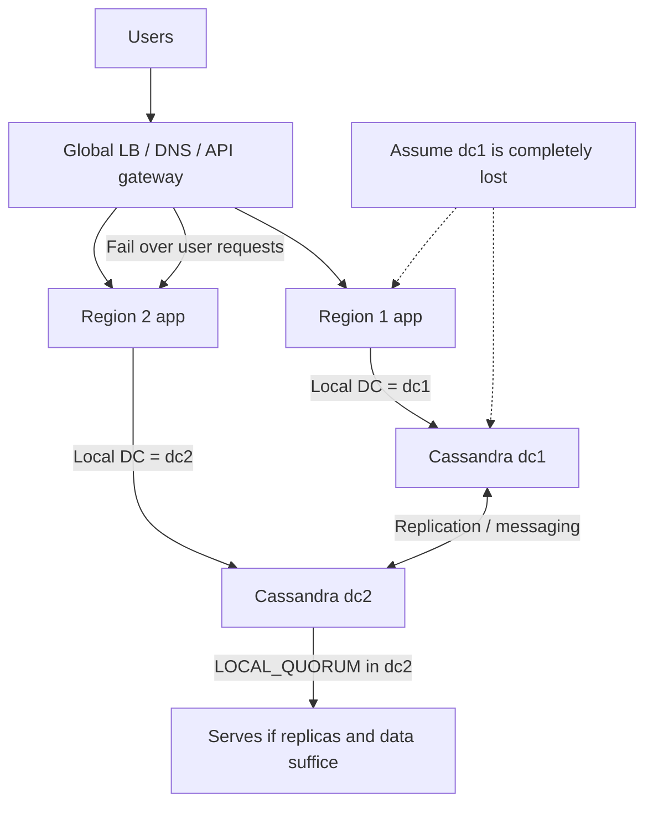

# Losing a Datacenter and Choosing Connection/Availability Paths

## 1. When One DC Disconnects, Can the Application Still Read and Write?

Apache Cassandra is a **distributed wide-column** database that places multiple copies of each partition across nodes according to the keyspace's **replication strategy**. In a *multi-datacenter (multi-DC)* deployment, each DC can hold its own set of replicas. When **a DC loses power, becomes isolated by a WAN outage, or all its nodes go down**, the replicas in the surviving DC can continue serving CQL—**provided** data was properly replicated there, healthy replicas satisfy the **consistency level (CL)**, and the application has a working connection path.

Three questions must be kept separate:

1. **Is the data present in the surviving DC?** Depends on per-DC RF, replication progress prior to the outage, bootstrap/repair, and replica health.
2. **Do requests get enough responses to satisfy CL?** Depends on thresholds for `LOCAL_ONE`, `LOCAL_QUORUM`, `QUORUM`, `EACH_QUORUM`, `ALL`, and which nodes actually respond.
3. **Do clients reach a coordinator in the surviving DC?** Depends on application infrastructure, DNS/load balancers, Java Driver DC selection policy, auth/TLS, and network reachability.

This lesson belongs to the **Multi-Datacenter Deployment** chapter of the `DATABASE_ENGINE_WIDE_COLUMN_CASSANDRA` module. It connects distributed architecture, partition keys, query-driven table modeling, and read/write consistency with replication operations, compaction, repair, infrastructure failures, and the Java Driver. The focus is not adding a DC, but **making access-path and availability decisions when one DC is lost**.

By the end of this lesson, you should be able to calculate ACK/read thresholds, design two DC-aligned application paths, identify **data staleness/RPO**, distinguish application failover from driver failover, and follow a runbook for isolating the outage and recovering safely.

## 2. Baseline Condition: Per-DC RF and Nodes Actually Holding Data

Suppose a cluster has two DCs, three nodes each:

```text
             Region 1                        Region 2
           +----------------+              +----------------+
           |   Cassandra    |    WAN       |   Cassandra    |
           | dc1: A, B, C   |<------------>| dc2: D, E, F   |
           +----------------+              +----------------+
                   ^                                ^
                   |                                |
             App in Region 1                  App in Region 2
                   ^                                ^
                   +------ Global traffic route ----+
                              (DNS / LB)
```

Example keyspace using `NetworkTopologyStrategy`:

```sql
CREATE KEYSPACE shop_ks
WITH replication = {
    'class': 'NetworkTopologyStrategy',
    'dc1': 3,
    'dc2': 3
}
AND durable_writes = true;
```

For **each partition**, when topology has enough eligible nodes, Cassandra assigns **3 natural replicas in `dc1` and 3 in `dc2`**. The keyspace's total logical RF is **6**, not 3. Different DCs can hold the same partition, though SSTables, compaction schedules, and update timing on each replica **need not be strictly identical**.

On a real system, verify:

```sql
SELECT keyspace_name, replication, durable_writes
FROM system_schema.keyspaces
WHERE keyspace_name = 'shop_ks';

SELECT data_center, rack
FROM system.local;
```

Query `system.local` on **each node or via separate `cqlsh` sessions connected to each DC** to see that node's DC/rack; do not treat output from one coordinator as describing every node. Also inspect `nodetool status`, `nodetool ring shop_ks`, and actual snitch settings.

**Prerequisite:** the keyspace must actually be replicated in the surviving DC. If `dc2` has RF = 0 or metadata was just altered to RF = 3 without **full historical streaming/repair**, having three Up nodes in that DC **does not guarantee** the application can read all data there.

## 3. DC-Loss Diagram: Three Distinct Types of Failover



There are **three routing layers** that should not be conflated:

| Layer | Who Decides? | What Changes? |
| --- | --- | --- |
| **User / HTTP layer** | Global load balancer, DNS, API gateway, orchestration | Traffic from Region 1 shifts to **healthy applications in Region 2**. |
| **Java Driver → coordinator layer** | Load-balancing policy, `local-datacenter`, contact points, connections | Region 2 app selects **Cassandra nodes in `dc2`** to send CQL. |
| **Coordinator → replicas layer** | Replication strategy, tokens, RF, CL | `dc2` coordinator contacts eligible replicas and awaits enough ACKs/responses per CL. |

**Cassandra does not relocate your HTTP application** when a DC fails. The driver does not perform global traffic failover. Conversely, DNS routing users to Region 2 does not prove the Java service there is connecting to `dc2` coordinators with an available CL.

## 4. Exact Availability Calculations: RF = 3 in Each DC

The quorum for \(N\) copies is calculated as:

\[
Q(N) = \left\lfloor \frac{N}{2} \right\rfloor + 1
\]

With `NetworkTopologyStrategy {dc1: 3, dc2: 3}`:

- `LOCAL_QUORUM` in **`dc2`** = `Q(3) = 2` replicas **in `dc2`**.
- Cluster-wide `QUORUM` = `Q(3 + 3) = Q(6) = 4` replicas **in any DC**, subject to operation rules.
- `EACH_QUORUM` for **writes** = `2 in dc1 and 2 in dc2`.
- `ALL` = **6 replicas**.

Suppose **`dc1` is completely lost**, while D/E/F in `dc2` are healthy and the coordinator receives requests **in `dc2`**:

| Consistency Level | Readable? | Writable? | Reason in This Scenario |
| --- | --- | --- | --- |
| `LOCAL_ONE` | Possible | Possible | Needs only **1 replica in `dc2`** to respond; data may be stale. |
| `ONE` | Possible | Possible | Needs 1 replica; CL semantics do not restrict DC, though a `dc2` coordinator prefers local. |
| `TWO` | Possible | Possible | Needs 2 replicas; D/E/F can satisfy it. |
| `THREE` | Possible | Possible | Needs 3 replicas; D/E/F suffice if all three are healthy. |
| **`LOCAL_QUORUM`** | **Possible** | **Possible** | Needs **2/3 replicas in `dc2`**; does not wait on `dc1`. |
| **`QUORUM`** | **No** | **No** | Needs **4/6**; `dc2` only has 3, even with all three Up. |
| **`EACH_QUORUM`** | N/A for reads | **No** | Writes require **2 ACKs in each DC**, but `dc1` is unresponsive. |
| **`ALL`** | **No** | **No** | Requires all 6 replicas. |
| `ANY` | N/A for reads | Possible | Write may be acknowledged via a hint only; does not guarantee a real replica holds the data. |

**"Possible" is not an unconditional guarantee of success**: it assumes data was already replicated, networking to `dc2` is healthy, nodes are responsive, and requests finish before timeout. An `UN` replica can still stall due to CPU, GC, I/O, or network issues.

### Asymmetric Case: `dc1` RF = 3, `dc2` RF = 2

If a keyspace has `{dc1: 3, dc2: 2}`, **total RF = 5** and `QUORUM = 3`. When **`dc2` is lost**, `dc1` still has 3 replicas so `QUORUM` **can** succeed; when **`dc1` is lost**, `dc2` only has 2 replicas so `QUORUM` **cannot** succeed. Inside `dc2`, `LOCAL_QUORUM = 2/2`, meaning **a single slow or downed `dc2` node breaks local quorum**.

Therefore, never conclude broadly that "`QUORUM` always stops when one DC is lost" or "`LOCAL_QUORUM` always survives one more failed node": you must **calculate per-DC RF and coordinator placement**.

## 5. Which CL to Choose When Prioritizing Continuity?

| Business Need | Commonly Considered Choice | Cost / Limitation |
| --- | --- | --- |
| Serve requests in surviving DC without waiting on WAN | `LOCAL_QUORUM` reads/writes in surviving DC (when RF suffices) | Does not guarantee writes just ACKed in the dead DC **reached the other DC**. |
| Ultra-fast reads, accepting stale-data risk | `LOCAL_ONE` in serving DC | No intersection between read/write quorums; higher stale-read risk. |
| Return success only when both DCs confirm writes at local quorum | `EACH_QUORUM` write | Losing one DC **stops all writes**. |
| Require majority of replicas across entire keyspace | `QUORUM` | With RF 3+3, losing one DC breaks `QUORUM` reads/writes; adds WAN latency in many cases. |
| Require all six replicas to ACK | `ALL` | Very low availability under a DC outage or a single slow replica. |

**Never "just switch to `ONE` whenever you see `Unavailable`."** Lowering CL may let a request succeed, but it alters the consistency contract and exposes stale data. CL is part of business requirements and must be decided **before an incident**, tested, and documented alongside RPO/RTO.

**`EACH_QUORUM` is only for regular writes**, not a read CL. For Lightweight Transactions (`IF NOT EXISTS`, `IF ...`), Cassandra also uses **serial consistency** (`SERIAL`/`LOCAL_SERIAL`); do not use the regular-write ACK table to claim conditional concurrent operations are cross-DC safe.

## 6. Availability Does Not Equal Freshness or Cross-DC Durability

Suppose in Region 1:

1. App writes `order-42 = PAID` via a `dc1` coordinator with **write CL = `LOCAL_QUORUM`**.
2. Replicas A and B in `dc1` ACK, so the app receives **success**.
3. Cassandra still attempts to distribute the mutation to natural replicas in `dc2`, **but `dc1` success does not wait for `dc2` ACKs**.
4. Immediately afterward, all of `dc1` loses connectivity before `dc2` receives the full mutation.
5. User traffic shifts to Region 2 / `dc2`; a `LOCAL_QUORUM` `SELECT` in `dc2` **may still observe the stale status**.

```mermaid
sequenceDiagram
    participant App1 as Region 1 App
    participant Q1 as Coordinator dc1
    participant R1 as Replica dc1
    participant R2 as Replica dc1
    participant Q2 as Replicas dc2
    participant App2 as Region 2 App
    App1->>Q1: UPDATE order-42; LOCAL_QUORUM
    Q1->>R1: mutation
    Q1->>R2: mutation
    Q1-->>Q2: Replication may arrive late
    R1-->>Q1: ACK
    R2-->>Q1: ACK
    Q1-->>App1: Success
    Note over Q1,Q2: dc1 lost before dc2 fully updates
    App2->>Q2: SELECT; LOCAL_QUORUM in dc2
    Q2-->>App2: May return stale value
```

This explains **RPO (Recovery Point Objective)**: how much recent data may be lost or invisible upon failing over. With `LOCAL_QUORUM` writes, **there is no cross-DC RPO = 0 guarantee** simply because both DCs have RF = 3. A `LOCAL_QUORUM` read in `dc2` immediately after a write is acknowledged in `dc1` **does not guarantee cross-DC read-your-writes**; the local quorums of two DCs do not intersect.

**RTO (Recovery Time Objective)** is the time until users regain service. It depends on failure detection, health checks, HTTP traffic shifting, standby app warmup, driver connections, DNS TTL/routing, data verification, and re-enabling writes—it cannot be derived from RF and CL alone.

| State | Valid Conclusion |
| --- | --- |
| `dc2` has enough replicas and apps can connect | Foundation exists to keep serving at local CL. |
| `dc1` `LOCAL_QUORUM` write succeeded | Does not guarantee that mutation ACKed in `dc2`. |
| `EACH_QUORUM` write succeeded **before outage** | ACKs occurred in both DCs per command threshold, though commit log durability and concurrent failures still apply. |
| `dc2` reads back a value | Does not prove every partition updated or every `dc1` write arrived. |
| `dc1` never recovers; mutation existed only on `dc1` | Hints/repair from `dc2` **cannot recreate data that no surviving copy holds**; backups or external business sources are needed. |

Therefore, DR design requires **independent backups, business reconciliation workflows, idempotency**, and deciding whether to pause sensitive operations (payments, transfers, business ID issuance) while RPO is uncertain.

## 7. Java Driver 4.x: Local DC Routing Is a Deliberate Choice

### 7.1. Each App Region Uses a Driver Local to Its DC

Java Driver 4.x's load-balancing policy routes within the **local datacenter** by default; if an app specifies contact points explicitly, set `local-datacenter` clearly. Example for Region 2's app:

```java
import java.net.InetSocketAddress;
import java.util.UUID;
import com.datastax.oss.driver.api.core.CqlSession;
import com.datastax.oss.driver.api.core.DefaultConsistencyLevel;
import com.datastax.oss.driver.api.core.cql.*;

// Example TEST-NET IPs; in production use reachable nodes in dc2.
try (CqlSession session = CqlSession.builder()
        .addContactPoint(new InetSocketAddress("192.0.2.21", 9042))
        .addContactPoint(new InetSocketAddress("192.0.2.22", 9042))
        .withLocalDatacenter("dc2")
        .build()) {

    PreparedStatement ps = session.prepare(
        "SELECT status FROM shop_ks.orders_by_customer " +
        "WHERE customer_id = ? AND order_id = ?");

    BoundStatement request = ps.bind(
        "cust-42", UUID.fromString("11111111-2222-3333-4444-555555555555"))
        .setConsistencyLevel(DefaultConsistencyLevel.LOCAL_QUORUM);

    Row row = session.execute(request).one();
    System.out.println(row == null ? "<missing>" : row.getString("status"));
}
```

This assumes the table/keys from the lab exist, real deployments use valid contact points, and authentication/TLS are configured separately. Specifying **`withLocalDatacenter("dc2")`** directs the driver to prefer `dc2` nodes and avoid accidentally treating `dc1` as local. After regional failover, ensure **all app instances, sessions, connection pools, and health checks** align with the surviving DC.

**Do not merely swap IPs while keeping `withLocalDatacenter("dc1")`** expecting load balancing to guess your DR intent. `LOCAL_QUORUM` is evaluated in the **actual coordinator's** DC, not according to HTTP region labels or operator intentions. Routing and consistency must align.

### 7.2. Shifting HTTP Traffic to the Surviving Region's App Is the Standard Choice

When both regions run applications and Cassandra:

- Normally, Region 1 users → App 1 → local driver `dc1`; Region 2 users → App 2 → local driver `dc2`.
- When `dc1`/Region 1 fails, load balancers or service discovery route traffic to **App 2**, which already holds a session with `local-datacenter = dc2`.
- App 2 executes requests at the CL designed for DR, without needing to open cross-region WAN paths to an outage-struck DC.

The advantage is **decoupling user routing from database routing**, making it easier to govern network policies, TLS, capacity, and controlled failback. It requires App 2 to have sufficient CPU/connection pools/capacity for increased load and access to other system dependencies (queues, object storage, IAM, etc.).

### 7.3. Direct Driver Failover Option: Available, Not Default

**Java Driver 4.10+** added optional **cross-datacenter failover** in its built-in load-balancing policy. Example configuration for **testing environments**:

```hocon
datastax-java-driver {
  basic.load-balancing-policy.local-datacenter = dc1
  advanced.load-balancing-policy.dc-failover {
    max-nodes-per-remote-dc = 2
    allow-for-local-consistency-levels = true
  }
}
```

Mandatory caveats:

- By default `max-nodes-per-remote-dc = 0`: failover is **disabled**. Only with a positive value can remote nodes enter query plans.
- By default the driver **does not** fail over requests using `LOCAL_ONE`/`LOCAL_QUORUM`/`LOCAL_SERIAL` to remote nodes. `allow-for-local-consistency-levels = true` **enables sensitive behavior** whose risks must be accepted beforehand.
- If local `dc1` RF = 3 while `dc2` RF = 1, a `LOCAL_QUORUM` request hitting a `dc2` coordinator drops from **2 ACKs** to **1 ACK**. That is a **consistency semantics change**, not just a route change.
- Remote traffic can spike suddenly during a WAN outage; if all apps are still in Region 1 and Region 1 goes down, driver-level failover **cannot save dead application hosts**.
- Driver 4.x **prior to 4.10** lacks this failover feature in the built-in policy. Option names and availability must be checked against your exact minor version.

**Design recommendation:** with full multi-region infrastructure, prefer **global application traffic failover** paired with a local-DC driver in each region. Only use driver-level cross-DC failover after thoroughly testing WAN latency, CL impacts, capacity, auth/TLS, network policies, and RPO consequences.

## 8. Separating "DC Truly Dead" from "WAN Partitioned"

A WAN partition does not mean all nodes in the other DC are powered off. Both DCs may be **alive** and serving their own clients without seeing each other:

```text
dc1: A/B/C <----X  WAN partitioned  X----> dc2: D/E/F
    App 1 still writes LOCAL_QUORUM         App 2 still writes LOCAL_QUORUM
    on same partition K                     on same partition K
```

With RF3 per DC, both sides can still accept **`LOCAL_QUORUM` writes** while partitioned. Once connectivity returns, mutations must be distributed/reconciled, and Cassandra resolves conflicts by **timestamps and reconciliation rules** (including tombstones)—**without** understanding business rules like "deducting inventory twice is invalid."

For instance, if both regions update `balance` or `order.status` in the same CQL cell without coordination, the timestamp winner is **not** the sum of both updates and can erase a valid business decision. LWTs or custom conditional coordination protocols must also be evaluated against `SERIAL`/`LOCAL_SERIAL` scope and topology.

To prevent business-layer split-brain:

1. Enforce a **single writer authority** or explicit ownership/epoch/fencing mechanism for ordered data.
2. Issue **idempotency keys** and stable transaction IDs so retries/failovers do not duplicate actions.
3. Distinguish **serving reads** from **permitted to accept sensitive writes** in health checks.
4. After recovery, reconcile business activity generated on both sides; replica repair alone does not resolve all business conflicts.

## 9. Runbook When Detecting Complete Loss of One DC

### Step 1 — Verify Incident Scope; Do Not Guess from One Client Error

Collect status from **surviving nodes** and monitoring systems:

```bash
nodetool status
nodetool describecluster
nodetool netstats
nodetool tpstats
```

Correlate with application region health, WAN links, CQL port reachability, gossip/logs, and metrics `ClientRequest.Read/Write.Latency`, `Timeouts`, `Unavailables`, and `Failures`. A node marked `DN` by gossip could be a network cut between two DCs; never hastily start node replacement if the node **is still alive and may return**.

### Step 2 — Recalculate Servable Replicas for **Every Keyspace**

```sql
SELECT keyspace_name, replication
FROM system_schema.keyspaces
WHERE keyspace_name IN ('shop_ks');
```

Identify which keyspaces replicate to `dc2`, `dc2`'s RF, healthy local replicas, DC/racks, and actual CLs per query type. Never infer from `shop_ks` that every other keyspace also has `dc2:3`. Document separately whether **reads** and **writes** share the same availability.

### Step 3 — Make Explicit Decisions on User Routing and Write Acceptance

- Shift global HTTP traffic to applications in the surviving DC after **end-to-end health checks**.
- Confirm that the surviving app's driver/session has the right `local-datacenter` and contact points.
- For queries using `LOCAL_QUORUM`, confirm sufficient quorum in the surviving DC; do not rely on global `QUORUM` out of habit if RF is 3+3 and half the replicas are gone.
- If it is unknown whether the lost DC's latest writes reached the surviving DC, consider **read-only mode or restricting sensitive write flows** per RPO/RTO policy.

**Never lower CL from `QUORUM` to `ONE` across the entire application just to silence timeouts** without evaluating business semantics and stale-read exposure.

### Step 4 — Monitor During Failover

Watch throughput/p99 on **App 2 and `dc2`**, as they may handle double the traffic. Monitor local replica latency, free disk, GC, queues, connection counts, timeouts, and driver sessions. Avoid heavy competing admin tasks like full repair/major compaction while protecting SLOs, unless the recovery runbook demands them.

### Step 5 — Preserve Evidence and Handle Indeterminate Requests

A write in the failed DC may have ACKed with the response lost to the client, or succeeded for the client before reaching the surviving DC. Log request IDs, `order_id`, business timestamps, and outcomes before retrying. Retries must be **idempotent** by design; never generate a new UUID for the same order after a timeout.

### Step 6 — When the Failed DC Returns, **Do Not Fail Back Immediately**

Inspect nodes, racks/DC, schemas, tokens, disks, gossip, and `netstats`. Check whether hints remain, how long the outage lasted, when the last repair succeeded, and whether any tombstones exceeded `gc_grace_seconds`.

If the DC was down too long, nodes holding old data risk reviving **zombie data** after healthy replicas already purged tombstones. Follow an appropriate recovery/rebuild/replace and reconciliation procedure rather than **simply putting all old nodes back into write traffic immediately**. Repair must account for token ranges, per-keyspace state, repaired/unrepaired status, and streaming progress per version.

### Step 7 — Repair/Reconcile and Controlled Failback

Only after the DC is stable and a full-scope repair plan is executed, verify anti-entropy results across replicas. Reconcile business data generated during the outage, validate client reads/writes at proper CLs, and then shift traffic back gradually via canary/traffic weights. Avoid switching too fast and causing overload or split-brain writes.

### Step 8 — Close the Incident with Verifiable Metrics

Record **actual RTO**, suspected missing-data window (observed RPO), timeout/retry counts, repaired token ranges, DC/rack status, backfill completion time, reconciliation discrepancy levels, p95/p99 latency, and preventive actions.

## 10. Safe CQL Practice: Simulating Failover Decisions

> Use only a **test cluster** with two DCs and at least three nodes per DC. Replace `dc1`/`dc2` with your actual DC names. Never cut power, block WAN, or shut down production nodes to complete exercises.

### 10.1. Create Keyspace and Query-Driven Table

```sql
CREATE KEYSPACE shop_ks
WITH replication = {
    'class': 'NetworkTopologyStrategy',
    'dc1': 3,
    'dc2': 3
}
AND durable_writes = true;

CREATE TABLE shop_ks.orders_by_customer (
    customer_id text,
    order_id uuid,
    status text,
    total decimal,
    updated_at timestamp,
    PRIMARY KEY ((customer_id), order_id)
);

INSERT INTO shop_ks.orders_by_customer
    (customer_id, order_id, status, total, updated_at)
VALUES
    ('cust-42',
     11111111-2222-3333-4444-555555555555,
     'CREATED', 125.50, toTimestamp(now()));
```

The partition key is `customer_id`; Cassandra picks replicas from this field's token. Assume both DCs are **bootstrapped and fully synchronized** before testing.

### 10.2. Connect and Compare CLs from Each DC

In a terminal connected to a **`dc1` node**:

```bash
# Example address; replace with a valid host in your lab.
cqlsh 192.0.2.11 9042
```

Inside `cqlsh`:

```sql
SELECT data_center FROM system.local;
CONSISTENCY LOCAL_QUORUM

SELECT customer_id, order_id, status
FROM shop_ks.orders_by_customer
WHERE customer_id = 'cust-42'
  AND order_id = 11111111-2222-3333-4444-555555555555;
```

Repeat on a **`dc2` node**; `SELECT data_center FROM system.local` must report `dc2`. Observe whether the returned data matches, keeping in mind that **a single successful read does not prove all partitions are synchronized**.

Then work through on paper or in your lab table:

| Hypothetical Test | RF/CL | Expected Behavior If `dc1` Is Unresponsive and `dc2` Has Healthy D/E/F |
| --- | --- | --- |
| Read at `dc2` coordinator | RF 3+3, `LOCAL_QUORUM` | Can read with 2 ACKs from `dc2`. |
| Write at `dc2` coordinator | RF 3+3, `LOCAL_QUORUM` | Can write with 2 ACKs from `dc2`; remote replicas may receive late. |
| Read at `dc2` coordinator | RF 3+3, `QUORUM` | Cannot reach 4/6 ACKs; expect CL failure. |
| Write at `dc2` coordinator | RF 3+3, `EACH_QUORUM` | Cannot reach `dc1` quorum; fails per CL. |
| Read at `dc2` coordinator | RF 3+3, `LOCAL_ONE` | Can read one `dc2` replica, with staleness risk. |

In an isolated lab with fault-injection and recovery tools, you can test the matrix by **simulating** a single-DC outage. Without such an environment, complete the exercise using CL math, topology inspection, and running each query while both DCs are healthy.

### 10.3. Reading Metrics to Distinguish Routing Errors from CL Errors

```bash
nodetool status shop_ks
nodetool netstats
nodetool tpstats
```

A `NoNodeAvailableException` or `AllNodesFailedException` in the Java Driver signals **no coordinator in the query plan succeeded**; inspect per-node errors (in Driver 4.14+, certain busy-node cases return `AllNodesFailedException` instead of `NoNodeAvailableException`). `UnavailableException` from Cassandra means the coordinator lacked enough available replicas to satisfy CL; `ReadTimeoutException`/`WriteTimeoutException` occur when responses do not arrive in time. Never apply the same fix blindly to all three categories.

## 11. Quick Troubleshooting Table

| Symptom | First Check | Safe Decision |
| --- | --- | --- |
| `dc2` is healthy but App 1 cannot connect to Cassandra | Is App 1 alive? Is driver `local-datacenter` `dc1`? Is remote failover enabled? | Prefer routing traffic to App 2 with local driver `dc2`; never change driver config blindly. |
| `LOCAL_QUORUM` in `dc2` throws `Unavailable` | `dc2` RF, live nodes, which DC is the coordinator in? | Restore sufficient replicas/local routing; never lower CL if business rules forbid it. |
| `QUORUM` stops when `dc1` goes down | What are total RF and quorum? With 3+3 it needs 4 | If DR requires running when a DC fails, design local CL or topology upfront—do not improvise on assumptions. |
| App 2 reads stale state after failover | Did the last write ACK to `dc2`? Hints/repair, timestamps, TTL | Assess RPO, restrict sensitive actions, reconcile business events. |
| Both DCs Up but hold divergent writes after WAN partition | Were writers active on both sides? Same key? Which timestamp won? | Enforce write ownership/fencing, resolve business conflicts, and run repair. |
| Direct driver failover causes WAN traffic spike | `max-nodes-per-remote-dc`, remote pool, retries, local CL | Re-evaluate design; prefer regional app failover with spare capacity. |
| Returning DC has very stale data | Outage length vs. hints/grace, repair history, bootstrap status | Do not fail back immediately; follow rebuild/repair and verification plan. |
| `nodetool status` shows `UN` yet client is slow | Disk, GC, pending tasks, CL, network, driver pool | Investigate across layers; Up status does not guarantee timeouts/SLOs are met. |

## 12. Misconceptions to Eliminate

| Misconception | Fact |
| --- | --- |
| "RF3 per DC means `QUORUM` only needs 2 when one DC is lost." | False. Total RF = 6, so global `QUORUM` needs **4**; a surviving DC with 3 nodes is not enough. |
| "`LOCAL_QUORUM` in `dc1` and `dc2` share the same replica set." | False. They are in different DCs with no forced intersection; `dc2` reads may miss writes just ACKed in `dc1`. |
| "Once the app fails over via DNS, Cassandra switches local DC automatically." | False. The driver maintains its own topology/load-balancing policy and sessions that must be configured properly. |
| "Java Driver always falls back to another DC if the local one dies." | False. Driver 4.x connects only to the local DC by default; remote failover is an explicit version/config option. |
| "Enabling remote failover for `LOCAL_QUORUM` keeps consistency unchanged." | False. The threshold depends on RF in the **new coordinator's** DC, which may differ from the original RF. |
| "If a DC fails, every write that succeeded there definitely reached the other DC." | False for `LOCAL_QUORUM` writes: remote ACKs were not required for success. |
| "`UN` after recovery means replica data has converged." | False. Best-effort hints, streaming/repair, and outage duration must still be verified. |
| "Repair automatically resolves all two-region conflicts." | False. Anti-entropy reconciles storage copies without knowing business rules for order sequences or payments. |
| "Lowering `QUORUM` to `ONE` is a safe failover tactic for every table." | False. Changing CL alters freshness, observed durability, and application contracts. |

## 13. Scenario Exercises and Self-Check Questions

**Scenario A — 3+3:** Region 1 app uses `LOCAL_QUORUM`, and Region 2 runs the same schema. All of `dc1` goes down. Trace the path user → App 2 → `dc2` coordinator → D/E/F. Note read/write thresholds, stale-read risk for mutations recently ACKed in `dc1`, and which infrastructure components must switch.

**Scenario B — 3+2:** With `NetworkTopologyStrategy {dc1:3, dc2:2}`, global `QUORUM` requires 3. Compare losing `dc1` versus losing `dc2`. Why does `LOCAL_QUORUM` in `dc2` require both `dc2` nodes?

**Scenario C — WAN partition with neither DC dead:** Both App 1 and App 2 update `order.status` at `LOCAL_QUORUM` in their own DCs. Explain why both can succeed, why Cassandra does not know the "correct business state," and what mechanisms prevent double-processing.

**Scenario D — Driver 4.8:** App 1 sets `local-datacenter = dc1`; `dc1` is completely lost while `dc2` is healthy. Explain why automatic remote failover cannot be assumed and how to route users to an app with a local `dc2` driver. Contrast with Driver 4.10+ when remote failover is enabled, noting why local CL must be re-evaluated.

**Short Questions:**

1. Why doesn't `LOCAL_QUORUM` in the surviving DC need ACKs from the dead DC?
2. Why can't `QUORUM` for RF 3+3 be satisfied with just the three nodes in `dc2`?
3. Which operations support `EACH_QUORUM`? What happens if an entire DC is lost?
4. Can cross-DC RPO = 0 be inferred from `LOCAL_QUORUM` writes?
5. Why can changing `local-datacenter` change the `LOCAL_QUORUM` threshold when per-DC RFs differ?
6. Once `dc1` returns, why must you reconcile/repair before failing back? What risk arises if the outage exceeded `gc_grace_seconds`?
7. How do you distinguish driver `NoNodeAvailableException`/`AllNodesFailedException` from consistency-level `UnavailableException`?

**Completion criteria:** accurately compute ACKs per DC RF, choose the right app/driver/coordinator path when a DC fails, distinguish **availability, data freshness, and RPO/RTO**, establish failover/failback plans, and never equate a node returning to `Up` with fully repaired replicas.

## 14. References

- [Apache Cassandra — Dynamo / tunable consistency](https://cassandra.apache.org/doc/stable/cassandra/architecture/dynamo.html): semantics of `LOCAL_QUORUM`, `QUORUM`, `EACH_QUORUM`, `ALL`, and read/write intersection thresholds.
- [Apache Cassandra — Replication strategy](https://cassandra.apache.org/doc/stable/cassandra/architecture/dynamo.html): replication principles and topology-aware replica placement.
- [Apache Cassandra Java Driver 4.18 — Load balancing](https://apache.github.io/cassandra-java-driver/4.18.0/core/load_balancing/): `local-datacenter`, local routing, and optional cross-DC failover since 4.10.
- [Apache Cassandra Java Driver 4.18 — Upgrade guide](https://apache.github.io/cassandra-java-driver/4.18.0/upgrade-README/): changes to driver exceptions `NoNodeAvailableException`/`AllNodesFailedException` since 4.14.
- [Apache Cassandra — Hinted handoff](https://cassandra.apache.org/doc/stable/cassandra/managing/operating/hints.html): hints and best-effort limits when replicas are temporarily unavailable.
- [Apache Cassandra — Repair](https://cassandra.apache.org/doc/stable/cassandra/managing/operating/repair.html): Merkle trees, full/incremental repair, and post-outage reconciliation.
- [Apache Cassandra — cqlsh](https://cassandra.apache.org/doc/stable/cassandra/managing/tools/cqlsh.html): `CONSISTENCY` command and checking CL in labs.

**Conclusion:** When a datacenter is lost, **per-DC RF determines which copies still exist; CL determines whether requests meet response thresholds; and application routing plus the Java Driver determine whether requests reach the right coordinator**. With RF 3+3, `LOCAL_QUORUM` on the surviving DC can sustain service, whereas cluster-wide `QUORUM`, `EACH_QUORUM`, and `ALL` cannot. Still, being able to serve traffic does not mean writes just ACKed in the dead DC reached the standby DC. A complete DR plan must cover RPO/RTO, writer control, standby capacity, backups, reconciliation, and evidence-based failback.
