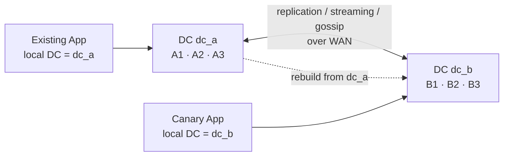
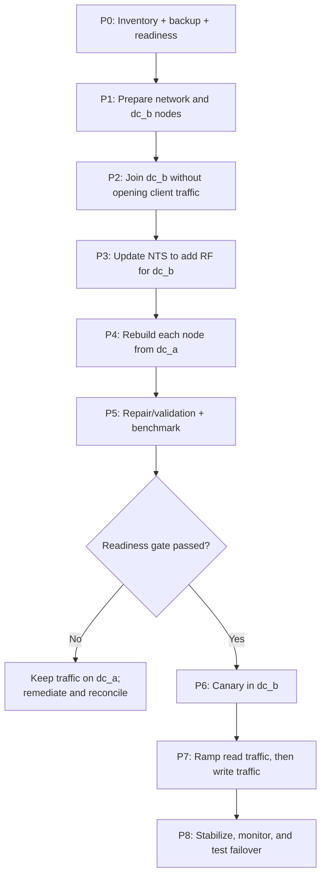

# Adding a New Datacenter, Rebuilding, and Gradually Shifting Application Load

**Chapter:** Multi-Datacenter Deployment  
**Module:** `DATABASE_ENGINE_WIDE_COLUMN_CASSANDRA` — Apache Cassandra

When an application scales from one datacenter (DC) to two datacenters, the goal is not merely **adding machines**. You must adjust **replica placement**, **transport of existing data**, **client consistency levels**, **inter-DC networking**, and **stepwise traffic shifting**. If you bring up a new DC and immediately let applications read from it, new nodes may join the ring before receiving all historical rows: a query succeeding does not mean its results are complete.

Apache Cassandra is a distributed wide-column database; partition keys are hashed into tokens, and replica placement is governed by the replication strategy and topology. Knowledge of partition keys, query-driven table design, consistency levels, replication, CQL, compaction, repair, error handling, and the Java Driver all come together here. This lesson presents **a conditional, safety-first rollout path**: adding datacenter `dc_b`, rebuilding from `dc_a`, validating data, and **gradually shifting traffic** without confusing availability with consistency.

> **Scope:** Examples use common concepts in Apache Cassandra 4.1/5.x. Depending on version/distribution, DC naming, `auto_bootstrap` configuration, repair/rebuild commands, and cloud/Kubernetes automation may differ. Adding a DC, altering RF, and rebuilding impose heavy network/disk load; **practice only in test clusters** and follow a verified runbook for production.

## 1. Objectives and Completion Criteria

After this lesson, you should be able to:

1. Explain why **adding nodes to a new DC** differs from scaling out an existing DC, and why `NetworkTopologyStrategy` (NTS) is required.
2. Design a per-DC RF matrix and understand internode addresses, snitches, racks, seeds, and topology discovery.
3. Distinguish **bootstrap**, **rebuild**, **repair**, and **streaming**; choose the right data source when rebuilding a new DC.
4. Plan RF updates on existing keyspaces without overlooking auth/tracing keyspaces or distribution-required metadata.
5. Monitor data transfer: `nodetool netstats`, disk headroom, streaming throughput, compaction, p95/p99, and errors.
6. Design pre-traffic verification, including sample/histogram comparisons and recognizing the limits of a single successful read.
7. Configure the Java Driver so applications use the right **local datacenter** and intentional `LOCAL_QUORUM`/`LOCAL_ONE`.
8. Execute traffic migration in stages—canary → read traffic → write traffic → scale—with stop thresholds and rollback procedures.
9. Analyze WAN partitions, independent concurrent writes across two DCs, and the risk of **last-write-wins** losing business updates.

**Completion criteria are not merely `nodetool status` showing more `UN` nodes.** A new DC is ready for production only when RF is configured accurately, historical data is rebuilt/verified, latency/throughput meet SLOs, and application traffic is shifted in monitored stages.

## 2. Deployment Model: Source DC and Target DC

Suppose we have two datacenters in **the same Cassandra cluster**:

- `dc_a`: existing datacenter, three nodes A1/A2/A3; currently serving all applications.
- `dc_b`: new datacenter, three nodes B1/B2/B3; initially serving no applications.
- Nodes run compatible Cassandra versions with internode connectivity over the right protocols/ports and topology metadata.
- Business keyspaces use `NetworkTopologyStrategy` with RF=3 in each DC after expansion.
- Each DC has enough racks/failure domains for placement aligned with fault-tolerance targets.



A multi-DC Cassandra cluster differs from two independent clusters connected by bidirectional ETL: DCs share ring metadata and keyspace schemas while placing replicas per DC. If DCs span separate networks/regions, internode link stability, firewalls, latency, and WAN transfer costs are real operational constraints.

### 2.1. Per-Datacenter RF

Before expansion:

```sql
-- Example current schema:
CREATE KEYSPACE IF NOT EXISTS shop
WITH replication = {
  'class': 'NetworkTopologyStrategy',
  'dc_a': 3
}
AND durable_writes = true;
```

Target after expansion:

```sql
ALTER KEYSPACE shop
WITH replication = {
  'class': 'NetworkTopologyStrategy',
  'dc_a': 3,
  'dc_b': 3
}
AND durable_writes = true;
```

Once `dc_b: 3` is applied, Cassandra understands tables in `shop` **need three replicas in `dc_b`**. However, changing schema **does not instantaneously copy all historical data** to the new nodes. That is why proper rebuild/repair is required.

**Important:** NTS supports different RFs per DC, e.g., `dc_a: 3`, `dc_b: 2`. Every `LOCAL_QUORUM` calculation in each DC must use **that DC's own RF**. Never infer from total node count or cluster-wide RF that every DC survives the same number of failures.

### 2.2. What Do Racks and Snitches Mean?

The snitch determines how Cassandra identifies each node's DC and rack. NTS tries to place replicas on different racks within the same DC when topology permits. A node B3 misconfigured as `dc_a` will not become a `dc_b` replica simply by sitting in the new network region.

Before expanding, document:

| Item | Example | Why Check |
| --- | --- | --- |
| Source DC | `dc_a` | Name passed to `nodetool rebuild dc_a` |
| Target DC | `dc_b` | Must match **exact spelling and case** in NTS/snitch |
| Rack / failure domain | `rack1`, `rack2`, `rack3` | Spreads replicas and mitigates correlated failures |
| Source / target RF | `3/3` | Determines required replicas and CL math |
| Seeds | Live, reachable endpoints | Helps new nodes discover the cluster; seeds are not "authoritative" data stores |
| Internode addresses | Routable IPs/hostnames between DCs | Used for gossip/streaming/replication; distinct from client native transport |
| Disk / headroom | Measured per node | Rebuild and compaction require physical capacity |
| WAN bandwidth / latency | Measured empirically | Bounds streaming speed and affects mutations |
| TLS / auth / ports | Per infrastructure policy | Never open WAN ports recklessly just to test |

## 3. Four Mechanisms: Join, Bootstrap, Rebuild, Repair

| Operation | Goal | What Not to Misunderstand |
| --- | --- | --- |
| **Join / discovery** | New node learns ring, gossip, and schema/topology | `UN` does not mean historical data is present |
| **Bootstrap** | New node joins and streams data for its assigned ranges per version mechanics | Adding a new DC may use a **no-auto-bootstrap** join followed by explicit rebuild |
| **Rebuild** | On the target node, streams needed data from source nodes, typically in another DC | Rebuild is not a full multi-replica audit; an out-of-sync source can supply incomplete data |
| **Anti-entropy repair** | Compares data across replicas/ranges and reconciles divergence within scope | Repair does not replace RF settings or load historical data if no source exists |

**Critical distinction:** in a new DC, do not let nodes serve historical reads merely because they own tokens and report `UN`. The standard workflow for a new DC joins nodes using a runbook/version-supported method, updates replication, and then **runs rebuild on every node in the new DC, specifying the source DC that holds the data**.

Common syntax (verify with `nodetool help rebuild` on your cluster):

```bash
# Run on each node belonging to dc_b:
nodetool rebuild dc_a
```

On versions supporting option-separator syntax:

```bash
nodetool rebuild -- dc_a
```

`dc_a` is the **source datacenter name**, not a node IP, keyspace, or target DC. Never assume omitting the source argument is safe: depending on topology/version, rebuild picking an unintended source may fail to stream the expected data.

### Does Rebuild "Read Every Replica and Pick the Latest"?

No. Rebuild streams from selected sources for the needed token ranges; it is not a multi-replica business audit and does not implicitly reconcile **all** sources like a quorum read. If a source in `dc_a` is missing mutations/tombstones or the cluster has not been repaired properly, data streamed to `dc_b` can be incomplete. Therefore:

1. Assess the source DC's health, repair history, and convergence **before** rebuilding.
2. Only rebuild when eligible sources hold complete data without major outages.
3. After rebuild, schedule **properly scoped full repair/validation**, especially after raising RF.
4. Never use rebuild as a backup substitute for snapshots/restore.

## 4. Multi-Stage Plan and Stop Gates

Do not execute every step in one monolithic deployment command.



**This is an orchestration framework**, not a claim that every Cassandra version enforces the exact same micro-order of steps. Some runbooks declare the new DC with `RF=0` before joining, while others alter RF after new nodes join. Check `RF=0` support, RF-change timing, `auto_bootstrap`, and metadata behavior for your Cassandra/vendor release before running. The invariant goal is: **never open application traffic to the target DC until it has received and verified data**.

## 5. P0 — Inventory and Pre-Change Safety Checks

### 5.1. Cluster Health and Schema

On existing nodes:

```bash
nodetool status
nodetool describecluster
nodetool info
nodetool compactionstats
nodetool netstats
```

In `cqlsh`:

```sql
SELECT cluster_name, partitioner, release_version
FROM system.local;

SELECT data_center, rack, host_id
FROM system.local;

SELECT keyspace_name, replication
FROM system_schema.keyspaces;
```

List the business keyspaces to expand as well as **configurable system keyspaces** per your version and vendor policy, such as `system_auth`, `system_distributed`, and `system_traces` where appropriate. Never blindly run `ALTER` on every `system_*` keyspace: some are managed internally and cannot or should not be edited manually. Missing auth/tracing replication can break logins or operational visibility in the new DC even after business tables are rebuilt.

### 5.2. Data and Operations

- Record baselines: read/write p50/p95/p99, timeouts/unavailables, per-DC throughput, driver errors.
- Record SSTable size, free disk, compaction backlog, and streaming capacity **per node**.
- Confirm the source DC has no prolonged Down nodes, no critical failed repairs, and a tested backup/recovery plan.
- Identify traffic ingress: where users live, and which service discovery/DNS/load balancer decides where apps run.
- Define **read consistency, write consistency, RPO/RTO targets, and acceptable failure domains**; never assume "multi-DC = zero data loss."
- Estimate WAN cost: initial historical transfer plus ongoing cross-DC mutations.

### 5.3. Readiness Gate Before Proceeding to P1

Do not expand if any of these exist: missing replicas in the source cluster without a recovery plan, unstable write latency, insufficient source/target disk headroom, schema disagreement, or inter-DC networking unable to sustain internode/TLS traffic. Adding a DC to an already stressed source cluster can degrade application availability further.

## 6. P1–P2 — Provisioning Nodes in the New Datacenter

### 6.1. Preparing Identity and Topology

On **each** node B1/B2/B3:

- Use a Cassandra version compatible with the source cluster and the same partitioner.
- Set the same cluster name; use the new node's **own** listen/broadcast addresses.
- Configure snitch/DC/rack accurately (`dc_b` and corresponding racks).
- Point seeds to live, reachable source nodes; avoid accidentally forming a split-brain new cluster.
- Configure internode TLS/mTLS, certificates matching hostnames/IPs, firewalls, NAT, and bidirectional routing.
- Configure topology/`num_tokens`/token allocation per runbook; never copy `system.local` or host IDs from A1/A2.
- Ensure clean data volumes/ownership with no leftover metadata from another cluster.
- Configure client native transport and telemetry, but **do not** add the new nodes to application load balancers/service discovery yet.

### 6.2. `auto_bootstrap` Must Be Managed Conditionally

When **adding a new DC**, some versions/runbooks set `auto_bootstrap: false` as new nodes join to avoid premature streaming; RF is then increased and `rebuild` runs from the source DC. Apache Cassandra documents this **manual bootstrap** approach for new datacenter rollouts.

This is **not** an option to disable casually in an existing cluster. Turning off `auto_bootstrap` when joining a node to a DC that already holds data—or restarting mid-bootstrap without tracking state—can leave nodes in the ring missing required ranges.

Therefore:

1. Verify your distribution supports `auto_bootstrap` and the exact configuration path (YAML/JVM/Helm operator).
2. Apply it only under a **new DC** runbook, never as a blanket setting for every new node.
3. Log timestamps and bootstrap/rebuild outcomes for each node.
4. After the DC is rebuilt per procedure, restore normal bootstrap settings if required by your runbook so future node additions do not skip streaming.

### 6.3. Inspecting the Ring from Both DCs

```bash
# On source and new nodes, after starting per runbook:
nodetool status
nodetool describecluster
nodetool gossipinfo
```

You should see both `dc_a` and `dc_b`, exact node/rack counts, all expected nodes `UN`, and schema agreement. However, this is **membership readiness**, not data readiness.

**Do not** allow `LOCAL_ONE`/`LOCAL_QUORUM` clients in `dc_b` to query historical data before rebuild and reconciliation; the cluster can route requests to the new replicas before they hold the data.

## 7. P3 — Switching Keyspaces to Multi-Datacenter Replication

Once `dc_b` nodes have joined properly and configuration is verified, update the business keyspaces to replicate.

Example for an existing `shop` keyspace in `dc_a`:

```sql
ALTER KEYSPACE shop
WITH replication = {
  'class': 'NetworkTopologyStrategy',
  'dc_a': 3,
  'dc_b': 3
}
AND durable_writes = true;
```

**Note:** `shop` represents an existing application keyspace. Never run `ALTER KEYSPACE` without verifying your live schema and operational procedures. Ensure no other DC is omitted: an `ALTER` statement must include **all** datacenters where you want to keep replicas. Accidentally omitting `dc_a` from the map removes its replication instead of merely "adding `dc_b`."

Verify:

```sql
SELECT keyspace_name, replication
FROM system_schema.keyspaces
WHERE keyspace_name = 'shop';
```

DC names are case-sensitive. Never define `dc_b` when nodes report `DC_B` expecting Cassandra to normalize casing.

### 7.1. Which Keyspaces Need Updating?

Create an inventory table beforehand:

| Keyspace Group | Consideration | Rule |
| --- | --- | --- |
| Core business | e.g., `shop`, `billing` | Expand NTS to `dc_b` if serving apps in the new DC |
| Auth / security | e.g., `system_auth` | Follow distribution/version docs; missing replicas can break logins |
| Tracing / distributed | e.g., `system_traces`, `system_distributed` | Check live schema and operational policy |
| Local metadata | `system` and internal node-local keyspaces | Never edit arbitrarily; many are node-local and managed by Cassandra |
| Single-DC only | Internal keyspaces requiring isolation | May intentionally stay un-replicated; document scope explicitly |

Changing RF **does not backfill old data**. You must still run properly scoped rebuild/repair next.

### 7.2. Why Not Enable Traffic Immediately After Changing RF?

A read request in `dc_b` can hit a new replica that does not yet hold historical data. **New** mutations can be sent to both DCs per placement, but history written before adding the DC does not appear automatically from `ALTER KEYSPACE`. Applications must wait for P4/P5.

## 8. P4 — Rebuilding from the Source DC on Each New-DC Node

On **each node B1, B2, B3** in `dc_b`, after RF is configured:

```bash
# Check exact syntax:
nodetool help rebuild

# Run on B1, then B2, then B3 to limit WAN pressure:
nodetool rebuild dc_a
```

Depending on version, separator syntax may apply:

```bash
nodetool rebuild -- dc_a
```

`dc_a` is the **source datacenter**. It is not a keyspace name. Some versions support `--keyspace` to narrow scope; if rebuilding a single keyspace, plan separately for any remaining keyspaces **not yet** rebuilt. Run `nodetool help rebuild` on the node to confirm flags.

### 8.1. Why Run It on Every Node?

Token ranges owned by B1, B2, and B3 differ. Running rebuild on B1 **does not** populate B2 or B3. Track completion per node rather than declaring the whole DC done after one command finishes.

Choose ordering and concurrency according to resources:

- **Sequential**: simple and minimizes WAN/source-disk contention.
- **Bounded parallel**: faster if bandwidth, disk throughput, and `dc_a` tail latency allow.
- **Never run all unthrottled in parallel**: can saturate the inter-DC link and visibly slow live services in `dc_a`.

Never treat a node showing `UN` as proof that rebuild succeeded; `nodetool rebuild` could still be running, failed, or not yet invoked.

### 8.2. Rebuild Can Stream Nothing If Given the Wrong Source

If invoked without specifying the source DC while the new DC is empty, some source-selection paths may pick an unsuitable peer or stream nothing as expected. That is why this guide specifies **`dc_a` explicitly** and verifies data afterward.

Inspect logs and metrics to confirm valid source peers, streamed ranges, and job completion. Never mark P4 complete just because the CLI exited with code 0 without validating historical records.

### 8.3. Monitoring Streaming and Headroom

On source and target nodes during rebuild:

```bash
nodetool netstats
nodetool compactionstats
nodetool tablestats shop.orders_by_customer
nodetool status
```

Use `shop.orders_by_customer` only if that table actually exists in your lab cluster; substitute your real table name, and note that `tablestats` output/syntax varies by version.

Also monitor infrastructure metrics:

| Metric | Why It Matters | Signal to Pause or Throttle Concurrency |
| --- | --- | --- |
| WAN sent/received bytes | Inter-DC transfer cost | Near saturation, packet loss, rising timeouts |
| Disk free on B1/B2/B3 | Space for incoming SSTables and compaction | Headroom falls below threshold |
| Disk I/O on A1/A2/A3 | Source must read SSTables to stream | Rising queues/I/O wait alongside p99 |
| Pending compactions | Streaming and background work compete for I/O | Sustained backlog growth |
| CPU/GC and heap pressure | Coordinator, streaming, compaction | GC pauses, overload |
| Read/write p95/p99 in `dc_a` | Protect existing SLAs | Exceeds threshold/timeouts |
| Streaming session progress | Spot stuck/failed ranges | Errored or stalled sessions |
| Monitoring / alerts | Detect real user impact | Rising error rates and `Unavailable`s |

**Note:** Total bytes received by node B can differ from logical data size due to compression, SSTable components, metadata, and transfer encoding. Never estimate streaming volume purely by row count from a large `COUNT(*)` scan.

### 8.4. Estimating Minimum Transfer Time from Link Bottleneck

If `B` bytes must cross the WAN and `V` is the effective throughput allocated to rebuild:

\[
T_{\mathrm{network}} \gtrsim \frac{B}{V}
\]

For a **hypothetical** 300 GiB over a link allocating 150 MiB/s to streaming, the network lower bound alone is:

\[
\frac{300 \times 1024\ \mathrm{MiB}}{150\ \mathrm{MiB/s}}
= 2048\ \mathrm{s}\approx 34.1\ \mathrm{minutes}
\]

This is **not** the ETA for the entire rollout: you must also account for validation, disk reads/writes, compaction, WAN contention, retries, and varying source/target speeds. A narrow link or one slow disk can dictate total duration even when aggregate machine bandwidth looks high.

## 9. P5 — Repair, Validation, and Pre-Cutover Readiness

### 9.1. Why Rebuild Alone Is Not Enough

Rebuild streams from chosen source replicas. If source replicas diverged, or if writes/DELETEs/TTLs occurred during rebuild, data reconciliation must be evaluated separately. After **increasing RF**, Cassandra documentation recommends running **full repair** across affected ranges to bring replicas into alignment. Pick scope and scheduling appropriate for your version—never blast cluster-wide repair indiscriminately.

Conceptual test-cluster example after verifying your version:

```bash
# Example: run full repair on the RF-expanded keyspace within appropriate scope.
nodetool repair --full shop
```

**Do not** assume running this **once on B1** repairs all ranges on B2/B3/other DCs. With vnodes, your repair schedule must cover all token ranges and replicas (using `-pr` primary-range repair if specified by your runbook). Pick full vs. incremental per existing repair policy, and log job outcomes and performance impact.

### 9.2. Application-Level Reconciliation

Prepare a validation key set **before expansion**:

- Old historical keys (to test historical backfill).
- Keys written **during** rebuild.
- Frequently updated rows and tombstones/TTLs (to check delete semantics).
- Large and small partitions spanning token ranges across nodes/racks.
- Records matching critical application access patterns.
- Queries using valid partition/clustering keys only; avoid accidental full-table scans.

Example (assuming `shop.orders_by_id` exists with PK `order_id uuid`):

```sql
CONSISTENCY LOCAL_QUORUM

SELECT order_id, customer_id, state, updated_at
FROM shop.orders_by_id
WHERE order_id = 20000000-0000-4000-8000-000000000101;
```

Run the same query from a `cqlsh`/driver session **routed explicitly to each DC** to observe `dc_a` and `dc_b`. **Simply changing `cqlsh` contact points does not always prove reads hit only one DC's replicas**, since coordinators apply CL and replica selection; what matters is which DC's coordinator serves `LOCAL_QUORUM` and the actual topology.

Keep a baseline log of keys, timestamps, and CLs. Under concurrent updates, two reads at different times do not form an atomic snapshot. For deterministic comparison, either test during a quiet window or ensure no concurrent writes hit test keys.

### 9.3. Readiness Gate for `dc_b`

Do not route clients to `dc_b` until every gate passes:

| Gate | Acceptance Criterion |
| --- | --- |
| Topology | B1/B2/B3 `UN`, accurate DC/racks, schema agreement |
| Replication | Exact RF for all required keyspaces |
| Rebuild | Job completed on **every node**, zero unresolved failed ranges |
| Repair / validation | Scope matches runbook; logs complete |
| Historical data | Historical samples, recent writes, and DELETE/TTL cases match expectations |
| Security | Auth/roles/TLS/service discovery verified |
| Capacity | Disk headroom, CPU, WAN, and compaction within budgets |
| Latency | p95/p99 in `dc_b` meets SLO under small canary load |
| Rollback | Traffic can return to `dc_a` cleanly without breaking ring/RF |

An `Up` node does not satisfy the gate. Nor does a single-row `SELECT` substitute for keyspace-wide validation.

## 10. Consistency Levels in a Multi-DC System

### 10.1. How `LOCAL_QUORUM` Differs from `QUORUM` and `EACH_QUORUM`

With NTS `dc_a:3` and `dc_b:3`:

| CL | Meaning | Risk / Key Point |
| --- | --- | --- |
| `LOCAL_ONE` | One replica in coordinator's local DC | Low latency; may read a stale replica |
| `LOCAL_QUORUM` | Two replicas in **local DC** (local RF=3) | Protects consistency within that DC; does not require ACKs from the other DC |
| `QUORUM` | Quorum of **total RF across DCs** (total RF 6 ⇒ 4) | Differs from local quorum; lower tolerance to WAN partitions |
| `EACH_QUORUM` for **writes** | Quorum in every DC | Demands every DC meet quorum; not a regular `SELECT` consistency level |
| `ALL` | All partition replicas must respond | Highly sensitive to any downed node or WAN outage |

**Important:** A `LOCAL_QUORUM` write in `dc_a` is forwarded by the coordinator to replicas in both DCs per replication strategy, yet **the ACK can return before `dc_b` replicas apply the mutation**. Consequently, an immediate `LOCAL_QUORUM` read in `dc_b` is not guaranteed to see a write just ACKed in `dc_a`. Keep this in mind whenever applications shift regions or require cross-DC read-your-writes.

### 10.2. WAN Partition Example

Suppose the WAN between `dc_a` and `dc_b` is cut while each DC retains three healthy local nodes.

- Clients in `dc_a` writing at `LOCAL_QUORUM` can still be ACKed in A.
- Clients in `dc_b` writing at `LOCAL_QUORUM` can also be ACKed in B.
- If both sides update the same key during the partition, mutations conflict; Cassandra reconciles by cell timestamp/tombstone, **not business logic**.
- Once the WAN recovers, hints/repair can converge replicas to the same storage state, yet an update from one side may overwrite the other via last-write-wins.
- Never run local quorums in both DCs and claim the data is **globally linearizable**.

If the application truly needs strong invariants (preventing double debits or negative inventory), design additional business mechanisms, partition write ownership, or choose fitting consistency/transactional architectures. Simply switching `LOCAL_QUORUM` to `QUORUM` does not solve write races or WAN latency requirements.

### 10.3. Clock Skew and Timestamps

Cassandra uses mutation/cell timestamps for conflict resolution. If clocks across nodes/clients drift significantly or an application sets `USING TIMESTAMP` undisciplinedly, a business-wise older write can beat a newer one. When opening a new DC:

- Synchronize system clocks via NTP and monitor clock drift in both DCs.
- Never ship inconsistent client-side timestamp logic to production.
- Design clear idempotency and retries for operations that may time out.
- Never treat a successful repair as proof that the business-correct version won.

## 11. P6–P7 — Shifting Application Traffic in Stages

Never flip 100% of traffic to the new DC just because rebuild finished. Migration should have **measurable gates** between stages and a clean **routing rollback** back to the old DC on errors.

| Stage | Load in `dc_b` | Goal | Promotion Criterion |
| --- | --- | --- | --- |
| 0 — Readiness | Zero user traffic | Topology, rebuild, security, validation | P5 gate passed |
| 1 — Synthetic / canary | Harmless test requests or select internal users | Verify routing, CL, auth, schema, and correctness | Errors/latency and data pass |
| 2 — Controlled shadow reads | Secondary reads whose results do not affect users | Compare results across DCs; spot missing history | Mismatch rate below threshold; root causes understood |
| 3 — 1–5% read traffic | Small slice of production reads | Measure tail latency, cache warmup, disk I/O | p99, errors, and results stable |
| 4 — 10–25%, then 50% | Ramp reads, followed by controlled writes | Measure real capacity and source/target impact | Each step meets observability thresholds |
| 5 — Shift primary preference | Majority of workload in `dc_b` | Meet regional routing/latency goals | No missing data or overload |
| 6 — Steady state | Regional balancing or failover policy | Long-term operational runbook | Docs, alerts, and recovery finalized |

Percentages are **rollout design examples** only. Appropriate steps depend on node count, traffic, batch sizes, peak hours, caches, and SLOs. Shadow reads must never trigger side effects, mutate state, cause double billing, or add prohibitive cost.

### 11.1. Reads First, Writes Second—Understanding the Limits

Shifting **read traffic** first is usually safer once data has been rebuilt. When planning **write traffic**, answer:

- How will node/driver `localDatacenter` shift from `dc_a` to `dc_b`?
- If a client writes in `dc_b` at `LOCAL_QUORUM` and immediately reads in `dc_a`, how does the app handle convergence delay?
- If a user/tenant hits multiple regions, is **sticky routing** or per-tenant primary write region needed?
- Are retries after timeouts designed to be idempotent?
- Can you **pause a traffic slice** or route back to `dc_a` without re-sending writes twice?

If the workload cannot tolerate stale reads or duplicate cross-DC mutations, finalize the business consistency plan before ramping write traffic.

### 11.2. At Which Layer Do You Roll Back?

**Routing rollback** means directing new requests back to `dc_a` when `dc_b` misbehaves. It **does not mean** removing `dc_b` from the replication map, decommissioning nodes, lowering RF, or undoing already-written mutations.

If `dc_b` accepted writes during the canary, routing reads back to `dc_a` can expose stale reads before those mutations propagate to A. Therefore, track in-flight writes, enforce read-after-write policies, and reconcile before executing a rollback.

**Never casually run `ALTER KEYSPACE` to drop RF or `decommission` the new DC just to roll back a canary.** Those are major topology/retention changes requiring a separate plan once data state is verified.

## 12. Java Driver: Local Datacenter and Two Access Paths

Java Driver 4.x uses **local datacenter** configuration to choose nodes and load-balancing plans. If an app already runs in `dc_b` while its driver still specifies `dc_a` as local DC, it will continue preferring coordinators in the source DC and generate unwanted WAN traffic.

A clean lab pattern uses two independent `CqlSession` instances—each with its own contact points and local DC—to compare the same read query.

```java
import com.datastax.oss.driver.api.core.CqlSession;
import com.datastax.oss.driver.api.core.DefaultConsistencyLevel;
import com.datastax.oss.driver.api.core.cql.PreparedStatement;
import com.datastax.oss.driver.api.core.cql.Row;

import java.net.InetSocketAddress;
import java.util.UUID;

public final class DcReadValidation {
    public static void main(String[] args) {
        UUID orderId = UUID.fromString(
            "20000000-0000-4000-8000-000000000101");

        // Replace IP/port with real contact points for your lab environment.
        // The two sessions intentionally target different local DCs.
        try (
            CqlSession inA = CqlSession.builder()
                .addContactPoint(new InetSocketAddress("10.10.1.11", 9042))
                .withLocalDatacenter("dc_a")
                .build();
            CqlSession inB = CqlSession.builder()
                .addContactPoint(new InetSocketAddress("10.20.1.11", 9042))
                .withLocalDatacenter("dc_b")
                .build()
        ) {
            printOrder(inA, "dc_a", orderId);
            printOrder(inB, "dc_b", orderId);
        }
    }

    private static void printOrder(CqlSession session,
                                   String dc,
                                   UUID orderId) {
        PreparedStatement query = session.prepare(
            "SELECT order_id, customer_id, state, updated_at " +
            "FROM shop.orders_by_id WHERE order_id = ?"
        );

        try {
            Row row = session.execute(
                query.bind(orderId).setConsistencyLevel(
                    DefaultConsistencyLevel.LOCAL_QUORUM)
            ).one();

            if (row == null) {
                System.out.println(dc + ": no row returned");
            } else {
                System.out.println(dc + ": " +
                    row.getUuid("order_id") + " " +
                    row.getString("state") + " " +
                    row.getInstant("updated_at"));
            }
        } catch (RuntimeException e) {
            // Do not treat timeout/unavailable as "row does not exist".
            System.err.println(dc + ": read error: " + e);
        }
    }
}
```

**Preconditions:** this code assumes `shop.orders_by_id` exists with PK `order_id uuid` and the selected columns; create/verify the real schema before running. IPs are illustrative and must not be used without matching nodes. Real deployments must also add TLS/auth and load-balancing configuration.

In production:

- Configure `localDatacenter` to match the region where the application process runs.
- Set bounded request timeouts, metrics, connection pools, and retry policies.
- Never create a new session **per request**; share sessions across the service lifecycle.
- If shifting load via feature flags, manage separate DC-aligned pools/sessions and route a controlled fraction of requests.
- Separate **query errors** from **empty results**; attach correlation IDs and log CL/route/DC for investigation.
- Never rely on A and B returning matching rows once to claim every partition has converged or cross-DC writes are immediately readable.

### 12.1. Do Not Equate Local DC with Where the Client Physically Runs

Local DC is a **coordinator/driver perspective** concept. A process running in `dc_b` infrastructure whose driver sets `localDatacenter = dc_a` will still open WAN connections to A. During canary rollouts, inspect actual coordinator/DC metrics and network paths rather than relying solely on DNS dashboards.

## 13. Reproducible Lab Exercise

### 13.1. Create a Reference Dataset in the Source DC

Assume `shop.orders_by_id` exists with PK `order_id`. Run while only the source DC receives traffic:

```sql
CONSISTENCY LOCAL_QUORUM

INSERT INTO shop.orders_by_id
    (order_id, customer_id, state, updated_at)
VALUES (
    20000000-0000-4000-8000-000000000101,
    10000000-0000-4000-8000-000000000001,
    'CREATED', '2026-11-21T01:00:00Z'
);

INSERT INTO shop.orders_by_id
    (order_id, customer_id, state, updated_at)
VALUES (
    20000000-0000-4000-8000-000000000102,
    10000000-0000-4000-8000-000000000002,
    'CREATED', '2026-11-21T01:01:00Z'
);
```

Log UUIDs, timestamps, responses, and CLs. To establish confidence in the source DC baseline, verify replica/repair status per runbook rather than treating two `INSERT`s as proof of cluster-wide health on A nodes.

### 13.2. Step-by-Step Checklist

| Step | Action | Output to Record |
| --- | --- | --- |
| L1 | Baseline `dc_a` and insert two sample rows | UUIDs, CL, latency, Up node count |
| L2 | Provision `dc_b` and verify snitch/racks | NTS, node status, metadata, and topology |
| L3 | Alter keyspace RF | Schema after `ALTER` and schema agreement |
| L4 | Rebuild B1 from `dc_a` | Logs, bytes, outcome, and free disk |
| L5 | Rebuild B2/B3 from `dc_a` | Per-node job results |
| L6 | Repair / validation | Scope, job results, sample data checks |
| L7 | Java canary with local DC = `dc_b` | Read responses, p95/p99, and errors |
| L8 | Ramp reads, test small controlled writes | Mismatches/errors/latency at each step |
| L9 | Simulate a non-destructive fault (if lab permits) | Failover policy / routing rollback |
| L10 | Summarize findings and limitations | Proven vs. unproven points, rollback commands |

You do not need a real WAN partition to verify rebuild syntax. Cross-DC fault injection has side effects and should be a separate lab with clear rollback procedures.

### 13.3. Checking Data Under Concurrent Writes

If the application writes during rebuild, differences between two `SELECT`s seconds apart can stem from new mutations, convergence lag, paging differences, or errors. Never "fix" this by casually re-writing data. To remove ambiguity:

1. Pick a set of keys created before rebuild and **never updated** during validation.
2. Pick a set of keys written **during** rebuild with correlation IDs and timestamps.
3. Verify DELETE/TTL test cases alongside proper grace/repair policies.
4. Log CL, coordinator/DC, timestamps, and responses/errors for every query.
5. Draw conclusions only after separating **missing historical data**, **replication lag**, and **writer business bugs**.

## 14. Key Risks During Multi-DC Transitions

### 14.1. Too Few Racks or RF Higher Than Available Nodes

If `dc_b:3` is set while the new DC only has one or two live nodes, quorum and read/write availability can fail. Do not open client traffic expecting Cassandra to auto-shrink RF to match Up nodes. Ensure node/rack counts satisfy replication and fault-tolerance plans.

### 14.2. Empty Historical Data in the New DC

Likely causes: RF changed without running rebuild; rebuild ran from the wrong DC; rebuild failed on some ranges; incomplete source data; un-replicated keyspace; or app routing hit the DC before it was ready. Inspect schemas, `netstats`, rebuild logs, repair/validation, and pre-expansion keys.

### 14.3. Switched DC Yet Driver Still Prefers the Old DC

Symptoms: high WAN latency, network traffic did not shift as planned, client dashboard shows `dc_b` while actual coordinators are in `dc_a`. Check `local-datacenter`, contact points, load balancing, TLS, and runtime driver config.

### 14.4. WAN Disconnect While Both DCs Accept Writes

Each DC can still process `LOCAL_QUORUM` independently. If the same key is written on both sides, timestamp reconciliation can overwrite a valid business update. Define primary write regions by tenant/key, idempotency, conflict detection, and failover policies. Never treat Cassandra NTS as a global geographic transaction.

### 14.5. Increased RF Without Full-Scope Repair

Rebuild may pull from inconsistent sources, or some token ranges/system keyspaces may be missed. Keep traffic on `dc_a`, run full repair/validation per cluster runbook, and never cut production over on `UN` status alone.

### 14.6. Rebuild Slowing Down the Source Application

Streaming reads SSTables in `dc_a`, ships over the WAN, and writes in `dc_b`. If A saturates disk I/O or networking, client p99 spikes. Limit concurrent node rebuilds, configure version-appropriate throttling, schedule off-peak, and measure before/after. Never assume higher WAN throughput alone speeds up rebuild when disk I/O is the bottleneck.

### 14.7. Routing Rollback Breaking Read-After-Write

An app wrote in `dc_b` and then routed reads back to `dc_a` before mutations reached A. Local reads in A can return stale data. When rolling back, account for unconverged writes, pick appropriate wait/reconciliation steps, and avoid re-sending non-idempotent writes.

### 14.8. Missing Security Configuration in the New DC

Auth/role data, certificate SANs, internode encryption, and native transport policies that are misaligned can break client logins or streaming. Check auth keyspace NTS, permissions, and service discovery readiness independently. Never disable auth/TLS just to "make the DC look working."

## 15. Observability and Rollout Thresholds

A rollout can be paused or promoted using **explicit thresholds** rather than intuition:

| Metric | Sample Criterion (Replace with Real SLOs) |
| --- | --- |
| DC B node health | All required nodes `UN`, zero schema disagreement |
| Rebuild | Every node reports job success with zero unresolved errors |
| Keyspace data validation | Historical, fresh-write, and UPDATE/DELETE/TTL samples pass |
| Client error rate | Does not exceed threshold across canary/reads/writes |
| Read p99 | Within SLO at chosen load and CL |
| Write p99 | Within SLO as traffic shifts |
| Lowest free disk | Above planned per-node headroom |
| Streaming / compaction backlog | No uncontrolled growth |
| WAN throughput / loss | Does not degrade `dc_a` applications |
| Auth / TLS | Canaries authenticate cleanly without relaxing security |
| Rollback test | Can route back to `dc_a` with explicit read-after-write handling |

If any gate fails, **halt traffic expansion** and preserve RF/topology while investigating; remediate based on actual data state and source health. Never automatically revert schemas or drop new nodes before verifying where writes landed.

## 16. Runbook and Practice Log

Record each phase using a simple template:

```text
CHANGE_ID:
CASSANDRA_VERSION:
SOURCE_DC:
TARGET_DC:
SOURCE_RF / TARGET_RF:
SOURCE_NODES_AND_RACKS:
TARGET_NODES_AND_RACKS:
KEYSPACES_AND_RF_BEFORE:
KEYSPACES_AND_RF_AFTER:
AUTO_BOOTSTRAP_PROCEDURE:
JOIN_STATUS:
REBUILD_COMMAND_ON_B1:
REBUILD_COMMAND_ON_B2:
REBUILD_COMMAND_ON_B3:
REBUILD_JOB_RESULTS:
TOTAL_STREAM_BYTES:
MAX_WAN_THROUGHPUT:
MIN_DISK_FREE_PER_NODE:
REPAIR_SCOPE_AND_RESULTS:
VALIDATION_KEYS_AND_RESULTS:
READ_CL / WRITE_CL:
DRIVER_LOCAL_DC_CONFIG:
CANARY_TRAFFIC_PERCENT:
READ_P99 / WRITE_P99 / ERROR_RATE:
FAILOVER_AND_ROUTING_ROLLBACK:
UNRESOLVED_RISKS:
OWNER / APPROVAL / NEXT_ACTION:
```

For large clusters, archive streaming/repair logs, timestamped metrics, validation outcomes, and config diffs under the change ID. When re-running any step, verify **whether it is idempotent** and check current node states. Never wipe data directories or blindly re-run rebuild across all nodes when one session fails; read logs and isolate unfinished ranges first.

## 17. Self-Check Questions

1. Why can adding `dc_b` nodes without running rebuild cause applications to read missing historical data?
2. With `dc_a:3` and `dc_b:3`, how many replicas does `LOCAL_QUORUM` need in each DC? How many does cluster-wide `QUORUM` need?
3. What is the difference between `nodetool rebuild dc_a` run **on B1** and `nodetool repair --full shop`?
4. Why must rebuild run on **each** new node rather than only one node in DC B?
5. Why must rebuild never target an empty DC or an unconverged source?
6. Which non-business keyspaces must be inventoried when opening a new DC? Why should you not edit every `system_*` keyspace?
7. `auto_bootstrap: false` can be used when adding a new DC, so why must it not be applied indiscriminately to every new node?
8. If two DCs suffer a WAN partition and clients on both sides write at `LOCAL_QUORUM` to the same key, what does Cassandra guarantee and what does it **not** guarantee?
9. Why is `EACH_QUORUM` not a regular CQL read mode?
10. What goes wrong when an application runs in `dc_b` while its driver local DC is still `dc_a`?
11. If B1 finishes rebuilding while B2/B3 are still in progress, should you ramp read traffic to DC B?
12. Is changing RF to include both DCs enough to distribute all prior historical data?
13. Why do shadow reads help compare data, and why must side effects and load be bounded?
14. When rolling back routing from B to A after a few minutes of writes in B, what read-after-write risk appears?
15. Estimate network transfer time for 300 GiB at 150 MiB/s; why is that not the entire rollout duration?
16. Name three disk/network metrics and three application metrics to use as gates for ramping traffic.
17. Describe the differences between "DC B nodes are `UN`," "rebuild finished," "repair passed," and "apps are ready for traffic."
18. Why are clock synchronization and client timestamp governance critical during multi-DC writes?

### Pre-Completion Rollout Checklist

- [ ] Recorded pre-expansion topology/RF/DC/racks/version and data sources.
- [ ] NTS declares **all retained datacenters**, without accidentally dropping source DC RF.
- [ ] `dc_b` nodes have correct identity/networking/TLS/snitch/seeds and are verified `UN`.
- [ ] `auto_bootstrap` follows the version-specific runbook without accidentally skipping required streaming.
- [ ] Executed `nodetool rebuild dc_a` on **every `dc_b` node** and archived job logs.
- [ ] Evaluated/updated auth and metadata keyspaces per version guidelines.
- [ ] Executed properly scoped repair/validation, especially after increasing RF.
- [ ] Reconciled historical, fresh-mutation, and DELETE/TTL samples.
- [ ] Confirmed disk headroom/throughput and verified `dc_a` p99 stayed within SLO.
- [ ] Configured each region's Java Driver with the proper local DC and CL.
- [ ] Tested canary, shadow reads, and stepwise read/write traffic ramps with stop gates.
- [ ] Defined cross-DC consistency, write-conflict protection, and read-after-write handling.
- [ ] Separated **routing** rollback from topology/schema rollback.
- [ ] Established monitoring, alerting, repair cadence, backups, and a WAN-partition runbook.

**Key takeaway:** Adding a datacenter in Cassandra comprises **three distinct yet linked processes**: **expanding topology/RF**, **populating historical data onto new replicas via rebuild/repair**, and **shifting application traffic in stages**. Never confuse `UN` with complete data, never confuse `LOCAL_QUORUM` with synchronous cross-DC consistency, and never enable production traffic in a new DC before passing verification gates.

## Version-Specific References

- [Apache Cassandra — Managing topology changes](https://cassandra.apache.org/doc/latest/cassandra/managing/operating/topo_changes.html).
- [Apache Cassandra — nodetool rebuild command](https://cassandra.apache.org/doc/latest/cassandra/managing/tools/nodetool/rebuild.html).
- [Apache Cassandra — Replication and NetworkTopologyStrategy](https://cassandra.apache.org/doc/stable/cassandra/architecture/dynamo).
- [DataStax Cassandra OSS — Adding a datacenter (3.x guide, for workflow reference while checking version differences)](https://docs.datastax.com/en/cassandra-oss/3.x/cassandra/operations/opsAddDCToCluster.html).

These links provide reference models and commands; always verify exact options and runbook steps against your running environment before execution.
