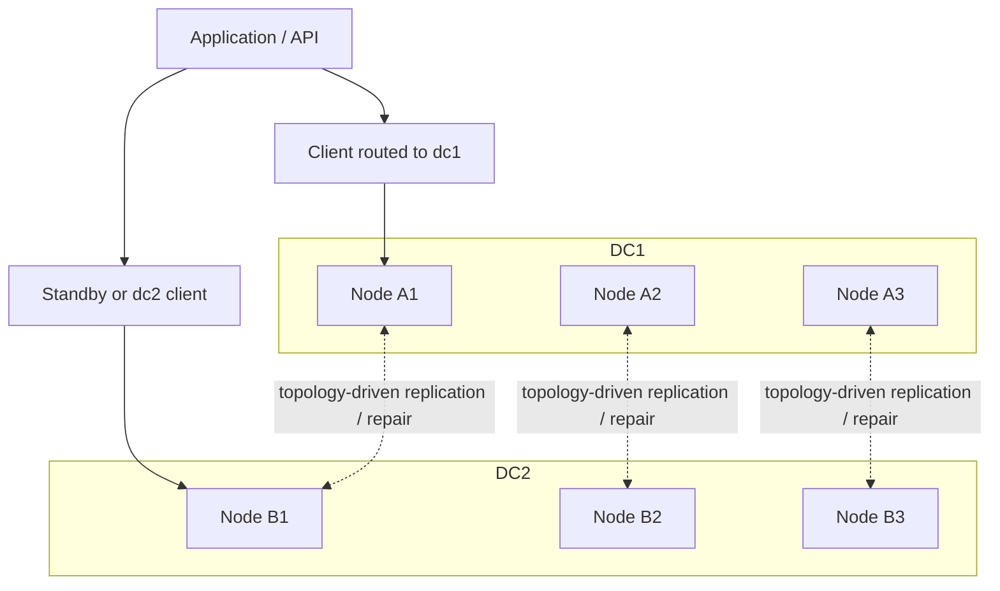
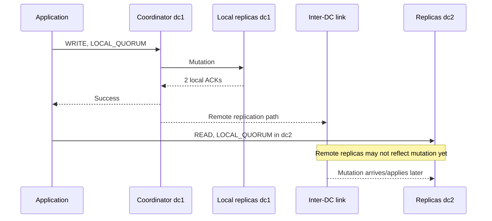

# Repair, Backup, and Operations Across the Full Data Domain

> **Chapter:** Multi-Datacenter Deployment  
> **Module:** `DATABASE_ENGINE_WIDE_COLUMN_CASSANDRA` — Apache Cassandra, a distributed wide-column database.  
> **Goal:** Protect data when Cassandra runs across multiple datacenters (DCs): design repairs that cover the right replicas, build backups/restores that actually recover data, operate failovers, and test cross-DC risks.

When Cassandra operates across multiple datacenters, **replication** keeps the system serving through certain node or full-DC outages. However, replication **is not equivalent to repair**, and neither **replaces backups**. An accidental `DELETE`, bad schema change, or application bug writing corrupted data is faithfully replicated to every copy; repair can even help **converge all replicas onto that bad state**.

Reliable operations require managing three layers together:

1. **Replication and consistency levels (CL):** replica distribution across DCs/racks, read/write success conditions, and client routing when a DC fails.
2. **Anti-entropy repair:** reconciling replicas of the same token ranges, including cross-DC synchronization scoped to job boundaries and inter-region bandwidth capacity.
3. **Backup, restore, and recovery drills:** retaining copies independent of the live cluster, governing RPO/RTO, and proving data can genuinely be restored.

This lesson ties these principles to query-driven table design, partition keys, CQL, tokens/replication, SSTables/compaction, tombstones, the Java Driver, and multi-DC operational runbooks.

> **Applicability note:** Examples follow Apache Cassandra 4.x/5.x models with `NetworkTopologyStrategy`, full replicas, and sample DCs `dc1`, `dc2`. Exact `nodetool` flags, incremental repair behavior, backup/restore tools, and streaming mechanics vary across versions/distributions. Verify exact cluster documentation before applying in production.

## 1. Learning Outcomes

After this lesson, you will be able to:

- Explain why `LOCAL_QUORUM` in DC1 and DC2 are two **distinct** conditions, and why data may not be synced immediately upon failing over.
- Scope repair by **keyspace/table, token ranges, replicas/DCs, and completion timestamp**, rather than glancing at a green job indicator.
- Distinguish **intra-DC** repair from necessary **cross-DC** reconciliation; evaluate WAN/streaming impact.
- Explain the role of `gc_grace_seconds`, tombstones, and DC disconnection duration in zombie-data risk.
- Design a per-node/table/DC backup strategy stored **outside the failure domain**, covering snapshots, incremental backups, and commit log archiving where planned.
- Write a recovery runbook for a table, node, or entire DC with drill-measured RPO/RTO.
- Use CQL and the Java Driver to test read/write behavior across DCs without mistaking a single valid read for a successful repair.
- Design monitoring dashboards for repair coverage, backups, inter-DC networking, and recovery timelines.

## 2. What Is a Data/Failure Domain?

In Cassandra, a **failure domain** is a set of resources that can fail together from one root cause: a server, rack, power feed, network, datacenter, or entire geographic region. With multiple DCs, systems aim to survive **losing a major domain**, yet that cannot be achieved merely by setting a high RF.



This is a conceptual diagram; Cassandra does **not** pin A1 ↔ B1 for all partitions. Replica sets are determined by token placement, snitch, per-DC RF, and racks. Never infer actual streaming peers from how boxes are paired visually.

### 2.1. Partition Keys and Tokens Remain Foundational

Every Cassandra table has a partition key; the partitioner hashes the key into a token. `NetworkTopologyStrategy` selects replicas per each DC's RF, spreading across racks when topology and snitch permit. Therefore:

- **One partition key** can have replicas in multiple DCs.
- Each DC holds **its own replica set** for token ranges.
- Reading/writing by the proper partition key helps Cassandra locate replicas and minimize fan-out.
- Nodes across two DCs do not hold identical full datasets; only compare replicas of **the same token range**.
- Adding/removing nodes or changing RF must account for streaming, disk headroom, and repair coverage.

### 2.2. RF and Replica Count Example

Suppose a keyspace:

```sql
CREATE KEYSPACE IF NOT EXISTS lab_multidc
WITH replication = {
    'class': 'NetworkTopologyStrategy',
    'dc1': 3,
    'dc2': 3
};
```

With full replicas, each partition has **three replicas in DC1 and three replicas in DC2**, totaling six target copies. Within one DC holding three full replicas:

\[
\text{LOCAL\_QUORUM}(RF=3)=\left\lfloor\frac{3}{2}\right\rfloor+1=2
\]

DC1 receiving two ACKs does not mean DC2 received two ACKs; nor is cluster-wide data guaranteed to be readable immediately in DC2. That is why **coordinator DC**, CL, and failover rules must be defined before operating.

## 3. Replication, Repair, and Backup Solve Three Different Problems

| Mechanism | Question It Solves | What It Does Not Guarantee |
|---|---|---|
| **Replication** | How many copies should a partition have, and in which DCs/racks? | Instant sync across all replicas; undoing accidental deletes |
| **Write / Read CL** | How many replicas must acknowledge/respond to one request? | Identical state across every replica in every DC |
| **Hinted handoff** | Can missed mutations be replayed to a temporarily Down replica? | Full convergence after prolonged DC disconnects |
| **Read repair** | Fix certain divergences discovered along the read path? | Scanning and repairing every token range |
| **Anti-entropy repair** | Which replicas for the same range differ and need synchronization? | Recovering mutations lost from all replicas |
| **Compaction** | Merge SSTables per node and reclaim eligible data? | Cross-DC synchronization |
| **Backup / restore** | Can data be restored to a trusted point independent of the live cluster? | Automatic RPO=0 or fast recovery if unrehearsed |

**Operational rule:** Replication maintains service availability; repair maintains consistency among surviving copies; backups protect against **loss or logical corruption that propagated to every copy**. All three need separate policies.

### 3.1. Scenarios Where Replication Cannot Save Data

- An application accidentally runs `DELETE` on a critical partition and the mutation replicates to all DCs.
- An accidental `DROP TABLE`/`TRUNCATE` executes validly in the cluster; replicas generally lack schema/data history to "undo" it.
- A bug writes bad values to the same row across all replicas.
- A delete's tombstone is purged on healthy replicas before an offline DC receives it; stale data resurrects.
- Cluster-wide data/metadata corruption or loss of access to the entire cluster.
- A botched restore injects old data back into the live cluster, overwriting newer rows or creating zombie records.

In these scenarios, **independent backups, audit trails, CDC, or business event logs** matter far more than increasing RF.

## 4. Consistency Levels for Reads/Writes Across Multiple DCs

### 4.1. Comparing Common CLs

Assume RF=3 in `dc1` and RF=3 in `dc2`:

| CL | Simplified Meaning | Trade-off |
|---|---|---|
| `ONE` | One replica responds per request scope rules | Easy availability, may return stale data |
| `LOCAL_QUORUM` | Quorum of **coordinator's local DC**; typically 2/3 | Isolates local ACKs from WAN, does not require remote quorum |
| `QUORUM` | Quorum of total full replicas for the keyspace; typically 4/6 | May depend on cross-DC replicas, increasing latency or lowering availability |
| `EACH_QUORUM` (write) | Requires quorum in **each DC** per its RF | Stricter multi-DC ACK, but one DC lacking quorum fails writes |
| `ALL` | All full replicas must respond per request semantics | Poor availability if any required replica fails |

Verify exact constraints for **reads and writes** on your version; never assume every CL supports every operation identically. `EACH_QUORUM` is designed for multi-DC **writes**, not as a universal read switch.

### 4.2. Writing in DC1 and Reading Immediately in DC2

Suppose an app writes in DC1 at `LOCAL_QUORUM`, then immediately sends a read in DC2 at `LOCAL_QUORUM`:



This simplified diagram does not depict exact packet ordering on every Cassandra release; Cassandra sends mutations to remote replicas along the write path, yet **local quorum ACKs do not wait for remote quorums**. Hence a subsequent DC2 read **may miss the new record**.

Applications requiring **immediate cross-DC read-your-writes** must design matching CL/routing/protocols; never claim a guarantee simply because both sides use `LOCAL_QUORUM`.

### 4.3. Switching DCs Is More Than Changing a URL

When `dc1` fails and clients shift to `dc2`:

- `dc2` must have enough healthy replicas to meet request CLs.
- Copies in `dc2` may lag behind recent mutations prior to the disconnect.
- Drivers must select the **right local DC** and valid contact points.
- In-flight writes to `dc1` may have **indeterminate** outcomes upon timing out.
- Workflows needing ordering or deduplication require idempotency or business-layer protocols.

**RPO (Recovery Point Objective)** during failover cannot be deduced from RF alone. Measure actual replication lag and correctness under real fault tests.

## 5. Repair Coverage in a Multi-DC Cluster

### 5.1. Repair Must Specify Three Dimensions

A repair strategy must define:

1. **Data scope:** keyspaces, tables, token ranges, and SSTables/data classes covered by policy.
2. **Replica scope:** nodes/peers, datacenters, racks, and RF; are unresponsive replicas being skipped?
3. **Time dimension:** when did the last repair **complete successfully** for those ranges, and how much margin remains relative to tombstone grace?

`nodetool repair` is not a magic "fix everything" button just because it ran once. With vnodes, multiple ranges, multiple nodes, and multiple DCs, a single job may cover only a subset.

### 5.2. Local DC Repair vs. Cross-DC Reconciliation

Some Cassandra versions offer flags restricting repair to the local DC or named DCs. Always read `nodetool help repair` for your running version before applying.

| Repair Scope | Benefit | Potential Gap |
|---|---|---|
| Repair within `dc1` | Uses intra-DC sources/targets, spares WAN bandwidth | Does not prove DC2 received mutations held by DC1 |
| Repair within `dc2` | Reconciles replicas inside DC2 | Does not prove DC1 and DC2 match |
| Repair with eligible peers across DCs | Detects/syncs cross-DC divergence | Uses WAN; requires bandwidth, latency, and availability control |
| Repair a subset of token ranges | Useful for chunking workload | Ranges outside the subset remain unverified |

**Two DCs that are each "internally consistent" are not guaranteed to match each other.** Suppose DC1 has record X while DC2 lacks X, yet **all three replicas inside each DC agree**. Independent intra-DC repairs will find zero mismatches within each DC while the two DCs remain different. Repair plans must therefore cover **cross-DC divergence** appropriately for your topology and version.

### 5.3. Merkle Trees Over the Same Token Range

Repair typically builds fingerprints/Merkle trees across replicas of **the same token range**:

```text
Keyspace lab_multidc, table events_by_tenant_day, range R

DC1: A1/A2/A3 → data in R → Merkle tree for R
DC2: B1/B2/B3 → data in R → Merkle tree for R

Compare trees across valid pairs/ranges:
- Trees match: no streaming needed for compared range.
- Trees differ: pinpoint differing subranges, sync via streaming/reconciliation.
```

Merkle trees isolate differences, but validation still reads/hashes SSTables and WAN streaming can be heavy. If both DCs missed a mutation, matching trees cannot recreate data lost everywhere.

### 5.4. Full vs. Incremental Repair

Modern Cassandra releases support **full** and **incremental** repairs; repaired/unrepaired marking and pending-session management depend on version.

- **Full repair:** compares the chosen scope thoroughly; heavier, useful for periodic verification or recovery.
- **Incremental repair:** focuses on unrepaired data and manages repaired/pending state (often via anti-compaction); cuts recurring work but does not re-verify already-repaired SSTables.
- **Interrupted incremental runs:** can leave pending sessions/anti-compaction artifacts that must be checked before overlapping runs or forced cleanups.
- **DC scope:** neither full nor incremental automatically covers every DC; verify flags and orchestration schedules.

Example **only in a lab with clearly understood scope**:

```bash
# Run on an appropriate node; a single run does not automatically fix the whole cluster.
nodetool repair --full lab_multidc events_by_tenant_day

# Inspect incremental repair state on supported versions:
nodetool repair_admin list
nodetool repair_admin summarize-pending
```

Before running in production, verify DC/peers, primary ranges, concurrency, and job schedulers. Never add `--force` blindly to skip downed nodes and declare the scope safe.

## 6. Cross-DC Repair: Scheduling and WAN Balancing

### 6.1. Why Measure WAN Impact?

For repair jobs spanning remote-DC peers, two traffic streams matter:

- **Validation:** reading SSTables and exchanging Merkle trees/hashes and metadata.
- **Synchronization / streaming:** shipping SSTables/data when mismatches are found.

Simultaneously, the link carries **normal write replication**, client traffic, hints, backup exports, and topology operations. A large repair can saturate the inter-DC link, spike p95/p99, or delay remote replication.

### 6.2. Estimating Streaming Time

Suppose \(B=500\) GiB of divergent data must traverse the inter-DC link, and **available effective** aggregate throughput for repair is \(v=80\) MiB/s:

\[
T_{\mathrm{transfer}}\approx\frac{B\times1024}{v}
=\frac{500\times1024}{80}=6,400\ \text{seconds}
\approx 1.78\ \text{hours}
\]

This is only an **ideal lower bound for transferring bytes**, excluding validation, retries, repair setup/teardown, compaction, disk I/O, and fluctuating bandwidth. If source/target nodes are also serving live load, actual runtime can be much longer.

Never treat a 10 Gbps NIC rating as guaranteed repair throughput. Measure **actual WAN links and disk resources**, leaving headroom for reads and writes.

### 6.3. Cross-DC Repair Operations Plan

1. Schedule repairs per keyspace/table, replica ranges, and participating DCs.
2. Avoid running multiple heavy repairs/streams across the same WAN link concurrently without throttling.
3. Pick maintenance windows where user traffic and backups do not contend for the same bandwidth.
4. Monitor network in/out, retransmits, disk, CPU, GC, compaction, and client errors in **both DCs**.
5. Record session IDs, bytes validated, bytes streamed, and final status; never equate "ran" with "synced."
6. When jobs fail, remediate missed ranges rather than infinitely retrying into congestion.
7. Track the **last successful** completion time and update coverage history.

### 6.4. Avoid Mixing Major Changes in One Window

Bootstrapping nodes, changing RF, migrating tables, and running cross-DC full repair simultaneously makes isolating slowdowns or data discrepancies extremely difficult. Stage changes and verify stability after each step unless an explicit recovery procedure demands otherwise.

## 7. Tombstones, `gc_grace_seconds`, and Prolonged DC Outages

### 7.1. Logical Deletes Must Reach Missed Replicas

Suppose RF=3 in DC1/DC2. While DC2 is disconnected:

1. A client in DC1 issues `DELETE` at `LOCAL_QUORUM`.
2. DC1 ACKs via two local replicas.
3. DC2 **misses the tombstone** because links/peers are unreachable.
4. Once DC2 returns, updates and repair must inform those replicas of the deletion.

If tombstones are purged from all healthy sources before DC2 receives them, old data in DC2 can spread back (**zombie data**).

### 7.2. Grace Period Is Not a Promise of Automatic Repair

`gc_grace_seconds` is the retention window protecting tombstones before compaction **may** purge them, commonly defaulting to 864,000 seconds (10 days); always check the actual table definition.

It **does not** guarantee:

- Every replica in every DC receives deletes within 10 days.
- Tombstones are purged cleanly on exactly day 10.
- Snapshots/backups are up to date.
- Hints and read repair touch every partition.
- Repair finished just because a scheduler started.

A conservative time-budget rule:

\[
T_{\mathrm{DC\ down}} + T_{\mathrm{repair\ complete}}
+ T_{\mathrm{safety\ margin}} < T_{\mathrm{grace}}
\]

For example, DC2 is disconnected for 7 days; full repair is projected to take 2 days, with a 2-day safety margin: 11 days total **exceeds** a 10-day grace window. This is a warning that you cannot simply "bring DC2 online and let Cassandra heal itself."

This budget is a **risk-management heuristic**, not a universal safety theorem across all versions: outcomes also depend on tombstone timestamps, compaction, topology, and repair coverage.

### 7.3. When a DC Returns After Grace Expires

Your runbook must:

1. **Assess and isolate stale data** before letting stale replicas serve reads or stream freely.
2. Collect outage duration, repair history, per-table tombstone grace, backups, and delete logs.
3. Verify whether surviving DCs/replicas are an authoritative source or also contain divergence.
4. Plan **rebuild/rebootstrap/replace** of stale data from trusted sources per version procedures; never simply mount and rejoin old disks blindly.
5. Reconcile business data and check for zombie or missing records.
6. Re-open client traffic only once data state and replica placement meet policy.

**Never lower `gc_grace_seconds` just to reclaim disk space** when cross-DC repair already lags; doing so increases resurrected-delete risk.

## 8. Multi-DC Backups: What Must Be Backed Up?

Proper backup is not merely "having a snapshot on one node." A plan must specify **which failures it recovers from**, backup granularity, timing, versions, and restore sources.

### 8.1. Distinguishing Types of Copies

| Copy Type | Purpose | Limitations |
|---|---|---|
| **Live replicas** | Availability and query serving | Replicates bad `DELETE`/schema changes too; no arbitrary history |
| **Local SSTable snapshot** | Point-in-time file capture on one node | Hard links on the same disk do not survive host/DC loss |
| **Incremental SSTable backup** | Captures newly flushed/compacted SSTables when enabled | Requires baseline, retention, and strict restore ordering |
| **Commit log archive** | Can support finer point-in-time recovery if properly configured and drilled | No automatic PITR without archived segments and full lineage |
| **Off-domain remote backup** | Protects against DC/cluster loss, accidental deletes, ransomware | Requires encryption, manifests, download speed, and restore tests |

**A Cassandra snapshot on one node does not create a globally synchronized transaction snapshot across all nodes or two DCs.** If apps keep writing while nodes snapshot sequentially, snapshots represent slightly shifted instants. Account for this in business data checks and restore workflows.

### 8.2. Backup Components Often Forgotten

Beyond SSTable files, capture/record:

- **CQL schema:** keyspaces, per-DC RF, tables, types, indexes, UDTs/UDFs if used, and schema versions.
- **Topology:** Cassandra version, cluster ID/name, partitioner, DC/racks, nodes, host IDs, token ownership/vnodes, snitch.
- **Operational config:** compression/compaction/TTL settings, security settings, encryption config, backup/commit-log options.
- **Access control:** roles/permissions, **without storing plaintext secrets in manifests**; manage credentials/keys in a dedicated secrets vault.
- **Data manifest:** source node, keyspace/table, snapshot tag, checksums/hashes, size, timestamps, version, object storage paths.
- **Completion proof:** upload success, checksum verification, retention lock, decryption test, and restore drill results.
- **External data sources:** queues/CDC and audit/event logs if business state or near-loss writes must be replayed.

Restoring SSTables without matching schema/metadata or knowing which node/token range they belong to can produce incomplete or corrupted restores.

## 9. Failure-Domain-Aligned Backup Strategy

### 9.1. Per-Node, Per-DC, and Independent Storage

A common model:

1. Schedule snapshots on **nodes selected to cover all token ranges/replicas per strategy**.
2. Export SSTable snapshots, incremental SSTables, and/or commit log archives per policy.
3. Ship artifacts to **storage outside the source DC's failure domain**, e.g., cross-region object storage honoring data-residency rules.
4. Attach manifests, checksums, and version metadata.
5. Alert on upload failures, age of the last valid backup, storage quota, and download health.
6. Periodically restore into an **isolated environment** to verify completeness and real RTO.

To survive losing an **entire** DC, backups cannot live solely on disks inside that DC. To survive accidental deletes propagated via replication, backups must keep **historical retention**, not just "the latest snapshot taken after the bad `DELETE`."

### 9.2. Do You Need to Snapshot Every Replica?

There is no single answer. You may back up a coordinated set covering every token range at a target time, or back up every node/replica per policy. The choice depends on:

- Restore granularity: a row/table, one node, one DC, or the entire cluster.
- Whether RF, vnodes, and topology changed during the backup window.
- Ability to resolve stale differences across replicas.
- Backup bandwidth/cost and target restore duration.
- Regulatory rules on data residency, encryption, retention, and audits.

**Never assume "RF=3 means backing up one node is enough."** With token-sharded data, one node does **not** hold every partition. Partial backups lacking range manifests can miss entire token ranges.

### 9.3. Snapshots Are Hard Links, Not Independent Copies

`nodetool snapshot` typically creates hard links to SSTables on the node. That is fast and uses minimal extra blocks initially, but:

- If the host or disk dies, both live SSTables and local snapshots on that filesystem are lost together.
- As compaction replaces SSTables, snapshot hard links retain old blocks, raising disk usage.
- Only after **copying/uploading off-domain and verifying checksums** do you hold a copy surviving that failure domain.
- Prune snapshots strictly according to retention and verified uploads; never delete snapshots blindly to "free disk" at the expense of recoverability.

Lab observation example:

```bash
# Create a snapshot for the test keyspace on the local node.
nodetool snapshot --tag lab-multi-20261121 lab_multidc

# List snapshots on the node.
nodetool listsnapshots

# Observe disk/table impact.
nodetool tablestats lab_multidc.events_by_tenant_day
```

**Note:** tag flags, keyspace/table selection, and listing syntax vary by version; check `nodetool help snapshot`. Running on one node **is not** a cluster-wide snapshot.

### 9.4. Incremental Backups and Commit Log Archiving

To shrink RPO beyond full-snapshot intervals:

- **Incremental backups:** when enabled, Cassandra retains additional hard links to newly flushed/compacted SSTables per version mechanics. Requires the baseline snapshot, incremental files, and an unbroken manifest chain.
- **Commit log archiving:** when configured, commit log segments can be shipped externally to recover mutations after a snapshot. Point-in-time recovery requires matching segments/timestamps, version compatibility, and tested replay workflows.
- **CDC / audit logs:** can supplement business-event recovery, though they do not automatically constitute a complete backup of every table.

Never claim "minutes-level RPO" simply because incremental backups or commit log archiving are turned on. **Measure upload lag, detect missing segments, and test actual replay/restore.** A byte-complete backup that cannot be decrypted or lacks encryption keys is unrecoverable.

## 10. RPO, RTO, and Verifying Recoverability

### 10.1. Two Metrics Required in Every SLA

- **RPO (Recovery Point Objective):** maximum tolerable data loss measured in time or recovery-point lag.
- **RTO (Recovery Time Objective):** maximum elapsed time from incident onset until service and data are restored to defined criteria.

Suppose an organization sets RPO=15 minutes and RTO=4 hours for a critical service. Having two DCs does not automatically meet either target:

- Taking snapshots every six hours with no verified archive/logs means backup recovery can lose **six hours or more** if jobs/uploads lag.
- If each DC holds tens of TiBs, downloading, verifying checksums, loading SSTables, rebuilding indexes, and repairing can exceed RTO without rehearsed automation.
- Failing over to surviving replicas is faster than restoring backups, yet the remote DC **may lack the latest mutations** when the WAN drops.
- RPO is measured at the **recoverable data point**, not when a cron job started.

### 10.2. Planning by Failure Cause

| Incident | Preferred Recovery Option | Required Verification |
|---|---|---|
| Single node failure; DC still has healthy replicas | Replace/bootstrap/stream from trusted replicas | RF, token ownership, data consistency, repair |
| One DC down; other DC healthy | Fail over applications to surviving DC | Local CL, data freshness, capacity, RPO |
| Entire cluster lost or inaccessible | Restore from off-domain backups | Manifests, schema, files/segments, checksums, RTO |
| Accidental `DELETE`/`DROP` replicated to both DCs | Restore to pre-incident point; reconcile/replay business events | Avoid overwriting valid post-incident changes |
| Logical corruption spread across replicas | Use trusted backups/audits; isolate bad writer | Data accuracy and authoritative source |
| DC offline past tombstone grace | Evaluate rebuilding/replacing DC from trusted source | Prevent reintroducing zombie data |

### 10.3. Breaking Down RTO

A budgeting estimation model:

\[
T_{\mathrm{RTO}}
\approx T_{\mathrm{detect}} + T_{\mathrm{decision}}
+ T_{\mathrm{provision}} + T_{\mathrm{download}}
+ T_{\mathrm{load}} + T_{\mathrm{verify}} + T_{\mathrm{cutover}}
\]

Steps can overlap in parallel, so this is a **planning model**, not an exact formula. During drills, log actual timestamps for each stage and locate bottlenecks: network egress, target disk capacity, node rebuild count, schema mismatches, disk I/O, compaction, and application reconnects.

## 11. Restoring Data: One Table, One Node, or an Entire DC?

### 11.1. Pre-Restore Principles

1. Define the **restore scope**: full table, token range, new environment, or full DC.
2. Pick a **trusted backup source and target timestamp**, explicitly stating whether valid writes after that point must be preserved.
3. Verify schema, Cassandra/SSTable version, partitioner, token/ownership, and compression/encryption.
4. Validate manifests/checksums, decryption keys, and download disk space.
5. Use a **version-supported restore procedure**—never copy SSTable files arbitrarily onto a random live node.
6. If performing live surgical fixes, define how ongoing writes, TTLs, tombstones, and LWTs are handled during restore.
7. Test in isolation first, measure duration, and validate restored data.
8. Cut over traffic only after verifying data completeness, topology, CL, and client metrics.

### 11.2. Restoring a Table: Never Copy Files Arbitrarily into Production

A snapshot contains SSTables from a specific node. Each target node only owns specific token ranges; dropping files in the wrong place creates unowned data or timestamp/tombstone conflicts.

Situational recovery approaches include:

- Restoring into an **isolated cluster** with identical schema/version, reconciling, and writing valid records back through application workflows.
- Using supported SSTable-loading tools to **stream data across the ring** (such as `sstableloader` under compatible formats/configs), rather than copying directly into a random node's table directory.
- Using dedicated node-replacement/backup-restore workflows when recovering the exact token ranges of a lost node.
- Replaying events from audit/CDC at the application layer when only a narrow subset of records was deleted or corrupted.

**Never assume** restoring an old snapshot onto a live cluster acts as a safe "undo." Historical rows may be shadowed by current tombstones, or resurrect zombies if loaded improperly; you must understand timestamp reconciliation and validate post-restore.

### 11.3. Restoring an Entire DC After a Prolonged Outage

If DC2 lost all machines or stayed offline past grace:

- Confirm whether DC1 remains an authoritative source (enough replicas and no lost critical tombstones).
- Provision DC2 nodes with matching version, config, DC/rack metadata, and sufficient capacity.
- Run the version-supported rebuild/streaming workflow from the trusted source.
- Throttle inter-DC bandwidth so DC1 continues serving live traffic cleanly.
- Monitor bootstrap/rebuild, disk headroom, compaction, repair, and replica health.
- Validate representative ranges in both DCs; check critical business flows and lag.
- Re-enable client traffic to DC2 gradually while keeping a rollback path.

If DC1 is also corrupted or missing data, the recovery source must be **independent backups**, not streaming from DC1.

### 11.4. Restore Does Not Grant Transactional Consistency

Cassandra follows replica and timestamp consistency. Backups taken across multiple nodes at slightly different times can capture partial slices of concurrent mutations. For applications with cross-row business invariants (orders–payments, ledgers, denormalized tables):

- Identify the **authoritative event source** and replay rules.
- Use idempotency/versioning or reconciliation rules to prevent duplicate or regressive writes.
- Verify relationships across query tables after restore, since Cassandra repair is unaware of cross-table invariants.
- Consider a separate transactional store for invariants that cannot be guaranteed by your current Cassandra model.

## 12. Runbook: DC1 Lost While DC2 Remains Operational

### 12.1. Detection and Failover Decision

Suppose all apps previously used `dc1` as local datacenter. DC1 disconnects while DC2 retains quorum.

**Step 1 — Triage the Incident**

- Check node/DC status, network errors, root cause, and blast radius.
- Verify DC2 has enough healthy full replicas to meet `LOCAL_QUORUM`.
- Assess replication lag/latest data in DC2 and writes ACKed in DC1 shortly before disconnect.
- Record the cutover timestamp and any indeterminate in-flight operations.

**Step 2 — Controlled Client Cutover**

- Route traffic to apps/drivers configured with **local DC = `dc2`** and valid contact points.
- Enforce retry/backoff/throttling to avoid thundering herds.
- Monitor p95/p99, error rates, availability, data freshness, and new write volume.
- If workflows require halting writes in the old DC, apply infrastructure/app fencing; never let both sides accept uncoordinated conflicting writes.

**Step 3 — Protect Data**

- Log writes with indeterminate timeout outcomes.
- Preserve audit/event logs for reconciliation when DC1 returns.
- Track downtime duration against `gc_grace_seconds`.
- Prevent long-offline DC1 nodes from rejoining automatically if zombie risk exists.

**Step 4 — Recover DC1**

- Verify trusted data sources and the right rebuild/repair workflow.
- Throttle streaming so DC2 keeps meeting SLOs.
- Validate data, replica placement, repair coverage, and backups before failing back.
- Fail back gradually with a rollback plan; avoid simultaneous mass client reconnects.

### 12.2. Common Mistakes

| Mistake | Potential Consequence |
|---|---|
| Driver keeps `withLocalDatacenter("dc1")` while meant to run in DC2 | Picks wrong nodes or no eligible local endpoints; errors or unintended routing |
| Assuming DC1 `LOCAL_QUORUM` writes are guaranteed in DC2 | Drops/misses unpropagated remote mutations |
| Restarting old DC1 nodes after outage exceeds grace | Zombie data risk if healthy sources purged tombstones |
| Running unbounded cluster-wide repair to "force sync" over a congested WAN | Amplifies contention and prolongs the outage |
| Deleting snapshots to free space before verifying uploads | Destroys backup recovery path |
| Testing only happy-path failover | Misses retry bugs, token metadata, auth, or RPO surprises |

## 13. Hands-On CQL: Two DCs, Two Observation Points

### 13.1. Lab Schema

The test cluster must have **two real Cassandra-recognized DCs**, `dc1` and `dc2`, each with at least three eligible full replicas for RF=3.

```sql
CREATE KEYSPACE IF NOT EXISTS lab_multidc
WITH replication = {
    'class': 'NetworkTopologyStrategy',
    'dc1': 3,
    'dc2': 3
};

CREATE TABLE IF NOT EXISTS lab_multidc.events_by_tenant_day (
    tenant_id uuid,
    event_day date,
    event_time timestamp,
    event_id timeuuid,
    event_type text,
    payload text,
    PRIMARY KEY ((tenant_id, event_day), event_time, event_id)
) WITH CLUSTERING ORDER BY (event_time DESC, event_id DESC)
  AND gc_grace_seconds = 864000;
```

**Query-driven design:** the app reads events for one tenant on one day; hence `(tenant_id, event_day)` is the partition key and `event_time`, `event_id` are clustering columns. Each partition's token is replicated per RF across both DCs.

### 13.2. Writing in DC1 at `LOCAL_QUORUM`

Connect `cqlsh` to a node **inside `dc1`** (this determines the coordinator's local DC for the operation):

```sql
CONSISTENCY LOCAL_QUORUM;

INSERT INTO lab_multidc.events_by_tenant_day (
    tenant_id, event_day, event_time, event_id, event_type, payload
) VALUES (
    11111111-1111-1111-1111-111111111111,
    '2026-11-21',
    '2026-11-21 08:00:00+0000',
    7c627d5a-a6b0-11ef-8ae8-0242ac120002,
    'created',
    'demo'
);

SELECT event_id, event_type
FROM lab_multidc.events_by_tenant_day
WHERE tenant_id = 11111111-1111-1111-1111-111111111111
  AND event_day = '2026-11-21'
LIMIT 20;
```

Record ACK timestamps, latency, and peer statuses. Success **does not prove** `dc2` has received the mutation.

### 13.3. Reading Back from DC2

Connect a **separate** `cqlsh` session to a node in `dc2` using the same CL:

```sql
CONSISTENCY LOCAL_QUORUM;

SELECT event_id, event_type
FROM lab_multidc.events_by_tenant_day
WHERE tenant_id = 11111111-1111-1111-1111-111111111111
  AND event_day = '2026-11-21'
LIMIT 20;
```

In a healthy cluster, data may arrive very quickly; lag is not always visible. To verify boundaries, rehearse in an **isolated lab cluster** with simulated WAN delay/partitions: you can observe cases where `dc1` ACKed yet `dc2` does not see it right away.

**Never run WAN-cutting experiments on production.**

### 13.4. Testing `DELETE` While One DC Is Disconnected

In a lab with controlled fault injection:

1. Write and confirm the initial row in both DCs.
2. Isolate connectivity to `dc2` while keeping `dc1` quorum healthy.
3. Execute `DELETE` at `LOCAL_QUORUM` in `dc1`.
4. Confirm a local read in `dc1` no longer returns the row, yet **do not conclude** `dc2` received the tombstone.
5. Restore `dc2` **before exceeding grace**, and run cross-DC repair per your deployment's coverage workflow.
6. Verify after convergence: the row is absent in every DC per policy; repair logs show completion with zero failed sessions.
7. Record downtime, repair duration, and remaining safety margin.

Example `DELETE`:

```sql
DELETE FROM lab_multidc.events_by_tenant_day
WHERE tenant_id = 11111111-1111-1111-1111-111111111111
  AND event_day = '2026-11-21'
  AND event_time = '2026-11-21 08:00:00+0000'
  AND event_id = 7c627d5a-a6b0-11ef-8ae8-0242ac120002;
```

When simulating outages longer than grace, do not rejoin old nodes "as usual"; use a disposable test environment and a safe rebuild runbook.

## 14. Java Driver: Local DC Configuration and Failover Testing

Java Driver 4.x uses topology/DC metadata to pick contact endpoints and routing; across multiple DCs, you must **manage each session's local datacenter**.

Example integration test using **two separate sessions** to read the same partition from both DCs. Placeholder hostnames must be replaced with real lab contact points:

```java
import com.datastax.oss.driver.api.core.CqlSession;
import com.datastax.oss.driver.api.core.DefaultConsistencyLevel;
import com.datastax.oss.driver.api.core.cql.BoundStatement;
import com.datastax.oss.driver.api.core.cql.PreparedStatement;
import java.net.InetSocketAddress;
import java.time.LocalDate;
import java.util.UUID;

public final class CrossDcReadLab {
    private static boolean hasAnyEvent(
            CqlSession session, UUID tenantId, LocalDate eventDay) {
        PreparedStatement ps = session.prepare(
            "SELECT event_id FROM lab_multidc.events_by_tenant_day " +
            "WHERE tenant_id = ? AND event_day = ? LIMIT 1"
        );
        BoundStatement statement = ps.bind(tenantId, eventDay)
            .setConsistencyLevel(DefaultConsistencyLevel.LOCAL_QUORUM);
        return session.execute(statement).one() != null;
    }

    public static void main(String[] args) {
        UUID tenantId =
            UUID.fromString("11111111-1111-1111-1111-111111111111");
        LocalDate day = LocalDate.of(2026, 11, 21);

        try (CqlSession dc1Session = CqlSession.builder()
                .addContactPoint(
                    new InetSocketAddress("dc1-node.example.net", 9042))
                .withLocalDatacenter("dc1")
                .build();
             CqlSession dc2Session = CqlSession.builder()
                .addContactPoint(
                    new InetSocketAddress("dc2-node.example.net", 9042))
                .withLocalDatacenter("dc2")
                .build()) {

            System.out.println("DC1: " +
                hasAnyEvent(dc1Session, tenantId, day));
            System.out.println("DC2: " +
                hasAnyEvent(dc2Session, tenantId, day));
        }
    }
}
```

**Preconditions for this example:** both sessions connect to a cluster with matching DC names, the keyspace/table exist, and enough replicas are up for `LOCAL_QUORUM`. This code only illustrates **each DC's perspective**, not a production failover controller.

In real systems:

- Prefer drivers/sessions whose **local DC matches** the DC where the app serves.
- Failover must be an **orchestrated procedure** with explicit decisions on data freshness, traffic, and fencing; never assume the driver switches DCs safely on its own.
- Treat write timeouts as **indeterminate** outcomes (some replicas may have persisted the write); bound retries and use idempotency where appropriate.
- Never "verify a backup" by reading one partition; restore into an isolated test environment.
- Monitor p95/p99, errors, per-DC/node requests, queueing, and retry counts during repair/restore.

## 15. Observing Cluster, Repair, and Backup Across DCs

### 15.1. Cassandra Tools

Common inspection commands on relevant nodes:

```bash
nodetool status
nodetool describecluster
nodetool describering lab_multidc
nodetool netstats
nodetool compactionstats
nodetool tpstats
nodetool tablestats lab_multidc.events_by_tenant_day
nodetool listsnapshots

# Incremental repair status if supported by your version:
nodetool repair_admin list
nodetool repair_admin summarize-pending
```

For commands whose flags vary across releases, run `nodetool help <command>` and cross-check your repair scheduler. Seeing `status=UN` or an empty `netstats` output does not prove DCs are in sync or backups are complete.

### 15.2. Dashboards Need a Per-DC View

| Area | Metric or Question | Example Alert |
|---|---|---|
| Replicas | Effective RF, Down nodes, DC/rack, token ownership | Missing replica / DC outage |
| CQL / Driver | Read/write latency, timeouts, unavailables by DC and CL | p99 breaches SLO or failover failing |
| Replication | Network errors, hints/backlog, observable lag | Remote DC may be stale |
| Repair | Session success/fail, range/table/DC coverage, repair age | Overdue / incomplete coverage |
| WAN | Bytes in/out, retransmits, throughput, egress cost | Bandwidth nearing saturation |
| Compaction / streaming | Pending tasks, disk I/O, active sessions | Backlog causing disk pressure |
| Tombstones | Per-table grace, node/DC downtime, repair schedule | Downtime + repair approaching grace |
| Backups | Last verified snapshot, incremental lag, manifest, checksum | Backup stale / missing files |
| Restore readiness | Latest drill, download/load/verify duration | Missing RPO/RTO targets |

### 15.3. Two Essential Metrics Often Overlooked

**Repair coverage age:** elapsed time since the last **complete and fully scoped** repair for a token range/table/replica group per policy. Never use job start time as the repaired timestamp.

**Recoverable backup age:** elapsed time since the latest data point **proven recoverable** via manifest, upload, and restore verification; never treat snapshot creation date as proof of a valid backup.

These metrics are harder to compute than a green "scheduler OK" badge, yet directly reflect real data risk.

## 16. Multi-DC Backup and Restore Drills

A backup strategy only counts when it **restores cleanly**. Your drill plan should include:

### 16.1. Scenario A — Losing One Table to Operator Error

1. Take a valid pre-incident backup and save its manifest/schema.
2. In the lab, simulate accidental table corruption/deletion.
3. Restore **into an isolated cluster** from the chosen backup.
4. Reconcile row counts safely, representative keys, schema, TTL/tombstones, and business invariants.
5. If selectively reverting production, design how valid records move back from the trusted environment.
6. Record actual RPO and detection-to-recovery time.

### 16.2. Scenario B — Losing a Datacenter

1. Simulate DC1 unavailability; confirm DC2 satisfies local quorum.
2. Point test clients to local DC2 and verify partition-key queries.
3. Record data freshness gaps and indeterminate writes.
4. Rebuild DC1 from trusted sources while monitoring streaming and WAN.
5. Verify cross-DC repair coverage, deletes, and denormalized tables.
6. Re-open traffic in stages and measure RTO.

### 16.3. Scenario C — Total Cluster Loss

1. Provision a blank cluster with zero SSTables from the old cluster.
2. Restore schema, configuration, and access permissions.
3. Fetch backups from off-domain storage, verify checksums, and decrypt.
4. Run version-appropriate restore/streaming tools.
5. Replay incremental backups/commit logs if policy requires and lineage allows.
6. Reconcile all critical datasets, applications, and query paths.
7. Log actual RTO, achieved RPO, defects, and remaining manual steps.

**Do not wait until both DCs are gone to run Scenario C for the first time.**

## 17. Pitfalls That Frequently Cause Outages

### 17.1. "Both DCs Have RF=3, So We Don't Need Backups"

Replication faithfully copies bad mutations too. An accidental `DELETE`/`DROP` or app bug reaches every DC; you still need independent point-in-time backups.

### 17.2. "`LOCAL_QUORUM` in DC1 Guarantees DC2 Has the Data"

CL only requires ACKs within the **local DC**. Remote DCs may not have received the mutation when the client gets its ACK; measure freshness and prepare failover rules.

### 17.3. "Running Local Repair in Each DC Completes Cross-DC Repair"

Local repairs make replicas consistent **within each DC**, without proving the two DCs agree with each other. You need a repair policy covering cross-DC replica discrepancies.

### 17.4. "Snapshotting Three Nodes in One DC Protects Against DC Loss"

If snapshots remain on disks inside that DC, losing the DC loses everything. Copy them off-domain and verify downloads.

### 17.5. "Snapshot Creation Succeeded Means RPO/RTO Are Met"

RPO/RTO only hold when data restores accurately within target times. You need checksums, manifests, schemas, encryption keys, and drills.

### 17.6. "After a DC Outage Past Grace, Restarting Old Nodes Is Safe"

Old nodes may have missed tombstones already purged on healthy sources. Assess zombie risk and rebuild/replace from trusted sources before rejoining.

### 17.7. "Running More Cross-WAN Repairs in Parallel Is Always Faster"

Too many concurrent jobs contend for disk/network, inflating latency and retries—even lengthening repair past tombstone grace. Tune concurrency by measurement.

### 17.8. "Restoring an Old Snapshot Directly into a Live Table Undoes Accidental Deletes"

Current tombstones may shadow restored rows, timestamps may collide, or stale data may resurrect unpredictably. Restore from trusted sources/points using verified workflows—typically starting in an isolated cluster.

## 18. Production Operations Checklist

**Design and Policy**

- [ ] Use `NetworkTopologyStrategy` with per-DC RF validated against racks/failure domains.
- [ ] Query shapes and partition keys align without creating unsplittable hotspots.
- [ ] CL chosen per latency, availability, and consistency needs **within each DC and during failover**.
- [ ] Realistic RPO/RTO targets and post-failover staleness/conflict acceptance criteria defined.
- [ ] Authoritative event sources identified for critical business workflows.

**Repair and Tombstones**

- [ ] Repair schedule covers token ranges/tables/replicas per DC and **cross-DC divergence**.
- [ ] Track last completed repair, not just scheduler triggers.
- [ ] Measure network/WAN, compaction, and client impact during repairs.
- [ ] Track node/DC downtime against `gc_grace_seconds` and repair safety margins.
- [ ] Runbook exists for nodes/DCs returning after long downtime without rejoining stale copies blindly.

**Backup and Restore**

- [ ] Backups cover all token ranges needed for restore targets, including schema/topology/version manifests.
- [ ] Copies live **outside the source DC's failure domain**, encrypted, with policy-aligned retention.
- [ ] Snapshots/incrementals/commit log archives (if used) are uploaded, checksummed, and completeness-verified.
- [ ] Backup credentials/keys and deletion permissions are strictly governed.
- [ ] Table, node/DC, and full-cluster restore drills executed with measured RPO/RTO.

**Observability and Response**

- [ ] Dashboards provide per-DC views: availability, CQL p99, repair coverage, streaming, WAN, backup age.
- [ ] Failover/failback runbooks cover driver local DC, fencing, and bounded retries.
- [ ] Rollback plans address stale remote DCs and rebuild bandwidth pressure.
- [ ] Incidents/changes close only after verifying data, replica placement, client SLOs, and backups.

## 19. Applied Exercises

**Exercise 1 — Two DCs, RF=3 each.** Write in DC1 at `LOCAL_QUORUM`; at least how many local full replicas ACK? Why might an immediate `LOCAL_QUORUM` read in DC2 miss that write?

**Exercise 2 — Repair coverage.** Both DC1 and DC2 run local-only repairs, and both report success. Can you declare both DCs identical? Describe a case where each DC is internally consistent yet the two differ.

**Exercise 3 — Grace budget.** DC2 disconnects for 7 days, post-return repair takes 2 days, required safety margin is 2 days, and `gc_grace_seconds` is 10 days. Compute the total and decide whether simply restarting the old replicas is safe.

**Exercise 4 — Backing up a single node.** A DC has six nodes and RF=3. Why is one node's snapshot insufficient to restore every partition if the whole DC is lost?

**Exercise 5 — WAN streaming.** Reconciling 500 GiB of divergence at an effective aggregate throughput of 80 MiB/s. Compute the ideal transfer time, then list three factors that lengthen RTO.

**Exercise 6 — Cluster-wide accidental `DELETE`.** An operator deletes critical data and the mutation reaches all replicas in both DCs. Why can't repair "undo" it? Which source should you use, and what conflicts must be handled during restore?

**Exercise 7 — Snapshot-based RPO.** Your latest snapshot is six hours old with no verified incremental backups or commit log archives. Can you promise RPO=15 minutes? Explain.

**Exercise 8 — Java failover.** A service moves infrastructure from DC1 to DC2 while its session still sets `withLocalDatacenter("dc1")`. Identify the problem and two checks required before opening traffic.

**Exercise 9 — Late-returning DC.** DC1 was disconnected for 15 days; a critical table's grace is 10 days. Outline the safe steps before letting DC1 accept writes again.

**Exercise 10 — Backup completeness.** Snapshot creation succeeded, yet one SSTable failed to upload and checksums were never verified. Should the dashboard report "valid backup"? What evidence is missing?

### Answer Hints

1. Quorum = 2/3; the remote DC is outside DC1's `LOCAL_QUORUM` ACK condition.
2. No; DC1 holds row X and DC2 lacks X, while all replicas within each DC agree internally.
3. \(7+2+2=11>10\) days, exceeding grace; evaluate zombie risk and isolate/rebuild from trusted sources.
4. One node only stores the token ranges assigned to it as a replica, not the entire keyspace.
5. \(500\times1024/80=6,400\) seconds ≈ 1.78 hours; validation, retries, disk/compaction, app load, and verification extend RTO.
6. Repair only propagates the delete state; restore from pre-incident backups/audits with timestamp/tombstone controls while preserving valid post-incident writes if needed.
7. No; the recoverable point could be six hours old or older.
8. The driver routes to the wrong DC; update local DC/contact points and verify quorum/freshness in DC2.
9. Verify outage duration, repair/tombstones, and trusted sources; isolate stale state, rebuild/replace, repair/reconcile, and ramp traffic carefully.
10. No; missing complete file uploads, manifest/checksums, decryption verification, and a restore test.

## 20. Takeaways

- **Multiple DCs create multiple fault domains, not automatic historical backups.** Replication, repair, and backup must each be managed independently.
- **`LOCAL_QUORUM` is evaluated in the coordinator's DC.** A successful write in DC1 does not prove DC2 already sees the mutation.
- **Intra-DC repair does not prove two DCs hold identical data.** Schedule and measure coverage across cross-DC scopes.
- **Merkle trees, streaming, compaction, and tombstones** carry real operational cost; slow repairs or long DC outages create zombie risks.
- **Backups must live outside the failure domain**, with schemas/manifests/checksums, encryption keys, and tested restores.
- **RPO/RTO must be measured**, never guessed from RF, snapshot schedules, or nominal NIC speeds.
- During a DC outage, failover is only safe when you know **quorum math, data freshness, retry behavior, and authoritative data sources**.
- The ultimate goal is not merely both DCs showing `UN`, but **proven serviceability, data correctness, repair coverage, and recoverability**.
