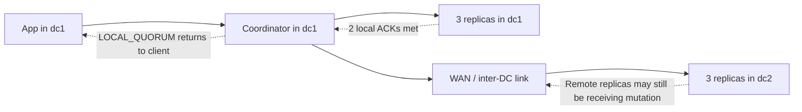
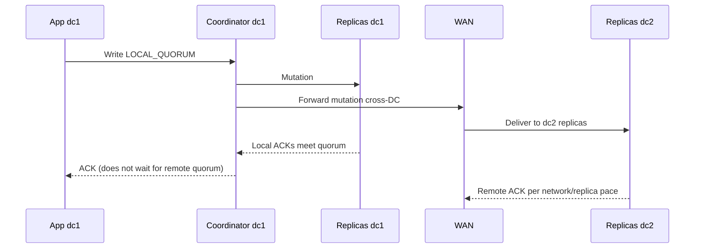
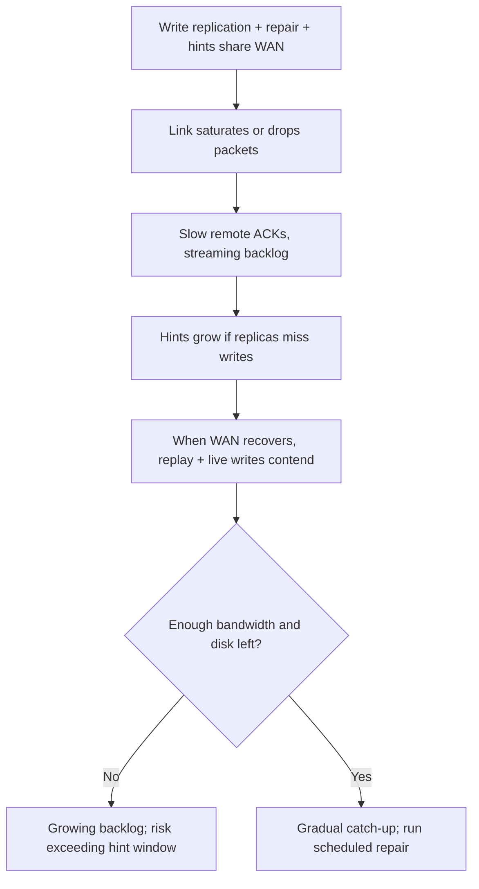

# Bandwidth, Transfer Costs, and Background Traffic

> **Chapter:** Multi-Datacenter Deployment  
> **Module:** `DATABASE_ENGINE_WIDE_COLUMN_CASSANDRA` — Apache Cassandra

Deploying Apache Cassandra across multiple **data centers (DCs)** lets a distributed wide-column system keep serving applications even when one DC suffers an outage. In return, **the inter-DC network link becomes a resource you must engineer and monitor**, not merely a "backup pipe." Regular mutations may need to reach replicas in other DCs; repair, hinted handoff, bootstrap, rebuild, and streaming generate background traffic bursts that can be several times larger than average query traffic.

The most common misconception is: **`LOCAL_QUORUM` reduces how many responses the coordinator waits for from another DC, but it does not disable Cassandra from replicating data to the other DC**. When `NetworkTopologyStrategy` sets RF across multiple DCs, the long-term goal is for every selected replica to receive the data. Thus, achieving low read/write latency from one DC does not prove the WAN link has enough bandwidth, remote replicas have caught up, or egress bills will be low.

This lesson explains how to identify inter-DC traffic sources, estimate throughput and cost, separate steady-state traffic from recovery traffic, pick the right throttling mechanisms, and build a runbook when links saturate or partition. It also connects to partition keys, query-driven table design, consistency levels, repair, compaction, and the Java Driver.

**Learning objectives**

- Explain why multi-DC consumes bandwidth even with `LOCAL_QUORUM` and local-DC routing.
- Classify inter-DC traffic: mutation replication, reads, hints, repair, bootstrap/rebuild, schema/gossip, and auxiliary operations.
- Estimate **bytes, average/peak throughput, transfer times, and network cost**, stating assumptions explicitly.
- Distinguish **streaming** limits from **request traffic** limits; select the right configuration knobs.
- Write queries to inspect replication, sample CQL statements, and Java client code setting local DC and CL.
- Propose a capacity, monitoring, and remediation plan for slow or partitioned inter-DC links.

## 1. What Happens When a Keyspace Has Replicas in Two DCs?

Suppose a cluster has two DCs, three nodes each, and a keyspace declared as:

```sql
CREATE KEYSPACE telemetry
WITH replication = {
    'class': 'NetworkTopologyStrategy',
    'dc1': 3,
    'dc2': 3
};
```

`NetworkTopologyStrategy` picks **three replicas in each DC** per token range according to node/rack topology reported by the snitch. Each partition has six total replicas across the two DCs in this example. Never use `SimpleStrategy` for multi-DC production clusters.



The diagram shows the **logical flow**, not fixed physical network sockets: Cassandra can optimize how mutations are forwarded between nodes/replicas. However, **sending writes to selected replicas in other DCs** is not skipped merely because the coordinator already collected enough local ACKs.

When a client sends an `INSERT` from `dc1` at `LOCAL_QUORUM`:

1. The driver typically picks a coordinator in the application's **local DC** when configured properly.
2. The coordinator computes the token from the partition key and builds the replica list per replication strategy.
3. The mutation is distributed to all selected replicas, including replicas in **`dc2`**—generating WAN traffic.
4. The coordinator returns success once it receives enough ACKs for **`dc1`'s `LOCAL_QUORUM`** (2 when `dc1` RF=3), without waiting for a majority in `dc2`.
5. If `dc2` is slow or temporarily unreachable, remote replicas may fall behind; Cassandra uses hinted handoff under eligible conditions, while anti-entropy repair remains an operational duty.

If both `dc1` and `dc2` accept writes from local applications, inter-DC traffic flows **bidirectionally**. When estimating costs, separate **`dc1` → `dc2` egress**, **`dc2` → `dc1` egress**, and any ingress/peering/intra-DC charges under your provider contract.

### Distinguish Token Ownership, DC, and Rack

- **Partition keys** determine tokens; hot partitions concentrate load on one replica group. Adding WAN bandwidth does not fix a hot partition.
- **Snitch** declares DC/rack so Cassandra places replicas and routes efficiently. Misconfiguring DC/rack can force apps to read across the WAN or place replicas in the same failure domain.
- **Per-DC replication factor** defines replica counts in that DC, not necessarily the number of simultaneous WAN streams.
- **Compaction** runs primarily on **node-local** SSTables. It increases disk I/O and can contend with streaming, but compaction bytes must not be counted as WAN transfer bytes.

## 2. Which Traffic Classes Cross the Inter-DC Link?

Classify by **data path** and **recurrence pattern** so background bursts are not overlooked.

| Traffic Source | When Does It Occur? | Crosses WAN? | What to Measure |
| --- | --- | --- | --- |
| **Write replication** | `INSERT`, `UPDATE`, `DELETE` to keyspaces replicated across DCs | **Yes**, typically continuous with write rate | Mutation bytes, req/s, directional traffic, retries/timeouts |
| **Cross-DC reads** | Client/coordinator in one DC reads from remote replicas when CL or routing permits/requires it | Yes; **local routing** minimizes this | Remote reads, p95/p99, response bytes, retry count |
| **Gossip, topology, schema** | Nodes exchange liveness, tokens, and metadata | Yes, though much smaller than bulk streaming | Message counts, connection errors, gossip/schema state |
| **Hinted handoff** | A replica missed writes; coordinator stores and replays mutations | Yes, especially as nodes/WAN recover | Stored hints, replay rate, backlog, drops, disk |
| **Anti-entropy repair** | Replicas compare token ranges and stream differing data | Yes, depending on participating DCs and repair flags | Bytes streamed, Merkle trees, duration/coverage, failures |
| **Bootstrap / rebuild / replace / removenode** | Topology changes or re-populating data | Can be huge, especially adding a new DC | Streaming bytes, source/dest, throughput, disk headroom |
| **LWT / Paxos & auxiliary features** | Conditional/consensus queries and specific topologies | Can add extra replica round trips, including cross-DC | Latency, LWT/s, background messages, contention rate |
| **Internal compaction / flush** | Writing SSTables, merging SSTables, purging tombstones | **Not by default** as WAN traffic | Disk I/O, pending compactions; indirect streaming impact |
| **Off-DC backup / snapshot export** | Uploading backups to object storage / remote site | Yes, if target is outside the DC | Bytes transferred, destination, egress, retention |

Identify **which sources actually traverse billed WAN links**. For instance, node traffic to same-region object storage, inter-region streaming, and client traffic through load balancers may be metered differently.

Never lump everything into "replication network usage": if a dashboard only shows total NIC bytes, you cannot tell whether traffic spiked from customer demand, a badly timed repair, or a node replaying a backlog of hints.

## 3. Consistency Levels Change Wait Time, Not Replication Transfer Volume

With **RF=3 in both `dc1` and `dc2`**, the table below illustrates common consistency levels. Choose CL based on business requirements and your exact Cassandra version.

| CL | Coordinator Responses Required | Notable WAN Impact |
| --- | --- | --- |
| `LOCAL_ONE` (read) | One replica in local DC | Avoids remote-DC reads on the normal path; low read latency, may return stale data. |
| `LOCAL_QUORUM` | Majority of replicas in local DC; 2 for RF=3 | Normal reads fetch locally; writes still forward to remote replicas, **without waiting** for remote ACKs. |
| `QUORUM` | Majority of all keyspace replicas; 4 for total RF=6 | May require cross-DC responses, making p99 sensitive to WAN and slow DCs. |
| `EACH_QUORUM` (write) | Majority of replicas **in each DC**; here 2 in `dc1` **and** 2 in `dc2` | Must wait at least one WAN round trip; drops write availability if the other DC disconnects. |
| `ALL` | All replicas | Sensitive to slowness or outage on any replica; lower availability. |

**Note:** `EACH_QUORUM` applies to **writes**; never treat it as a standard read option. When an app only needs consistency within its local DC, `LOCAL_QUORUM` is often considered for reads/writes; however, new data **need not have reached the remote DC** at ACK time. Thus an immediate read in `dc2` may see an older version when the inter-DC link lags.

Latency interaction example:



**Do not treat `LOCAL_QUORUM` as a major WAN-byte reduction mechanism.** That setting primarily reduces **client response latency and synchronous remote dependency**. To reduce WAN bytes, look at mutation counts, payloads, replication layout, compression, data lifecycle, and background traffic.

## 4. A Rough Model for Bytes and Cost

Model **each traffic direction separately**, splitting three layers:

1. **Business payload:** average and peak bytes/s of valid mutations originating in the source DC.
2. **Actual protocol overhead:** serialization, metadata, retries, compressed size, framing, TLS, and inter-node forwarding. Never equate raw CQL `payload` size with bytes on the wire.
3. **Additional traffic:** hints, repair, bootstrap/rebuild, backups, and post-outage catch-up bursts.

A **rough forecasting** formula per direction is:

\[
V_{\text{WAN, day}} \approx
R_{\text{write}} \times S_{\text{wire}} \times 86\,400
+ V_{\text{reads}} + V_{\text{hints}} + V_{\text{repair}} + V_{\text{stream}} + V_{\text{other}}
\]

Here `R_write` is writes/s needing replication to the other DC, and `S_wire` is WAN bytes **measured or estimated including mutation/protocol/compression** per write. **Do not blindly multiply `S_wire` by the receiving DC's RF** unless you know the forwarding mechanics, since RF is the final copy count rather than independent WAN copies.

### Example A — Steady-State Replication Traffic

A system writing to `dc1` generates estimated WAN mutation traffic averaging **20 MB/s**, after accounting for message sizing yet **before background tasks**. Using **decimal MB = 1,000,000 bytes**:

\[
20 \ \text{MB/s} \times 86\,400\ \text{s/day}
= 1\,728\,000\ \text{MB/day}
= 1.728\ \text{TB/day}
\]

That is roughly **1.728 TB/day** in the **`dc1` → `dc2`** direction alone. If `dc2` also generates the same local write rate replicated back to `dc1`, **bidirectional** egress can approach double that in a symmetric workload—**before** adding repair, hints, bootstrap, or backups.

If the link only has about **100 Mb/s** effective capacity—**12.5 MB/s theoretical before overhead**—it cannot sustain a continuous 20 MB/s workload. You cannot fix this by "raising client timeouts": you need higher network capacity, lower mutation rates/sizes, or architectural changes. Cassandra cannot maintain an infinite, lossless WAN replication queue.

### Example B — Streaming Time When Adding a New DC

Suppose at least **1 TB (decimal)** of data must traverse a link allocating an average **200 Mb/s** to bulk streaming:

\[
t_{\min} =
\frac{1\,000\,000\,000\,000 \times 8}
{200\,000\,000}
= 40\,000\ \text{s} \approx 11.1\ \text{hours}
\]

This is an **ideal lower bound** for transferring 1 TB at a constant 200 Mb/s aggregate rate—**not an ETA**. In reality, live write replication, protocol/TLS overhead, retransmissions, SSTable churn, timeouts, disk I/O, and streaming sources all compete. If stream throttling is configured **per node**, sum limits across *all sources/targets and shared links* rather than treating 200 Mb/s as a cluster-wide cap.

### Example C — From Bytes to Billing

Suppose a provider bills egress per **decimal GB**:

\[
C_{\text{network}} =
V_{\text{dc1→dc2}} \times P_{\text{egress, dc1}}
+ V_{\text{dc2→dc1}} \times P_{\text{egress, dc2}}
+ C_{\text{interconnect}} + C_{\text{ingress (if any)}}
\]

Unit prices `P` and fixed charges are set by your network/cloud contract. **Never assume a universal unit price**: the same byte can be priced differently across zones, regions, cloud providers, or leased/private peering links. Also inspect directional billing, pricing tiers, GB vs. GiB units, committed bandwidth, NAT/gateway fees, and backup storage charges.

### Capacity Planning Must Consider p95/p99, Not Just Averages

| Parameter to Record | Question |
| --- | --- |
| Average throughput per direction | Does the link handle baseline load 24/7? |
| 1-min / 5-min / hourly peaks | Is there headroom for traffic spikes, compaction/GC, or network jitter? |
| Data & write-rate growth | Will the network still suffice in 3–6 months? |
| Hints / repair / streaming bytes | When a DC returns, how long does backlog drain take? |
| WAN RTT / loss / jitter | How are `EACH_QUORUM` and streaming affected? |
| Egress by traffic class | Which traffic is billed vs. free/discounted intra-DC? |
| RTO / RPO targets | Are bandwidth and replicas sufficient to recover within deadlines? |

**Transfer capacity is separate from latency.** A high-bandwidth link with high RTT still slows operations needing cross-DC responses; a low-RTT link with low bandwidth looks fast when idle yet collapses during rebuilds.

## 5. Background Traffic: When Can It Exceed Application Traffic?

### 5.1. Hinted Handoff: Backlog Bursts When Links Recover

If `dc2` replicas miss mutations during a link drop, `dc1` coordinators may retain **hints** within a bounded window per hinted-handoff policy. When the node/link recovers, hints replay, causing **WAN traffic to surge** on top of ongoing live write replication.

- Hints **are not guaranteed for every mutation**, especially if downtime exceeds `max_hint_window` or coordinator disks hit errors.
- Never assume a hint backlog will "drain on its own" before saturating links again: measure pending hint bytes, replay throughput, and risk of repeat disconnects.
- Replay throughput can be throttled via version-appropriate hinted-handoff settings; never crank it up blindly when WAN bandwidth is already saturated.
- When hints do not cover everything, **repair** is still required to reconcile replicas.

### 5.2. Repair: Comparing Ranges and Streaming Differences

Anti-entropy repair reads data and compares replicas. When divergence appears, Cassandra streams data to reconcile. Simultaneous repairs in `dc1` and `dc2` can consume all network headroom and degrade client p99.

In `nodetool repair`, the **`-local` / `--in-local-dc`** flag repairs only against nodes **within the local DC**, keeping routine repairs off the WAN. However, **running only local repair does not prove data across two DCs is reconciled**. A sound strategy may combine frequent local repairs with coordinated cross-DC repairs when needed, maintaining full token-range coverage within `gc_grace_seconds`. Never drop cross-DC reconciliation entirely if data and consistency rules require it.

```bash
# Read-only inspection first; does not mutate data:
nodetool status
nodetool netstats
nodetool compactionstats

# Example resource-intensive command; run only on an approved schedule:
nodetool repair -pr -local telemetry sensor_events_by_day

# Example repair without local-DC restriction; coordinate scope carefully:
nodetool repair --full -pr telemetry sensor_events_by_day
```

`-pr` covers only the **primary token ranges of the invoked node**; running it once **does not equal a full-cluster repair**. Your repair schedule must track evidence of every range/table/DC succeeding so one green job does not hide skipped ranges.

### 5.3. Bootstrap, Rebuild, and Streaming During DC Expansion

Adding a new DC is not "copy config and Cassandra gets all the data automatically." Configure topology/replication properly, join nodes safely, and then stream data on plan—such as **rebuilding from the source DC** under controlled conditions.

- Transfer volume can span **TB/PB**, competing directly with live replication.
- Cap concurrent streaming nodes and bandwidth **per source, destination, link, and DC**—not merely one node's cap.
- After streaming, verify schema agreement, node status, endpoint/replica ownership, queries against **pre-expansion data**, and proper repair/validation before shifting traffic.
- Heavy streaming can spike read/write latency via disk I/O contention on source nodes even while WAN bandwidth looks plentiful.
- If a stream fails, inspect logs, source health, disks, networking, and versions first; never reset bootstraps or delete SSTables by guesswork.

### 5.4. Quiet Traffic That Still Matters

Gossip, schema agreement, and failure-detector heartbeats are tiny compared to SSTable streaming, yet **highly sensitive to packet loss and flapping links**. A degraded link can mark nodes Down, accumulate hints, shift request routes, or trigger timeouts.

Similarly, if apps use **LWT/CAS** for conditional mutations, Paxos message rounds make latency sensitive to topology and DC distances. LWTs do not make replication free and never replace network planning.

**Compaction does not ship every byte over the WAN directly**, yet it can keep data disks saturated and stretch repair/rebuild durations. Coordinate schedules for heavy compaction, snapshots/backups, repairs, and streaming to avoid resource contention.

## 6. Technical Levers to Reduce Load and Stay Safe

### 6.1. Route Clients to the Local DC

Java applications should generally connect to and select coordinators **in the same DC** as the app via load-balancing policies and proper `localDatacenter` settings. Pair with `LOCAL_ONE` or `LOCAL_QUORUM` reads when business logic allows.

This avoids **client → remote coordinator** hops and eliminates unnecessary cross-WAN reads. It does not eliminate cross-DC write replication when remote DC RF > 0.

**Never pass a contact-point list spanning both DCs while omitting local DC** hoping the driver picks the cheapest path; verify host metadata, DC policies, and actual query routing metrics.

### 6.2. Internode Compression: Fewer Bytes, Higher CPU Cost

Apache Cassandra supports `internode_compression` in `cassandra.yaml`:

```yaml
# Illustrative configuration snippet. Verify against your exact Cassandra version before editing:
internode_compression: dc
```

| Value | Meaning | Considerations |
| --- | --- | --- |
| `dc` | Compresses messages **between DCs** | Common default in current Cassandra docs; saves WAN bytes when payloads are compressible. |
| `all` | Compresses all internode traffic | Can reduce intra-DC network traffic too, at broader CPU cost. |
| `none` | Disables internode compression | Saves CPU but sends more bytes on the wire; costly when egress is expensive. |

This is **internode message compression**, distinct from on-disk SSTable compression and distinct from **TLS**. If traffic carries already-compressed or encrypted payloads, compression gains may be small. Measure CPU/GC, WAN throughput, and request latency before and after rather than assuming `all` always beats `dc`.

Sending traffic over untrusted/public networks requires proper security controls: internode encryption per your Cassandra version, peer authentication, network ACLs, and TLS—never assume compression provides security.

### 6.3. Throttling Streaming Separately from Live Traffic

In current Apache Cassandra configuration documentation, relevant settings include:

- `stream_throughput_outbound`: overall cap for **per-node outbound file streaming**.
- `inter_dc_stream_throughput_outbound`: cap for **cross-DC file streaming** per node, alongside the overall streaming cap.
- `entire_sstable_inter_dc_stream_throughput_outbound` and related settings: govern zero-copy/whole-SSTable streaming on supported versions.
- `internode_compression`: compresses internode messages, **not** a byte/s rate limiter.

Older versions may use `_megabits_per_sec` suffixes and different unit representations. In 5.0 docs, settings commonly use **MiB/s**, while some `nodetool` commands default to displaying **megabits/s**. Never copy a number like `200` between configs and CLI flags without verifying units!

```bash
# Read-only commands on supported Cassandra versions:
nodetool getstreamthroughput
nodetool getinterdcstreamthroughput

# Depending on version, use -m to display MiB/s explicitly:
nodetool getinterdcstreamthroughput -m

# Check syntax without changing limits:
nodetool help setinterdcstreamthroughput
```

For runtime tuning, `nodetool setinterdcstreamthroughput` caps inter-DC streaming; apply carefully while verifying units, config persistence across restarts, node coverage, and rollout plans. **These streaming caps do not throttle regular live write replication.** A WAN link can still saturate from write replication and hints even with a low streaming cap.

### 6.4. Data Modeling to Cut Unnecessary Mutations

A table misaligned with queries generates avoidable WAN traffic:

- Writing an event then updating columns repeatedly on the same row → multiple mutations replicated.
- Deleting and re-inserting because a frequently changing attribute is in the partition key → tombstones + new mutations.
- Overusing counters or logged batches unnecessarily → extra protocol, retry, consensus, or coordination overhead.
- Hot partition keys → saturates traffic and CPU on a handful of replicas even while aggregate WAN bandwidth has headroom.

Favor **query-driven tables**, stable partition keys, fixed event IDs, clear retention, time bucketing, and purposeful updates. Never casually lower RF just to save bandwidth: that alters **fault tolerance and data guarantees**, requiring architecture and compliance review first.

### 6.5. Scheduling Background Work by Budget and Priority

Maintain a dedicated **network budget** by tier:

1. Live application traffic and steady-state write replication.
2. Headroom for traffic bursts, retries, and brief blips.
3. Recovery streaming/repair/hints within remaining capacity, respecting RTO/RPO deadlines.
4. Backups/exports and non-urgent batch jobs.

Instead of "letting repair run full-blast overnight," stagger across nodes, avoid overlapping range segments across jobs, and monitor read/write p99 impact. Continuously postponing repair to save egress can eventually expose data to zombie resurrection past `gc_grace_seconds`.

## 7. Observing and Accounting Bandwidth by Direction

A multi-DC dashboard needs two layers: **Cassandra metrics** and **network provider/OS counters**. Either layer alone cannot accurately explain network bills.

| Metric Group | Dimensions / Intervals to Inspect | What It Identifies |
| --- | --- | --- |
| Network rx/tx bytes & packet drops | Per node, NIC, DC, link direction; 1m / 5m / 1h | Total traffic composition, peaks, loss, saturation |
| Billed egress bytes | Per region/zone, cross-region link, gateway/VPN/peering | Real dollar cost vs. forecast |
| Cassandra request traffic | Mutations/s, payload/response sizes, CL, remote reads | Separates user demand from background transfers |
| Hints | Created, stored, delivered, dropped, backlog | Detects replay bursts as a DC recovers |
| Repair | Runs, range/DC coverage, bytes streamed, errors | Verifies repair completion and cross-DC cost |
| Streaming | Throughput by source/dest, active sessions, remaining bytes | Progress of bootstrap/rebuild/replace or repair |
| Compaction / flush | Pending tasks, disk throughput/latency | Separates WAN bottlenecks from source/target disk limits |
| Java driver | Local DC, coordinator host, request latency, retries/timeouts | Spots apps routing to unintended DCs |

Sample investigative commands (read-only):

```bash
nodetool status
nodetool describecluster
nodetool netstats
nodetool compactionstats
nodetool tpstats
nodetool getinterdcstreamthroughput
```

In `cqlsh`, inspect keyspace replication:

```sql
SELECT keyspace_name, replication
FROM system_schema.keyspaces
WHERE keyspace_name = 'telemetry';
```

On the OS/network-provider side, inspect throughput and billing **per direction**. Diagnostic questions to verify:

- Does a `dc1` → `dc2` spike correlate with **write rate** or with starting **repair/streaming**?
- Is a `dc2` → `dc1` spike right after link recovery caused by **hint replay**?
- When enabling `internode_compression`, do WAN bytes drop while node CPU or write p99 rises?
- When lowering streaming caps, does client p99 improve while rebuild still meets RTO?
- Does the link retain headroom if a DC must recover during peak hours?

**Observability caveat:** NIC counters include intra-DC traffic, client traffic, and OS traffic. To measure true inter-DC traffic, use flow logs or infrastructure telemetry tagged by source–destination, or WAN/peering metrics. Never read total NIC bytes and claim every byte incurred egress billing.

## 8. Incident Scenario: WAN Congested, Severed, or Flapping

Suppose `dc1` and `dc2` both have RF=3, and apps in `dc1` write at `LOCAL_QUORUM`. A WAN link becomes bandwidth-constrained while a large cross-DC repair is running.



### First 15–30 Minutes of Triage (Sequence, Not an SLA)

1. **Assess app impact:** read/write timeouts in `dc1`/`dc2`, affected CLs, any `EACH_QUORUM` traffic, or clients misrouted across DCs?
2. **Compare cluster state:** `nodetool status` from both DCs; inspect snitch, latency, gossip, packet drops, streaming/hints.
3. **Separate live vs. background:** is repair, rebuild, backup/export, or hinted handoff surging? Check source/destination pairs.
4. **Defer discretionary background load:** temporarily reduce parallelism or throttle streaming/repair per runbook to protect critical reads/writes; never leave all repairs disabled indefinitely.
5. **Check coordinator and replica disks:** hints consume disk; flush/compaction backlogs worsen catch-up.
6. **Recover and reconcile:** once the WAN stabilizes, monitor hint drain and run scoped repair if downtime exceeded hint windows or risked divergence.

**What not to do:** raise Java timeouts/retries indefinitely; silently downgrade CL from `EACH_QUORUM` to `ONE` without business approval; delete hint/commit-log files; launch cluster-wide full repair while the WAN is starved; or assume `LOCAL_QUORUM` keeps both DCs fully consistent during a link outage.

### During a Prolonged DC Disconnect

- Apps can continue serving in the healthy DC at local CL if enough replicas remain there; **cross-DC visibility** needs must be evaluated separately.
- Missed mutations in the disconnected DC can exceed hint limits, so never promise "reconnecting automatically syncs everything."
- Once the link returns, **ramp background traffic back in a controlled manner**, watch disk/network health, and run repair per runbook to catch up.
- If using conditional operations or writing the same key in multiple DCs, review timestamp/concurrency conflict semantics; network recovery does not automatically decide which business event is right.

## 9. CQL and Java Driver: Examples Checking DC and CL Alignment

### 9.1. Partition Key / Bucketed Table

Example table recording events per device and day:

```sql
-- Assumes the telemetry keyspace from Section 1 exists with enough nodes per DC.
CREATE TABLE IF NOT EXISTS telemetry.events_by_device_day (
    device_id text,
    event_day date,
    event_id uuid,
    payload text,
    PRIMARY KEY ((device_id, event_day), event_id)
);

INSERT INTO telemetry.events_by_device_day
    (device_id, event_day, event_id, payload)
VALUES (
    'device-07', '2026-11-21',
    11111111-1111-4111-8111-111111111111,
    'probe-2026-11-21'
);

SELECT payload
FROM telemetry.events_by_device_day
WHERE device_id = 'device-07'
  AND event_day = '2026-11-21'
  AND event_id = 11111111-1111-4111-8111-111111111111;
```

The partition key `(device_id, event_day)` lets apps read a single device's daily events. Under very high volume, add smaller time buckets to avoid hot partitions; compaction, compression, or fast WAN links cannot fix a query misaligned with its partition key.

To set CL in `cqlsh`:

```sql
-- cqlsh shell command, not an application CQL statement:
CONSISTENCY LOCAL_QUORUM;
```

### 9.2. Java Driver 4.x Application Selecting Local DC

```java
import java.net.InetSocketAddress;
import java.time.LocalDate;
import java.util.UUID;

import com.datastax.oss.driver.api.core.CqlSession;
import com.datastax.oss.driver.api.core.DefaultConsistencyLevel;
import com.datastax.oss.driver.api.core.cql.PreparedStatement;
import com.datastax.oss.driver.api.core.cql.Row;

public final class MultiDcProbe {
    private final CqlSession session;
    private final PreparedStatement readByKey;

    public MultiDcProbe(CqlSession session) {
        this.session = session;
        this.readByKey = session.prepare(
            "SELECT payload FROM telemetry.events_by_device_day " +
            "WHERE device_id = ? AND event_day = ? AND event_id = ?");
    }

    public String read(String deviceId, LocalDate day, UUID eventId) {
        Row row = session.execute(
            readByKey.bind(deviceId, day, eventId)
                .setConsistencyLevel(DefaultConsistencyLevel.LOCAL_QUORUM)
                .setIdempotent(true)
        ).one();
        return row == null ? null : row.getString("payload");
    }

    public static CqlSession connectToDc1() {
        // Example IP; in production load host/credentials/TLS from config.
        return CqlSession.builder()
            .addContactPoint(new InetSocketAddress("192.0.2.10", 9042))
            .withLocalDatacenter("dc1")
            .build();
    }
}
```

- `withLocalDatacenter("dc1")` must match the snitch DC name; if the service runs in `dc2`, configure that instance with `dc2` and matching contact points.
- This is a read probe, not a full traffic benchmark. Check the same `event_id` from both DCs after streaming/repair; if the remote DC lags, results may differ right after a `dc1` write.
- Driver local routing prevents clients from crossing to a remote DC, yet **does not eliminate Cassandra's WAN write replication**.
- If a client write times out, never conclude it did not apply. For counters or side-effecting updates, blind automatic retries can corrupt business state.
- Java apps must never trigger repair/rebuild per request. They should log latency, errors, and coordinator identity where helpful, and reconcile at the business layer when needed.

## 10. Capacity and Cost-Control Runbook When Adding a DC

### Before Opening the New DC

1. **Measure a 7–30 day directional baseline:** writes/s, mutation size, read/write p99, billed egress, streaming, repair, hints, backups, and packet loss.
2. **Confirm topology:** snitch DC/racks, `NetworkTopologyStrategy` and per-DC RF, enough nodes for target CLs.
3. **Estimate steady-state cross-DC flow:** directional write replication volume, compressed wire payload, and peaks; build low/high forecasts.
4. **Estimate bulk transfer:** total SSTables to load into the new DC, source/target node counts, max link throughput, minimum duration, and cost.
5. **Set budgets and caps:** reserve bandwidth for live writes, cap streaming/repair, bound concurrency, and add margin for faults/hints.
6. **Verify security and billing:** internode TLS, network ACLs, private/public links, cross-region egress/ingress rates, backup destinations, and provider SLAs.

### During Bootstrap / Rebuild

- Expand **in stages**; avoid launching bulk repair, full-DC rebuild, and large backups concurrently over a thin link.
- Watch `nodetool netstats`, `status`, disk I/O, directional egress, source/destination pairs, and ETA.
- Monitor SLOs in both source and target DCs; lower streaming concurrency if client traffic suffers.
- Validate keys **written prior to adding the DC** as well as keys written during streaming.
- Never route load-balancer traffic to the new DC before RF, schema agreement, data completeness, and query probes pass.

### After the New DC Serves Traffic

- Compare **forecast vs. actual** (bytes/hour, bytes/day, cost/GB, unplanned streaming).
- Attribute cross-DC traffic across live mutations, repair, hints, and backups, with an owner per source.
- Alert on abnormal egress spikes, prolonged hint replay, stalled streams, missing data in a DC, or overdue repairs.
- Maintain a cluster-wide repair cadence within `gc_grace_seconds`; include **cross-DC** reconciliation, not just intra-DC.
- Re-evaluate capacity whenever RF, data types, write rates, TTL frequency, or retention change.

## 11. Practice Exercises and Self-Check Scenarios

**Question 1.** A cluster has `{'dc1': 3, 'dc2': 3}`. An app in `dc1` writes at `LOCAL_QUORUM` successfully while `dc2` has lost network connectivity. Can you conclude there is zero cross-DC replication traffic and both DCs are in sync?

**Question 2.** A dashboard shows average WAN egress of 20 MB/s (decimal) from `dc1` to `dc2` over a day. Estimate TB/day before hints/repair. With a 100 Mb/s link, can this load be transferred continuously in real time?

**Question 3.** Switching from `QUORUM` to `LOCAL_QUORUM` cuts application p99 sharply. Will WAN write-replication egress drop proportionally? Why or why not?

**Question 4.** A team enables `internode_compression: dc` and reduces inter-DC wire traffic, while node CPU rises sharply. What else must be evaluated before declaring the setting optimal?

**Question 5.** While adding `dc2`, streaming from `dc1` to `dc2` is capped at 200 Mb/s on the single link used. At least 1 TB of data must be transferred. What is the ideal lower-bound transfer time? Why can't it serve as the ETA?

**Question 6.** A scheduler runs `nodetool repair -pr -local` regularly in both DCs and every job reports PASS. Can you confirm data between `dc1` and `dc2` is fully reconciled?

**Question 7.** After a long WAN outage, traffic triples when the link recovers. Name two background traffic sources that may appear and two measures to reduce impact without losing data.

<details>
<summary>Answer Hints</summary>

1. No. `LOCAL_QUORUM` only requires ACKs from a majority of `dc1` replicas; writes still attempt to reach `dc2` replicas whenever the network permits. While `dc2` is disconnected, it misses mutations.
2. `20 × 86,400 = 1,728,000 MB = 1.728 TB/day`. A 100 Mb/s link yields only 12.5 MB/s theoretical before overhead—insufficient for sustained 20 MB/s.
3. No. CL changes how many ACKs are waited on, not whether mutations are sent to remote replicas. Measure compression, real wire traffic, and background jobs.
4. Measure per-node/per-DC CPU/GC, read/write p99, throughput, payload compressibility, TLS overhead, and packet loss; saving WAN bytes may violate CPU budgets.
5. Roughly `1 TB × 8 / 200 Mb/s = 40,000 seconds ≈ 11.1 hours` under ideal assumptions. Real runs involve multiple sources/targets, disk I/O, protocol overhead, jitter, background load, and other caps.
6. Not yet. `-local` only reconciles replicas within the same DC; a cross-DC repair plan is needed when synchronizing replicas across DCs.
7. Hinted handoff replay and repair/streaming backlogs; throttle or stagger bulk streaming/repair carefully, enforce throughput caps, add headroom or temporarily rate-limit producers if business permits, and track repair/hint deadlines.

</details>

## Takeaways

- For multi-DC keyspaces, **inter-DC write replication occurs even when using `LOCAL_QUORUM`**; CL primarily governs which responses are waited on.
- Budget **both WAN directions**, separating steady-state traffic (writes/reads) from background traffic (hints, repair, bootstrap/rebuild, backups), plus protocol overhead and real unit pricing.
- **Compaction** is mainly local disk I/O, though it competes for resources with repair/streaming; do not count compaction bytes as WAN traffic.
- `internode_compression: dc` can cut WAN bytes at CPU cost; **`inter_dc_stream_throughput_outbound` throttles streaming**, not all mutation traffic.
- `-local` repair saves WAN bandwidth within that scope, yet **does not verify cross-DC data consistency**.
- Whenever changing topology or RF, validate ownership, streaming, per-DC queries, repair coverage, SLOs, and egress billing before declaring completion.

### Official References

- [Apache Cassandra — Dynamo and consistency levels](https://cassandra.apache.org/doc/stable/cassandra/architecture/dynamo.html)
- [Apache Cassandra — Snitch and DC/rack topology](https://cassandra.apache.org/doc/stable/cassandra/managing/operating/snitch.html)
- [Apache Cassandra — cassandra.yaml: compression, streaming throughput](https://cassandra.apache.org/doc/stable/cassandra/managing/configuration/cass_yaml_file.html)
- [Apache Cassandra — Streaming architecture and throttling](https://cassandra.apache.org/doc/stable/cassandra/architecture/streaming.html)
- [Apache Cassandra — Repair and local-DC options](https://cassandra.apache.org/doc/stable/cassandra/managing/operating/repair.html)
- [Apache Cassandra — nodetool repair](https://cassandra.apache.org/doc/stable/cassandra/managing/tools/nodetool/repair.html)
- [Apache Cassandra — nodetool getinterdcstreamthroughput](https://cassandra.apache.org/doc/stable/cassandra/managing/tools/nodetool/getinterdcstreamthroughput.html)
- [Apache Cassandra — Topology changes, bootstrap, and replace](https://cassandra.apache.org/doc/stable/cassandra/managing/operating/topo_changes.html)
