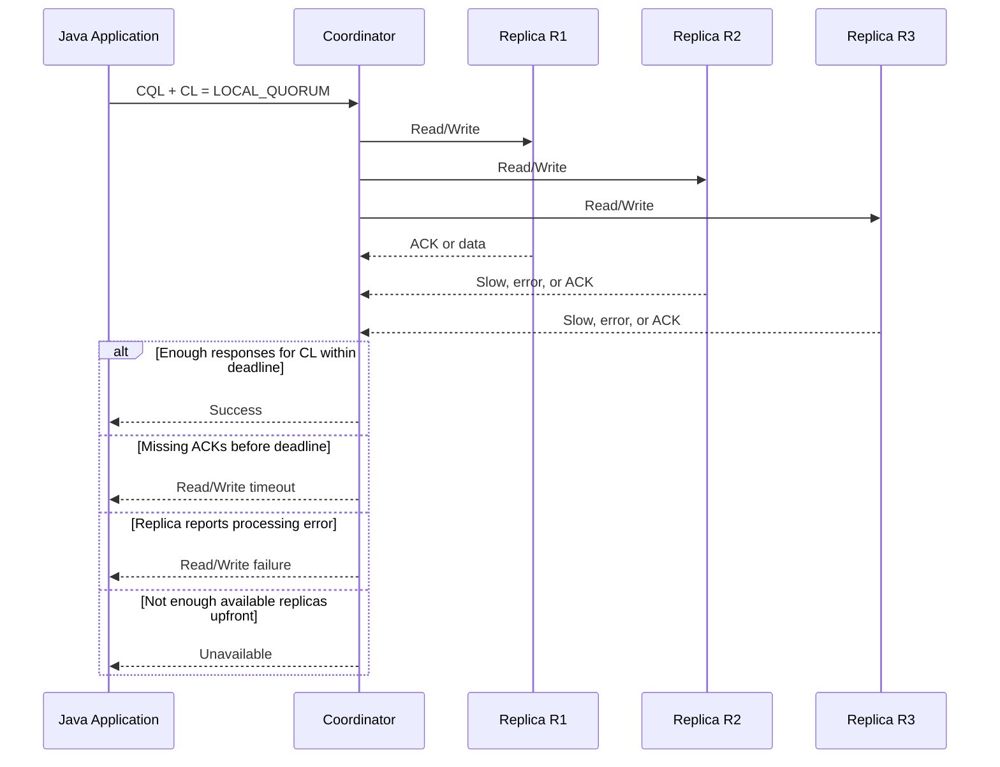

# Timeouts, Failures, Unavailable, Dropped Messages, and Retries in Apache Cassandra

## 1. Goal: distinguish symptoms from root causes

Apache Cassandra is a **distributed wide-column** database. Data is partitioned by **partition key**, each partition maintains copies (*replicas*) according to the **replication factor (RF)**, and clients select a **consistency level (CL)** for each CQL query. A Java application sends a request to a **coordinator**; the coordinator contacts the required replicas, aggregates responses, and returns either a result or an error.

In a multi-node system, these scenarios are often lumped together as “Cassandra timeout” even though they mean very different things:

- **Timeout:** the coordinator waited past the deadline without receiving enough required responses.
- **Failure:** a replica or processing component explicitly reported an error rather than merely responding slowly.
- **Unavailable:** the coordinator detected upfront that too few replicas are up/reachable to satisfy the CL.
- **Dropped message:** an internal message was discarded, typically because it was no longer useful after its deadline expired; this is not a direct synonym for a lost data row.
- **Retry:** re-sending a request after failure or no answer; retries can improve availability, yet can also **amplify load and introduce side effects**.

Observability must link these concepts into an evidence chain: **which request → which CL → which coordinator/replicas → which resource slowed or failed → how the application retried**.

> Core principle throughout: an **unacknowledged** request does **not** mean a mutation **definitely was not written**. Especially for write timeouts, applications must handle the possibility of an **unknown outcome**.

## 2. Request path model and failure points



This is a conceptual diagram. Exact replica targeting, message counts, local/remote DC routing, and digest/read-repair flows vary with CL, topology, Cassandra version, and node state.

Errors can also occur **before a coordinator sends anything**—for example, when the client cannot connect to any node—or **past the client's deadline** while the server continues executing. Always separate **errors returned by Cassandra servers** from **timeouts imposed by the Java Driver or application**.

## 3. Consistency level defines how many responses are “enough”

Assume a single datacenter with RF = 3 and three replicas R1, R2, R3 for a partition.

| CL | Required responses in example | Consequence when one replica is slow/down |
| --- | ---: | --- |
| `ONE` | 1 | Can still succeed via another replica; freshness depends on read/write pairing |
| `LOCAL_ONE` | 1 in local DC | Can succeed if at least one local replica serves the request |
| `LOCAL_QUORUM` | 2 in local DC | Two replicas must respond adequately; one down replica can still be tolerated |
| `QUORUM` | `floor(RF_total/2) + 1`; 2 in a single-DC RF3 setup | Requires a majority across the cluster-wide replica set |
| `ALL` | 3 | Even one replica failing to respond in time can fail the operation |

In multi-DC keyspaces, `LOCAL_QUORUM` computes quorum **within the coordinator's DC**, whereas `QUORUM` uses total RF across all DCs; the two are not equivalent. `EACH_QUORUM` is a CL for **standard writes** requiring quorum in each DC, not another name for local quorum reads.

When timeouts appear, ask first: “How many replicas must respond for this request, and in which DC?” You cannot infer availability solely from `nodetool status` without considering RF and CL.

### Example: all nodes UP yet still timing out

```text
RF = 3, LOCAL_QUORUM = 2
R1: responds in 15 ms
R2: UP, but I/O-bound, responds after 3 seconds
R3: UP, but queue backed up, responds after 4 seconds
Applied request deadline: 2 seconds (illustrative)

Result: likely TIMEOUT because only 1 ACK arrived on time,
even though nodetool status shows all 3 nodes UN.
```

**Up/Normal (`UN`) does not mean a replica is responding on time.** Check thread pools, disk, CPU/GC, network, compaction, and actual query latency.

## 4. Read timeout: read did not receive enough data before the deadline

A server-level **Read timeout** occurs when the coordinator does not receive enough responses/data to complete a read at the requested CL before the timeout expires. In Java Driver 4.x, this surfaces as `ReadTimeoutException`.

Common causes:

- An overloaded replica, deep read queues, or GC stop-the-world pauses.
- High SSTable read amplification: wide partitions, heavy SSTable overlap/tombstones, or slow disk reads.
- Packet loss or high latency between coordinator and replicas.
- `LOCAL_QUORUM` reads waiting on a slower replica; `ONE` on the same query may be faster but carries weaker consistency guarantees.
- Digest mismatches forcing the coordinator to fetch full data and reconcile/read-repair, lengthening the read path in some cases.

Depending on the read-timeout variant, returned metadata may report **responses received, responses required, and whether actual data was retrieved** (versus digest only). Never treat raw response count as proof the coordinator assembled a complete read result.

### A read timeout does not prove data is lost

A partition may be completely intact in SSTables/memtables across replicas. If replicas answer too slowly, the application observes timeouts even though zero data was lost. Diagnose by measuring **read-path latency**, inspecting contacted replicas, and checking workload at the incident timestamp.

At the same time, do not conclude “it is just a timeout, keep retrying endlessly.” Heavy queries or hot partitions make queues even longer with every retry.

## 5. Write timeout: mutation state may be unknown

A server-level **Write timeout** happens when the coordinator fails to collect enough write acknowledgements for the CL within the deadline. Java Driver 4.x surfaces this as `WriteTimeoutException`.

Suppose we write a row at `LOCAL_QUORUM` in an RF3 DC:

```text
Application sends UPDATE (needs 2 ACKs).
R1 persists mutation and ACKs.
R2 may have persisted it, but its ACK is delayed or lost on the network.
R3 is slow and does not ACK before the deadline.
Coordinator returns WRITE TIMEOUT.
```

The application knows **CL durability/acknowledgement was not confirmed**, yet cannot assume every replica rejected the mutation. The mutation may:

1. Already be persisted on a subset of replicas.
2. Already be persisted on enough replicas while an ACK was lost/delayed.
3. Still be in flight after the client timed out.
4. Differ across replicas and converge later.

**Retrying a write timeout can execute the mutation again.** For non-idempotent operations, counter updates, external side-effect workflows, or LWTs, blind retries can corrupt business state.

### Distinguish write types

Cassandra differentiates write categories with distinct behavior (e.g., `SIMPLE`, `BATCH`, `BATCH_LOG`, `UNLOGGED_BATCH`, `COUNTER`, `CAS`). Write timeouts/failures may carry write-type metadata; check it during analysis instead of applying one retry rule to every `INSERT`/`UPDATE`.

Specifically:

- **Counter mutations** must never be retried blindly like fixed-value assignments.
- **Conditional mutations/LWTs** require evaluating CAS/Paxos semantics and condition state rather than blind retries.
- **Batches** do not turn multi-partition mutations into arbitrary ACID transactions; evaluate timeout state by batch type and business boundary.

## 6. Failure: a replica reported an error, not merely slowness

**Read failure** and **write failure** arise when a replica or processing stage explicitly returns an error preventing the coordinator from meeting CL. In Java Driver 4.x, these appear as `ReadFailureException` and `WriteFailureException`.

Example root causes:

- SSTable read/write errors, disk I/O exceptions, or out-of-space errors.
- A replica aborting request execution or failing to complete a stage.
- Memory exhaustion or internal node errors.
- Overload failures on a heavily stressed node—check logs and metrics for specifics.

A **failure** differs from a timeout because an **explicit error signal** was returned rather than simply missing a deadline. Still, the exception alone does not name the bad disk or stack frame; pull logs and metrics from the reporting node.

### Read failure vs. write failure

| Type | Core meaning | First things to inspect |
| --- | --- | --- |
| `ReadFailureException` | Read could not satisfy CL due to an explicit read-path error | Node logs, read path, tombstones/IO/GC, replicas, CL |
| `WriteFailureException` | Write could not satisfy CL due to an explicit write-path error | Commit log, disk space, flushes, replica logs, write type |
| `ReadTimeoutException` | Read waited past deadline without enough responses | Deadline, read latency, queues, network, CL |
| `WriteTimeoutException` | Write waited past deadline without enough ACKs | ACKs, commit log/memtable, node load, CL, unknown mutation state |

**Do not equate failure with permanent data loss.** A transiently failing replica may recover, though the exception indicates the active request did not succeed cleanly.

## 7. Unavailable: not enough replicas to satisfy CL

`UnavailableException` occurs when the coordinator determines upfront that **too few replicas are available** to satisfy the requested consistency level, rather than sending requests and waiting for a timeout.

Example:

```text
RF = 3 in dc1
LOCAL_QUORUM = 2
R1: Up
R2: Down
R3: Down

Available = 1 < Required = 2
=> UNAVAILABLE for any query requiring LOCAL_QUORUM.
```

Compare with timeouts and failures:

| Condition | Observable state | Likely outcome |
| --- | --- | --- |
| Only 1 replica live, 2 needed | Coordinator sees insufficient live replicas | `Unavailable` |
| 3 replicas live, 2 needed, 2 slow | Topology has enough replicas, ACKs miss deadline | `ReadTimeout` or `WriteTimeout` |
| Enough replicas live, some return errors | Explicit error signals received instead of slowness | `ReadFailure` or `WriteFailure` |

In a multi-DC cluster, losing one DC can:

- Leave `LOCAL_QUORUM` unaffected in surviving DCs that still have enough replicas.
- Break cluster-wide `QUORUM` or `EACH_QUORUM` writes, depending on RF and which DC was lost.

Never downgrade CL just to “make `Unavailable` go away” when business correctness requires quorum. Lowering CL may let protocol calls succeed while **silently changing consistency guarantees**.

## 8. Java Driver timeouts vs. Cassandra server timeouts

Distinguish at least three clocks:

1. **Client/Java Driver timeout:** how long the driver waits for an entire request or attempt, depending on configuration.
2. **Server-side read/write timeout:** coordinator deadline governed by Cassandra's configured request timeouts.
3. **Upstream API/service deadline:** HTTP/gRPC timeouts, circuit breakers, or business deadlines.

A single request can:

- Receive a **server `ReadTimeoutException`/`WriteTimeoutException`** before the client deadline expires.
- Time out in the **driver** (e.g., `DriverTimeoutException`) while the server is still executing.
- Be aborted by an **HTTP gateway** before the driver finishes, even while the mutation proceeds.
- Fail to reach any server due to connection/topology errors; exceptions like `AllNodesFailedException` reflect a different class of problem.

Example timeline:

```text
T+0 ms:    API starts request.
T+100 ms:  Driver sends write to coordinator.
T+900 ms:  Gateway deadline expires; HTTP client gets timeout.
T+1200 ms: Cassandra finishes write; coordinator may ACK.
T+1300 ms: Driver completes or application discards result.

API caller sees a timeout, yet data may already have changed.
```

**Do not treat cancelling a Future, closing an HTTP request, or hitting a Java timeout as rolling back an in-flight CQL write.** Use idempotency keys, explicit job state, and business-level reconciliation when write outcomes are uncertain.

## 9. Dropped messages: measuring internal pressure, not lost data

Cassandra uses various **internal messages** for inter-node requests, reads/writes, hints, and background tasks. When a message passes its deadline or is no longer useful by the time it is dequeued, Cassandra can **drop** it rather than spending resources on stale work.

In `nodetool tpstats`, Cassandra typically reports **Dropped Messages** by message/verb type alongside thread-pool statistics:

```bash
nodetool tpstats
```

Key points:

- **Rising dropped messages** indicate expired requests, slow queues, or overloaded nodes.
- **A dropped message does not mean an acknowledged mutation was erased across the cluster.**
- **Zero dropped messages** does not guarantee zero timeouts: delays can occur on the network/client or outside tracked verbs.
- Exact verb names, counters, and display formats depend on the **Cassandra version**.
- Counters are typically **cumulative**: compute rates of change over time to see if conditions are currently worsening.

Illustrative example:

```text
10:00  READ_REQ dropped total = 180
10:05  READ_REQ dropped total = 230
10:10  READ_REQ dropped total = 480

10:00 → 10:05: +50 / 5 min = 10/min
10:05 → 10:10: +250 / 5 min = 50/min
```

These labels are **illustrative**, not fixed `nodetool` output. Watch the **rate of increase per dropped-message type** and correlate it with read/write timeouts, request volume, pending queues, CPU/GC, and I/O.

### Dropped message vs. dropped mutation

A message discarded due to deadline expiry is different from explicit deletion (`DELETE`/tombstones), different from a failed write, and different from permanent data loss. If a mutation missed some replicas, hinted handoff, read repair, and anti-entropy repair may still converge it; however, **never treat dropped-message counters as a guarantee that data will automatically heal completely**.

## 10. Retries: weigh both amplification cost and business safety

Retries can happen in the **Java Driver**, service layer, API gateway, job queue, or user client. When multiple layers retry independently, one logical request can multiply into many Cassandra attempts.


Every retry layer needs **bounded attempts and a shared overall deadline** to avoid compounding into a *retry storm* when the cluster is slow.

### Load-amplification math

Suppose a read API receives `10,000 requests/sec`. During an incident window, `20%` of requests retry **once**:

```text
Logical requests: 10,000 / sec
Extra attempts:   10,000 × 20% = 2,000 / sec
Total attempts hitting Cassandra ≈ 12,000 / sec
Load increase over baseline ≈ 20% (before internal amplification).
```

If nodes are already I/O- or queue-bound, 20% extra traffic pushes timeout probability even higher, triggering further retries. When retries stack across **multiple tiers**, amplification grows much faster than in this example.

### Read retries and write retries are not the same

| Operation type | When is retry acceptable? | What to evaluate |
| --- | --- | --- |
| `SELECT` with no business side effects | Bounded retries on transient errors while deadline remains | Adds load; CL and observed data state must match requirements |
| Upsert with deterministic key, values, and stable timestamp | Can be idempotent if business logic guarantees it | Concurrency, TTL, timestamps, update ordering, prior state |
| `UPDATE counter = counter + 1` | Do not retry blindly | Can double-increment |
| LWT `IF` | Do not retry blindly on unknown outcome | Must verify condition outcome and serial consistency boundaries |
| Multi-mutation batch | Retry only per batch semantics with idempotency | Do not confuse batches with multi-partition ACID transactions |
| Write with external side effects | Requires end-to-end idempotency | Prevent a retried Cassandra write from double-charging or double-emailing |

**Idempotent** means executing the same operation multiple times yields the same business result as executing it once under defined design assumptions. Because Cassandra writes are upserts, **not every `INSERT` is automatically business-idempotent**.

### Safe retry policy

1. Cap retry count and total operation deadline; prefer **exponential backoff with jitter** where supported.
2. Preserve the required CL; never treat lowering CL as a “free” retry.
3. On write timeouts, distinguish unconfirmed outcomes from definite failures; never assume server rollback.
4. Mark statements **idempotent** for the driver only when re-execution is genuinely safe.
5. Monitor **logical requests**, **attempts**, **retries**, **speculative executions**, timeouts, and total QPS to see amplification.
6. Under congestion, shedding non-critical load and capping retries often helps more than raising retry counts.

## 11. Speculative execution is not a cure-all for timeouts

Some Java Driver versions/configs support **speculative execution**: if one attempt has not answered within a configured delay, the driver launches another attempt against a different coordinator to cut tail latency.

Unlike error-triggered retries, a speculative attempt fires **while the first attempt is still in flight**. That improves odds of hitting a faster path, but:

- Adds extra requests and cluster load, especially when multiple replicas are slow simultaneously.
- Is safe only for statements verified and marked **idempotent** for your driver and workload semantics.
- Does not fix root causes such as saturated disks, very hot partitions, or widespread JVM GC pauses.
- Is **not** read repair, does not replace consistency levels, and does not eliminate all timeouts.

For latency-sensitive services, enable speculative execution only after measuring baseline p95/p99, throughput, and extra-attempt overhead. Never assume it is enabled—or safe—without inspecting your driver configuration.

## 12. Observing effectively with nodetool, logs, and metrics

### Initial diagnostic command set

From a Cassandra node with administrative access:

```bash
nodetool status
nodetool tpstats
nodetool tablestats observability_lab.requests_by_id
nodetool tablehistograms observability_lab requests_by_id
nodetool proxyhistograms
nodetool compactionstats
nodetool netstats
```

These are observational commands; exact syntax, field names, and completeness vary by version. If your cluster does not have the lab table, substitute the table under investigation—never create lab tables in production just to run `tablestats`.

| Source | Useful indicators | Question answered |
| --- | --- | --- |
| `nodetool status` | Up/Down, DC, rack, joining/leaving state | Are enough replicas up for the CL? |
| `nodetool tpstats` | Active/pending/blocked tasks, dropped messages | Which queues or message verbs are dropping? |
| `nodetool tablestats` | Local read/write latency, SSTables, memtable, space | Which table shows read/write amplification? |
| `nodetool tablehistograms` | Latency distributions, SSTables/read, partition sizes | Are tail latency and large partitions correlated? |
| `nodetool proxyhistograms` | Coordinator-layer latency distribution (version-dependent) | Is the coordinator slow relative to replicas? |
| `nodetool compactionstats` | Active/pending compactions | Is compaction consuming I/O or building a backlog? |
| `nodetool netstats` | Streaming/hints and connections per version output | Are repair/bootstrap/streaming running concurrently? |
| JMX/metrics exporter | Client request timeouts/failures/unavailable, dropped messages, thread pools, GC | Which node/DC and request types are failing? |
| Java Driver & API metrics | p50/p95/p99, timeouts, retries, pool saturation, attempts | What impact are users experiencing? |

JMX typically exposes request, latency, thread-pool, and dropped-message groups; **exact metric paths vary by Cassandra version and exporter**. Map dashboards to your exact version, node, DC, keyspace/table, and request type rather than copying metric names blindly from another system.

### Measure rates, not just cumulative counters

If a dropped-message counter increases from 1,000 to 1,050 over 5 minutes:

```text
Δcount = 1,050 - 1,000 = 50
Average rate = 50 / 300 seconds ≈ 0.167 messages/second
```

If a node restart resets counters to 0, your monitoring system must handle **counter resets** instead of producing a “negative rate” or claiming errors disappeared. Also normalize against total traffic: 50 drops out of one million requests differs sharply from 50 drops out of one thousand requests.

### Tracing a representative query

In `cqlsh`, you can enable tracing selectively:

```text
CONSISTENCY LOCAL_QUORUM;
TRACING ON;
```

Run a specific partition-key query, inspect the trace, then turn tracing off:

```text
TRACING OFF;
```

Tracing reveals coordinator/replica execution steps, yet adds overhead and **does not capture all client-side retry behavior**, especially when gateways or the Java Driver issue multiple attempts. Never leave tracing enabled broadly across production traffic to hunt timeouts.

## 13. Diagnostic matrix: which symptom leads to which step?

| Initial observation | Primary hypothesis | Next checks |
| --- | --- | --- |
| `Unavailable` rising, nodes Down | Insufficient live replicas for CL | `nodetool status`, DC/RF, network, maintenance events |
| `ReadTimeout` rising while all nodes are UN | Slow replicas, queues, I/O, heavy reads | `tpstats`, local read p99, SSTables/read, tombstones |
| `WriteTimeout` rising, high disk util | Slow commit log/flush/disk or lost ACKs | Disk latency, logs, memtable flushes, write CL |
| `ReadFailure`/`WriteFailure` rising | Replicas reporting explicit errors | Filter logs by timestamp and node; check I/O/disk/heap errors |
| Dropped-message rate surging | Requests expiring in queues before processing | Message verb, queue depth, GC, latency, request rate |
| Driver timeouts rising while server timeouts stay low | Client deadline, network, pool saturation, or unmeasured gap | Driver metrics, network, request timeouts, query attempts |
| Retries rising alongside QPS and p99 | Retry storm amplifying load | Retry policies across layers, attempts/request, backoff |
| Only one partition is slow | Hot/wide partition, tombstones, SSTables | Partition key, query plan, tablestats/histograms |
| Errors isolated to one DC | Local replicas, DC network, RF/CL mismatch | Compare per-DC metrics, topology, and local load |

**Correlation does not prove causation.** If timeouts and compaction backlog rise together, verify whether compaction is genuinely saturating disk/CPU or whether a heavy write burst caused both.

## 14. CQL practice on a test cluster

Assume a lab cluster with datacenter `dc1`, three ready replicas, and Cassandra supporting `NetworkTopologyStrategy`. Adjust DC name, RF, and CL to your lab; **never induce node failures in production**.

### Step 1 — Create a partition-key table

```sql
CREATE KEYSPACE IF NOT EXISTS observability_lab
WITH replication = {
    'class': 'NetworkTopologyStrategy',
    'dc1': 3
}
AND durable_writes = true;

CREATE TABLE IF NOT EXISTS observability_lab.requests_by_id (
    request_id uuid PRIMARY KEY,
    state text,
    updated_at timestamp
);
```

### Step 2 — Write and read at CL

In `cqlsh`:

```text
CONSISTENCY LOCAL_QUORUM;
```

Then:

```sql
INSERT INTO observability_lab.requests_by_id
    (request_id, state, updated_at)
VALUES (
    11111111-1111-4111-8111-111111111111,
    'SUBMITTED',
    '2026-11-20 10:00:00+0000'
);

SELECT state, updated_at
FROM observability_lab.requests_by_id
WHERE request_id = 11111111-1111-4111-8111-111111111111;
```

Compare `nodetool status` and `tpstats` before and after. **A handful of healthy queries will not trigger noticeable errors or dropped messages**; the aim is practicing baseline checks and understanding normal responses.

### Step 3 — Controlled fault experiments

In an **isolated lab** where you can simulate one slow or temporarily disconnected node, measure:

1. Live replica count and CL of each request.
2. Observed outcomes: success, timeout, failure, or unavailable (if triggered).
3. Logical requests versus Java Driver attempts/retries.
4. Dropped-message **delta/rate**, pending thread pools, disk latency, and p95/p99.
5. Partition-key read results after topology recovery, alongside repair state.

Never intentionally fill disks, delete SSTables/commit logs, kill production nodes, or set infinite retries just to “generate metrics”.

## 15. Java Driver 4.x: classify errors instead of blind retries

Example write repository using a **stable request key** and caller-managed fixed CQL timestamp. An upsert with identical data, identical timestamp, and no extra side effects **can be designed to be idempotent**; verify that explicitly before calling `setIdempotent(true)`.

```java
import java.util.UUID;

import com.datastax.oss.driver.api.core.CqlSession;
import com.datastax.oss.driver.api.core.DefaultConsistencyLevel;
import com.datastax.oss.driver.api.core.DriverTimeoutException;
import com.datastax.oss.driver.api.core.cql.BoundStatement;
import com.datastax.oss.driver.api.core.cql.PreparedStatement;
import com.datastax.oss.driver.api.core.servererrors.UnavailableException;
import com.datastax.oss.driver.api.core.servererrors.WriteFailureException;
import com.datastax.oss.driver.api.core.servererrors.WriteTimeoutException;

public final class RequestWriter {
    public enum WriteOutcome {
        ACKNOWLEDGED,
        UNAVAILABLE,
        UNKNOWN
    }

    private final CqlSession session;
    private final PreparedStatement upsert;

    public RequestWriter(CqlSession session) {
        this.session = session;
        this.upsert = session.prepare(
            "INSERT INTO observability_lab.requests_by_id " +
            "(request_id, state) VALUES (?, ?) USING TIMESTAMP ?"
        );
    }

    public WriteOutcome upsertState(
            UUID requestId, String state, long timestampMicros) {
        BoundStatement statement = upsert.bind(requestId, state, timestampMicros)
            .setConsistencyLevel(DefaultConsistencyLevel.LOCAL_QUORUM)
            .setIdempotent(true);

        try {
            session.execute(statement);
            return WriteOutcome.ACKNOWLEDGED;
        } catch (UnavailableException e) {
            // Insufficient available replicas for the chosen consistency level.
            return WriteOutcome.UNAVAILABLE;
        } catch (WriteTimeoutException |
                 WriteFailureException |
                 DriverTimeoutException e) {
            // Uncertain how many replicas applied the mutation.
            // Do not automatically re-run a non-idempotent operation.
            return WriteOutcome.UNKNOWN;
        }
    }
}
```

This example intentionally returns `UNKNOWN` for ambiguous write outcomes. Real systems should log an **operation/request ID** and apply reconciliation/read-back at an appropriate CL, deadlines, monitoring, and bounded retries. `UNAVAILABLE` must also follow business policy: never infer from this exception an absolute guarantee that **no side effect could possibly have occurred** on every path.

**Never call `setIdempotent(true)`** on an arbitrary mutation merely because it uses `INSERT`. Here, both the new state and timestamp are fixed by the business layer for the same logical operation; concurrent writes, TTLs, LWTs, counters, and external side effects require separate analysis.

### Reading with read timeout/failure classification

```java
import java.util.UUID;

import com.datastax.oss.driver.api.core.CqlSession;
import com.datastax.oss.driver.api.core.DriverTimeoutException;
import com.datastax.oss.driver.api.core.DefaultConsistencyLevel;
import com.datastax.oss.driver.api.core.cql.PreparedStatement;
import com.datastax.oss.driver.api.core.cql.Row;
import com.datastax.oss.driver.api.core.servererrors.ReadFailureException;
import com.datastax.oss.driver.api.core.servererrors.ReadTimeoutException;
import com.datastax.oss.driver.api.core.servererrors.UnavailableException;

// Illustrative snippet inside a repository class holding a CqlSession.
public String readState(CqlSession session, PreparedStatement select, UUID id) {
    try {
        Row row = session.execute(
            select.bind(id)
                  .setConsistencyLevel(DefaultConsistencyLevel.LOCAL_QUORUM)
                  .setIdempotent(true)
        ).one();
        return row == null ? null : row.getString("state");
    } catch (UnavailableException e) {
        throw new IllegalStateException("Insufficient replicas for CL", e);
    } catch (ReadTimeoutException | ReadFailureException e) {
        throw new IllegalStateException("Read failed in Cassandra", e);
    } catch (DriverTimeoutException e) {
        throw new IllegalStateException("Client read deadline expired", e);
    }
}
```

This is an **error-handling flow snippet**, not a standalone compilable Java class: place the method inside an appropriate class with a pre-prepared `select` statement. In a real repository, return explicit domain exceptions/results rather than generic `IllegalStateException`.

In Java Driver 4.x, `AllNodesFailedException` and other transport errors can arise **before any server read/write exception is returned**. Catch them at the proper boundary, log per-node causes, and avoid collapsing everything into one “read timeout” message.

## 16. Time-correlated incident investigation runbook

### Step 1 — Identify error types and impact

Pick a concrete time window: start time, logical requests, attempts, error rate, p95/p99, API groups, and DCs. Classify exceptions:

```text
server ReadTimeout / WriteTimeout
server ReadFailure / WriteFailure
server Unavailable
driver DriverTimeout / AllNodesFailed / transport issues
HTTP/gateway deadline exceeded
```

If multiple layers report timeouts simultaneously, correlate **timestamps and request IDs** so one failed request is not counted three times as three separate incidents.

### Step 2 — Check RF, CL, DC, and node health

```bash
nodetool status
nodetool tpstats
```

For a given request, note the keyspace RF and the driver/CQL CL. If only one replica is live for an RF3 `LOCAL_QUORUM` keyspace, restore node availability first. If all nodes are `UN` yet timeouts persist, trace slow stages and queues.

### Step 3 — Pinpoint the bottlenecked node and resource

Check:

- CPU, JVM pauses/GC, heap, and pending thread pools.
- Disk latency, free space, commit log, flushes, SSTables/tombstones.
- Network packet loss, inter-node latency, concurrent streaming/repair.
- Hot partitions, queries missing partition keys, or overly wide range scans.
- Recent shifts in workload, compaction config, bootstrap, or replication.

Never conclude “Cassandra is slow” from a raw cumulative `Dropped Messages` counter without time deltas and message types.

### Step 4 — Curb retry amplification

Compare attempts/request, retry rate, speculative executions, and driver/gateway timeouts. If retries climb alongside worsening p99, **shed secondary load** per your runbook rather than raising retry limits. For `UNKNOWN` write outcomes, reconcile via request ID and pre-designed idempotent operations.

### Step 5 — Verify recovery, not just silence of error alerts

After remediation:

1. Timeout/failure/unavailable rates return to acceptable baselines.
2. Dropped-message rates and thread-pool queues drop steadily.
3. CQL read/write p95/p99 and API p99 return within SLOs.
4. Any interrupted replica has an appropriate hints/anti-entropy repair plan; never equate “requests succeed again” with “all replicas are synchronized”.
5. Retry policies, deadlines, and alerts are updated based on verified root causes.

## 17. Four practice scenarios

**Scenario A — All three nodes are UN, yet read timeouts spike.** RF3, `LOCAL_QUORUM`, one replica replies fast while two have high disk latency and rising `tpstats` pending read tasks. Should you lower CL to stop timeouts?

**Guidance:** Not by default. This is a replica-slowness problem exceeding the deadline. Investigate disk/queues, partition/query shape, and background load; change CL only if the business explicitly accepts altered consistency semantics.

**Scenario B — Write timeout, user clicks “Pay” again.** An API writes order state and calls an external payment system. The caller gets an HTTP timeout, while the Cassandra mutation may already have succeeded. What is the safe action?

**Guidance:** Use an idempotency key and query/reconcile operation state as designed before repeating external side effects. Never re-submit payment blindly or assume Cassandra definitely did not write.

**Scenario C — Dropped messages jump after an ingest burst.** A counter rises from 500 to 2,000 over 5 minutes, during which the node restarted. Can you conclude the drop rate was 300/min?

**Guidance:** No. Counters can reset across restarts; use time-series math that handles counter resets and group by message type. Cross-check request volume, queues, and timeouts, and never infer data loss from the counter alone.

**Scenario D — Entire DC1 goes down while DC2 remains healthy.** Keyspace has RF3 in each DC; one app in DC2 uses `LOCAL_QUORUM`, while another uses cluster-wide `QUORUM`. Why does only one app see `Unavailable`?

**Guidance:** `LOCAL_QUORUM` in DC2 needs 2 of 3 local replicas; cluster-wide `QUORUM` across total RF6 needs 4, while DC2 only has 3. The difference comes from CL scope, not necessarily a fault inside DC2 nodes.

## 18. Pre-production checklist

- [ ] Clearly separate **server timeout, server failure, unavailable, driver timeout, and network error**.
- [ ] Log request/operation ID, CL, DC, query shape, endpoint, and timestamp to correlate across layers.
- [ ] Recognize that write timeouts/failures can leave **unknown outcomes**; never retry blindly.
- [ ] Assign idempotency keys to operations that clients, gateways, or drivers might replay.
- [ ] Never set `setIdempotent(true)` on counters, LWTs, or side-effecting operations without analysis.
- [ ] Track logical QPS vs. attempt QPS, retry rate, speculative executions, error rate, and p95/p99.
- [ ] Track **dropped messages by type and rate of increase**; never use cumulative totals to infer data loss.
- [ ] Inspect `nodetool status`, `tpstats`, `tablestats`, `compactionstats`, and disk/GC/network metrics based on symptoms.
- [ ] Enforce CL/RF per business needs; never lower consistency simply to mask availability errors.
- [ ] Bound retries with deadlines, backoff/jitter, and load shedding to prevent retry storms.
- [ ] Run post-incident repair/replica recovery; do not assume clearing timeouts means replicas converged.
- [ ] Test failover, slow nodes, and retries in an **isolated lab**, never by breaking production intentionally.

**Remember:** In Cassandra, **timeout** means responses did not arrive in time, **failure** signals an explicit processing error, **unavailable** means too few replicas can satisfy CL, **dropped messages** indicate stale internal work being discarded, and **retries** trade higher availability against amplification and business risk. Good observability pairs node metrics, RF/CL, request timelines, and Java Driver behavior; good handling pairs **bounded retries, idempotency, load protection, and post-incident data verification**.
