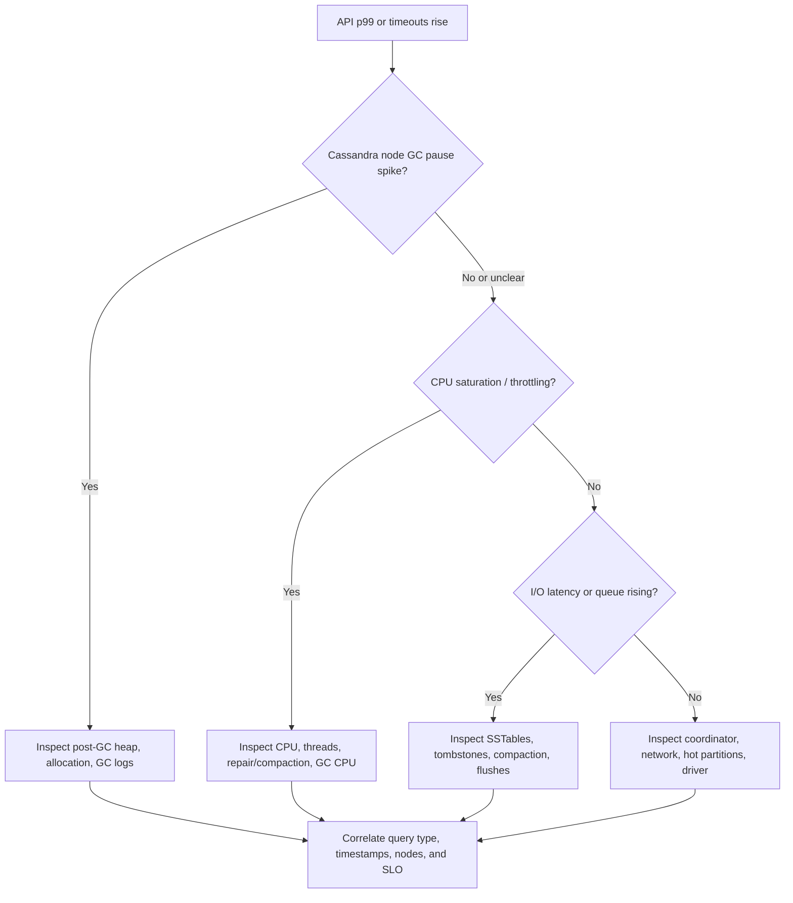

# Heap, Off-Heap, GC, CPU, and I/O Wait

> **Chapter:** Cluster Observability  
> **Scope:** Apache Cassandra—a distributed *wide-column* database—and JVM nodes running on servers or containers.  
> **Goal:** Distinguish JVM heap, off-heap memory, and OS page cache; interpret garbage collection (GC), CPU, and I/O wait signals accurately; and correlate them with partition keys, SSTables, compaction, repair, and CQL/Java Driver latency.

## 1. Scenario: p99 jumped, but where is the real root cause?

A Java API reads a customer's 20 latest orders from Cassandra. Normal p99 is 70 ms. Under higher load, p99 jumps to 450 ms. On one Cassandra node:

- Heap usage fluctuates between 40% and 85%.
- CPU shows 78%.
- `iowait` occasionally reaches 30%.
- Compaction queues grow and some read timeouts appear.

Jumping straight to “out of RAM, increase heap” can be dead wrong. In reality, **the same symptom—rising p99—** can stem from:

1. GC pausing application threads during *stop-the-world* phases.
2. CPU saturation from request handling, compression/decompression, replica comparison, or compaction.
3. Disk reads hitting many SSTables and tombstones, stalling requests on storage.
4. Off-heap/native memory growth creating overall RAM pressure or triggering a container OOM-kill.
5. Hot partitions, queries misaligned with access patterns, or a slow replica forcing the coordinator to wait.

Consequently, this lesson does not look for one “magic metric” but teaches how to **correlate metrics across time, nodes, and query classes**.

## 2. Memory and resource map of a node

```text
                    CASSANDRA NODE (JVM PROCESS)
+--------------------------------------------------------------+
| JVM HEAP                                                     |
|  - Java objects: mutations, metadata, short-lived allocations|
|  - Data/control structures explicitly allocated on heap      |
|  - Managed by the JVM Garbage Collector                      |
+--------------------------------------------------------------+
| OFF-HEAP / NATIVE MEMORY                                     |
|  - Direct buffers, allocators, and off-heap structures       |
|  - Thread stacks, JVM native, native libs, mmap...           |
|  - Not fully captured by JVM heap-used                       |
+--------------------------------------------------------------+
              | I/O                                | network
              v                                    v
+-----------------------------+           +-------------------+
| OS / FILESYSTEM / STORAGE   |           | REPLICA / CLIENT  |
| - OS page cache             |           | - CQL requests    |
| - SSTables, commit log      |           | - Streaming/repair|
| - Flush, compaction, fsync  |           +-------------------+
+-----------------------------+

Host RAM or container limits must accommodate all of these.
CPU and I/O serve reads, writes, compaction, and repair alike.
```

### Do not add or subtract memory numbers as if they never overlap

Different measurements mean different things:

| Indicator | Meaning | Must NOT be mistaken for |
| --- | --- | --- |
| **JVM heap used** | Memory currently recorded as used inside the JVM heap | All RAM consumed by Cassandra |
| **JVM heap committed/max** | Heap memory committed/expandable up to configured limit | Memory holding live data |
| **Off-heap/direct** | Certain structures/buffers allocated outside the heap | All native memory of the process |
| **Process RSS** | Physical memory pages attributed to the process by OS accounting | Always equal to heap + off-heap |
| **OS page cache** | OS RAM caching file data, reclaimable under memory pressure | A second Java heap |
| **Container memory usage** | Memory billed to the cgroup/container, depending on runtime/version | Java heap alone |

RSS, file-backed mappings, and page cache can overlap in OS accounting. **Never add RSS + full page cache to judge actual RAM consumption** unless you know how the accounting tool counts pages.

When running in containers, track **JVM limits, RSS/native, cgroup limits, and OOM-kill counts** together. A node with free heap can still be killed if total container memory breaches its limit.

## 3. JVM heap: seeing “how much is used” is not enough

The heap holds Java objects created by Cassandra, internal drivers, libraries, and the JVM. Exactly which structures live on heap depends on Cassandra version, memtable settings, caches, and JVM config.

### Three questions to ask

1. **After each GC cycle, how much heap remains in use?**  
   This signals the *live set* and object retention risk; pre-GC peaks are naturally higher due to transient allocations.
2. **What is the object allocation rate?**  
   High allocation rates trigger frequent GCs even when the live set is steady.
3. **Is GC interrupting request handling enough to hurt SLOs?**  
   75% heap usage does not by itself prove trouble; check pause durations alongside API latency.

Compare two nodes both peaking at 80% heap:

```text
Node A: 35% -- steady climb --> 80% -- GC --> 36% -- ...
        Low live set; most objects are short-lived.

Node B: 71% -- steady climb --> 80% -- GC --> 72% -- ...
        High live set; little headroom left after GC, investigate.
```

Both hit 80%, yet their behavior is completely different. Node B may face old-generation pressure, long-lived caches/objects, or a heap size too small for the workload.

### Heap and memtables

Mutations are written to the commit log and applied to memtables, which later flush to SSTables. **Never assume all memtables live entirely inside JVM heap**: memtable allocation modes, index/buffer structures, and limits vary by version and configuration.

Under memory pressure, inspect together:

- Heap used **and** heap after GC.
- Memtable size, active flushes, pending flush tasks.
- Write/flush rates and disk I/O.
- Caches or objects retained long term.
- Oversized mutations/partitions or high request concurrency.

If memtables flush slowly because disk is saturated, enlarging the heap only delays symptoms without fixing the I/O bottleneck.

## 4. Off-heap: why can RAM run out even with a healthy heap?

**Off-heap** is memory allocated outside the GC-managed Java heap. In Cassandra/JVM setups, depending on version and config, this can include:

- **Direct buffers** for network and I/O operations.
- Off-heap **memtable, buffer pool, cache, or SSTable metadata** structures.
- **Memory-mapped file regions** and file pages faulted into RAM on access.
- JVM native allocations, native libraries, JIT/code cache, and **thread stacks**.

Not all of these appear under a single metric called `offHeapUsed`. For instance, native thread stacks and some native libraries are absent from buffer-pool metrics.

### Failure example

```text
JVM heap used:        5 GiB / 12 GiB
Process RSS:         20 GiB
Container limit:     22 GiB
Container memory:    ~21 GiB, still climbing
GC pauses:           low
Result:              OOM-kill risk despite plenty of free heap
```

These are **illustrative figures**. Investigate off-heap/native usage, page mappings, thread counts, container accounting, and co-located process memory—do not blindly increase `-Xmx`.

### Observation sources

- **JMX/JVM metrics:** `MemoryPool`, `BufferPool`, heap/non-heap; check Cassandra off-heap/buffer-pool metrics exposed by your version.
- **OS:** RSS, virtual mappings, thread count, `/proc/<pid>/smaps_rollup` (where supported on Linux), cgroup memory usage.
- **JVM Native Memory Tracking (NMT):** `jcmd <pid> VM.native_memory summary` when the JVM was started with NMT enabled. NMT adds overhead and does not automatically track every third-party native allocation.

Example **read-only status** commands in an authorized environment:

```bash
jcmd <pid> GC.heap_info
jcmd <pid> VM.native_memory summary
```

The second command will report if NMT is not enabled. **Never enable NMT or alter production startup flags just for an exercise**; follow change-control procedures and your JVM's documentation.

## 5. GC: distinguish frequency from pause duration

Garbage collection reclaims unreferenced heap memory. Some collectors perform concurrent phases that do **not** halt all Cassandra threads.

Distinguish carefully:

- **GC count/rate:** how often collections run per unit time.
- **Pause duration:** time application threads are halted in stop-the-world phases.
- **GC time:** total reported duration across phases/events depending on metric and collector; never assume all reported GC time is stop-the-world pause time.
- **Live heap after GC:** retained memory after a collection.
- **Allocation rate:** object creation rate, which drives GC frequency.
- **Old-generation occupancy / promotion:** reveals long-lived data and GC pressure.
- **Full GC or allocation failure:** critical warning signs whose exact names and mechanics vary by collector and JDK.

### Why can GC look like a Cassandra read timeout?

A substantial pause can freeze a node from processing CQL or answering the coordinator on time. If multiple replicas pause concurrently, read/write p99 latency and timeouts jump.

```text
12:00:00.000  Coordinator sends read to replica N2
12:00:00.010  N2 enters GC pause
12:00:00.310  N2 resumes execution
12:00:00.320  Read response returns to coordinator
             -> Read path may breach SLO or time out
```

This is a linearized illustration. In practice, the coordinator can also pause in GC, drivers enforce their own timeouts, and requests can stall in queues or on the network.

### High GC does not automatically mean “increase heap”

| Symptom | Hypothesis worth testing |
| --- | --- |
| Frequent GC, low heap after GC, rising CPU | High allocation rate or workload churning short-lived objects |
| Post-GC heap rising day over day | Growing live set, caches/metadata/memtables, long-lived references |
| Long pauses aligned with p99 spikes | GC is a direct suspect |
| Low pauses yet p99 remains high | Investigate I/O, thread pools, hot partitions, network, coordinator |
| OOM-kill while heap used is low | Total native/off-heap/container memory, not heap alone |

Cassandra supports different JDKs and GC collectors by release. Never copy one set of JVM flags across every cluster. Tune GC based on logs/metrics and supported versions, never by guesswork.

### Inspecting GC in a lab

On supported JVMs/JDKs:

```bash
jstat -gcutil <pid> 1000 10
jcmd <pid> GC.heap_info
```

`jstat` summarizes GC regions per JVM; columns vary by collector and JDK. Use **GC logs, JFR, or proper metrics** to confirm exact pause durations and timestamps instead of inferring pause p99 from cumulative `GCT`.

Example GC logging option on JVMs supporting *unified logging*:

```text
-Xlog:gc*:file=/path/to/gc.log:time,uptime,level,tags
```

This is only a modern JVM syntax example. Paths, write permissions, log rotation, and overhead must follow operational standards; never apply ad-hoc flags directly on production nodes.

## 6. CPU: know what it is busy doing

High CPU is a *resource utilization* signal; it does not by itself tell whether the node is doing useful work or thrashing/waiting.

Cassandra spends CPU on:

- Request coordination, CQL parsing/decoding, and read/write planning.
- SSTable compression/decompression, checksums, Bloom filters, and indexes.
- Mutations, memtables, caches, and paging.
- Compaction, validation/repair, and data streaming.
- GC and thread scheduling.
- TLS, networking, serialization, and logging.

### CPU utilization vs. CPU saturation

A node at 85% CPU with headroom left can run smoothly. Conversely, a container with a tight **CPU quota** can suffer severe throttling even when the host-level CPU dashboard reads 25%.

Watch these together:

| Metric | Meaning |
| --- | --- |
| Process CPU usage | How much CPU Cassandra consumes |
| Host CPU usage per core | Whether the host overall is saturated |
| Container CPU throttling | Quota reached, stalling runnable threads despite spare host CPU |
| Runnable queue / load average | Work waiting for CPU or accounted uninterruptible I/O |
| CPU steal time (VM) | Hypervisor withholding CPU cycles from the VM |
| Thread pool pending/blocked | Cassandra tasks queued due to CPU, locks, I/O, or downstream waits |
| GC CPU and pauses | Whether memory management consumes excessive CPU |

**Load average is not CPU percentage.** On Linux, load average typically counts runnable tasks plus tasks in uninterruptible I/O wait. Never compare “load = 8” with “CPU = 8%” without knowing core count and task states.

### Cassandra thread pools help locate bottlenecks

Cassandra uses thread pools/stages for reads, mutations, compaction, and related tasks. `nodetool tpstats` exposes active, pending, and dropped counts depending on version.

If pending read tasks rise while CPU is low and I/O wait is high, check disk. If pending rises while CPU is pegged, inspect contention, allocations, and concurrency. Correlate metrics over time; a single snapshot never proves causality.

## 7. I/O wait: not synonymous with “disk is 100% utilized”

On Linux, `iowait` is typically **the share of time a CPU is idle while the system has outstanding I/O**. It is a **CPU time accounting metric**, not a direct measurement of “how many milliseconds a request waited on disk”.

A node showing `iowait = 30%` may be waiting on storage, yet you still must check:

- Device read/write latency (e.g., `r_await`, `w_await` in `iostat` where available).
- IOPS and throughput (MB/s).
- Queue depth or active in-flight requests.
- `%util`: device busy time as defined by the tool/driver; on NVMe and parallel devices, **100% does not strictly mean maximum bandwidth is exhausted**.
- Filesystem latency, `fsync`, log volumes, RAID/volume/network block storage.
- Cassandra read latency, pending compactions, and commit log syncs.

### Common misreadings

| Pattern | Careful interpretation |
| --- | --- |
| High I/O wait, rising disk await, rising query p99 | Strong storage bottleneck candidate; identify whether I/O comes from reads, commit log, flushes, or compaction |
| CPU 100%, iowait near 0, normal disk await | CPU saturation is likely primary; low iowait does not mean everything is fine |
| Low disk throughput yet high await | Small random I/O, latency-constrained volume/device, or filesystem contention |
| High disk `%util` while await stays flat and p99 meets SLO | Insufficient evidence to upgrade disks; inspect queue depth and throughput capacity |
| API slow while Cassandra storage devices look healthy | Check network, driver queues, coordinator, GC, hot partitions, or app logic |

### Why wide-column workloads drive I/O

Partition keys determine which replicas hold data; clustering keys determine intra-partition scan order. Queries hitting exact partitions/slices generate far less I/O than queries scanning many SSTables and tombstones.

Disk bottlenecks can come from several sources at once:

- **Read amplification:** one partition spread across many SSTables forces reads through multiple Bloom filters, partition indexes, and disk blocks.
- **Compaction amplification:** rewriting SSTables in the background while serving live requests.
- **Memtable flushes:** persisting in-memory data to new SSTables.
- **Commit log `fsync`:** depending on sync mode, directly affects write acknowledgement latency.
- **Repair/streaming:** reading SSTables for Merkle comparison/transfer while also writing streamed data.

That is why I/O troubleshooting must pair request profiles with background activity, never relying on a disk-usage percentage chart alone.

## 8. Causal flow: from symptom to metric group



This is a **triage order**, not a mutually exclusive decision tree. GC, CPU, and I/O can spike together, or an I/O stall can back up memtables and indirectly drive allocation and GC. When several signals go red together, check **which changed first** and how nodes interact.

## 9. Layered observability metrics

Not every Cassandra version emits identical JMX metric names. Verify **units, metric types, scopes, and exporter names** before building dashboards or alerts.

| Layer | Suggested indicators | Diagnostic question |
| --- | --- | --- |
| **JVM heap** | Used/committed/max, old/live after GC, allocation | Is the live set growing at constant load? |
| **JVM GC** | Pause count/duration, max/p95 pause, collector CPU | Do pause spikes align with request timeouts? |
| **Native/off-heap** | Direct buffer pools, off-heap structures, RSS, thread count | Is off-heap memory leaking or growing? |
| **OS/container** | Available memory, cgroup usage/limit, OOM kills, swap activity | Is there memory pressure outside the JVM? |
| **CPU** | Host/process CPU, steal, cgroup throttle, run queue | Genuine CPU shortage or quota throttling? |
| **Storage** | Device await/queue/throughput, filesystem space, `fsync` | Slow disk or excessive I/O volume? |
| **Cassandra read/write** | `ClientRequest` latency and timeouts for Read/Write | Slow inside Cassandra or only in the app? |
| **Cassandra tables** | Read/write latency, SSTable count, memtable data size, tombstones | Which table/partition suffers read amplification? |
| **Compaction** | Pending/active tasks, bytes compacted, backlog | Is background I/O colliding with queries? |
| **Thread pools** | Active/pending/dropped per stage | Where is the node queueing work? |
| **Streaming/repair** | Sessions, bytes streamed, errors, duration | Did issues coincide with repair or topology changes? |
| **Java Driver** | Request latency, coordinator host, timeouts, retries, pool in-flight | Delay in client, network, or specific coordinator/replica? |

### Watch your labels

A trustworthy dashboard includes at least: **cluster, datacenter, node, keyspace, table (where supported), operation, instance, and time range**. A single “cluster-average Cassandra CPU” line easily masks one hot node or a failing local disk.

That does not mean adding `partition_key` as a metric label: partition-key cardinality can be huge and blow up time-series storage. Use sampling/tracing or targeted diagnostics for hot-partition analysis instead of putting raw keys into metric labels.

## 10. Hands-on diagnostic tools

### 10.1. `nodetool` on Cassandra

On an authorized node, depending on version:

```bash
nodetool info
nodetool gcstats
nodetool tpstats
nodetool compactionstats
nodetool tablestats shop_md.orders_by_customer
nodetool netstats
```

What each shows:

- `nodetool info`: node details, heap summary, status, and aggregate stats.
- `nodetool gcstats`: command-line GC stats if supported by version.
- `nodetool tpstats`: active/pending/completed/dropped thread-pool tasks.
- `nodetool compactionstats`: active and pending compactions.
- `nodetool tablestats`: per-table memtables/SSTables/space/latency/tombstones (exact fields vary by version).
- `nodetool netstats`: streaming and network-related activity.

`shop_md.orders_by_customer` is merely an example table from a matching lab environment. Substitute an authorized keyspace/table in your lab if that table does not exist.

**Commands return point-in-time snapshots, not replacements for time-series dashboards.** Compute deltas over time for cumulative counters; use proper quantile aggregation for histograms and never mix microseconds with milliseconds.

### 10.2. JVM tools

On Linux with matching JDK tools and permissions:

```bash
jcmd <pid> GC.heap_info
jstat -gcutil <pid> 1000 10
jcmd <pid> Thread.print
```

`Thread.print` can produce large output and pause overhead; use selectively when hunting `BLOCKED`/`WAITING` threads. Look for repeating thread names/states across multiple samples before diagnosing deadlocks or lock contention.

**Never run `jcmd <pid> GC.run` to “test GC” in production**: forcing an explicit GC alters performance and pauses the JVM, invalidating measurements.

### 10.3. OS tools

On Linux with standard utilities:

```bash
vmstat 1
iostat -xz 1
pidstat -u -p <pid> 1
free -h
```

Reading by layer:

- `vmstat`: runnable tasks, blocked tasks, swap in/out, CPU user/system/iowait.
- `iostat -xz`: device latency/queue/throughput, depending on `sysstat` version.
- `pidstat`: Cassandra process CPU usage over time.
- `free`: host total, available, and cache RAM—not JVM heap.

In containers/Kubernetes, host numbers may not reflect container CPU quotas or memory limits; cross-check `cgroup` metrics and your orchestration monitoring. On Windows, tool names differ; these OS examples target Linux.

### 10.4. CQL tracing

In a lab cluster:

```cql
TRACING ON;

SELECT order_id, created_at, status, total
FROM shop_md.orders_by_customer
WHERE customer_id = aaaaaaaa-aaaa-4aaa-8aaa-aaaaaaaaaaaa
LIMIT 20;

TRACING OFF;
```

Tracing reveals the read execution path and replica steps, but **does not measure system-wide heap/native memory**. It also adds overhead and can affect latency if enabled broadly. Use it only on representative queries alongside concurrent metrics.

## 11. Read-path analysis: right table, right partition, right replica

Suppose the table schema is:

```cql
CREATE TABLE IF NOT EXISTS shop_md.orders_by_customer (
    customer_id uuid,
    created_at timestamp,
    order_id uuid,
    status text,
    total decimal,
    PRIMARY KEY ((customer_id), created_at, order_id)
) WITH CLUSTERING ORDER BY (created_at DESC, order_id ASC);
```

Query:

```cql
SELECT order_id, created_at, status, total
FROM shop_md.orders_by_customer
WHERE customer_id = aaaaaaaa-aaaa-4aaa-8aaa-aaaaaaaaaaaa
LIMIT 20;
```

This query matches the partition key and clustering order. Yet it can still be slow if the partition is huge, accumulates tombstones, spans overlapping SSTables, or hits a replica with abnormal I/O.

Isolation workflow:

1. Measure **client latency** in Java and **server read latency** in Cassandra.
2. Identify the coordinator from driver metadata and inspect per-node metrics.
3. Check whether a slow replica suffers GC pauses, CPU pressure, or I/O bottlenecks.
4. Compare `tablestats`, SSTable counts, tombstones scanned, and compaction for the table.
5. If only a few partitions are hot, fix bucketing/access patterns before blindly adding heap or disks.

**Never take `LIMIT 20` as proof the server only read 20 physical rows.** Cassandra may inspect many tombstoned rows/cells, multiple SSTables, or slow replicas to assemble 20 live results.

### Distinguishing cache misses from slow disks

Cold reads naturally incur disk I/O while subsequent reads hit page cache. However, if disk `await` remains persistently high alongside a growing compaction backlog, the issue is not merely “unwarmed cache”.

Cassandra caches (such as key cache or row cache if enabled) and the OS page cache have distinct mechanics and costs. **Growing Java heap caches** can worsen GC and memory pressure without improving overall p99. Measure hit rates, partition skew, and disk reads first.

## 12. Write-path analysis: heap, `fsync`, and flushes

For each mutation, replicas append to the commit log and update the memtable before flushing SSTables later. Write performance reflects:

- **Commit log:** sequential writes synced per durability policy; slow log disks or `fsync` stalls affect write latency in corresponding sync modes.
- **Memtables:** memory allocated per allocator/config; flushes produce SSTables and consume disk bandwidth.
- **Compaction:** merges SSTables after flushes, consuming I/O and CPU even when reads are quiet.
- **Replication:** coordinators wait for ACKs per consistency level; one slow replica or lossy link can trigger timeouts.

Cascade scenario:

```text
Write rate rises
    |
    +--> memtables fill, continuous flushes
    |        |
    |        +--> disk write queue grows
    |                 |
    |                 +--> compaction backlog builds
    |                          |
    |                          +--> read p99 spikes from I/O contention
    |
    +--> allocation/CPU/network may also rise
```

Watching only heap and GC can miss this **write → flush → compaction → slow-read** chain. Confirm it by lining up timestamps across write throughput, memtable flushes, compaction backlog, disk `await`, and read latency.

### Consistency level shapes latency measurements

`LOCAL_ONE`, `LOCAL_QUORUM`, and `QUORUM` wait on different replica sets. Higher latency after changing CL does not prove the JVM lacks RAM. Across multiple DCs, `QUORUM` can wait on WAN links, whereas `LOCAL_QUORUM` needs quorum only in the coordinator's DC.

Every before/after p99 comparison must state: **CL, RF, topology, client concurrency, query class, and measurement window**.

## 13. Scenario A — GC pauses as the primary bottleneck

Suppose during a peak hour:

| Time | Post-GC heap | GC pause p99 | Read p99 | Disk await |
| --- | ---: | ---: | ---: | ---: |
| 09:50 | 42% | 12 ms | 65 ms | 3 ms |
| 10:00 | 68% | 80 ms | 140 ms | 4 ms |
| 10:10 | 79% | 260 ms | 390 ms | 4 ms |

These are **hypothetical figures**. Disk `await` barely moved while GC pauses climbed alongside read p99. That justifies investigating memory allocation, live set, object-retaining structures, and JVM tuning.

Steps:

1. Isolate nodes with p99 spikes; check post-GC heap and memory pools.
2. Inspect GC logs at matching timestamps to confirm true *pause durations* rather than just “higher GC count”.
3. Check for new allocation-heavy workloads, wide scans, or triggered backups/repairs.
4. Check off-heap/native and container memory headroom before changing `-Xmx`.
5. Change **one variable at a time** under representative load and re-measure latency, GC, and resources.

Never declare a “memory leak” solely because heap rises between two GCs. Look for sustained live-set growth across many cycles unexplained by legitimate load.

## 14. Scenario B — Disk bottleneck with GC only as a side effect

Suppose a node runs heavy compaction:

| Indicator | Before incident | During incident |
| --- | ---: | ---: |
| Disk `r_await` | 2 ms | 45 ms |
| Pending compactions | 2 | 90 |
| Read p99 | 80 ms | 500 ms |
| GC pause p99 | 15 ms | 20 ms |
| CPU utilization | 55% | 60% |

These hypothetical metrics show disk `await` and compaction jumping while GC remains steady. Focus investigation on I/O, compaction, and query read amplification.

Safe actions:

- Identify which nodes are compacting, disk queue/latency, and whether repair or streaming adds I/O.
- Check flush rates, SSTable counts, tombstones, and partition distribution.
- Check disk headroom; compaction requires temporary scratch space.
- Consider tuning repair scheduling/concurrency or compaction parameters **appropriate to version and SLOs**—never disable compaction indefinitely.
- Check whether wide queries are reading too many SSTables and saturating disk.

Switching GC collectors in this scenario is unlikely to fix p99 and adds operational risk.

## 15. Scenario C — Off-heap/container OOM while heap looks normal

Suppose a Cassandra container restarts because the host/cgroup killed it on memory exhaustion:

```text
JVM Xmx = 10 GiB
Heap used steady = 6 GiB
RSS/native climbs over several hours
Container memory approaches 16 GiB limit
GC pauses virtually unchanged
Eventually OOM-kill -> node goes down
```

Investigation steps:

1. Confirm whether it was a **container/OS OOM-kill** versus a Java `OutOfMemoryError: Java heap space`. The two have distinct causes.
2. Record RSS, cgroup memory, direct buffer pools, thread count, mmap/native memory, and runtime versions.
3. Review recent changes: concurrency, TLS/native libs, buffer pools, data/indexes/compaction.
4. Evaluate total RAM limit, `-Xmx`, native headroom, OS page cache needs, and workload demand.
5. If suspecting a native leak, run controlled NMT/profiling in an appropriate environment; never mass-restart nodes to “clear RAM” without protecting RF and CL.

A **smaller heap** does not cure off-heap growth. Shrinking heap too aggressively can worsen GC while native memory keeps climbing.

## 16. Scenario D — CPU throttling driving higher latency

A Cassandra pod has a low CPU limit. The host CPU dashboard sits at 40%, yet inside the cgroup, throttled periods climb and pending requests grow. The JVM is starved of CPU despite spare host capacity.

Signals to cross-check:

- Process CPU usage **and** cgroup CPU quota.
- Throttled time and throttled period counts.
- Runnable threads and Cassandra pending tasks.
- GC activity: collections can slow down simply from CPU starvation.
- Disk `await`: if flat, storage is unlikely to be primary.
- Read/write p95/p99 as load rises.

Never explain everything solely from `top` on the host. Inside containers, CPU quotas and JVM-detected core counts govern thread/GC behavior; inspect runtime settings and cgroup metrics for the Cassandra container itself.

## 17. From Cassandra metrics to the Java Driver and SLOs

End users feel the latency of the **entire request**, not just Cassandra server execution:

```text
API latency =
  app queue/validation +
  driver queue/connection +
  client-coordinator network +
  Cassandra coordinator/replica read-write path +
  transfer/deserialize +
  application post-processing
```

This is a conceptual decomposition, not quantities that always separate cleanly in metrics. If API p99 is 500 ms while Cassandra read latency reports 15 ms, investigate driver queues, connection pools, network, retries/speculative executions, or application-side processing.

Java Driver 4.x example timing a prepared `SELECT` and logging the coordinator:

```java
import java.util.UUID;
import java.util.concurrent.TimeUnit;

import com.datastax.oss.driver.api.core.CqlSession;
import com.datastax.oss.driver.api.core.DefaultConsistencyLevel;
import com.datastax.oss.driver.api.core.cql.BoundStatement;
import com.datastax.oss.driver.api.core.cql.PreparedStatement;
import com.datastax.oss.driver.api.core.cql.ResultSet;
import com.datastax.oss.driver.api.core.metadata.Node;

public final class ReadProbe {
    private final CqlSession session;
    private final PreparedStatement read;

    public ReadProbe(CqlSession session) {
        this.session = session;
        this.read = session.prepare(
            "SELECT order_id, created_at, status " +
            "FROM shop_md.orders_by_customer " +
            "WHERE customer_id = ? LIMIT ?"
        );
    }

    public void readRecent(UUID customerId) {
        BoundStatement stmt = read.bind(customerId, 20)
            .setConsistencyLevel(DefaultConsistencyLevel.LOCAL_QUORUM)
            .setIdempotent(true)
            .setPageSize(20);

        long startedNs = System.nanoTime();
        try {
            ResultSet result = session.execute(stmt);
            Node coordinator = result.getExecutionInfo().getCoordinator();

            // Iterate rows within the timed scope if the app
            // SLO covers materializing this full page.
            int rows = 0;
            for (var row : result) {
                rows++;
            }

            long durationMs = TimeUnit.NANOSECONDS.toMillis(
                System.nanoTime() - startedNs);
            System.out.printf(
                "read_ms=%d rows=%d coordinator_dc=%s%n",
                durationMs, rows,
                coordinator == null ? "unknown" : coordinator.getDatacenter()
            );
        } catch (RuntimeException ex) {
            long durationMs = TimeUnit.NANOSECONDS.toMillis(
                System.nanoTime() - startedNs);
            System.err.printf(
                "read_failed_ms=%d error_type=%s%n",
                durationMs, ex.getClass().getSimpleName()
            );
            throw ex;
        }
    }
}
```

`CqlSession` is assumed to be configured with the proper local DC, authentication, contact points, and keyspace. The loop uses `var`, requiring Java 10+; use explicit `Row` on older toolchains. This code **does not isolate server processing time**; it measures the Java/driver call plus result iteration. For larger result sets, the driver fetches subsequent pages automatically during iteration, so align page size/limits with what you intend to observe.

In real services, never `System.out.println` every high-throughput request; export histograms/metrics and sampled traces tagged by operation, coordinator DC, and error class to avoid logging overload.

### Comparing three latency sources

| Source | What does it measure? | When is it useful? |
| --- | --- | --- |
| API histogram | How long the caller waits | Confirming SLO impact |
| Driver request metrics | Client-to-coordinator timing/timeouts | Separating client queues, retries, and network |
| Cassandra `ClientRequest`/table metrics | Server-side Cassandra timing within metric scope | Finding slow nodes, replicas, and tables |

**Never subtract two p99 values to infer “network p99”.** Quantiles come from separate distributions; the difference of p99s does not equal the p99 of per-request differences. Attribution requires traces carrying matching request IDs, timestamps, and proper sampling.

## 18. Dashboard and alert design checklist

A good dashboard quickly answers:

1. **Is the service slow?** Read/write p95/p99 and timeouts by DC, node, and operation.
2. **Is the JVM struggling?** Post-GC heap, allocation, pauses, native/RSS, OOMs.
3. **Is CPU constrained?** Process/host CPU, throttling, run queues, thread pools.
4. **Is storage constrained?** Disk latency/queues, compaction, flushes, commit log.
5. **One node or whole cluster?** Top-N node comparisons over matching timelines.
6. **Any background activity?** Repair, streaming, snapshots, backups, topology changes.

### Alerting on correlations rather than single thresholds

| Alert | Suggested condition | Investigation action |
| --- | --- | --- |
| Tail latency degradation | p99 above SLO across multiple windows + rising errors/timeouts | Identify operation, node/DC, and slow layer |
| GC interference | Long pauses or rising total pause time alongside higher latency | Inspect post-GC heap and allocation |
| Memory exhaustion risk | Container usage near limit, climbing RSS, or OOM kills | Analyze off-heap/native usage and headroom |
| Storage latency | Sustained rise in disk await/queues with read/write latency | Inspect compaction, flushes, SSTables/tombstones |
| Repair/compaction pressure | Growing background backlog affecting disk/network and p99 | Adjust/throttle concurrency per runbook |
| CPU starvation | CPU saturation/throttling with rising pending tasks | Check quotas, hot threads, workload |
| Single-node hotspot | One replica diverges sharply from same-DC peers | Inspect tokens/partitions, disk, GC, node network |

Never treat illustrative numbers in this lesson as production thresholds. Calibrate thresholds to your SLOs, baselines, provisioned hardware, and data profile.

### Metric collection reminders

- **Counters** require rate calculations over time and proper handling of resets after restarts.
- **Gauges** can spike briefly; scrape often enough without creating excessive overhead.
- Per-node histograms/quantiles **cannot simply be summed or averaged** into an accurate “cluster p99”.
- Synchronize clocks (NTP) across nodes so GC, compaction, and request events line up.
- High-cardinality labels, overly dense trace sampling, and verbose logs can become load sources themselves.

## 19. 15-step p99 diagnostic runbook

1. **Confirm the symptom:** which API is slow, p95/p99, timeouts, and start time?
2. **Scope it:** single DC/node or entire cluster?
3. **Record context:** RF, CL, versions, client count, and query class.
4. **Identify coordinator:** from driver metadata/traces or host metrics.
5. **Check node health:** `nodetool status`; did any node recently restart/stream/repair?
6. **Check heap:** used, post-GC live set, allocation rate.
7. **Check GC:** do pause durations align with p99 spikes?
8. **Check off-heap/RSS:** memory growth, swap/OOMs, or cgroup pressure?
9. **Check CPU:** process usage, run queues, throttling, steal.
10. **Check I/O:** `await`, queues, throughput, free space, commit log/flushes.
11. **Check Cassandra queues:** `tpstats`, pending reads/writes, dropped messages.
12. **Check compaction/repair:** active/pending jobs coinciding with the incident?
13. **Check table/query:** partition keys, SSTable counts, tombstones, caches.
14. **Test a safe hypothesis:** reduce background load or optimize a query in lab/canary, measuring before and after.
15. **Verify recovery:** p99/errors and resources return to baseline; document root cause and prevention.

An incident can have multiple bottlenecks. Never treat steps 6–10 as an either-or elimination checklist; synthesize them by **causal relationship and event timeline**.

## 20. Misconceptions to avoid

**“High heap always means insufficient RAM.”** False. Heap fluctuates with allocations and GC; inspect post-GC live set, pauses, and total memory bounds.

**“If heap has free space, OOM is impossible.”** False. Off-heap memory, direct buffers, thread stacks, and container accounting can still exceed limits.

**“Rising GC count proves GC caused the p99 spike.”** False. Correlate actual pause durations, timestamps, and request latency.

**“High CPU iowait means the disk is using 100% bandwidth.”** False. `iowait` is a CPU accounting state; verify disk `await`, queues, throughput, and workload.

**“100% disk `%util` proves an NVMe drive hit its IOPS ceiling.”** Not from `%util` alone, especially on devices with deep parallel queues.

**“Low host CPU means Cassandra has plenty of CPU.”** False inside containers with CPU quotas/throttling or VMs experiencing CPU steal.

**“A `UN` node has healthy latency.”** False. `UN` reflects gossip reachability, not GC pauses, I/O stalls, or query p99.

**“Adding cache or heap fixes every slow query.”** False. Queries misaligned with partition keys or scanning wide tombstone ranges need schema and access-pattern fixes.

**“Cassandra read latency equals API latency.”** False. Java Driver, network, application queues, and paging all add time.

**“Cluster p99 is the average of per-node p99s.”** False. Use properly aggregatable histograms or compute p99 over the unified request stream.

**“Changing compaction or GC immediately when dashboards turn red is good response.”** Not necessarily. Verify traffic drivers, versions, data/repair safety, and measure after changes.

## 21. Self-check exercises

1. A node peaks at 85% heap, drops to 30% after every GC, and has very low GC pause p99. Is there enough evidence to increase heap? What else should you check?
2. A node shows 50% heap used yet its container gets OOM-killed. Name four memory/metric areas to investigate.
3. CPU `iowait` is 25%, disk `await` is 2 ms, and CPU usage is 95%. Can you conclude disk is the bottleneck? Why or why not?
4. Compaction backlog rises, `r_await` rises, and query read p99 rises. Describe a plausible causal chain.
5. Why are high pending reads in `nodetool tpstats` not enough by themselves to blame heap size?
6. An application sees p99 = 500 ms while Cassandra server read p99 = 20 ms. List the remaining components to inspect.
7. Distinguish JVM heap, off-heap/native memory, and OS page cache, and explain why you should not sum their numbers mechanically.
8. Why are GC pause duration and total GC execution time not necessarily equal?
9. A replica is slow due to disk I/O while the coordinator sits on another node. How do you correlate per-node metrics to isolate the slow replica?
10. Why should you never average per-node p99 latencies to produce cluster-wide p99?
11. If you switch `LOCAL_QUORUM` to `QUORUM` in a multi-DC cluster, what can raise latency unrelated to GC?
12. For a table with heavy tombstones, can adding RAM replace fixing the partition key or clustering query?
13. You plot three time-aligned charts: GC pauses, disk `await`, and API p99. How do you use event ordering to evaluate competing hypotheses?
14. Outline a short runbook distinguishing container CPU throttling from host CPU saturation.

## 22. Conclusion

```text
                    API p99 / Timeouts rise
                             |
                   Multi-layer investigation
                             |
          +------------------+------------------+
          |                  |                  |
       JVM MEMORY          CPU               STORAGE
       heap/off-heap       threads           disk latency
       GC pauses           throttling        flush/compaction
          |                  |                  |
          +------------------+------------------+
                             |
                Cassandra read/write path
               partition key, replica, CL,
               cache, SSTable, repair, tombstones
                             |
                   Java Driver / Network
                             |
                  Verify with before/after data
```

**Remember:** Heap, off-heap, GC, CPU, and I/O wait are **different cross-sections of the same distributed Cassandra system**. High heap does not automatically prove insufficient RAM; high `iowait` does not automatically prove saturated disk bandwidth; a slow coordinator or client does not mean storage replicas are slow. Always read metrics **across time, nodes, query classes, and SLOs**, then fix the true bottleneck—whether partition modeling, caches, GC, CPU quotas, compaction, repair, or storage hardware.
