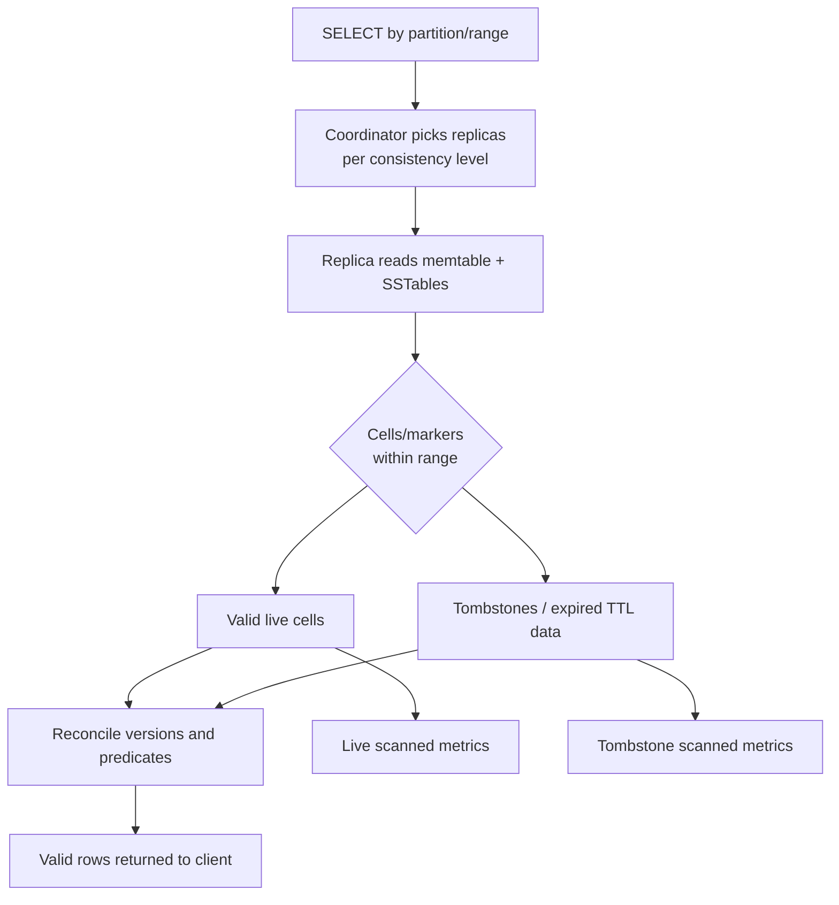
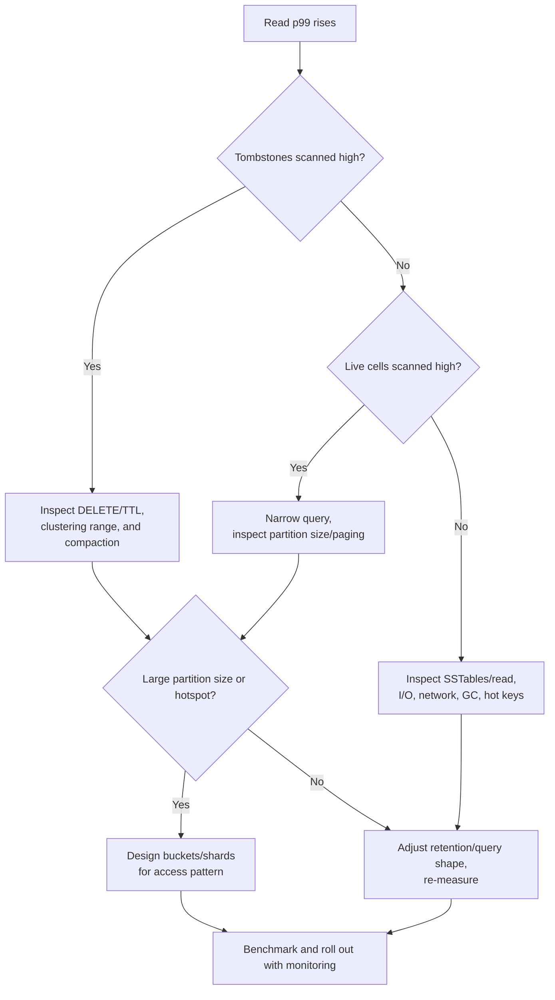

# Tombstones Scanned, Live Cells, and Partition Size

**Chapter:** Cluster Observability  
**Module:** `DATABASE_ENGINE_WIDE_COLUMN_CASSANDRA` — Apache Cassandra

When reading a partition in Apache Cassandra, response time depends on more than **the number of returned rows**. A replica may have to scan many live cells, older row versions, deleted records, or expired TTL entries before assembling the result. On dashboards, three signals are commonly read together: **tombstones scanned**, **live cells scanned**, and **partition size**. Failing to distinguish them leads to optimizing the wrong thing—tweaking `LIMIT`, adjusting compaction, or adding caches when the true issue is an overly wide partition or a query repeatedly traversing a tombstone-dense range.

This lesson belongs to module `DATABASE_ENGINE_WIDE_COLUMN_CASSANDRA`: distributed architecture, wide-column modeling, partition keys, query-driven table design, read/write consistency levels, CQL, replication, compaction, repair, error handling, and Java connectivity. Here we connect **how Cassandra stores and reads data** with **cluster observability indicators**, using a small CQL lab, `nodetool` commands, tracing, and a Java Driver example.

> **Scope:** Descriptions target Apache Cassandra 4.1/5.x. Exact metric/JMX MBean names, `nodetool` formatting, alert thresholds, and exporter labels vary by Cassandra release or vendor. All data-modifying/deleting statements in this lesson are for test clusters only; never lower `gc_grace_seconds` or force major compaction in production merely to make a chart look cleaner.

## 1. Learning objectives

After this lesson, you will be able to:

1. Explain how “tombstones scanned” and “live cells scanned” measure **read work performed**, not directly the number of returned rows.
2. Distinguish **row tombstones**, **cell tombstones**, **range tombstones**, **partition tombstones**, and expired TTL entries.
3. Read per-table/per-replica statistics via `nodetool tablestats`, `tablehistograms`, and tracing, and understand their limitations.
4. Analyze why a `LIMIT 10` query can still scan huge numbers of tombstones.
5. Understand partition size across **row/cell counts, bytes on disk, overlapping SSTables, and access distribution**, without conflating them.
6. Design a CQL experiment that writes live data, deletes rows, adds TTLs, and measures before/after behavior.
7. Identify risky queries, ranges, or partitions without relying on a single aggregate average.
8. Select appropriate mitigations: narrowing clustering ranges, adding time buckets, tuning TTL policy, redesigning access patterns, or evaluating compaction.
9. Build a dashboard/alert checklist and Java Driver probe to correlate server metrics with client impact.

**Central question:** Why can an API returning just three rows force Cassandra to inspect thousands of cells/tombstones and take hundreds of milliseconds?

## 2. Revisiting the read path: how does Cassandra read data?

### 2.1. Partition key locates the partition; clustering key narrows the slice

Suppose a table records events by tenant and day:

```sql
CREATE TABLE lab_observability.events_by_tenant_day (
    tenant_id text,
    bucket_day date,
    event_ts timestamp,
    event_id uuid,
    event_type text,
    payload text,
    PRIMARY KEY ((tenant_id, bucket_day), event_ts, event_id)
) WITH CLUSTERING ORDER BY (event_ts DESC, event_id ASC);
```

Here:

- `(tenant_id, bucket_day)` is the **composite partition key**; it locates one logical partition.
- `event_ts` and `event_id` are clustering columns defining row order and identity within the partition.
- `event_type` and `payload` are regular columns; each row can hold multiple cells.
- A read providing the full partition key and bounds on `event_ts` narrows the clustering slice scanned.

Even a query like:

```sql
SELECT event_ts, event_id, event_type
FROM lab_observability.events_by_tenant_day
WHERE tenant_id = 'tenant-a'
  AND bucket_day = '2026-11-21'
  AND event_ts >= '2026-11-21T10:00:00Z'
  AND event_ts <  '2026-11-21T11:00:00Z'
LIMIT 10;
```

may still have to evaluate many deletion markers sitting in the 10:00–11:00 range. Cassandra cannot count a deletion marker as a live row just to hit `LIMIT 10` sooner.

### 2.2. Data across memtables and SSTables

Cassandra uses an LSM-tree architecture. Mutations go into the commit log/memtable and later flush to **immutable SSTables**. Overwrites and deletes do not edit older SSTables in place: a key can have versions and tombstones spread across multiple files. The read path must reconcile live data by timestamp and deletion rules.



Conceptual diagram only. A replica uses Bloom filters, partition indexes, caches, and other read structures to skip irrelevant files. Therefore, **a table's total SSTable count does not always equal the SSTables touched by a given read**.

### 2.3. Cell, row, partition, SSTable: different units

| Unit | Meaning | Example |
| --- | --- | --- |
| **Cell** | Column/structure value read and reconciled | `event_type` or `payload` inside one row |
| **Row** | CQL row identified by full primary key | One event with `event_ts` + `event_id` |
| **Partition** | Group of rows sharing one partition key | All events for `tenant-a` on Nov 21 |
| **SSTable** | Immutable storage file on a replica | One SSTable can hold many partitions |
| **Replica** | Logical copy held by a node | A partition has multiple replicas per RF |

One CQL row contains multiple cells, one partition can hold millions of rows, and one partition can span many SSTables **on the same replica**. Thus `live cells scanned = 500` does not mean “500 rows returned”, and “100 MiB partition size” does not mean every `SELECT` reads all 100 MiB.

## 3. What is “tombstones scanned”?

### 3.1. A tombstone is a semantic deletion marker

In Cassandra, `DELETE` writes a **tombstone**; when a TTL expires, the data also becomes logically expired and appears in tombstone-handling work. Tombstones must persist long enough under configured rules so an older offline replica cannot “resurrect” deleted data upon rejoining.

Common forms:

| Type | Typical operation creating it | Scope affected |
| --- | --- | --- |
| Cell tombstone | Deleting a single non-PK column, or setting a column to `null` where applicable | One cell/column |
| Row tombstone | `DELETE` of a row by full primary key | Cells/row matching key |
| Range tombstone | `DELETE` across a clustering range where syntax allows | Slice of rows in a partition |
| Partition tombstone | Deleting an entire partition by partition key | All rows in that partition |
| Expired TTL | Cell whose TTL has elapsed | Expired value; still must be handled during reads/physical purge |

Exact marker representation and metric accounting can vary by operation and Cassandra version. Never assume “one `DELETE` = exactly one tombstone scanned.” One `DELETE` can write a broad marker, and one read can inspect that marker across multiple SSTables or slices.

### 3.2. Tombstones scanned is not total `DELETE`s ever executed

**Tombstones scanned** reflects **work performed during a read**: how many markers/tombstone entries the read path had to process. It is NOT:

- Cumulative `DELETE` statements since cluster startup.
- Logical deleted row count across the whole table.
- Physical bytes freed by compaction.
- Unique tombstones across all SSTables.
- Guaranteed identical across two replicas running the same `SELECT`.

Two identical CQL queries can report different scan counts due to different partitions/ranges, cache state, SSTables, compaction progress, replication lag, or TTL expiration timing.

### 3.3. Why do tombstones hurt latency?

Suppose a query requests the **10 latest events**, yet thousands of events at the top of the slice were deleted. The read path must verify those deleted entries are not returned and keep scanning onward until it finds live rows—burning CPU, I/O, memory, and potentially touching extra SSTables.

**Hypothetical** illustration (not a lab measurement):

```text
CQL: SELECT ... WHERE partition = P LIMIT 10

Replica inspects:
  4,000 tombstones / expired entries
     80 relevant live cells
  => Client receives only 10 rows

p99 latency jumps despite a small LIMIT.
```

Sustained high tombstone scans can trigger warnings, protective read failures, or timeouts depending on configuration and version. There is no universal safe number for every cluster; check `tombstone_warn_threshold` and `tombstone_failure_threshold` in your actual configuration. Never raise limits recklessly to hide overly broad scans.

## 4. What is “live cells scanned”?

**Live cells scanned** reflects the volume of valid live cells/data units processed while serving a read within the measured scope. It differs from the CQL row count returned to the client because:

- One row contains multiple columns/cells.
- A read may fetch extra cells beyond what is finally projected to reconcile state.
- Filtering predicates and clustering slices can inspect data that is not all returned.
- Paging, partition ranges, and CL affect how many requests/scans happen.
- Overlapping SSTables with shadowed versions can decouple scanned cell counts from final rows.

Exact sampling/counting mechanics in histograms vary by version; the metric is meant to **compare read-work volume**, not act as an API row-count meter.

### 4.1. Reading tombstones and live cells together

| Tombstones scanned | Live cells scanned | Likely interpretation | Next diagnostic step |
|---|---|---|---|
| Low | Low | Small lookup, little discarded work | Check p99 and SSTables/read; bottleneck may lie elsewhere |
| High | Low | Many expired/deleted markers traversed before finding live data | Inspect `DELETE`/TTL, clustering range, compaction, tombstone warnings |
| Low | High | Query scans a large volume of live data | Inspect partition size, paging, clustering slice, query shape |
| High | High | Read walks many live cells AND many tombstones | Oversized partitions, read amplification, hot partitions, retention |
| Low on one node, high on another | Any | Data/compaction/config/replicas may diverge | Compare per node, repair status, routing, instance health |

An illustrative ratio that is often helpful:

\[
r_{\text{tombstone}} =
\frac{T}{\max(1,L+T)}
\]

where `T` is tombstones scanned and `L` is live cells scanned over the **same measurement scope**. This is a **custom analytical indicator**, not a built-in Cassandra metric or percentage of “dead rows”. If `T=9,000` and `L=1,000`, the ratio is 90%; conversely, a high ratio can still be cheap if total scanned entries are tiny—always check **absolute counts and latency**.

## 5. How should partition size be interpreted?

A partition is the set of rows sharing one partition key. In Cassandra, a very large partition can cause:

- Full-partition reads to walk huge numbers of rows/cells, including deleted ones.
- Query, compaction, streaming, and repair operations to stress I/O and memory.
- Tail latency driven by a few unusually large tenants or devices.
- Nodes holding replicas of a hot/large partition to carry disproportionate load despite a large cluster.
- Even “first page” reads on tombstone-heavy partitions to remain expensive.

### 5.1. Three ways to measure “large”

| Perspective | Measurement | Key takeaway |
|---|---|---|
| **Logical** | Live rows/cells in the partition | Misses tombstones and older shadowed versions |
| **Physical** | Partition/SSTable bytes on a replica | Includes expired data, duplicate versions, and overhead |
| **Workload** | Cells/SSTables scanned and read/write frequency on that partition | A byte-small partition can still be fiercely hot |

There is no single megabyte limit that is universally “wrong” for every Cassandra table. Safe bounds depend on row width, clustering queries, hardware, compaction type, read/write ratio, SLAs, and version. Always benchmark **p95/p99, partition-size histograms, and disk I/O** under realistic workloads.

### 5.2. Estimates are not exact `COUNT` results

`nodetool tablestats` reports estimated partition counts and compacted partition bytes (minimum/maximum/mean), depending on version. `nodetool tablehistograms` reports percentile distributions for partition size and cell count per node. These come from storage metadata/sampling and can differ from a live logical row count at query time.

**Specifically:** one logical partition can span multiple SSTables, and each replica has its own files and compaction state. Never read a single SSTable table-stat figure and claim it is the exact size of one partition across every replica.

### 5.3. Hot partitions vs. large partitions

- **Large partition:** too much data/too many cells under one partition key.
- **Hot partition:** too many reads/writes hitting one partition key regardless of byte size.
- A partition that is both large and hot is dangerous, yet even a tiny partition can melt down a replica under thousands of requests per second.

Requests targeting one hugely popular tenant can drive tail latency and hotspots. Always inspect **per-key skew**, not just table-wide mean partition size.

## 6. How tombstones, live cells, and partition size interact

Consider one daily partition for `tenant-a`:

```text
T0: 80,000 events, many live cells
T1: 60,000 events deleted via DELETE or TTL expiry
T2: Client runs SELECT ... LIMIT 20 over a range full of deleted events
T3: Tombstones scanned spikes; live cells scanned may be much lower
T4: Compaction gradually merges SSTables; tombstones purge only when safe
```

Avoid these false inferences:

- “60,000 events were deleted” means every read scans 60,000 tombstones; tight clustering bounds may skip most of them.
- “Compaction just ran” means every tombstone is gone; `gc_grace_seconds`, overlapping SSTables, live data, and repair history still apply.
- “Partition size shrank” means read p99 is guaranteed to drop; the bottleneck could be a hot partition, network, GC, or indexes.
- “Live cells scanned is low” means the query is cheap; the read may have slogged through thousands of tombstones beforehand.

All three indicators only tell the full story alongside **the CQL query, partition key, clustering range, node/replica, CL, time window, and latency**.

## 7. Preparing the lab environment

Use a Cassandra 4.1/5.x-compatible test cluster. A single-node/single-DC lab lets you observe syntax and metrics with RF=1; production requires RF/CL matched to fault-tolerance requirements.

In your terminal:

```bash
nodetool status
cqlsh
```

In `cqlsh`:

```sql
SELECT data_center, release_version FROM system.local;
```

If your actual datacenter name is not `datacenter1`, replace it in the DDL below:

```sql
CREATE KEYSPACE IF NOT EXISTS lab_observability
WITH replication = {
  'class': 'NetworkTopologyStrategy',
  'datacenter1': 1
}
AND durable_writes = true;

CREATE TABLE IF NOT EXISTS lab_observability.events_by_tenant_day (
    tenant_id text,
    bucket_day date,
    event_ts timestamp,
    event_id uuid,
    event_type text,
    payload text,
    PRIMARY KEY ((tenant_id, bucket_day), event_ts, event_id)
) WITH CLUSTERING ORDER BY (event_ts DESC, event_id ASC);
```

**Why bucket by day?** `tenant_id` alone risks unbounded partition growth. `(tenant_id, bucket_day)` bounds each partition by time window; if one tenant emits hundreds of millions of events per day, use finer buckets or sharding. Size buckets for your **largest tenant**, not the average tenant.

## 8. Experiment 1: creating live cells and deleting a subset

### 8.1. Insert six events with fixed IDs

```sql
CONSISTENCY ONE

INSERT INTO lab_observability.events_by_tenant_day
    (tenant_id, bucket_day, event_ts, event_id, event_type, payload)
VALUES ('tenant-a', '2026-11-21', '2026-11-21T10:00:00Z',
        00000000-0000-4000-8000-000000000001, 'OPEN', 'payload-01');

INSERT INTO lab_observability.events_by_tenant_day
    (tenant_id, bucket_day, event_ts, event_id, event_type, payload)
VALUES ('tenant-a', '2026-11-21', '2026-11-21T10:01:00Z',
        00000000-0000-4000-8000-000000000002, 'OPEN', 'payload-02');

INSERT INTO lab_observability.events_by_tenant_day
    (tenant_id, bucket_day, event_ts, event_id, event_type, payload)
VALUES ('tenant-a', '2026-11-21', '2026-11-21T10:02:00Z',
        00000000-0000-4000-8000-000000000003, 'CLICK', 'payload-03');

INSERT INTO lab_observability.events_by_tenant_day
    (tenant_id, bucket_day, event_ts, event_id, event_type, payload)
VALUES ('tenant-a', '2026-11-21', '2026-11-21T10:03:00Z',
        00000000-0000-4000-8000-000000000004, 'CLICK', 'payload-04');

INSERT INTO lab_observability.events_by_tenant_day
    (tenant_id, bucket_day, event_ts, event_id, event_type, payload)
VALUES ('tenant-a', '2026-11-21', '2026-11-21T10:04:00Z',
        00000000-0000-4000-8000-000000000005, 'VIEW', 'payload-05');

INSERT INTO lab_observability.events_by_tenant_day
    (tenant_id, bucket_day, event_ts, event_id, event_type, payload)
VALUES ('tenant-a', '2026-11-21', '2026-11-21T10:05:00Z',
        00000000-0000-4000-8000-000000000006, 'VIEW', 'payload-06');
```

Read initial state:

```sql
SELECT event_ts, event_id, event_type
FROM lab_observability.events_by_tenant_day
WHERE tenant_id = 'tenant-a'
  AND bucket_day = '2026-11-21';
```

Expected: six rows returned in descending `event_ts` order. That is the CQL row count, **not** live cells scanned—each row holds multiple cells.

### 8.2. Delete three rows by full primary key

```sql
DELETE FROM lab_observability.events_by_tenant_day
WHERE tenant_id = 'tenant-a'
  AND bucket_day = '2026-11-21'
  AND event_ts = '2026-11-21T10:04:00Z'
  AND event_id = 00000000-0000-4000-8000-000000000005;

DELETE FROM lab_observability.events_by_tenant_day
WHERE tenant_id = 'tenant-a'
  AND bucket_day = '2026-11-21'
  AND event_ts = '2026-11-21T10:03:00Z'
  AND event_id = 00000000-0000-4000-8000-000000000004;

DELETE FROM lab_observability.events_by_tenant_day
WHERE tenant_id = 'tenant-a'
  AND bucket_day = '2026-11-21'
  AND event_ts = '2026-11-21T10:02:00Z'
  AND event_id = 00000000-0000-4000-8000-000000000003;
```

Then:

```sql
SELECT event_ts, event_id, event_type
FROM lab_observability.events_by_tenant_day
WHERE tenant_id = 'tenant-a'
  AND bucket_day = '2026-11-21'
LIMIT 3;
```

Expected logical output: three live rows `10:05`, `10:01`, and `10:00` (assuming no competing writes). Depending on SSTable/memtable state, the read path may process deletion markers for `10:04`, `10:03`, and `10:02` before collecting all three live rows.

**Do not expect a tombstone warning from just three `DELETE`s.** Warn/fail thresholds are orders of magnitude higher; this demonstrates the mechanics, not a stress benchmark.

### 8.3. Different query ranges lead to different scan volumes

```sql
-- Broad range: may traverse deleted markers.
SELECT event_ts, event_type
FROM lab_observability.events_by_tenant_day
WHERE tenant_id = 'tenant-a'
  AND bucket_day = '2026-11-21'
LIMIT 3;

-- Narrow range: inspects only events before 10:02.
SELECT event_ts, event_type
FROM lab_observability.events_by_tenant_day
WHERE tenant_id = 'tenant-a'
  AND bucket_day = '2026-11-21'
  AND event_ts < '2026-11-21T10:02:00Z';
```

The two queries do not return identical results (the narrower query returns two rows), yet comparing them illustrates how **narrowing the clustering range** skips deleted regions. For fair comparisons, match returned data volume, event distribution, and real read profiles.

Never add `ALLOW FILTERING` to a query lacking the partition key in hopes of “avoiding tombstones”: filtering across partitions typically scans far more data and creates unpredictable latency.

## 9. Experiment 2: TTLs and expired markers

TTL invalidates data logically after an interval measured from **write time**. It does not delete physical bytes on disk the moment the TTL clock runs out.

Use another lab partition:

```sql
INSERT INTO lab_observability.events_by_tenant_day
    (tenant_id, bucket_day, event_ts, event_id, event_type, payload)
VALUES ('tenant-ttl', '2026-11-21', '2026-11-21T11:00:00Z',
        00000000-0000-4000-8000-000000000101, 'TEMP', 'ttl-60s')
USING TTL 60;

SELECT event_ts, event_type, TTL(payload)
FROM lab_observability.events_by_tenant_day
WHERE tenant_id = 'tenant-ttl'
  AND bucket_day = '2026-11-21';
```

Before 60 seconds elapse, `TTL(payload)` reports remaining seconds on that column. Once TTL expires, the row disappears from logical `SELECT` results, while expired data can still affect storage and scans until safely reclaimed.

Read after TTL expiry and check histogram/tombstone metrics. Never demand an exact clock time for SSTable removal, because compaction runs asynchronously in the background and respects tombstone safety rules.

### 9.1. A “30-day” TTL and event timestamp are not the same thing

If an event carries an `event_ts` from two weeks ago yet is ingested today with `USING TTL 2592000` (30 days), Cassandra counts TTL from ingestion write time, not subtracting two weeks from `event_ts`. That matters for backfills and **TimeWindowCompactionStrategy (TWCS)**: an `event_ts` column does not automatically determine the compaction window.

For nearly append-only time-series with uniform TTLs, TWCS lets entire SSTables age out together so whole files can be dropped safely once expired. Mixing wildly different TTLs, late writes, and frequent overwrites undermines whole-file drops.

### 9.2. Do not lower `gc_grace_seconds` just to shrink tombstones

`gc_grace_seconds` keeps deletion markers long enough for offline replicas to synchronize. Cutting grace without guaranteeing repair and downtime bounds risks **data resurrection** when an old replica rejoins. In this lesson, observe only—never lower `gc_grace_seconds` or force major compactions just to alter charts.

## 10. Reading metrics with `nodetool`

On the lab Cassandra node:

```bash
nodetool status

nodetool tablestats lab_observability.events_by_tenant_day

nodetool tablehistograms lab_observability events_by_tenant_day

nodetool compactionstats
```

If command flags or formats differ, check:

```bash
nodetool help tablestats
nodetool help tablehistograms
nodetool help compactionstats
```

These commands inspect the state of **the queried node**. In an RF=3 cluster, inspect each relevant replica/node; numbers are not identical across nodes.

### 10.1. Fields commonly seen in `tablestats`

Depending on version, `tablestats` prints fields such as:

| Statistic / field | Interpretation | Do NOT infer |
|---|---|---|
| **Average live cells per slice (last five minutes)** | Average live cells scanned per read slice in the recent window | Not returned row count or cluster-wide average |
| **Maximum live cells per slice (last five minutes)** | Highest scan seen in the reported window | Not p99 and does not name the offending key |
| **Average tombstones per slice (last five minutes)** | Average tombstones scanned per read slice | Not total tombstones on disk |
| **Maximum tombstones per slice (last five minutes)** | Peak tombstone scan seen recently | Not a universal safety limit |
| **Compacted partition minimum/maximum/mean bytes** | Partition size estimates from storage metadata | Not exact sizes of every logical partition |
| **Estimated number of partitions** | Estimated partitions stored on that node | Not an exact cluster-wide `COUNT` |
| **SSTable count / space used** | File count and storage bytes | Does not prove how many files one query read |
| **Droppable tombstone ratio** (if reported) | Estimated share of tombstones eligible for purge | Does not guarantee compaction will immediately free matching bytes |

“Last five minutes” appears in several versions' output, whereas other metrics may be cumulative histograms or point-in-time snapshots. Never compare a **5-minute average** with a **session cumulative count** as if they were the same metric.

### 10.2. `tablehistograms` for distribution tails

`nodetool tablehistograms` typically prints percentiles for:

- SSTables per read.
- Write/read latency.
- Partition size (bytes).
- Cell count.

Columns and units depend on version. Crucially, **p95/p99/max for partition size and SSTables per read** can tower over the mean. A handful of massive tenants are easily masked by a small mean.

**Hypothetical example:**

| Partition size percentile | Illustrative value |
|---|---:|
| Median | 32 KiB |
| p95 | 2 MiB |
| p99 | 24 MiB |
| Max | 480 MiB |

None of the numbers above are real measurements; they show why a “small mean” never rules out oversized partitions. Calibrate concrete alert thresholds to your cluster's SLOs and capacity.

### 10.3. CQL schema inspection for TTL/compaction

In `cqlsh`:

```sql
SELECT keyspace_name, table_name, compaction,
       default_time_to_live, gc_grace_seconds
FROM system_schema.tables
WHERE keyspace_name = 'lab_observability';
```

This reveals default TTLs and compaction strategy, **not** live tombstone scan counts. To trace tombstones produced by specific operations, combine tracing/metrics/logs with data state.

## 11. CQL tracing and warnings: using them properly

In `cqlsh`:

```sql
TRACING ON;

SELECT event_ts, event_id, event_type
FROM lab_observability.events_by_tenant_day
WHERE tenant_id = 'tenant-a'
  AND bucket_day = '2026-11-21'
LIMIT 3;

SELECT event_ts, event_id, event_type
FROM lab_observability.events_by_tenant_day
WHERE tenant_id = 'tenant-a'
  AND bucket_day = '2026-11-21'
  AND event_ts < '2026-11-21T10:02:00Z';

TRACING OFF;
```

Once traces are generated, inspect:

- Which coordinator and replicas handled the request.
- SSTable/tombstone read/scan events (where printed in detail by your version).
- Total duration and per-step timing contributions.
- Differences between the broad and narrow range queries.
- Server warnings if a query crossed tombstone thresholds.

Tracing adds overhead; enable it selectively during diagnosis and never use it as a permanent p99 measurement mechanism. Not every trace formats tombstone counts identically, and **absence of a trace line** does not prove zero tombstones were scanned.

### 11.1. Tombstone warning thresholds

Relevant Cassandra settings include:

- `tombstone_warn_threshold`: threshold for logging/returning a warning when a query scans many tombstones.
- `tombstone_failure_threshold`: protective limit that aborts/fails reads scanning excessive tombstones.
- Read timeouts and paging settings: govern client experience on heavy queries.

Verify exact names and semantics for your version and config. Never raise or lower these thresholds in production just to test alerts. Raising the failure threshold can simply let runaway reads burn more resources before failing, worsening node-wide p99.

In logs, record the verbatim warning, keyspace/table, partition key if printed, and timestamp—while keeping sensitive user data out of uncontrolled logs/alerts.

## 12. JMX/metrics and dashboards

Cassandra exposes per-table metrics over JMX; depending on version, you may see histograms named similarly to:

```text
org.apache.cassandra.metrics:
  type=Table,
  keyspace=<keyspace>,
  scope=<table>,
  name=TombstoneScannedHistogram

org.apache.cassandra.metrics:
  type=Table,
  keyspace=<keyspace>,
  scope=<table>,
  name=LiveScannedHistogram
```

These are **illustrative naming patterns** to locate metrics. Actual MBean names, spacing, scopes, ObjectNames, and per-table availability vary. Exported Prometheus metric names and labels also **depend on your JMX exporter config**; never write PromQL assuming every system uses identical names.

To build a dashboard:

1. Discover MBeans/metrics on your **actual version** and verify units and sampling behavior.
2. Distinguish cumulative histograms from rolling stats; compute rates/windows where appropriate.
3. Label by node, datacenter, keyspace, table, and environment; avoid unbounded cardinality such as raw partition keys.
4. Pair scan metrics with read latency, read timeouts, SSTables per read, partition-size histograms, CPU, disk I/O, and compaction.
5. Plot **distributions and p95/p99** rather than mean alone; configure your exporter properly for histogram buckets/quantiles.
6. Annotate deployments, TTL edits, compaction-strategy changes, repairs, and schema migrations—they shift baselines.
7. Use selective tracing/logs to pinpoint exact partitions/query shapes once dashboards flag an anomalous table.

### 12.1. Minimal dashboard for one table

| Panel | Data | Question answered |
|---|---|---|
| Read p50/p95/p99 + timeout rate | Client and server latency | Are users actually impacted? |
| Tombstones scanned histogram | By node/table | How many deletion markers are reads processing? |
| Live cells scanned histogram | By node/table | Are queries scanning too much live data? |
| SSTables per read | By table, per replica | Is SSTable sprawl causing read amplification? |
| Partition size / cell count histogram | By table | Are oversized tail partitions forming? |
| Tombstone warnings/failures | Logs/metrics | Are queries hitting protective scan thresholds? |
| Compaction pending, disk free, I/O wait | Node | Is SSTable cleanup keeping pace with ingests/TTLs? |
| Request counts / traffic source | Endpoint, app, DC | Did traffic spike from new queries or shifting data? |

Never look at “tombstones scanned” in isolation from request rate. A histogram p99 jumping from 100 to 2,000 at 5,000 req/s has a vastly different impact than one rare query per day; track rate, cardinality, and real impact.

## 13. Why `LIMIT`, paging, or caching do not fix it automatically

### 13.1. `LIMIT 10` bounds output, not scan work

A `SELECT ... LIMIT 10` must find **10 live rows**. If thousands of tombstones sit at the start of the clustering slice, the replica still must walk through them. Changing `LIMIT` does not erase deleted ranges.

Viable fixes:

- Query a narrower clustering range.
- Partition-bucket data by time or event category.
- Separate active data from expired-retention data cleanly.
- Avoid mass row-by-row `DELETE`s in huge partitions when structured TTL/retention works.

### 13.2. Paging splits cost across requests; it does not eliminate cost

Java Driver's `pageSize` bounds rows per protocol page. If the query spans a wide partition, fetching subsequent pages still reads the remaining slice. Measuring only the first page hides total query cost, while iterating all pages can incur substantial I/O and latency.

**Never** run `SELECT COUNT(*)` to “quickly inspect” a large partition: it can traverse vast numbers of rows and tombstones and worsen load. Rely on storage metadata/metrics and test narrower bounded queries.

### 13.3. Cache hits do not cure data-model issues

Key cache, row cache, or application caches can speed up repeated reads, yet they do not remove tombstones from SSTables. On cache misses or broad key distributions, reads still pay the full scan cost. Never enable wide caching over giant partitions to mask an uncontrolled key model.

### 13.4. `ALLOW FILTERING` can widen the scan further

Queries on non-key columns without an access path are normally rejected by Cassandra. Adding `ALLOW FILTERING` can push coordinators and replicas into scanning broad ranges outside a single targeted partition—multiplying cost when tombstones are present. Model tables/queries/indexes around your access patterns rather than treating `ALLOW FILTERING` as an optimization.

## 14. Finding root causes: diagnostic workflow

### 14.1. Start from user symptoms

Suppose a “get recent events” API climbs from p99 = 80 ms to p99 = 900 ms. Do not jump straight to blaming tombstones; gather:

- Endpoint/query shape and recent deployments.
- Partition key, clustering range, `LIMIT`, page size, and consistency level.
- Client/DC p50/p95/p99 and timeout rates.
- SSTables/read and tombstone/live scanned histograms by table/replica.
- Partition-size distribution and large/hot tenant skew.
- Compaction queue, disk I/O wait, heap/GC, and node health.

**Align the time window:** compare 10:00–10:05 tombstone metrics with 10:00–10:05 latency—never explain today's timeouts with yesterday's max tombstone count.

### 14.2. Decision tree



Even with yes/no branches, real datasets can exhibit multiple bottlenecks at once. Never change compaction or schemas before confirming which **read path** drives the main cost.

### 14.3. Symptom-to-action table

| Symptom | High-probability cause | First actions |
|---|---|---|
| High tombstones scanned, low live scanned | Query traverses many deleted/TTL-expired rows | Inspect `DELETE`/TTL patterns, clustering range, tombstone warnings |
| High live scanned, low tombstones | Overly wide query or partition packed with live cells | Narrow clustering slice, bound paging, check bucketing |
| Both high | Large/hot partition with churning retention | Measure partition size, check compaction, redesign schema |
| High partition-size p99, low mean | A few outlier tenants/devices dominate | Locate heavy keys via sampled logs/queries; add shards/buckets |
| High SSTables/read | Overlapping files, compaction backlog | Check compaction strategy, I/O, mutation patterns |
| Tombstone warnings surge after TTL rollout | Mass TTL expiry while queries still hit old slices | Review retention, TWCS suitability, time-range bounds |
| Read timeouts right after repair/streaming | I/O or network contention, not necessarily tombstones | Check disk queues, CPU, compaction, stream progress |
| One replica scans far more than peers | Divergent data/compaction or routing | Compare node health, SSTable metrics, repair, CL |
| `COUNT(*)` on large table is very slow | Full scan scope too large | Use storage estimates/metadata and dedicated aggregations, not `COUNT` for monitoring |

## 15. Data-modeling and retention solutions

### 15.1. Partition bucketing by an appropriate time window

If one tenant writes 2 million events/day, partitioning by `(tenant_id, bucket_day)` can still grow too large. Adding an hourly bucket keeps partitions smaller:

```sql
CREATE TABLE lab_observability.events_by_tenant_hour (
    tenant_id text,
    bucket_hour text,
    event_ts timestamp,
    event_id uuid,
    event_type text,
    PRIMARY KEY ((tenant_id, bucket_hour), event_ts, event_id)
) WITH CLUSTERING ORDER BY (event_ts DESC, event_id ASC);
```

For example, `bucket_hour` can be a normalized UTC string like `2026-11-21T10` computed by the application. Using `text` here only illustrates bucketing; production schemas may choose more compact key types with strict timezone discipline.

Query:

```sql
SELECT event_ts, event_id, event_type
FROM lab_observability.events_by_tenant_hour
WHERE tenant_id = 'tenant-a'
  AND bucket_hour = '2026-11-21T10'
LIMIT 50;
```

The trade-off is that displaying 24 hours of events requires querying multiple buckets and merging carefully. **Smaller partitions are not free**: they add partition count, fan-out, and round-trips. Size buckets by benchmarking against your largest tenant, read patterns, and SLOs.

### 15.2. Do you need sharding within the same time bucket?

If a single tenant emits 1 million events/hour, add a `shard_id` to spread load, paired with deterministic shard assignment and controlled read fan-out/merge. Never assign random shards per write without keeping reads able to target exact partition keys.

### 15.3. Consistent TTLs and TWCS for append-only data

For sequential time-series with explicit retention and uniform TTLs, **TimeWindowCompactionStrategy (TWCS)** lets SSTables age together so entire files can be dropped safely once expired. Keep these caveats in mind:

- Enabling TWCS **does not automatically set a TTL**.
- Overwriting old keys, late writes, and backfills scatter data across windows.
- Mixing 1-hour TTLs with 1-year TTLs traps expired and live cells inside the same SSTable.
- Changing `default_time_to_live` affects future writes per TTL rules, not retroactively changing existing cells.
- Tombstone purging still obeys repair, `gc_grace_seconds`, and SSTable overlap rules.

For update-heavy and delete-heavy workloads, benchmark LCS, UCS (on supported versions), or STCS against your actual read/write mix instead of defaulting to TWCS solely because the table has a timestamp column.

### 15.4. Does changing compaction strategy solve everything?

No. Compaction reduces SSTable overlap and purges expired data when safe, but **cannot** turn a bad partition key into a good access pattern. If an API needs “the 20 newest events across all tenants” globally, model a dedicated table/index/aggregation rather than expecting compaction to maintain global order.

Never run `nodetool compact` repeatedly just to clear tombstones. Major compactions trigger heavy disk I/O, demand huge headroom, and undermine several strategies. Investigate purge conditions and background compaction health first.

### 15.5. Avoid deleting millions of individual rows for age-based retention

For daily/monthly retention data, time buckets paired with consistent TTLs bound scope and help compaction clean files cleanly. When a business requirement deletes an entire tenant, understand **partition tombstones** and scan/replica scope instead of running a broad `SELECT` followed by row-by-row `DELETE`s without measuring impact.

Never replace `DELETE` with `TRUNCATE` in production application code: `TRUNCATE` wipes an entire table destructively rather than deleting targeted user data.

## 16. Java Driver: observing server warnings and client latency

Java Driver 4.x surfaces request latency and server-returned warnings via execution info. It **does not replace** replica-side tombstone/live scanned histograms; always correlate client and server telemetry.

```java
import com.datastax.oss.driver.api.core.CqlSession;
import com.datastax.oss.driver.api.core.DefaultConsistencyLevel;
import com.datastax.oss.driver.api.core.cql.PreparedStatement;
import com.datastax.oss.driver.api.core.cql.ResultSet;
import com.datastax.oss.driver.api.core.cql.Row;
import com.datastax.oss.driver.api.core.data.CqlDate;

import java.time.Instant;
import java.time.LocalDate;
import java.util.UUID;

public final class TombstoneReadProbe {
    public static void readRecent(CqlSession session) {
        PreparedStatement ps = session.prepare(
            "SELECT event_ts, event_id, event_type " +
            "FROM lab_observability.events_by_tenant_day " +
            "WHERE tenant_id = ? AND bucket_day = ? " +
            "AND event_ts >= ? AND event_ts < ? LIMIT 100"
        );

        LocalDate day = LocalDate.of(2026, 11, 21);
        CqlDate cqlDay = CqlDate.fromDaysSinceEpoch(
            (int) day.toEpochDay()
        );

        long startNanos = System.nanoTime();
        try {
            ResultSet rs = session.execute(
                ps.bind(
                    "tenant-a",
                    cqlDay,
                    Instant.parse("2026-11-21T10:00:00Z"),
                    Instant.parse("2026-11-21T11:00:00Z")
                ).setConsistencyLevel(DefaultConsistencyLevel.ONE)
                 .setPageSize(50)
            );

            // Server warnings if emitted: not every heavy read
            // is guaranteed to emit a warning.
            for (String warning : rs.getExecutionInfo().getWarnings()) {
                System.err.println("Cassandra warning: " + warning);
            }

            int rows = 0;
            for (Row row : rs) {
                Instant at = row.getInstant("event_ts");
                UUID eventId = row.getUuid("event_id");
                String type = row.getString("event_type");
                System.out.println(at + " " + eventId + " " + type);
                rows++;
            }

            double elapsedMs =
                (System.nanoTime() - startNanos) / 1_000_000.0;

            System.out.println(
                "rows=" + rows + ", elapsedMs=" + elapsedMs
            );
        } catch (RuntimeException ex) {
            // Timeout/unavailable is a request error, not an empty result.
            System.err.println("Read failed: " + ex);
        }
    }
}
```

**Explanation and limits:**

- `DefaultConsistencyLevel.ONE` matches **lab RF=1**. For production RF=3, choose CL based on consistency goals, topology/DC, and SLAs.
- `setPageSize(50)` does not cap how many cells a replica scans; `LIMIT 100` only caps returned logical rows.
- Elapsed time around the loop includes subsequent page fetches and stdout printing—it is **not** pure server read latency. Proper benchmarks avoid console I/O and aggregate metrics over many runs.
- `getExecutionInfo().getWarnings()` reflects warnings on that execution info, not an audit across every page or replica. Watch server logs and metrics for the complete picture.
- To trace which partition or query caused heavy scans, log correlation IDs, query shape, timestamps, and hashed/anonymized keys where user data exists—never put raw partition keys into Prometheus labels where cardinality explodes and sensitive data leaks.

## 17. Designing meaningful comparisons

Six lab rows illustrate CQL and deletion markers, not production performance. To verify whether a fix helps, build representative load on a **disposable cluster** without altering protective system thresholds.

### 17.1. Four data cohorts

| Cohort | Characteristics | Question to answer |
|---|---|---|
| A — Small/clean | Small partition, almost no `DELETE`/TTL | Baseline read latency |
| B — Small/deleted | Small partition packed with deletion markers | How do tombstones affect small byte sizes? |
| C — Large/live | Large partition, mostly live data | How do live scans and partition size impact reads? |
| D — Large/deleted | Large partition, heavy TTL/`DELETE`, wide read slice | Worst-case scenario and warning behavior |

Document write timestamps, TTLs, clustering order, compaction strategy, and CL for every cohort. Never compare a warm-cached 10-row partition with a 10-million-row partition on another node and blame tombstones for the entire gap.

### 17.2. Test execution and measurement

1. Populate data with production-like skew across popular and rare tenants—avoid testing a single hot cached partition.
2. Warm caches consistently, measuring cold and warm phases if relevant.
3. Run identical query shapes and rates on each cohort.
4. Collect read p50/p95/p99, timeout rate, tombstone/live scanned histograms, SSTables/read, partition size, and disk I/O.
5. Test narrower clustering ranges.
6. Test finer-grained bucket schemas on equivalent data, measuring fan-out cost too.
7. Record ingest/update/delete/TTL rates and compaction backlogs per run.
8. Declare victory only when latency, scan counts, and resource usage all improve meaningfully.

Avoid running full-table `COUNT(*)`, continuous forced flushes, or major compactions before each run unless production does so; they distort the benchmark into a different workload.

## 18. Real-world diagnostic scenarios

### A. Endpoint returns only 10 rows yet hits “scanned many tombstones” warnings

The query is likely walking across deleted or TTL-expired rows. Check partition key, clustering range, `DESC` ordering, `LIMIT`, deletion timing, and compaction progress. Cut scanned markers by narrowing the range or redesigning retention; raising thresholds only delays warnings.

### B. Very high live scanned, near-zero tombstones scanned

The query is likely scanning an overly wide partition full of live rows. Do not touch `gc_grace_seconds`; cut per-request scan size using tighter ranges or buckets, and inspect p99 and page counts. If aggregation is required, build a dedicated read model instead of scanning entire partitions per API call.

### C. Partition-size max spikes sharply on one node

A few high-volume tenants may be hashing to that replica. Compare partition byte/cell distributions, token-level table stats, and workload skew; identify hot keys via controlled query logs/tracing. Never let a cluster mean hide a massive tail.

### D. Disk usage has not dropped after rolling out TTL

TTL expiry does not mean instant physical reclamation. Check SSTable overlap, compaction backlog, mixed TTLs, `gc_grace_seconds`, and repair status. TWCS helps clean append-only time-series, yet does not fix backfills or overwrites.

### E. Server latency looks normal while the API stays slow

Investigate network/client pooling, paging, per-row app processing, downstream timeouts, and verbose logging. Tombstone/live scans do not explain **every** slowdown; dashboards need both client and server metrics.

### F. Replica A has far more tombstones than B and C

Differences in SSTables/compaction, hinted handoff, repair, or write history can cause divergence. Never declare “Replica A is corrupted” from histograms alone; inspect topology/CL, node health, repair logs, and token ranges. `nodetool repair` is a heavy scheduled operation, not a knee-jerk command for every alert.

### G. After adding time buckets, single-query p99 dropped while total requests climbed

Smaller partitions make each single-bucket read cheap, yet a “30-day” query now fans out across 30 partitions or multiple shards. Measure end-to-end fan-out latency and network transfer; tune bucket granularity for your **most common queries**, not a single toy query.

## 19. Dashboard, alert, and response checklist

An operational checklist should verify:

- [ ] Metrics are separated per table, per node, datacenter, and environment.
- [ ] Read p95/p99, throughput, and timeouts sit alongside tombstone/live scanned histograms.
- [ ] Partition-size and cell-count distributions are tracked, not just means.
- [ ] SSTables/read, pending compaction, free disk, CPU, I/O wait, and GC are visible.
- [ ] Exact metric/JMX exporter names, units, and rolling vs. cumulative semantics are verified for your version.
- [ ] Alert thresholds reflect real SLOs and baselines rather than arbitrary numbers.
- [ ] Scan spikes are correlated with query shapes, clustering ranges, deployments, and TTL/`DELETE` batches.
- [ ] On warnings, teams do not reflexively raise `tombstone_failure_threshold` or add `ALLOW FILTERING`.
- [ ] Any reduction to `gc_grace_seconds` follows full analysis of repair, node downtime, and resurrection risk.
- [ ] Schema, compaction, and retention changes are tested on a clone/lab before production.
- [ ] Post-change verification compares identical workloads across multiple time windows.
- [ ] Sensitive partition keys are excluded from dashboard labels and uncontrolled logs.

## 20. Self-check questions

1. Why can a `SELECT ... LIMIT 10` scan thousands of tombstones?
2. Does tombstones scanned equal total `DELETE` statements executed since cluster start? Explain.
3. How does live cells scanned differ from returned row count?
4. A partition holds 500 MiB of live data and zero tombstones: can it still cause high p99? Why?
5. What distinguishes a large partition from a hot partition? Can a tiny partition be hot?
6. Why track p95/p99/max partition size instead of mean alone?
7. In `events_by_tenant_day`, which predicate bounds the clustering slice read?
8. Is data with a 60-second TTL physically erased from SSTables at exactly 60 seconds?
9. Why is `gc_grace_seconds` not a performance knob you can lower arbitrarily?
10. When tombstones scanned is low while live scanned is high, what do you check first?
11. Does `nodetool tablestats` from one node prove the whole cluster shares the same histogram?
12. How should tracing be used to avoid excessive production overhead?
13. Why can running `COUNT(*)` on a large partition be hazardous?
14. What benefits and trade-offs come from partitioning by hour instead of by day?
15. When does TWCS pair well with TTLs, and why do late writes or mixed TTLs erode its benefit?
16. In Java Driver, do `setPageSize` and `LIMIT` cap how many tombstones a replica scans on the server?
17. If Replica A shows an unusually high tombstone histogram, what should you check before declaring A faulty?
18. Which data cohorts would you design to separate tombstone impact from partition-size impact?
19. Why can server read latency differ from application end-to-end latency?
20. Draft a short incident template recording query shape, tenant bucket, p99, tombstone/live scanned, partition-size tail, compaction backlog, and remediation/verification steps.

**Remember:** **Tombstones scanned** shows how much expired/deleted data a read had to step through, **live cells scanned** shows how much live data it traversed, and **partition size** describes how much data lives under one partition key. All three are inseparable from schema, clustering ranges, TTL/`DELETE` patterns, compaction, and replica state. Only by observing them **alongside latency, query shape, and key distribution** can you optimize effectively instead of hiding warnings behind configuration tweaks.
