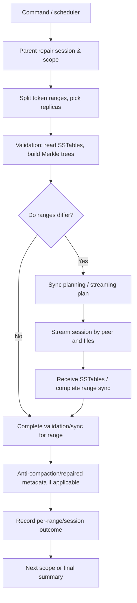
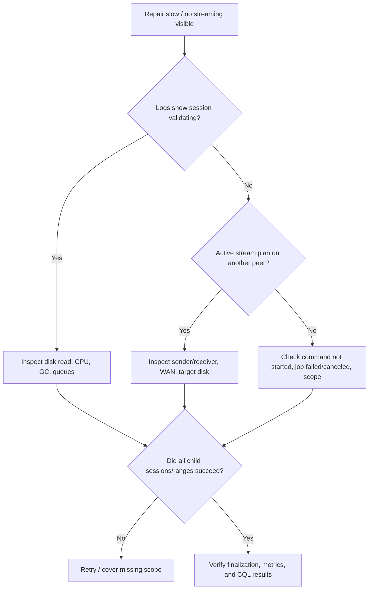

# Streaming, Repair Sessions, and Replica Synchronization Activity

## 1. Observation goal: is data merely moving, or actually synchronized?

In Apache Cassandra, each partition resides on **natural replicas** determined by partition key, token, replication strategy, and topology. A write using a consistency level (CL) that does not require every replica's acknowledgement can return success while a replica still missed the mutation. Clusters therefore rely on convergence mechanisms such as **hinted handoff**, **read repair**, and **anti-entropy repair**. When topology changes (bootstrap, rebuild, replace, decommission), Cassandra also **streams** data between nodes.

Operators commonly fall into three mistaken conclusions:

- “`nodetool status` shows `UN`, so replicas must hold all data.”
- “`nodetool netstats` shows no active streams, so repair is completely done.”
- “A repair session streamed 0 bytes, so every table in every DC must be identical.”

All three lack **sufficient evidence**. Node liveness, byte transfers, and repair coverage are **three distinct quantities**. This lesson belongs to the **Cluster Observability** chapter of `DATABASE_ENGINE_WIDE_COLUMN_CASSANDRA`, tying together distributed wide-column architecture, partition keys, query-driven modeling, read/write consistency levels, compaction, repair, troubleshooting, and Java connectivity.

After this lesson, you will be able to:

1. Distinguish **streaming plans/sessions**, **repair parent sessions**, **validation**, **sync**, and **anti-compaction**.
2. Reconstruct timelines using `nodetool status`, `netstats`, `compactionstats`, `tpstats`, logs, and metrics.
3. Identify source/target nodes, DCs, keyspace/table/token-range scope, and session success/failure state.
4. Measure synchronization impact on disk, network, CPU, p95/p99 latency, and Java application timeouts.
5. Declare completion only with **scope-level coverage evidence**, never merely because byte streaming stopped.

## 2. Map of related synchronization activities

The following operations can all spike network and disk activity, yet **do not substitute for one another**:

| Activity | Trigger | Transfers data between nodes? | What to observe |
| --- | --- | --- | --- |
| **Anti-entropy repair** | `nodetool repair`, orchestrator, or Auto Repair where supported | **Maybe**: if data differs; validation still burns I/O even when streaming = 0 | Repair sessions/ranges, validation, Merkle trees, sync/streaming, per-range outcomes |
| **Bootstrap/rebuild/replace** | Node joining cluster, rebuilding data, or replacing a node | Normally **yes**, streaming owned token ranges | `Joining`/`Normal` state, streaming peers, bytes, new ranges, bootstrap errors |
| **Decommission/removenode** | Membership/token-ownership changes | Can stream to nodes taking over ownership | `Leaving`/removal state, source/target, per-range progress, RF availability |
| **Hinted handoff** | Coordinator replaying stored mutations to a recovered replica | Transfers mutations over network, **not an anti-entropy streaming plan** | Pending hints, hint delivery success/failures, hint retention window |
| **Read repair** | Read path detecting mismatch under eligible conditions | May send repair mutations, not a full-table scan | Read repair metrics, sampled query traces, latency |
| **Compaction/anti-compaction** | SSTable scheduler or incremental-repair helper phase | Mostly **local** SSTable reads/writes | Pending/active tasks, disk I/O, output SSTables, repaired metadata |

**Core takeaway:** “Replica synchronization” is the goal; “streaming” is one transport mechanism; “repair session” is the reconciliation coordinator unit. A node with zero active streams may still be running validation, anti-compaction, or have unprocessed token ranges.

## 3. Tracing the lifecycle of a repair run

Conceptually, an anti-entropy repair progresses through these stages:



In Cassandra versions using **incremental repair**, **repaired/unrepaired/pending-repair** states and anti-compaction follow internal scheduling/classification; never treat this flowchart as identical event names across every version. Full vs. incremental behavior, repair coordinators, subrange counts, and failure handling also depend on version.

### Identifiers you must keep distinct

| Identifier | Meaning | Why it matters |
| --- | --- | --- |
| **Repair command ID / parent repair session ID** | Top-level identifier for an initiated repair command or parent run, depending on version | Links operator command, child sessions, logs, and final status |
| **Repair session/subsession ID** | Repair unit for a range/replica group; multiple child sessions may exist | One child session failing does not mean every child session failed |
| **Streaming plan ID / stream session** | Transfer session between source/target peers and file sets | One repair spawns many streams; bootstrap also streams without a repair parent |
| **Token range** | Partition token interval being validated/synced | Measures coverage and catches skipped ranges |
| **Node host ID / endpoint / DC** | Participating node and assigned rack/DC | Correlates multi-node logs and separates IP/hostname changes from host identity |

**Never assume IDs across layers match 1:1.** When troubleshooting, record IDs, timestamps, peers, and tables to link parent repair, child sessions, and streams. A stream log stating “completed” only reports that **single stream unit**, never full-range repair completion.

## 4. First observation layer: `nodetool` on the right nodes

The commands below gather live state. For multi-DC investigations, run them on the **repair coordinator, participating replicas, and streaming source/destination nodes**, not only a single admin box.

```bash
# Verify topology, DC/rack placement, and node reachability:
nodetool status
nodetool describecluster

# Snapshot of current streaming on the node:
nodetool netstats

# Validation / compaction work and backlogs:
nodetool compactionstats
nodetool tpstats

# SSTable and read/write context for the table under repair:
nodetool tablestats repair_lab_ks.orders_by_id
```

When running from an operator workstation with authorized admin connectivity:

```bash
nodetool -h cassandra-a netstats
nodetool -h cassandra-b netstats
nodetool -h cassandra-c compactionstats
```

Hostnames are illustrative only; real environments require JMX ports, TLS, credentials, and access controls. `nodetool` is a **node management interface**, not a CQL query sent over port 9042.

### What does `nodetool status` answer?

Common states include `UN` (Up/Normal), `DN` (Down/Normal), `UJ` (Up/Joining), `UL` (Up/Leaving), and sometimes `UM` (Up/Moving) depending on version—alongside DC/rack, host ID, load, and ownership.

**What you CAN conclude:** how peers view a node's Up/Down liveness and topology state at that moment. **What you CANNOT conclude:** that every mutation, tombstone, or partition is fully replicated. `Owns (effective)` reflects keyspace/replication token ownership, not repair completion percentage.

### What does `nodetool netstats` answer?

Typically shows **Mode**, **Receiving/Sending**, per-peer stream details, files/bytes transferred, and remaining tasks; some versions also print read-repair or messaging pool stats.

**Illustrative example (not live output from a real cluster):**

```text
Mode: NORMAL
Receiving 2 files, 134217728 bytes total
    from /192.0.2.12:
        file 1/2 ... progress 48 MiB / 64 MiB (75%)
Sending 1 files, 67108864 bytes total
    to /192.0.2.13:
        file 1/1 ... progress 16 MiB / 64 MiB (25%)
```

Exact strings, units, and formatting **vary by version**. Take away **transfer direction, peers, file/byte progress, and instantaneous status**, not a promise about total work remaining for the entire repair.

If `netstats` shows zero active streams:

1. Repair may still be in the **validation phase**, so streaming hasn't started yet.
2. Compared ranges had **no differences**, requiring zero streaming.
3. Streaming finished, while **anti-compaction/finalization** is still running.
4. Repair **never ran, failed, was cancelled, or skipped** other ranges.
5. You may be checking the **wrong node**: streams are running between other peers.

Hence `netstats` is an **activity snapshot**, not a **repair history audit**.

## 5. Tracking progress: deltas, rates, and latency

Stream metrics are most useful when collected **continuously on consistent intervals** and paired with session logs:

| Quantity | How to read it | Watch out for |
| --- | --- | --- |
| Current bytes sent/received | Bytes moved by an active stream on source/target | May reset once a stream finishes; not necessarily a cumulative counter |
| Total incoming/outgoing bytes per node | Reflects streaming over time if exporter exposes matching metrics | Compute **deltas/rates**; handle restarts/resets and metric scope |
| Active stream plans/sessions | How many transfer sessions are currently running | Not equal to repair session count or remaining token ranges |
| File progress | Bytes/files sent within a specific stream | File sizes vary; wire volume also reflects compression/protocol |
| Repair duration | Time from launch to completion or checkpoint | Never take it from a single stream's timestamp |
| Streaming retries/failures | Retransmissions or aborted streams | Impacts SLAs and causes actual bytes moved to diverge from estimates |

If an exporter emits a **monotonic counter** `streamed_bytes_total`, the average transfer rate over \(\Delta t\) seconds is:

\[
\text{stream rate (MiB/s)}
= \frac{C(t_2)-C(t_1)}{(t_2-t_1)\times 2^{20}}
\]

This is a **counter-reading formula**; `streamed_bytes_total` is illustrative only, **not a built-in metric guaranteed to exist under that exact name**. Before computing it, verify it is a counter (not a gauge), measured in bytes, tagged by direction and node, and had no resets in the interval.

**Example:** an outgoing counter growing by 256 MiB over 64 seconds averages 4 MiB/s. That is not the throttle cap in `cassandra.yaml`, and it **cannot measure** validation disk I/O that sends zero bytes over the wire.

### Do not mechanically sum bytes across all nodes

One stream A → B is counted **outbound on A** and **inbound on B**. Summing both counters as “unique repaired bytes” double-counts the transfer. For multi-DC repair, track **by direction**, **by link/DC**, and **by source/target node**, separating repair streams from bootstraps, other streaming, and normal CQL traffic.

## 6. Repair session layer: logs, completion, and token-range scope

To answer “did repair finish enough?”, connect **the initiated command** to **sessions and ranges**.

### What a repair session log should capture

- Start/end timestamps with timezone.
- Cassandra version, initiating node, keyspace, table, and mode (**incremental/full/preview/validate**).
- Token ranges/primary ranges, DC/host filters, and participating natural replicas.
- Command/parent session ID and child repair session IDs.
- Succeeded/failed/aborted range counts, validation status, and streaming status.
- Source/target peers, bytes streamed, duration, and timeout/streaming/anti-compaction errors.
- Scheduler ID/config: manual run, cron, Reaper, or Auto Repair (if supported).

**Self-written summary log example (not verbatim Cassandra log syntax):**

```text
2026-11-21T09:00:00Z REPAIR_START
  job=repair-window-42 keyspace=repair_lab_ks table=orders_by_id
  mode=incremental coordinator=A scope=primary-ranges-on-A
2026-11-21T09:01:10Z REPAIR_VALIDATION
  range=(t0,t1] participants=A,B,C
2026-11-21T09:03:20Z REPAIR_SYNC
  range=(t0,t1] stream=A->C bytes=67108864
2026-11-21T09:04:00Z REPAIR_RANGE_SUCCESS
  range=(t0,t1]
2026-11-21T09:05:00Z REPAIR_RANGE_FAILED
  range=(t1,t2] reason=stream-timeout
2026-11-21T09:05:10Z REPAIR_PARTIAL
  successful=1 failed=1 remaining=unknown
```

Valid conclusion: **at least one range succeeded and at least one range remains unrepaired**. False conclusion: “the run lasted 5 minutes and finished streaming a file, so the entire table is synchronized.”

### Which nodes' logs should you check?

1. **Repair coordinator node:** command parameters, overall progress, session IDs, failures, and final outcome.
2. **Validation-participating replicas:** SSTable read errors, overload, Merkle tree build times, timeouts.
3. **Stream sender/receiver nodes:** link errors, out-of-disk errors, I/O errors, aborted streams.
4. **Scheduler:** planned cadence, skipped ranges, retry policy, overlapping jobs, and per-run results.

Exact log strings, `INFO`/`DEBUG`/`WARN` levels, and file paths vary by version and logging config. **Never rely on a single imagined log pattern as your monitoring system's sole proof of repair success.** Collect structured status from the orchestrator and repair exit status where available, link IDs by session, and track failure events too.

### Repair history in system tables: check your version

Some Cassandra releases maintain tables such as `system_distributed.parent_repair_history` and `system_distributed.repair_history`; releases with **Auto Repair** may also include `system_distributed.auto_repair_history`. **Schemas, TTL/retention, granularity, and availability differ across versions.**

Before querying:

```sql
-- cqlsh metadata inspection command, not a production SELECT:
DESCRIBE KEYSPACE system_distributed;
```

Only after confirming the table exists and checking its partition/clustering keys in the schema should you run bounded `SELECT ... WHERE ...` queries. Never run unbounded `SELECT *` on large system tables as a routine production monitoring method. If your version lacks the desired history table, rely on logs, orchestrator records, and metrics—**never assume repair never ran**.

## 7. Validation, streaming, and anti-compaction: reading the right metrics

| Signal | Likely active phase | Next verification source |
| --- | --- | --- |
| Network stream ~0 while disk reads and CPU jump | Validation/Merkle trees or other SSTable-reading work | `compactionstats`, `tpstats`, validation logs, host disk/CPU |
| Outbound on A and inbound on C rise together | Streaming A → C | `netstats` on both nodes, session/peer in logs |
| Free disk drops after streaming, new SSTables appear | Receiver writing streamed data or running compaction/anti-compaction | `tablestats`, file counts, `compactionstats`, snapshots |
| 0 files streamed yet session reports success | Replicas already matched in that scope | Parent repair summary, range coverage, validation success |
| Stream drops abruptly, repair logs `WARN`/`ERROR` | Stream failed/canceled or node interrupted | Repair status/exit code, source/target logs, timeouts, disk |
| High pending compactions and degraded read p99 | Repair/anti-compaction competing with foreground CQL for I/O/CPU | Table read latency, disk `await`, CPU/GC, concurrent job count |
| All nodes `UN` yet repair reports failed | Nodes are alive, **reconciliation failed** | Failed range count, logs, repair coordinator, retry handling |

**JMX/Prometheus metric names vary by Cassandra version and exporter rules.** Group dashboards into:

- **Streaming:** bytes in/out, active streams, failures/retries where exposed.
- **Repair:** validation duration, repair sessions started/completed/failed, bytes/ranges processed, scheduler state.
- **Compaction/table:** pending tasks, repaired/unrepaired SSTables, disk space, read/write latency, `SSTablesPerReadHistogram`, tombstone scans.
- **Network/host:** inbound/outbound throughput, retransmits, RTT, packet loss, disk read/write throughput/latency, CPU, and GC.
- **ClientRequest:** read/write latency distributions, timeouts, failures, unavailables.

Coordinator **client latency**, replica **local read latency**, and OS **disk read latency** measure different scopes—never sum them into one combined latency. When comparing across nodes, keep clocks synchronized (NTP), use one timezone, and align metric windows.

## 8. Counting “how much is done” accurately

Progress can be expressed against several different denominators:

| Measure | Denominator / scope | Why it cannot replace coverage |
| --- | --- | --- |
| 90% of bytes sent for one stream | Total bytes of **that single stream** | Many other streams/replicas/ranges may not have started |
| 100% of files in one streaming plan | Files in **that plan** | Repair still has validation, anti-compaction, or finalization |
| One child repair session succeeds | Ranges/participants of **that child** | Parent may have other child sessions and other tables |
| Parent repair command succeeds | Keyspace/tables/ranges requested by **that command** | `-pr`, `-dc`/`-local`, or filters restrict scope |
| Scheduler finished today's run | Jobs registered in **that schedule** | Schedule may omit a new table, a DC, or token ranges |
| Cluster shows `UN` on all nodes | Node liveness | Carries zero information about replica data convergence |

A useful coverage metric can be computed in your **orchestration layer**, even if not built into Cassandra:

\[
\text{Scoped coverage}
= \frac{\text{range/table/DC units repaired successfully}}
{\text{range/table/DC units planned for repair}}
\]

This is an **operational definition example**, not a built-in `repair_coverage` metric. When ranges vary wildly in data volume, range-count ratio alone can mislead; pair it with **byte estimates, time since last successful repair, and actual token spans**. On vnode clusters, “20/20 ranges repaired on Node A” still does not guarantee Node B or another DC is covered.

### Track age since last successful repair

For each `keyspace × table × token range × DC/replica set`, track:

- Timestamp of the **last successful completion**, not merely when the job was scheduled.
- Timestamp and cause of the latest failure.
- Remaining margin before the table's tombstone safety window (`gc_grace_seconds`).
- Recent topology/RF changes, new tables, or long node outages increasing urgency.

When ranges fall overdue, alerts should name **which ranges remain unrepaired**, not merely display “repair jobs completed: 99%”. Zombie-data risk depends on tombstones, repair cadence, and replica history; coverage ratios alone never automatically prove every tombstone is safe.

## 9. Investigation runbook: from symptom to evidence

### Step 1 — Identify the initiating event

Clarify: is this a **scheduled repair**, a **bootstrap/rebuild/replace**, or a **replica outage recovery**? Record cluster, Cassandra version, keyspace/table, RF per DC, app CL, timestamps, and the operator/scheduler that triggered it.

```sql
SELECT keyspace_name, replication
FROM system_schema.keyspaces
WHERE keyspace_name = 'repair_lab_ks';
```

With multiple keyspaces, never assume one keyspace's RF represents the entire cluster.

### Step 2 — Capture topology and source/target placement

```bash
nodetool status repair_lab_ks
nodetool describecluster
nodetool getendpoints repair_lab_ks orders_by_id cust-42
```

`getendpoints` identifies natural replicas for a **specific partition key**, not which replica holds the newest row. Record host IDs, DC, rack, and token ranges; right after topology changes, inspect **more than one node** to catch uncommitted schema/gossip metadata.

### Step 3 — Snapshot streaming and validation across all participating nodes

```bash
nodetool -h cassandra-a netstats
nodetool -h cassandra-b netstats
nodetool -h cassandra-c netstats

nodetool -h cassandra-a compactionstats
nodetool -h cassandra-b compactionstats
nodetool -h cassandra-c tpstats
```

Streams can finish between calls; during ongoing investigation, **sample on a steady cadence** to build a timeline. Keep administrative polling modest—do not hammer an overloaded node with high-frequency `nodetool` loops.

### Step 4 — Correlate parent session, child sessions, and streams

Search coordinator/scheduler logs by **timestamp and repair ID**; track child sessions by token range and peers. Check sender/receiver logs by peer ID/endpoint and timeframe to identify phases: validating, syncing, streaming, anti-compacting, completed/failed.

**If `netstats` shows streaming with no active repair**, never assume it is repair: it may be bootstrap, rebuild, replace, or decommission. Use node state, logs, and command history to classify accurately.

### Step 5 — Separate resource saturation from data divergence

Record CQL p95/p99, timeouts, free disk/`await`, CPU/GC, and outbound/inbound bandwidth. Sending 100 MiB/s does **not** prove heavy data corruption—normal bootstrap moves large SSTables too. Conversely, 0 MiB/s streaming does **not** prove data matches if validation hasn't run or failed.

### Step 6 — Throttle or recover within scope

- If streaming saturates WAN links: inspect throughput caps, cross-DC scope, and concurrent streaming nodes; protect bandwidth for live CQL.
- If validation saturates disk/CPU: check job concurrency, compaction/validation throughput, and queues; cut concurrent jobs and stagger schedules.
- If a receiving node runs low on disk: never raise concurrency; inspect SSTables, snapshots/backups, and incoming streams.
- If a repair session fails: isolate **failed ranges** and retry per runbook/version—never mark the parent run succeeded.
- If a replica stayed down past the tombstone grace window: follow restore/rebuild/repair runbooks and assess zombie-data risk rather than blindly launching repair.

Change **one primary variable at a time** and verify impact on both source/target nodes and application SLOs.

### Step 7 — Close only with evidence

Close the incident only when:

1. All target keyspaces/tables/ranges/DCs show confirmed completion or explicitly documented gaps.
2. Associated stream plans show zero unresolved errors and reconcile with parent/child repair state—never relying solely on empty `netstats`.
3. Version-specific anti-compaction or finalization steps finished cleanly.
4. Replicas show healthy topology state with no dangling bootstrap/replace work.
5. p95/p99, throughput, and disk/network/CPU stabilize; representative business queries return expected results at CL.
6. Repair history/last-success tracking is updated so any overdue ranges surface next cycle.

## 10. Illustrative timeline analysis (hypothetical numbers)

Assume replicas A, B, and C own a range undergoing repair while the application reads/writes at `LOCAL_QUORUM`:

| Time | Symptom | `netstats` | `compactionstats` / logs | Evidence-backed conclusion |
| --- | --- | --- | --- | --- |
| 09:00 | Repair starts | No streams yet | Log creates parent and assigns ranges | No proof validation finished |
| 09:01 | Disk read/CPU jump | 0 bytes | Validation/Merkle tree running | Cost is likely SSTable scan/hashing |
| 09:03 | Network A → C rises | Stream A → C | Sync session found differences | Data is actively synchronizing |
| 09:05 | Network drops to 0 | No streams | One child succeeded, another timed out | **Repair has NOT covered full scope** |
| 09:07 | CQL p99 stays high | No streams | Pending anti-compaction/compactions remain | I/O impact can outlast streaming |
| 09:20 | p99 stabilizes | No streams | Failed child retried; logs confirm all requested ranges done | **Requested repair scope** can close; do not infer other tables match |

This table uses **hypothetical data for practicing evidence correlation**, not real logs or benchmarks. Looking only at `netstats` at 09:05 would falsely close the job and leave a failed child session unnoticed.

### Short diagnostic tree



## 11. Multi-DC scenario: WAN link is busy, is repair progressing?

Suppose `NetworkTopologyStrategy` configures `dc1:3` and `dc2:3`. During a full repair, the WAN link saturates, yet `netstats` on Node A in `dc1` shows only a few MiB/s.

Hypotheses to test:

1. **Multiple nodes streaming concurrently:** A sends little while B/C and peers in `dc2` stream simultaneously. Aggregate per node and per DC link.
2. **Non-repair traffic:** bootstraps, backups, app traffic, cross-DC replication writes, or hinted handoff share the WAN; check sessions and logs.
3. **Unit mismatch:** NIC tools report Mbit/s while streaming dashboards show bytes/s or MiB/s.
4. **Slow disk on target node:** stream encounters backpressure or pauses/retries; inspect incoming stream, target disk `await`, and target logs.
5. **Stalled session:** near-zero rate with zero progress across intervals and timeout warnings in logs.

Bandwidth throttling uses `nodetool getstreamthroughput`/`getinterdcstreamthroughput` and corresponding config settings, yet **never change them mid-investigation** without baselines, recorded prior values, and approval. `set*` commands affect **other node streaming tasks**, not just one repair session. Using `LOCAL_QUORUM` for CQL within each DC also does **not** make cross-DC repair streaming free.

## 12. Hands-on lab: creating data and observing a small-scope repair

**Run only on a lab cluster** with matching RF and datacenter names; never induce outages in production. Example single-DC three-node lab in `dc1`:

```sql
CREATE KEYSPACE repair_lab_ks
WITH replication = {'class': 'NetworkTopologyStrategy', 'dc1': 3}
AND durable_writes = true;

CREATE TABLE repair_lab_ks.orders_by_id (
    customer_id text,
    order_id uuid,
    state text,
    updated_at timestamp,
    PRIMARY KEY ((customer_id), order_id)
);

INSERT INTO repair_lab_ks.orders_by_id
    (customer_id, order_id, state, updated_at)
VALUES ('cust-42',
        11111111-2222-3333-4444-555555555555,
        'CREATED', toTimestamp(now()));

SELECT customer_id, order_id, state
FROM repair_lab_ks.orders_by_id
WHERE customer_id = 'cust-42'
  AND order_id = 11111111-2222-3333-4444-555555555555;
```

On the selected node:

```bash
# Before experiment — read-only:
nodetool help repair
nodetool status repair_lab_ks
nodetool getendpoints repair_lab_ks orders_by_id cust-42
nodetool netstats
nodetool compactionstats
nodetool tablestats repair_lab_ks.orders_by_id

# ONLY in a lab with verified disk headroom and no overlapping repair:
# nodetool repair --full -pr repair_lab_ks orders_by_id

# During/after repair, observe on both coordinator and peers:
nodetool netstats
nodetool compactionstats
nodetool tpstats
```

**`--full`** requests a full repair; **`-pr`** restricts scope to the **primary token ranges of the invoked node** per supported version semantics. A single `-pr` run **does not repair the whole cluster**; full coverage requires scheduling across remaining nodes/ranges. Always check `nodetool help repair` on your actual binary, especially if Auto Repair or Reaper runs on the cluster.

### Experiment observation sheet

| Field | Before repair | During repair | After repair |
| --- | --- | --- | --- |
| Node/DC/rack, keyspace/table, mode | Record | Unchanged unless planned | Confirm scope |
| Command/parent session ID | None yet | Record ID and start time | Overall result |
| Child sessions & token ranges | Planned range list | Validation/sync/fail per range | Succeeded/failed per range |
| Source/target `netstats` | Idle or baseline load | Peer, sending/receiving, bytes | No remaining failed streams |
| `compactionstats`/`tpstats` | Baseline | CPU/disk/queue/validation | Backlog recovered |
| Host metrics | Disk, CPU, network | Peak and p95/p99 | Returned to baseline |
| CQL and Java client | Output, latency | Timeouts, latency | Correct data and SLO |
| Unrepaired scope | From schedule/coverage | By child session | Record gaps + catch-up plan |

With a table holding only a few synchronized rows, repair may **stream zero bytes** or finish too fast for `netstats` to catch. It remains a valid exercise for **reading logs/sessions and distinguishing snapshots from completion**; never break a replica intentionally just to see streaming bytes.

## 13. Impact on Java applications and how to measure it

A Java application **does not invoke `nodetool repair` over CQL** to reconcile the cluster. Still, repair shares disk, CPU, and network with live driver queries. Using Java Driver 4.x, time a partition-key query to observe latency shifts:

```java
PreparedStatement ps = session.prepare(
    "SELECT state, updated_at FROM repair_lab_ks.orders_by_id " +
    "WHERE customer_id = ? AND order_id = ?"
);

BoundStatement query = ps.bind(
    "cust-42",
    UUID.fromString("11111111-2222-3333-4444-555555555555")
).setConsistencyLevel(DefaultConsistencyLevel.LOCAL_QUORUM);

long started = System.nanoTime();
Row row = session.execute(query).one();
long elapsed = System.nanoTime() - started;

System.out.printf("elapsedMs=%.2f; state=%s%n",
    elapsed / 1_000_000.0,
    row == null ? "<missing>" : row.getString("state"));
```

This snippet assumes an active `session` and Java Driver 4.x/standard Java imports. **A single latency sample is not p99**; collect driver metrics by query class, request count, timeouts/retries, connection pools, first-page vs. full-page duration when paging, and payload sizes.

During repair, observe simultaneously:

- **Data correctness:** do `LOCAL_QUORUM` reads return expected results, or are timestamps/TTLs/tombstones interfering?
- **Availability:** how many `ReadTimeoutException`, `WriteTimeoutException`, or `UnavailableException` errors hit live requests?
- **Latency:** p50/p95/p99 on identical workloads before, during, and after repair.
- **Cause alignment:** do spikes line up with validation/streaming on the **exact owning replicas**, with matching disk/GC/network climbs on those nodes?

With RF = 3, `LOCAL_QUORUM` requires 2 local replicas; **two replicas overloaded simultaneously** by validation/streaming can trigger timeouts even while all three show `UN`. Changing CL or raising app timeouts to hide this is never the right first diagnostic step.

## 14. Common misconceptions

| Misconception | Accurate understanding |
| --- | --- |
| “`netstats` is empty, so cluster-wide repair is done.” | Only means no active stream is shown on that queried node right now; check parent/child sessions and range coverage. |
| “0 bytes streamed proves all replicas match.” | May mean one validated range matched, or validation hasn't run/failed; check outcome for the full scope. |
| “Bytes sent + bytes received equals unique repaired data.” | One A → B transfer counts on both ends, plus retries/protocol overhead and unchecked ranges. |
| “`UN` means every replica received outage mutations.” | Node liveness does not prove data consistency or hint/repair completion. |
| “One stream session succeeding means parent repair succeeded.” | Other child sessions/ranges and finalization steps still remain. |
| “Validation doesn't stream, so it's free.” | Validation scans SSTables, hashes Merkle trees, and contends for CPU and disk. |
| “Compaction finishing means repair finished.” | Local compaction never reconciles across replicas; anti-compaction is only one sub-step of some repairs. |
| “Repair succeeding on Node A covers all DCs.” | Check scope, token ranges, DCs, and cluster-wide orchestration. |
| “Raising stream throughput always improves repair.” | Can saturate WAN links, target disks, or CQL p99; balance hardware headroom against completion windows. |
| “We can verify repair with one hot-key `SELECT`.” | Checks only one partition across CL-responding replicas, not cold data or all token ranges. |

## 15. Self-check questions

1. What distinguishes a **repair parent session**, a child repair session, and a streaming plan? Can a streaming plan exist without a repair?
2. Why is `nodetool netstats` only a snapshot that cannot replace per-range completion history?
3. If network streaming is 0 while disk reads and CPU spike during repair, which phase and evidence should you inspect?
4. Stream A → B shows 300 MiB outbound on A and 300 MiB inbound on B. Can you report 600 MiB of unique data repaired?
5. `nodetool repair --full -pr ks tbl` finishes on Node A: what scope is covered, and what still needs scheduling?
6. Why must a parent repair with one succeeded child and one failed child be treated as incomplete?
7. How do you correlate a Java p99 latency spike with replica validation/streaming without jumping to false causation?
8. When Auto Repair/Reaper and manual repairs run together, what signals indicate overlapping schedules?
9. A node returns `UN` after an outage longer than hint retention or `gc_grace_seconds`; what data verification is still needed and why?
10. Name three complementary metrics/signals that prove “repair finished” far more reliably than “`netstats` shows zero streams”.

**Completion criterion:** you can reconstruct **command → parent session → child/range → validation/sync → stream plan → outcome**, correlate logs/metrics across coordinator and peers, measure CQL impact, and declare success only for scopes backed by explicit evidence.

## 16. References

- [Apache Cassandra — Repair](https://cassandra.apache.org/doc/stable/cassandra/managing/operating/repair.html): anti-entropy, Merkle trees, full/incremental modes, and scope flags.
- [Apache Cassandra — nodetool netstats](https://cassandra.apache.org/doc/stable/cassandra/managing/tools/nodetool/netstats.html): inspecting active streams and per-peer send/receive stats.
- [Apache Cassandra — nodetool compactionstats](https://cassandra.apache.org/doc/stable/cassandra/managing/tools/nodetool/compactionstats.html): validation/compaction tasks and progress.
- [Apache Cassandra — nodetool tpstats](https://cassandra.apache.org/doc/stable/cassandra/managing/tools/nodetool/tpstats.html): active/pending/completed/dropped thread-pool tasks.
- [Apache Cassandra — Monitoring metrics](https://cassandra.apache.org/doc/stable/cassandra/managing/operating/metrics.html): JMX metrics for streaming, repair, tables, and client requests.
- [Apache Cassandra — Storage Engine](https://cassandra.apache.org/doc/stable/cassandra/architecture/storage-engine.html): SSTables and compaction tied to validation/anti-compaction; verify against your exact version.
- [Apache Cassandra — nodetool repair](https://cassandra.apache.org/doc/stable/cassandra/managing/tools/nodetool/repair.html): `--full`, `-pr`, and version-specific options.

**Conclusion:** Streaming shows **data in motion**; repair sessions show **which reconciliation jobs are running or finished**; and token-range/table/DC coverage backed by logs and metrics answers **how completely replicas were synchronized**. Proper observability combines node state, session IDs, validation, peer streams, timelines, hardware resources, and Java application outcomes. Never equate “no active streams” with “the entire cluster is in sync”.
