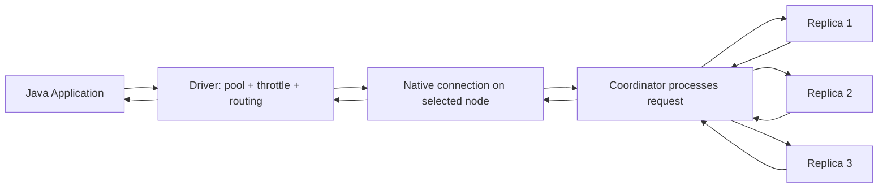
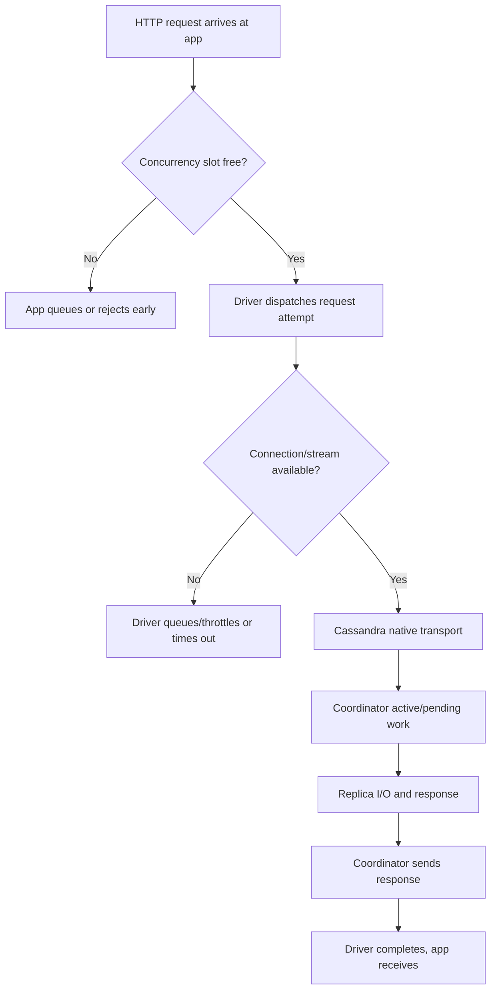

# Client Connections, In-Flight Requests, and Coordinator Load in Apache Cassandra

## 1. Why is observing connections alone not enough to tell if a cluster is overloaded?

In **Apache Cassandra**, a Java application typically opens long-lived **native protocol/CQL** connections to cluster nodes. Each connection multiplexes many concurrent requests. When an application reports slow reads or write timeouts, three numbers are usually asked first:

1. **Client connections:** how many TCP/native-protocol connections are open to each node?
2. **In-flight requests:** how many requests have been sent without finishing yet, and in which queue are they sitting?
3. **Coordinator load:** which node is receiving and coordinating heavy request traffic, waiting on replicas, or consuming CPU, disk, or network?

These three metrics are related yet **not interchangeable**. An application can hold 200 mostly idle connections with crisp latency; another can hold just a handful of connections yet push thousands of concurrent queries into timeouts. One node can hold fewer connections than a peer while coordinating far heavier queries.

This lesson belongs to the **Cluster Observability** chapter of `DATABASE_ENGINE_WIDE_COLUMN_CASSANDRA`: distributed architecture, partition keys, query-driven table design, read/write consistency levels, CQL, replication, compaction, repair, error handling, and Java applications. The emphasis is on **evidence-based bottleneck detection**, not reflexively tweaking pool settings or adding nodes.

### Objectives

After this lesson, you will be able to:

- Distinguish **open connections**, **in-flight requests** across app/driver/server, **queues**, **attempts**, and **logical operations**.
- Explain how a Cassandra coordinator handles requests and why load can skew across nodes.
- Observe using `nodetool clientstats`, `tpstats`, `proxyhistograms`, JMX/metrics, and Java Driver 4.x.
- Interpret latency, throughput, retries, timeouts, and pending tasks; estimate concurrency with Little's Law and understand its limits.
- Design dashboards, alerts, and runbooks distinguishing connection storms, queue buildup, hot partitions, and coordinator overload.
- Apply concurrency limits/backpressure in Java to prevent incident amplification.

## 2. How does a CQL request flow from client to coordinator?

Cassandra uses a distributed architecture **without a fixed primary coordinator**. Any node receiving a client's CQL request acts as that request's **coordinator**. The coordinator evaluates the execution plan, resolves replica endpoints from the partition key's token and replication strategy, dispatches replica requests, waits for responses matching the **consistency level (CL)**, and returns the result to the client.



**Key points:**

- The chosen coordinator **does not have to be** a replica holding the requested partition, although token-aware drivers prefer nearby replicas when routing keys and token metadata are available.
- With `NetworkTopologyStrategy` and `LOCAL_QUORUM`, the coordinator must gather enough valid responses **in the local DC**; RF, CL, and replica health shape internal cluster traffic.
- A paged `SELECT` can trigger **multiple page fetches**; one application logical query does not always equal one server request.
- Retries and speculative executions create **multiple attempts** for a single logical operation, so client, driver, and server counters naturally differ without losing requests.
- Queries missing partition keys, wide range scans, oversized partitions, or large payloads consume vastly different coordinator and replica resources at the exact same QPS.

### Example of a well-routed query

```sql
-- Assumes keyspace and table already exist in the lab.
SELECT display_name, updated_at
FROM traffic_lab.profile_by_user
WHERE user_id = 11111111-1111-1111-1111-111111111111;
```

With the full partition key, the driver computes the token and targets an appropriate coordinator when metadata and prepared statements are in place. Conversely, broad scans or `ALLOW FILTERING` impose heavy load even when returning tiny row counts. **Never diagnose coordinators from connection counts while ignoring CQL query shapes.**

## 3. Client connections: connections are not requests

### 3.1. Native transport and sessions

Java Driver 4.x maintains **long-lived** connection pools to Cassandra nodes according to config and load-balancing policies. CQL native transport typically uses port **9042** by default, though ports and TLS vary by deployment.

| Concept | What it means | What it does NOT mean |
| --- | --- | --- |
| **Open TCP connection** | OS client–node socket exists | A query is actively running on it |
| **CQL/native connection** | Client completed Cassandra protocol setup | Each connection executes only one request at a time |
| **Driver session** | Thread-safe `CqlSession` managing config and pools | Equal to a single socket |
| **Per-node connection pool** | Connections kept by a driver to one node | Every node always holds identical connection counts |
| **Active stream/request slot** | Multiplexing slot for an in-flight attempt | Equal to session count or client count |
| **Accepted vs. authenticated connection** | Socket reached server and protocol/auth status | Server has spare CPU/disk to serve queries |

One connection multiplexes many requests via native-protocol stream IDs. Thus **10 connections** does not mean **at most 10 concurrent requests**. Conversely, 10,000 idle connections do not mean Cassandra is running 10,000 queries, though they still consume sockets, file descriptors, memory, and keepalive overhead.

### 3.2. Example of a false inference to avoid

Suppose you run **40 Java pods** against **6 Cassandra nodes**, each pod averaging one connection to each node it uses. *Illustratively*, total connections might be around `40 × 6 = 240`. That is not a fixed formula: drivers may open multiple connections per node or only connect to local-DC subsets, and topology, reconnects, and server behavior affect actual counts.

If every pod creates **a new `CqlSession` per HTTP request**, connection count explodes under high RPS. That is a **connection storm** requiring a fix to session lifecycle—not blindly raising server native-transport limits.

**Java practice:** create and reuse a long-lived `CqlSession` per required configuration, share it safely across threads, and close it on application shutdown—never per query.

### 3.3. Cassandra counts differ from driver counts

- **Server:** sees all clients connected to **one node**, across all services, `cqlsh`, half-open/unauthenticated sockets, and instantaneous churn.
- **Driver:** sees **that single application session's pool** per node, unaware of other services.
- **OS:** sees TCP sockets in `ESTABLISHED`, `TIME_WAIT`, `CLOSE_WAIT`, etc., potentially including non-native-transport ports.

Always state **scope and timestamp** when comparing numbers; never sum overlapping counts as independent client counts.

## 4. In-flight requests: at least three distinct levels

When does a request become “in-flight”? Different tools define it differently.

| Level | Operation definition | Key caveat |
| --- | --- | --- |
| **Application in-flight** | Logical operations dispatched by app code not yet completed/timed out | May include time waiting inside app limiters or queues |
| **Driver in-flight** | Request attempts assigned to a connection/stream awaiting response per driver metric | Can differ from logical operations due to retries, speculative execution, paging |
| **Server in-progress/queued** | Work coordinator is executing or queueing across native transport, execution stages, and responses | Does not map 1:1 to driver stream IDs; metrics vary by version |



**Important:** real pipelines also include request throttlers, event-loop callbacks, retry policies, and paged result streaming; this diagram merely marks **where work can pile up**. Never conflate those separate queues.

### 4.1. Is high in-flight always bad?

No. With multiplexed pools, a few hundred in-flight requests on a node can be completely healthy when latency, throughput, timeouts, and queues remain stable. However, if in-flight climbs continuously while successful RPS stays flat, **the system is falling behind incoming demand**.

Examples:

- **200 in-flight, zero pending queues, flat p99:** likely healthy concurrency.
- **200 → 2,000 in-flight, flat throughput, rising p99:** nodes/replicas/network are saturating and the driver is accumulating backlog.
- **0 in-flight right after mass driver timeouts:** does not prove health; requests may be getting rejected upfront or servers may still be finishing stale work.

There is no universal “in-flight > N means Cassandra is overloaded” threshold. Bounds depend on driver config, latency, RPS, query cost, and each workload's SLO.

## 5. Coordinator load: what work is the coordinator doing?

Coordinator load goes far beyond receiving TCP packets. For a single query, a coordinator may:

1. Receive and decode CQL/native-protocol frames, authenticate, and build request context.
2. Compute partition token, resolve replica endpoints, apply consistency level, and plan execution.
3. Dispatch reads/writes to replicas and collect ACKs, data, or digests as required.
4. Reconcile data versions, handle timeouts/unavailable errors, or run internal retries/speculation where applicable.
5. Serialize results/pages and stream responses back over the client socket.

**Coordinator load** feels pressure from three sides:

- **Client-facing:** request attempts/s, connections, in-flight volume, response sizes, and native-transport throughput.
- **Replica-facing:** intra-cluster RPC/network, CL, number of replicas coordinated, query/range cost, and replica read/write latency.
- **Node resources:** CPU, heap/GC, disk I/O, compaction/repair/streaming, network, and thread-pool queues.

A single node simultaneously acts as coordinator for Request A and as replica for requests coordinated by peers. Therefore, **high CPU on a node does not prove coordinator overload**; separate coordinator request metrics from replica and background activity.

### Why can coordinator load skew across nodes?

| Cause | Common symptom | How to verify |
| --- | --- | --- |
| Non-token-aware driver / missing routing key | Traffic piles onto a few contact points/coordinators | Driver config, prepared/bound keys, per-node requests |
| App pinned to fixed subset of nodes | Those nodes handle disproportionate traffic | Per-node pool metrics and `clientstats` per node |
| Hot partition | One replica set absorbs abnormal load | Partition sizes, tokens, query shapes, per-table latency |
| Peer node down/slow | Driver avoids unhealthy node, shifting load to fewer peers | `nodetool status`, timeouts, health, routing |
| Cross-DC or rack mismatch | Traffic hits wrong DC; WAN keeps in-flight open longer | Driver local DC, CL, network latency |
| Heavy retries/speculative execution | Server request attempts exceed logical requests | Retry/speculation metrics, timeouts |
| Heavy range scans | Low request count yet high p99, CPU, and network | Query shape, `proxyhistograms`, `tablehistograms` |

Never “balance” by disabling token awareness and routing queries randomly. With full partition keys, targeting a nearby replica as coordinator minimizes network hops—though real behavior depends on load-balancing policy and topology.

## 6. Metrics to view side by side

### 6.1. Holistic view

| Layer | Metrics | Meaning |
| --- | --- | --- |
| **Java client** | HTTP/RPC accepted RPS, successful RPS, p50/p95/p99 | User workload and actual SLO |
| **Driver 4.x** | Per-node open connections, in-flight, pending/available streams if exposed | Request path from session to node |
| **Driver** | Request throttling queue, retries, speculative executions, timeouts | Pressure and extra attempt amplification |
| **Cassandra native transport** | Connected native clients and connection churn rate | Connection leaks/storms, client scaling shifts |
| **Coordinator request metrics** | Read/write/range latency, counts, timeouts, unavailable, failures | Per-node request coordination health |
| **Thread pools/queues** | Active/pending/completed/blocked tasks per stage | Internal server queueing |
| **Replica/table** | SSTables/read, partition sizes, tombstone scans, write/read latency | Data-level cause of slow queries |
| **Node/system** | CPU, heap/GC, disk util/latency, network, file descriptors | Hardware/runtime constraints |
| **Cluster operations** | Compaction, repair, streaming, node `UN`/`DN` state | Background jobs and topology shifts |

**Never** build a dashboard solely from “connections” and “CPU”. Actionable diagnosis links **workload → in-flight/queues → coordinator latency/errors → replica/storage**.

### 6.2. Averages do not replace tail latency

Suppose a node reports read p50 = 3 ms while p99 = 180 ms. When most requests are tiny lookups, a few wide-partition scans can push p99 high while the mean barely budges. Collect **p50/p95/p99**, timeouts, and request failures—and track errors separately so latency over successful requests alone does not make an overloaded cluster look “fast”.

**Never take the arithmetic mean of p99 across six nodes** as “cluster p99”. Aggregate compatible histograms/samples with proper weights and scope because each node handles different traffic and distributions.

## 7. Observing with `nodetool`: which command answers which question?

The commands below are **read-only**; run them on each relevant node at aligned timestamps and record Cassandra version, as fields/metric names vary across releases.

```bash
# Native-protocol clients connected to the inspected node.
nodetool clientstats

# Stage/thread-pool active, pending, completed, blocked...
nodetool tpstats

# Coordinator/proxy latency distributions for read, write, range.
nodetool proxyhistograms

# Membership, DC/rack, state, and node load.
nodetool status

# Inspect a specific heavy table.
nodetool tablestats traffic_lab.profile_by_user
nodetool tablehistograms traffic_lab profile_by_user

# Rule out background tasks competing for CPU/disk.
nodetool compactionstats
nodetool netstats
```

| Tool | Question answered | Limitation |
| --- | --- | --- |
| `clientstats` | How many native clients are connected to **this node**, broken down per version support? | Not in-flight query count; one socket multiplexes many requests |
| `tpstats` | Which stages have active, pending, or blocked tasks? | Pool/field names vary by version; not 1:1 with logical requests |
| `proxyhistograms` | How is coordinator/proxy request latency distributed? | Not end-to-end client latency; does not show connection counts |
| `tablestats` | Table state: SSTable count, bytes, read/write stats | One table does not represent all node requests |
| `tablehistograms` | Per-table partition/cell distributions and I/O latency | Not driver request queue histograms |
| `status` | Node Up/Down, Normal/Joining/Leaving, DC, and load | `UN` does not mean free of queueing or congestion |
| `compactionstats`, `netstats` | Active compaction and streaming tasks | Streaming ≠ normal CQL mutation throughput |

Some Cassandra versions expose **virtual tables** such as `system_views.clients` for connection inspection. If supported on your release:

```sql
-- Run only when system_views.clients exists in your Cassandra version.
SELECT * FROM system_views.clients;
```

Never assume every version exposes identical columns (IP/driver/protocol/user/request count). If the virtual table is absent, rely on `nodetool clientstats` and JMX. Avoid exposing client IPs, usernames, and connection metadata on public dashboards.

### 7.1. Reading `tpstats`

Suppose an **illustrative** snapshot shows:

```text
Pool/Stage              Active   Pending   Completed   Blocked
Native-Transport-...      16       600      5200000       0
Read-related-stage        12       180      4000000       0
Mutation-related-stage     3         0      6000000       0
```

Stage names are shortened here and **are not exact output** of a specific version. Interpretation: 600 pending tasks signals possible queue buildup, yet check **trend**, latency, and successful RPS. `Completed` is usually a **cumulative** counter that resets on restart. Never compare raw `Completed` counts across two nodes with different uptimes to judge who carries more load; compute **rate/s** over the same time window.

### 7.2. What does `nodetool` NOT see?

`nodetool` does not show requests queued inside **a Java client**, nor does it know which HTTP requests end users are waiting on. End-to-end answers require application/driver metrics correlated by timestamp, request ID, query shape, local DC, and node/cluster metadata.

## 8. JMX/Prometheus: separating metric types properly

Cassandra publishes internal metrics over **JMX**, which exporters/collectors ship to Prometheus or other observability backends. Exact MBean names, scopes, and exported names depend on **Cassandra release** and collector config.

Common metric groups:

- **`ClientRequest` Read/Write/Range Latency, Timeouts, Failures, Unavailables:** shows coordinator request outcomes; verify exact names/scopes on your cluster.
- **`ThreadPools` ActiveTasks/PendingTasks/CompletedTasks/BlockedTasks:** shows stage queues and utilization, not socket counts.
- **`Client`/`Connection` metrics** and native-transport indicators: connected clients, bytes, and requests per version support.
- **`Table` ReadLatency, WriteLatency, SSTableCount, tombstone metrics:** locates expensive tables or query classes.
- **JVM/OS:** heap, GC pauses, process CPU, file descriptors, disk I/O latency, network bandwidth.

### Turning raw metrics into meaningful signals

| Type | Examples | How to display |
| --- | --- | --- |
| **Gauge** | Connected clients, active/pending tasks, in-flight | Current value, trends, and per-node comparisons |
| **Counter** | Completed tasks, total timeouts, total requests | `rate`/`increase` over a window; handle restart resets |
| **Timer/histogram** | Coordinator read latency, driver request latency | Distributions or quantiles from proper histogram buckets |
| **Size/bytes** | Memory, free disk, SSTable bytes | Consistent units, per node/table, free headroom |

Never subtract a server cumulative counter from a driver instantaneous gauge and call it “backlog”. Never apply `rate()` to pre-aggregated summary quantiles without understanding exporter semantics. Tag dashboards with **cluster, DC, node, keyspace/table, app/service, and client local DC**, while excluding high-cardinality labels like `request_id` or `partition_key`.

## 9. Relationship between throughput, latency, and concurrency

**Little's Law** estimates *average concurrency* in steady state:

\[
L = \lambda W
\]

Where:

- `L`: **average** number of requests inside the measured system boundary.
- `λ`: **average** throughput of that exact request set (e.g., requests/second).
- `W`: average residence time per request in that same boundary, in **seconds**.

Suppose an application executes **4,000 requests/s** with mean driver-to-completion latency **25 ms = 0.025 s**. In steady state over a consistent boundary:

\[
L \approx 4000 \times 0.025 = 100
\]

That means **about 100 average in-flight requests** at that boundary. It does **not** mean Cassandra nodes hold 100 active native-transport tasks, nor can you plug p99 into `W` instead of **mean latency** to compute “p99 concurrency”.

### 9.1. Spotting saturation from trends

| Observation | Initial interpretation |
| --- | --- |
| Offered RPS up, successful RPS up, p99 flat | System still has headroom |
| Offered RPS up, successful RPS flat, in-flight/queues up | Bottleneck or throttling reached/exceeded capacity |
| In-flight rises because latency rises at constant offered RPS | Requests stay open longer, possibly due to server/replica/WAN |
| Connected clients rise while RPS stays flat | Suspect session churn, autoscaling, reconnect loops, or leaks |
| Per-node RPS skewed while total looks flat | Suspect token/driver routing skew; do not assume cluster headroom |
| Client latency rises while server latency stays flat | Suspect driver queues, network, callback threads, pools, or client CPU |

Little's Law applies when **concurrency and throughput are roughly stationary over the window**, not while queues grow unbounded. When requests time out or fail, define completion and rate carefully; counting only successes hides shed/failed load.

## 10. Observation example: few connections, overloaded coordinator

Suppose three DC1 nodes report these **hypothetical** numbers over one minute:

| Metric | Node A | Node B | Node C |
| --- | ---: | ---: | ---: |
| Native connections | 110 | 105 | 108 |
| Coordinator request attempts/s | 7,000 | 2,500 | 2,400 |
| Active/pending requests | 60 / 500 | 25 / 20 | 22 / 15 |
| Coordinator read p99 | 210 ms | 38 ms | 36 ms |
| CPU utilization | 91% | 55% | 53% |
| Read timeouts/s | 70 | 2 | 1 |

This is **not a real benchmark**, and active/pending values are illustrative totals.

**Initial evidence-backed conclusion:** Node A has nearly identical connection counts to B and C, yet handles far more coordinator attempts, deeper queues, and worse CPU/p99/timeouts. You cannot blame “too few connections” or “too many connections” from this table. Hypotheses to check:

1. Is the driver resolving tokens/routing keys properly, or funneling traffic onto one coordinator due to load-balancing config?
2. Are hot partitions on Node A's replicas causing I/O, tombstone scans, or data skew?
3. Did the driver temporarily mark B or C slow/unhealthy and shift traffic onto A?
4. Are retries/speculative executions inflating Node A's attempts far above logical requests?
5. Is Node A running heavy compaction, repair, GC, or streaming that slows both coordinator and replica work?

A safe fix addresses the **root cause**. Increasing `advanced.connection.pool.local.size` (where used) will not cure hot partitions, saturated disks, or wide scans.

## 11. CQL practice: a simple table for controlled load testing

Example for a **lab cluster**; adjust `dc1` and RF to your topology:

```sql
CREATE KEYSPACE IF NOT EXISTS traffic_lab
WITH replication = {
    'class': 'NetworkTopologyStrategy',
    'dc1': 3
};

CREATE TABLE IF NOT EXISTS traffic_lab.profile_by_user (
    user_id uuid PRIMARY KEY,
    display_name text,
    updated_at timestamp
);

INSERT INTO traffic_lab.profile_by_user (user_id, display_name, updated_at)
VALUES (
    11111111-1111-1111-1111-111111111111,
    'User A',
    '2026-11-21T00:00:00Z'
);

SELECT display_name, updated_at
FROM traffic_lab.profile_by_user
WHERE user_id = 11111111-1111-1111-1111-111111111111;
```

One row **does not make a representative workload**. To test concurrency and routing in staging, populate many UUIDs across tokens under bounded RPS, and compare uniform partition access separately from intentional hot-key tests.

### Three-run measurement plan

1. **Baseline:** full partition-key lookups, fixed client count, low offered RPS. Record connections/node, driver in-flight/node, coordinator read/write p99, pending stages, CPU/disk, and timeouts.
2. **Step up concurrency gradually:** hold query/payload/CL constant while stepping concurrency up safely. Record where successful RPS plateaus, queues start building, and p99 breaches SLO.
3. **Controlled load shedding:** apply a Java-side concurrency limiter and request throttle; compare p99, timeouts, rejected requests, and throughput. Never claim “p99 improved because we rejected 90% of traffic” as an unqualified win.

Never use `ALLOW FILTERING`, bulk `COUNT(*)`, or full-table scans to “test connections”; those measure completely different query costs. Test heavy queries separately with explicit goals.

## 12. Java Driver 4.x: bounding in-flight requests with a semaphore

`CqlSession` should be **thread-safe and reused**. The Java 17+ example below bounds application concurrency, tracks **app in-flight**, and fails fast when slots run out. The driver still has its own connection pools, request throttlers, retries, and metrics—never confuse app-layer counters with server state.

```java
import com.datastax.oss.driver.api.core.CqlSession;
import com.datastax.oss.driver.api.core.DefaultConsistencyLevel;
import com.datastax.oss.driver.api.core.cql.AsyncResultSet;
import com.datastax.oss.driver.api.core.cql.BoundStatement;
import com.datastax.oss.driver.api.core.cql.PreparedStatement;
import java.util.UUID;
import java.util.concurrent.CompletableFuture;
import java.util.concurrent.CompletionStage;
import java.util.concurrent.RejectedExecutionException;
import java.util.concurrent.Semaphore;
import java.util.concurrent.atomic.AtomicInteger;
import java.util.concurrent.atomic.LongAdder;

public final class ProfileReader {
    private final CqlSession session;
    private final PreparedStatement query;
    private final Semaphore slots = new Semaphore(128);
    private final AtomicInteger appInFlight = new AtomicInteger();
    private final LongAdder completed = new LongAdder();
    private final LongAdder failed = new LongAdder();
    private final LongAdder rejected = new LongAdder();

    public ProfileReader(CqlSession session) {
        this.session = session;
        this.query = session.prepare(
            "SELECT display_name, updated_at " +
            "FROM traffic_lab.profile_by_user WHERE user_id = ?");
    }

    public CompletionStage<AsyncResultSet> read(UUID userId) {
        if (!slots.tryAcquire()) {
            rejected.increment();
            return CompletableFuture.failedFuture(
                new RejectedExecutionException("Cassandra concurrency limit"));
        }

        appInFlight.incrementAndGet();
        final long startedNs = System.nanoTime();
        try {
            BoundStatement statement = query.boundStatementBuilder()
                .setUuid(0, userId)
                .setConsistencyLevel(DefaultConsistencyLevel.LOCAL_QUORUM)
                .build();

            return session.executeAsync(statement).whenComplete((result, error) -> {
                long latencyNs = System.nanoTime() - startedNs;
                appInFlight.decrementAndGet();
                slots.release();
                if (error == null) {
                    completed.increment();
                } else {
                    failed.increment();
                }
                // Ship latencyNs, completed, failed, rejected, appInFlight
                // to your metrics registry by window; never log raw userId.
            });
        } catch (RuntimeException error) {
            appInFlight.decrementAndGet();
            slots.release();
            failed.increment();
            return CompletableFuture.failedFuture(error);
        }
    }

    public int inFlight() { return appInFlight.get(); }
    public long rejectedCount() { return rejected.sum(); }
}
```

**Technical explanation:**

- `Semaphore(128)` caps **128 concurrent calls through this `ProfileReader` instance**, not a hard limit across the whole app, whole session, or a Cassandra node.
- `tryAcquire()` sheds load immediately under saturation; translate that into proper HTTP/gRPC **overload/backpressure** responses and retry only with bounded backoff if business semantics permit.
- `executeAsync` does not block a Java thread waiting on the network per request; `whenComplete` releases the slot once the async stage finishes.
- `appInFlight` does not count internal driver retries/speculative attempts or queries issued by other components sharing the session.
- `latencyNs` covers dispatch-to-Java-completion; queues sitting **outside** `read()` are excluded unless you time from business request entry.
- This snippet does not close `CqlSession`, because the application manages and shares it long-term; lifecycle belongs to the application container.
- `failed` aggregates all client-level failures; separate `ReadTimeout`, `Unavailable`, server overload, and driver-side timeouts by inspecting exception types/causes.

### 12.1. Why not raise the semaphore limit indefinitely?

When coordinators have finite capacity, raising slots from 128 to 10,000 merely piles up queued requests, p99/timeouts, and retries. Choose limits based on **measured throughput**, mean/percentile latency, pod count, memory budget, timeouts, retry policies, and SLOs—and coordinate **aggregate service budgets** when autoscaling adds pods rapidly.

### 12.2. Driver metrics and pool observability

Java Driver 4.x exposes metrics depending on driver version/module and config, exportable via Micrometer or compatible registries. Prioritize:

- Per-node **open connections**, **in-flight requests**, and **available streams** where supported.
- Per-session **request latency**, **request count**, **errors**, and **retry/speculative attempts**.
- Request **throttling queue**, blocked/rejected tasks, and timeouts.
- Event-loop/callback saturation where measurable, plus **client JVM CPU/GC**.

Never copy `datastax-java-driver.*` keys or metric names verbatim from another version without verifying docs/`reference.conf` for **your exact driver version**. Names and enablement vary across 4.0, 4.1x, and vendor builds.

## 13. Safe capacity planning instead of staring at max connections

A repeatable capacity process:

1. **Pin the workload:** read/write mix, key queries, partition/row sizes, CL, node count/RF, target RPS, and p95/p99 SLOs.
2. **Run bounded load tests:** step up offered RPS/concurrency while recording successful RPS, latency, timeouts, app/driver in-flight, coordinator CPU/queues, and node resources.
3. **Locate the knee:** where successful RPS flattens while p99, pending tasks, and errors/retries climb, you hit a bottleneck.
4. **Reserve headroom:** operate below measured saturation with margin for down nodes, repair, compaction, retries, or DC failover.
5. **Test failure modes:** one slow node, one DC isolated, pod autoscaling bursts, rolling restarts—verifying limiters and reconnects never cause storms.

**Never** use “max native connections” as your sole capacity proxy. Real limits depend on connections per node, stream slots, queues, CPU, disk, NICs, query cost, timeouts, and topology.

### Starting estimate for app in-flight

Suppose a service needs 2,000 successful requests/s with 20 ms mean Cassandra latency from Java:

\[
L = 2000 \times 0.020 \approx 40
\]

That yields roughly **40 average in-flight requests** for that path—**not** the exact semaphore slot count to deploy immediately. Bursts, tail latency, failure handling, paging, and retries require headroom; calibrate under real load.

## 14. Runbooks: handling each anomaly pattern

### 14.1. Connections spike suddenly

**Symptoms:** `clientstats` and socket counts climb fast without matching application RPS growth; file descriptors and memory rise.

**Checks:**

1. Did a deploy or autoscaler spin up extra pods, each opening its own session?
2. Is code creating a `CqlSession` per request or leaking unclosed sessions?
3. Did a node restart trigger a reconnect storm? Are driver jitter/backoff working?
4. Are auth/TLS failures causing continuous reconnect loops?
5. Are connections jumping to all nodes or only one node/DC?

**Actions:** fix session/pool lifecycle, rate-limit client startup, configure driver reconnect backoff, and watch file descriptors and server load. **Never** raise native connection limits without a resource model.

### 14.2. In-flight and pending rise while throughput stalls

**Symptoms:** driver in-flight/queues or `tpstats` Pending climb; coordinator p99 and timeouts rise; successful RPS stays flat.

**Checks:** CPU, disk I/O, GC, tombstones/partition sizes, compaction/repair, network, CL, and retry storms. Compare **driver queues** vs. **server queues** to locate where work first backs up.

**Actions:** shed offered load or cap concurrency safely; fix heavy scan queries; curb retries/speculation; resolve hardware or data-range bottlenecks. When servers are overloaded, **adding connections can make things worse**.

### 14.3. Only one coordinator or subset of nodes runs hot

**Symptoms:** inside one cluster, one node shows much higher p99, attempts/s, `tpstats`, or CPU than peers.

**Checks:** session local DC, routing keys/token awareness, down nodes, hot partitions, retry distribution, top query shapes, per-node data size, and disk skew. Separate **coordinator traffic** from **replica work** using appropriate metrics.

**Actions:** fix routing, partition keys/buckets, workload balance, and degraded nodes. Never switch to random cross-DC coordinator routing, which injects WAN latency into reads/writes.

### 14.4. Driver times out while server read latency stays flat

**Symptoms:** app p99/timeouts degrade while coordinator `proxyhistograms` remain healthy.

**Checks:** requests stuck in **client-side throttle queues**, connection stream slots, event-loop/callback backlogs, DNS/TLS/reconnects, client → coordinator network, slow downstream consumers, and page sizes. A request timing out **before reaching the server** never appears as a completed request on the server.

**Actions:** measure queue/dispatch delay separately from network/server time, apply early backpressure, and check client limits, callbacks, and CPU. Do not simply raise `read_request_timeout_in_ms` on Cassandra when the bottleneck is inside the driver.

### 14.5. Server logs timeouts while the client reports “no errors”

**Likely cause:** retries or speculative attempts succeeded on another node, so the app sees only the final successful logical operation—or server metrics reflect other client apps. Check attempt counts, logs, and correlation IDs.

**Actions:** track both **logical success rate** and **attempt failure/retry rate**; high attempt amplification means real cluster load exceeds business RPS.

## 15. Context-aware dashboards and alerting

A practical dashboard aligns client, driver, coordinator, and storage timelines side by side:

| Block | Minimum panels | Goal-aligned alerts |
| --- | --- | --- |
| **Client/session** | Connected clients/node, new connection rate, TLS/auth/reconnect errors | Connection storms or approaching FD/resource limits |
| **Driver** | Per-node pool connections, in-flight, available streams, throttle queue | Sustained queueing, stream exhaustion, rising retries |
| **Coordinator** | Request attempts/s, read/write/range p95/p99, timeouts, unavailable, failures | Tail latency breaching SLO or rising errors |
| **Work queues** | Native-transport and read/write stage active/pending/blocked tasks | Continuously growing pending queues with flat throughput |
| **Replica/storage** | Table latency, SSTables/read, partition size, tombstones, disk latency | Bottleneck isolated to a table/partition or saturated disk |
| **Node/cluster** | CPU, heap/GC, network, free disk, compaction/repair, topology | Unhealthy node or failure domain losing capacity |
| **User outcome** | End-to-end RPS/p99/errors by endpoint and DC | Business SLO missed even if server averages look fine |

### 15.1. Baseline-driven alert thresholds

There is no universal rule like “> 100 connections/node is dangerous”. A sound alerting model:

- **Early warning:** windowed p95 in-flight or pending climbs while successful RPS stays flat; retry rate rises; p99 approaches SLO.
- **Actionable page:** p99/timeout/error rate breaches SLO long enough, pending queues grow monotonically, driver rejects continuously for lack of slots, or a node leaves the cluster.
- **Resource boundary:** low free disk, sustained high CPU/GC, file descriptors/native connections near cap, or stream exhaustion.

Calibrate thresholds **before rollout** using benchmarks and workload history, and choose windows that filter out single-request noise. Pair every alert with a runbook.

### 15.2. Cluster aggregates vs. per-node / per-DC views

In a six-node cluster, one node handling 40% of attempts can choke even while cluster-average CPU reads 55%. Dashboards must allow drill-down along **cluster → DC → node → table/query/service**. When aggregating, sum **valid counters/rates** and merge compatible histograms—never sum or average per-node p99s.

## 16. How do data errors and consistency relate to load observability?

High in-flight counts or coordinator timeouts can coincide with replica divergence, yet **they are distinct issues**:

- A `LOCAL_QUORUM` write at RF 3 succeeds once two replicas ACK while the third catches up later via hints/repair; connection counts cannot measure replica convergence.
- `UnavailableException` from missing live replicas differs from `ReadTimeoutException` from slow replicas; classify by CL and topology.
- After adding a node/DC or raising RF, `UN` nodes and stable connections do not prove historical data finished backfilling; verify streaming/repair and sample data explicitly.
- Tombstone scans, compaction backlogs, and repair raise read latency—which is why **table-level and background metrics** belong beside coordinator load.
- Lowering CL to make requests faster alters business read/write guarantees and never fixes underlying overload or missing data.

Never trigger repair, cleanup, major compaction, or RF changes solely off an in-flight or connection graph; each carries independent safety requirements and resource costs.

## 17. Metric accuracy pitfalls to avoid

1. **Connection ≠ user:** one pod opens multiple connections, while many users share one session/pool.
2. **Connection ≠ running query:** multiplexing puts many requests on one socket, while idle sockets stay open.
3. **Client in-flight ≠ server active:** clients may be queueing while servers are executing or waiting on replicas.
4. **Logical operation ≠ request attempt:** retries, speculation, and paging separate the two counters.
5. **Completed counter ≠ throughput:** compute rates over intervals and handle restart resets.
6. **Successful-request p99 ≠ overall quality:** timeouts and rejections may be missing from success histograms.
7. **High node CPU ≠ coordinator overload:** the node also serves replicas and runs compaction/repair/GC.
8. **Balanced native connections ≠ balanced coordinator attempts:** routing keys, hot partitions, and retries create skew.
9. **Node `UN` ≠ healthy latency:** gossip membership does not check queueing or disk I/O.
10. **Larger pool size ≠ more server capacity:** often just adds more queued work.
11. **Different time windows aren't comparable:** a maintenance snapshot does not represent steady-state traffic.
12. **Metric names depend on version/exporter:** JMX MBeans and labels change; verify semantics on your deployment.

## 18. First-15-minute incident investigation checklist

This is an **evidence-collection order**, not a claim every incident resolves in 15 minutes:

```text
1. Identify: cluster/DC/service, start time, read vs. write,
   query shape, consistency level, p99, timeouts/errors.
2. Client: active pods, CqlSession count, connection churn,
   driver pool connections, in-flight, throttled/queued, retries.
3. Coordinator: request attempts/s per node, proxy latency,
   clientstats, tpstats active/pending, unavailable/failures.
4. Replica: table latency, SSTables/read, tombstone scans,
   partition size, compaction/repair/streaming, hot keys.
5. Node: CPU, heap/GC, disk util/latency, network, free disk.
6. Compare: client p99 vs. server p99; offered vs. successful RPS;
   in-flight vs. queues; per-node/per-DC instead of cluster averages.
7. Contain blast radius: bounded concurrency/backoff, no retry storms;
   follow root-cause runbook and protect CL/data safety.
8. Verify: re-test representative workload, record before/after
   p50/p95/p99, errors, RPS, and capacity headroom.
```

If telemetry cannot separate driver queues from server execution, record **bottleneck undetermined** instead of guessing, and add instrumentation at the blind layer first.

## 19. Practice scenarios and self-check questions

### Scenario A: 1,000 connections yet very low throughput

Cassandra shows 1,000 connections, CPU at 30%, and coordinator read p99 at 10 ms. Operators want to add two nodes because of “too many connections”.

1. Why is there insufficient evidence of cluster overload?
2. How would you inspect session lifecycle, connection churn, RPS, heap/FDs, and idle pools?
3. When should you cap connections vs. fixing code that opens a session per request?

### Scenario B: 15 connections yet timeouts jump

A node holds only 15 native connections while driver in-flight jumps 150 → 1,800; successful RPS stays flat; `tpstats` pending and p99 deteriorate.

1. Why do 15 connections not mean “cannot be overloaded”?
2. What does Little's Law tell you as latency and in-flight climb together?
3. Should you immediately raise connections to 300? Which bottlenecks must be checked first?

### Scenario C: one coordinator runs hot

Three nodes hold equal connections, yet one handles 5× the request attempts/s of its two peers.

1. What causes could come from driver routing, partition keys, node health, or retries?
2. Which metrics separate coordinator load from replica/compaction load?
3. How do you verify once request distribution is fixed?

### Scenario D: Java limiter improves p99 while raising rejections

Capping requests from 2,000 down to 200 in-flight cuts p99 in half, yet 15% of requests get rejected.

1. Can this automatically be declared an SLO improvement?
2. How should you report offered RPS, successful RPS, rejections, latency, and retries?
3. To sustain throughput, where should you prioritize tuning queries, partitions, or capacity?

### Quick check questions

1. Is one `CqlSession` equivalent to one TCP socket?
2. Why can application in-flight exceed server active tasks?
3. How do retries and speculative execution decouple client and server counters?
4. What does `nodetool clientstats` answer, and what does it NOT answer?
5. How does `nodetool proxyhistograms` differ in scope from `tablestats`?
6. Why compute `rate(CompletedTasks)` rather than comparing raw `CompletedTasks` across two nodes?
7. When client p99 climbs while coordinator p99 stays flat, which queues should you inspect?
8. Why should you never average per-node p99 values as cluster p99?
9. When a replica goes down, how can coordinator load and available throughput shift?
10. Why should you never fix an overload incident by arbitrarily downgrading consistency level?

## 20. Conclusion

**Client connections measure socket links; in-flight requests measure unfinished work; coordinator load measures orchestration work and replica-side stalls.** The three are not the same metric. In Cassandra, native-protocol connections multiplex many requests, coordinators are chosen **per operation**, and equal TCP connection counts do not guarantee balanced workload.

Reliable observability pairs **Java application/driver metrics** with **`nodetool clientstats`, `tpstats`, `proxyhistograms`**, per-node latency/errors, queues, CPU/disk/network resources, and table/partition metrics. Compare **offered RPS, successful RPS, app/driver in-flight, server pending, and p95/p99** over identical time windows; apply Little's Law conditionally and bound concurrency to prevent retry and connection storms. **Adjust pools, schemas, or cluster capacity only after isolating the true bottleneck and validating improvements against SLOs.**
