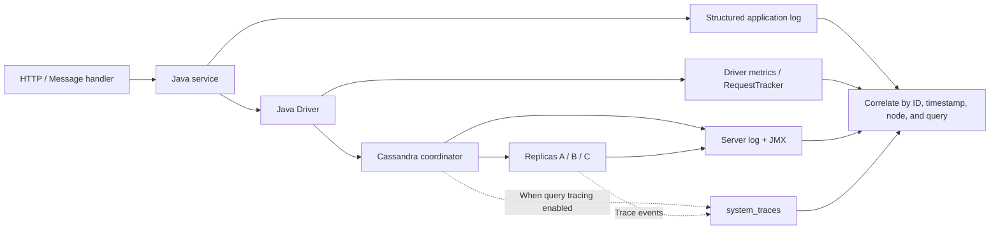
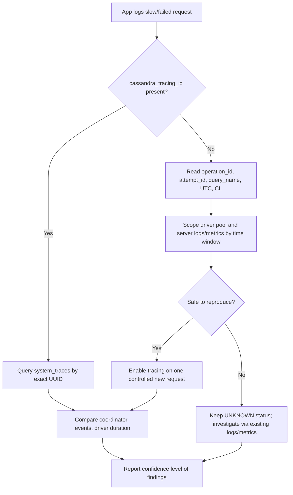

# Structured Logs, Request Identifiers, and Driver/Server Correlation

When a Java API returns `ReadTimeout` or `WriteTimeout`, an operator's first question is usually: **“Which request was slow, which coordinator did the driver pick, what did Cassandra actually do, and did the write succeed or not?”** A single `ERROR query timed out` line lacking an identifier, query class, consistency level, coordinator address, and duration cannot answer that. Conversely, turning on full `DEBUG` logging or query tracing for every request adds heavy load and risks exposing sensitive data.

This lesson belongs to the **Cluster Observability** chapter of **DATABASE_ENGINE_WIDE_COLUMN_CASSANDRA**. We build an end-to-end evidence chain across **HTTP/worker → Java application → Cassandra Java Driver → coordinator → replicas** using structured logs, request identifiers, metrics, and selective tracing—directly tied to wide-column modeling, partition keys, consistency, replication, tombstones, compaction, repair, and cluster operations.

> **Principle:** There is no built-in “Cassandra request ID” automatically flowing through every application, driver, and server log. The application must assign its own business operation ID; Cassandra's tracing ID is a **separate** mechanism present only when query tracing is enabled and the ID is returned/recorded.

## 1. Learning objectives

After this lesson, you will be able to:

1. Distinguish **structured logs**, **metrics**, **distributed traces**, **Cassandra query tracing**, and **server logs**.
2. Design `operation_id`, `attempt_id`, `trace_id`, `cassandra_tracing_id`, and `query_name` with crisp semantics.
3. Log Java Driver 4.x calls using `ExecutionInfo`, `getCoordinator()`, `getWarnings()`, and `getTracingId()` without leaking raw CQL or bind values.
4. Enable tracing for **one selected query**, query `system_traces.sessions`/`events`, and recognize delayed trace persistence.
5. Correlate end-to-end, driver, and coordinator/replica latencies with thread-pool, compaction, disk, GC, and network signals.
6. Investigate timeouts/unknown outcomes without falsely assuming Cassandra never executed the request.
7. Build dashboards and incident workflows that control cardinality, overhead, security, and log retention.

## 2. Four observability layers: no single tool suffices

| Layer | Questions it answers well | Limitations to remember |
| --- | --- | --- |
| **Application structured log** | Which API, business operation, attempt, query class, and status/latency? | Does not know what each replica did; if the call dies before response, coordinator may be unknown. |
| **Java Driver telemetry** | Which coordinator was chosen, speculative executions, warnings, pool/network errors, client timing? | Sees only requests/responses observed by the driver; timeouts can leave unknown outcomes. |
| **Cassandra query tracing** | Exact coordinator/replica steps for **one traced query**? | Must be enabled per request, adds overhead, persists asynchronously with a TTL; failed calls may yield no readable trace ID. |
| **Server logs + metrics** | Which node is down/GCing/full disk/streaming/compacting, and is the issue cluster-wide? | `system.log` normally lacks business operation IDs; metrics are aggregates, not single-request records. |

Strong diagnosis combines **logs to locate the request**, **metrics to scope impact**, and **query tracing to inspect a few representative requests**. Never blanket-enable tracing before knowing which query needs investigation.



The dashed arrows to `system_traces` apply only when tracing is enabled and events finish writing; this diagram does not imply every request is recorded there.

## 3. Identifiers: sharing the word “trace” does not mean sharing the purpose

| Field | Who issues it, and lifetime? | What is it used for? |
| --- | --- | --- |
| `operation_id` | Issued by app for **one logical business action**; preserved across retries and message redeliveries. | Answers: how many times was the same logical action retried, and what was the final outcome? |
| `request_id` / `http_request_id` | Issued by HTTP gateway/framework or app for a specific **HTTP hop**. | Links gateway, controller, and service; one logical operation may span multiple HTTP requests. |
| `attempt_id` | Issued by app for **each deliberate driver invocation**. | Distinguishes attempt #1 timing out from attempt #2 succeeding. |
| `trace_id` / `span_id` | Issued by distributed tracing (e.g., OpenTelemetry) for workflow/spans. | Connects service-to-service hops. **Not automatically a Cassandra tracing ID.** |
| `cassandra_tracing_id` | Issued by Cassandra when **query tracing is enabled**; retrieved from driver response. | Lookup key for `system_traces.sessions`/`events` of one traced execution. |
| `query_name` | App-defined **stable label** such as `events_by_day.select_latest`. | Safe metric/log grouping instead of raw CQL. |
| `coordinator` | Node the driver received the response from (when known). | Scopes node log/metric searches and verifies local-DC routing. |
| **Protocol stream ID** | Used by driver/protocol **within one TCP socket** to match in-flight frames. | Not globally unique; never use as an operation ID. |
| **Prepared statement ID** | Identifies a prepared query on server/driver. | Identifies a statement template; **not unique per execution**. |

### One logical operation can emit multiple requests

```text
operation_id = op-784c                         (one business action)
  HTTP request = http-101
    driver invocation attempt_id = att-01
      coordinator = node-A
      outcome = timeout (no tracing ID returned)
    driver invocation attempt_id = att-02
      coordinator = node-B
      outcome = success
      cassandra_tracing_id = <UUID if tracing was enabled>

In addition, the driver may retry or speculatively execute internally;
do not equate 1 invocation = exactly 1 packet to 1 node.
```

**Preserving `operation_id` across retries** is foundational for debugging and idempotency. Generating a new `operation_id` per retry makes logs look like unrelated transactions and masks duplicate-write bugs. Still, a shared log ID **does not by itself make an operation idempotent**: storage design and business logic must enforce idempotency.

### Naming rules

- Use `operation_id` for the **logical action** and `attempt_id` for each **app-initiated driver call**. Internal driver retries/speculative executions may exceed visible `attempt_id` counts.
- Name `cassandra_tracing_id` explicitly rather than overloading `trace_id`. OpenTelemetry/HTTP `trace_id` exists even when Cassandra tracing is off.
- Never expect Cassandra servers to read your `operation_id` UUID and print it in `system.log`. Link the two sides by **logging the mapping** `operation_id ↔ cassandra_tracing_id` whenever the driver returns a tracing ID.
- If an application attaches custom native-protocol payloads, **never assume** Cassandra automatically writes them into logs/traces; that depends on custom server plugins/configs.

## 4. Designing a structured JSON log schema

Logs should be **machine-parseable, consistently named, and free of leaked data**. Use a JSON serializer via Logback/SLF4J or your logging stack; the schema below is an **application-layer proposal**, not Cassandra's built-in server log format.

| Field | Type | Purpose |
| --- | --- | --- |
| `timestamp` | ISO-8601 UTC | When the **log event was emitted**; never use instead of monotonic elapsed time. |
| `severity` / `event` | Enum/string | `INFO`, `WARN`; `cql.request.succeeded`, `cql.request.failed`… |
| `service`, `environment`, `version` | Bounded string | Identifies which deployment emitted the log. |
| `operation_id`, `http_request_id`, `attempt_id` | ID | Correlates request layers. |
| `query_name`, `table` | Stable enum/string | Groups queries by workload and table without raw bind values. |
| `consistency`, `serial_consistency` | Enum/nullable | Distinguishes `LOCAL_QUORUM`, `ONE`, and LWTs. |
| `local_dc`, `coordinator` | String/nullable | Client region and actual coordinator when known. |
| `elapsed_ms` | Number | Measured via monotonic clock in the app across the app-observed scope. |
| `outcome`, `error_class` | Enum/string | `SUCCESS`, `FAILED`, `UNKNOWN`, and exception category. |
| `warning_count` | Integer | Signals server warnings without necessarily logging raw text. |
| `speculative_executions` | Integer | Speculative executions reported by driver for successful call, where supported. |
| `cassandra_tracing_id` | UUID/nullable | Present only when server tracing was enabled and returned. |
| `partition_key_hash` or `bucket_class` | String/nullable | Groups hot partitions per security policy without putting raw PII in logs. |

### Example success log

```json
{
  "timestamp": "2026-11-21T09:30:12.481Z",
  "severity": "INFO",
  "service": "event-query-api",
  "environment": "lab",
  "event": "cql.request.succeeded",
  "operation_id": "op-784c",
  "http_request_id": "http-101",
  "attempt_id": "att-02",
  "trace_id": "otel-3a2f",
  "query_name": "events_by_tenant_day.select_latest",
  "table": "observability_lab.events_by_tenant_day",
  "consistency": "LOCAL_QUORUM",
  "local_dc": "dc1",
  "coordinator": "node-b:9042",
  "elapsed_ms": 18.3,
  "outcome": "SUCCESS",
  "warning_count": 0,
  "speculative_executions": 0,
  "cassandra_tracing_id": null
}
```

This is **illustrative sample data**, not live output from a real cluster. `trace_id` is an example ID from an external tracing system, and `cassandra_tracing_id=null` because routine queries do not enable Cassandra tracing. In real services, OpenTelemetry trace IDs follow standard formatting issued by the tracing SDK rather than invented in logs.

### Example timeout log

```json
{
  "timestamp": "2026-11-21T09:30:13.010Z",
  "severity": "WARN",
  "service": "event-query-api",
  "event": "cql.request.failed",
  "operation_id": "op-784c",
  "attempt_id": "att-01",
  "query_name": "events_by_tenant_day.select_latest",
  "consistency": "LOCAL_QUORUM",
  "local_dc": "dc1",
  "coordinator": null,
  "elapsed_ms": 500.8,
  "error_class": "DriverTimeoutException",
  "outcome": "UNKNOWN",
  "cassandra_tracing_id": null
}
```

Logging `coordinator=null` means **the app could not identify the coordinator from captured metadata**, not that Cassandra never received the request. `outcome=UNKNOWN` is the cautious classification for an in-flight write whose final state the client never learned; for reads, the attempt yielded no result, though it may still have consumed server resources.

## 5. Measuring time: which clocks are we comparing?

**Never let one latency figure stand in for all layers.**

```text
T_http = ingress + auth + business logic + T_driver_invocation + response serialization

T_driver_invocation =
  client queue/throttling + connection/pool + network RTT
  + coordinator handling + replica responses + retries/speculation
  + response decoding

T_server_trace =
  duration recorded by Cassandra for one specific traced query;
  excludes full client-side steps and does not necessarily equal
  wall time from session.execute entry to return.
```

In Java, compute durations using `System.nanoTime()` deltas converted to milliseconds; use UTC timestamps only to **locate log time windows**. Never subtract `Instant.now()` across two different hosts to compute network latency and blame clock skew on the database.

In multi-DC clusters, `LOCAL_QUORUM` waits only for local replicas per CL, yet the coordinator still replicates mutations asynchronously to remote DCs. **App-to-response time** does not measure remote-DC convergence. When comparing server logs across nodes, monitor NTP/clock offsets and keep search windows wide enough for skew.

### Metric trio to inspect side by side

1. **Application p50/p95/p99** by `query_name`, DC, and outcome, with clear end-to-end vs. driver-call boundaries.
2. **Driver session/node metrics**: `cql-requests`, connections, in-flight, errors/timeouts per driver and monitoring config.
3. **Server metrics**: read/write latency, pending tasks, dropped messages, compaction, tombstone scans, GC pauses, disk I/O, network, and replica state.

If the application sees p99 = 2 seconds while a single traced query reports 30 ms on the server, check **pools/queues, throttling, network, retries, app GC, serialization**, and whether the traced request represents the slow cohort. Never claim Cassandra “took 2 seconds” solely from total HTTP latency.

## 6. Java Driver 4.x: logging outcomes with coordinator and tracing ID

Example using Java Driver 4.x with `CqlSession session` already configured for contact points/local DC and a `PreparedStatement` prepared at startup. The code uses **SLF4J MDC** to attach `operation_id` and `attempt_id` to JSON logs, assuming logging config prints MDC fields. In async/reactive frameworks, **thread-local MDC context must be propagated explicitly** across callbacks.

```java
import com.datastax.oss.driver.api.core.ConsistencyLevel;
import com.datastax.oss.driver.api.core.cql.BoundStatement;
import com.datastax.oss.driver.api.core.cql.ExecutionInfo;
import com.datastax.oss.driver.api.core.cql.PreparedStatement;
import com.datastax.oss.driver.api.core.cql.ResultSet;
import java.time.LocalDate;
import java.util.UUID;
import org.slf4j.Logger;
import org.slf4j.LoggerFactory;
import org.slf4j.MDC;

public final class CassandraQueryProbe {
  private static final Logger LOG =
      LoggerFactory.getLogger(CassandraQueryProbe.class);

  public static ResultSet selectDay(
      com.datastax.oss.driver.api.core.CqlSession session,
      PreparedStatement selectByDay,
      String tenantId,
      LocalDate eventDay,
      UUID operationId,
      boolean sampleCassandraTracing) {

    UUID attemptId = UUID.randomUUID(); // One per app-level driver call.
    BoundStatement request = selectByDay.bind(tenantId, eventDay)
        .setConsistencyLevel(ConsistencyLevel.LOCAL_QUORUM)
        .setPageSize(100)
        .setIdempotent(true) // Valid only because this SELECT has no side effects.
        .setTracing(sampleCassandraTracing);

    long startNanos = System.nanoTime();
    MDC.put("operation_id", operationId.toString());
    MDC.put("attempt_id", attemptId.toString());

    try {
      ResultSet result = session.execute(request);
      ExecutionInfo info = result.getExecutionInfo();
      String coordinator = info.getCoordinator() == null
          ? "unknown"
          : info.getCoordinator().getEndPoint().toString();
      double elapsedMs = (System.nanoTime() - startNanos) / 1_000_000.0;

      LOG.info(
          "event=cql.request.succeeded query_name=events_by_day.read " +
          "elapsed_ms={} coordinator={} cassandra_tracing_id={} " +
          "warning_count={} speculative_executions={}",
          elapsedMs,
          coordinator,
          info.getTracingId(),
          info.getWarnings().size(),
          info.getSpeculativeExecutionCount());
      return result;

    } catch (RuntimeException error) {
      double elapsedMs = (System.nanoTime() - startNanos) / 1_000_000.0;
      LOG.warn(
          "event=cql.request.failed query_name=events_by_day.read " +
          "elapsed_ms={} error_class={}",
          elapsedMs, error.getClass().getSimpleName());
      throw error;

    } finally {
      MDC.remove("attempt_id");
      MDC.remove("operation_id");
    }
  }
}
```

**Limitations of this example:**

- On a **successful** call, `ExecutionInfo.getCoordinator()` reports the node that returned the decoded response—**not** all replicas, and not proof every replica received a write.
- When tracing is **disabled**, `getTracingId()` returns `null`. Even when enabled, if a request errors or loses its response, the app may not receive a tracing ID.
- `getWarnings()` exposes server warnings received; log the **count** first, storing redacted warning text in restricted channels only when needed because warnings can contain query details.
- `getSpeculativeExecutionCount()` reflects driver-initiated speculative attempts—**not** total retries/attempts from the application or gateway.
- `ResultSet.getExecutionInfo()` describes the execution of the returned page. With **paging**, iterating subsequent pages triggers extra requests; collect execution info per page if measuring the **entire multi-page read**.
- This method returns `ResultSet` before the caller iterates remaining pages, so `elapsedMs` covers only the initial `execute()` call—never call it the full latency for reading millions of rows.
- `MDC.remove()` assumes this method owns those keys; if an outer context sets the same keys, **save and restore prior values** instead of wiping them.

Production code should define **fixed `query_name` constants**, never concatenating raw parameters. `tenantId` may be customer data—never log it raw; if hot-partition grouping is needed, use a policy-compliant managed hash or bounded bucket class. Never log access tokens, PII queries, full bind values, or unsanitized exception payloads.

## 7. Selective tracing: retrieving a Cassandra tracing ID from Java

In Java Driver 4.x, enable query tracing per statement with `setTracing(true)`. After execution succeeds:

```java
BoundStatement traced = selectByDay.bind("tenant-lab",
        LocalDate.of(2026, 11, 21))
    .setConsistencyLevel(ConsistencyLevel.LOCAL_QUORUM)
    .setTracing(true);

ResultSet rows = session.execute(traced);
ExecutionInfo executionInfo = rows.getExecutionInfo();
UUID cassandraTracingId = executionInfo.getTracingId();

if (cassandraTracingId != null) {
    // Log this UUID alongside operation_id/attempt_id in app logs.
    // Only in diagnostic tooling when needed, call:
    // executionInfo.getQueryTraceAsync()
    // to fetch trace details from Cassandra system_traces.
}
```

The driver provides `getQueryTrace()` and `getQueryTraceAsync()`. Fetching trace details issues **background queries against `system_traces`**. Because Cassandra persists trace rows **asynchronously**, querying immediately after receiving the ID may still find incomplete `sessions/events`. The driver supports configurable retries—no need to write unbounded `while (true)` polling loops.

**Operational rules:**

- Enable tracing on only a **tiny fraction of requests** (e.g., targeted debugging or a controlled sampling rate). Tracing adds server write/storage load plus read load when fetched; never run at 100% in production.
- Every traced query emits multiple events; **wide queries**, paging, and high QPS multiply monitoring overhead.
- Log **trace IDs and non-sensitive metadata** in routine logs; inspect detailed trace tables under restricted access during investigations.
- Never call blocking `getQueryTrace()` on I/O threads, `RequestTracker` callbacks, or critical event loops—use `getQueryTraceAsync()` with bounded concurrency.
- A trace ID does not prove Cassandra finished updating every replica or that a business write cannot later be overwritten.

## 8. CQL lab: `TRACING ON` and the two `system_traces` tables

This lab targets a cluster with datacenter `dc1` and **at least three nodes** if using RF=3. On a single-node lab, adjust RF/consistency **for the lab only**, never production. Ensure your role has permission to query the trace tables.

### Step 1 — Create a partition-key table

```sql
CREATE KEYSPACE IF NOT EXISTS observability_lab
WITH replication = {
  'class': 'NetworkTopologyStrategy',
  'dc1': 3
}
AND durable_writes = true;

CREATE TABLE IF NOT EXISTS observability_lab.events_by_tenant_day (
  tenant_id text,
  event_day date,
  event_id uuid,
  payload text,
  PRIMARY KEY ((tenant_id, event_day), event_id)
);

INSERT INTO observability_lab.events_by_tenant_day
  (tenant_id, event_day, event_id, payload)
VALUES ('tenant-lab', '2026-11-21',
        11111111-1111-4111-8111-111111111111,
        'lab-only');
```

The partition key is `(tenant_id, event_day)`, so the `SELECT` below hits the partition directly instead of scanning the table. A fixed UUID enables deterministic verification across retries; avoid `now()` if testing idempotent replay of the same logical event.

### Step 2 — Trace a single query

In `cqlsh`:

```sql
CONSISTENCY LOCAL_QUORUM;
TRACING ON;

SELECT event_id, payload
FROM observability_lab.events_by_tenant_day
WHERE tenant_id = 'tenant-lab'
  AND event_day = '2026-11-21';

TRACING OFF;
```

`TRACING ON` applies to **queries in that `cqlsh` session** until turned off; it does not enable tracing for Java applications on the cluster. After the `SELECT`, `cqlsh` prints a **tracing session ID** and recorded events/latencies in version-dependent formatting.

### Step 3 — Look up the session ID

Replace `aaaaaaaa-bbbb-4ccc-8ddd-eeeeeeeeeeee` with the **observed** tracing UUID:

```sql
SELECT *
FROM system_traces.sessions
WHERE session_id = aaaaaaaa-bbbb-4ccc-8ddd-eeeeeeeeeeee;

SELECT activity, source, source_elapsed, thread
FROM system_traces.events
WHERE session_id = aaaaaaaa-bbbb-4ccc-8ddd-eeeeeeeeeeee;
```

Output normally includes start time, coordinator/request type, total duration, per-node events, and `source_elapsed` in **microseconds**. Exact columns vary by version; inspect `DESCRIBE TABLE system_traces.events` in the lab if permitted.

**If `system_traces` initially shows no events right after the query:** suspect **async trace write delay, short TTL, replication, or permissions**—not that Cassandra skipped executing the `SELECT`. Trace rows are short-lived and expire via TTL; never rely on `system_traces` as a long-term audit store. Export evidence separately under retention and security policies if needed long term.

### Step 4 — Correlate with a Java run

Execute the same `query_name` from Java with `setTracing(true)`, recording `operation_id`, `attempt_id`, `getCoordinator()`, and `getTracingId()`. Query `system_traces` using the **UUID returned to Java**—that is the exact link between **one** traced driver invocation and server trace events.

Never use a `cqlsh` tracing ID and claim it traced the Java request: those are **two separate executions**, even with identical CQL and partition keys.

## 9. Step-by-step driver/server correlation

When investigating a “`SELECT` timed out” ticket, build the **evidence chain** in order:

1. **Locate `operation_id` from ingress:** identify endpoint, UTC window, service deploy, `query_name`, `attempt_id`, consistency, deadline, and error class.
2. **Determine attempt state:** success/failed/unknown; whether `getCoordinator()` is known; server warnings or speculative executions.
3. **Expand to node and DC:** per-node driver metrics, connection pools, in-flight counts, app CPU/GC, and service-to-coordinator network.
4. **Inspect server state in the same window:** `system.log`, `debug.log` if enabled, GC logs, pending tasks, read/write latency, tombstone scans, dropped messages, and disk/compaction.
5. **If `cassandra_tracing_id` exists**, query exact `system_traces.sessions`/`events`. If absent, run a **controlled** reproducible query with tracing on the new request—and **never attach the new trace to the old failed request**.
6. **Check replica behavior:** RF, token ownership, CL, node health, hints/repair, tombstones/compaction. The coordinator may differ from the replicas actually serving data.
7. **Classify root cause** and define verification criteria: driver pool/throttling, network, unavailable replica, server overload, slow partition, GC, excessive tombstones, compaction, or contention.
8. **Verify post-fix:** p95/p99, timeout rate, warnings, server resources, and retry counts before/after under **comparable workload**.

### Symptom matrix

| App/driver symptom | What to check in Cassandra | Conclusion NOT to jump to |
| --- | --- | --- |
| Driver timeout, coordinator unknown | Client pool, throttler, DNS/network, driver node metrics, whether server logged/saw traffic | “Server definitely never saw the request.” |
| `ReadTimeout` | CL, responding replica count, read latency, pending tasks, tombstones scanned, GC/disk, network | “Partition is corrupted” or “wrong data returned.” |
| `WriteTimeout` | CL, commit log/disk I/O, replica health, possibility mutation landed, hints | “Write definitely failed”; retry with new event ID. |
| `Unavailable` | Replication/DC, node UP/DOWN, partition's replica set, topology | “Raising deadline will fix it” when replicas are down. |
| Server tombstone warning | Query range, partition size, TTL/`DELETE`, SSTable count, compaction, tombstone scans | “Raising threshold makes the query lighter.” |
| Many speculative executions | Tail latency, read path, driver config, query mix, extra node load | “Every speculative attempt is a distinct user request.” |
| Fast DB reads yet slow API | App queueing, network RTT, paging, serialization, business logic, retries | “Cassandra accounts for all HTTP latency.” |
| Errors isolated to DC2 | Driver local-DC routing, WAN, RF/CL, DC2 coordinator/replica health | “The entire cluster is equally slow.” |

## 10. No tracing ID: how to investigate?

This is **completely normal** because tracing is off by default and failures often happen before a response arrives.



**Never** grep `system.log` for an `operation_id` UUID and conclude “server never received the request” when nothing turns up—Cassandra does not know that ID by default. Nor assume every CQL query creates rows in `system_traces`: only traced requests appear there, subject to TTL.

### Time-window correlation is indirect, not an exact ID join

Without a server trace ID, align `UTC timestamp ± clock skew/processing delay`, `coordinator` (if known), `query_name`, node warnings, read/write metrics, and incident timelines. That is **indirect correlation**, not proof a single server log line came from one specific HTTP call among thousands of similar queries.

To improve future triage, add **controlled sampled tracing** where permitted and log the ID link in the application—never hack server log formatters expecting an ID the protocol does not transmit.

## 11. Server logs: `system.log`, `debug.log`, `gc.log`, and audit/FQL

Cassandra commonly emits:

- **`system.log`:** primary starting point for exceptions, disk errors, gossip/topology shifts, slow operations, and operational notices.
- **`debug.log`:** extra detail if enabled; many deployments keep it disabled or short-lived.
- **`gc.log`** or JVM GC logs: diagnoses stop-the-world pauses, heap pressure, and latency impact.
- **Audit log / Full Query Log (FQL)** (when enabled per version): serves auditing or specialized diagnostics—**distinct from** application structured logs or per-request tracing, with higher overhead and sensitive-data risk.

Default log paths vary by packaging/distribution, usually in Cassandra's log directory or configured service directory; containerized setups often emit to stdout/agents. Formatting can be tuned via **Logback**, but **never assume Cassandra emits the same JSON schema as your Java app out of the box**.

### Node-side diagnostic commands (read-only)

```bash
nodetool status
nodetool info
nodetool tpstats
nodetool tablestats observability_lab.events_by_tenant_day
nodetool tablehistograms observability_lab events_by_tenant_day
nodetool compactionstats
nodetool netstats
```

In authorized environments, align node ↔ logs ↔ metrics by **exact timestamp and DC**. `nodetool status` reports Up/Normal vs. Down, not whether an individual request succeeded. `compactionstats` and `netstats` are live snapshots; work that finished before you ran them will not appear afterward.

### Structured server logs: where should they live?

If your organization requires JSON server logs, choose a version-supported pipeline (Logback encoder, log collector, or ingestion parser) ensuring:

1. Multi-line stacktraces and node/DC metadata stay intact.
2. `node_id`/host/DC, UTC timestamp, severity, logger name, and normalized event type are present.
3. No assumption `operation_id` appears automatically; use `cassandra_tracing_id` or indirect correlation when no protocol link exists.
4. Backpressure, retention, and rotation prevent logging from filling disks or stalling I/O.
5. Tested on real Cassandra builds before cluster-wide rollout.

## 12. Driver `RequestTracker` and metrics: keep detail logs separate from aggregates

Java Driver 4.x provides **`RequestTracker`** for driver-level callbacks on request success, error, and per-node attempts, plus an optional **request logger** and **session/node metrics**. Never replace metrics with `INFO` logging for every query—log volume will overwhelm the service.

### Sample driver metrics configuration

Illustrative HOCON config (verify metric names in Java Driver 4.x docs; requires a configured metrics backend):

```hocon
datastax-java-driver.advanced.metrics {
  session.enabled = [connected-nodes, cql-requests]
  node.enabled = [pool.open-connections, pool.in-flight]
}
```

Depending on driver version and metrics factory, attach Dropwizard or Micrometer to export latency histograms and pool gauges. **Driver metrics may be disabled by default**; verify collection is active before relying on dashboards. Use bounded labels such as `service`, `dc`, `query_name`, `outcome`, and `node`. **Never put `operation_id`, `attempt_id`, `tenant_id`, or `cassandra_tracing_id` into Prometheus labels** due to unbounded cardinality.

### Preventing logging from becoming the bottleneck

- `RequestTracker` runs on the **hot path**, potentially on **driver I/O threads**; callbacks must be **fast, non-blocking, and never issue queries to fetch traces inline**.
- Use **bounded** async queues/events, sampling, or aggregated counters so logging cannot trigger OOM when the cluster slows down.
- Never turn on verbose driver request logging and Cassandra server `DEBUG` for every request merely because one ID is missing.
- Count retries/speculative executions using driver APIs where available; never miscount each attempt as an independent business operation.
- When measuring observability changes, monitor **instrumentation overhead itself** to ensure monitoring does not materially distort the system.

## 13. Paging, retries, and LWTs: cases where logs are easily misread

### Paging — one logical `SELECT` can issue multiple requests

A multi-page `SELECT` triggers follow-up protocol fetches as the client iterates. `LIMIT 100`, `pageSize=100`, and returned row count are three different things:

- **Page size** caps rows per page, not tombstones scanned on the server.
- Logging **first page succeeded** does not mean the whole result finished; page 2 may still time out.
- One `operation_id` should aggregate metrics across the entire iteration, while page indexes/`attempt_id`s distinguish individual fetches when deep debugging.
- Tracing may generate separate trace IDs for subsequent page fetches; never attach page 1's tracing ID to later pages.

### Retries and speculative execution

Internal driver retries can try another node after eligible errors; speculative execution can launch another attempt on idempotent queries when the first stalls. **One logical operation → multiple coordinators** is normal. Logging only the “final coordinator” hides earlier attempts; use driver `RequestTracker`/metrics or attempt lists without exposing sensitive payloads.

### LWTs and counters

- LWT `IF ...` queries use **serial consistency** (`SERIAL` or `LOCAL_SERIAL`) plus regular commit consistency; log both to explain latency and behavior.
- `[applied]=false` is a **completed conditional outcome**, not a network error or timeout. Grouping it into “DB failed” corrupts dashboards.
- Counter increments and external side effects may be **non-idempotent**. Blindly retrying timeouts can double-apply effects; keep `operation_id` alongside explicit deduplication/reconciliation.
- A write timeout can leave an **unknown outcome**; reading back to reconcile must still account for CL, replica lag, and timestamps.

## 14. Sample incident walkthrough: write timeout while one replica is down

Suppose an order service updates state at `LOCAL_QUORUM` in an RF=3 `dc1` keyspace. During an incident, one node goes `DOWN` and a write hits a timeout.

| Timestamp | Evidence | Cautious interpretation |
| --- | --- | --- |
| **09:15:00.100** | `operation_id=order-op-88`, `attempt_id=a1`, query `orders_by_id.upsert_state` | One logical mutation dispatched; stable ID links attempts. |
| **09:15:00.600** | Java `WriteTimeout`, `LOCAL_QUORUM`, elapsed 500 ms | Timeout alone cannot tell how many replicas applied the mutation. |
| **09:15:00.630** | Driver/node metrics show pool/coordinator pressure | Verify on server; do not assume commit log corruption immediately. |
| **09:15:00.700** | `nodetool status` shows a node `DOWN`; `system.log` shows network/timeouts in same window | Explains part of quorum risk; verify whether down node owns this partition. |
| **09:15:01.000** | Retry uses same `operation_id`, primary key, and payload/idempotency semantics | Prevents duplicate events; still verify true idempotency guarantees. |
| **09:15:01.020** | Retry succeeds; coordinator and sampled tracing ID recorded | Applies only to retry attempt `a2`; never attach this trace ID to timed-out `a1`. |
| **Post-recovery** | Check hints/repair, read at matching CL, inspect p99 | Confirms replicas converged and business state is sound, beyond `UN` status alone. |

**Never run destructive tests in production** to reproduce errors. In a lab, simulate with isolated test nodes/fault injection or approved tools, separating network, quorum, and driver deadline faults. Never bump socket timeouts, lower CL, or turn on 100% tracing just to make one request look “successful”.

### Investigation sign-off ticket template

```text
INCIDENT: INC-lab-17
BUSINESS_OPERATION: order-op-88
QUERY_NAME: orders_by_id.upsert_state
KEYSPACE/TABLE: orders.orders_by_id
CONSISTENCY: LOCAL_QUORUM (dc1, RF=3)
ATTEMPTS: a1 timeout/unknown; a2 success
COORDINATOR: known for a2; unknown for a1
CASSANDRA_TRACING_ID: present for a2 only
SERVER_EVIDENCE: system.log + node metrics within bounded time window
ROOT_CAUSE: [fill with evidence, never guess from one exception]
DATA_OUTCOME: [reconciled key and version at appropriate CL]
REMEDIATION: [repair/runbook/query fix/driver routing...]
FOLLOW_UP: [p99, timeouts, retries, server health, business invariant]
```

## 15. Data safety, access control, and log storage cost

Good observability does not mean logging everything:

| Data | Risk | Handling |
| --- | --- | --- |
| **Bind values / raw CQL with customer data** | Leaks PII/secrets into logs and log backups. | Log stable `query_name`, strip parameters or redact strictly. |
| **Partition key / tenant ID** | Exposes identity and creates high metric cardinality. | Use managed salted hashes or bounded bucket classes per policy. |
| **Tracing events** | Can reveal internal execution and parameters; storage-heavy. | Enable selectively, enforce RBAC, explicit TTL/retention, and separate store if needed. |
| **Full query / audit logs** | High write overhead and sensitive query exposure. | Enable only for compliance/legal needs with strict access control and retention. |
| **Exception messages** | Libraries may embed query text, addresses, or sensitive details. | Log error class/code first; sanitize/redact messages and limit verbose stacktraces. |
| **High-cardinality IDs in metrics** | Time-series explosion, RAM/cost spike, sluggish dashboards. | Keep IDs in **logs/spans**; keep metric labels low-cardinality. |

Set distinct **retention** policies for application logs, driver telemetry, server logs, and detailed traces. Never rely on `system_traces` TTL as a business audit archive. Standardize UTC timestamps and preserve `service_version`, `driver_version`, and `cassandra_version` in metadata to reproduce post-deploy regressions.

## 16. Hands-on exercises

### Exercise A — Designing an ID scheme

An order update arrives via HTTP request `http-1`; the app times out, so the HTTP client retries via `http-2`; inside each call, the Java Driver may retry internally. Design a table of `operation_id`, `http_request_id`, `attempt_id`, `trace_id`, and `cassandra_tracing_id`, and explain:

1. Which ID stays constant across the HTTP retry?
2. Which ID changes per `session.execute()` invocation?
3. Which ID appears only when Cassandra query tracing is enabled and a response returns?
4. Why not use the native-protocol stream ID as a cluster-wide identifier?

### Exercise B — Correlating a timeout without a trace ID

Given a `cql.request.failed` log containing `operation_id`, `query_name`, `consistency`, `elapsed_ms`, and `error_class`, **without `coordinator` or `cassandra_tracing_id`**, write a workflow using time windows, driver metrics, node health, `system.log`, and tracing on a **reproduced request**. State at least three conclusions you lack evidence to assert.

### Exercise C — Java logging + security

Write a wrapper around a multi-page `PreparedStatement` logging `operation_id`, page index, `query_name`, elapsed time, warnings, and coordinator. Explain why raw `tenantId` must not be logged and why `ResultSet.getExecutionInfo()` on page 1 does not reflect every request across the whole loop.

### Exercise D — Server-side trace correlation

In a lab:

1. Create `observability_lab.events_by_tenant_day` and insert one event.
2. Run `TRACING ON` for a partition-key `SELECT`, then `TRACING OFF`.
3. Record the tracing session UUID from `cqlsh`.
4. Query `system_traces.sessions` and `system_traces.events` using that exact UUID.
5. Compare server trace duration with `System.nanoTime()` from an equivalent Java `SELECT`, and explain why **two separate requests** cannot be compared 1:1 as a single measurement.

### Exercise E — Reading dashboards

A dashboard shows `app read p99 = 1500ms`, `server read p99 = 20ms`, rising driver `pool.in-flight`, and many timeouts. Propose at least four hypotheses and the metrics/logs to distinguish them: client queues, pool saturation, network, retries/speculation, app GC, query mix, or missing server samples. Never conclude “Cassandra ran in 20 ms so the app makes no sense” when measurement boundaries differ.

### Exercise F — Reviewing a flawed logging design

A team puts `operation_id` and `tenant_id` into Prometheus labels, enables `TRACING ON` on every `SELECT`, logs all bind values, and searches `system.log` for `operation_id`. Point out four flaws—**cardinality, overhead, sensitive data, and false correlation assumptions**—and redesign using structured logs + sampling + driver metrics + `cassandra_tracing_id`.

### Completion criteria

You succeed when you can demonstrate a request flow with:

1. **Semantic identifiers:** `operation_id`, HTTP request, app attempt, and `cassandra_tracing_id` cleanly separated.
2. **Application and driver evidence:** `query_name`, CL, DC, elapsed time, and coordinator/warnings when known.
3. **Server evidence:** per-node logs/metrics and `system_traces` where tracing was enabled.
4. **Epistemic discipline:** distinguishing success, failure, and unknown outcomes; never attributing a new trace ID to an old failed call.
5. **Operational guardrails:** zero leaked raw PII, never 100% tracing, and zero high-cardinality IDs in metric labels.

## 17. Self-check questions

1. Why are `operation_id` and `cassandra_tracing_id` not interchangeable?
2. Does a `WriteTimeout` prove zero replicas wrote the mutation? Why or why not?
3. When does `getTracingId()` return `null`, and why is that not a Java Driver bug?
4. Why does `TRACING ON` in a `cqlsh` session not enable tracing for the entire Java application?
5. Querying `system_traces.events` immediately after a response returns zero rows: give at least three plausible reasons.
6. Why does `getCoordinator()` not represent all replicas of a partition?
7. Why can driver `cql-requests`, Cassandra `read latency`, and HTTP latency differ sharply?
8. How many native-protocol requests can a paged `SELECT` generate, and why is logging page 1 success insufficient?
9. Why keep `operation_id` and `tenant_id` out of time-series metric labels?
10. When no server tracing ID exists, what evidence narrows the problem without claiming an exact per-request join?
11. Why must a `RequestTracker` never execute follow-up queries or blocking logging on I/O threads?
12. How do you investigate tombstone warnings without raising thresholds or turning on unbounded `DEBUG` logging?

## 18. References

- [Apache Cassandra — Reading server logs](https://cassandra.apache.org/doc/latest/cassandra/troubleshooting/reading_logs.html): `system.log`, `debug.log`, `gc.log`, and investigation starting points.
- [Apache Cassandra — cqlsh](https://cassandra.apache.org/doc/latest/cassandra/managing/tools/cqlsh.html): `TRACING ON`/`OFF` and lab commands.
- [Apache Cassandra Java Driver 4.x — Query tracing](https://apache.github.io/cassandra-java-driver/4.18.1/core/tracing/): per-statement tracing, tracing IDs, and querying traces.
- [Apache Cassandra Java Driver 4.x — ExecutionInfo API](https://apache.github.io/cassandra-java-driver/4.18.1/api/com/datastax/oss/driver/api/core/cql/ExecutionInfo.html): coordinator, tracing ID, warnings, and speculative executions.
- [Apache Cassandra Java Driver 4.x — Request Tracker](https://apache.github.io/cassandra-java-driver/4.19.0/core/request_tracker/): callbacks, request logger, and configuration.
- [Apache Cassandra Java Driver 4.x — Metrics](https://apache.github.io/cassandra-java-driver/4.19.0/core/metrics/): session/node metrics, backends, and cost.
- [Apache Cassandra Java Driver 4.x — Performance](https://apache.github.io/cassandra-java-driver/4.19.0/core/performance/): tracing limits, hot-path trackers, and instrumentation overhead.
- [Apache Cassandra — nodetool](https://cassandra.apache.org/doc/latest/cassandra/managing/tools/nodetool/): node health, thread pools, tables, histograms, compaction, and streaming.

**Remember:** Structured logs answer **who ran what and which attempt failed**; Java Driver telemetry shows **when known, which coordinator handled the call and what warnings/latencies occurred**; Cassandra query tracing inspects **one specific traced execution**; and server logs/metrics reflect **node and cluster health**. Keep `operation_id`, `attempt_id`, and `cassandra_tracing_id` distinct, never equate timeouts with unapplied writes, never leak bind values, and assert driver/server correlation only when backed by evidence linking both sides.
