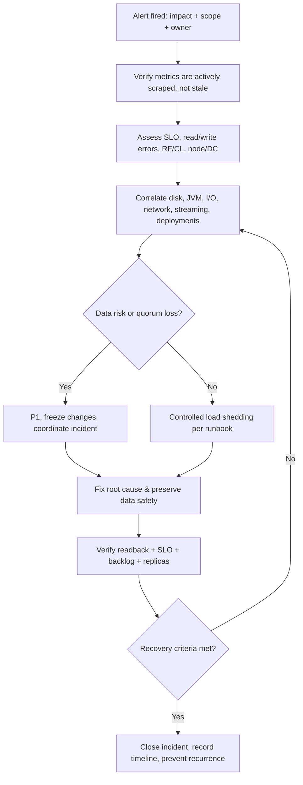

# Actionable Alerts and Corresponding Response Runbooks

> **Chapter:** Cluster Observability  
> **Module:** `DATABASE_ENGINE_WIDE_COLUMN_CASSANDRA` — Apache Cassandra

A multi-node Apache Cassandra cluster emits hundreds of metrics across requests, memtables, commit logs, SSTables, compaction, repair, hints, streaming, JVM, disk, and network. **Having metrics does not automatically mean having useful alerts.** An alert is only valuable when the responder knows **what is affecting users**, **which scope is impacted**, **what first step to take**, and **when to escalate**.

This lesson builds a catalog of *actionable alerts* and **corresponding runbooks** grounded in Cassandra's distributed wide-column model: partition keys govern replica placement, tables follow query patterns, `ONE`/`LOCAL_QUORUM`/`EACH_QUORUM` shape availability, while replication, compaction, repair, streaming, and Java applications jointly determine durability and recovery.

**Expected outcome:** you can design alerts prioritized around SLOs, link every alert to a runbook, investigate on the right node/DC/table, avoid data-destroying actions, and verify full recovery before closing an incident.

## 1. What makes an alert “actionable”?

Alerts like “high CPU”, “compaction pending > 0”, or “node has tombstones” may reflect true numbers yet rarely justify waking someone up at midnight.

A solid alert includes at least:

1. **Signal and condition:** metric, threshold, window, minimum traffic volume, and sustained vs. burst state.
2. **Target scope:** cluster, datacenter, rack, node, keyspace/table, read/write, consistency level, or application group.
3. **Impact:** SLO breach, impending quorum loss, disk exhaustion, or missed repair before deadline.
4. **Severity and owner:** who receives it, and whether it requires immediate paging or queued follow-up.
5. **Runbook and first action:** doc link, **read-only** verification commands, safe load mitigation, and escalation criteria.
6. **Resolution criteria:** how low errors must stay, for how long, and what evidence proves data/service recovery.

Comparison examples:

| Weak alert | More actionable alert |
| --- | --- |
| “Disk usage > 80%” | “Node A data volume projected < 24h before running out of space for SSTables/compaction; storage owner must verify growth rate, snapshots, and expand before deadline.” |
| “High p99 latency” | “Order-query read p99 in dc1 breached SLO for 10m alongside rising timeout rate; on-call checks CL, owning replicas, and resource contention per RB-01.” |
| “Repair failed” | “Table X token ranges in dc2 lack full repair coverage within `gc_grace_seconds`; zero retry margin left; escalate to DB on-call.” |
| “Node DN” | “DC has exactly two healthy replicas left for RF=3 with `LOCAL_QUORUM`; losing one more replica breaks availability for a slice of partitions—handle during shift.” |

**Symptom alerts** (SLOs, timeouts, unavailable) tell you whether users are hurting. **Causal/risk alerts** (projected disk exhaustion, node loss, overdue repair) let you intervene **before** an outage. You need both—without sending 20 separate pages for one filling disk.

### Severity tiers

| Tier | Suggested criteria | Response path |
| --- | --- | --- |
| **P1 / page immediately** | Widespread user outage, CL broken, imminent data-loss/recovery risk; requires immediate action | Page Cassandra on-call and incident commander; open incident bridge |
| **P2 / respond on shift** | Sustained SLO degradation, lost node cutting redundancy, disk or repair deadline within hours/days | Owner verifies evidence, sheds load, and schedules recovery |
| **P3 / ticket** | Long-term growth trend, tuning needing benchmarks, isolated alert without SLO impact | Ticket with owner and due date; never pages 24/7 |

This is only an **example framework**. Anchor thresholds to real SLOs, traffic, cluster scale, and RPO/RTO; no single p99 or disk percentage fits every cluster.

## 2. Where does observability data come from?

Cassandra exports metrics via **Dropwizard Metrics**, typically over **JMX**, virtual tables, or reporters/exporters. Apache Cassandra documents metrics as **per-node**; cluster/DC aggregation must be performed deliberately by your external monitoring stack.

| Layer | Example sources | Helps answer |
| --- | --- | --- |
| **Application / Java Driver** | Request latency, requests/s, timeouts, retries, error codes, coordinator host, local DC, CL | Which errors are users seeing, and on which queries? |
| **Cassandra Coordinator** | `ClientRequest`: `Latency`, `Timeouts`, `Failures`, `Unavailables`, read/write/CAS by type | Is the coordinator stalling, missing replicas, or failing requests? |
| **Table & SSTables** | `Table`: `ReadLatency`, `WriteLatency`, `PendingCompactions`, `PendingFlushes`, `TombstoneScannedHistogram`, `TombstoneWarnings`, `TombstoneFailures`, `LiveSSTableCount` | Which table/partition causes slow reads, heavy tombstones, or background I/O? |
| **Commit log / flush** | `CommitLog.TotalCommitLogSize`, `WaitingOnCommit`, `WaitingOnSegmentAllocation`; flush tasks | Is the log blocked on `fsync`, segments/disk, or lagging flushes? |
| **Compaction / repair / streaming** | `Compaction.PendingTasks`, `Streaming.IncomingBytes`/`OutgoingBytes`, repair history & range coverage | Is there a backlog, active stream, or missing repair coverage? |
| **Hints** | Hinted handoff/delivery metrics, hint files, error logs | Did a recovered node receive all hinted mutations? |
| **JVM & OS** | GC pauses, heap/off-heap, file descriptors, CPU, I/O `await`, free disk/inodes, NIC drops | Is the bottleneck in runtime, disk, or network? |
| **Topology & ownership** | `nodetool status`, `describecluster`, `ring`/`getendpoints` | Which node is down, and do enough replicas remain for RF/DC and CL? |

**Critical collector design details:**

- `Counter`s accumulate only since process startup; use **rate of increase** or restart-aware deltas, never comparing raw counters across nodes with different uptimes.
- `Gauge`s are point-in-time values; evaluate multi-sample trends, growth rates, and backlog duration.
- `Timer/Histogram` metrics have specific units and export formats. **Never sum or average per-node p99s** to infer cluster p99: use aggregatable histogram distributions or app-side SLIs.
- Documented JMX names do not always match Prometheus names after exporter rules; **verify live metric names and labels** before copying rules.
- Use bounded labels like `cluster`, `dc`, `node`, `keyspace`, `table`, and `operation`; never put unbounded `partition_key` or `event_id` values into labels, causing **high cardinality** and data leaks.
- Monitoring itself can fail. Treat **missing scrapes/telemetry** with its own alert, distinct from “metric = 0”.

### Initial read-only diagnostic commands

```bash
# Run on an authorized operational node, comparing across nodes/DCs.
nodetool version
nodetool status
nodetool describecluster
nodetool tpstats
nodetool compactionstats
nodetool netstats

# Substitute real keyspace/table names.
nodetool tablestats telemetry.sensor_events_by_day
nodetool proxyhistograms

# On Linux: use the cluster's actual data/commitlog paths.
df -h /var/lib/cassandra/data /var/lib/cassandra/commitlog
df -i /var/lib/cassandra/data /var/lib/cassandra/commitlog
iostat -xz 1 5
```

`proxyhistograms` gives coordinator-perspective latency histograms; `tablestats` drills into per-table stats; `tpstats` surfaces stage queues and dropped messages. On Windows or managed Cassandra services, substitute equivalent platform metrics where OS/JMX commands are restricted.

Never enable tracing across all production traffic just to “get enough data”. Use short, selective, approved tracing only when diagnosing specific queries.

## 3. Catalog of alerts and paired runbooks

Standardize alert IDs so dashboards, pagers, and tickets share **one name and one runbook**:

| Alert ID | Practical trigger signal | Initial tier | Runbook |
| --- | --- | --- | --- |
| **A01 — Request SLO burn** | Read/write timeouts, unavailable, or latency burning error budget with sufficient volume | P1/P2 by severity | **RB-01 — Client read/write degradation** |
| **A02 — Replica/quorum risk** | Down node/rack/DC leaves healthy replicas near or below required CL | P1 if quorum lost; P2 if zero redundancy remains | **RB-02 — Node down / quorum loss** |
| **A03 — Disk exhaustion forecast** | Data/commitlog volume low or projected full before expansion lead time | P1 if writes failing; P2 if draining | **RB-03 — Disk full / nearly full** |
| **A04 — Commitlog/flush pressure** | Commit log waits rising, flush backlog sustained, write latency rising | P1/P2 by impact | **RB-04 — Write path congested** |
| **A05 — Compaction backlog** | Pending compactions climb continuously; SSTable count and read latency degrade | P2; P1 if service broken | **RB-05 — Compaction / multi-SSTable reads** |
| **A06 — Tombstone scan failures** | `TombstoneWarnings`/`TombstoneFailures` rising on critical queries | P2; P1 if mandatory queries fail | **RB-06 — Tombstones / data model** |
| **A07 — Repair coverage overdue** | Range/table/DC repair incomplete before deadline relative to `gc_grace_seconds` | P1 if data nears grace expiry; otherwise P2 | **RB-07 — Overdue / failing repair** |
| **A08 — Hints backlog / delivery failures** | Hints piling up, delivery failures rising, or peer down past hint window | P2; escalate to P1 if quorum or data safety at risk | **RB-08 — Hinted handoff** |
| **A09 — Streaming stalled** | Bootstrap/rebuild/replace/repair streaming stuck, erroring, or stalled | P2/P1 by availability impact | **RB-09 — Streaming / topology** |
| **A10 — JVM/GC/FD pressure** | Long GC pauses, heap/FDs exhausted; correlated with timeouts and dropped messages | P2; P1 if cascading across nodes | **RB-10 — Runtime / resources** |
| **A11 — Network/DC isolation** | Packet loss, unreachable peers, internode timeouts, cross-DC congestion | P1/P2 depending on RF/CL | **RB-11 — Network / multi-DC** |
| **A12 — Schema/topology disagreement** | Schema mismatch, nodes stuck `Joining`/`Leaving` after change, wrong endpoints | P2/P1 if DDL/DML or queries fail | **RB-12 — Schema / ownership** |
| **A13 — Missing telemetry** | Target unscraped or exporter down past freshness threshold | P2/P3 by observability blind spot | **RB-13 — Lost observability** |

**Alert grouping principle:** A01 often reflects the downstream symptom. If A03 (full disk) drives A04, A05, and A01, configure Alertmanager grouping by `cluster + dc + node + incident` so on-call receives one coherent incident stream showing cause and effect rather than dozens of separate pages.

### Illustrative rule — not a drop-in Prometheus config

Below is a **logical specification**; `app_write_requests_total` and similar names are **hypothetical standardized aliases**, *not* official built-in Cassandra exporter names.

```yaml
alert: CassandraWriteErrorBudgetBurn
scope: cluster + dc + service
severity: page_if_multiburn
rule:
  numerator: "rate(app_write_errors_total[5m])"
  denominator: "rate(app_write_requests_total[5m])"
  condition: "error_ratio > service_error_budget_burn_threshold"
  persist: "10m, with minimum request volume"
  compare_to: "longer window such as 1h"
annotation:
  impact: "Writes failing in dc1 at LOCAL_QUORUM"
  runbook: "RB-01"
  first_step: "Compare app errors with ClientRequest Timeouts/Unavailables"
  owner: "database-oncall"
```

Every rule must explicitly define **which errors belong in the numerator**, whether retries count as requests, minimum traffic volume, and how missing telemetry is excluded. Multi-window multi-burn-rate policies catch both sharp outages and slow leaks, while thresholds must come from **real SLOs** rather than copying one fixed ratio across every service.

## 4. General workflow when paged

Follow the same “backbone” before jumping into any specific runbook:



**Step 1 — Verify ground truth.** Record timestamp, cluster/DC/node/table, Cassandra/exporter versions, last successful scrape, metric age, and recent deployments. If telemetry is missing, never conclude “timeouts = 0”.

**Step 2 — Assess impact.** Check app SLIs and `ClientRequest` Read/Write/CAS latency, timeouts, unavailable, and failures. Check RF/CL to confirm whether quorum holds; distinguish losing one node from losing a DC.

**Step 3 — Correlate causes.** In the exact same window, align free disk/I/O, commit log, flushes, compaction, GC, network, hints, streaming, repair, and hot partitions. High CPU alone proves nothing; timeouts can originate at coordinator, replica, network, or disk.

**Step 4 — Mitigate safely without risking data.** Throttle producers, pause deferrable batch/repair/rebuild jobs, cap concurrency safely, and follow node recovery procedures. Avoid running concurrent heavy I/O jobs or enabling infinite retries.

**Step 5 — Verify recovery.** Confirm both latency/error SLOs *and* replica/repair/hints/streaming state. One successful test query does not prove all replicas converged. Close only with evidence and assigned owners for remaining follow-ups.

## 5. RB-01 — Read/write timeouts, unavailable, or p99 breaching SLO

**Trigger:** A01 with sufficient volume, rising request errors, or latency breaching SLO by service/operation/DC.

**Verify:**

1. Split by Read, Write, CAS, and app call path; check **CL** and **local DC** in the Java Driver.
2. Compare server `ClientRequest.Timeouts`, `Unavailables`, `Failures`, and `Latency` against client metrics; a client timeout does not always map 1:1 to a server-recorded timeout.
3. Run `nodetool status` from multiple nodes to identify down nodes/racks/DCs; check `tpstats` for queued/dropped messages.
4. Check disk/commitlog/flush, compaction, GC, and network around incident start; isolate hot partitions/tables instead of looking at cluster averages.
5. For queries suspected of scanning tombstones or large partitions, inspect `tablestats` and selective traces.

**Safe actions:** trim producer concurrency or ingest bursts per SLA; pause deferrable background tasks when I/O contention is confirmed; recover nodes/network per RB-02/RB-11. If only one DC fails, use **pre-designed, tested** traffic-failover policies—never arbitrarily change CL as a universal bandage.

**Do NOT:** enable infinite retries; crank timeouts way up to hide errors; retry counters/LWTs/side-effecting writes as if idempotent; add `ALLOW FILTERING` to avoid fixing partition keys.

**Close criteria:** error rate and p95/p99 remain within SLO over the agreed window, zero quorum risk or dangerous backlogs remain, and representative probe keys read/write cleanly in the target DC/CL.

## 6. RB-02 — Node down, unstable ring, and quorum risk

**Trigger:** A02 when a node is `DN`, stuck in `UJ/UL/UM` too long, or healthy replicas fall short of CL for some token ranges.

**Verify:**

```bash
nodetool status
nodetool describecluster
nodetool netstats
nodetool tpstats
```

Use host IDs, DC/rack placement, RF, and partition token ranges to evaluate impact. **One node down does not mean the whole cluster is down**; with RF=3, `LOCAL_QUORUM` needs 2 replicas per DC, though real impact depends on which ranges and peer nodes remain healthy. Check from multiple nodes to distinguish split-brain/gossip partitions from an actually stopped node.

**Safe actions:** confirm host/disk/network failure; recover **one node per runbook**, monitoring hinted handoff and scheduling repair on return. On total disk or host loss, follow the proper replacement/restore procedure—never mass-restart nodes.

**Do NOT:** run `nodetool assassinate`, `removenode force`, or wipe a suspected offline node's disk before verifying membership/ranges and source data.

**Escalation:** P1 if CL cannot be satisfied or the sole remaining copy of data is at risk. Close when topology is healthy, pre- and post-incident probe keys read cleanly at required CL, and hints/repair are coordinated.

## 7. RB-03 — Data disk/commit log full or projected exhaustion

**Trigger:** A03 on **any** volume holding `data_file_directories`, `commitlog_directory`, hints, or snapshots, catching exhaustion trends before writes fail.

**Verify:** compare `df -h`, `df -i`, quotas/file descriptors if relevant, `nodetool tablestats`, snapshot/backup retention, `TotalCommitLogSize`, and `FSWriteError`/`No space left on device` logs. Separate **full capacity** from **slow I/O**: both raise write latency, yet require different fixes.

**Safe actions:**

- Prioritize expanding disk or removing **only verified non-Cassandra files**; manage snapshots/backups strictly through supported commands and retention policies.
- Shed write/streaming load as space tightens; avoid launching tasks that emit new SSTables or large streams.
- Relieve data volumes first if flushes cannot write SSTables; confirm commit log segments reclaim after successful flushes.

**Do NOT:** manually delete SSTables, commit logs, hint files, or unknown snapshots; run major compaction when nearly full since compaction needs scratch space for output; assume a restart creates free disk.

**Close criteria:** safe headroom restored for both data and commit log, projected time-to-full safely exceeds response/expansion lead time, flushes/compactions run cleanly, and write latency stabilizes.

## 8. RB-04 — Commit log, memtable, and flush congestion

**Trigger:** A04 when `CommitLog.WaitingOnCommit`/`WaitingOnSegmentAllocation` spikes, `TotalCommitLogSize` climbs alongside flush backlogs, and writes slow or fail.

**Verify:** inspect commit log and flush logs, per-table `PendingFlushes`, memtable sizes, disk `await`/throughput, `Compaction.PendingTasks`, and competing I/O. Commit log segments cannot recycle until dirty mutations flush; on shared volumes, a full data disk stalls both logs and data.

**Safe actions:** reduce ingest concurrency, resolve disk-full/slow-volume bottlenecks, check I/O-heavy background jobs; tune flush writers or compaction throughput only after isolating the bottleneck against a baseline.

**Do NOT:** run `nodetool flush` just to “clear the backlog” when data disks are full; delete commit log segments; weaken commit log sync mode mid-incident without evaluating durability impact.

**Close criteria:** flushes complete steadily, commit log size stops climbing unboundedly, queues drain, and write SLO recovers. Any timed-out writes still require handling unknown outcomes at the app layer.

## 9. RB-05 — Compaction backlog, many SSTables, slow reads

**Trigger:** A05 when `Compaction.PendingTasks`/`Table.PendingCompactions` climbs persistently, `LiveSSTableCount`/`SSTablesPerReadHistogram` rises, and read p99 degrades.

**Verify:** `nodetool compactionstats`, `tablestats keyspace.table`, disk I/O, CPU, and pressure drivers (repair, streaming, ingest). Check active strategy (`STCS`/`LCS`/`TWCS`, or `UCS` starting in Apache Cassandra 5.0), TTL/tombstones, and read amplification.

**Safe actions:** reduce I/O-competing workloads; review compaction throughput/concurrency and node sizing, considering tuning or data-model fixes **after** capturing baselines. Reschedule non-urgent full repairs/streaming if they are the direct cause.

**Do NOT:** trigger mass major compactions; arbitrarily set `gc_grace_seconds=0`; switch strategies cluster-wide off a single pending metric. Running compaction can consume substantial temporary disk space for outputs.

**Close criteria:** backlog stops growing, read latency meets SLO, disk/CPU retain headroom, and no new compaction errors appear.

## 10. RB-06 — Tombstone scans and query/data-model errors

**Trigger:** A06 when `Table.TombstoneWarnings` or `TombstoneFailures` rises on critical tables, or queries scan excessive tombstones and time out.

**Verify:** analyze queries and partition keys, partition sizes, rows/tombstones scanned (via metrics/selective tracing), TTLs, `DELETE`s, `null` column updates, churning collections, and compaction strategy.

**Safe actions:** prioritize narrowing broad scans, fixing pagination, bounding partitions/buckets, and aligning tables to query patterns. For “delete-then-insert because state lives in the key” workflows, consider immutable ID-keyed state + append-only events or projections.

**Do NOT:** simply raise `tombstone_warn_threshold`/`tombstone_failure_threshold` and declare victory; drop grace to force tombstones away; use `ALLOW FILTERING` on growing datasets.

**Close criteria:** canonical queries keep tombstone scans within benchmarked bounds, warning/failure rates drop under equal load, read p99 improves, and any schema migration has reconciliation and rollback plans.

## 11. RB-07 — Overdue or persistently failing repair

**Trigger:** A07 when Reaper/Auto Repair/cron reports failed segments, repairs fail to cover required keyspaces/tables/ranges/DCs before deadline, or time since last successful repair nears `gc_grace_seconds`.

**Verify:** inspect **actual range coverage**, not merely `schedule enabled`. Identify full vs. incremental mode, skipped nodes/ranges, network/disk/schema errors, Cassandra version, and last successful repair time per range. Cross-check `nodetool compactionstats`/`netstats`, repair logs, and scheduler dashboards.

**Safe actions:** fix failing nodes/streaming/storage; orchestrate repair with segment/parallelism limits matched to capacity; consider full repair after severe incidents when source replicas are intact. Preserve margin before grace expiry and alert owners if deadlines cannot be met.

**Do NOT:** treat cron exit code 0 as full-cluster repair; run `nodetool repair -pr` on one node and mark the whole cluster done; treat repair as backup; force `gc_grace_seconds=0`. If data was lost from every replica, restore from trusted backups.

**Close criteria:** all required ranges/tables/DCs reach full coverage, scheduler has next cycle queued, no overdue ranges remain, and evidence confirms repair success across scope rather than mere job execution counts.

## 12. RB-08 — Hints backlog and delivery failures

**Trigger:** A08 when a recovered node returns yet hint delivery fails, backlogs stay flat, or a peer stayed down longer than `max_hint_window`.

**Verify:** node down/up timestamps, which coordinators stored hints, configured hint window, hints stored/delivered/failed, hints disk space, target node health, and cross-DC network. `nodetool netstats` shows streaming activity but does not replace detailed hint metrics.

**Safe actions:** restore network/target node, watch delivery and disk space, throttle competing background streams if needed, and schedule appropriately scoped **repair** whenever downtime exceeded the hint window or replay completeness is uncertain.

**Do NOT:** delete hints manually, run `nodetool truncatehints` just to reclaim disk, assume `resumehandoff` regenerates expired/missing hints, or confuse `replaybatchlog` with hinted handoff.

**Close criteria:** hint delivery succeeds, remaining backlog drains/is accounted for, repair is scheduled for any un-hinted outage window, and SLOs remain unaffected.

## 13. RB-09 — Streaming, bootstrap, or rebuild stalled

**Trigger:** A09 when a node stays `UJ/UL`, `nodetool netstats` shows zero streaming progress, transfers repeatedly fail, or source/destination disk/network saturates.

**Verify:** identify operation type (bootstrap, rebuild, replace, `removenode`, repair), expected token ranges, source/destination peers, total bytes, directional throughput, network/disk errors, and version compatibility. Confirm remaining DC RF/quorum holds throughout transfer.

**Safe actions:** reduce concurrent streams or tune stream throughput in verified units, resolve link errors or disk shortages, monitor tasks through completion, verify token ownership, and check **read-before/write-after** probes on transferred ranges.

**Do NOT:** reset bootstrap progress, delete files, restart the entire cluster, or run `removenode force` as a first step; run `cleanup` before confirming new owners received all data.

**Close criteria:** topology/stream task finishes cleanly, node enters expected state, token ownership matches plan, CL query probes pass, and follow-up repair/`cleanup` is coordinated as needed.

## 14. RB-10 — JVM, GC, file descriptor, or CPU pressure

**Trigger:** A10 when long GC pauses align with timeout spikes, heap/off-heap exhausts, FDs approach limits, or nodes slow repeatedly.

**Verify:** JVM/GC metrics and logs, heap/off-heap usage, CPU, thread pools, `tpstats`, OS FDs, direct buffers, and disk I/O. Check for extraordinary tasks like repair/compaction/streaming or heavy UDFs before blaming “not enough RAM”.

**Safe actions:** shed non-critical load, investigate memory leaks, oversized partitions, queued tasks, and specific workloads. Tune heap/GC, caches, concurrency, or FD limits strictly per JVM/Cassandra version and operational plan; changes may require a rolling restart.

**Do NOT:** enlarge heap blindly at the expense of OS page cache, restart all replicas simultaneously, or treat shorter GC pauses as proof data corruption was fixed.

**Close criteria:** GC pauses/FDs/CPU stabilize, client errors drop, queues stop growing, SLOs recover, and preventive follow-ups are logged.

## 15. RB-11 — Network loss, DC isolation, or cross-DC bandwidth congestion

**Trigger:** A11 when gossip loses peers, inter-DC links suffer high loss/jitter, hints climb, or repair/rebuild streams choke.

**Verify:** DC/rack mapping, snitch, routes/network ACLs/TLS, packet drops, directional network throughput, and `nodetool status` viewed from different DCs. Check workload CL: `EACH_QUORUM` writes wait on quorum in every DC; `LOCAL_QUORUM` serves healthy DCs while still needing eventual replication to peers.

**Safe actions:** restore network connectivity, prioritize live traffic, throttle or pause bulk streaming/repair consistent with grace risk, monitor hint backlogs, and schedule repair once WAN recovers.

**Do NOT:** alter RF/CL mid-incident unless pre-designed for failover; claim both DCs are synchronized just because one DC serves `LOCAL_QUORUM`.

**Close criteria:** peer connectivity stabilizes, error/latency SLOs hold in every DC, and streaming/hints/cross-DC repair are evaluated or completed as required.

## 16. RB-12 — Schema disagreement or non-converging ownership

**Trigger:** A12 when schema versions fail to converge after DDL or node add/remove/replace past the grace window, a node sticks in transition, or sample key endpoints look wrong.

**Verify:**

```bash
nodetool describecluster
nodetool status
nodetool ring telemetry
nodetool describering telemetry
nodetool netstats

# Uses probe table events_by_bucket (single partition key) from Section 18:
nodetool getendpoints telemetry events_by_bucket sensor-07_2026-11-21
```

**Note:** the `getendpoints` command above targets probe table `events_by_bucket` with single partition key `bucket_id`. For composite partition keys like `(sensor_id, event_day)`, encode the key in the exact format expected by your tool/driver—never concatenate strings arbitrarily to guess endpoints.

**Safe actions:** halt further topology changes, verify schema versions across multiple nodes, inspect migration logs, host IDs/DC/rack, and streaming sources, and verify replica ownership per token range. Recover disagreeing nodes using standard version-appropriate procedures.

**Do NOT:** spam repeated DDL statements, edit `system_schema` tables directly, run `assassinate`, or delete SSTables to force convergence.

**Close criteria:** full schema agreement, accurate ring/ownership, nodes in expected state, and representative queries succeeding across target DCs/CLs.

## 17. RB-13 — Lost telemetry or exporter not emitting metrics

**Trigger:** A13 when scrape targets go down, metrics go stale, or an essential node/DC/table disappears from dashboards.

**Verify:** confirm whether exporter/JMX is running, check permissions, TLS, network, service discovery, and target labels; compare `nodetool status` node lists against scrape inventory. Check whether the collector itself is overloaded or hitting high cardinality.

**Safe actions:** restore scraping/collectors, verify retention and target discovery, check exporter logs, and temporarily rely on `nodetool`/OS/driver metrics. If the cluster simultaneously shows degradation signs, **escalate incident severity** due to lost visibility.

**Do NOT:** treat missing data as 0; assume `up=0` always means “Cassandra node down” when the exporter/JMX may have failed; strip DC/node labels so alerts lose routing context.

**Close criteria:** every monitored node/DC reports fresh metrics, alert pipeline tests pass, and dashboards/notifications are restored.

## 18. CQL and Java probes for post-incident verification

### 18.1. Probe table and query by partition key

Assume a lab environment with keyspace `telemetry` and table:

```sql
-- Lab illustration only; match RF to real topology.
CREATE KEYSPACE IF NOT EXISTS telemetry
WITH replication = {
    'class': 'NetworkTopologyStrategy',
    'dc1': 3
};

CREATE TABLE IF NOT EXISTS telemetry.events_by_bucket (
    bucket_id text,
    event_id uuid,
    payload text,
    PRIMARY KEY ((bucket_id), event_id)
);

INSERT INTO telemetry.events_by_bucket (bucket_id, event_id, payload)
VALUES (
    'sensor-07_2026-11-21',
    11111111-1111-4111-8111-111111111111,
    'probe-before-incident'
);

SELECT payload FROM telemetry.events_by_bucket
WHERE bucket_id = 'sensor-07_2026-11-21'
  AND event_id = 11111111-1111-4111-8111-111111111111;
```

`bucket_id` is a **single** partition key, allowing direct endpoint lookup for a partition:

```bash
nodetool getendpoints telemetry events_by_bucket sensor-07_2026-11-21
```

In real systems, probes must test **keys written before the incident** and **keys written after recovery** across multiple token ranges—never use full-table `SELECT *` scans to prove recovery.

Verify RF and table config with read-only CQL:

```sql
SELECT keyspace_name, replication
FROM system_schema.keyspaces
WHERE keyspace_name = 'telemetry';

SELECT keyspace_name, table_name, gc_grace_seconds, compaction
FROM system_schema.tables
WHERE keyspace_name = 'telemetry'
  AND table_name = 'events_by_bucket';
```

### 18.2. Java Driver 4.x: measuring requests where real callers execute

```java
import java.util.UUID;
import java.util.concurrent.TimeUnit;
import java.util.logging.Level;
import java.util.logging.Logger;

import com.datastax.oss.driver.api.core.CqlSession;
import com.datastax.oss.driver.api.core.DefaultConsistencyLevel;
import com.datastax.oss.driver.api.core.DriverException;
import com.datastax.oss.driver.api.core.cql.PreparedStatement;
import com.datastax.oss.driver.api.core.cql.Row;

public final class CassandraReadProbe {
    private static final Logger LOG =
        Logger.getLogger(CassandraReadProbe.class.getName());

    private final CqlSession session;
    private final PreparedStatement read;

    public CassandraReadProbe(CqlSession session) {
        this.session = session;
        this.read = session.prepare(
            "SELECT payload FROM telemetry.events_by_bucket " +
            "WHERE bucket_id = ? AND event_id = ?");
    }

    public String read(String bucket, UUID eventId) {
        long start = System.nanoTime();
        boolean success = false;
        try {
            Row row = session.execute(
                read.bind(bucket, eventId)
                    .setConsistencyLevel(DefaultConsistencyLevel.LOCAL_QUORUM)
                    .setIdempotent(true)
            ).one();
            success = true;
            return row == null ? null : row.getString("payload");
        } catch (DriverException error) {
            // Never log partition keys/event IDs/payloads containing sensitive data.
            LOG.log(Level.WARNING,
                "Cassandra read probe failed: " +
                error.getClass().getSimpleName());
            throw error;
        } finally {
            long elapsedMs = TimeUnit.NANOSECONDS.toMillis(
                System.nanoTime() - start);
            // In production: emit histograms + counters with bounded labels,
            // rather than logging every request like this illustration.
            LOG.log(Level.FINE,
                "probe outcome=" + success + ", latency_ms=" + elapsedMs);
        }
    }
}
```

**Production extensions needed:**

- Measure Java-side **end-to-end latency**, error codes, timeouts/unavailable, and retries, comparing against coordinator metrics. One request may retry across different coordinators, so keep SLO denominators consistent.
- When errors appear in one DC, confirm `CqlSession` specifies the proper **local datacenter**; `LOCAL_QUORUM` helps only when that DC's RF satisfies requirements.
- `setIdempotent(true)` applies to this read-only `SELECT`, never automatically to `+1` counters or side-effecting writes.
- After write timeouts, state may be **unknown**; never use alerts or repairs as a license to replay non-idempotent mutations blindly.
- Never treat one healthy probe as proof cluster-wide repair/streaming finished; verify range coverage and replica state explicitly.

## 19. Alert rollout playbook template and exercises

### 19.1. On-call alert card template

```yaml
id: A03-CassandraDiskExhaustionForecast
title: "Data volume at risk within capacity response time"
severity: P2
group_by: ["cluster", "dc", "node", "volume"]
evidence:
  - "free_bytes / rate_of_fill"
  - "free_inodes"
  - "commitlog/flush/compaction metrics"
impact: "Potential SSTable flush/compaction failure and write timeouts"
owner: "cassandra-oncall"
runbook: "RB-03"
first_action: "Verify actual data/commitlog paths; inspect df -h/-i"
escalate_if: "No safe headroom or write failures start"
resolve_when: "Capacity margin and write SLO verified"
```

**Note:** this is a **data template for alert workflows**, not complete Prometheus Alertmanager/Grafana syntax. Time-to-full forecasts must guard against zero or negative growth rates and apply appropriate window smoothing; peak-hour fill rates can differ sharply.

### 19.2. End-to-end alert pipeline testing

Do not stop at “the rule runs on a dashboard”:

1. Inject a **simulated** signal in staging or alert-testing tooling without harming production Cassandra.
2. Verify alerts populate cluster/DC/node/service labels, severity, owner, and runbook links accurately.
3. Verify alert grouping: A03 + A04 + A01 for one incident should not spam dozens of duplicate pages.
4. Verify resolution depends on **fresh** metrics and sustained stability, never auto-resolving merely because an exporter went down.
5. Measure time-to-detect, time-to-acknowledge, and time-to-mitigate; update runbooks from real steps taken.

### 19.3. Scenario exercises

**Question 1.** A node shows 92% CPU for 3 minutes while request p99 and error rates stay normal and compaction runs on schedule. Should you fire a P1 page right now? What additional signals do you need?

**Question 2.** `ClientRequest.Timeouts` climbs in dc1 while app metrics report rising `UnavailableException` at `LOCAL_QUORUM`. `nodetool status` shows two replicas owning a shared set of token ranges are down. Which alert takes priority, and what do you check?

**Question 3.** Data disk free space shrinks steadily, projected to exhaust before infra can provision larger disks. Someone proposes deleting a few SSTables and running major compaction. How do you respond?

**Question 4.** A repair schedule runs every 48 hours, yet some token ranges have not succeeded once in 9 days with `gc_grace_seconds` set to 10 days. Why is “schedule active” insufficient? Which metrics are required?

**Question 5.** Cassandra metrics vanish from dashboards; alerting sees zero timeouts and reports “resolved”. Can you close the incident?

**Question 6.** After cross-DC connectivity returns, hints backlog and streaming spike while `LOCAL_QUORUM` in dc1 keeps succeeding. Can you conclude dc2 is consistent? Which actions improve safety?

**Question 7.** Why should you not use “average of Cassandra per-node p99s” as the service p99? What is a sound metric source for user-facing SLIs?

<details>
<summary>Answer hints</summary>

1. No P1 yet if there is no urgent risk; verify sustained CPU, GC/disk, pending compactions, p99, error rate, and headroom. File a ticket if trending toward saturation.
2. Prioritize A02 (quorum loss) alongside A01 (user impact); inspect RF/CL, token ranges, nodes/racks/DCs, and replica restoration.
3. Never delete SSTables manually or force major compaction on a nearly full disk. Prioritize capacity expansion, inspect snapshots/retention, and shed load safely.
4. Track coverage by table/range/DC plus last **successful** repair timestamp, margin before grace expiry, failing nodes, and ability to finish the next cycle.
5. No. Missing telemetry does not prove zero errors. Investigate A13, rely on backup telemetry sources, and restore the collector.
6. No. `LOCAL_QUORUM` does not wait on remote DC quorums. Monitor hints/backlogs, orchestrate appropriate repair, and run verification reads from dc2.
7. Percentiles do not add or average linearly. Use properly aggregatable histograms or end-to-end latency SLIs measured at the Java service.

</details>

## Remember

- **Every alert must map to an action, an owner, and a runbook**; a standalone metric with no clear impact or risk should not page.
- Combine **application symptoms** with **Cassandra, JVM, OS, and network** signals by node/DC/table/CL, investigating via time correlation.
- Cassandra metrics originate primarily **per node**; aggregate percentiles and counters properly and detect collector data loss.
- **Disk/commit log/flush**, **compaction/tombstones**, **repair/hints/streaming**, and **quorum/DC** each need tailored runbooks—never treat “restart/retry/compact” as a universal fix.
- Base repair alerts on **actual range coverage before `gc_grace_seconds`**, not merely whether a scheduler is enabled.
- After alerts clear, always verify **read/write SLOs, replication/repair/streaming, and sample key correctness**—never delete data to silence an alert.

### References

- [Apache Cassandra — Monitoring metrics (JMX, ClientRequest, Table, Compaction, CommitLog, Streaming)](https://cassandra.apache.org/doc/stable/cassandra/managing/operating/metrics.html)
- [Apache Cassandra — Use nodetool for troubleshooting](https://cassandra.apache.org/doc/stable/cassandra/troubleshooting/use_nodetool.html)
- [Apache Cassandra — Repair and token range coverage](https://cassandra.apache.org/doc/stable/cassandra/managing/operating/repair.html)
- [Apache Cassandra — Tombstones and reclamation](https://cassandra.apache.org/doc/stable/cassandra/managing/operating/compaction/tombstones.html)
- [Apache Cassandra — Topology changes](https://cassandra.apache.org/doc/stable/cassandra/managing/operating/topo_changes.html)
- [Apache Cassandra — Hints](https://cassandra.apache.org/doc/stable/cassandra/managing/operating/hints.html)
