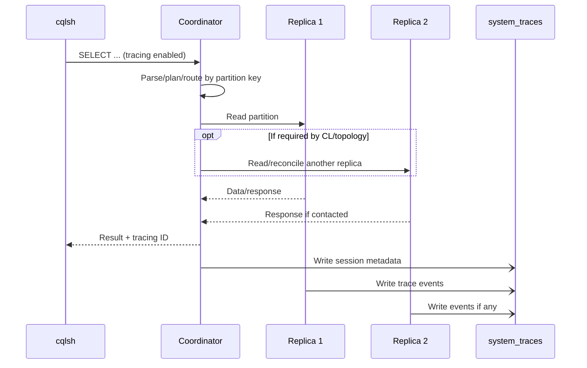

# `TRACING ON/OFF` and Collecting a Sample Query with `cqlsh` in Apache Cassandra

> **Chapter:** Tracing and Diagnosis  
> **Module:** `DATABASE_ENGINE_WIDE_COLUMN_CASSANDRA` — explore the distributed architecture and wide-column model of Apache Cassandra, specifically partition keys, query-driven table design, read/write consistency, replication, compaction, repair, error handling, and Java applications. This hands-on lesson focuses on **tracing a CQL query with `cqlsh`** and interpreting trace data to investigate latency.

## 1. Objectives and Expected Outcomes

When a Java API reports that a Cassandra query is slow, knowing only the `SELECT` statement and HTTP duration is not enough to identify the root cause. Latency may lie in coordinator selection, replica access, memtable/SSTable reads, data reconciliation and tombstones, waiting for a consistency level, or the network path between the application and Cassandra.

Apache Cassandra supports **request tracing**: recording a sequence of events for *a specific CQL request*. In `cqlsh`, you can enable this mode with `TRACING ON`, run **one sample query**, and then disable it with `TRACING OFF`. The tool displays the query's activities along with a **trace session ID** for later inspection.

After this lesson, you will be able to:

1. Prepare a small keyspace/table and query by partition key.
2. Enable/disable tracing properly for a `cqlsh` session, avoiding tracing large batches of unnecessary statements.
3. Record the **CQL statement, consistency level, result, session ID, and execution timestamp**.
4. Read details from `system_traces.sessions` and `system_traces.events` by ID.
5. Distinguish between **client-side latency**, **Cassandra-side processing time**, and indicators on the coordinator/replicas.
6. Formulate testable hypotheses from a trace instead of immediately concluding that a single event is the root cause.

> **Scope & Limitations:** Tracing is a diagnostic tool with overhead, **not a continuous sampling metric** or an end-to-end distributed tracing system for HTTP/Java. Only enable it for a small number of queries in a safe environment and disable it immediately after collecting sufficient data.

## 2. Where Does Request Tracing Operate?

Every time a client sends a query to Cassandra, one node acts as the **coordinator**. The coordinator determines the partition/token to access and communicates with the **replicas** according to the requested consistency level. When tracing is enabled for a request, participating components can emit events with a timestamp, source node, and timing information.



The diagram above illustrates the **conceptual flow**; it does not assert that Cassandra always sends every query to two replicas or that every event will always appear. The number of participating replicas depends on the **replication factor, consistency level, node status, and operation type**. Trace events are stored in the `system_traces` system keyspace, and writing/retrieving them also takes place across the distributed system.

A trace session ID groups events belonging to **one request**. It is different from `CqlSession` in the Java Driver (a long-lived connection object) and different from an HTTP correlation ID. Do not confuse these three types of identifiers.

## 3. Prerequisites

You need permission to connect to a **lab/staging Cassandra cluster** via `cqlsh`, permission to create a keyspace/table or access an existing test table, and read permissions on traces if you want to query `system_traces` directly.

```bash
# Example connection when cqlsh is installed locally and the server is on localhost.
cqlsh 127.0.0.1 9042
```

For clusters with authentication/TLS, use the access configuration provided by your organization; do not include passwords in documentation or trace captures. You can retrieve some cluster information from `cqlsh`:

```sql
SELECT cluster_name, release_version, data_center, host_id
FROM system.local;
```

`system.local` describes the node that the querying coordinator is connected to, not the entire cluster configuration. You need to know the **Cassandra version, datacenter, RF, and consistency level**, because these determine the meaning of the trace. If you are using a multi-node/multi-datacenter cluster, adjust the initialization below to match your topology rather than copying `SimpleStrategy` into production.

### Safety Rules When Measuring

- Run a **small query with an explicit partition key**; never randomly pick a query that scans an entire large table in production.
- Do not open multiple `cqlsh` tracing sessions concurrently to "capture extra samples just in case" without evaluating overhead first.
- Enable `TRACING ON` **immediately before the query to be measured** and run `TRACING OFF` **immediately afterward**.
- Record the **version, CL, timestamp, contacted node, schema, and CQL**; without context, comparing two traces is difficult.
- Do not mistake tracing for non-intrusive measurement: tracing can **increase latency** and write additional data into `system_traces`.

## 4. Creating a Query-Driven Lab Keyspace and Table

The example below is for **a single local Cassandra node**. `SimpleStrategy` with RF=1 is for learning only, **not** an HA configuration. Multi-datacenter clusters should use an appropriate replication strategy, typically `NetworkTopologyStrategy` with per-datacenter RF.

```sql
CREATE KEYSPACE IF NOT EXISTS tracing_lab
WITH replication = {
    'class': 'SimpleStrategy',
    'replication_factor': 1
};

CREATE TABLE IF NOT EXISTS tracing_lab.events_by_account (
    account_id uuid,
    event_id int,
    event_type text,
    detail text,
    PRIMARY KEY ((account_id), event_id)
) WITH CLUSTERING ORDER BY (event_id DESC);

INSERT INTO tracing_lab.events_by_account
    (account_id, event_id, event_type, detail)
VALUES (11111111-1111-4111-8111-111111111111, 1, 'LOGIN', 'web');

INSERT INTO tracing_lab.events_by_account
    (account_id, event_id, event_type, detail)
VALUES (11111111-1111-4111-8111-111111111111, 2, 'VIEW', 'partition-key');

INSERT INTO tracing_lab.events_by_account
    (account_id, event_id, event_type, detail)
VALUES (11111111-1111-4111-8111-111111111111, 3, 'VIEW', 'repair');
```

In `PRIMARY KEY ((account_id), event_id)`, `account_id` is the **partition key**; `event_id` is the **clustering key** ordered descending. Because `account_id` is known precisely, the following query can locate the exact partition and apply a range condition on the clustering key:

```sql
SELECT event_id, event_type, detail
FROM tracing_lab.events_by_account
WHERE account_id = 11111111-1111-4111-8111-111111111111
  AND event_id >= 2
LIMIT 2;
```

The expected logical result contains two rows with `event_id` **3 and 2**. If the lab data has changed from a previous run, verify the table state instead of assuming the output will always be identical. `LIMIT 2` limits **result rows**, and does not paginate a collection stored within a single row.

## 5. Three Core Commands: `TRACING ON` → `SELECT` → `TRACING OFF`

Within the same `cqlsh` session, execute the following sequence. For an RF=1 lab, set consistency to `ONE` for clarity. `CONSISTENCY` and `TRACING` are **`cqlsh` control commands**, not CQL statements that the Java Driver sends like a `SELECT` or `UPDATE`.

```sql
CONSISTENCY ONE;

TRACING ON;

SELECT event_id, event_type, detail
FROM tracing_lab.events_by_account
WHERE account_id = 11111111-1111-4111-8111-111111111111
  AND event_id >= 2
LIMIT 2;

TRACING OFF;
```

While `TRACING ON` is active, `cqlsh` requests tracing for subsequent CQL statements in **that session**. After the sample query, `cqlsh` typically prints the trace table alongside the query results and a line showing the **tracing session ID**. Once `TRACING OFF` is run, subsequent statements are no longer traced by that `cqlsh` session under this mode.

**Do not leave tracing enabled** and then execute a file with thousands of `INSERT`s or other investigative operations: the volume of events, overhead, and risk of exposing sensitive data in traces can grow rapidly. If the `cqlsh` session disconnects after the query, the session-level toggle ends, but events already written to `system_traces` still follow their own retention lifecycle.

### Sample Output to Know What to Save

The following example **only illustrates the output shape**, not an actual trace measured from a real cluster. Event text, nodes, ordering, and microseconds will vary by version and query path:

```text
cqlsh> TRACING ON;
Now Tracing is enabled

cqlsh> SELECT ... WHERE account_id = ... AND event_id >= 2 LIMIT 2;

 event_id | event_type | detail
----------+------------+---------------
        3 | VIEW       | repair
        2 | VIEW       | partition-key

Tracing session: 3ed3fbf0-0aef-11f0-8b3a-0242ac120002

 activity                        | timestamp | source     | source_elapsed | client
---------------------------------+-----------+------------+----------------+--------
 Executing single-partition ... | ...       | 127.0.0.1  | ...            | ...
 ...                              | ...       | ...        | ...            | ...
 Request complete                | ...       | 127.0.0.1  | ...            | ...

cqlsh> TRACING OFF;
Now Tracing is disabled
```

**Minimum evidence for a measurement:** record the verbatim `SELECT` statement, `CONSISTENCY ONE`, server version, execution timestamp, and the **actual trace UUID returned by `cqlsh`**. Do not copy the illustrative UUID into a query and conclude that "the trace does not exist."

## 6. Retrieving a Trace by Session ID

If your `cqlsh` supports the `SHOW SESSION` utility command, you can redisplay a recorded trace:

```text
-- cqlsh syntax; replace the UUID with the real ID from your output.
SHOW SESSION 3ed3fbf0-0aef-11f0-8b3a-0242ac120002;
```

`SHOW SESSION` is a **`cqlsh` command**, not standard CQL used in a prepared statement. If your `cqlsh` version does not support it or cannot find the session, read the data in `system_traces` using the two CQL queries in the next section.

### `system_traces.sessions`: Metadata for a Request

After running **`TRACING OFF`**, use the real session ID:

```sql
-- The UUID below is illustrative only; replace it with the real tracing session ID.
SELECT session_id, coordinator, started_at, duration, request, parameters
FROM system_traces.sessions
WHERE session_id = 3ed3fbf0-0aef-11f0-8b3a-0242ac120002;
```

Depending on the version, the `system_traces.sessions` table contains fields such as `session_id`, `coordinator`, `started_at`, `duration`, `request`, `parameters`, and `client`. `duration` typically represents **microseconds** of request time as recorded by the tracing system, not the full HTTP duration or end-to-end application wait time. Some fields may be absent or unpopulated for certain requests.

### `system_traces.events`: Events for the Same Request

```sql
SELECT event_id, activity, source, source_elapsed, thread
FROM system_traces.events
WHERE session_id = 3ed3fbf0-0aef-11f0-8b3a-0242ac120002;
```

`session_id` is the partition key for trace data, so the query has a **clear routing path**. `event_id` is usually a timeuuid used for ordering events; `source` is the node that emitted the event; `thread` and `activity` indicate some of the operations that took place. `source_elapsed` typically represents elapsed time in microseconds from the trace start on the **emitting node**, so exercise caution when comparing directly across nodes due to clock differences and event emission timing.

**Rows may arrive with a delay:** writing trace data runs on a separate workflow; immediately after the main query completes, reading `system_traces` may not yet show all events due to write/replication/latency delays. If events are missing, retry querying **a limited number of times** and check node status/consistency. Do not infer "no event = the replica definitely did not process it."

## 7. How Do Trace ID, Session Metadata, and Events Differ?

| Data | Question It Answers | What You Must **Not** Infer |
| --- | --- | --- |
| **Trace session ID** | Which events belong to the same request? | That it is an HTTP trace ID or Java `CqlSession` ID |
| **Coordinator** | Which node received/coordinated the request? | That this node necessarily stores the entire partition |
| **`request`** | Type of CQL request being traced | That it always contains all bind values or full business SQL/logs |
| **`parameters`** | Certain trace metadata/parameter values | That it is complete and safe to publicly expose sensitive info |
| **`started_at`** | Server-side trace timestamp | That all nodes have perfectly synchronized clocks |
| **`duration`** | Request duration recorded by tracing | End-to-end latency of HTTP and Java client |
| **Event `activity`** | Processing step recorded by Cassandra | That every CPU cycle/I/O/GC pause is fully measured |
| **`source`** | Which node generated the event? | That this node is definitely the bottleneck |
| **`source_elapsed`** | Relative timestamp within the trace from a source | That subtracting two nodes' values always yields exact network latency |

An event named something like "read SSTable", "fetching replica", or "request complete" is a **clue**. To confirm a root cause, combine client-side latency measurements, Cassandra metrics, node logs, schema/partition data, and cluster load at the same point in time.

## 8. How to Read a Timeline Without Confusing Coordinator and Replica

A simple way to analyze a request timeline is to divide it into **conceptual phases**:

1. **Startup/preparation** at the coordinator: receive CQL, parse/prepare, determine statement and consistency level.
2. **Routing**: determine token/partition and appropriate replicas.
3. **Replica exchange**: send read/write; wait for responses per CL; may include version reconciliation or read repair depending on the situation/version.
4. **Storage read/write**: memtable, cache, SSTable, tombstones, commit log, or specific steps depending on request type.
5. **Completion**: coordinator aggregates results and returns the response.

```text
Client              Coordinator           Replica
  |                     |                    |
  | SELECT              |                    |
  |-------------------->| parse + route      |
  |                     |---- request ------>|
  |                     |                    | read storage
  |                     |<--- response ------|
  |<--------------------| response           |
  |                     |                    |
```

The diagram is not to scale. Actual event order and names vary by Cassandra version, CL, and whether a replica resides on the same node as the coordinator. In a **single-node RF=1** lab, the coordinator and replica may have the **exact same IP address**; do not expect the trace to always show two nodes or multiple network RPCs.

### A Recording Sheet When Comparing Traces

| Observation Point | Information to Record | Diagnostic Question |
| --- | --- | --- |
| Before sending request | CQL, token/partition key, CL, contacted node | Does the query target the right partition? |
| Coordinator starts | Source and first event | Is parse/route time abnormal? |
| Replica starts processing | Source node different from or same as coordinator | How many replicas were contacted? |
| Read activity | Storage events if present | Are there signs of reading many SSTables/tombstones? |
| Completion | Duration and final event | Which part of the processing chain takes the most time? |
| Java/API receives response | Separate client-side latency | Is the server/client gap due to network, queuing, deserialization, or app? |

Not every event is guaranteed to appear; tracing is **selective observation**, not a profiler recording every syscall. If a trace lacks evidence for a hypothesis, gather complementary metrics rather than inventing steps that "must have happened."

## 9. Distinguishing Java-Side Latency from Cassandra Duration

Suppose a Java request measures 45 ms while `system_traces.sessions.duration` shows around 7 ms. You cannot immediately conclude that **38 ms is a network issue**. Java-side time may include:

- Connection pool queuing/waiting or backpressure in the driver.
- Time to send/receive data over the network, TLS, and intermediate systems.
- Retries or speculative execution if configured and applicable to the statement semantics.
- Result set deserialization and processing work inside the Java service.
- Differences between when the Java timer starts/stops and the tracing boundaries.
- **Tracing overhead**, which can alter the very request being measured.

Therefore, only **compare correlations**; do not subtract the two numbers and attribute the difference to a specific component without supporting telemetry. When an application uses HTTP distributed tracing, log the Java request correlation ID and corresponding CQL query; a Cassandra trace ID can be linked via log metadata, though it does not automatically become a complete HTTP span.

## 10. Trying a Sample `UPDATE`: Tracing Is Not Just for `SELECT`

After measuring `SELECT`, you can run a small write request on **the same lab row** to compare event types; remember to turn tracing off after each run:

```sql
TRACING ON;

UPDATE tracing_lab.events_by_account
SET detail = 'repair-session'
WHERE account_id = 11111111-1111-4111-8111-111111111111
  AND event_id = 3;

TRACING OFF;
```

On the write path, events may involve the coordinator distributing the mutation, replicas applying the mutation, commit log/memtable writes, and acknowledging the required consistency level. Do not use a trace of a small `UPDATE` to immediately infer that **compaction has completed**, because compaction is a background task that may happen long after the request returns.

With RF=1, `ONE` is a reasonable choice for a lab; in an RF=3 cluster, the same write at `LOCAL_QUORUM` may require acknowledgments from more replicas. Traces should not be compared simply by event count when CLs differ. Do not run a write command in production just to capture a trace if it has business side effects; choose a **read-only** request or a dedicated test row.

## 11. Comparing Consistency Levels and Replication Under Valid Conditions

Consistency level determines **how many replicas and from which scope must respond** for a request to succeed; it does not change the partition key. Tracing helps observe *some steps* of replica communication, but it does not replace understanding the topology.

| Environment | Meaningful CL Examples | Key Understanding |
| --- | --- | --- |
| Single-node lab, RF=1 | `ONE` | Coordinator and replica are usually the same node; cannot test multi-replica quorum |
| Single datacenter, RF=3 | `ONE`, `LOCAL_QUORUM` | Can compare acknowledgment requirements, trace output, and latency when all nodes are healthy |
| Multi-datacenter | `LOCAL_ONE`, `LOCAL_QUORUM`, `QUORUM` depending on schema/version | Distinguish local vs. cluster-wide scope; watch out for cross-DC network links |
| LWT with `IF` | Normal CL + **serial consistency** | Trace may include additional consensus phases; unlike a regular `UPDATE` |

Example in `cqlsh` on a specifically configured RF=3 environment:

```sql
-- Only run if your replication/topology supports this CL.
CONSISTENCY LOCAL_QUORUM;
TRACING ON;

SELECT event_id, event_type
FROM tracing_lab.events_by_account
WHERE account_id = 11111111-1111-4111-8111-111111111111
LIMIT 2;

TRACING OFF;
```

**Do not** copy this test to an RF=1 lab and conclude that the query tested quorum fault tolerance; with RF=1, even using a quorum CL does not provide multiple replicas for fault tolerance. To study replica failure, repair, or consistency when a node goes down, you need a multi-node cluster and an isolated test scenario.

## 12. How Does Tracing Support Formulating Hypotheses About Slow Queries?

| Symptom | Trace Clues That May Help | Further Checks Needed |
| --- | --- | --- |
| Slow `SELECT` by partition key | Time between request start and completion, events on replicas | Partition size, SSTable count, tombstones, CPU/disk |
| Read timeout at high CL | Coordinator waiting for enough responses, events on replicas if recorded | RF, DC, node status, network, speculative retry |
| Slow `UPDATE list[index]` | May show an extra read path before creating the mutation | Read-before-write mechanism, list size, contention |
| Query returning large data | Activities processing many rows and completion time | Result size, driver paging, schema with oversized collections |
| Slow after compaction/repair | Request trace changes during the same timeframe | Compaction/repair metrics, disk saturation, system logs |
| Slow only from Java | Cassandra duration smaller than client latency | Driver pool, timeouts, retries, JVM GC, TLS/network, and app |
| Hot partition | Specific queries on the same key are consistently slow | Write frequency, token ownership, hotspots, and bucket design |

**Do not invert causality:** A trace containing a "read SSTable" event does not prove that all slowness is caused by compaction; slowness occurring while repair is running does not prove repair is always the cause. You must combine **timestamps, metrics, and controlled experiments**.

## 13. Reasons Traces May Be Missing or Hard to Read

### 13.1. No Tracing ID Shown in `cqlsh`

Verify that `TRACING ON` was enabled **in the exact `cqlsh` session** before running the statement, that the statement was actually sent to and processed by the server, and that your `cqlsh`/server versions support the feature. If a CQL statement fails with a syntax error before server execution, do not always expect a complete trace session.

### 13.2. Querying `system_traces` Returns 0 Rows

Possible causes include using the illustrative UUID by mistake, events not yet written/propagated, records having expired, restricted permissions, or connecting to a different cluster than the one that generated the trace. Double-check the exact session ID, cluster, permissions, and retry reading a limited number of times; do not scan `system_traces.events` cluster-wide using `ALLOW FILTERING` to hunt for an ID.

### 13.3. Session Exists But Events Are Missing

Trace writes can be delayed or partially dropped when nodes are under heavy load or failing; the TTL and replication of the system keyspace also affect retention and collection. A missing event **is not sufficient proof** that the step did not occur. Do not use traces as a complete audit log or absolute proof that a write succeeded or failed.

### 13.4. Timestamps Appear Out of Order or Skewed Between Two Nodes

`timestamp` and `source_elapsed` must be interpreted in the context of each **source** clock and how the system emits events. Node clock skew, asynchronous trace writing, and relative offsets can make events appear out of order. Do not subtract timestamps from two different sources and treat the difference as **exact network latency**.

### 13.5. Tracing Makes Requests Slower

This is an expected effect: collecting, sending, and persisting events consumes resources. Measure normal SLOs using **metrics from untraced requests**; use traces of a few representative requests to analyze execution paths, and do not use traced request latencies as a production baseline.

## 14. Storing and Sharing Traces Safely

Metadata in `system_traces.sessions` and `events` can contain CQL statements, parameters, node/client IP addresses, timestamps, and thread names. In some scenarios, queried data can be sensitive; therefore:

- Do not include passwords, tokens, personal data, or secret parameters in publicly shared screenshots/trace logs.
- When filing a diagnostic ticket, you can include the **trace ID, version, CL, duration, and sanitized events**.
- Apply **retention periods and access controls** for trace/log systems in accordance with organizational policy.
- Do not treat `system_traces` as an unlimited historical archive. Trace records have **configuration/version-dependent TTL/retention**; copy necessary details to an approved observability system if long-term storage is required.
- If you lack permission to read the system keyspace, ask an authorized operator to export **a sanitized trace**, rather than granting cluster-wide read access to all developers.

## 15. Comparing Well-Designed Queries vs. Unsuitable Partition Designs

With the `events_by_account` table, a query that specifies `account_id` (partition key) and `event_id` (clustering key) accesses a clearly bounded slice of data. Conversely, if the application wants "all `VIEW` events across all accounts," the current table has no partitioning path by `event_type`.

```sql
-- This query is NOT a designed read path for the lab table.
-- Do not run it on a large table just to generate a trace.
SELECT account_id, event_id
FROM tracing_lab.events_by_account
WHERE event_type = 'VIEW'
ALLOW FILTERING;
```

`ALLOW FILTERING` may allow expensive filtering depending on the CQL/schema, **without creating a partition key or index**. A trace may reveal a complex query path, but **tracing cannot fix a schema**. If "finding VIEW events by day" is a frequent query, you need a **table keyed by event type and time bucket**, with clustering keys supporting ordering and paging.

Example of a dedicated read table design (no need to run this to complete the tracing exercise):

```sql
CREATE TABLE tracing_lab.events_by_type_day (
    event_type text,
    event_day date,
    occurred_at timeuuid,
    account_id uuid,
    detail text,
    PRIMARY KEY ((event_type, event_day), occurred_at, account_id)
) WITH CLUSTERING ORDER BY (occurred_at DESC, account_id ASC);
```

The new table allows querying the **exact partition** when `event_type` and `event_day` are known. However, adding a denormalized table requires the application to write/sync data across multiple dimensions, handle retries, and bound bucket sizes. Tracing helps verify the execution path, while choosing partition/clustering keys remains a **query-driven design problem**.

## 16. Connecting to Java Driver 4.x and Application Telemetry

In Java, measure latency where the **request starts and completes** to establish a baseline independent of `cqlsh` tracing. Simple example (without server-side tracing enabled, using an initialized session and prepared statement):

```java
import com.datastax.oss.driver.api.core.CqlSession;
import com.datastax.oss.driver.api.core.cql.PreparedStatement;
import com.datastax.oss.driver.api.core.cql.Row;
import java.util.UUID;
import java.util.concurrent.TimeUnit;

class EventReader {
    private final CqlSession session;
    private final PreparedStatement byAccount;

    EventReader(CqlSession session) {
        this.session = session;
        this.byAccount = session.prepare(
            "SELECT event_id, event_type FROM tracing_lab.events_by_account " +
            "WHERE account_id = ? LIMIT 2"
        );
    }

    void read(UUID accountId) {
        long started = System.nanoTime();
        Row first = session.execute(byAccount.bind(accountId)).one();
        long elapsedMicros = TimeUnit.NANOSECONDS.toMicros(
            System.nanoTime() - started
        );
        System.out.println("client_elapsed_us=" + elapsedMicros);
        if (first != null) {
            System.out.println("first_event=" + first.getInt("event_id"));
        }
    }
}
```

This Java snippet measures the **client-side call path** covering `session.execute(...).one()`; it does not replace a profiler, distributed tracing, or measuring all result pages. Specifically, if an application reads multiple pages, measure the full pagination loop to avoid falsely concluding that the query only spends time fetching the first page.

In Java Driver 4.x, request tracing and execution info have dedicated APIs depending on the version, but this hands-on lesson intentionally uses `cqlsh` to **obtain an easily observable trace and query it by ID**. In real systems, log a safely sanitized CQL identifier, consistency level, host/coordinator, retry count, timeouts, and application correlation ID to link with a Cassandra trace when needed.

## 17. Reproducible Investigation Checklist

1. **Choose the target:** A small, safe query with a known partition key and the symptom under investigation.
2. **Record context:** Server/driver versions, RF/datacenter, CL, schema, partition size, and execution timestamp.
3. **Run baseline:** Measure normal latency from Java or `cqlsh` with tracing disabled; avoid comparing measurements under different loads.
4. **Enable tracing:** Run `TRACING ON` in the target `cqlsh` session.
5. **Run a single representative query:** Keep the same key/CL so results remain comparable.
6. **Disable immediately:** Run `TRACING OFF` before performing further experiments or querying system tables.
7. **Save the real trace ID:** Along with the query, timestamp, output, CL, and node.
8. **Read the trace:** Use the `cqlsh` output, `SHOW SESSION` if supported, or query `system_traces.sessions/events` by ID.
9. **Correlate:** Distinguish coordinator/replica and client-side metrics; avoid inferring duration from cross-node timestamps.
10. **Formulate hypotheses:** E.g., oversized partition, excessive tombstones, RF/CL waiting on replicas, or driver queuing.
11. **Verify with other metrics:** `nodetool tablestats`, `tablehistograms`, selective tracing, replica logs, and CPU/I/O/compaction/repair depending on version.
12. **Wrap up:** Document conclusions, redact sensitive data, ensure tracing is off, and never change cluster configuration based on a single sample.

## 18. Practice Exercises

**Exercise 1 — Capture a trace:** Using the `tracing_lab.events_by_account` table, enable `TRACING ON`, run `SELECT` with `account_id` and `event_id >= 2`, then run `TRACING OFF`.  
**Expected:** Save the CQL statement, the two rows with `event_id` 3 and 2, the CL, the real trace ID, and the events displayed by `cqlsh`.

**Exercise 2 — Re-query the trace:** Using the ID you received, read `system_traces.sessions` and `system_traces.events`. If you see the session but not all events yet, what should you do?  
**Hint:** Verify the ID/cluster, access permissions, and trace write delay; re-read a limited number of times. Do not immediately conclude that the replica did not execute.

**Exercise 3 — Local RF=1:** The trace only shows the IP `127.0.0.1`. Does this mean Cassandra has no replicas?  
**Hint:** No. In an RF=1 lab, the coordinator and replica can be the same node. Check RF/topology rather than counting IPs to infer logical replica count.

**Exercise 4 — Client 50 ms, trace 8 ms:** Can you state that the remaining 42 ms is network latency?  
**Hint:** No. Client measurements can include connection wait, TLS, retries, deserialization, queuing, and timing boundary differences.

**Exercise 5 — CL:** On an RF=3 cluster, you switch from `ONE` to `LOCAL_QUORUM` to compare. Can you use the result as proof that `QUORUM` is always slower?  
**Hint:** No. Only draw conclusions for the tested workload and conditions; latency also depends on cache, replicas, network, load, and the consistency path.

**Exercise 6 — Wrong query dimension:** An API needs to find all `event_type='VIEW'` records in a day. Why isn't adding `TRACING ON` enough to make the query fast?  
**Hint:** Tracing observes the query; it does not change the partition key. You need a table designed around `event_type, event_day` or an index suited to the workload.

**Exercise 7 — Tombstones:** A trace shows an SSTable-related event while read latency increases. What should you check before claiming tombstones are the cause?  
**Hint:** Check tombstone statistics, SSTable count, p95/p99 latency, compaction backlog, partition size, GC/I/O, and similar requests.

**Exercise 8 — Security:** A trace contains query parameters and node IPs. Should you paste the raw output onto a public forum?  
**Hint:** No. Sanitize sensitive values, use an authorized ticketing system, and restrict retention.

## 19. Common Mistakes and How to Avoid Them

| Mistake | Consequence | How to Handle |
| --- | --- | --- |
| Enabling `TRACING ON` and forgetting to turn it off | Traces every request in the session, increasing overhead and extra data | Enable right before one query, disable immediately after |
| Using the example UUID instead of the real ID | Trace session not found | Copy the tracing ID from the `cqlsh` output of that run |
| Comparing two traces with different CL/RF | Wrong conclusions about replicas and latency | Record context and compare under matching conditions |
| Assuming all events have identical format across Cassandra versions | Misinterpretation, broken parsers after upgrades | Check actual field/event names and server version |
| Treating `source_elapsed` across nodes as a shared precise clock | Wrongly inferred network latency | Analyze per source and cross-check server/client timing |
| Treating a single trace as absolute proof | Misses jitter/load or dropped events | Measure multiple selective requests and inspect metrics/logs |
| Querying `system_traces` while tracing is still enabled | Generates extra traces for diagnostic queries | Run `TRACING OFF` before querying system keyspaces |
| Using `ALLOW FILTERING` to fix a slow query | Scans many partitions and generates load | Design schema/indexes to match the query dimension |
| Using traces to replace compaction/repair metrics | Misses cluster-wide background activity | Combine `nodetool`, metrics, and logs |
| Publishing unsanitized traces | Leaks IPs, parameters, or internal details | Enforce access controls and redact sensitive info |

## 20. Key Takeaways

- `TRACING ON` and `TRACING OFF` are **`cqlsh` commands** that collect traces for requests in the current session; they **do not enable cluster-wide tracing for all clients**.
- Minimum workflow: **pick a safe query → enable tracing → run one query → disable tracing → save the session ID**.
- `system_traces.sessions` stores request metadata; `system_traces.events` stores activities under the **same `session_id`**. Events may arrive late/incomplete and are not retained permanently.
- When reading a timeline, distinguish **coordinator, replica, partition key, RF, CL**, and event source; do not equate Cassandra duration with Java/HTTP latency.
- Tracing is a **diagnostic tool with overhead**, not a profiler or end-to-end measurement system; use it only to form hypotheses that must be verified with metrics/logs.
- A query with an unsuitable partition key path, oversized partitions, heavy tombstones, compaction/repair load, or overloaded replicas still requires **query-driven table design and proper operations**—it cannot be fixed by `TRACING ON` alone.
- Always disable tracing, protect information inside traces, and report findings with **CQL, timestamp, server version, CL, trace ID, and workload context**.
