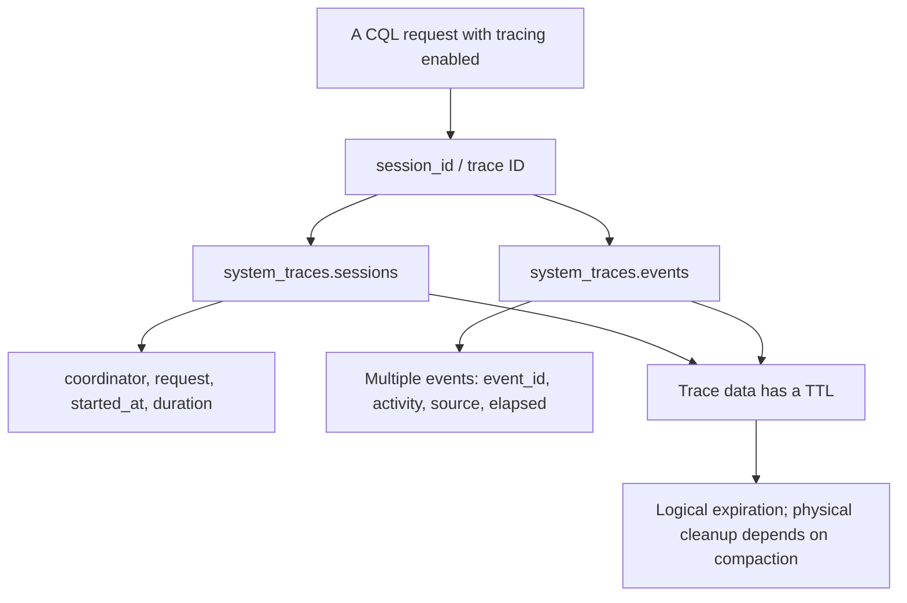
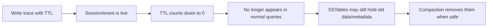
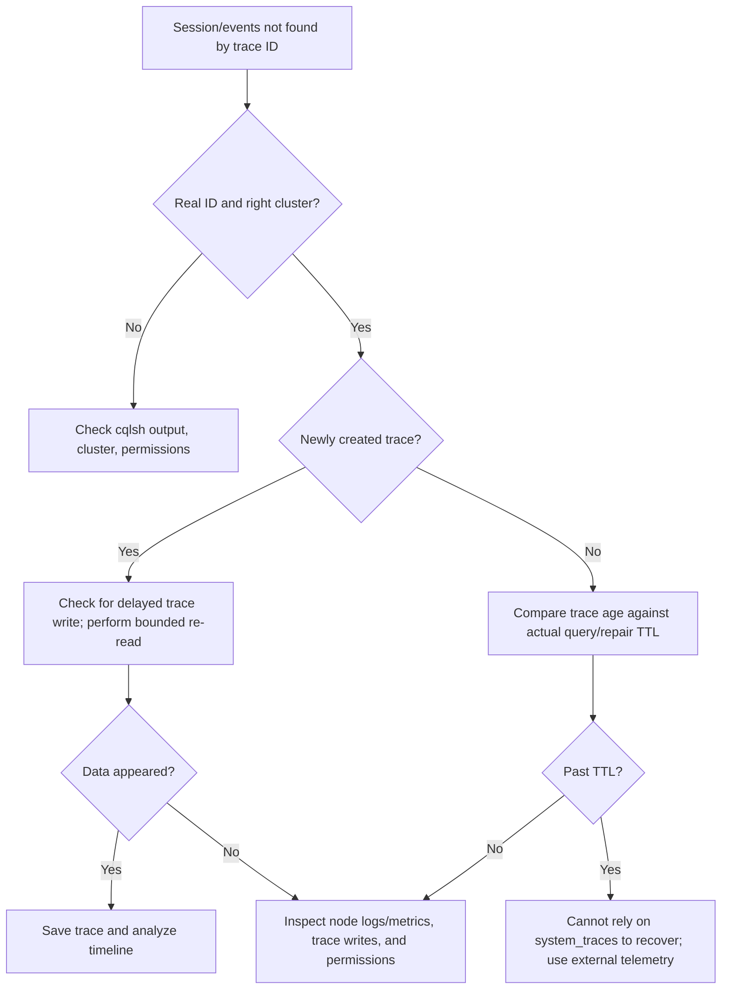

# `system_traces`: Sessions, Events, and Trace Retention in Apache Cassandra

> **Chapter:** Tracing and Diagnosis  
> **Module:** `DATABASE_ENGINE_WIDE_COLUMN_CASSANDRA` — explore the distributed architecture and wide-column model of Apache Cassandra, partition keys, query-driven table design, read/write consistency, replication, compaction, repair, error handling, and Java application integration. This lesson focuses on how **request traces are stored in `system_traces`, session–event linkage, and TTL expiration**.

## 1. Why Does One Trace Have Two Record Types?

When a CQL query is slow, we need to know **which request was traced** and **which activities occurred inside that request**. Cassandra typically stores two groups of data in the `system_traces` system keyspace:

- **`system_traces.sessions`**: one metadata row per traced *request* session; containing the ID, coordinator, start timestamp, duration, and details about the request.
- **`system_traces.events`**: event rows belonging to the same trace; each row describes an activity, originating node, thread, and relative elapsed time.

From **a single `session_id`**, you can read both the request metadata and the detailed set of events. This follows Cassandra's core data modeling principle: knowing the **partition key** lets you read the related group of rows without scanning the entire cluster to search for an event by description.



**Do not confuse three types of sessions:**

1. `session_id` in `system_traces` is the **identifier of a traced request**.
2. `CqlSession` in the Java Driver is a **long-lived connection object** to the cluster.
3. A login/API session or HTTP distributed-tracing span is an **application-level context**.

They do not automatically share the same ID. To link a Cassandra trace with an HTTP trace, the application must **record the mapping/correlation** according to the system's observability conventions.

## 2. Data Structure and Primary Keys of Both Tables

To understand how to query them, look at a simplified model of the system schema. **Do not run the `CREATE TABLE` outline below**: `system_traces` is an internal keyspace managed by Cassandra, and column names/types/DDL may differ by version.

```text
system_traces.sessions
  session_id     timeuuid    PRIMARY KEY
  coordinator    inet
  started_at     timestamp
  duration       int        (typically microseconds)
  request        text
  parameters     map<text,text>
  client         inet       (when schema/version includes this column)

system_traces.events
  session_id     timeuuid    PARTITION KEY
  event_id       timeuuid    CLUSTERING KEY
  activity       text
  source         inet
  source_elapsed int        (typically microseconds)
  thread         text
```

Depending on the Cassandra version or distribution, the sessions table may include additional fields, such as `command`, and some values may be `null`. Therefore, **inspect the actual schema before copying a `SELECT` query**.

| Aspect | `sessions` | `events` |
| --- | --- | --- |
| Record unit | One traced request | One activity within the request |
| Partition key | `session_id` | `session_id` |
| Clustering key | None, in the typical model | `event_id` (timeuuid) |
| Cardinality per trace | Typically one row | Multiple rows; may be missing or delayed |
| Efficient query | By **exact `session_id`** | By **exact `session_id`**, optionally limiting row count |
| Purpose | Request context and duration | Detailed timeline of activities/nodes/threads |

Because `events` is partitioned by `session_id`, all events for a trace belong to the same **logical partition**. `event_id` serves as the clustering key to order events by key; this **does not guarantee strict causal ordering across nodes with different clocks**.

## 3. Starting from a Sample Query in `cqlsh`

To obtain a real `session_id`, you need to **generate a traced request**. Do not invent a random UUID and look it up in `system_traces`: a random ID that was never traced will naturally return no data.

The hands-on example below uses a dedicated keyspace suitable for a **single-node lab cluster**. `SimpleStrategy` with RF=1 is for learning only; multi-datacenter production environments require topology-aware replication, typically `NetworkTopologyStrategy`.

```sql
CREATE KEYSPACE IF NOT EXISTS trace_storage_lab
WITH replication = {
    'class': 'SimpleStrategy',
    'replication_factor': 1
};

CREATE TABLE IF NOT EXISTS trace_storage_lab.events_by_user (
    user_id uuid,
    event_no int,
    event_type text,
    detail text,
    PRIMARY KEY ((user_id), event_no)
) WITH CLUSTERING ORDER BY (event_no DESC);

INSERT INTO trace_storage_lab.events_by_user
    (user_id, event_no, event_type, detail)
VALUES (11111111-1111-4111-8111-111111111111, 1, 'LOGIN', 'web');

INSERT INTO trace_storage_lab.events_by_user
    (user_id, event_no, event_type, detail)
VALUES (11111111-1111-4111-8111-111111111111, 2, 'VIEW', 'partition');

INSERT INTO trace_storage_lab.events_by_user
    (user_id, event_no, event_type, detail)
VALUES (11111111-1111-4111-8111-111111111111, 3, 'VIEW', 'repair');
```

`user_id` is the **partition key**, and `event_no` is the **clustering key**. Querying by `user_id` has a clear routing path, making it suitable as an initial sample; there is no need for `ALLOW FILTERING` or a secondary index just to capture a trace.

Within the **same `cqlsh` session**, run:

```sql
CONSISTENCY ONE;
TRACING ON;

SELECT event_no, event_type, detail
FROM trace_storage_lab.events_by_user
WHERE user_id = 11111111-1111-4111-8111-111111111111
  AND event_no >= 2
LIMIT 2;

TRACING OFF;
```

`TRACING ON` and `TRACING OFF` are **`cqlsh` commands**, not a permanent cluster-wide toggle for all of Cassandra. After `TRACING ON`, `cqlsh` typically displays the trace table and a `Tracing session: ...` line alongside the query results. **Copy that real ID** along with the timestamp, CQL statement, CL, and server version.

The logical result from the sample data is two rows with `event_no = 3` and `2`, following the `DESC` clustering order. If the lab table was modified by a previous run, verify the current data rather than assuming the output will always match.

## 4. Collecting the Minimum Evidence Set for a Trace

A screenshot containing only the events table without the CQL statement and context is very hard to diagnose. Create a note containing these details:

| Field to Record | Example or How to Obtain | Why It Matters |
| --- | --- | --- |
| Trace ID | Real UUID from `Tracing session: ...` | Joins `sessions` and `events` |
| Measurement timestamp | UTC and timezone when interpreting | Correlates metrics/logs from the same window |
| CQL statement | `SELECT ... WHERE user_id = ...` | Distinguishes single-partition queries from scans |
| Bind parameters | Values **sanitized of sensitive info** | Shows which partition/fields were queried |
| Consistency level | `ONE`, `LOCAL_QUORUM`, ... | Defines replica acknowledgment requirements |
| Cassandra version and datacenter | Specific lab/production cluster | Event names, schema columns, and code paths may differ |
| Replication factor | RF per keyspace/DC | Interprets how many replicas may participate |
| Result count and response size | Row count/bytes when metrics exist | Identifies queries slow due to large payloads |
| Client-observed latency | Driver/JVM or API telemetry | Compares against `duration` in `sessions` |

Do not copy passwords, tokens, or user data directly into tickets. Traces may include request strings, parameters, and IPs; store only necessary details in compliance with your system's security policy.

## 5. Querying `system_traces.sessions` by ID

After running **`TRACING OFF`**, replace the illustrative UUID with the *real* ID from your output. The UUID below only illustrates syntax and is **not** a trace generated by this lesson:

```sql
SELECT session_id, coordinator, started_at, duration,
       request, parameters
FROM system_traces.sessions
WHERE session_id = 8cbe0000-e581-11f1-8e9a-0242ac120002;
```

Because `session_id` is the **primary key**, the query targets a single request. Do not run an unbounded `SELECT * FROM system_traces.sessions` to find "recent traces": the table design is not optimized for cluster-wide time-range scans and can generate unnecessary load.

### Interpreting Each Key Field

- `session_id`: **timeuuid** identifying the trace, not a user or business transaction ID.
- `coordinator`: IP of the node coordinating the request; **not necessarily** the node storing all data for the accessed partition.
- `started_at`: request start time according to server-side tracing info; account for clock synchronization when comparing across nodes.
- `duration`: request duration recorded by tracing, **typically measured in microseconds**; for example, `7500` corresponds to roughly `7.5 ms`, not `7500 ms`.
- `request`: description of the request type; do not assume it always includes full SQL or all bind values.
- `parameters`: certain metadata/values recorded during tracing; content and presence may depend on version, execution path, and statement.

**Be careful when `duration` is missing or `null`:** session metadata and events may be written asynchronously. If you just captured a trace and a column has not appeared yet, re-read after a brief bounded wait; do not interpret `null` as "the request completed instantaneously."

## 6. Querying `system_traces.events` by `session_id`

```sql
SELECT event_id, activity, source, source_elapsed, thread
FROM system_traces.events
WHERE session_id = 8cbe0000-e581-11f1-8e9a-0242ac120002;
```

This is a **partition-key query**, avoiding a full table scan. `event_id` is a timeuuid clustering key, so rows are ordered by key. You can bound the number of returned events to avoid reading an overly long trace:

```sql
-- Return at most 100 event rows within the trace's partition.
SELECT event_id, activity, source, source_elapsed, thread
FROM system_traces.events
WHERE session_id = 8cbe0000-e581-11f1-8e9a-0242ac120002
LIMIT 100;
```

**Note:** `LIMIT 100` only **bounds the row count**, not a statement that the trace has exactly 100 events. If you need the full set, read remaining rows or paginate properly. In the Java Driver, `setPageSize` also only bounds **rows per page**, not total events or the byte size of a row containing a large collection.

### Meaning of Event Columns

| Column | Meaning | Interpretation Pitfall |
| --- | --- | --- |
| `event_id` | Timeuuid identifier for an event, typically used as clustering key | Does not guarantee strict causal ordering across all nodes |
| `activity` | Description line of the traced operation | Wording varies across versions and request types |
| `source` | IP of the node emitting the event | Multiple events from one source do not prove only one replica exists |
| `source_elapsed` | Relative elapsed time, typically microseconds | Do not assume exact synchronization across nodes with different clocks |
| `thread` | Executing thread when the event was created | Thread name is not a stable business identifier |

A trace may include events from the **coordinator and one or more replicas**. In an RF=1 lab cluster, the coordinator and replica may reside on the **same node/IP**, so seeing few distinct sources is normal. Do not infer the replication factor by counting IP addresses in trace results.

## 7. `SHOW SESSION` in `cqlsh`: Convenient but Limited

In `cqlsh` versions that provide this command, after disabling tracing you can re-display a request's trace using:

```text
SHOW SESSION 8cbe0000-e581-11f1-8e9a-0242ac120002;
```

This is a **`cqlsh` utility command**, not CQL executed directly via a Java prepared statement. If `SHOW SESSION` is unsupported or the record has passed its TTL, use the `system_traces` tables if authorized, or review the output saved from the original run.

**Do not treat this command as an infinite recovery mechanism:** if the session/events have expired and no copy remains, `SHOW SESSION` cannot reconstruct the request. To retain long-term evidence, copy the sanitized trace to an authorized observability system **while the trace is still alive**.

## 8. Trace Retention: What Is TTL and Why Does It Matter?

**TTL (*time-to-live*)** is the duration a value is considered live after being written. Tracing is designed for **short-term diagnosis**, not storing all CQL history forever. Records in `system_traces.sessions` and `system_traces.events` are typically written with a TTL defined/configured by Cassandra per trace type.

In some Cassandra versions/configurations, administrators may encounter parameters with similar meanings:

```text
# Example configuration parameter names common in some cassandra.yaml versions:
tracetype_query_ttl: 86400
tracetype_repair_ttl: 604800
```

**These are illustrative examples only, not mandatory settings or fixed defaults for every version.** `86400` seconds equals **24 hours**, and `604800` seconds equals **7 days**. Some distributions rename parameters, change defaults, or manage configuration differently. Parameter names, scope, mutability, and active values must be verified against the documentation/configuration of the **running version**.

| Information Type | Common Purpose | What to Verify |
| --- | --- | --- |
| CQL query tracing | Investigating read/write requests, latency, replicas | TTL for **query traces**, read permissions, and evidence retention |
| Repair-related tracing | Monitoring repair events on supported versions | **Repair trace** TTL may differ from query trace TTL |
| Trace session metadata | High-level summary of a request | Actual column/row TTL; write/update timestamps |
| Trace events | Sub-operations of a request | Per-event TTL; whether events arrive late or get dropped |

**Do not equate `gc_grace_seconds` with trace TTL.** TTL determines when a value **logically expires**; `gc_grace_seconds` and compaction govern how deletion metadata is handled across SSTables/replicas. Changing grace periods does not automatically extend a 1-day TTL to 7 days.

## 9. Checking Remaining TTL with CQL

On versions that support the `TTL(...)` function on regular columns, you can inspect the remaining TTL **while trace records are still live**:

```sql
-- Replace with a real session ID; run after TRACING OFF.
SELECT session_id, request, duration,
       TTL(request) AS request_ttl_seconds,
       TTL(duration) AS duration_ttl_seconds
FROM system_traces.sessions
WHERE session_id = 8cbe0000-e581-11f1-8e9a-0242ac120002;

-- Remaining TTL of activity in live events.
SELECT event_id, activity,
       TTL(activity) AS activity_ttl_seconds
FROM system_traces.events
WHERE session_id = 8cbe0000-e581-11f1-8e9a-0242ac120002
LIMIT 20;
```

These queries apply `TTL(...)` to **regular data columns**, not primary key columns like `session_id` or `event_id`. Depending on the version and column state, TTL may return seconds remaining, `null` (e.g., column is unset or has no TTL), or the record may already be gone. Some session columns may be written at different times; **their TTLs do not necessarily match down to the exact second**.

If `TTL(request)` does not return the expected value, **check the actual schema and columns**; do not conclude that all of `system_traces` has no TTL based on a single null column. The presence and queryability of a field depend on the Cassandra version. Do not perform full-table scans to compute average TTL across all traces.

### Remaining TTL Decreases Over Time

Example of an event written with an 86,400-second TTL:

```text
T0:      event is written                   TTL ≈ 86,400 s
T0+1h:   event is still queryable           TTL ≈ 82,800 s
T0+24h:  event logically expires            SELECT may no longer return the row
Later:   old bytes/tombstones may remain in SSTables until safe cleanup
```

Exact timing also depends on clocks, cell write timestamps, measurement variance, and how Cassandra persists traces. Do not use the diagram's arithmetic as a guarantee that after exactly 24 hours the physical data has been wiped from every node, disk, or backup.

## 10. TTL Expiration Does Not Mean Physical Data Vanishes Immediately

Cassandra writes to the memtable/commit log and flushes immutable SSTables. When a cell's TTL expires, that cell is **no longer treated as live data** on the standard read path. However, the expired version and related deletion markers can remain inside SSTables until **compaction** processes them under safe conditions.



This is crucial when estimating `system_traces` capacity: **a short TTL does not guarantee immediate disk space reclamation**. Tracing many requests can generate huge numbers of event rows and increase I/O, storage usage, and compaction overhead, even if each row only lives for a limited window.

**Do not directly modify** table options, delete/truncate `system_traces` tables, or alter system keyspace replication/grace settings just to "clean up traces faster" without official documentation for your exact Cassandra version and an approved operational procedure. This is system diagnostic data; improper intervention can disrupt other diagnostic workflows.

## 11. Why Might a Session Exist Without Events, or Vice Versa?

Trace writes can occur **asynchronously and across multiple nodes**. In practice, you may observe transient or persistent states:

| Symptom | Plausible Hypothesis | Verification Steps |
| --- | --- | --- |
| `sessions` row exists but `events` is empty | Events still being written, partially lost, expired, or permission/version differences | Check ID, timestamp, bounded re-read, node status |
| Some events exist but final steps are missing | Slow/dropped trace writes, request error/timeout, or retention | Check exceptions, server logs, metrics; do not conclude solely from missing events |
| Session not found after `Tracing session` output | Wrong cluster/ID, TTL expired, unreadable, incomplete trace write | Verify connected cluster, permissions, time elapsed, bounded retry |
| Events exist but session metadata is incomplete | Metadata not yet updated or expired at a different time | Check `duration`, per-column TTL, and trace age |
| `SHOW SESSION` not supported | Different `cqlsh` version or access method | Query via CQL directly if authorized |
| TTL returns `null` | Null column, no TTL set, or version/codec difference | Inspect another live column, check schema and a fresh sample |

These possibilities **do not replace** diagnosing the underlying issue. Traces are observational data, not a strictly once-delivered ledger or complete audit log. When a request times out, some mutations may still have been accepted by replicas even though the trace ends incomplete.

## 12. Timeline Analysis: `event_id` and `source_elapsed`

A common mistake is looking at two event rows, subtracting `source_elapsed`, and concluding "the network RPC took exactly 5 ms." `source_elapsed` is typically a **relative microsecond offset within the tracing context** and can be tied to the emitting node's clock/start point. Some events are sent/persisted asynchronously; clocks on two nodes can drift.

Therefore:

1. Start from **`started_at`, `duration`, and coordinator** in `sessions`.
2. Read all events for the same `session_id` and identify each event's **`source`**.
3. Group activities into phases—**startup/routing, replica dispatch, processing, response**—based on actual available events.
4. Compare timestamps from the **same source** and broad relationships across sources; do not treat a multi-node timeline as a perfectly synchronized clock.
5. Correlate with client-side latency, node logs/metrics, network, GC, SSTables/tombstones, and CL/RF.

If a trace contains a `request complete` event, it only indicates that Cassandra recorded a completion stage; **it does not guarantee** that the upstream HTTP request returned a valid result or that every event has already landed in `system_traces`.

### Example of an Accurate Observation vs. an Overstatement

**Appropriate:** "In trace X, the coordinator is node A; available events show replica B participated. Cassandra-side duration is about 8 ms; the client recorded 35 ms. Further checks are needed on driver queuing and network."

**Overstated:** "The 27 ms gap is definitely the network; replica B is the bottleneck because it has the longest event." Without additional metrics, this conclusion is not supported by the trace alone.

## 13. Consistency, Replication, and Trace Completeness

On an RF=3 cluster, `ONE` and `LOCAL_QUORUM` queries can have different acknowledgment requirements and replica paths. **The same CQL** may not produce identical events if coordinator, cache state, replica health, or CL differ.

| Factor | Impact on Request Path / Trace |
| --- | --- |
| Partition key | Determines token and replica set; key-targeted queries are easier to diagnose |
| Replication factor | Number of maintained copies and nodes eligible to participate |
| `ONE`/`LOCAL_QUORUM`/`QUORUM` | Read/write acknowledgment level and replica scope required to respond |
| Datacenter | Can affect network latency and local replica selection |
| Node failure/timeout | Events may be missing due to failed requests or incomplete trace writes |
| Repair | Helps replicas synchronize base data and tombstones; also adds background load while running |
| Compaction | Affects I/O and SSTable reads; not fully captured inside request traces |

Do not count distinct sources in `system_traces.events` to conclude **RF equals the number of nodes with events**: some replicas may not be contacted under the CL, some sources may fail to write trace rows in time, or the coordinator itself may also be a replica. To know RF, inspect the actual keyspace schema and cluster topology rather than inferring it from one trace.

## 14. An Example with `IF`: LWT Traces Can Be Longer

To observe the difference between a regular mutation and a **lightweight transaction (LWT)**, use the **lab table** and a known row:

```sql
-- Prepare normal read/write state first.
UPDATE trace_storage_lab.events_by_user
SET detail = 'repair'
WHERE user_id = 11111111-1111-4111-8111-111111111111
  AND event_no = 3;

TRACING ON;

-- LWT: conditional check against the current value of detail.
UPDATE trace_storage_lab.events_by_user
SET detail = 'repair-checked'
WHERE user_id = 11111111-1111-4111-8111-111111111111
  AND event_no = 3
IF detail = 'repair';

TRACING OFF;
```

With `IF`, Cassandra performs a conditional check via consensus (Paxos) and returns an `[applied]` column. This can be a multi-phase request path compared to a regular `UPDATE`, and the trace may show corresponding events. **Do not** rely on event row counts to deduce exact RPC counts or assume latency is always higher by a fixed constant.

In an RF=1 lab, this exercise primarily illustrates **semantic differences**; observing multi-replica Paxos requires a cluster with multiple replicas and appropriate serial consistency. If `[applied] = false`, it does not mean Cassandra errored—the condition simply evaluated to false; on timeout, mutation acceptance may be uncertain and requires checking state.

## 15. Java Driver 4.x: Linking Trace IDs with Client Telemetry

In a Java application, tracing can be enabled **for a single selected request**, and the trace ID retrieved via execution info if supported by the driver/version. Example illustrating common Java Driver 4.x APIs:

```java
import com.datastax.oss.driver.api.core.CqlSession;
import com.datastax.oss.driver.api.core.cql.BoundStatement;
import com.datastax.oss.driver.api.core.cql.PreparedStatement;
import com.datastax.oss.driver.api.core.cql.ResultSet;
import java.util.UUID;

class TraceSampleRepository {
    private final CqlSession session;
    private final PreparedStatement select;

    TraceSampleRepository(CqlSession session) {
        this.session = session;
        this.select = session.prepare(
            "SELECT event_no, event_type FROM trace_storage_lab.events_by_user " +
            "WHERE user_id = ? LIMIT 2"
        );
    }

    void sampleOneRequest(UUID userId) {
        BoundStatement statement = select.bind(userId)
            .setTracing(true);
        long start = System.nanoTime();
        ResultSet result = session.execute(statement);
        long clientMicros = (System.nanoTime() - start) / 1_000;

        UUID traceId = result.getExecutionInfo().getTracingId();
        System.out.println("client_elapsed_us=" + clientMicros);
        System.out.println("cassandra_trace_id=" + traceId);
    }
}
```

Once an operator has the trace ID, they can query `system_traces.sessions/events` just as in `cqlsh`. **Do not enable tracing for all production queries** simply because the Java API offers `.setTracing(true)`; sample a small number of safe requests, rate-limit it, and protect trace metadata.

`client_elapsed_us` in the snippet measures the interval from before `execute` until the driver receives the initial `ResultSet`; it does not necessarily include iterating through multiple result pages or upper-layer HTTP processing. It is **not equal to** `sessions.duration`, because the two measurements have different start/end boundaries and overhead. When the driver retries or performs speculative execution, inspect the detailed execution info and corresponding trace ID meanings rather than assuming one logical query always corresponds to a single network execution.

## 16. What If You Need to Keep Traces Longer Than the Default TTL?

If an organization wants to review traces weeks later, the answer is not blindly increasing the system keyspace TTL toward infinity. Clarify the goal and frequency first:

- **Immediate incident investigation:** Capture the session ID, events, and metrics within the **active TTL window**; save sanitized details in an internal ticket.
- **Long-term performance comparison:** Use request metrics, p95/p99 latency, timeouts, driver telemetry, and logs with suitable retention. A handful of representative traces provide explanatory detail, not a statistical time series for monthly reporting.
- **Business auditing:** Design a dedicated audit/event log with its own retention and access controls. `system_traces` does not guarantee capturing every request or immutability to audit standards.
- **Operational need to adjust TTL:** Check supported settings/features for your **exact version and distribution**, estimate traced requests × events × bytes/event × RF, and follow change management. Do not run `ALTER TABLE system_traces.events` or `TRUNCATE` directly as a shortcut.

If you must retain a trace outside the cluster, store the **ID, UTC timestamp, parameterized query, CL/RF, coordinator, duration, sanitized events table, and related metrics**. Define a retention limit and authorized audience to avoid uncontrolled copying of raw data.

## 17. Formula for Estimating Tracing Storage Impact

To make a **rough** estimate of the load from enabling tracing, assume:

- (Q): traced requests per second.
- (E): average events per request.
- (B_s): session metadata size (bytes).
- (B_e): average size per event (bytes).
- (T): trace retention duration (seconds).

At a steady rate and ignoring TTL differences, live logical data is approximately:

\[
D_{\text{logic}} \approx Q \times T \times (B_s + E \times B_e).
\]

Illustrative calculation **only**: 5 traced requests/second, 20 events/request, 300-byte session metadata, 200 bytes per event, and a 1-day TTL:

\[
D_{\text{logic}} \approx 5 \times 86,400 \times (300 + 20\times200)
= 1,857,600,000\ \text{bytes} \approx 1.86\ \text{GB}.
\]

This figure **excludes replication factor, storage indexes/metadata, compaction, tombstones, compression, uncollected expired data, and uneven distribution across nodes**. Consequently, accidentally tracing all traffic on a high-throughput service can turn trace writes into a **significant secondary Cassandra workload**.

Do not substitute this formula for actual monitoring of disk utilization and compaction. When query traces and repair traces have different TTLs, estimate each group separately and sum them according to workload.

## 18. Troubleshooting Workflow When a Trace Disappears Early



Do not rush to raise TTL or adjust `system_traces` replication when a trace appears missing. First check for **wrong ID, wrong cluster, wrong keyspace, read permissions, event write delay, and trace age**. During node failures, I/O pressure, or request timeouts, some tracing data may be lost without losing business data; inspect both independently.

## 19. Common Mistakes to Avoid

| Mistake | Why It Is Dangerous | Correct Approach |
| --- | --- | --- |
| Calling `session_id` the Java `CqlSession` ID | Confuses request ID with connection pool object | Explicitly call it **trace session ID** |
| Querying events by `activity` without `session_id` | Ignores partition key; may require cluster-wide scan/filtering | Capture the **ID from output** and query by `session_id` |
| Running `TRACING ON` and querying `system_traces` before disabling | Generates extra traces and unnecessary load | Run `TRACING OFF` right after the sample request |
| Counting event sources to infer RF | Not all replicas necessarily emit observable events | Inspect the actual replication schema and topology |
| Treating `duration` as milliseconds | Can misstate performance numbers by a factor of 1,000 | Verify **microsecond** units for the column/version |
| Subtracting `source_elapsed` across nodes as exact network latency | Subject to clock skew and asynchronous tracing | Read per source and cross-check with metrics/network |
| Assuming `TTL(request)` is the exact TTL of every event | Session/events and columns may be written at different times | Check event TTL separately, trace age, and version |
| Assuming TTL expiration frees disk immediately | SSTables and tombstones may still persist | Distinguish logical expiration from compaction |
| Copying sample TTL values onto every Cassandra version | Configurations vary by version/distribution | Verify actual configuration |
| Using traces as a mandatory audit log | Events may be dropped, delayed, or expired | Use a dedicated audit/event log |
| Leaving tracing enabled across all traffic long-term | Increases CPU/I/O, network, SSTables, and sensitive data volume | Sample small requests with strict limits |
| Directly altering `system_traces` to extend TTL | Risks breaking internal system keyspace behavior | Follow official configuration/procedures for your version |

## 20. Practice Exercises

**Exercise 1 — Identify primary keys.** Why is `SELECT ... FROM system_traces.events WHERE session_id = ?` more efficient than searching `activity = '...'` across the whole table?  
**Hint:** `session_id` is the partition key; events for the same request are grouped into one partition. `activity` is not a partitioning key.

**Exercise 2 — Capture a real trace.** Run `TRACING ON`, a lab `SELECT` query, and then `TRACING OFF`. What must you record so someone else can review the result?  
**Hint:** Real trace ID, CQL statement, sanitized bind params, server version, CL, timestamp, and topology.

**Exercise 3 — Two tables.** `sessions` has one row, while `events` only has a few lines. Can you conclude that all missing activities never occurred?  
**Hint:** No. Trace events can be written late, dropped, or expired.

**Exercise 4 — Time units.** How should `duration = 12500` be interpreted if the column is in microseconds?  
**Hint:** Roughly 12.5 ms on the tracing side, not 12,500 ms on the HTTP side.

**Exercise 5 — TTL.** Does an event with `TTL(activity) = 1800` mean disk will delete the event's bytes after exactly 1,800 seconds?  
**Hint:** No. TTL is remaining logical lifetime; compaction determines physical cleanup when safe.

**Exercise 6 — Wrong session ID.** You copy a UUID from a lesson example and `SELECT` returns zero rows. What reason should you check first?  
**Hint:** Example UUIDs are not real trace IDs. You must capture an ID from `cqlsh` when a request is traced.

**Exercise 7 — CL.** An RF=1 lab shows only one node/IP in events. Is that enough to conclude the trace looks identical to RF=3 `LOCAL_QUORUM`?  
**Hint:** No. You only observed the lab's execution path; testing multi-replica behavior requires a matching cluster and CL.

**Exercise 8 — Retention.** An organization needs to retain incident evidence for three months. Should `system_traces` be used as the primary storage?  
**Hint:** No. Use an observability/ticketing system with suitable retention and permissions, extracting needed traces while live.

**Exercise 9 — Cost estimation.** If traced traffic increases from 5 to 50 requests/second while other parameters remain constant in the approximation formula, how does live logical data grow?  
**Hint:** Roughly **10x**. Replica overhead, compaction, and tombstones must also be evaluated separately.

**Exercise 10 — Java client.** Java measures 40 ms while `sessions.duration` is 6 ms. What must you check before blaming the remaining 34 ms on the network?  
**Hint:** Check queuing, connection pool, retries, serialization, TLS, timing boundaries, page fetching, and real telemetry.

## 21. Safe Deployment Checklist

- [ ] Verified exact **Cassandra version, distribution, and actual `system_traces` schema**.
- [ ] Identified a **partition-key query** that is small and safe to trace.
- [ ] Used **`TRACING ON` → single request → `TRACING OFF`** within the same `cqlsh` session.
- [ ] Copied the **real trace session ID**, never using an illustrative UUID to search for data.
- [ ] Queried `sessions`/`events` **by `session_id`**, avoiding scans of the system keyspace.
- [ ] Distinguished **server-side duration (microseconds)**, `source_elapsed`, and Java/HTTP latency.
- [ ] Confirmed **RF, CL, and datacenter** before drawing conclusions about coordinator/replicas.
- [ ] Checked **query trace / repair trace TTL** in the actual configuration/version rather than relying on sample numbers.
- [ ] Distinguished **logical TTL expiration** from physical SSTable cleanup via compaction.
- [ ] Handled missing/delayed traces with **bounded re-reads** and log/metric correlation instead of treating traces as complete audits.
- [ ] Avoided altering or truncating `system_traces` arbitrarily; planned monitoring for tracing overhead/rate.
- [ ] Shared only **sanitized traces** and stored required evidence under proper retention and access controls.

## 22. Key Takeaways

- **`system_traces.sessions`** stores metadata for a traced request; **`system_traces.events`** stores activities for that request, linked together by **`session_id`**.
- `session_id` is a **timeuuid/partition key** for direct lookup; `event_id` is typically a **timeuuid/clustering key** for an event and does not replace a business correlation ID.
- `started_at`, `duration`, `source_elapsed`, `source`, and `activity` must be interpreted according to **units, node, and Cassandra version**. Server-side `duration` **does not equal** Java/HTTP latency.
- Traces have **TTL/retention**, often configured separately for queries vs. repairs. Sample values like 24 hours / 7 days **are not guarantees for every cluster**.
- You can inspect remaining TTL with `TTL(data_column)` while a record is live, but session and event TTLs can differ; **logical TTL expiration does not mean bytes have disappeared from SSTables**.
- Tracing incurs overhead and events can arrive late or incomplete. **Do not** use `system_traces` as an audit log or long-term metrics store; supplement it with metrics, logs, and replication/consistency context.
- During diagnosis, retain the **partition-key query, real trace ID, CL/RF, timestamp, and load context**; disable tracing immediately after measurement and never modify system keyspaces arbitrarily.
