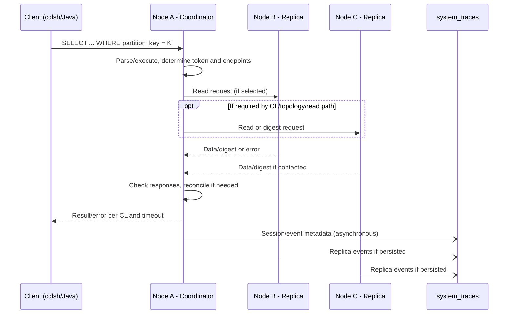
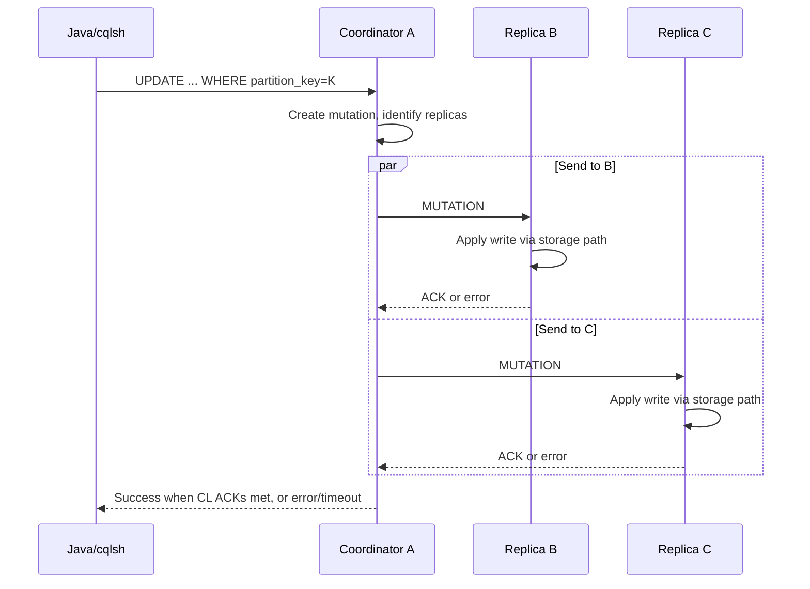

# Identifying Coordinator, Replicas, and Processing Steps in an Apache Cassandra Trace

> **Chapter:** Tracing and Diagnosis  
> **Module:** `DATABASE_ENGINE_WIDE_COLUMN_CASSANDRA` — understand the distributed architecture and wide-column model of Apache Cassandra, partition keys, query-driven table design, read/write consistency levels, replication, compaction, repair, error handling, and Java integration. This lesson guides you through **reading a request trace to distinguish the coordinator, replicas, processing phases, and the limits of trace evidence**.

## 1. Objective: Seeing Each Node's True Role

A query from a Java application may arrive at node A, while the partition's data is stored on B, C, and D. Node A, which receives the request, is the **coordinator**; the nodes holding copies of that partition's data are the **replicas**. If A is also in the replica set, it can serve both roles simultaneously. Never assume the coordinator is always a separate node outside the replica set.

When tracing is enabled, Cassandra creates **one trace session per request**, along with multiple events from components that emit activities. You need to piece together three questions:

1. **Who is the coordinator?** Which node received and coordinated the CQL request?
2. **Which replicas participated?** Which nodes performed reads/writes or responded during this execution?
3. **How did the steps unfold?** Partition routing, replica communication, SSTable/memtable processing, data reconciliation, waiting for sufficient responses, and returning the result?

Identifying these helps distinguish a **hot partition**, a slow-responding replica, SSTable/tombstone read costs, consistency-level waiting, and time spent outside Cassandra in the Java Driver. However, a trace is not an exhaustive recorder of every RPC, syscall, or background task; only what is **instrumented and successfully persisted** appears.

### Learning Outcomes

- Create a lab query with a **partition key** and capture a `Tracing session` using `cqlsh`.
- Query `system_traces.sessions` and `system_traces.events` by the same `session_id`.
- Identify the coordinator, distinguish an event's `source` from nodes storing the data, and draw conditional conclusions about participating replicas.
- Analyze **read**, **write**, and **LWT** paths conceptually without assuming event names are identical across all versions.
- Relate traces to **RF, consistency level, wide-column data, repair/compaction**, and Java Driver latency.

## 2. Four Foundational Concepts Before Reading a Trace

| Concept | Definition | Common Misconception |
| --- | --- | --- |
| **Client** | `cqlsh`, Java Driver, or a service issuing CQL | Not the coordinator, unless the app runs on the same host (still a separate process) |
| **Coordinator** | The Cassandra node to which a client sends a CQL request; coordinates execution and response | Not necessarily a replica; not a fixed central leader of the cluster |
| **Replica** | A node responsible for holding a copy of the partition per token/replication topology | Not every replica of a partition is necessarily asked to respond for a low-CL read |
| **Trace event source** | The node/address that emitted an event written to `system_traces.events` | Not every replica necessarily has an event successfully persisted |

In Cassandra, **any eligible node that the client connects to** can act as the coordinator for a request. The driver typically selects a coordinator based on its load-balancing policy, local datacenter, host status, connections, and other parameters. Cassandra has no single cluster-wide leader handling all CQL requests.

**Routing unit:** the partition key is hashed into a token; the replication strategy determines the responsible replica set. For tables with a composite partition key, **all components of the partition key** are needed to pinpoint the exact partition. Clustering keys order rows within a partition and do not select a separate replica group.

## 3. Request Flow Diagram from Java/cqlsh to Replicas



This diagram shows **one possible scenario**, not a fixed schedule. With consistency level `ONE`, the coordinator may only need one response to return a result, though the actual endpoints contacted depend on the read mechanism and node health. With `LOCAL_QUORUM`, more responses from the local datacenter are required in topologies with RF greater than one. A single node can be both coordinator and replica, collapsing the diagram to fewer IP addresses.

**Tracing does not create replication:** RF is configured on the keyspace; tracing merely observes selected activities of a request already routed according to that replication.

## 4. Creating Lab Schema and Data for Reproducible Traces

These examples target a single-node local Cassandra instance. The lab keyspace uses `SimpleStrategy`, RF=1 **for learning only**. Multi-datacenter production clusters typically use `NetworkTopologyStrategy` with appropriate per-datacenter RF; never copy lab settings into an operational cluster.

```sql
CREATE KEYSPACE IF NOT EXISTS trace_steps_lab
WITH replication = {
    'class': 'SimpleStrategy',
    'replication_factor': 1
};

CREATE TABLE IF NOT EXISTS trace_steps_lab.events_by_user_day (
    user_id uuid,
    event_day date,
    event_no int,
    event_type text,
    detail text,
    PRIMARY KEY ((user_id, event_day), event_no)
) WITH CLUSTERING ORDER BY (event_no DESC);

INSERT INTO trace_steps_lab.events_by_user_day
    (user_id, event_day, event_no, event_type, detail)
VALUES (
    11111111-1111-4111-8111-111111111111,
    '2026-11-21', 1, 'LOGIN', 'web'
);

INSERT INTO trace_steps_lab.events_by_user_day
    (user_id, event_day, event_no, event_type, detail)
VALUES (
    11111111-1111-4111-8111-111111111111,
    '2026-11-21', 2, 'VIEW', 'partition-key'
);

INSERT INTO trace_steps_lab.events_by_user_day
    (user_id, event_day, event_no, event_type, detail)
VALUES (
    11111111-1111-4111-8111-111111111111,
    '2026-11-21', 3, 'VIEW', 'repair'
);
```

Here `(user_id, event_day)` is the **composite partition key**, and `event_no` is the **clustering key**. All events for the same user/day belong to one partition; rows are ordered by `event_no DESC`. A query that supplies `user_id` but **omits `event_day`** lacks a complete routing path to this partition.

### Sample Query

```sql
SELECT event_no, event_type, detail
FROM trace_steps_lab.events_by_user_day
WHERE user_id = 11111111-1111-4111-8111-111111111111
  AND event_day = '2026-11-21'
  AND event_no >= 2
LIMIT 2;
```

With unmodified sample data, the logical result is **rows with `event_no` 3 then 2**. This is a targeted partition query requiring no full-table filtering. `LIMIT 2` limits **two rows**, and does not directly control how many nodes are contacted.

## 5. Capturing a Trace with `cqlsh` and Copying the Exact Session ID

Connect to your lab cluster with `cqlsh` using your environment's settings, then in **the same session** run:

```sql
CONSISTENCY ONE;
TRACING ON;

SELECT event_no, event_type, detail
FROM trace_steps_lab.events_by_user_day
WHERE user_id = 11111111-1111-4111-8111-111111111111
  AND event_day = '2026-11-21'
  AND event_no >= 2
LIMIT 2;

TRACING OFF;
```

`TRACING ON/OFF` and `CONSISTENCY` are **`cqlsh` utility commands**, not standard CQL sent inside a Java Driver prepared statement. `TRACING ON` asks the server to trace subsequent requests from that `cqlsh` session; `TRACING OFF` stops tracing for later commands. Never leave tracing enabled and run hundreds of `INSERT` statements in production just to gather extra samples.

`cqlsh` usually prints a **`Tracing session: <UUID>`** line and the event table when a request is traced. **You must use the real UUID** from the output; UUIDs shown in this lesson are illustrative only. Also record the Cassandra version, UTC timestamp, CQL, CL, contacted node, and query result for full context.

### Illustrative Output Example (Not a Measured Trace)

```text
cqlsh> TRACING ON;
Now Tracing is enabled

cqlsh> SELECT event_no, event_type, detail FROM ...;

 event_no | event_type | detail
----------+------------+---------------
        3 | VIEW       | repair
        2 | VIEW       | partition-key

Tracing session: 8cbe0000-e581-11f1-8e9a-0242ac120002

 activity                         | source    | source_elapsed
----------------------------------+-----------+---------------
 Executing single-partition ...  | 127.0.0.1 | ...
 ...                               | ...       | ...
 Request complete                 | 127.0.0.1 | ...

cqlsh> TRACING OFF;
Now Tracing is disabled
```

**Do not build a rigid parser around the event names in this illustrative table.** Actual activity text, ordering, timestamps, and nodes vary across Cassandra versions, CLs, statement types, and trace write success.

## 6. Reading Both System Tables and Identifying the Coordinator

After running **`TRACING OFF`**, query using the real `session_id`:

```sql
-- Replace the illustrative UUID with the real tracing session ID.
SELECT session_id, coordinator, started_at, duration,
       request, parameters
FROM system_traces.sessions
WHERE session_id = 8cbe0000-e581-11f1-8e9a-0242ac120002;

SELECT event_id, activity, source, source_elapsed, thread
FROM system_traces.events
WHERE session_id = 8cbe0000-e581-11f1-8e9a-0242ac120002;
```

The **`coordinator`** field in `system_traces.sessions` is direct evidence of the node that coordinated **that traced request**. `system_traces.events.source` is the node that emitted **each individual event**, not a substitute column for the coordinator. If `source == coordinator`, that event was recorded on the same node address. If different, the event came from another node—potentially a participating replica or related processing component; **read the activity and context** before assigning a role.

| Field | Table | Meaning | Must Not Infer |
| --- | --- | --- | --- |
| `session_id` | `sessions`, `events` | Key linking all events of a trace | Java `CqlSession` ID or HTTP request ID |
| `coordinator` | `sessions` | Node coordinating the request | Only node holding data or slowest node |
| `duration` | `sessions` | Request duration recorded by tracing, usually microseconds | Total HTTP/Java latency |
| `started_at` | `sessions` | Recorded start timestamp | All node clocks are perfectly synchronized |
| `source` | `events` | Node emitting an event | Every source is a replica owning the partition |
| `activity` | `events` | Description of an instrumented step | Complete list of every RPC/IO |
| `source_elapsed` | `events` | Relative timestamp, usually microseconds | Exact network latency by subtracting two nodes |
| `thread` | `events` | Thread that created the event | Business transaction or row lock identifier |

`session_id` is the partition key in `events`, and `event_id` is typically a `timeuuid` clustering key; this makes reading all events **by ID** efficient. Do not scan `system_traces.events` with `ALLOW FILTERING` on `activity` to hunt for the "slowest traces cluster-wide"; the schema is not designed for that access path.

### If `sessions` Has No Row Immediately

Trace writes can be asynchronous, have a TTL, and be affected by node/replica failures. Verify the real ID, cluster, read permissions, timestamp, and retry **a bounded number of times**. Seeing an ID in `cqlsh` output does not guarantee all events have already been persisted and become immediately readable. Do not treat a missing trace as proof that the CQL request never executed.

## 7. Coordinator: Receiving Requests, Routing, and Deciding Completion

Conceptually, the coordinator must:

1. Receive the CQL request or prepared statement execution from the client.
2. Identify the table, primary key constraints, and consistency level.
3. Compute/look up the token from the **partition key** to locate the target partition.
4. Determine the **appropriate replicas** based on topology, RF, node health, and read/write path.
5. Dispatch requests to the required endpoints and collect responses.
6. Reconcile data or evaluate conditions when required by the read/write algorithm.
7. Return the result or error once completion criteria or timeout is reached.

Not every step emits an explicitly named event like `Calculate token` in every trace. A pre-`PREPARE`d CQL statement, a cached small query, or a different code path can produce **different event counts and names**. Tracing lets you observe instrumented steps, not a full printout of Cassandra's source code.

**The coordinator is not a data leader** in the sense of owning the sole authoritative copy of a partition. Cassandra maintains replicas and reconciles cell versions via metadata/timestamps; the coordinator simply orchestrates **the current request**.

## 8. Replicas: Nodes Actually Reading/Writing the Partition

To identify participating replicas, combine:

- `sessions.coordinator`: the coordinating node.
- `events.source`: the address emitting the activity.
- `events.activity`: descriptions such as *sending READ message*, *reading partition*, *received response*, or related steps—**semantic examples only**; exact strings are not fixed.
- **Replication topology and token ownership** from the corresponding schema/operational tools.

If an event from IP B records **reading partition data** and the trace belongs to a query on key K, there is reasonable evidence to treat B as **a node participating on the replica read path**. However, the absence of events from C **does not** prove C is not a replica of K: C may not have been chosen by the coordinator under that CL, or its events may not have been recorded, or may have been dropped, delayed, or expired by TTL.

A coordinator can also be a replica for K. In that case, routing and local data reading can both appear with the **same source IP**. Do not count distinct IPs to determine RF.

### Distinguishing Other Roles

- **Driver contact point**: an address used by the client to discover/connect to the cluster; not automatically the coordinator for **every** subsequent query.
- **Coordinator**: the node receiving a **specific request**; varies from request to request.
- **Replica owner**: a node storing a copy of a **specific partition** per token/replication.
- **Event-emitting node**: observed from `source`; insufficient to assign a role independently of `activity`.
- **Repair/streaming participant**: nodes may perform background work concurrently; a single query trace does not fully capture that repair/streaming work.

## 9. Read Path: Recognizable Phases in a `SELECT`

Reading a partition can proceed through the following conceptual phases:

| Phase | What Coordinator/Replica Does | Potential Trace Clues | Additional Verification Needed |
| --- | --- | --- | --- |
| **Acceptance** | Coordinator receives/decodes CQL request | Execution start, READ/SELECT type | Driver latency before sending |
| **Routing** | Computes token and picks replica endpoints | Events contacting replicas or local execution | Partition key, RF, DC, topology |
| **Data retrieval** | Replica reads memtable/cache/SSTables | Partition/storage read events if instrumented | SSTable count, cache, disk I/O |
| **Response receipt** | Coordinator receives data/digest or error | Response events from replicas | CL, node timeout, network |
| **Reconciliation** | Compares responses/versions if needed | Digest mismatch, reconciliation/read repair if triggered | Replica divergence, Cassandra version |
| **Completion** | CL satisfied, returns result | Request complete/finish | Client latency and payload |

**Not every phase is visible** in every trace. A local replica read in a single-node cluster may produce no network RPCs. A cache-hit query differs from one reading multiple SSTables. Likewise, a query returning few rows is not necessarily cheap if a large partition contains many tombstones or rows filtered out by conditions.

### Data Requests and Digest Requests

On some multi-replica read paths, Cassandra may fetch **full data** from at least one replica and a **digest** (content checksum) from others for verification. If digests mismatch, the coordinator may fetch additional data and reconcile according to the version's rules.

- **Data response:** carries the actual data needed to return to the client.
- **Digest response:** summary of content used to check consistency; insufficient on its own to return full rows.
- **Digest mismatch:** indicates replicas hold diverged data or read different snapshots; investigate further rather than immediately assuming SSTable corruption.

Exact request/response names and whether digests are used depend on Cassandra version, CL, and read path. **Do not assume a `ONE` query always generates data + digest across multiple replicas**, nor assume `LOCAL_QUORUM` must always issue exactly one data request plus one digest request.

## 10. Identifying Read Repair vs. Scheduled Anti-Entropy Repair

If contacted replicas return differing data, Cassandra may trigger **read repair/reconciliation** depending on version and table configuration to bring certain replicas back into alignment. The trace may contain activities related to extra reads, digest comparisons, or repairing data.

**Read repair on the read path** differs from **`nodetool repair`**:

| Read Repair / Reconciliation | Scheduled Anti-Entropy Repair |
| --- | --- |
| Triggered within/alongside a read path when conditions apply | Planned/background operational task to synchronize replicas |
| Can impact latency of the traced request | Can impact I/O/network load over an extended period |
| Depends on CL, divergence, and Cassandra version/table settings | Has its own schedule, keyspace/table/token scope, progress, and errors |
| Does not replace cluster-wide repair schedules | Does not replace per-request read reconciliation |

For example, Cassandra 4.x has read repair controls that differ from older versions. Therefore, do not see a `digest mismatch` trace message and immediately assert that blocking read repair always ran using one fixed algorithm. **Check the version, table configuration, and metrics** before concluding.

## 11. Write Path: Coordinator Waits for ACKs, Replicas Write Mutations

For an `UPDATE`, processing differs from `SELECT`. The coordinator builds/routes the mutation to the relevant replica set; replicas persist the write via Cassandra's storage path (e.g., commit log, memtable) and return an ACK along the execution path. The coordinator decides when **enough responses per consistency level** have arrived to return success.



**Important:** `CL=ONE` usually specifies **how many ACKs the coordinator needs to complete**, not that Cassandra only **sends the write to one replica** and ignores the others. RF and endpoint health still drive replication work. With RF=3, multiple replicas can process the mutation even though the client receives success after one qualifying ACK.

### Sample Trace of a Small Write

```sql
-- Initial state already has event_no=3 from the lab example.
TRACING ON;

UPDATE trace_steps_lab.events_by_user_day
SET detail = 'repair-topic-updated'
WHERE user_id = 11111111-1111-4111-8111-111111111111
  AND event_day = '2026-11-21'
  AND event_no = 3;

TRACING OFF;
```

When analyzing an UPDATE trace, look for events indicating **mutation sent/received/acknowledged** and storage operations if present. Do not infer that completing an `UPDATE` means **compaction is done**: compaction is background work occurring later with its own metrics and logs.

## 12. Reads vs. Writes: Comparing Under the Same RF/CL and Workload

| Aspect | `SELECT` | Standard `INSERT`/`UPDATE` |
| --- | --- | --- |
| Primary output | Data/rows | Mutation acknowledgment per CL |
| Replica work | Read data, versions, cache/SSTables as needed | Write mutation, commit log/memtable via storage path |
| Acknowledgment level | Required read response count/scope | Required write ACK count/scope |
| Reconciliation visible? | Digest mismatch, reconcile/read repair in applicable cases | Mutations merged later by replicas using metadata/timestamps |
| On timeout | Insufficient data/read ACKs collected in time | Write may already be applied on some replicas |
| Trace evidence | Only successfully persisted events | Only successfully persisted events |

Do not compare a `SELECT` at `ONE` on a tiny partition against an `UPDATE` at `LOCAL_QUORUM` on a cluster undergoing repair and conclude reads are always faster than writes. For root-cause analysis, **keep RF, topology, load, consistency, and partition size as constant as possible**.

## 13. LWT: Traces May Contain Consensus Phases

A lightweight transaction (LWT) using `IF` requires conditional checking with consensus coordination, unlike unconditional mutations. LWT relies on Paxos/serial consistency; the execution path can include prepare, propose/accept, and commit phases or version-specific optimizations.

```sql
-- Example runs on lab row only; condition depends on existing state.
TRACING ON;

UPDATE trace_steps_lab.events_by_user_day
SET detail = 'lwt-accepted'
WHERE user_id = 11111111-1111-4111-8111-111111111111
  AND event_day = '2026-11-21'
  AND event_no = 3
IF detail = 'repair-topic-updated';

TRACING OFF;
```

The result includes an **`[applied]`** column. If the condition is false, `[applied] = false` is a **valid business outcome**, not a CQL request failure. On timeout, never assume the transaction was definitely not applied; check state instead of retrying blindly.

When inspecting an LWT trace, compare **the consensus steps and response counts** with a normal write path, but avoid hardcoding phase or event counts. Cassandra version, CL/serial CL, replica health, and optimizations alter the execution flow. In an RF=1 lab, the trace only illustrates semantics; it does not represent Paxos cost under RF=3.

## 14. How RF, Datacenter, and Consistency Level Shape Replica Presence

### Replication Factor Is Not a Mandatory IP Count in Traces

Suppose a production keyspace uses `NetworkTopologyStrategy` with RF=3 in one datacenter. A partition has a replica set defined by topology/token. However, a `SELECT` at `ONE` may only need **one** qualifying response, `LOCAL_QUORUM` typically requires **two** responses in a DC with RF=3, and `QUORUM` applies quorum semantics across the replica scope for that CL. Even so, due to endpoint selection, retries/speculation, or read repair, **the number of contacted nodes cannot be rigidly deduced from ACK counting formulas**.

| CL / Scenario | What Is Required | What Cannot Be Inferred from One Trace |
| --- | --- | --- |
| `ONE`, RF=1 lab | One replica suffices to reply; no node fault tolerance | Multi-node quorum execution path |
| `ONE`, RF=3 | One qualifying read/write response satisfies CL | Only one replica participated in the entire request |
| `LOCAL_QUORUM`, RF=3 in local DC | Local quorum, typically two replicas | Exactly two IPs always appear in events |
| `QUORUM`, multi-DC | Quorum across total replicas per CL | No cross-DC traffic or latency is always higher |
| `LOCAL_ONE` | One response from local DC per valid config | Every request runs 100% on a single node |
| LWT `SERIAL`/`LOCAL_SERIAL` | Serial consistency scope for condition | Equivalent to a regular `UPDATE` at the same CL |

Do not arbitrarily change CL in production just to generate more trace events: CL affects **latency, availability, and business consistency guarantees**. To test multi-replica behavior, use a staging cluster with sufficient RF/topology and a controlled test scenario.

## 15. Timeline: What Do `event_id`, `source_elapsed`, and Ordering Mean?

`system_traces.events` typically has `event_id` (timeuuid), `activity`, `source`, `source_elapsed`, and `thread`. Events sharing a `session_id` are ordered by clustering key; this **does not turn the trace into a single perfectly accurate cluster-wide clock**.

### A Simulated Timeline Example

| Observed Order | Source | Activity (Illustrative Meaning) | Cautious Interpretation |
| --- | --- | --- | --- |
| 1 | A | Start reading partition K | A is coordinator per `sessions.coordinator` |
| 2 | A | Send request to B | B is an endpoint contacted by A this time |
| 3 | B | Read local data for K | B shows signs of participating on replica read path |
| 4 | B | Return data/response | B responded as part of the processing path |
| 5 | A | Complete request | A returns result once CL conditions are met |

**This is not real Cassandra output.** An actual trace may display some timestamps out of order or miss events due to asynchronous processing, clock skew, caching, or path optimizations. Never subtract `source_elapsed` between events on A and B and claim the result is **exact network latency**.

### A More Reliable Timeline Analysis Process

1. Take the **coordinator** from `sessions`, rather than guessing from the first event.
2. Group events by **`source`** to see which steps each node instrumented.
3. Identify the **request type** (SELECT, UPDATE, LWT) and **consistency level** from context.
4. Isolate **wait/response intervals** based on actual available activities without inventing missing events.
5. Compare **Cassandra-side `duration`** (usually microseconds) with Java/cqlsh latency, accounting for measurement boundaries.
6. If a phase looks suspicious, inspect **metrics/logs**: CPU, disk I/O, queues, SSTables, tombstones, GC, network, repair, and compaction.

`source_elapsed` is a relative time tied to the trace event and its source; its calculation, precision, and synchronization should be checked against your Cassandra version. Although `event_id` helps sort rows by timeuuid, **timeuuid order is insufficient to prove strict causal ordering of all RPCs** across machines with independent clocks.

## 16. How Does Session Duration Differ from Client-Observed Time?

For example, `sessions.duration = 7000` in a version using **microseconds** equals roughly **7 ms** in server-side tracing. If Java measures 40 ms for the call, **you cannot conclude the remaining 33 ms is definitely network latency**.

Client-side time can include:

- Connection pool waiting, backpressure, or queuing inside the Java Driver.
- DNS/TLS/network setup and request/response transport.
- Retries, speculative execution, or host failover if configured.
- Deserialization, data processing, and fetching subsequent result pages.
- GC/JVM scheduling or application logic wrapping `session.execute`.
- Tracing overhead itself, shifting the sample request away from baseline.

In particular, if the application uses **paging**, calling `session.execute(...).one()` or receiving the first page does not mean all rows were read. When measuring end-to-end API latency, define the scope clearly, measure the full page iteration loop, and use appropriate driver metrics.

## 17. What Can Traces Help Diagnose, and What Supporting Evidence Is Needed?

| Symptom | Potentially Related Trace Clues | Supporting Evidence to Collect |
| --- | --- | --- |
| Unusually slow read query | Prolonged replica storage path, late responses | p95/p99, disk I/O, SSTable count, tombstone metrics |
| Timeouts at high CL | Coordinator waiting for enough responses in time | RF, datacenter, node status, network, logs, timeout config |
| One node consistently slow | Events from that source are prolonged across traces | CPU, GC, disk, queues, load imbalance, token ownership |
| Frequent digest mismatches | Data reconciliation path appears | Repair history, replica divergence, version/table read-repair |
| Write timeout yet data appears later | Insufficient ACKs before timeout | State on replicas, idempotence, retry policy |
| Slow LWT | Multiple coordination/consensus phases | Partition contention, serial CL, Paxos metrics |
| Slow while compaction/repair runs | Request trace coincides with high background I/O | Compaction backlog, repair progress, disk/network saturation |
| Only Java is slow, server duration is small | Little time visible inside server trace | Driver pool, retries, TLS, JVM GC, app telemetry |
| Scan / large partition query | Lots of data read/reconciled | Schema, partition size, clustering range, filtering |

A single trace is **one observational sample**, not performance statistics. To diagnose systemic issues, compare several well-chosen samples under similar load and correlate with metrics. Do not leave `TRACING ON` throughout a load test; tracing incurs CPU/I/O/storage costs and can distort the very latency under investigation.

## 18. Common Trace-Reading Mistakes

### Mistake 1: "Coordinator = node with the first event"

Wrong: the first event can arrive late or be missing. Read `coordinator` from `system_traces.sessions` when available and match the exact request's trace ID.

### Mistake 2: "RF=3 means the trace must have exactly three sources"

Wrong: the number of event sources is neither the number of replicas owning the partition nor the number of ACKs required. Check RF, token/topology, and CL.

### Mistake 3: "Replica C has no events, so C did not receive the write"

Wrong: events may be uninstrumented, dropped, delayed, or expired by TTL. Traces are not an audit log guaranteeing coverage of every replica.

### Mistake 4: "`source_elapsed(B) - source_elapsed(A)` = exact network time"

Wrong: starting offsets and clocks across sources have skew; queuing and unrecorded events also occur.

### Mistake 5: "`TRACING ON` lets you benchmark production with zero overhead"

Wrong: request tracing has overhead; collect baseline numbers from normal queries and metrics, and use traces to inspect the structure of a few requests.

### Mistake 6: "Request completion means replicas are fully repaired/compacted"

Wrong: write acknowledgments, read repair, anti-entropy repair, and compaction are distinct mechanisms. Query completion does not prove background jobs finished.

### Mistake 7: "A timeout guarantees the UPDATE was not applied"

Wrong: some replicas may have already applied the mutation. Retrying non-idempotent statements (such as list appends) can create duplicate elements; handle retries based on mutation semantics.

## 19. Java Driver 4.x: Selective Tracing and Retrieving the ID

Java Driver 4.x provides a mechanism to enable tracing **per statement**. This example assumes the session is already configured with contact points, local datacenter, and appropriate auth/TLS. The repository prepares the statement once rather than creating a new session per request:

```java
import com.datastax.oss.driver.api.core.CqlSession;
import com.datastax.oss.driver.api.core.cql.BoundStatement;
import com.datastax.oss.driver.api.core.cql.PreparedStatement;
import com.datastax.oss.driver.api.core.cql.ResultSet;
import java.time.LocalDate;
import java.util.UUID;

class TraceReader {
    private final CqlSession session;
    private final PreparedStatement select;

    TraceReader(CqlSession session) {
        this.session = session;
        this.select = session.prepare(
            "SELECT event_no, event_type FROM trace_steps_lab.events_by_user_day " +
            "WHERE user_id = ? AND event_day = ? LIMIT 2"
        );
    }

    void traceOneRead(UUID userId, LocalDate day) {
        BoundStatement stmt = select.bind(userId, day)
            .setTracing(true);

        long started = System.nanoTime();
        ResultSet rs = session.execute(stmt);
        long clientElapsedUs = (System.nanoTime() - started) / 1_000;

        UUID traceId = rs.getExecutionInfo().getTracingId();
        System.out.println("trace_id=" + traceId);
        System.out.println("client_elapsed_us=" + clientElapsedUs);
        // Also collect host/CL/retries from execution info and telemetry
        // using the exact APIs of your deployed driver version.
    }
}
```

Enable `.setTracing(true)` only for **sample requests**; never trace every request on an API handling thousands of QPS by default. If `traceId == null`, check configuration, tracing support, and actual execution rather than generating a placeholder UUID. When retries or speculative execution occur, inspect **attempts** and host details per driver/version; one logical Java request can trigger multiple network attempts.

**Distinguish three measurement scopes:** Java measures how long `session.execute` takes to return `ResultSet`, Cassandra records `sessions.duration`, and the HTTP API measures the entire business request. They do not share the same scope; discrepancies merely point where to investigate.

## 20. Query-Driven Table Design: Tracing Does Not Fix a Wrong Partition Key

The lab query is designed **along the right dimension**: knowing `(user_id, event_day)` lets the coordinator route to one partition. If the application instead needs "all `VIEW` activities across all users on a given day," the current user-keyed table does not serve that read path:

```sql
-- ANTI-PATTERN: do not run on large tables in production.
SELECT user_id, event_no
FROM trace_steps_lab.events_by_user_day
WHERE event_type = 'VIEW'
ALLOW FILTERING;
```

Even if a CQL version permits `ALLOW FILTERING`, the query may have to read many partitions. A trace can highlight expensive execution steps, but **it cannot create an index or change the partition key**. A table aligned to that query dimension could look like:

```sql
CREATE TABLE trace_steps_lab.events_by_type_day (
    event_type text,
    event_day date,
    event_time timeuuid,
    user_id uuid,
    detail text,
    PRIMARY KEY ((event_type, event_day), event_time, user_id)
) WITH CLUSTERING ORDER BY (event_time DESC, user_id ASC);
```

In the new table, `(event_type, event_day)` is the **partition key**, and `(event_time, user_id)` is the **clustering key**. The read path by event type and day becomes clear. However, a very common event type can make a daily partition too large, requiring smaller buckets/sharding; the system must also maintain denormalized tables and handle write retries. In Cassandra, **query-driven schema design** is foundational; tracing verifies behavior rather than replacing design.

## 21. Scenario Exercises

**Exercise 1 — Identifying the coordinator.** `sessions.coordinator = A`, and events show sources A and B. Which node definitely acted as coordinator for this trace?  
**Hint:** A, according to session metadata. B is another event source; check activity and topology to determine B's role.

**Exercise 2 — Single-node lab.** All events show `source=127.0.0.1`, yet the query still reads data. Does this mean the query didn't need a replica?  
**Hint:** No. With RF=1, the coordinator can also be the replica. One IP can serve both roles.

**Exercise 3 — RF=3, CL=ONE.** The trace shows events from nodes B and C. Does that mean data was acknowledged by two replicas before returning success?  
**Hint:** Do not infer required/satisfied ACKs solely from source count. `CL=ONE` and contacted replica paths are distinct concepts.

**Exercise 4 — Digest mismatch.** A trace contains a digest mismatch activity. Can you conclude an SSTable is corrupted?  
**Hint:** No. Replicas may simply not have converged yet; check repair/read-repair, version, logs, and metrics.

**Exercise 5 — Source elapsed.** Event A has `source_elapsed=1000` and event B has `source_elapsed=6000`. Can you conclude the A→B network took exactly 5 ms?  
**Hint:** No. Different nodes/clocks, asynchronous events, and relative offsets apply; use complementary network/timing metrics.

**Exercise 6 — Write timeout.** An `UPDATE` times out at `LOCAL_QUORUM`; a subsequent `SELECT` sees the new data. Is that contradictory?  
**Hint:** No. Some replicas may have applied the mutation before enough ACKs returned within the timeout. Handle retries based on write semantics.

**Exercise 7 — LWT.** `UPDATE ... IF detail='repair'` returns `[applied]=false`. Did a replica fail?  
**Hint:** No. A false condition is a valid result. Inspect state and potential contention rather than forcing an unconditional write.

**Exercise 8 — Server 8 ms, Java 42 ms.** Can you assert the 34 ms difference is network latency?  
**Hint:** No. Check pool queuing, retries, TLS, GC, deserialization, paging, and measurement boundaries.

**Exercise 9 — Missing trace events.** The session exists, but events from B are missing. List at least three explanations.  
**Hint:** B was not contacted, events weren't persisted yet, trace write failed, trace expired by TTL, or that step wasn't instrumented.

**Exercise 10 — Schema.** An API needs the 20 latest `VIEW` events per day across millions of users. Should you use `TRACING ON` with `ALLOW FILTERING` instead of a dedicated table?  
**Hint:** No. Design a table keyed by `(event_type,event_day)` with time clustering, bound partition size, and measure fan-out if needed.

## 22. Trace Investigation Checklist

- [ ] Recorded **full CQL, sanitized bind values, partition key**, CL, and timestamp.
- [ ] Confirmed **Cassandra version, RF, and datacenter/topology** before interpreting nodes.
- [ ] Enabled `TRACING ON` for **one small, safe request**, then disabled immediately with `TRACING OFF`.
- [ ] Saved the **real tracing session ID**, never copying sample IDs from documentation.
- [ ] Read `system_traces.sessions` and `system_traces.events` **using the same `session_id`**.
- [ ] Took the **coordinator from session metadata**, not by guessing from the first event.
- [ ] Grouped **events by `source`**, reading activities before assigning a replica role with evidence.
- [ ] Distinguished **read data/digest/reconciliation**, **write mutation/ACK**, and **LWT consensus** by request type.
- [ ] Avoided treating **event source IP count as RF** or actual ACK count.
- [ ] Avoided subtracting timestamps from **different nodes** to claim exact network latency.
- [ ] Correlated server `duration` with **Java Driver latency**, timeouts, retries, paging, and telemetry.
- [ ] Checked **partition size, tombstones, SSTables/cache, compaction, and repair** when explaining latency.
- [ ] Handled missing/delayed/expired traces with bounded re-checks; never treated them as complete audit logs.
- [ ] Avoided bulk tracing in production; sanitized sensitive data and stored evidence per permissions/retention.

## 23. Key Takeaways

- **Coordinator** is the node receiving and orchestrating a request; **replica** is a node storing a partition copy per RF/token. Both roles **can coexist on the same node**.
- `system_traces.sessions.coordinator` identifies the coordinating node; `system_traces.events.source` indicates **where an event originated**, without proving all sources are replicas or all replicas appear.
- **Read path** typically involves routing, data/digest reads, reconciliation, and returning results; **write path** involves mutations and replica ACKs; **LWT** adds conditional/consensus coordination.
- **Consistency level governs required responses**, not mandatory event counts or IP counts in a trace. Know RF, DC, and version before interpreting.
- `event_id`, `source_elapsed`, and `duration` are useful timeline clues but **not a single cluster-wide precision clock**. Tracing has overhead, can drop/delay events, and expires by TTL.
- From a trace, only form **hypotheses** about slow replicas, SSTables/tombstones, network, queuing, or read repair; verify with metrics/logs, Java telemetry, and controlled experiments.
- In Cassandra, **partition keys and query-driven table design** determine the data path. Tracing illuminates execution and errors, but cannot fix an oversized partition or a misaligned query schema.
