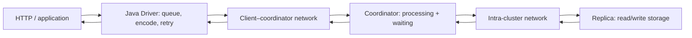
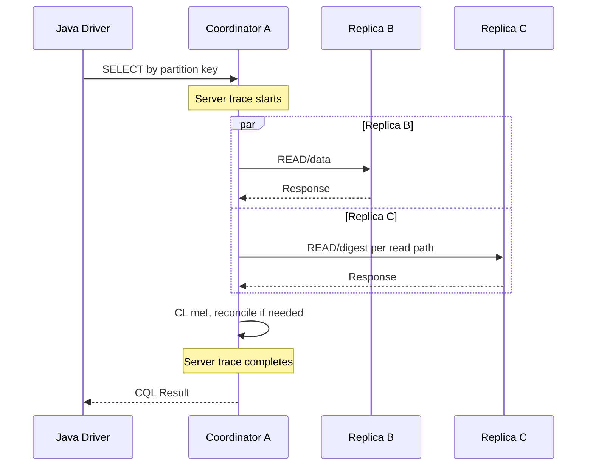
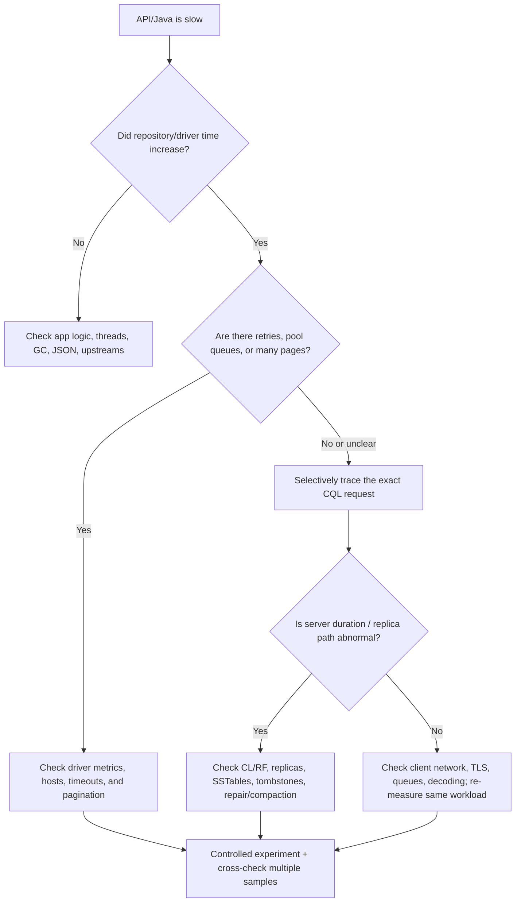

# Distinguishing Application, Network, and Server Time When Diagnosing Apache Cassandra

> **Chapter:** Tracing and Diagnosis  
> **Module:** `DATABASE_ENGINE_WIDE_COLUMN_CASSANDRA` — understand the distributed architecture and wide-column model of Apache Cassandra, specifically partition keys, query-driven table design, replication, read/write consistency levels, compaction, repair, error handling, and Java application integration. This lesson guides you through **measuring and interpreting multi-layer latency**, combining Java Driver 4.x, `cqlsh`, `system_traces`, and operational telemetry.

## 1. A 120 ms API Call Does Not Mean Cassandra Took 120 ms

Suppose the API `GET /users/{id}/events` responds in 120 ms. The Java team records that the Cassandra call took 55 ms, while a Cassandra trace reports a `duration` of roughly 8 ms. Can you conclude **47 ms is network latency**?

**No.** You must distinguish at least the following components:

- **Application:** authentication, request handling, cache checks, domain object mapping, JSON serialization, other logic, and thread scheduling waits.
- **Java Driver:** connection acquisition, in-flight limits/backpressure, CQL encoding, host selection, request dispatch time, retries/speculative execution, result decoding, and fetching subsequent pages.
- **Network between application and coordinator:** request/response transit, TLS, kernel/socket queues, packet loss/retransmissions, and intermediate infrastructure if any.
- **Server-side Cassandra:** coordinator receiving the request, partition routing, replica communication, memtable/SSTable lookup, tombstone/cache processing, data reconciliation, and waiting for enough responses per consistency level.
- **Intra-cluster network:** coordinator ↔ replica RPCs. This portion may **fall inside the coordinator's request-processing time** and must not be lumped into "client–server network time."

One logical request can trigger **multiple actual CQL dispatches** when the driver retries or performs speculative execution. Thus, total latency is not always a linear sum of one send, one server execution, and one return.

**Objective:** after this lesson, you will be able to construct measurements with clear boundaries, distinguish **client-observed** metrics from **server tracing**, capture traces by session ID, and propose testable hypotheses about the network, driver, or replicas instead of assigning blame via naive subtraction.

## 2. The Three-Layer Timing Model — and Where the Simple Model Breaks

In a *simple* request with no retries and no extra paging, you can visualize:

```text
JAVA APPLICATION                              CASSANDRA

t0 HTTP enters
   | API handling, validation, cache, mapping
t1 session.execute() starts
   | driver picks host, waits for connection/encode
   |---------------- network request ---------> t2 coordinator receives
   |                                            | routing, replica RPCs
   |                                            | storage + waiting for responses
   |<--------------- network response --------- t3 coordinator replies
   | driver decodes, builds ResultSet
t4 execute() returns / first page received
   | iterate results, fetch next pages if any
   | DTO mapping + JSON serialization
t5 HTTP completes
```

Quantities observed **on the same Java clock** can be computed as:

\[
T_{\text{API}} = t_5 - t_0,
\qquad T_{\text{execute}} = t_4 - t_1.
\]

If `t1` and `t4` bracket the exact same call, you can split total API time into **non-overlapping intervals** measured by Java: before the call, during the call, and after the call. However, you **cannot** take `t4 - t1` and directly subtract the server's `t3 - t2` to deduce exact network time, because:

1. Boundaries `t2` and `t3` do not necessarily align with `sessions.duration`.
2. Coordinator-side server duration **may include waiting on inter-node RPCs**, rather than pure server CPU work.
3. A single logical request may involve **retries/speculation**, multiple coordinators/attempts, timeouts, or multiple pages.
4. Client-side duration also includes **decoding, scheduling, GC, and queuing**, not just packet transit.
5. Clocks on the Java host and Cassandra nodes are not guaranteed to be synchronized at microsecond precision for cross-machine timestamp subtraction.

### Observability Boundary Diagram



Arrow paths are not drawn to time scale. The diagram highlights **multiple observability boundaries** and the waiting segment between coordinator and replicas; it does not assert that every query touches this exact number of nodes.

## 3. Build a Timing Glossary Before Reading Dashboards

| Measurement | Typical Start and End Points | What It Includes | What It Must Not Be Mistaken For |
| --- | --- | --- | --- |
| **HTTP request latency** | HTTP ingress → response complete | App logic, DB, network, JSON, app-level queues | Cassandra latency alone |
| **Repository method latency** | Method entry → exit | Mapping logic, one or more queries, result processing | A single server execution |
| **Driver observed request latency** | Driver-measured request/attempt per metric definition | Queue/connection/network/protocol as defined by the metric | Automatically equal to server duration |
| **`session.execute()` wall time** | `System.nanoTime()` before → after call | Synchronous execution until initial result or error | Full time to consume all pages |
| **Full result consumption** | Before send → finished iterating all rows | May include multi-page fetches and mapping | First-page time only |
| **`system_traces.sessions.duration`** | Server tracing boundaries for one request | Server/coordinator request path per version; may include replica wait | HTTP end-to-end or pure CPU time |
| **`source_elapsed` in events** | Relative event offset within trace | Part of the timeline from a node/source | Absolute network time via difference between two nodes |
| **Disk/CPU/GC metrics** | Node sampling window | Background load, resources, and concurrent work | Exact time breakdown of a single request |

Whenever reporting "DB latency 50 ms," specify **where it was measured, in what unit, from which start/end points, whether pagination is included, and whether it covers one attempt or multiple attempts**. Without clear definitions, two dashboards both labeled "DB latency" may not be comparable.

## 4. A Numerical Example to Avoid Wrong Subtraction

Suppose the following illustrative values are observed during **one HTTP request**:

| Observation | Illustrative Value |
| --- | ---: |
| HTTP end-to-end | 120 ms |
| Application work before calling repository | 28 ms |
| `session.execute()` until first result page | 55 ms |
| Fetching remaining pages, DTO mapping, building response | 37 ms |
| `sessions.duration` of one traced CQL request | 8,000 µs (about 8 ms) |

The three intervals **28 + 55 + 37 = 120 ms** can form a valid breakdown if measured on the same Java clock **back-to-back without overlap**. However, **55 − 8 = 47 ms is not a network measurement**. The 47 ms figure is merely *the difference between two observation scopes* in this hypothetical scenario. It can contain driver queuing, client–coordinator round-trip, waiting for fetch/deserialization, scheduling, and discrepancies in which request was traced.

Even if a tracing ID corresponds to this exact attempt, the coordinator-side duration may already include **waiting on replicas over the intra-cluster network**. To estimate network time, you need socket/TCP metrics, host/client telemetry, RPC latencies, observability systems, or controlled experiments—**not a single subtraction**.

## 5. Preparing a Partition-Key Lab Environment in Cassandra

The example below assumes `cqlsh` can connect to a learning Cassandra cluster. `SimpleStrategy` with RF=1 is **only suitable for a single-node lab**; multi-datacenter production clusters should choose `NetworkTopologyStrategy` and RF/consistency aligned with fault-tolerance requirements.

```sql
CREATE KEYSPACE IF NOT EXISTS latency_lab
WITH replication = {
    'class': 'SimpleStrategy',
    'replication_factor': 1
};

CREATE TABLE IF NOT EXISTS latency_lab.events_by_user_day (
    user_id uuid,
    event_day date,
    event_no int,
    event_type text,
    payload text,
    PRIMARY KEY ((user_id, event_day), event_no)
) WITH CLUSTERING ORDER BY (event_no DESC);

INSERT INTO latency_lab.events_by_user_day
    (user_id, event_day, event_no, event_type, payload)
VALUES (
    11111111-1111-4111-8111-111111111111,
    '2026-11-21', 1, 'LOGIN', 'web'
);

INSERT INTO latency_lab.events_by_user_day
    (user_id, event_day, event_no, event_type, payload)
VALUES (
    11111111-1111-4111-8111-111111111111,
    '2026-11-21', 2, 'VIEW', 'partition'
);

INSERT INTO latency_lab.events_by_user_day
    (user_id, event_day, event_no, event_type, payload)
VALUES (
    11111111-1111-4111-8111-111111111111,
    '2026-11-21', 3, 'VIEW', 'repair'
);
```

In `PRIMARY KEY ((user_id, event_day), event_no)`, `(user_id, event_day)` is the **composite partition key**, and `event_no` is the **clustering key**. Events for the same user/day land in one partition, so the sample query below supplies the **complete partition key**:

```sql
SELECT event_no, event_type, payload
FROM latency_lab.events_by_user_day
WHERE user_id = 11111111-1111-4111-8111-111111111111
  AND event_day = '2026-11-21'
  AND event_no >= 2
LIMIT 2;
```

The expected result when no other writes have occurred is two rows with `event_no = 3` then `2`. We choose a small query to observe the **baseline execution path**, avoiding cluster-wide `ALLOW FILTERING` scans that inflate load just to produce a trace.

## 6. Using `cqlsh` to Capture the Server Trace of the Sample Query

Within the **same `cqlsh` session**, run:

```sql
CONSISTENCY ONE;
TRACING ON;

SELECT event_no, event_type, payload
FROM latency_lab.events_by_user_day
WHERE user_id = 11111111-1111-4111-8111-111111111111
  AND event_day = '2026-11-21'
  AND event_no >= 2
LIMIT 2;

TRACING OFF;
```

`CONSISTENCY`, `TRACING ON`, and `TRACING OFF` are **`cqlsh` commands**, not CQL for Java prepared statements. `cqlsh` typically prints a **`Tracing session: <UUID>`** line and the server-side event table after the query. Save the **real trace ID**, CQL statement, CL, timestamp, server version, and connected node.

**Do not leave tracing enabled** while running a batch of queries or live traffic: generating and persisting traces adds CPU, network, and I/O overhead and can distort latency. Trace data may also contain sensitive IPs/parameters; use it only in lab/staging or authorized selective production queries.

### Why Measuring the Same Query in Java Can Still Differ from `cqlsh`

`cqlsh` and the Java Driver may pick **different coordinators**, different consistency levels, different payloads/prepared statements, or encounter different cache warmth. `cqlsh` displays traces captured with **tracing enabled**, whereas Java typically measures without tracing. Therefore, label comparisons as **two samples of the same workload type**, not an identical request at every boundary.

When you need to match a server trace to **an exact Java request**, enable tracing selectively **on that specific Java statement** and retrieve the trace ID from execution info, rather than matching a `cqlsh` trace ID to a separate HTTP request.

## 7. Reading `system_traces.sessions` and `system_traces.events`

After running `TRACING OFF`, replace the sample UUID with the real ID you received:

```sql
-- The following ID only illustrates syntax, not a real captured trace.
SELECT session_id, coordinator, started_at, duration,
       request, parameters
FROM system_traces.sessions
WHERE session_id = 8cbe0000-e581-11f1-8e9a-0242ac120002;

SELECT event_id, activity, source, source_elapsed, thread
FROM system_traces.events
WHERE session_id = 8cbe0000-e581-11f1-8e9a-0242ac120002;
```

`system_traces.sessions` holds metadata for **one request**; `system_traces.events` holds **multiple events** for that request. `session_id` is the partition key for direct lookup. The `coordinator` field indicates which node received the request; `source` in events shows where each event originated, which is not necessarily the coordinator.

### Units and Precision

- `duration` in `sessions` on common Cassandra versions is typically in **microseconds**. For example, `8000` equals roughly **8 ms**, not 8,000 ms.
- `source_elapsed` is typically **relative microseconds** within the tracing context; comparing differences across nodes can be skewed by clock differences and asynchronous event writes.
- `started_at` is a server-side timestamp; **do not subtract it directly** from Java's `System.currentTimeMillis()` to deduce queuing or network time without synchronized clocks and aligned boundaries.
- Trace events can **arrive late, be missing, or expire by TTL**. Missing events do not prove a step did not occur.

| Trace Field | Useful For | Insufficient to Conclude |
| --- | --- | --- |
| `sessions.coordinator` | Identifying the node coordinating that request | That all cost occurred on that node |
| `sessions.duration` | Server-side tracing duration of the request | Pure CPU time or HTTP latency |
| `events.activity` | Understanding instrumented read/write/replica steps | That every syscall and RPC was recorded |
| `events.source` | Grouping events by emitting node | That partition RF equals the count of appearing IPs |
| `events.source_elapsed` | Bracketing relative timing phases | Exact A↔B network RTT from subtracting two offsets |

### When `sessions` Exists But `events` Are Missing

Trace writes can be asynchronous, written from multiple nodes, and subject to TTL. Check the real ID, permissions, cluster, query timing, and re-read **a bounded number of times** if newly created. If still missing, gather complementary logs/metrics; never interpret the absence of an event as proof of the absence of an RPC.

## 8. Coordinator Duration Can Include Intra-Cluster Network Time

This is one of the most common points of confusion. On an RF=3 cluster, coordinator A receives a `SELECT` at `LOCAL_QUORUM` and may wait for responses from replicas B/C. That waiting window can include:

- Coordinator sending the request and queuing in the network stack.
- Intra-datacenter network delivering packets to replicas.
- Replicas waiting on threads/CPU/disk, reading SSTables/memtables, and building responses.
- Network returning responses to the coordinator.
- Coordinator comparing data, reconciling if needed, and completing per CL.

All of this can sit **inside the coordinator's server-side request window**, depending on server version tracing and measurement scope. Therefore, **"server duration" does not mean "Cassandra CPU computation time,"** nor does it exclude network latency. Calling the entire `client − server` gap "network" overlooks **intra-cluster network already inside server duration** and **Java Driver overhead outside the server**.



The diagram illustrates a multi-replica case. Do not assume every `SELECT` sends exactly two RPCs, always uses digests, or that the coordinator cannot also be a replica. **Actual nodes and steps depend on RF, CL, topology, Cassandra version, caching, and node health.**

## 9. Network Time: What to Measure and What Not to Use

The term "network latency" must specify **which network segment**:

1. **Application ↔ coordinator:** network external to Cassandra, potentially crossing NAT, TLS, routing, firewalls, and virtualization layers.
2. **Coordinator ↔ replica:** intra-cluster transport, potentially crossing racks/datacenters depending on topology and CL.
3. **Replica ↔ replica during repair/streaming:** background work not necessarily inside the traced request, yet competing for bandwidth/disk.

Useful collection tools:

- **Driver telemetry:** request latency, timeouts, retries, pool/in-flight/backpressure, and per-host metrics by operation type (metric names vary by driver/version).
- **OS/network metrics:** RTT, retransmissions, packet loss, throughput, NIC errors, socket queues; matched to the exact host and timeframe.
- **Cassandra inter-node metrics/logs:** messaging connections, queues, timeouts/drops, GC, replica read/write latency, and cluster status per version.
- **Controlled comparative tests:** same CQL/CL and data, executed from a client in the **same datacenter** versus another location, recording hosts and p95/p99.

`ping` or TCP connect checks can give a rough signal of path health, **not** represent real CQL latency involving serialization, TLS, coordinator/replicas, GC, or application-thread congestion. Do not blame an entire p99 spike on the network because of one slow ping.

## 10. Java Driver: Queues, Connection Pools, and Backpressure

Before a request even leaves the Java process, the driver may perform:

- Selecting a coordinator via its **load balancing policy**, DC, and host health.
- Acquiring an open connection, waiting for write capacity, or hitting **in-flight** request limits.
- Encoding bind variables and protocol frames.
- Enqueuing the request internally when call rate exceeds connection/server capacity; depending on configuration, throwing **busy/timeout errors**.
- Performing retries or speculative execution when permitted by policy and the statement is marked idempotent.

Thus, a Java `execute()` duration much larger than trace duration may stem from **in-process queuing**, not the network. If errors rise with thread count/QPS while server p99 remains flat, inspect pool utilization, in-flight counts, request throttling/queues, and Java thread/JVM metrics before changing replication or compaction.

**Prepared statements:** Prepare statements once at repository initialization and reuse them. If a benchmark accidentally runs `session.prepare()` on every request, "Cassandra read latency" gets polluted by **statement preparation and metadata/network round-trips**. Measure startup/prepare separately from steady-state execution.

## 11. Java Driver 4.x: Measuring `execute()` and the Full Result Iteration Loop

The example below uses `System.nanoTime()` as a monotonic clock to measure **elapsed intervals within the same JVM**, avoiding cross-machine wall-clock timestamp subtraction. It assumes the lab schema in Section 5 exists and `CqlSession` is configured with contact points, local datacenter, and TLS/auth as needed.

```java
import com.datastax.oss.driver.api.core.CqlSession;
import com.datastax.oss.driver.api.core.cql.BoundStatement;
import com.datastax.oss.driver.api.core.cql.PreparedStatement;
import com.datastax.oss.driver.api.core.cql.ResultSet;
import com.datastax.oss.driver.api.core.cql.Row;
import java.time.LocalDate;
import java.util.UUID;
import java.util.concurrent.TimeUnit;

class TimedEventRepository {
    private final CqlSession session;
    private final PreparedStatement query;

    TimedEventRepository(CqlSession session) {
        this.session = session;
        this.query = session.prepare(
            "SELECT event_no, event_type, payload " +
            "FROM latency_lab.events_by_user_day " +
            "WHERE user_id = ? AND event_day = ?"
        );
    }

    void measure(UUID userId, LocalDate day) {
        BoundStatement statement = query.bind(userId, day)
            .setPageSize(2); // Illustrates multiple fetches when >2 rows exist.

        long start = System.nanoTime();
        ResultSet result = session.execute(statement);
        long firstPage = System.nanoTime();

        int rows = 0;
        for (Row row : result) {
            String eventType = row.getString("event_type");
            if (eventType != null) rows++;
        }
        long consumed = System.nanoTime();

        System.out.println("execute_us=" +
            TimeUnit.NANOSECONDS.toMicros(firstPage - start));
        System.out.println("fetch_and_iterate_us=" +
            TimeUnit.NANOSECONDS.toMicros(consumed - firstPage));
        System.out.println("overall_us=" +
            TimeUnit.NANOSECONDS.toMicros(consumed - start));
        System.out.println("rows=" + rows);
    }
}
```

With the synchronous Java Driver 4.x, `session.execute(statement)` returns a `ResultSet` and typically fetches the first page; the `for (Row row : result)` loop **may automatically fetch additional pages**. Therefore:

- `execute_us` measures **client-side time until the initial result/first page** in this example, not server duration.
- `fetch_and_iterate_us` includes **iteration, decoding/mapping, and any subsequent page fetches**; it is not purely Java CPU time.
- `overall_us` covers the full method scope, excluding JSON serialization and HTTP response writing outside the method.
- With only **three rows** in the lab dataset, `setPageSize(2)` demonstrates the effect when actually iterating across three rows. Page count depends on driver/server settings and result layout; do not extrapolate large-query performance from this tiny test.

`System.nanoTime()` is suited for elapsed time within one process, **not as a UTC timestamp** for correlating with server logs. To correlate traces, log a separate UTC timestamp and correlation ID, without directly subtracting clocks across machines.

## 12. Enabling Server Tracing Directly on the Java Statement

When comparing **a specific Java request** against a Cassandra trace, Java Driver 4.x supports enabling tracing per statement. Do not enable it on all production traffic as it generates extra events and load on `system_traces`.

```java
import com.datastax.oss.driver.api.core.cql.BoundStatement;
import com.datastax.oss.driver.api.core.cql.ResultSet;
import java.time.LocalDate;
import java.util.UUID;

void traceSelectedRequest(UUID userId, LocalDate day) {
    BoundStatement statement = query.bind(userId, day)
        .setTracing(true)
        .setPageSize(20);

    long started = System.nanoTime();
    ResultSet results = session.execute(statement);
    long elapsedUs = (System.nanoTime() - started) / 1_000;

    UUID cassandraTraceId = results.getExecutionInfo().getTracingId();
    System.out.println("client_execute_us=" + elapsedUs);
    System.out.println("cassandra_trace_id=" + cassandraTraceId);
}
```

The snippet above is a method inside the repository class from Section 11 that holds the `session` and `query` fields; it is not a standalone Java file. With the returned trace ID, you can inspect `system_traces.sessions/events` for **that exact request**, instead of mistakenly pairing it with a separate `cqlsh` run.

**Watch out for multiple attempts and multiple pages:** `ExecutionInfo` describes execution/page info per driver API scope; retries or speculative execution can cause one logical request to have multiple attempts. A tracing ID does not necessarily represent an entire multi-query HTTP request or all pages. When in doubt, log execution info/attempts per your driver version's API and match each corresponding trace.

## 13. Retries and Speculative Execution Break "One Request = One Timeline"

Suppose Java executes a `SELECT` and coordinator A responds slowly. The driver may be configured with retries or speculative execution that sends another attempt to coordinator B. The client observes 70 ms total wall time, whereas a server-side trace shows the request on B took only 9 ms.

```text
Logical Java request
  |---- attempt 1 -> Coordinator A ---- slow/timeout ----|
                |---- attempt 2 -> Coordinator B -- 9 ms --|
  |---------------- client wall time 70 ms ------------------|
```

You cannot conclude the network took 61 ms; that time can include **waiting before the second attempt**, queues, timeout budgets, attempt responses, and Java processing.

When investigating:

1. Record the **application-side request ID**, CQL, and sanitized bind keys.
2. Record the statement's **idempotence** and retry/speculative policy.
3. Determine the number of **attempts, hosts, and errors/timeouts** from driver execution info, metrics, and logs.
4. Match trace IDs **per attempt** if traced; do not force one trace to represent all attempts.
5. Distinguish a client-failed request from a mutation that **may have already been applied** on some replicas.

**Do not blindly retry non-idempotent mutations:** For example, `UPDATE list_col = list_col + ['x']` can append duplicate elements on retry; setting `setIdempotent(false)` appropriately prevents automatic driver mechanisms from treating list appends as safe to repeat, though it does not stop custom application-level retries. For LWTs, inspect `[applied]` and state after timeouts.

## 14. Pagination, Response Size, and Decoding Often Create Hidden Slowness

A `SELECT` returning thousands of rows differs greatly from `SELECT ... LIMIT 2`. Likewise, `LIMIT 20` on a table with a `list<UDT>` column containing hundreds of thousands of elements **limits rows**, not elements inside a single row's collection.

Sources of client-side cost:

- Receiving many bytes over the network for a large row/collection.
- Decoding `List`, `Map`, `UdtValue`, object allocation, and GC pressure.
- Converting `Row` objects into DTOs, filtering/joining data in Java.
- Fetching multiple pages of `ResultSet` and waiting on network round-trips for subsequent pages.
- Serializing JSON/Protobuf and writing the HTTP response.

Before blaming the Cassandra server, measure **result count, byte payload, page count (if tooling provides it), iteration/mapping time, and HTTP serialization**. A query with low server duration but slow API response can stem from building/serializing results in Java, especially with unbounded collections.

**Redesign data if needed:** Use multi-row tables keyed by partition/clustering keys with time bucketing for histories/events instead of stuffing all items into one large collection. Java Driver paging paginates **CQL rows**, not individual UDTs inside a column.

## 15. Comparing Java, `cqlsh`, and Server Using One Investigation Sheet

An investigation sheet should capture both context and **units**:

| Group | Data to Record | Analysis Direction |
| --- | --- | --- |
| Application | HTTP p50/p95/p99, method spans, JVM GC, thread pools | Slow before/after DB or inside DB? |
| Driver | Request wall time, host, in-flight/queues, retries, timeouts | Are there queues or multiple attempts? |
| Client network | DC/zone path, RTT/retransmits/TLS | Packet loss, cross-region distance, or congestion? |
| Server trace | `session_id`, coordinator, duration µs, event sources | Is coordinator waiting on replicas or working locally? |
| Replica | Read/write latency, SSTables, tombstones, CPU, disk, GC | Is one replica more heavily loaded than others? |
| Background load | Compaction, repair, streaming, backups | Concurrent I/O or network contention? |
| Data model | PK, clustering, partition size, result size, TTL | Does the query hit one partition and return bounded data? |

Do not compare Java p99 during a 15-minute peak against a midnight server trace to diagnose root cause. Try to collect from **the same time window, same query, and comparable load**; when impossible, explicitly note the data limitations.

## 16. Outside-In Layered Diagnostic Methodology



This is a **questioning sequence**, not a deterministic fault classifier. For instance, high server duration and driver queuing can happen together: when the server slows down, requests pile up in the driver; cause and effect must be separated using timelines and concurrent metrics.

### 8-Step Practical Workflow

1. Define the **SLO and latency type** showing anomalies (HTTP, repository, driver, server, per-page).
2. Record the **query, primary key, RF, datacenter, CL, result size, and driver/server versions**.
3. Measure **non-overlapping intervals** in Java using `System.nanoTime()`; use aggregated metrics across many samples for p95/p99.
4. Check driver pool, queues, retries, speculative execution, and result page counts.
5. Enable tracing on **a few safe requests** via `cqlsh` or traced Java statements.
6. Analyze `sessions.coordinator`, `sessions.duration`, and `events.source/activity` for the **same session ID**.
7. Correlate coordinator/replica metrics, client network metrics, and background tasks.
8. Formulate a **hypothesis + verification experiment**; only afterward adjust indexes, schema, timeouts, RF/CL, or driver configuration.

## 17. Pattern-Based Diagnostic Scenarios

### Scenario A — Short Server Trace, Long Java `execute()`

Suppose `execute()` p99 = 90 ms while corresponding Cassandra traces show roughly 6–10 ms. **Hypotheses:** connection/queue wait, client–coordinator network, TLS, retry/attempt delay, or decoding overhead. **Next steps:** check queues/in-flight requests, host/attempt logs, socket metrics, GC, and compare a client near the cluster against a distant client.

**Do not conclude:** "network is definitely 80 ms." A request may sit in a driver queue before even being sent.

### Scenario B — Both Server Duration and Java Latency Rise Together

A replica has saturated disk I/O, many SSTables, or tombstones. The coordinator waits on the slow replica, increasing `sessions.duration` and Java latency alike. **Next steps:** inspect node metrics, memtable/SSTables, compaction backlog, partition size, tombstone warnings, and RF/CL. If only one partition is hot, consider **bucketing/sharding** by workload rather than raising timeouts indefinitely.

**Do not conclude:** every `reading SSTable` event is a compaction bug. You need background load evidence and comparisons with similar queries.

### Scenario C — Slow HTTP, Stable Driver and Server

Repository query p95 remains 8 ms and server traces look normal, yet API p95 jumps to 300 ms. **Next steps:** profile JSON serialization, DTO mapping, thread pools, synchronization locks, upstream dependencies, and JVM GC. Do not rush to change Cassandra consistency levels or increase RF just because the API is slow.

### Scenario D — Write Timeout Yet Data Exists

`UPDATE` returns a timeout to Java; later `SELECT` sees the new value. **Possible explanation:** one or more replicas received/applied the mutation, but the coordinator did not collect enough ACKs per CL before the deadline. This is **not a contradiction**. Check write consistency, node health, retry policy, and statement **idempotence**; never assume timeout means rollback.

### Scenario E — Large Result Set, Fast First Page Yet Slow API

`session.execute()` fetches the first page quickly, but iterating all pages and serializing the response takes 2 seconds. A server trace of one page does not reflect the API's full work. **Next steps:** implement true API pagination, reduce result size, measure page fetches, and design tables with appropriate clustering keys.

## 18. CQL, Wide-Column Model, and Real Read Costs

A schema misaligned with its query path is hard to rescue with tracing or timeouts. For example, `events_by_user_day` serves **events for a user on a day** well. If an API instead needs **all `VIEW` events across all users on a day**, filtering by `event_type` does not use a partition key:

```sql
-- ANTI-PATTERN: do not use as a production read path on large tables.
SELECT user_id, event_no
FROM latency_lab.events_by_user_day
WHERE event_type = 'VIEW'
ALLOW FILTERING;
```

`ALLOW FILTERING` does not create an index and may force Cassandra to read many partitions. A dedicated query-aligned read table is much clearer:

```sql
CREATE TABLE latency_lab.events_by_type_day (
    event_type text,
    event_day date,
    event_time timeuuid,
    user_id uuid,
    payload text,
    PRIMARY KEY ((event_type, event_day), event_time, user_id)
) WITH CLUSTERING ORDER BY (event_time DESC, user_id ASC);

SELECT event_time, user_id, payload
FROM latency_lab.events_by_type_day
WHERE event_type = 'VIEW' AND event_day = '2026-11-21'
LIMIT 20;
```

In the new table, `(event_type, event_day)` is the partition key, and `(event_time, user_id)` is the clustering key. If one event type/day accumulates millions of events, smaller time buckets or sharding are still needed to avoid hot/large partitions, trading off application-side merging across buckets. Denormalized tables also require appropriate write/sync, retry, and reconciliation workflows.

**Connection to latency:** proper partition/clustering key design cuts down the partitions/rows read and enables clean paging. In Cassandra, the fundamental fix for a misaligned query is usually **query-driven data modeling**, not longer tracing sessions.

## 19. Consistency, Replication, and Server-Side Latency Baseline

Replication factor specifies how many data copies exist per keyspace/datacenter, while consistency level defines **how many responses are required** for a request to succeed. With RF=3 in one DC, `LOCAL_QUORUM` typically requires two eligible replicas to reply; this can make coordinator wait times differ from `ONE` under certain conditions.

| Factor | Impact on Time | What to Avoid Inferring |
| --- | --- | --- |
| RF and DC count | Replica set/contact scope, storage and repair cost | That RF=3 forces every read to wait for all 3 nodes |
| `ONE` | Low acknowledgment threshold, may reduce waiting | That replication only occurs on one replica |
| `LOCAL_QUORUM` | Quorum within local DC, may wait for additional replicas | That latency is always strictly double `ONE` |
| Multi-DC `QUORUM` | May require replicas outside local DC | Adding a fixed RTT across all topologies |
| LWT/serial consistency | Conditional/Paxos coordination, potentially multi-phase | Behaving identically to a normal `UPDATE` at the same CL |
| Repair/compaction | Background CPU/disk/network load can affect queries | That a single request trace represents the whole repair job |

**An RF=1 lab cannot measure multi-replica quorum cost.** Even if `cqlsh` accepts a quorum-named CL compatible with RF=1, the environment lacks node fault tolerance and real RF=3 RPC paths. When comparing CLs, hold query type, data size, and load constant, and test on a representative topology.

## 20. Aggregate Observability: p50/p95/p99 and Sampling Selectivity

A trace captures **one request**, whereas SLOs and alerts rely on **latency distributions**. If Java p99 is poor but you grab one random trace during an idle server period, that measurement does not represent the slow requests.

- Collect p50/p95/p99 metrics **by operation, endpoint, consistency, and request size** where possible.
- Attach **trace/correlation IDs** to sampled requests; avoid tracing all traffic.
- Preserve context: **host/coordinator, sanitized token/partition key, page count, retry count, error type**.
- Correlate driver histograms, server latency, CPU, disk, GC, and network **within the same time window**.
- Bucket queries by result size; a 1-row request cannot be directly compared to a 10,000-row request.
- After schema or pool changes, re-compare **baseline and tail latency at equivalent load**, not just a single ad-hoc query.

Do not add up p95 values across layers to compute total p95: percentiles **do not add linearly**, especially when stages are correlated or concurrent. To find which stage degraded a specific request, use the **same correlation ID / same sample** with well-defined spans.

## 21. Common Mistakes When Splitting Latency Into Three Parts

| Mistake | Why Is It Wrong? | How to Fix It |
| --- | --- | --- |
| `T_network = T_java − sessions.duration` | Driver queues/decoding/retries and server scope differ | Call it a measurement gap; gather network/driver metrics |
| Treating coordinator duration as pure server CPU | Includes waiting on replicas/RPCs in many paths | Check events, replica metrics, and intra-cluster network |
| Subtracting `System.currentTimeMillis()` across two machines | Clock skew/NTP and unaligned boundaries | Use `nanoTime()` for elapsed inside JVM; correlate rather than subtract clocks |
| Comparing a `cqlsh` trace to a Java request with another host/CL | Network paths, coordinators, and caches differ | Enable selective tracing on the exact Java request when needed |
| Treating `execute()` as time to load the entire result set | Paging may fetch after `execute()` returns | Measure the full loop/serialization; manage paging |
| Reading only one trace ID when the driver retries | Multiple attempts may dispatch multiple requests | Cross-check execution info/hosts/attempts and related traces |
| Leaving `TRACING ON` during a load test | Overhead distorts baseline and floods events | Trace a few samples; measure SLOs on untraced traffic |
| Treating `ping` as a CQL round-trip | Excludes protocol/TLS/coordinator/replicas | Use CQL telemetry, OS metrics, and controlled experiments |
| Equating event `source` count with RF | Replicas may not be contacted or events may drop | Check keyspace RF, topology, and CL |
| Assuming `LIMIT 20` trims a large collection to 20 items | `LIMIT` bounds rows, not elements in a column | Model multi-row partitions with clustering keys |
| Treating write timeouts as rollbacks | Replicas may have already applied the mutation | Handle retries per idempotence and verify state |
| Thinking longer timeouts cure all latency | Masks hotspots, queues, tombstones, and bad PK queries | Identify root cause with traces + metrics + data model |

## 22. Practice Exercises

**Exercise 1 — Three timestamps.** API takes 120 ms, `execute()` takes 55 ms, `sessions.duration=8000` microseconds. Can you state 47 ms is network?  
**Hint:** No; 8,000 µs is ~8 ms on the server scope, while the 47 ms gap also spans queues/driver/TLS/decoding/attempts. Supporting data is needed.

**Exercise 2 — Coordinator and intra-cluster network.** A trace shows coordinator A and data-read events on B and C. Can waiting for B/C responses sit inside server duration?  
**Hint:** Yes. The server request path can include replica RPCs and waiting; do not label all of that client–server network.

**Exercise 3 — Paging.** Java measures `execute()=10 ms`, and the result loop takes another 500 ms. Can you conclude the server only spent 10 ms on the entire logical query?  
**Hint:** No; the loop may fetch multiple pages. Measure result count/size and per-page timings.

**Exercise 4 — `System.nanoTime()`.** Why use it for elapsed time within a JVM instead of subtracting client and server wall-clock timestamps?  
**Hint:** Monotonic clocks accurately measure elapsed intervals within a process; two hosts have clock skew and differing boundaries.

**Exercise 5 — Retries.** The driver sends attempt A, then attempt B replies quickly. B's `sessions.duration` is only 7 ms, yet Java takes 80 ms. Can you ignore attempt A when finding the root cause?  
**Hint:** No. Wait time/retry queues are a key part of the logical request; correlate all attempts and hosts.

**Exercise 6 — CL.** Lab RF1 runs at `ONE`, production RF3 runs at `LOCAL_QUORUM`. Can you compare latencies directly and blame "slower production network"?  
**Hint:** No. Topologies, replica counts, data, CLs, and load differ. Run representative tests.

**Exercise 7 — Tombstones.** Server duration rises while compaction backlog is high. Is the root cause confirmed?  
**Hint:** Not yet. Check SSTables/tombstones, disk I/O, p95/p99, partition size, and time correlation.

**Exercise 8 — App-only slowness.** API p99 jumps by 300 ms while repository p99 barely moves. Should you adjust Cassandra consistency first?  
**Hint:** No. Profile app logic, JSON serialization, thread pools, GC, and upstreams.

**Exercise 9 — Wrong query dimension.** You want all users' `VIEW` events for a day on a table keyed by `(user_id,event_day)`. Will tracing fix the query path?  
**Hint:** No. You need a table keyed by `(event_type,event_day)` or an index evaluated for the workload.

**Exercise 10 — Latency distribution.** Can you add application p95 + driver p95 + server p95 to get total p95?  
**Hint:** No. Percentiles are non-additive and measurement scopes can overlap.

## 23. Diagnostic Checklist Before Changing Configuration

- [ ] Defined **SLOs and metric scopes**: HTTP, repository, Java Driver, page fetches, server trace.
- [ ] Recorded **CQL, full partition key, result size, CL, RF, datacenter, and Cassandra version**.
- [ ] Measured Java using a **monotonic clock** with non-overlapping intervals when decomposing latency.
- [ ] Separated **prepare**, `execute`, iteration/paging, DTO mapping, and JSON/HTTP serialization times.
- [ ] Checked driver **connection pool, in-flight, queuing, retries, speculation, and timeouts**.
- [ ] Captured **traces of the exact request** via `cqlsh` or selective `.setTracing(true)`; saved real IDs.
- [ ] Queried `system_traces.sessions` and `events` by the same `session_id`, reading microsecond units accurately.
- [ ] Distinguished **client–coordinator network** from **coordinator–replica RPCs** in the server path.
- [ ] Avoided subtracting Java vs. Cassandra clocks or cross-node `source_elapsed` values as absolute RTT.
- [ ] Correlated **hosts, replica metrics, CPU, GC, network, SSTables, tombstones, compaction, and repair**.
- [ ] Classified **read/write timeouts, idempotence, and LWTs** before altering retry policies.
- [ ] Evaluated **query-driven schema, partition size, and bucketing** if queries hit wrong dimensions or return oversized payloads.
- [ ] Compared **same workload, same time window, p95/p99, and measurement conditions** before and after changes.
- [ ] Disabled tracing, sanitized sensitive data, and documented conclusions as **hypothesis + evidence + verification experiment**.

## 24. Key Takeaways

- **Application latency**, **Java Driver time**, **client–coordinator network**, and **server duration** are **distinct scopes** that can overlap or nest inside each other.
- **`sessions.duration` is not pure CPU**: the coordinator may wait on the network and replicas. Never write `network = client − server` without corroborating data.
- **`System.nanoTime()`** fits elapsed measurement inside Java; cross-machine wall-clock timestamps should not be subtracted directly due to clock skew and differing boundaries.
- **`TRACING ON/OFF`, `system_traces.sessions/events`, and Java trace IDs** illuminate one server request, but tracing adds overhead, expires by TTL, and can drop events.
- **Retries, speculative execution, and paging** mean one logical request can span multiple attempts or pages; first-page timing does not represent the entire request.
- To diagnose network issues, rely on **driver/OS/network and inter-node metrics** plus controlled tests; `ping` and naive subtraction are insufficient.
- Always interpret timing in the context of **partition keys, RF, CL, datacenter, SSTables/tombstones, compaction, repair, result size, and query-driven schema**. Conclusions must rest on multiple contemporaneous sources of evidence.
