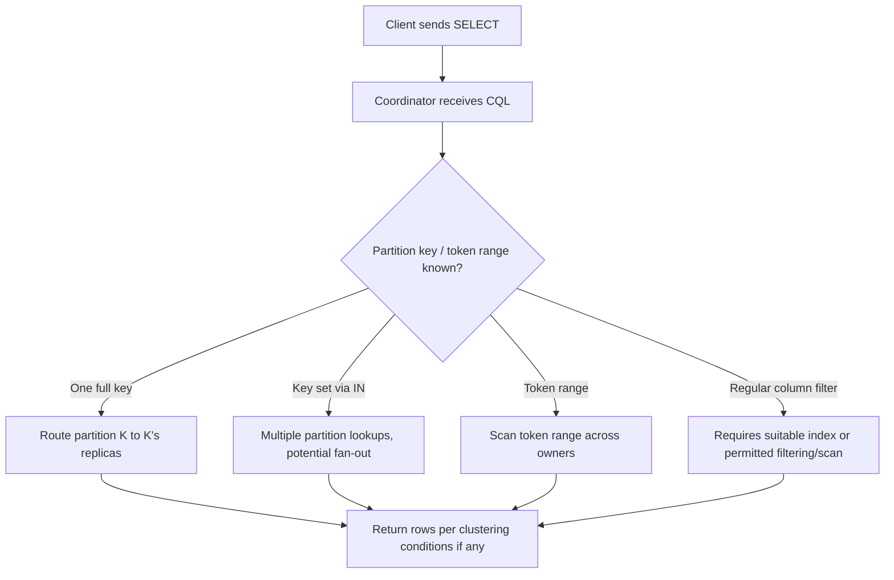

# Traces for Single-Partition Queries vs. Multi-Partition Scans in Apache Cassandra

> **Chapter:** Tracing and Diagnosis  
> **Module:** `DATABASE_ENGINE_WIDE_COLUMN_CASSANDRA` — explore the distributed architecture and wide-column model of Apache Cassandra, specifically partition keys, query-driven table design, read/write consistency levels, replication, compaction, repair, error handling, and connecting from Java applications. This lesson uses **CQL request tracing** to compare a single-partition read path against queries spanning multiple partitions or broad range scans.

## 1. A Short `SELECT` Is Not Necessarily a Cheap Query

Suppose a retail application has a table `orders_by_customer`. The following three questions look fairly similar at the API layer yet have vastly different routing costs:

1. **What orders does customer A have?** `customer_id` is known; Cassandra can route directly to the replica group owning partition A.
2. **What orders do customers A and B have?** A small set of partition keys is known; Cassandra can perform multiple partition lookups without scanning the entire cluster.
3. **Which orders have `order_type='RETURN'` system-wide?** If `order_type` is not an appropriate key or index, Cassandra may have to filter huge amounts of data or reject the query.

**Request tracing** helps observe the coordinator, replicas, and instrumented events when Cassandra executes each CQL statement. However, a trace alone cannot directly answer "how many partitions were scanned?" or "how many bytes were read?" without supporting metrics. A multi-partition query is not always a *full scan*, and a single-partition query can still be very slow if that partition is massive.

### Learning Outcomes

- Read a schema to identify the **partition key** and distinguish primary-key filters from filters on regular columns.
- Capture traces for a **single-partition lookup**, **multi-partition `IN`**, and **broad `ALLOW FILTERING` filter** in a safe lab.
- Query `system_traces.sessions` and `system_traces.events` by the exact `session_id` to compare coordinators, event sources, and processing phases.
- Also understand **token-range scans** used for intentional batch/operational tasks.
- Avoid using `LIMIT`, Java Driver paging, or a single trace to hide risks of **fan-out, tombstones, large partitions, CPU/I/O, and tail latency**.
- Know when to switch to a **query-driven table with partition/clustering keys** or a version-verified index.

## 2. Partition Keys Determine Routing Path, Not CQL Statement Length

In Cassandra, the **partition key** is passed through the partitioner to determine a token; the replication strategy combined with the token ring/topology identifies the responsible replicas. The **coordinator** is the node receiving the CQL request from the client, then orchestrating work across the needed replicas. The coordinator can simultaneously be one of the replicas for the partition being read.



The diagram illustrates **access path patterns**, not an assertion that Cassandra sends exactly one RPC per partition or always contacts every replica. The number of nodes queried or awaited depends on consistency level, replication, topology, caches, failures, and version.

**Clustering keys** identify and order rows **within a partition**. If you need time-ordered row pagination, `PRIMARY KEY ((customer_id), order_seq)` serves an entirely different query pattern than simply having a regular `customer_id` column outside the key.

## 3. Comparing Four Query Patterns Without Conflating Every Fan-Out

| Pattern | Sample Condition | Scope to Consider | Primary Risks |
| --- | --- | --- | --- |
| **Single partition** | `customer_id = A` | Partition A and A's replicas | Oversized partition, long clustering scan, many tombstones |
| **Multiple known partitions** | `customer_id IN (A, B)` | The two listed partitions, not automatically all partitions | Fan-out on large lists, response ordering/paging, timeouts |
| **Broad unindexed filter** | `order_type='RETURN' ALLOW FILTERING` | May need to inspect many partitions/rows to find matches | Expensive scan, cost unpredictable via `LIMIT` |
| **Token-range scan** | `token(customer_id)` in a range | Partitions within the token range, possibly across multiple owners | Intentional scan, I/O/network cost, and checkpointing overhead |

A query using a **secondary index** or Storage-Attached Index (SAI) is a fifth case: an indexed access path differs from an unindexed filtering scan, though selectivity, search scope, and version capabilities still require measurement. Never automatically call every query lacking a partition key a *full scan* if the engine supports an index.

## 4. Creating Practice Data with an Explicit Partition Key

The following example targets a single-node Cassandra lab. The keyspace uses `SimpleStrategy` with replication factor 1 **for learning only**, not as a recommended setup for multi-node or production clusters. Production clusters need `NetworkTopologyStrategy` and per-datacenter RF.

```sql
CREATE KEYSPACE IF NOT EXISTS trace_partition_lab
WITH replication = {
    'class': 'SimpleStrategy',
    'replication_factor': 1
};

CREATE TABLE IF NOT EXISTS trace_partition_lab.orders_by_customer (
    customer_id uuid,
    order_seq int,
    order_type text,
    total_cents bigint,
    note text,
    PRIMARY KEY ((customer_id), order_seq)
) WITH CLUSTERING ORDER BY (order_seq DESC);

-- Partition A: three orders.
INSERT INTO trace_partition_lab.orders_by_customer
    (customer_id, order_seq, order_type, total_cents, note)
VALUES (11111111-1111-4111-8111-111111111111, 1, 'SALE', 120000, 'first');

INSERT INTO trace_partition_lab.orders_by_customer
    (customer_id, order_seq, order_type, total_cents, note)
VALUES (11111111-1111-4111-8111-111111111111, 2, 'RETURN', 25000, 'refund');

INSERT INTO trace_partition_lab.orders_by_customer
    (customer_id, order_seq, order_type, total_cents, note)
VALUES (11111111-1111-4111-8111-111111111111, 3, 'SALE', 400000, 'repeat');

-- Partition B: two orders.
INSERT INTO trace_partition_lab.orders_by_customer
    (customer_id, order_seq, order_type, total_cents, note)
VALUES (22222222-2222-4222-8222-222222222222, 1, 'SALE', 80000, 'gift');

INSERT INTO trace_partition_lab.orders_by_customer
    (customer_id, order_seq, order_type, total_cents, note)
VALUES (22222222-2222-4222-8222-222222222222, 2, 'RETURN', 10000, 'cancel');

-- Partition C: one order.
INSERT INTO trace_partition_lab.orders_by_customer
    (customer_id, order_seq, order_type, total_cents, note)
VALUES (33333333-3333-4333-8333-333333333333, 1, 'SALE', 60000, 'single');
```

Each `customer_id` identifies **one partition**; `order_seq` is the clustering key so orders within the same partition can be read in descending order. All data in this exercise is tiny, so trace durations observed in the lab do not represent performance on production tables with millions of rows.

### Baseline Check Before Tracing

```sql
SELECT customer_id, order_seq, order_type, total_cents
FROM trace_partition_lab.orders_by_customer
WHERE customer_id = 11111111-1111-4111-8111-111111111111;
```

Expect three rows with `order_seq` **3, 2, 1** if the lab data has not been modified. Do not enable tracing just to check if the table exists: verify the schema and sample rows first, then pick the exact `SELECT` statement you intend to analyze.

## 5. Pattern A — `SELECT` Within Exactly One Partition

Schema-aligned read path:

```sql
SELECT order_seq, order_type, total_cents
FROM trace_partition_lab.orders_by_customer
WHERE customer_id = 11111111-1111-4111-8111-111111111111
  AND order_seq >= 2
LIMIT 2;
```

The coordinator knows the partition key `customer_id=A`. Cassandra locates partition A's replica, accesses rows matching the clustering condition `order_seq >= 2`, and returns at most two rows with `order_seq = 3, 2`.

To capture a trace via `cqlsh`:

```sql
CONSISTENCY ONE;
TRACING ON;

SELECT order_seq, order_type, total_cents
FROM trace_partition_lab.orders_by_customer
WHERE customer_id = 11111111-1111-4111-8111-111111111111
  AND order_seq >= 2
LIMIT 2;

TRACING OFF;
```

`CONSISTENCY`, `TRACING ON`, and `TRACING OFF` are **`cqlsh` commands**, not CQL for a Java prepared statement. `cqlsh` typically prints `Tracing session: <UUID>` along with the event table. **Copy the real UUID** from the request; illustrative UUIDs shown later are not measured traces.

**What to record:** the query has the **full partition key**, returned row count, CL=`ONE`, session coordinator, event sources, duration, and data count/size. In a single-node RF=1 lab, coordinator and replica can share one IP; do not expect RPCs to two separate nodes.

## 6. Pattern B — `IN` on Partition Key: Multiple Lookups, Not Yet a Full-Table Scan

When you need data for **two known customers**, Cassandra supports `IN` on a single partition key in CQL versions that allow it:

```sql
SELECT customer_id, order_seq, order_type, total_cents
FROM trace_partition_lab.orders_by_customer
WHERE customer_id IN (
    11111111-1111-4111-8111-111111111111,
    22222222-2222-4222-8222-222222222222
);
```

With the lab data, this statement returns **5 rows** across **2 known partitions**. CQL does not guarantee global ordering by `order_seq` across multiple partitions; applications must not rely on incidental ordering observed on a single node. If you need "the 20 newest orders across all customers," `IN` over a customer list does not provide global chronological sorting.

Try tracing this statement:

```sql
TRACING ON;

SELECT customer_id, order_seq, order_type, total_cents
FROM trace_partition_lab.orders_by_customer
WHERE customer_id IN (
    11111111-1111-4111-8111-111111111111,
    22222222-2222-4222-8222-222222222222
);

TRACING OFF;
```

Compared to Pattern A, the coordinator may touch more partition/replica endpoints; **however, in a single-node lab, those partitions live on the same replica**, so the IP count in the trace remains one. In a distributed cluster, a large `IN` list can fan out to many nodes, increasing RPCs, memory pressure, and tail latency. Never use `IN` with thousands or millions of keys as a pagination hack or scan substitute.

### `IN` Is Not the Same as `ALLOW FILTERING`

- `customer_id IN (A,B)`: **the keys of the partitions to visit are already known**.
- `order_type='RETURN' ALLOW FILTERING`: **it is unknown from `order_type` which partitions contain matching rows** without an index or dedicated read table; the engine may have to read and discard many rows.

Both statements may "involve more than one partition," yet their scope and cost predictability are **not the same**.

## 7. Pattern C — Filtering on a Regular Unindexed Column

Suppose an API needs **all RETURN orders across all customers**, while `orders_by_customer` is partitioned by customer rather than `order_type`. In a small lab, an example *deliberately unsuitable as a production read path* is:

```sql
-- ANTI-PATTERN: test only on a small lab table, never on large tables.
SELECT customer_id, order_seq, order_type, total_cents
FROM trace_partition_lab.orders_by_customer
WHERE order_type = 'RETURN'
ALLOW FILTERING;
```

`ALLOW FILTERING` lets Cassandra run certain expensive filtering queries **if the version/CQL permits the syntax and execution plan**. It **does not create an index** on `order_type`, does not turn the column into a partition key, and does not guarantee visiting only the two partitions holding RETURN orders. In our lab dataset, the logical result is two RETURN rows; on a huge table, the system may inspect vast numbers of non-matching partitions and rows before finding matches.

To trace and see the difference in the lab:

```sql
TRACING ON;

SELECT customer_id, order_seq, order_type, total_cents
FROM trace_partition_lab.orders_by_customer
WHERE order_type = 'RETURN'
ALLOW FILTERING;

TRACING OFF;
```

**Important note:** Some query shapes are rejected immediately when lacking a partition key/index or `ALLOW FILTERING`; others **cannot be fixed with `ALLOW FILTERING`** when the operator is unsupported. Tracing only records full events when a request reaches the server and executes; parser/validation errors do not necessarily produce a trace with a full read path. **Never run this anti-pattern on large production tables** just to find out whether it is slow.

### Why `LIMIT 2` Does Not Fix the Root Cause

```sql
-- Still an anti-pattern, for small lab use only.
SELECT customer_id, order_seq
FROM trace_partition_lab.orders_by_customer
WHERE order_type = 'RETURN'
LIMIT 2
ALLOW FILTERING;
```

`LIMIT 2` caps the **number of returned rows**, not a hard cap saying "read only two partitions, two SSTables, or two rows." If matching rows are rare, the coordinator/replicas may scan far more data before finding two rows. `LIMIT` also gives no **global chronological ordering** guarantee when the query lacks an aligned clustering order.

## 8. Pattern D — How Intentional Token-Range Scans Differ from Ad-Hoc Full Scans

Operational or batch jobs sometimes need to walk part of the token ring: data verification, checkpointed backfills, or distributed readers. Cassandra supports conditions on **`token(partition_key)`** in applicable cases/versions:

```sql
-- ILLUSTRATIVE in lab; does not guarantee returning a specific row count.
SELECT customer_id, order_seq, order_type
FROM trace_partition_lab.orders_by_customer
WHERE token(customer_id) > token(11111111-1111-4111-8111-111111111111)
  AND token(customer_id) <= token(33333333-3333-4333-8333-333333333333);
```

**Key point:** a UUID's token **does not increase monotonically with UUID string order**. If the start token exceeds the end token, the example query may return empty because the range bounds are inverted; the ring also has **wrap-around**. You must compute actual tokens for the active partitioner, define proper non-overlapping/gapless subranges, checkpoint progress, and control paging. Never use illustrative UUIDs as automatic scan bounds in production jobs.

A token-range scan **intentionally reads multiple partitions within a range**, unlike a single-partition lookup. It also differs from `ALLOW FILTERING` queries "searching by a non-routing column": a token range has **explicit token boundaries** suited for partitioning batch work; additional filter predicates, if any, must still be evaluated for CQL feasibility.

```text
Token ring (illustrative, not to scale)

  ...  [node A's range] [node B's range] [node C's range] ...
                        ^      ^
                    start    end

  Single partition: compute token(K), go to K's owners
  IN (K1,K2): go to owners of K1 and K2
  Range scan: walk partitions whose tokens fall inside the range
```

A token-range scan **may** involve multiple nodes without necessarily requiring every node to return all data. For long-running jobs, throttle concurrency/paging, bound read rates, checkpoint progress, and handle node failures, compaction, and repair variance. Tracing one token-range request does not replace monitoring metrics for the entire batch job.

## 9. Comparing Traces: Do Not Interpret "Event Line Count" as I/O Cost

After running the four patterns in a suitable environment, you can summarize:

| Indicator | Single Partition | Two-Key `IN` | `ALLOW FILTERING` | Token Range |
| --- | --- | --- | --- | --- |
| Full routing key supplied? | Yes | Yes, for each key | No, for `order_type` | Has token bounds, not a single key |
| Logical partition scope | One | Two known | Potentially very broad | Partitions within range |
| Expected lab row count | Two | Five | Two RETURN | Depends on token order |
| Event IP count in RF1 lab | Likely one | Likely still one | Likely still one | Likely still one |
| Routing/scan indicator | Reads one key and clustering range | Multiple key lookups | Filter/scan if executed | Walks token range |
| Does `LIMIT` cap partitions read? | No, though PK pins one partition | No | No | No |
| Suited for frequent online API? | Usually good if partition stays small | Depends on tiny key list and SLO | Usually no on large data | Usually no; mostly controlled batch |

The number of `events` rows depends on **instrumentation level, timing, paging, coordinator batching, clock synchronization, and trace persistence**. Two queries with the same event count **do not prove** they read the same volume of data. Conversely, a trace with more events is not conclusive proof that it scanned the whole cluster.

### An Illustrative Timeline Only to Practice Reading

```text
Request A: single-partition SELECT K1
  coordinator -> replica owner of K1 -> return rows

Request B: SELECT WHERE partition_key IN (K1,K2)
  coordinator -> process K1 and K2 -> merge rows

Request C: SELECT WHERE non_key = X ALLOW FILTERING
  coordinator -> scan/filter data per permitted plan -> return matching rows

Request D: SELECT WHERE token(partition_key) within a range
  coordinator -> read partitions in token range -> return rows
```

This is a **conceptual diagram**, not measured Cassandra output, and it does not enforce RPC ordering. On a real cluster, the coordinator may be a replica; requests may run in parallel, trigger data/digest reads and reconciliation, or time out.

## 10. Reading `system_traces.sessions` and `events` Per Request

When `cqlsh` prints `Tracing session: ...`, record the **distinct ID for each pattern A/B/C/D**. After `TRACING OFF`, query metadata and events using the real ID:

```sql
-- Illustrative UUID; replace with the tracing session ID printed by cqlsh.
SELECT session_id, coordinator, started_at, duration,
       request, parameters
FROM system_traces.sessions
WHERE session_id = 8cbe0000-e581-11f1-8e9a-0242ac120002;

SELECT event_id, activity, source, source_elapsed, thread
FROM system_traces.events
WHERE session_id = 8cbe0000-e581-11f1-8e9a-0242ac120002;
```

`system_traces.sessions` stores metadata for **one traced request**; `system_traces.events` stores activities under the tracing system's **partition key `session_id`**. In standard Cassandra versions, `duration` and `source_elapsed` are typically reported in **microseconds**; verify column/version units before comparing because confusing µs with ms creates a 1,000x error.

**Do not confuse a trace `session_id` with a business data partition key.** A trace of a broad scan query still typically has **one trace session ID**, not a separate session ID per business partition. Conversely, fetching **multiple pages** can generate separate requests/traces depending on how the client issues queries and enables tracing.

### How to Extract the Coordinator and Group Events

1. Read **`sessions.coordinator`** to identify which node coordinated that specific request.
2. Group `events` by **`source`** to see which nodes emitted events.
3. Inspect `activity` for signs of routing, READ dispatch/receipt, storage reads, filtering/reconciliation, and completion, if recorded by your version.
4. Use `source_elapsed` alongside **node context** and `event_id` ordering, without treating cross-node timelines as a single absolute clock.
5. Correlate with RF, CL, datacenter, and metrics; **never infer partition count from source IP count**.

If a newly captured trace has incomplete `events`, it may be due to asynchronous trace writes, node errors, or TTL. Re-read a bounded number of times, verify the ID/cluster/permissions, and check logs. **Do not treat missing events as proof that a processing step did not occur.**

## 11. Coordinator, Replicas, and CL: Same Schema Yet Traces Can Differ

In Cassandra, the node receiving a client request is the **coordinator**, while **replicas** hold partition copies per token and replication topology. Both roles can overlap. On a multi-replica cluster, a `SELECT` at low CL can finish after fewer responses than a higher CL; however, endpoint selection, digests, retries, and read repair mean actual RPC counts do not simply equal required ACKs.

| Condition | Impact to Note When Reading Traces |
| --- | --- |
| Single-node lab, RF=1, `ONE` | Coordinator and replica are usually the same node; multiple partitions share one `source` |
| Single-DC RF=3, `ONE` | One qualifying response satisfies CL, though more than one replica may still be involved |
| Single-DC RF=3, `LOCAL_QUORUM` | Typically requires two local responses; event source count need not equal two |
| Multi-datacenter | Replica selection may involve cross-DC RPCs depending on CL/topology |
| Slow/offline replica | Coordinator may wait, try another endpoint, time out, and traces may miss events |
| LWT/Paxos | Consensus path has more steps than regular mutations; do not compare directly to SELECT |

**Do not conclude "the IN query touched three nodes so RF=3"** or "ALLOW FILTERING showed one node so it read only one partition." `source` only shows **who wrote an event**, not all storage touched or exact token ownership.

## 12. `LIMIT`, Paging, and Broad Scans: Cost Does Not Disappear

Two common limiting patterns that cause misunderstandings:

```sql
-- Limit two rows within exact partition A.
SELECT order_seq, order_type
FROM trace_partition_lab.orders_by_customer
WHERE customer_id = 11111111-1111-4111-8111-111111111111
LIMIT 2;

-- Limit two rows after evaluating an unrouted condition.
-- Small lab illustration only.
SELECT customer_id, order_seq
FROM trace_partition_lab.orders_by_customer
WHERE order_type = 'RETURN'
LIMIT 2
ALLOW FILTERING;
```

Both use `LIMIT 2`, yet the first query locates partition A and reads leading rows in clustering order; the second may examine many partitions/rows to find two RETURN matches. **Rows returned is not rows inspected**, nor is it partitions traversed.

With the Java Driver, `.setPageSize(100)` is a **page-size hint measured in rows**, not a total query cap, and it does not split elements inside a single row's large collection. Iterating `for (Row r : resultSet)` in the synchronous API automatically fetches subsequent pages, issuing additional network requests.

Specifically, a query returning **one massive partition** can still consume heavy resources; a query reading **multiple partitions with one row each** can be acceptable if the key list is small. **Evaluating row counts, payload bytes, fan-out, and partition sizes together** is what matters.

## 13. Impact of Tombstones, TTL, SSTables, Compaction, and Repair

A trace for a `SELECT` on one large partition can be slow due to:

- Hundreds of thousands of clustering rows within the same partition.
- Numerous **tombstones** from deletes, expired TTLs, or collection/UDT overwrites.
- Many SSTables needing inspection with cold caches.
- Concurrent compaction/repair/streaming pressuring disk, CPU, or network.
- Diverged replicas triggering reconciliation work when required by mechanism/version.

Meanwhile, a broad scan query can be slow from **visiting many partitions** even if each partition is tiny. Both can cause read timeouts, yet their **root causes differ**.

| Symptom | Single Partition | Multi-Partition Scan |
| --- | --- | --- |
| p99 bad only for one customer ID | Suspect hot/large partition, tombstones, or owner node | Unlikely as the primary conclusion |
| p99 grows with `IN` ID count | Possible fan-out and larger payload | Bound the key list or redesign the API |
| p99 rises despite small `LIMIT` on unindexed filter | Not applicable if PK pins one partition | May scan many rows/partitions to find matches |
| High disk I/O during repair/compaction | Raises storage cost directly on owners | Amplifies cost as scans spread wide |
| Timeout at high CL | Waiting on enough replicas for the partition | Multiplied across multiple replica groups to wait on |

**A trace is only one piece of evidence.** To confirm tombstones or compaction as the bottleneck, correlate p95/p99 latency, SSTable/tombstone metrics, disk I/O, heap/GC, compaction backlog, repair progress, and partition sizes in the same window. Never recklessly lower `gc_grace_seconds` to "reduce tombstones" when replicas could miss deletes and resurrect stale data.

## 14. When to Use an Index vs. a Query-Driven Table?

If `order_type='RETURN'` is genuinely a critical query, do not rely on `ALLOW FILTERING` as a long-term fix. Evaluate three options:

1. **Query-driven table**: store orders keyed by `order_type` and time/bucket to read an exact partition, ideal for primary read paths with strict SLOs/ordering.
2. **Secondary index**: if supported by your engine/version and the predicate is selective enough, suitable for sparse queries without complex sorting requirements.
3. **Dedicated search engine**: when you need full-text search, ranking, arbitrary dynamic predicates, or filtering/aggregations ill-suited to Cassandra.

**Indexes are not uniform across versions.** Legacy secondary indexes and SAI have different storage structures, capabilities, and performance characteristics; Cassandra OSS 5.x and distributions may differ. Always verify **server version, index engine, supported operators, build status, and write/delete/index maintenance cost** before claiming any query without a partition key is always a full scan.

## 15. Redesigning: `returns_by_day` Table for the Reverse Read Path

Suppose the API needs "the 20 newest return orders of the day." A table aligned to that read path is much cleaner:

```sql
CREATE TABLE trace_partition_lab.returns_by_day (
    return_day date,
    return_time timeuuid,
    customer_id uuid,
    order_seq int,
    total_cents bigint,
    PRIMARY KEY ((return_day), return_time, customer_id, order_seq)
) WITH CLUSTERING ORDER BY (
    return_time DESC, customer_id ASC, order_seq ASC
);

-- One demo row; return_time must be a version 1 UUID (timeuuid).
INSERT INTO trace_partition_lab.returns_by_day (
    return_day, return_time, customer_id, order_seq, total_cents
) VALUES (
    '2026-11-21',
    8cbe0000-e581-11f1-8e9a-0242ac120002,
    11111111-1111-4111-8111-111111111111,
    2, 25000
);

SELECT return_time, customer_id, order_seq, total_cents
FROM trace_partition_lab.returns_by_day
WHERE return_day = '2026-11-21'
LIMIT 20;
```

In this table, `return_day` is the partition key, and `(return_time, customer_id, order_seq)` is the clustering key. Querying by day has an explicit routing path; `LIMIT 20` leverages clustering order to read the leading rows in the partition rather than **filtering the entire table by `order_type`**.

**Trade-off:** an application recording a RETURN order must update both the source table and the lookup table; when return status changes, the lookup record must be updated/deleted accordingly. Cassandra does not join or synchronize two tables automatically. You need **stable-ID retries, reconciliation, consistency design**, and per-step failure handling.

If millions of RETURN orders occur daily, a daily partition can still grow too large or hot. Consider hourly buckets or additional sharding, trading off multi-bucket fan-out on reads. **No single bucket size fits every workload**; measure row/partition sizes and p99 under realistic load.

## 16. Java Driver 4.x: Comparing a Single-Key Lookup vs. Two-Key `IN`

The Java Driver can measure client-side request duration, though it cannot turn an unindexed table into an efficient query on its own. Example using **reusable prepared statements** and a `CqlSession` properly configured with local datacenter/auth/TLS:

```java
import com.datastax.oss.driver.api.core.CqlSession;
import com.datastax.oss.driver.api.core.cql.BoundStatement;
import com.datastax.oss.driver.api.core.cql.PreparedStatement;
import com.datastax.oss.driver.api.core.cql.ResultSet;
import com.datastax.oss.driver.api.core.cql.Row;
import java.util.UUID;
import java.util.concurrent.TimeUnit;

class PartitionTraceRepository {
    private final CqlSession session;
    private final PreparedStatement oneCustomer;
    private final PreparedStatement twoCustomers;

    PartitionTraceRepository(CqlSession session) {
        this.session = session;
        this.oneCustomer = session.prepare(
            "SELECT customer_id, order_seq, order_type " +
            "FROM trace_partition_lab.orders_by_customer " +
            "WHERE customer_id = ?"
        );
        this.twoCustomers = session.prepare(
            "SELECT customer_id, order_seq, order_type " +
            "FROM trace_partition_lab.orders_by_customer " +
            "WHERE customer_id IN (?, ?)"
        );
    }

    void inspectOne(UUID customerId) {
        executeAndTrace(oneCustomer.bind(customerId));
    }

    void inspectTwo(UUID first, UUID second) {
        executeAndTrace(twoCustomers.bind(first, second));
    }

    private void executeAndTrace(BoundStatement bound) {
        // Enable only for a small number of selected lab/staging requests.
        BoundStatement sampled = bound.setTracing(true).setPageSize(100);
        long start = System.nanoTime();
        ResultSet rs = session.execute(sampled);
        long firstResult = System.nanoTime();

        int count = 0;
        for (Row ignored : rs) {
            count++;
        }
        long consumed = System.nanoTime();

        System.out.println("trace_id_first_result=" +
            rs.getExecutionInfo().getTracingId());
        System.out.println("execute_us=" +
            TimeUnit.NANOSECONDS.toMicros(firstResult - start));
        System.out.println("consume_us=" +
            TimeUnit.NANOSECONDS.toMicros(consumed - firstResult));
        System.out.println("rows=" + count);
    }
}
```

`execute_us` is **Java-side time until the first result/page**, while `consume_us` also covers iteration and any subsequent page fetches. Trace IDs obtained from execution info must be tied to the matching request/page; if the driver triggers **multiple pages, retries, or speculative execution**, a single displayed ID does not necessarily describe all attempts and pages of a logical HTTP request.

### Why Not Benchmark With Tracing Enabled Everywhere?

Tracing causes Cassandra to write extra session/event rows and can alter the very latency under test. Use **normal latency metrics** as your baseline and enable tracing selectively to inspect execution paths. When comparing two queries touching different partition counts or returning different row counts, **normalize the workload** and measure payload bytes and row counts before attributing differences to fan-out.

## 17. Reading Traces When Java Retries or Fetches Multiple Pages

In production applications, a single repository call does not always map to **one actual CQL request**. For example, a client queries multiple partitions, coordinator A is slow, and the driver retries on B or triggers speculative execution. Multiple server requests (and if traced, multiple trace IDs) can occur:

```text
Java HTTP request
  Query IN (A,B)
      attempt 1 -> coordinator X (slow/timeout)
           attempt 2 -> coordinator Y (success)
      page 1 complete -> page 2 if more rows remain
  Map DTO -> HTTP response
```

When Java latency exceeds `sessions.duration` of one trace, **do not subtract them and blame the network**. The difference may contain driver queuing, retry delays, client–coordinator network, decoding, and additional page requests. Conversely, `sessions.duration` on the coordinator can include **coordinator–replica networking**.

A reproducible report should capture **CQL, sanitized bind values, CL/RF, `IN` key count, trace ID, coordinator, attempt hosts, page count, result bytes, and client latency**. Consult execution info/metrics APIs for your exact Java Driver 4.x/distribution version.

## 18. How to Fairly Compare Patterns A, B, C, and D

You cannot compare four query patterns from a single cold run and declare one permanently faster. Diagnostic benchmarks require:

1. **Known schema and data:** count lab partitions/rows before tracing. In production, use table statistics/query metrics and approved samples—never run full scans to count.
2. **Consistent context:** Cassandra version, RF, datacenter, CL, driver/cqlsh version, load level, and cluster health.
3. **Result size:** record row count, byte count, page count, and whether rows were filtered; do not compare two rows against five rows and ascribe the difference solely to routing.
4. **Intentional warm-up:** caches, Java JIT, and prepared statements affect initial runs; keep conditions explicit.
5. **Selectivity:** a rare `order_type='RETURN'` predicate behaves very differently from one matching 90% of rows.
6. **Selective trace sampling:** use consistent capture methods without leaving tracing on throughout a load test.
7. **Multiple samples and percentiles:** measure p50/p95/p99 per workload and analyze tail latency rather than a single duration.
8. **Node metrics:** monitor CPU, disk I/O, SSTable counts, tombstone warnings, compaction, repair, queues, RPC/network, and driver pools.

**Important:** stage p95s do not add linearly into total p95. To explain a slow request, gather spans/measurements sharing the **same request/correlation ID**, rather than summing p95s from two independent dashboards.

## 19. Diagnostic Table When Traces Look "Strange"

| Symptom | Cautious Interpretation | Next Step |
| --- | --- | --- |
| `IN` has two keys yet only one IP in events | Both partitions may share an owner, or other events dropped | Check RF, token ownership, CL, and activities |
| Single-partition query slower than lab filter | That partition may be large/hot; lab is tiny, cache differs | Compare p95/p99, partition size, tombstones, SSTables |
| `ALLOW FILTERING LIMIT 2` runs fast on 6-row table | Dataset is too small; proves nothing at production scale | Avoid production scans; build an aligned table/index |
| Tracing a query produces no `session_id` | Tracing not enabled in that session, or request rejected early | Check `cqlsh`, syntax, ID, and server logs |
| Session exists yet events are missing | Asynchronous trace write, node failure/TTL | Bounded re-read, check permissions/cluster, metrics |
| Trace has many events yet fast read | Event count does not scale linearly with CPU/I/O | Measure duration, bytes, rows, replica latency |
| Short coordinator trace, slow Java | Possible queuing/driver/network/retries/paging | Inspect driver attempts, network, JVM, page fetches |
| `LIMIT 20` still reads a huge list | `LIMIT` bounds rows, not elements inside a collection | Model items as clustering-key rows |
| `token()` range returns 0 rows | Token bounds do not follow UUID order; range may be empty | Check actual tokens, wrap-around, and partitioner |
| Read timeout during broad scan | Too much data/RPCs or slow replica | Stop risky query; inspect schema and cluster load |

## 20. Practice Exercises

**Exercise 1 — Finding the right partition.** Why does `WHERE customer_id=A AND order_seq>=2 LIMIT 2` usually have a clearer routing path than `WHERE order_type='RETURN'`?  
**Hint:** `customer_id` is the partition key; the clustering filter bounds rows inside that partition. `order_type` is a regular column that does not identify a partition.

**Exercise 2 — Two-key `IN`.** If A has 3 rows and B has 2 rows, how many rows is `customer_id IN (A,B)` expected to return if data hasn't changed? Is this a full scan?  
**Hint:** 5 rows across two known partitions; not automatically a full-table scan.

**Exercise 3 — IP count in traces.** An RF1 lab yields only one `events.source` for both Patterns A and B. Can you conclude both queries read only one partition?  
**Hint:** No. Multiple partitions can live on the same node; trace sources do not count partitions.

**Exercise 4 — Filtering and LIMIT.** `WHERE order_type='RETURN' LIMIT 2 ALLOW FILTERING` returns two rows. Does Cassandra guarantee it only read two rows and two partitions?  
**Hint:** No. It may have to inspect many non-matching records before finding enough results.

**Exercise 5 — Token ranges.** Why shouldn't `token(customer_id)` be inferred from lexicographical UUID order?  
**Hint:** The partitioner hashes the partition key into a token; token order differs from ID order and wraps around the ring.

**Exercise 6 — Trace structure.** `system_traces.sessions` has one row and `events` has many rows. Does that prove the query only read one partition?  
**Hint:** No. A trace session identifies one **request**, not one business partition.

**Exercise 7 — Cost.** Partition A holds one million rows/tombstones, while an `IN` query hits two partitions with ten rows each. Which is guaranteed faster?  
**Hint:** You cannot conclude from partition count alone; consider size, SSTables, cache, CL, fan-out, load, and result size.

**Exercise 8 — New read path.** An API needs the 20 latest return orders per day. Should you use `ALLOW FILTERING` or the `returns_by_day` table?  
**Hint:** A table keyed by `return_day` and clustered by `return_time` gives a more predictable read path; manage data sync and bucketing if partitions grow large.

**Exercise 9 — Driver.** Does Java `.setPageSize(100)` split a `map` containing 100,000 entries into 1,000 pages?  
**Hint:** No. Paging applies to **CQL rows**, not entries inside a map column.

**Exercise 10 — Incident analysis.** An `ALLOW FILTERING` query slows down right as compaction runs. Is that enough evidence to claim compaction is the root cause?  
**Hint:** Not yet. Measure I/O/CPU, scanned partitions/rows, workload, metrics, and controlled comparative tests.

**Exercise 11 — Multi-attempt Java request.** The driver retries a `SELECT IN` and HTTP takes 90 ms, while one trace shows `duration=7000 µs`. Can you blame 83 ms on the network?  
**Hint:** No. Consider retry budgets, driver queues, paging, decoding, and other attempts.

**Exercise 12 — Replica coordination.** Do `CL=ONE` and RF3 mean the query always touches only one replica?  
**Hint:** No. CL sets the acknowledgment threshold to complete; the execution path may still involve multiple endpoints/digests/retries.

## 21. Checklist Before Optimizing Queries

- [ ] Identified **partition key and clustering key** from the schema, not inferred from column names or API URLs.
- [ ] Distinguished **single-partition**, **multi-partition `IN`**, **token-range scan**, and **unindexed filter**.
- [ ] Checked **Cassandra version/index engine** before calling an unkeyed query a full scan or assuming `ALLOW FILTERING` is always allowed.
- [ ] Enabled `TRACING ON` in the target `cqlsh` session, ran **one safe query**, and ran `TRACING OFF` immediately after.
- [ ] Recorded **real trace ID**, CQL, results, CL, RF/datacenter, timestamp, schema, and server version.
- [ ] Read `system_traces.sessions/events` using the **same `session_id`**, identifying coordinator and event-emitting nodes.
- [ ] Avoided equating **IP/source/event counts** with scanned partition counts or bytes; cross-checked replica topology/metrics.
- [ ] Avoided using `LIMIT` or Java Driver page size to claim a scan was capped at N partitions/rows read.
- [ ] Measured **result rows, result bytes, partition size, p95/p99, fan-out, tombstones/SSTables, and CPU/I/O**.
- [ ] When comparing queries A/B/C, kept **RF, CL, load, cache state, and benchmark conditions** consistent.
- [ ] Avoided running **`ALLOW FILTERING` or broad token scans** in production without limits, authorization, and load planning.
- [ ] Considered **query-driven tables/suitable indexes, bucketing/sharding, and retry/reconciliation** for critical read paths.
- [ ] Accounted for **Java retries, speculative execution, and multiple pages** when correlating traces with API latency.
- [ ] Avoided lowering `gc_grace_seconds` or changing compaction/repair policies based on a single trace; require operational evidence.

## 22. Key Takeaways

- **Single-partition lookup** routes via the **full partition key**; clustering predicates and `LIMIT` bound rows inside that target partition.
- `IN` over a **small known set of partition keys** performs **multiple lookups**, not a full scan of every partition. Still, large `IN` lists can cause fan-out and timeouts.
- `ALLOW FILTERING` **does not create a key/index access path**; `LIMIT` bounds returned rows, not a guarantee of reading only N partitions or N rows before filtering.
- **Token-range scans** intentionally walk a token range; never assume UUID order matches token order, and account for bounds, wrap-around, checkpoints, and load.
- `system_traces.sessions` holds **one request trace**, and `system_traces.events` holds recorded steps for that request. **Event/source counts are not partition/RF counts**.
- The coordinator can also be a replica; CL defines required response levels, not an exact count of contacted nodes. Tracing adds overhead and events can be missing, delayed, or expired by TTL.
- One huge partition full of tombstones can be slower than several tiny partitions. Performance conclusions require **p95/p99, result size, partition size, SSTables, compaction/repair, replication, and Java Driver telemetry**.
- Primary reverse-lookup read paths should usually use a **query-driven table with aligned partition/clustering keys** or a verified index; never use tracing as a substitute for data modeling.
