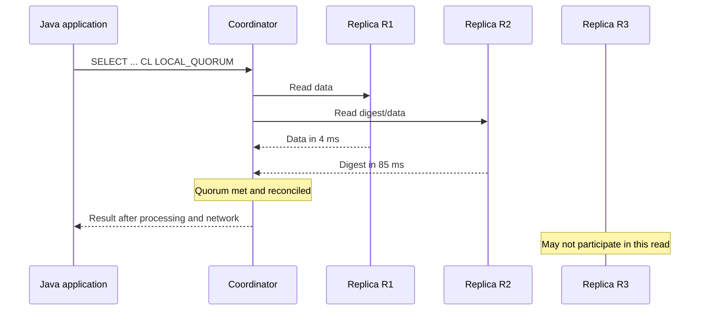
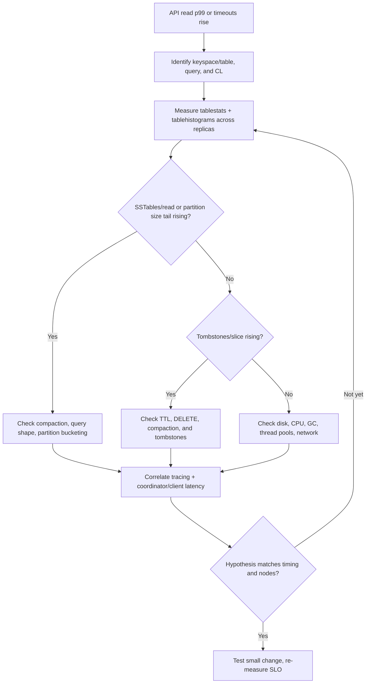

# `nodetool tablestats`, `tablehistograms`, and Interpreting Cassandra Metrics

## 1. Objectives and Observation Scope

Apache Cassandra is a **distributed wide-column** database where data is placed by **partition key**, ordered within each partition by clustering key, and replicated across **replicas** according to the replication factor (RF). A Java application sends CQL to a coordinator with a consistency level (CL) such as `LOCAL_ONE` or `LOCAL_QUORUM`; the coordinator may have to interact with multiple replicas.

When a query is slow, the key questions are:

- Which table and which node are spending time?
- Is a partition oversized or holding too many cells/tombstones?
- How many SSTables must a single read inspect?
- Does latency originate **on a replica**, **at the coordinator**, on the network, or **inside the Java Driver**?
- Did metrics spike briefly from an ingest burst, or is it a sustained trend?

Two helpful commands for initial triage:

```bash
nodetool tablestats <keyspace>.<table>
nodetool tablehistograms <keyspace> <table>
```

**Core difference:**

| Command | Primary Content | Best Answers Which Question? |
| --- | --- | --- |
| `tablestats` | Aggregated per-table stats on a node: SSTables, space used, memtables, reads/writes, Bloom filters, tombstones… | "What resources is the table consuming, and are there abnormal signs?" |
| `tablehistograms` | Estimated distributions/percentiles: SSTables per read, read/write latency, partition size, cell count… | "How bad is the tail of the distribution, rather than looking only at averages?" |

**Important:** Both commands query **the Cassandra node `nodetool` is connected to**; they do not automatically aggregate all replicas across a DC or cluster. One partition can be stored by multiple replicas; one slow node does not necessarily reflect all nodes.

## 2. Identifying the Right Node, Keyspace, Table, and Version

Before reading metrics, establish where requests actually travel:

1. **Which table does the app query?** E.g., `shop.orders_by_customer_day`.
2. **What are the query's partition key and clustering predicate?** Is it reading one day or a whole year of data?
3. **What RF, DC, and CL apply?** With RF = 3, `LOCAL_QUORUM` needs two local responses, though the coordinator may contact more replicas.
4. Which node acts as **coordinator** and which nodes are **replicas** capable of serving that partition?
5. Do those nodes share the same hardware, SSTable count, and compaction backlog?

Reference commands:

```bash
nodetool status
nodetool help tablestats
nodetool help tablehistograms
```

Example commands for inspecting one table (substitute real names):

```bash
nodetool tablestats shop.orders_by_customer_day
nodetool tablehistograms shop orders_by_customer_day
```

Arguments, field names, formatting, units, and availability of certain metrics **vary across Cassandra 3.x, 4.x, and 5.x**. `nodetool help` and the output of your exact deployed version are the authoritative reference—do not assume every example in this lesson prints identically.

### Why Measure Multiple Nodes?

```text
                  Coordinator C
                    /       \
              Replica A    Replica B      Replica D (may not participate)
              p99 4 ms     p99 90 ms      p99 6 ms
              SSTable 7    SSTable 94     SSTable 9

A slow quorum read may involve Replica B,
even though tablestats on Replica A looks completely healthy.
```

These numbers are **illustrative**, not a formula for deriving coordinator p99 from replica p99s. Inspect multiple nodes and track where requests are actually routed.

## 3. `tablestats`: Reading Metric Groups by Storage Mechanism

`tablestats` typically prints statistics grouped by keyspace/table. Common metric groups include:

| Group | Commonly Seen Metric/Label | Diagnostic Question |
| --- | --- | --- |
| SSTables | `SSTable count`, `SSTables in each level` (if applicable) | Are there many SSTables to inspect during reads? |
| Space | `Space used (live)`, `Space used (total)` | How much disk space do live data and related files use on this node? |
| Memtables | `Memtable cell count`, `Memtable data size`, `Memtable switch count`, `Pending flushes` | Are flushes keeping up with the write workload? |
| Reads | `Local read count`, `Local read latency` | How many reads has this replica served, and how slow is the average? |
| Writes | `Local write count`, `Local write latency` | What is the local write load and write cost? |
| Bloom filters | `Bloom filter false positives`, `Bloom filter false ratio`, `Bloom filter space used` | Are filters effectively skipping unnecessary lookups? |
| Partitions | Estimates like `minimum/maximum/mean partition bytes` | Are there huge partitions or skewed distributions? |
| Cells/tombstones | `Average/Maximum live cells per slice`, `Average/Maximum tombstones per slice` | Are queries fetching too many cells or scanning many deleted entries? |
| Compression/storage | `Compression ratio`, off-heap memory if shown | Has storage/memory overhead shifted significantly? |

Metric names in the table above are **indicative**, not a stable API across all Cassandra versions. Some statistics depend on compaction strategy, SSTable state, sampling, or release version.

### 3.1. SSTable Count Is Not Disk Access Count

An SSTable is an **immutable** data file produced by flushes or compactions. A partition can have versions spread across multiple SSTables.

- A steadily rising SSTable count may indicate compaction is falling behind flushes/ingest.
- A high SSTable count **does not mean** every read must open all files.
- Bloom filters, partition indexes, key caches, clustering predicates, and compaction strategies bound which SSTables are read.
- With **TWCS**, having many SSTables holding irrelevant time windows for a query may hurt far less than the raw file count suggests.
- With **LCS**, leveled structure aims to minimize read overlap, typically trading off higher write amplification.

Therefore, compare `SSTable count` in `tablestats` against **SSTables per read** in `tablehistograms` before blaming high read latency on file count.

### 3.2. `Space used (live)` Differs from `Space used (total)`

These two numbers can differ due to file state, compaction, snapshots/hard links, or version-specific accounting:

- **Live:** space the node reports as used by the table's current live SSTable data.
- **Total:** total space within the command's measurement scope, potentially including obsolete uncleaned files or version-specific components.

**Do not use these two numbers directly in place of OS `df`.** Actual free disk space is also affected by filesystem overhead, snapshots, commit logs, temp files, logs, and other tables. During compaction, both input and output SSTables coexist temporarily.

### 3.3. Memtables and Pending Flushes

Memtables hold mutations in memory before **flushing to SSTables**. `Memtable cell count` and `Memtable data size` grow with new writes and drop/reset after flush. `Memtable switch count` is typically a cumulative counter—note when stats were last reset.

Steadily rising `Pending flushes` paired with high disk latency suggests the write/flush path is bottlenecked. However, a brief pending spike after an ingest burst **is not enough** to declare an incident; observe trends across multiple windows alongside disk logs/metrics.

### 3.4. Local Read/Write Latency: Node-Local Averages, Not Application SLAs

An abridged illustrative output example:

```text
Table: orders_by_customer_day
SSTable count: 37
Space used (live): 11.2 GiB
Local read count: 520000
Local read latency: 1.8 ms
Local write count: 1900000
Local write latency: 0.4 ms
Pending flushes: 0
```

Values and formatting **are constructed for explanation**, not guaranteed output of any version.

`Local read latency = 1.8 ms` on one node **does not mean** the Java API has a 1.8 ms p99. It is a statistical mean on that node, whereas a client request can include:

- Connection wait and serialization/deserialization in the driver.
- Client ↔ coordinator and coordinator ↔ replica networking.
- Quorum waiting, the slowest participating replica, digest mismatches, and read repair.
- Pagination, secondary queries, business logic, and service queues.

Moreover, "local read/write count" counts operations instrumented at the node/table level, **not always logical API requests**. One request at a high CL can generate operations across multiple replicas.

### 3.5. Bloom Filter False Positives

A Bloom filter can say "**possibly** contains this partition" or "**definitely not**" by design. A **false positive** occurs when it reports a possible match, yet subsequent index/file inspection finds no data.

Never infer that a false positive produces **wrong CQL results**: Cassandra still checks indexes/files to confirm data.

- High false positives can trigger wasted I/O, especially when querying many nonexistent partitions.
- Interpret the false-positive ratio alongside **check counts** and workload shape; a large cumulative counter may simply reflect high traffic.
- Tuning `bloom_filter_fp_chance` trades off **memory vs. I/O** and affects existing SSTables only upon rewrite/rebuild; never tune it in production from a single `tablestats` glance.

### 3.6. Per-Slice Cell and Tombstone Statistics

A **cell** in wide-column Cassandra is a column data unit; one partition can contain many clustering rows/cells. A **tombstone** marks deleted or expired data for safe reconciliation and replica synchronization.

Metrics such as "average tombstones per slice" and "maximum tombstones per slice" reflect reads measured within the version's scope/mode. They are **not the total count of tombstones sitting on disk**.

If a query scans many tombstones:

1. The replica must read/reconcile far more entries than the rows returned.
2. Read latency and CPU/I/O can rise.
3. Warnings or failures related to tombstone thresholds may trigger if configured/applicable in your version.

**Do not recklessly lower `gc_grace_seconds` to "fix" tombstone counts.** Tombstones safeguard delete correctness across replicas; shrinking the retention window prematurely before safe repairs risks resurrecting deleted data.

## 4. `tablehistograms`: Reading Distributions Instead of Only Averages

`tablehistograms` typically reports estimated percentiles—such as 50%, 75%, 95%, 98%, 99%, and other marks depending on version—for the following metrics:

| Typical Column | Meaning | How to Interpret |
| --- | --- | --- |
| `SSTables` | SSTables touched during observed reads | Rising tail can indicate read amplification |
| `Write Latency` | Local write latency distribution on node/table | p99 much higher than p50 signals tail latency |
| `Read Latency` | Local read latency distribution | Exposes slow reads masked by the mean |
| `Partition Size` | Estimated/recorded partition size distribution | Large tail may indicate large partitions |
| `Cell Count` | Distribution of measured partition cell counts | Helps spot partitions holding excessive data |

Depending on Cassandra version, output may include extra columns or use different labels/units. Partition size and cell count stats typically rely on **SSTable metadata and sampling**, not a live full scan of every active partition for exact figures.

### What Do p50, p95, and p99 Percentiles Tell You?

Given a set of latency measurements, the `p99` percentile is the threshold below which **approximately 99% of observations fall** within the measured distribution. For example:

```text
Read latency (illustrative, same ms unit)
p50  =   1.2 ms
p75  =   2.1 ms
p95  =   8.0 ms
p99  =  48.0 ms
Max  = 180.0 ms
```

Looking only at "average local read latency ~2 ms" misses the `p99 = 48 ms` tail. For applications with tight p99 SLOs, that tail matters significantly. Still, **p99 from `tablehistograms` is a node/table-local distribution**, not end-to-end API p99.

Additional notes:

- Percentiles may be **estimates from decaying histograms/reservoirs**, not an exact sort of every request since node boot.
- **Do not sum or average node p99s** to get cluster p99; accurate cluster p99 requires merging underlying distributions properly.
- Comparing two snapshots requires knowing observation windows, sample counts, volume, and metric reset state.
- A high p99 based on tiny sample counts is **far less reliable** than sustained high p99 across millions of requests.

## 5. Reading Units and Scales Accurately

Depending on version and tool, a table may report latency in **microseconds (µs)** or **milliseconds (ms)**, and size in bytes, KiB, or human-readable units. Normalize before charting:

```text
1 ms = 1,000 µs
1 s  = 1,000 ms

1 KiB = 1,024 bytes
1 MiB = 1,024 KiB
1 GiB = 1,024 MiB
```

For instance, if output reports `Read Latency p99 = 12500 µs`, the normalized value is **12.5 ms**, not 12,500 ms. If an exporter emits `12500` without units, dashboards can trigger alerts off by a factor of 1,000.

For `SSTables` and `Cell Count`, those are **counts**, not byte sizes. For `Partition Size`, verify whether the table reports raw bytes or formatted units.

### Distinguishing Counters, Gauges, Rates, and Histograms

| Metric Type | Example | How to Read Over Time |
| --- | --- | --- |
| **Counter** | Read count, write count, Bloom false-positive count | Compute delta/rate over time; handle restarts/resets |
| **Gauge** | SSTable count, memtable size, pending flushes | Inspect current value and trend |
| **Histogram** | Partition bytes, latency, SSTables per read | Inspect distribution/percentiles alongside sample volume |
| **Derived ratio** | Bloom false-positive ratio, read timeout ratio | Inspect numerator and denominator; beware tiny sample sizes |

A counter rising from 100,000 to 101,500 in 5 minutes equals roughly **5 operations/second** over that interval assuming no reset:

```text
delta = 1,500
duration = 300 seconds
rate = 1,500 / 300 = 5 / second
```

Never conclude "the cluster is currently serving 101,500 requests/second" from a cumulative counter.

## 6. Combining `tablestats` and `tablehistograms` on the Same Table

Suppose you monitor `shop.orders_by_customer_day` on one node:

| Metric | Last Week Baseline | Current | Initial Interpretation |
| --- | ---: | ---: | --- |
| SSTable count | 15 | 72 | Files accumulating or compaction/flush pattern shifted |
| SSTables/read p99 | 3 | 16 | Tail read amplification increased |
| Local read mean | 1.8 ms | 7.6 ms | Replica serving reads more slowly |
| Local read p99 | 12 ms | 95 ms | Latency tail degraded markedly |
| Estimated max partition size | 4 MiB | 280 MiB | Potential large partition |
| Pending flushes | 0 | 0 | No flush backlog evident at snapshot time |

**This is hypothetical data for practicing hypothesis formation.** Never conclude solely "compaction is broken" from six numbers. Write volume may have spiked, a hot partition may have appeared, queries may have shifted, or storage may be degraded.

A sound reading approach:

1. SSTable count and SSTables/read p99 rising **together** → check compaction backlog and SSTable overlap pattern.
2. Max partition size jumping sharply → look for hot partition keys, overly wide buckets, or unbounded clustering rows.
3. Both local read mean and p99 degrading → inspect disk I/O, GC, and query shapes.
4. `Pending flushes = 0` in one snapshot **does not rule out** slow flushes earlier.
5. Correlate with other replicas, the coordinator, and the Java app before tuning anything.

## 7. Identifying Large Partitions vs. Hot Partitions

These two terms are **not synonymous**:

- **Large partition:** very high row/cell count or byte size in one partition; tends to strain range reads, compaction, streaming, and repair.
- **Hot partition:** a partition receiving very high read/write frequency; it might be only a few KB yet overload its owning replicas.

An event table using `PRIMARY KEY ((customer_id), event_time)` without time bucketing risks unbounded partition growth for long-lived customers. Bucketing by day/month limits growth. The DDL below assumes the `shop` keyspace exists; if practicing sequentially, create the keyspace per Section 13 first:

```sql
CREATE TABLE IF NOT EXISTS shop.events_by_customer_day (
    customer_id text,
    bucket_day date,
    event_time timestamp,
    event_id uuid,
    event_type text,
    PRIMARY KEY ((customer_id, bucket_day), event_time, event_id)
) WITH CLUSTERING ORDER BY (
    event_time DESC,
    event_id ASC
);
```

When seeing high `Partition Size p99` or `Cell Count p99`, check whether a few partitions are genuinely large or stats reflect workload skew. **SSTable-estimated metrics do not reveal which exact partition key is largest**; combine application logs, schema, request distributions, and appropriate diagnostic tools in a controlled environment.

Never create a massive synthetic partition in production to "test limits." Partition size thresholds must be established from SLAs, query types, node hardware, and realistic testing.

## 8. Tombstones and Slow Reads Returning Few Rows

Suppose an app writes short-TTL session data and runs:

```sql
SELECT event_time, event_type
FROM shop.events_by_customer_day
WHERE customer_id = 'customer-42'
  AND bucket_day = '2026-11-20'
LIMIT 20;
```

Returning only 20 rows **does not mean Cassandra processed only 20 cells**. If the partition holds many deleted or TTL-expired records, the replica may scan vast numbers of tombstones before finding 20 live rows.

Combined symptoms:

- `Average/Maximum tombstones per slice` increases.
- Local read latency p95/p99 climbs, especially for queries near TTL expiration windows.
- Disk/CPU usage rises despite small result payloads.
- Logs emit tombstone-related warnings if thresholds are crossed (depending on config/version).

Evaluation steps:

1. Review why deletes/TTLs occur, query shape, and retention period.
2. Evaluate workload-aligned compaction strategies, such as TWCS for time-series data when conditions fit.
3. Check `gc_grace_seconds` and anti-entropy repair schedules before adjusting tombstone lifetimes.
4. Separate **tombstone prevention** from **slow-read mitigation**; whether compaction actually purges data still depends on safety rules.

## 9. Bloom Filters, Caches, and SSTables/Read: Avoid Mechanical Inferences

Example: `Bloom filter false-positive ratio` is high, yet `SSTables per read p99` is low. Are all reads slow because of Bloom filters?

Not necessarily. The workload might mainly query nonexistent partitions while other structures still skip most disk I/O; or sample sizes and windows may be too small.

| Observation | Plausible Meaning | What to Verify |
| --- | --- | --- |
| Many SSTables, low SSTables/read | Compaction strategy, Bloom/indexes skipping files | Actual CQL latency and requests |
| High SSTables/read p99 | Many overlapping files inspected per query | Latency, I/O, compaction backlog |
| Rising Bloom false positives | Some unnecessary file lookups | FP ratio, query miss rate, I/O |
| Low cache hit rate | More structure/disk reads required | Cache type, workload, hit/miss, RAM |
| Low local read latency yet high API p99 | Bottleneck may be coordinator/quorum/network/driver | Tracing and app metrics |

Do not try to "tune Bloom filters" before confirming queries actually suffer avoidable I/O. Changing indexes, caches, compaction, or schema requires a baseline and isolated testing.

## 10. Connecting to Consistency Levels and Replication

`tablestats`/`tablehistograms` only look **inside individual nodes**. Yet application wait time also depends on CL and how the coordinator selects replicas.



Timings are illustrative. Across Cassandra versions, the coordinator may alter data/digest choices, speculative reads, read repair, or other optimizations.

**Consequence:** R1's local read p99 does not reflect how long the coordinator waits on R2. In a DC with RF = 3 and CL `LOCAL_QUORUM`, inspect at least the eligible replicas and coordinator metrics.

In multi-DC deployments:

- `LOCAL_QUORUM` evaluates local responses; metrics from another DC cannot stand in for the coordinator's DC.
- Keyspace-wide `QUORUM` can depend on replicas across multiple DCs, adding network latency depending on topology.
- Reading cleanly from one healthy DC does not prove another DC is in sync; scheduled **anti-entropy repair** remains essential.

## 11. `tablehistograms` vs. Tracing: When to Use Which?

| Tool | Observation Mode | Strengths | Limitations |
| --- | --- | --- | --- |
| `tablestats` | Table summary on one node | Shows local health and storage state | Masks tails; misses coordinator/client |
| `tablehistograms` | Estimated distributions for one node/table | Shows p95/p99 and size/cell tails | Does not directly explain a single request |
| `cqlsh TRACING ON` | Single traced CQL flow | Reveals selected coordinator/replica steps | Adds overhead; not an end-to-end Java trace |
| `nodetool proxyhistograms` | Coordinator-side latency where supported | Partially separates local vs. coordinator | Still not HTTP/API end-to-end |
| Java Driver metrics | Latency, attempts, retries, timeouts, pool | Shows Cassandra client experience | Does not pinpoint SSTable/cell root causes |
| API distributed tracing | HTTP/service spans, DB calls, side effects | Pinpoints cross-tier latency | Does not always see inside Cassandra replicas |

To investigate a specific request in `cqlsh`:

```text
CONSISTENCY LOCAL_QUORUM;
TRACING ON;
```

Then run the partition-key query:

```sql
SELECT event_time, event_type
FROM shop.events_by_customer_day
WHERE customer_id = 'customer-42'
  AND bucket_day = '2026-11-20'
LIMIT 20;
```

And disable tracing:

```text
TRACING OFF;
```

Query tracing shows which steps ran, yet **do not assume a trace line saying "read from disk" equals all actual disk I/O**. In production, sample traces purposefully; avoid mass tracing that adds load and skews measurements away from baseline.

## 12. Playbook: From Slow Table to Testable Root Cause



### Step 1 — Pin Down Timeframe and Symptoms

Record when p99/timeouts increased, QPS, keyspace/table, query shape, DC, CL, `ReadTimeout`/`Unavailable` errors, and recent ingest shifts or deployments.

Do not compare a post-restart histogram against last week's baseline without confirming identical sampling behavior. If nodes run different versions or loads, document the comparison conditions explicitly.

### Step 2 — Snapshot Multiple Nodes Serving the Table

```bash
nodetool status
nodetool tablestats shop.orders_by_customer_day
nodetool tablehistograms shop orders_by_customer_day
nodetool compactionstats
nodetool tpstats
```

Run on relevant nodes or pull from centralized observability. If using remote `-h`/`-p` options, verify JMX permissions and security; never expose JMX publicly on untrusted networks.

### Step 3 — Diagnose One Hypothesis at a Time

| If You Observe… | Hypothesis | Next Verification Check |
| --- | --- | --- |
| SSTables/read p99 rises with SSTable count | Compaction debt / read amplification | `compactionstats`, flush rate, disk util, compaction strategy |
| High Partition Size p99 / cell count p99 | Oversized partition bucket | Schema PRIMARY KEY, query filters, per-key workload |
| Tombstones/slice rises alongside read p99 | TTL/deletes inflating scans | Logs, TTLs, tombstone warnings, time-window design |
| Poor local write latency and rising pending flushes | Flush/commit log/disk contention | Disk latency, memtable size, commit log, and node load |
| Good local read p99 yet poor API p99 | Quorum wait/network/driver/service | `TRACING ON`, `proxyhistograms`, driver spans/retries |
| Only one node has poor p99 | Node-specific infra/GC/disk or token skew | CPU/heap, GC pauses, hardware, neighboring node metrics |
| Bloom FP ratio rises yet p99 unchanged | False positives without proven impact | I/O, read miss pattern, sample size, and trend |

**Correlation does not prove causation.** A heavy ingest burst can simultaneously elevate SSTable counts, compaction backlog, local p99, and API p99. Change one variable at a time and re-measure under comparable conditions.

### Step 4 — Never "Make Numbers Look Pretty" by Harming Production

Do not run `nodetool compact` everywhere, drop `gc_grace_seconds`, uncap compaction throughput, or downgrade CL from `LOCAL_QUORUM` to `ONE` just to make graphs look better.

Those actions can spike I/O, weaken consistency guarantees, or risk resurrecting deleted data. Follow version-verified runbooks, staging validation, and rollback plans.

### Step 5 — Verify Outcomes via Application SLOs

After a change, do not compare `SSTable count` alone. A trustworthy improvement requires:

1. Local read/write latency and p95/p99 distributions on replicas do not worsen.
2. API latency and error/timeout rates improve toward target goals.
3. No excessive flush/compaction backlog or disk pressure emerges.
4. Replication, repair, and data correctness remain protected.

## 13. Lab CQL Practice: Building an Explainable Workload

This example requires a test cluster with a DC named `dc1` and enough replicas for RF = 3. Adjust DC name and RF to match your infrastructure; a single-node lab cannot satisfy `LOCAL_QUORUM` if configured with RF=3 without enough replicas.

### Step 1 — Create Keyspace and Table

```sql
CREATE KEYSPACE IF NOT EXISTS shop
WITH replication = {
    'class': 'NetworkTopologyStrategy',
    'dc1': 3
}
AND durable_writes = true;

CREATE TABLE IF NOT EXISTS shop.orders_by_customer_day (
    customer_id text,
    order_day date,
    created_at timestamp,
    order_id uuid,
    status text,
    total_cents bigint,
    PRIMARY KEY ((customer_id, order_day), created_at, order_id)
) WITH CLUSTERING ORDER BY (
    created_at DESC,
    order_id ASC
);
```

The `(customer_id, order_day)` key creates a **per-customer/day partition**, avoiding unbounded history inside a single partition. The clustering order supports reading the newest orders for that day.

### Step 2 — Sample Writes and Reads

In `cqlsh`:

```text
CONSISTENCY LOCAL_QUORUM;
```

Then:

```sql
INSERT INTO shop.orders_by_customer_day (
    customer_id, order_day, created_at, order_id, status, total_cents
) VALUES (
    'customer-42', '2026-11-20', '2026-11-20 10:00:00+0000',
    11111111-1111-4111-8111-111111111111, 'CREATED', 125000
);

INSERT INTO shop.orders_by_customer_day (
    customer_id, order_day, created_at, order_id, status, total_cents
) VALUES (
    'customer-42', '2026-11-20', '2026-11-20 10:02:00+0000',
    22222222-2222-4222-8222-222222222222, 'PAID', 78000
);

SELECT created_at, order_id, status, total_cents
FROM shop.orders_by_customer_day
WHERE customer_id = 'customer-42'
  AND order_day = '2026-11-20'
LIMIT 20;
```

### Step 3 — Measure Before/After Without Extrapolating from Two Sample Rows

```bash
nodetool tablestats shop.orders_by_customer_day
nodetool tablehistograms shop orders_by_customer_day
```

With two rows, most histograms cannot yet provide a meaningful distribution. In particular, **partition-size/cell-count statistics may update from SSTable sampling/flushes/compaction rather than immediately reflecting every fresh mutation in memtables**.

In the lab, use a bounded load generator with evenly distributed partition keys, measure **request count, latency, disk, compaction, and sample volume**, and wait long enough for stats to stabilize. Never run `nodetool flush` or major compaction in production merely to force histograms to update.

### Step 4 — Comparing Query Shapes

Hold the workload steady and compare two read shapes:

```sql
-- One day for one customer, fetching only the 20 latest orders.
SELECT created_at, order_id, status
FROM shop.orders_by_customer_day
WHERE customer_id = 'customer-42'
  AND order_day = '2026-11-20'
LIMIT 20;

-- Same partition, reading the entire day's data.
SELECT created_at, order_id, status
FROM shop.orders_by_customer_day
WHERE customer_id = 'customer-42'
  AND order_day = '2026-11-20';
```

If the lab partition holds many rows, the second query fetches more data. Compare `tablehistograms` and client latency across the **same partition-key distribution**, rather than running a few random queries and declaring root cause proven.

## 14. Java Driver 4.x: Measuring End-to-End to Correlate Local Metrics

Java Driver 4.x configures CL, prepared statements, and client-side metrics. The simple example below measures **execution and iterating all pages** of a `SELECT`:

```java
import java.time.LocalDate;
import java.util.concurrent.TimeUnit;

import com.datastax.oss.driver.api.core.CqlSession;
import com.datastax.oss.driver.api.core.DefaultConsistencyLevel;
import com.datastax.oss.driver.api.core.cql.BoundStatement;
import com.datastax.oss.driver.api.core.cql.PreparedStatement;
import com.datastax.oss.driver.api.core.cql.ResultSet;
import com.datastax.oss.driver.api.core.cql.Row;

public final class OrderDiagnosticReader {
    private final CqlSession session;
    private final PreparedStatement query;

    public OrderDiagnosticReader(CqlSession session) {
        this.session = session;
        this.query = session.prepare(
            "SELECT created_at, order_id, status " +
            "FROM shop.orders_by_customer_day " +
            "WHERE customer_id = ? AND order_day = ? LIMIT 100"
        );
    }

    public long readAndMeasureMillis(String customerId, LocalDate day) {
        BoundStatement statement = query.bind(customerId, day)
            .setConsistencyLevel(DefaultConsistencyLevel.LOCAL_QUORUM)
            .setPageSize(50)
            .setIdempotent(true);

        long startNanos = System.nanoTime();
        ResultSet resultSet = session.execute(statement);
        long rows = 0;
        for (Row ignored : resultSet) {
            rows++; // Subsequent pages may be fetched inside the loop.
        }
        long elapsedNanos = System.nanoTime() - startNanos;

        // In real applications, emit rows and elapsed time to metrics;
        // avoid logging raw partition keys containing sensitive information.
        return TimeUnit.NANOSECONDS.toMillis(elapsedNanos);
    }
}
```

In practice, also measure:

- Time-to-first-page and total-time-to-consume-all-pages **separately**.
- Page/row counts and returned bytes to compare queries of equal scale.
- Retry/speculative attempts, request timeouts, and driver pool saturation.
- DC, CL, query template, application version, and UTC timestamp.
- API p95/p99 SLOs outside the Java Driver if requests traverse HTTP/gRPC.

Note that `SELECT LIMIT 100` combined with `setPageSize(50)` means the driver may fetch multiple pages for up to 100 rows; timing only `session.execute(...)` usually captures only the first page. Also, never downgrade `LOCAL_QUORUM` arbitrarily just to make benchmark numbers look nicer.

**Do not directly compare** the entire Java method's time above with `Local read latency` in `tablestats`: one includes network/client/paging, while the other measures replica-side processing as Cassandra instruments it.

## 15. Practical Incident Analysis Scenarios

### Scenario A — Healthy Average Yet Poor p99

`tablestats` reports local read mean 2 ms; `tablehistograms` reports p99 150 ms. The API sees p99 spikes. Why don't the two tools contradict each other?

**Hint:** The mean hides tails; histograms expose the distribution (potentially estimated). Check sample counts, workload, and tail causes on specific partitions/nodes instead of claiming the mean is broken.

### Scenario B — Very High SSTable Count Yet Low SSTables/Read

TWCS has 160 SSTables on a node; most queries read daily partitions and the SSTables/read p99 histogram is 2. Should you immediately run major compaction?

**Hint:** No. Table-wide file count does not dictate how many files each query inspects. Major compaction causes heavy I/O and destroys time-window grouping; check actual latency and compaction strategy.

### Scenario C — Growing Partition Size Tail

Partition p99 grows from 3 MiB to 220 MiB, cell count tail rises, and local read p99 degrades. The table stores all logs under `PRIMARY KEY ((tenant_id), event_time)`. What improvements are worth testing?

**Hint:** Evaluate daily/hourly bucketing alongside business queries; assess hotspots, TTLs, and query bounds. Do not default to just adding RAM or lowering consistency levels.

### Scenario D — Slow API Yet Healthy Local Reads

Replicas show local read p99 under 5 ms while API p99 is 400 ms. The app uses `LOCAL_QUORUM`, driver retries are climbing, and the coordinator/replica network has packet loss. What should you inspect?

**Hint:** Check coordinator/proxy latency, driver attempts, networking, CL, pooling, and tracing. Do not blame partition size when local evidence does not support it.

### Scenario E — High Tombstones After a Delete Wave

`Average tombstones per slice` spikes, and a query returning a few rows takes hundreds of milliseconds. Should you set `gc_grace_seconds = 0`?

**Hint:** No. Evaluate replica/repair health, TTL/delete patterns, schema, and compaction first; lowering `gc_grace_seconds` unsafely risks resurrecting deleted data.

### Scenario F — Two Nodes Show Different Histograms

R1 shows high partition size p99 while R2 is low; both belong to RF3. Should you conclude R1 holds larger partitions because replicas are out of balance?

**Hint:** Not enough evidence. Histograms depend on local SSTables/sampling, differing token ranges, and staggered flush/compaction timing. Check token ownership, sample counts, schema, SSTable/compaction state, and actual data.

## 16. Operational Checklist and Pitfalls to Avoid

- [ ] Identify **keyspace/table, query shape, partition key, DC, CL, and RF** before reading metrics.
- [ ] Run `tablestats` and `tablehistograms` across **multiple relevant replicas**, not just one random node.
- [ ] Distinguish **table-wide SSTable count** from **SSTables per read**.
- [ ] Read both `Partition Size` and `Cell Count` to detect large partitions; never infer hot partitions from size alone.
- [ ] Remember "tombstones per slice" is a read-scoped metric, not total tombstones on disk.
- [ ] Never interpret Bloom filter false positives as wrong query results.
- [ ] Verify **latency and size units** before building dashboards or reporting p99.
- [ ] Distinguish cumulative counters, gauges, and estimated histograms; watch for restarts, sampling, and request volume.
- [ ] Never average node p99s to claim cluster-wide p99.
- [ ] Compare local read/write latency against **coordinator, Java Driver, and API latency** to locate the slow boundary.
- [ ] Use `TRACING ON` selectively to inspect one query; never enable it broadly in production.
- [ ] Correlate compaction/flushes, disk, CPU/GC, network, and hot partitions before tuning.
- [ ] Never run major compaction or lower `gc_grace_seconds` just to "clean up" graphs.
- [ ] Re-measure SLOs and data correctness after every change, keeping a baseline for comparison over time.

**Key takeaway:** `nodetool tablestats` answers "how is this table behaving **on the queried node**?", while `nodetool tablehistograms` reveals **tail distributions** of latency, partition size, cell count, and SSTables/read. Finding why a Java application is slow requires combining **multiple nodes + query shape + consistency level + tracing/coordinator + client metrics**, interpreting units and sampling limits accurately, and verifying via SLOs rather than a single isolated metric.
