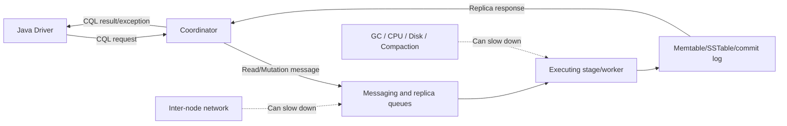

# `nodetool tpstats`, Dropped Messages, and Processing Queues

> **Chapter:** Tracing and Diagnosis  
> **Scope:** Apache Cassandra, a distributed *wide-column* database, and Java applications using Cassandra Java Driver 4.x. This lesson focuses on reading `nodetool tpstats`, evaluating messages dropped due to expiration, and connecting queue symptoms to the read/write paths, replication, compaction, GC, CPU, and I/O.
>
> **Learning Outcomes:** Identify congested queues, distinguish `pending` from `dropped` and client timeouts, calculate growth rates from counters, pinpoint the affected node/layer, and propose root-cause fixes instead of mechanically raising timeouts.

## 1. Opening Scenario: Requests Time Out Yet Nodes Still Show `UN`

A Java service reads recent orders by `customer_id`. During a heavy write burst, the API begins returning timeouts:

- Read p99 climbs from 80 ms to 600 ms.
- All nodes still report `UN` (*Up/Normal*) in `nodetool status`.
- `nodetool tpstats` on one replica shows rising `Pending` in the request-handling pool and an increasing `Dropped Messages` counter.
- Disk I/O, GC, or compaction may also be under pressure.

The key question is not merely "is the node alive?" Cassandra may continue exchanging gossip and answering some requests while **failing to process messages before their deadlines**. A message queued too long can be dropped without executing work that is no longer timely.

Scenario model:

```text
Java Client
    |
    | SELECT ... WHERE partition_key = ?
    v
Coordinator C1
    |
    | dispatches read request
    v
Replica R2
    |
    +--> receives message / stage queue
              |
              +--> pending grows
              |       |
              |       +--> processed past deadline?
              |                 |
              |                 +--> drop expired message
              |                      (dropped message)
              |
              +--> coordinator lacks enough responses in time
                         |
                         +--> read timeout / request timeout
```

This illustrates **one possible cause**, not an assertion that every timeout corresponds to a dropped message. Timeouts can happen from network issues, coordinators, the driver, or other mechanisms even when dropped counters stay flat.

## 2. Placing `tpstats` Along a Request's Path

Cassandra distributes data by hashing the **partition key** into a token, then selects replicas according to `NetworkTopologyStrategy`/RF and topology. A node acts as **coordinator** upon receiving CQL from a client; the coordinator sends inter-node messages to participating replicas.



`nodetool tpstats` reports the **status of thread pools and processing stages** on **the node where the command runs**, along with dropped message statistics if displayed by that version. It shows active, queued, and completed work, yet it is **not a packet capture** and does not directly show which nodes every request traversed.

When analyzing, separate three layers:

1. **Application/driver:** was the request dispatched, and how long did it wait for a connection or response?
2. **Coordinator:** did it receive the request, dispatch messages to replicas, and collect enough ACKs per consistency level?
3. **Replica:** was the message received, queued, and processed before its deadline?

A fast coordinator does not guarantee fast replicas, and a `UN` replica does not guarantee empty queues.

## 3. What Do the Columns in `nodetool tpstats` Mean?

Example running a **read-only status command** on a node:

```bash
nodetool tpstats
```

Below is an **illustrative table**, not output copied from a specific version:

```text
Pool Name           Active   Pending   Completed   Blocked   All time blocked
ReadStage                8       120     1850000         0                  0
MutationStage            2         4     2400000         0                  0
CompactionExecutor       4        26      128000         0                  0
...

Dropped Messages
Message type           Dropped
READ                       340
MUTATION                    12
...
```

Pool names, stage names, message types, column lists, and whether dropped-message latency stats appear **depend on the Cassandra version and distribution**. Never build alerts tied strictly to exact example strings like `ReadStage` or `READ`.

### Interpreting the Columns

| Column | Practical Meaning | Common Misinterpretation to Avoid |
| --- | --- | --- |
| **Active** | Tasks currently executing in that pool/stage at sample time | Not total requests on the node or CPU percentage |
| **Pending** | Tasks queued waiting for execution in that pool/stage | Does not prove expiration; a short burst may drain cleanly |
| **Completed** | Counter of tasks completed per pool stats, typically cumulative over node/metric uptime | Not per-second throughput from a single snapshot |
| **Blocked** | Tasks/threads currently blocked per the pool's queue/executor mechanics | Does not mean Java threads in `BLOCKED` monitor lock state |
| **All time blocked** | Cumulative counter of historical blocked events per pool and version | Watch the rate of increase; large historical values may be from an old incident |
| **Dropped** | Messages of that type recorded as dropped, typically due to expiring before processing | Not lost rows, nor necessarily equal to client error count |

Some versions have additional internal pools, changed threading models, or represent messages by *verb*. Always **verify your version and exported metric semantics** before comparing numbers across two clusters.

### What Does `Pending = 120` Mean?

A queue with 120 waiting tasks can occur because:

- A brief 200 ms read/write burst hit and drained quickly afterward.
- The executor has been falling behind for several minutes.
- Workers are stalled on I/O, CPU, or GC, causing tasks to pile up.
- The system is draining a prior backlog.

A single `Pending=120` snapshot cannot distinguish these cases. Collect a **time series**: is pending rising, staying elevated, or draining; check completed rate, dropped rate, p99, and system resources alongside it.

### Is a Large `Completed` Count Good or Bad?

Suppose `Completed = 2,000,000`. That number alone proves nothing about pool health; the node may simply have been up for days. A more useful signal is the growth rate:

```text
t0: Completed = 2,000,000
t1: Completed = 2,006,000, after 60 seconds

Observed throughput ≈ (2,006,000 - 2,000,000) / 60
                    ≈ 100 tasks/second
```

This measures throughput of **tasks completed by that pool**, not necessarily **100 CQL requests/second**: one request may spawn multiple messages/tasks or bypass the inspected pool.

If a node restarts, counters can reset; monitoring tools must handle counter resets rather than reporting negative throughput.

## 4. What Are `Dropped Messages` Really?

In many Cassandra versions, the system attaches deadlines to request messages. When a message **expires before being processed**, executing it can no longer help the original request finish on time. Cassandra can drop the message and increment the corresponding dropped counter.

Example:

```text
09:00:00.000  Coordinator sends READ request to R2
09:00:00.010  R2 receives and enqueues it, but the stage is busy
09:00:00.250  Read deadline passes (illustrative)
09:00:00.310  Worker pops task from queue:
              request already expired -> recorded as dropped
```

This is **illustrative**, not a promise of Cassandra's exact default timings. How deadlines are computed, propagated with messages, and recorded in metrics varies by version.

### Do Not Conflate Three Kinds of "Loss"

| Phenomenon | What It Proves | What It Does **Not** Automatically Prove |
| --- | --- | --- |
| **Dropped message** in `tpstats` | The node/messaging layer dropped a message type per internal logic | That corresponding mutations were lost on every replica |
| **Read/write timeout** on Cassandra | Coordinator did not collect enough required responses in time | That replicas performed zero work |
| **Driver request timeout** | Driver did not receive a complete result within client timeout | That coordinator/replicas never received or applied the mutation |
| **Network packet loss** | TCP/IP packets may be lost and retransmitted or connections broken | That a matching dropped line incremented in `tpstats` |
| **Application error** | API failed to deliver the expected outcome | That the root cause definitely lies inside Cassandra |

**Dropped messages are not counts of rows "deleted from the database."** Especially on replicated writes, other replicas may have applied the mutation; the coordinator or application may receive a timeout while the write outcome remains uncertain.

### How Do Dropped `READ` and `MUTATION` Differ?

- **Read-related dropped:** a read task expired before processing. This often correlates with read timeouts/tail latency, though you must check which node dropped it and whether the coordinator got enough responses from other replicas.
- **Mutation-related dropped:** a write-related task was not processed in time. If that replica missed the mutation, other replicas, hints, or repair can help converge under proper conditions; **never treat dropped mutations as proof a write is safely persisted**.
- **Response-related or other message types:** look up the exact message names, metric locations, and node roles for your version. Do not assume every dropped line stems from `ReadStage` overload.

Not all message types share the same timeout, semantics, or priority; Cassandra also features inter-node networking and backpressure/resource limits that evolve across versions.

## 5. How Do Queues Grow? A Simple Model

An executor whose arrival rate exceeds its sustained processing rate accumulates pending tasks:

```text
Arrival rate λ:     1,200 tasks/second
Processing rate μ:  1,000 tasks/second

During steady overload:
Backlog grows by roughly 200 tasks/second
After 30 seconds:   ~6,000 extra tasks waiting
```

This is an illustrative model. Real systems have multiple executors, queue bounds, message expirations, retries, and concurrent threads that alter exact numbers.

When queue wait approaches or exceeds deadlines, dropped counts can rise **after** pending climbs. Once a burst ends, falling pending counts do not necessarily mean every initial request succeeded: some may have expired and been dropped.

### Little's Law Aids Intuition Without Replacing Measurement

In a stable system meeting the required assumptions:

```text
L ≈ λ × W
```

Here `L` is average tasks in the system under study, `λ` is effective throughput, and `W` is average time a task spends in the system. **One stage's pending count does not always equal system-wide L**, and client read/write latency does not equal stage `W`. The formula simply explains why concurrency and latency rise together.

A useful alert signal is high `Pending` **paired with** flat completed throughput and degrading p99/timeouts, rather than a standalone pending threshold.

### Does Very High `Active` Mean CPU Overload?

No. Workers may be active yet blocked waiting on I/O, locks, or external responses. When `Active` approaches the pool's concurrency limit, inspect:

- CPU usage and container CPU throttling.
- I/O latency/queues and compaction.
- GC pauses.
- Sampled thread dumps if lock contention is suspected.
- Network and replica responsiveness.

**Adding more worker threads** while disk is saturated can cause more tasks to contend for I/O, worsening latency.

## 6. Diagnostic Table by Signal Pattern

| Pattern Over Time | Priority Hypothesis | Further Verification |
| --- | --- | --- |
| `Pending READ` rises, `Dropped READ` rises, read p99 rises | Read replica cannot keep up | SSTables/tombstones, disk await, compaction, GC, per-node read latency |
| `Pending MUTATION` rises, write drops rise | Write path / mutation workers congested | Write throughput, commit log fsync, memtable flushes, disk queue, CPU |
| Brief pending spike returns to 0, zero drops, SLO intact | Normal burst or self-recovering queue | Measure multiple bursts; check peaks and headroom |
| High pending, CPU near 100%, healthy disk | CPU saturation, compression/processing, or GC CPU burn | Per-process CPU, throttling, thread pools, GC |
| High pending, moderate CPU, high disk await | I/O bottleneck or storage latency | `iostat`, flushes/compaction, disk headroom |
| Drops spike during GC pause spikes, pending swings wildly | Stop-the-world pauses stalling execution | GC logs, post-GC heap, correlated timestamps |
| Driver timeouts rise, `tpstats` normal | Coordinator/network/client queue or external bottleneck | Driver metrics, pool, traces, network, coordinator logs |
| Drops on only one node, other nodes normal | Local bottleneck or hot token range | Compare nodes, disks, CPU, partitions, rack/DC |
| Multiple nodes drop simultaneously during repair | Repair/streaming competing for resources | `compactionstats`, `netstats`, stream bytes, I/O, SLOs |

These are **investigative hypotheses**, not rigid 1-to-1 mappings. One node can suffer CPU saturation, heavy GC, and slow disk simultaneously; establish timelines and root causes carefully.

## 7. Common Stages/Pools and Message Types

Exact pool names vary by version and messaging implementation, yet the following conceptual groups matter:

| Group | Typical Work | What to Inspect When Backlogged |
| --- | --- | --- |
| Read (*read stage*) | Handling replica read requests | Disk reads, SSTable counts, tombstones, hot partitions, GC |
| Mutation / write | Applying mutations to replicas | Commit log, memtables, flushes, CPU, disk writes |
| Request / response | Sending/receiving inter-node replies per version/pool | Network, coordinator, serialization, scheduler |
| Compaction | Merging SSTables, clearing tombstones and stale data | Disk read/write, compaction throughput, headroom |
| Memtable flush | Flushing memtables into SSTables | Disk write latency, memtable pressure, I/O |
| Streaming / repair | Transferring and reconciling data between replicas | Inter-node network, disk, repair concurrency |
| Gossip / internal messaging | Maintaining cluster state | Network, GC, node responsiveness, inter-node health |

**Some rows describe "activities to check," not a claim that pools with those exact verbatim names appear in every `tpstats` output.** In particular, Cassandra 4.x/5.x introduced substantial internal changes from earlier versions; rely on your cluster's actual metrics.

Never sum `Pending` across every pool and call it "waiting customer requests." Internal tasks like compaction have separate queues and task counts that do not map 1-to-1 to CQL requests.

## 8. Gathering a Time Series from `tpstats`

One snapshot shows current state; **multiple timestamped samples** separate brief bursts from sustained congestion.

On a test node or during controlled diagnosis:

```bash
nodetool tpstats
nodetool tpstats
```

In production, sample via monitoring/JMX or approved observability tooling for consistent timestamps and intervals. Avoid polling `nodetool` rapidly across every node; JMX/CLI commands also carry overhead.

### Example: Calculating Drop Rate

Suppose `READ dropped` is a cumulative counter:

| Timestamp | READ dropped | Instant Read Pending | Read p99 |
| --- | ---: | ---: | ---: |
| 10:00:00 | 120 | 5 | 70 ms |
| 10:01:00 | 120 | 20 | 95 ms |
| 10:02:00 | 210 | 900 | 410 ms |
| 10:03:00 | 330 | 1,100 | 650 ms |
| 10:04:00 | 335 | 90 | 130 ms |

Between 10:02 and 10:03 there are **120 dropped messages/minute**, or **2/second**. This measures the growth rate of the **READ counter on that node**, not a cluster-wide failure rate. To calculate a meaningful drop ratio, choose the matching denominator (total messages of that type received/processed, if metrics expose it) and account for counter resets.

When the node restarts at 10:05, the counter may reset to 0. Dashboards must **handle counter resets** rather than showing -335 dropped or assuming "all errors fixed."

### Why Looking Only at Total Dropped Count Is Insufficient

- High-traffic nodes naturally have more opportunities for drops.
- A 20-second pool stall can be smoothed out by 5-minute averages.
- One message type may account for nearly all failures while combined totals stay small.
- Across multiple DCs, cluster averages can mask a single struggling rack/node.
- Dashboards displaying only cumulative totals since boot hide whether an issue **is actively growing** or stopped hours ago.

Plot **rates per message type, per node, and per DC** alongside queue depth, latency, and system resources.

## 9. Tools That Complement `tpstats`

`tpstats` describes queues and executors. To find **why** queues overloaded, inspect additional layers.

### 9.1. `nodetool` Utilities

On a node with access:

```bash
nodetool status
nodetool tpstats
nodetool tablestats lab.orders_by_customer
nodetool compactionstats
nodetool netstats
nodetool gcstats
```

What these commands inspect:

- `status`: which nodes/DCs are `UN`, `DN`, and overall membership.
- `tpstats`: active/pending/completed/blocked tasks and dropped messages.
- `tablestats`: table health, SSTables/memtables, tombstones, latencies, and space per version.
- `compactionstats`: running or pending compactions.
- `netstats`: streaming activity and selected network stats.
- `gcstats`: summary GC metrics where supported by version.

`nodetool status` only reflects gossip/ownership health; **it does not prove a node meets p99 SLOs**. A node can be `UN` and still drop expired messages from backed-up queues.

### 9.2. Operating System and JVM

On Linux with appropriate tools:

```bash
vmstat 1
iostat -xz 1
pidstat -u -p <pid> 1
jcmd <pid> GC.heap_info
```

`<pid>` is the Cassandra process PID; substitute the real value when running. These correlate CPU, I/O latency, queues, and memory/GC. For containerized Cassandra, also check **CPU throttling and cgroup memory limits**, because low host-wide CPU does not guarantee the JVM isn't hitting container quotas.

Do not conclude a disk bottleneck solely from high CPU `iowait`; check `await`, throughput, queue depth, compaction, and read/write p99.

### 9.3. JMX and Metrics

In environments with a metrics collector, monitor:

- Thread pool active, pending, completed, and blocked counts per scope/pool.
- Dropped message counters/rates by message type/verb supported by your version.
- Client request read/write latency histograms, timeouts, and unavailables.
- GC pauses, post-GC heap, native memory/RSS, CPU, and disk.
- Memtable flushes, SSTable counts, tombstones scanned, and compaction backlog.
- Inter-node messaging, streaming/repair, and network errors.
- Driver request latency, in-flight requests, retries, and timeouts.

Metric/MBean names vary across Cassandra releases, exporters, and distributions. Verify **time units, counter vs. gauge types, and labels** before writing Prometheus queries or alerts.

### 9.4. CQL Tracing

Can be used in `cqlsh` in a lab:

```cql
TRACING ON;

SELECT order_id, created_at, status
FROM lab.orders_by_customer
WHERE customer_id = aaaaaaaa-aaaa-4aaa-8aaa-aaaaaaaaaaaa
LIMIT 20;

TRACING OFF;
```

Tracing can reveal the coordinator, replicas, and execution sequence of a query depending on version and sampling. However:

- A trace is **one sample request**, not a snapshot of all queues/drops on a node.
- A fast sample request does not necessarily represent the failing p99 tail.
- Tracing adds overhead and extra data; enable only under strict control.
- Event names and details differ across versions.
- If a request fails or times out very early, the trace may be incomplete; rely on correlated metrics and logs.

## 10. CQL Practice: A Partition-Key-Aligned Query

Assume a `lab` keyspace exists on a **test cluster**. Table:

```cql
CREATE TABLE IF NOT EXISTS lab.orders_by_customer (
    customer_id uuid,
    created_at timestamp,
    order_id uuid,
    status text,
    total decimal,
    PRIMARY KEY ((customer_id), created_at, order_id)
) WITH CLUSTERING ORDER BY (created_at DESC, order_id ASC);
```

Insert a sample row to read:

```cql
INSERT INTO lab.orders_by_customer
    (customer_id, created_at, order_id, status, total)
VALUES (
    aaaaaaaa-aaaa-4aaa-8aaa-aaaaaaaaaaaa,
    '2026-11-21T03:00:00Z',
    11111111-1111-4111-8111-111111111111,
    'PAID',
    250.00
);
```

Read with the full partition key:

```cql
SELECT order_id, created_at, status, total
FROM lab.orders_by_customer
WHERE customer_id = aaaaaaaa-aaaa-4aaa-8aaa-aaaaaaaaaaaa
LIMIT 20;
```

This query has a far better shape than scanning the entire table because Cassandra knows the partition's token. Still, **`LIMIT 20` does not guarantee reading only 20 physical cells**: tombstones, many SSTables, or an oversized partition can still make reads expensive.

To study `tpstats`, you don't need millions of requests or to crash a replica. Run a controlled representative workload in a lab and sample queues, drops, latency, disk, and CPU over the same window.

### How to Distinguish a Slow Table from a Slow Node?

- If **only one table/query** shows high read latency or tombstones scanned, investigate partition keys, TTLs, tombstones, and compaction strategy first.
- If **all tables** hitting the same node are slow and that node shows abnormal GC pauses/CPU/disk, prioritize a node-level bottleneck.
- If **one DC** hits timeouts alongside slow inter-node networking, check topology, consistency level, cross-DC links, and replica status.
- If Cassandra metrics look healthy yet **driver timeouts** spike, check client pools, connection acquisition, event loops, application queues, and client–coordinator networking.

`tpstats` is one piece of evidence; it does not replace isolating by **table, node, request, and timeframe**.

## 11. Reading Outcomes from Java Driver 4.x

Java applications should record client-side latency, consistency level, exception types, and the coordinator serving the request. These link API symptoms to `tpstats` on the corresponding node.

```java
import java.util.UUID;
import java.util.concurrent.TimeUnit;

import com.datastax.oss.driver.api.core.CqlSession;
import com.datastax.oss.driver.api.core.DefaultConsistencyLevel;
import com.datastax.oss.driver.api.core.cql.BoundStatement;
import com.datastax.oss.driver.api.core.cql.PreparedStatement;
import com.datastax.oss.driver.api.core.cql.ResultSet;
import com.datastax.oss.driver.api.core.metadata.Node;

public final class CassandraReadProbe {
    private final CqlSession session;
    private final PreparedStatement select;

    public CassandraReadProbe(CqlSession session) {
        this.session = session;
        this.select = session.prepare(
            "SELECT order_id, created_at, status " +
            "FROM lab.orders_by_customer " +
            "WHERE customer_id = ? LIMIT ?"
        );
    }

    public int readRecent(UUID customerId) {
        BoundStatement statement = select.bind(customerId, 20)
            .setConsistencyLevel(DefaultConsistencyLevel.LOCAL_QUORUM)
            .setIdempotent(true)
            .setPageSize(20);

        long started = System.nanoTime();
        try {
            ResultSet result = session.execute(statement);
            Node coordinator = result.getExecutionInfo().getCoordinator();

            int rows = 0;
            for (var row : result) {
                rows++;
            }

            long elapsedMs = TimeUnit.NANOSECONDS.toMillis(
                System.nanoTime() - started
            );

            System.out.printf(
                "read_ms=%d rows=%d coordinator_dc=%s%n",
                elapsedMs,
                rows,
                coordinator == null ? "unknown" : coordinator.getDatacenter()
            );
            return rows;
        } catch (RuntimeException ex) {
            long elapsedMs = TimeUnit.NANOSECONDS.toMillis(
                System.nanoTime() - started
            );
            System.err.printf(
                "read_error_ms=%d type=%s%n",
                elapsedMs,
                ex.getClass().getSimpleName()
            );
            throw ex;
        }
    }
}
```

Assumes `CqlSession` is configured with valid contact points, authentication, keyspace, and local datacenter, with sufficient RF for `LOCAL_QUORUM`. The example uses `var`, requiring a compatible Java version; substitute `Row` if needed.

**Proper interpretation:**

- `elapsedMs` measures Java-side execution including connection/driver/network/Cassandra and iterating results; not pure server processing time.
- `getCoordinator()` identifies only the coordinator for that execution, **not all participating replicas**.
- `setIdempotent(true)` suits a standard `SELECT`; it does not enable speculative execution on its own.
- In production systems, never print logs for every request; use histogram metrics and sampled tracing to avoid self-inflicted overhead.
- When requests fail, successful `ExecutionInfo` may be absent; log the exception type, local DC, statement kind, and request context, then correlate driver/server metrics.

### Identifying Where Timeouts Occur

| Symptom Observed from Driver | Possible Origin | What to Check |
| --- | --- | --- |
| Cassandra read timeout response | Coordinator lacked enough read responses per CL within deadline | Replica `tpstats`, dropped READs, disk/GC, CL/RF |
| Cassandra write timeout response | Insufficient write ACKs per CL within deadline | Mutation queues, commit log, flushes, network, and replicas |
| Driver request timeout | Driver timed out waiting for result; may span retries | Client pool, network, server traces, retry/speculative policy |
| No node available / connectivity | Driver could not reach an eligible coordinator | Contact points, local DC, node/network health, pool |
| Unavailable per CL | Too few live/eligible replicas to satisfy CL from coordinator's view | RF, `nodetool status`, DC, and replica placement |

Never treat a single exception class as sole proof of root cause. A write timeout **does not prove the mutation was rolled back on all replicas**; retries must account for idempotence and reconciliation.

## 12. Sample Incident A — Dropped READs Rise Due to Disk/Compaction

Suppose monitoring records:

| Timestamp | Pending READ | Dropped READ (counter) | Disk read await | Read p99 |
| --- | ---: | ---: | ---: | ---: |
| 14:00 | 4 | 15 | 3 ms | 70 ms |
| 14:05 | 90 | 15 | 18 ms | 160 ms |
| 14:10 | 800 | 110 | 75 ms | 590 ms |
| 14:15 | 980 | 300 | 92 ms | 750 ms |

These are **hypothetical numbers**. Disk latency climbs alongside pending, read p99, and drops. Next steps:

1. Check `compactionstats` for heavy compaction jobs.
2. Inspect `tablestats` for the affected table: SSTable count, tombstones scanned, memtables, compaction backlog.
3. Correlate disk headroom, disk IOPS, read/write queues, and active streaming/repair.
4. Verify whether queries hit partition keys cleanly or scan oversized partitions.
5. Throttle background load or optimize queries per runbook in a controlled manner; re-measure both p99 **and** dropped rate.

**Never "fix" this by immediately increasing timeouts 10x.** Longer timeouts may reduce drops slightly while holding more requests in flight, inflating concurrency and slowing the API further.

## 13. Sample Incident B — Dropped MUTATIONs Rise During a Write Surge

Suppose a pipeline pushes 5x normal write traffic. Soon after:

- `Pending` in the mutation pool climbs.
- Mutation `Dropped` counts rise.
- Commit log `fsync` or memtable flushes come under pressure.
- Some `LOCAL_QUORUM` requests time out while others succeed.

Hypotheses to test:

1. Incoming mutation rate exceeds current CPU/disk capacity.
2. Commit log storage has high latency or is nearly full.
3. Slow memtable flushes/compaction are competing for resources.
4. Partition keys concentrate load onto too few tokens/replicas.
5. A node or network link is degraded, starving the coordinator of timely ACKs.

**Do not conclude all writes were lost** upon seeing dropped mutations on one node. RF and CL may ensure other replicas accepted the write; equally, do not assume all data is safe. On request timeouts, applications need idempotence-safe retries, reconciliation, and monitoring of hints/repair.

Sustainable fixes usually involve producer rate-limiting, sensible batch sizing, better partition distribution, scaling nodes, or resolving I/O bottlenecks—not merely enlarging queues.

## 14. Sample Incident C — GC Pauses Drive Up Queues and Drops

```text
10:00:00  Node R2 enters a long GC pause
10:00:05  Read/response work for R2 piles up in queues
10:00:06  Some requests pass their deadlines
10:00:07  R2 resumes processing, dropping expired tasks
10:00:08  Dropped READs and timeouts spike
```

This relationship is **testable** via correlated timestamps:

- GC logs and JVM pause durations on the same node.
- Pending queues before, during, and after the pause.
- Drop rates and coordinator read timeouts.
- Post-GC heap usage, allocation rates, native memory, and CPU.

A high GC count **does not prove** long pauses. Distinguish *stop-the-world pause duration* from total collector CPU time. If disks and CPU look healthy while pause spikes clearly match the incident, JVM/memory tuning or reducing allocations may be warranted.

## 15. Sample Incident D — Network or Coordinator Causes Timeouts Despite Low Drops

Suppose Java request timeouts climb, yet `tpstats` on replicas shows negligible drops and very low pending counts.

Possible explanations:

- Driver cannot acquire connections or requests queue client-side.
- The coordinator is slow or pausing on GC even though replicas are healthy.
- Client → coordinator or coordinator → replica network is dropping/flapping.
- Mismatched local DC configuration sends requests across WAN.
- Consistency level requires ACKs from a remote datacenter or unavailable replicas.
- Pagination, serialization, or app processing stalls after the server returns results.

Inspect `ExecutionInfo`, driver metrics, the coordinator node, TCP/network stats, RF, and CL; do not bump replica thread pools without evidence of queued stages.

## 16. Per-Request Tracing vs. Node-Wide Metrics

Both observation sources complement each other:

| Source | Strengths | Limitations |
| --- | --- | --- |
| `tpstats` | Queue snapshots and dropped counters on a node | Not linked to request IDs; doesn't explain root cause |
| JMX / Prometheus | Trends over time by node, DC, and message type | Depends on exporter, sampling, and labels |
| CQL tracing | Execution steps of one sample query across coordinator/replicas | Adds overhead; one trace doesn't represent all requests |
| Java Driver metrics | Client, coordinator, and request timeout view | Cannot see directly inside replica workers/queues |
| OS / JVM telemetry | Distinguishes CPU/GC/disk/memory bottlenecks | Must be aligned in time and host with requests |
| Cassandra logs | Detailed errors like timeouts, GC, network, disk/streaming | Verbose and insufficient without timing metrics |

Align everything on **a unified timeline**. Synchronized node clocks (e.g., NTP) and consistent cluster/DC/node labels let you correlate a client read timeout with replica drops and matching GC/disk events.

### Never Average p99s Across Nodes

Suppose node A has p99=20 ms and node B has p99=200 ms. Their arithmetic mean is 110 ms, yet that is **not the p99 across all requests**. Aggregate compatible histograms properly or measure directly across the full request stream. The same applies when comparing client p99 and server p99: never subtract two percentiles to claim "network p99."

## 17. Rapid Diagnostic Workflow When Drops Increase

**Step 1 — Confirm the incident:** capture the error window, affected tables/queries, RF/CL, datacenter, and which nodes show rising drops.

**Step 2 — Separate message types:** READ, MUTATION, or others; verify exact metric names for your version. Distinguish `Dropped` (counter) from `Pending` (gauge).

**Step 3 — Compute rates:** take deltas of dropped/completed counts across intervals, handling restarts/resets; never use cumulative counters as instantaneous thresholds.

**Step 4 — Inspect queues:** `Active`, `Pending`, `Blocked`, and trends per specific pool/stage. Never sum all pools as "waiting CQL requests."

**Step 5 — Correlate latency:** API/driver/server p95/p99, read/write timeouts, coordinators, and replicas. Check whether drops rose **before, alongside, or after** the latency spike.

**Step 6 — Check resources:** CPU/throttling, JVM GC pauses, heap/native memory, disk await, commit log, flushes, and compaction. For multi-DC, inspect network and CL.

**Step 7 — Isolate load sources:** traffic surge, hot partitions, unaligned partition-key queries, repair/streaming, compaction, or node faults.

**Step 8 — Test hypotheses safely:** change **one variable at a time** in lab/canary (lower concurrency, fix I/O, or tune query), then measure p99, drop rate, pending, and throughput.

**Step 9 — Verify recovery:** confirm drops **are no longer climbing abnormally**, pending returns to baseline, and SLOs recover. Audit timed-out requests or missed mutations per business needs.

**Step 10 — Prevent recurrence:** alert on drop rates, sustained queues, and compaction/repair duration; document root cause, load limits, and the updated runbook.

## 18. How to Design Dashboards and Alerts

A minimal dashboard should include:

| Chart Row | Recommended Labels | Purpose |
| --- | --- | --- |
| Dropped messages / second | Cluster, DC, node, message type | Which message types are expiring on which nodes? |
| Pending tasks by stage | Cluster, DC, node, pool | Which queues are building up? |
| Active tasks + completed / second | Node, pool | Are workers keeping up with load? |
| Read/write latency p95/p99 | Node, table, operation where exposed | Where are SLOs impacted? |
| Read/write timeouts and unavailables | Node, operation, CL if captured | Are requests lacking enough replicas/ACKs? |
| GC pauses + CPU + throttling | Node/process/container | Are scheduler or GC pauses stalling work? |
| Disk await + compaction backlog | Node/device | Is storage congested? |
| Driver latency + errors | App, region, coordinator DC/host | Where are clients seeing failures? |

### Alerting Strategy

A more meaningful alert than cumulative `Dropped > 1000` is:

> **Dropped READs rising continuously on one or more nodes over multiple measurement windows, accompanied by sustained `Pending READ` or rising read p99/timeouts.**

Exact thresholds depend on baseline and traffic scale. A cluster handling millions of CQL/s needs different thresholds from a tiny cluster. Also alert on:

- Pending climbing steadily without draining during normal load hours.
- Unusual dropped mutations on write-receiving replicas.
- GC pauses or disk await spiking concurrently with drop bursts.
- One node diverging sharply from peers in the same DC/rack.
- Repair/streaming overlapping peak traffic windows and pushing p99 past SLOs.

**Never attach partition keys as labels to every metric:** high cardinality can overwhelm the monitoring system. Use sampling and dedicated hot-partition analysis tools only when needed.

## 19. Common Counterproductive "Quick Fixes"

**"Seeing drops? Just raise `read_request_timeout_in_ms`."** Raising timeouts may let fewer requests expire without adding any processing capacity. Once saturated, requests wait longer, consume more resources, and slow the API further. Find why queues grew first.

**"Increasing thread counts in every stage makes everything faster."** Not necessarily. If disk is saturated, extra workers heighten I/O and lock contention; if CPU is quota-throttled, more threads only add scheduling overhead.

**"`nodetool status` shows `UN`, so no investigation needed."** Wrong. Gossip health does not measure p99, queues, or GC.

**"One dropped MUTATION means one row is permanently lost."** Wrong. Replication/CL/hints/repair govern convergence and persisted state; verify carefully.

**"Zero drops means zero timeouts."** Wrong. Timeouts can happen in the driver, coordinator, network, or due to CL without incrementing dropped counters on the inspected node.

**"Pending spiked for one second, so the cluster needs more nodes."** Insufficient evidence. Short bursts differ from sustained backlog growth; check throughput, CPU/I/O, and hot keys.

**"High ReadStage pending means tune JVM heap immediately."** Wrong if the root cause is SSTable/tombstone scans or disk latency.

**"Speculative retry always helps when drops happen."** Not always. Extra speculative reads can help when a single replica lags, yet amplify fan-out and load when the whole cluster is congested.

**"Forcing continuous compaction drives every queue to 0."** False. Compaction consumes extra I/O and can worsen read/write p99; schedule and throttle thoughtfully.

**"Reading one CQL trace explains every drop over 10 minutes."** Wrong. A trace is a single sample request; combine it with time-series metrics and real workload distributions.

**"Restarting the node to reset counters resolves the incident."** Wrong. Counters reset while the root cause remains; unplanned restarts also reduce availability, trigger streaming/hints, and heighten consistency risks.

## 20. Self-Check Questions and Interview Scenarios

1. What does `Active=8` and `Pending=1000` in the read pool mean? Why can't you immediately conclude CPU is at 100%?
2. `Dropped READ` climbs from 250 to 370 in one minute. What is the drop rate? Does this equal failed CQL requests per second?
3. A node restart resets the dropped counter from 370 to 0. How must dashboards handle this to avoid misinterpretation?
4. Distinguish a Cassandra `ReadTimeout` from a driver request timeout and a replica dropped READ.
5. Why does `nodetool status` reporting `UN` fail to prove a node meets its SLO?
6. If pending MUTATION and disk write await rise together, how would you inspect commit log, flushes, and compaction?
7. When GC pauses rise alongside dropped READs, which additional JVM metrics should you check to confirm?
8. Why does a dropped mutation on one replica not prove data was lost across the entire RF?
9. A table has heavy tombstones and `LIMIT 20`, yet read p99 is very high. Connect this to pending READs and SSTables.
10. Drop rate is 0 yet driver timeouts rise after a local datacenter config change. What should you investigate?
11. Why shouldn't you sum `Pending` from compaction and read pools as "unprocessed customer requests"?
12. How do you combine `tpstats`, CQL tracing, JVM logs, and Java Driver metrics to locate a slow coordinator or replica?
13. A repair run drives up pending compaction and disk await, followed by rising dropped READs. Outline a safe load-reduction plan.
14. Explain why raising timeouts can mask symptoms without improving effective throughput.
15. Design three alerts to detect sustained queue growth, dropped mutations, and single-node congestion early.

## 21. Key Takeaways via Decision Diagram

```text
Observe slow requests / timeouts / drops
                  |
                  v
       Identify NODE and message type
                  |
                  v
     Read nodetool tpstats over time
       Active / Pending / Completed
         Blocked / Dropped rate
                  |
         +--------+---------+
         |                  |
   Sustained queue     Queue not growing
       growth               |
         |                  v
         v            Check client,
   Inspect GC/CPU/    coordinator, CL,
   I/O/compaction/    network, and trace
   hot keys                 |
         |                  |
         v                  |
   Find execution           |
   bottleneck               |
         +--------+---------+
                  |
                  v
       Apply controlled remediation
                  |
                  v
  Re-measure p99 + pending + drop rate
          + throughput + errors
```

**Conclusion:** `nodetool tpstats` reveals **running, queued, and completed tasks** on a node; `Dropped Messages` reveals **messages discarded by internal mechanics, typically due to expiration**, not a counter of lost data rows. Diagnostic value comes from measuring **growth rates** and correlating them with **tracing, driver timeouts, consistency levels, GC, CPU, disk I/O, compaction, and replica health** on a unified timeline. Never treat an overloaded queue merely by stretching timeouts or adding threads—eliminate whatever prevents it from keeping up.
