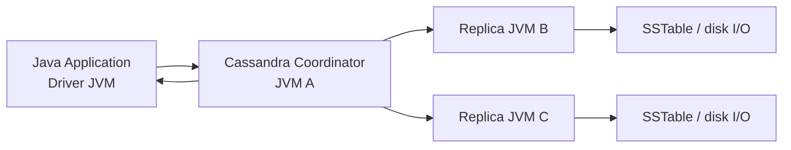

# JFR or JVM Profilers in a Controlled Investigation Scope

**Chapter:** Tracing and Diagnosis  
**Module:** `DATABASE_ENGINE_WIDE_COLUMN_CASSANDRA` — Apache Cassandra

When Cassandra queries slow down, a node's CPU spikes unexpectedly, or GC pauses inflate application p99, looking only at read latency graphs is rarely enough to tell **which component inside the JVM** is consuming resources. Java Flight Recorder (JFR) and sampling profilers let you observe execution activity, memory allocation, GC, threads, and selected I/O events of a **Java process**. However, profiling always incurs overhead and can capture sensitive details; in a distributed system, profiling the wrong node or wrong time window also easily leads to false conclusions.

This lesson connects your knowledge of Cassandra architecture, partition keys, query-driven tables, consistency levels, replication, read/write paths, compaction, repair, error handling, and the Java Driver into a controlled diagnostic workflow: **formulate a hypothesis → select the JVM and time window → capture a bounded recording → correlate metrics/tracing → verify remediation**.

> **Practical Scope:** Apache Cassandra 4.1/5.x running on a **JDK compatible with your version**, inside a test cluster. JFR commands illustrate modern JDKs providing `jcmd`/`jfr` tools. Event names, JFR capabilities, attach support, analysis tools, and permissions may vary across JDKs, distributions, and containers. **Never leave profilers running long-term or weaken kernel security settings in production** just to follow an example.

## 1. Learning Objectives

After this lesson, you will be able to:

1. Identify when to use **CQL tracing**, **metrics**, **JFR**, **thread dumps**, or a **sampling profiler**, rather than picking the wrong tool.
2. Select the right JVM—either the **Cassandra server** or the **Java client application**—to investigate.
3. Capture a short, time- and size-bounded JFR recording, check its status, and inspect the output file without restarting Cassandra.
4. Distinguish **CPU time**, **wall-clock time**, **allocations**, **GC pauses**, **blocked/parked threads**, and file/socket I/O events.
5. Read call trees and flame graphs to form hypotheses without treating a single stack sample as absolute causal proof.
6. Correlate JFR with p95/p99 latency, `nodetool`, CQL tracing, compaction backlogs, tombstone scans, and replica health.
7. Control profiler permissions, sensitive information inside recordings, disk headroom, and production impact.
8. Plan re-verification after tuning partition keys, queries, GC, compaction, or the Java client.
9. Write an incident report containing evidence, synchronized timestamps, and explicit measurement limitations.

## 2. Which Questions Does JFR Answer—and Which Does It Not?

### 2.1. Five Distinct Observation Layers

| Layer | Example Tools | Appropriate Questions | Limitations |
| --- | --- | --- | --- |
| Application | Java Driver metrics, request IDs, elapsed time | What p99 do users experience? Where do requests time out? | Does not pinpoint exact server JVM methods |
| Cassandra CQL | `TRACING ON`, execution info, warnings | Which coordinator/replicas handled the query? What read/write steps ran? | Tracing adds overhead; cannot describe every CPU method |
| Cassandra server | `nodetool tpstats`, `tablestats`, `compactionstats`, JMX metrics | How are thread pools/backlogs, SSTables/read, tombstones, compaction, and GC shifting? | Node/table aggregation can mask a single query or hot partition |
| JVM | **JFR**, thread dumps, GC logs | Which stacks burn CPU? What allocations/GC/locks/threads look abnormal? | Sample-based profiles; unaware of business intent |
| OS / infrastructure | CPU, disk queues, I/O wait, network, cgroups | Is the node bottlenecked on CPU, disk, memory, or WAN? | Does not directly explain query shape or Cassandra tokens |

**Ask the right question before running a profiler.** If read timeouts coincide with a node losing network connectivity, inspect topology, CL, logs, and `nodetool status` first; a CPU flame graph may not locate the issue. If CPU spikes on a healthy node, JFR or a CPU profiler is far more appropriate.

### 2.2. What Is JFR?

**Java Flight Recorder** is a built-in JVM observability engine that records configured JVM events. Depending on the JDK and preset used, events can include:

- Java/native execution samples related to CPU usage.
- Memory/object allocation samples and allocation hot spots.
- Garbage collection events, pause durations, and GC phases.
- Thread scheduling, thread parking, and monitor contention.
- Class loading, JIT compilation, and safepoints.
- Selected file/socket I/O events if enabled and supported by the JDK.

JFR is not a full heap dump. It does not continuously trace **every** method call on every thread, nor does it guarantee every allocation appears with exact granularity. Recording configuration determines both overhead and captured data.

### 2.3. How Is a Sampling Profiler Different?

A sampling profiler such as **async-profiler** samples stacks by CPU or other event sources (platform-dependent) and outputs flame graphs. Its strength is low-overhead stack sampling when configured carefully. However:

- CPU profiling measures **time threads actively execute on CPU**, not total time requests spend waiting on I/O.
- Wall-clock profiling samples waiting states too; you must know *what* threads are waiting on before concluding.
- Allocation profiling highlights where objects are allocated, not whether those objects survive long or cause OOMs.
- Results from one node do not represent the entire cluster; one minute off-peak does not represent peak hour.
- Some profilers require attach permissions, `perf_event`, or OS privileges unavailable inside containers. **Never disable kernel security protections** simply to attach in production.

### 2.4. Sometimes You Do Not Need a Profiler

If you only need to see whether a query scans many tombstones:

```sql
TRACING ON

SELECT event_ts, event_id
FROM lab_jfr.events_by_device_day
WHERE device_id = 'sensor-01'
  AND bucket_day = '2026-11-21'
LIMIT 20;

TRACING OFF
```

CQL tracing and `nodetool tablestats` are usually better first steps. Escalate to JFR only when you need to answer **why JVM CPU/GC/threads are elevated** or separate I/O, locking, and allocation costs. Never enable tracing across all production requests as default logging.

## 3. Identifying Which JVM Process to Profile

A slow CQL query traverses multiple components:



**Java application JFR** investigates connection pools, serialization, object mapping, blocked application threads, retry loops, client GC, or result processing. **Cassandra node JFR** investigates read/write stages, compaction, streaming, tombstone scanning, server allocations, and server GC. There is no single JFR file covering the whole distributed request.

### 3.1. Select the Node Using Evidence

Before profiling, check:

- Coordinator/replicas from CQL tracing if available.
- Which node shows unusually high CPU or GC activity.
- Which node shows elevated read/write p99, pending tasks, compaction backlogs, or disk I/O.
- The partition key/token and replica placement for the suspect query.
- Whether an incident is actively unfolding or only historical data remains.
- Whether any node recently bootstrapped, repaired, streamed, or changed compaction strategies.

If `node-a` is idle while `node-c` is compacting and overloaded, profiling A yields a clean profile even while client p99 suffers. Multi-DC clusters also vary in network paths and replica placement: tag every artifact with hostname, datacenter, rack, Cassandra version, and JDK version.

### 3.2. Same Symptom, Two Investigation Directions

| Symptom | Initial Suspicion | Where to Measure First |
| --- | --- | --- |
| Cassandra node CPU 95%, read p99 rising | CPU-heavy scan/compaction/GC/serialization | Server metrics + CPU JFR on the hot node |
| CPU only 15%, read p99 rising | Disk I/O, network, queues, locks, or timeouts | OS I/O/network + thread states/I/O JFR |
| GC pauses rise with allocation rate | Excessive short-lived objects, heap/GC pressure | GC/allocation JFR + heap/GC metrics |
| Client JVM CPU high, server normal | Deserialization, result transforms, retries, paging | Application JFR + Driver metrics |
| Timeouts after replica loss | CL/quorum, coordinator routing, network | `nodetool status`, tracing, and driver errors first |
| Write p99 rises during repair | Streaming/compaction competing for CPU/disk | `compactionstats`, `netstats`, disk I/O, then JFR if needed |

## 4. Controlled Investigation Principles

A recording is an **intentional diagnostic action**, not an unbounded feature flag.

### 4.1. "Scope Card" Before Running

Record at minimum:

```text
INCIDENT_ID: INC-2026-11-21-014
OBJECTIVE: identify hot CPU stacks during read p99 spike
ENVIRONMENT: lab / staging / production (approved)
NODE: cassandra-b, dc=dc1, rack=rack2
CASSANDRA_VERSION: [read from cluster]
JDK_VERSION: [java -version]
PID: [jcmd -l]
TIME_WINDOW_UTC: [start/end]
TOOL: JFR, settings=profile
DURATION: 60 seconds
FILE_LIMIT: 256 MiB
OUTPUT_LOCATION: filesystem with ample headroom, restricted permissions
BASELINE_METRICS: CPU, GC, p99, I/O, compaction, error rate
STOP_CONDITION: p99/error rate breaches threshold or disk nears full
APPROVER / RECIPIENT:
DELETION_PLAN / RETENTION:
```

In production, limits must derive from actual SLOs and capacity. **60 seconds / 256 MiB is a learning example**, not a safe universal preset for every workload. JFR files contain internal technical details; enforce access permissions and retention policies per security rules.

### 4.2. Common Costs

| Impact | Origin | Mitigation |
| --- | --- | --- |
| CPU overhead | Event emission, sampling, and stack walking | Keep recordings short, pick appropriate presets, avoid enabling all events |
| Memory / buffers | JFR/profiler event buffers | Monitor heap/native memory and cgroup limits |
| Disk | JFR files, snapshot/HTML profiles | Cap `maxsize`, check free disk, write to suitable volumes |
| I/O and p99 | Profiler competing with Cassandra threads | Watch client p99 and enforce stop conditions |
| Sensitive info | Stacks, thread names, paths, metadata, or event payloads | Restrict file permissions; never upload outside approved policies |
| Measurement skew | Heavy profiler config, warm-up, mismatched load | Compare baseline vs. profiling window; note differences |
| Attach side effects | JVM/container/kernel permissions, compatibility errors | Test JDK/tools beforehand; never blindly weaken production security |

### 4.3. Choosing a Preset Based on Your Question

JFR typically provides **`default`** (lighter, suited for broad observation) and **`profile`** (more detailed profiling, typically higher overhead) presets. Depending on JDK, preset contents vary. You should:

1. Clarify the target (CPU, GC, allocation, or I/O).
2. Inspect which events are enabled in your actual JDK's presets.
3. Test on staging under comparable workload first.
4. Bound both duration and file size.
5. Never crank up sampling frequency or enable every object allocation event in production without measuring overhead first.

JFR supports concurrent recordings, so give each an explicit `name` and check `JFR.check` before starting another.

## 5. Preparing the Cassandra Lab and Reference Query

The lab's goal is **capturing a recording and correlating data**, not intentionally overloading a production node. A handful of tiny rows will not generate meaningful hot CPU stacks; they simply validate the measurement path.

### 5.1. Checking Cluster and JDK

On the Cassandra node (assuming Linux/container):

```bash
nodetool status
nodetool tpstats
nodetool compactionstats
nodetool info

java -version
jcmd -l
```

`java -version` in your shell may not match the JDK running Cassandra if the service sets a different `JAVA_HOME`. Verify the **target process** and its runtime before attaching. Inside containers, PIDs may differ from the Docker host; run `jcmd` inside the **same PID namespace** under an authorized user. `jcmd -l` may omit processes if permissions or namespaces block visibility.

Pick Cassandra's PID by inspecting the process class/command line—**never guess a fixed PID**:

```bash
# Conceptual output example; never copy this PID to another node:
jcmd -l
# 1234 org.apache.cassandra.service.CassandraDaemon ...

# Only after verifying the real PID:
jcmd 1234 VM.version
jcmd 1234 JFR.check
```

If `JFR.*` commands are reported missing, verify JDK support and whether the JVM was launched with compatible flags. Never swap a JVM/JDK mid-production shift just to enable JFR without a planned restart and Cassandra compatibility validation.

### 5.2. Practice Table and Data

In `cqlsh`, replace the datacenter name below with your actual DC name if different:

```sql
CREATE KEYSPACE IF NOT EXISTS lab_jfr
WITH replication = {
  'class': 'NetworkTopologyStrategy',
  'datacenter1': 1
}
AND durable_writes = true;

CREATE TABLE IF NOT EXISTS lab_jfr.events_by_device_day (
    device_id text,
    bucket_day date,
    event_ts timestamp,
    event_id uuid,
    status text,
    payload text,
    PRIMARY KEY ((device_id, bucket_day), event_ts, event_id)
) WITH CLUSTERING ORDER BY (event_ts DESC, event_id ASC);

INSERT INTO lab_jfr.events_by_device_day
    (device_id, bucket_day, event_ts, event_id, status, payload)
VALUES (
    'sensor-01', '2026-11-21', '2026-11-21T10:00:00Z',
    10000000-0000-4000-8000-000000000001, 'OK', 'measurement-1'
);

INSERT INTO lab_jfr.events_by_device_day
    (device_id, bucket_day, event_ts, event_id, status, payload)
VALUES (
    'sensor-01', '2026-11-21', '2026-11-21T10:01:00Z',
    10000000-0000-4000-8000-000000000002, 'OK', 'measurement-2'
);

INSERT INTO lab_jfr.events_by_device_day
    (device_id, bucket_day, event_ts, event_id, status, payload)
VALUES (
    'sensor-01', '2026-11-21', '2026-11-21T10:02:00Z',
    10000000-0000-4000-8000-000000000003, 'OK', 'measurement-3'
);
```

Test a fully keyed query:

```sql
SELECT event_ts, event_id, status
FROM lab_jfr.events_by_device_day
WHERE device_id = 'sensor-01'
  AND bucket_day = '2026-11-21'
  AND event_ts >= '2026-11-21T10:00:00Z'
  AND event_ts <  '2026-11-21T11:00:00Z'
LIMIT 20;
```

Do not generate millions of rows in an uncontrolled CQL loop just to make JFR "show busy stacks." CPU/JFR benchmarks require a bounded load generator, adequate capacity, and a clear stop plan.

## 6. Capturing a Short JFR Recording on the Cassandra JVM

**Run only on a lab node with verified process identity and ample disk headroom.** The commands below assume a Linux environment with `jcmd` from a matching JDK and an output directory writable by the JVM account.

### 6.1. Verify the Process and Capture Baseline

```bash
jcmd -l
jcmd <PID_CASSANDRA> VM.version
jcmd <PID_CASSANDRA> JFR.check

nodetool tpstats
nodetool compactionstats
nodetool tablestats lab_jfr.events_by_device_day
```

In a real shell, replace `<PID_CASSANDRA>` with the verified PID; `< >` brackets are placeholders, never type them literally. Run `jcmd <pid> help JFR.start` to see exact supported options.

### 6.2. Create a Dedicated Recording Directory

```bash
# Run with appropriate permissions on the lab node; never write to a nearly full volume.
mkdir -p /var/tmp/cassandra-jfr
df -h /var/tmp/cassandra-jfr
```

Choose a directory on a filesystem separate from commit logs/SSTables if possible. Restrict file permissions to the investigation team; never leave JFR artifacts in a web root or public directory.

### 6.3. Start a Time-Bounded Recording

```bash
# Example for JDKs supporting these options:
jcmd <PID_CASSANDRA> JFR.start \
  name=cassandra_incident_014 \
  settings=profile \
  duration=60s \
  filename=/var/tmp/cassandra-jfr/incident-014.jfr \
  maxsize=256m
```

Options explained:

| Option | Purpose | What to Verify |
| --- | --- | --- |
| `name` | Recording identifier for monitoring/stopping | Does not collide with an active recording |
| `settings=profile` | Preset with richer profiling events than `default` | Overhead and exact event set per JDK |
| `duration=60s` | Automatically ends after the requested duration | Aligns with the incident/load window |
| `filename=...jfr` | Output path when recording completes/dumps | Write permissions, disk space, and retention |
| `maxsize=256m` | Caps recording size per JFR mechanics | Do not assume this protects the whole filesystem if other recordings exist |

While the recording runs, record **UTC timestamps** and metrics over the exact same window. Without meaningful load, CPU samples mostly show idle/background threads—which does not prove the query path is trouble-free.

### 6.4. Monitor, Stop, and Verify the File

```bash
jcmd <PID_CASSANDRA> JFR.check

# After duration completes:
ls -lh /var/tmp/cassandra-jfr/incident-014.jfr

# Use a JDK providing the jfr CLI to inspect summary:
jfr summary /var/tmp/cassandra-jfr/incident-014.jfr
```

If you need to **stop early** because p99 or disk crosses a threshold, verify the recording is still running with `JFR.check`, then run:

```bash
jcmd <PID_CASSANDRA> JFR.stop name=cassandra_incident_014
```

Whether stopping writes out the file depends on recording options and JDK version; inspect the actual file and CLI output. If the file does not exist yet, never report "capture succeeded." For continuous recordings without `duration`, use `JFR.dump name=... filename=...` followed by `JFR.stop` per your JDK's documentation.

### 6.5. Troubleshooting When JFR Fails to Save

If recording fails to attach or write:

1. Check PID, matching JVM/JDK, and OS permissions.
2. Check `jcmd <pid> help JFR.start` and exact option names.
3. Check free disk space, directory permissions, and container/cgroup filesystem limits.
4. Check whether a recording with the same name is already running.
5. Record the verbatim error and fall back to metrics or bounded thread dumps if appropriate; **never grant root/ptrace casually** or restart a live production Cassandra node just to "try again."

## 7. Reading Recordings with Java Mission Control or CLI

**Java Mission Control (JMC)** is a standard tool for analyzing JFR files offline. Use it to inspect the event browser, hot methods/call trees, threads, GC, allocations, and I/O. The `jfr` CLI can print summaries or dump specific events to text.

```bash
jfr summary /var/tmp/cassandra-jfr/incident-014.jfr

# Event names must exist in the recording; check summary first:
jfr print --events jdk.CPULoad,jdk.GarbageCollection \
  /var/tmp/cassandra-jfr/incident-014.jfr
```

Do not assume every event is present or that all JDKs emit identical names. `jfr summary` reveals which events were recorded and their counts; missing events may stem from preset defaults, short duration, or lack of workload triggering them.

### 7.1. Reading Call Trees Properly

When JMC displays `Hot Methods` or a call tree:

- **Self time/samples:** samples attributed directly to the method itself (excluding callees as presented by the tool).
- **Total/inclusive:** includes samples in the method and its callees.
- **Thread grouping:** which threads emitted the samples. Servers run many thread pools, so aggregating across the whole JVM can hide overloaded worker threads.
- **Sample count:** number of captured samples, not how many times the method was invoked.
- **Percentages:** depend on the profiling window, thread filter, and sampling mechanism.

Never translate "method X = 30%" into "30% of every CQL request's end-to-end latency is in X." CPU sample share reflects **sampled CPU execution during that interval**, which may include compaction, repair, gossip, or background tasks unrelated to the query under study.

### 7.2. High CPU Is Not the Same as High Wall-Clock Time

Example:

```text
Request A: 300 ms wall-clock
  10 ms CPU executing Java
  240 ms waiting on disk read
  50 ms queue/network/scheduling

Request B: 300 ms wall-clock
  250 ms CPU processing data
  50 ms queue/network

A CPU flame graph highlights B while hiding A's I/O wait.
```

To investigate A, combine JFR thread states, file/socket events (if enabled), OS I/O wait, Cassandra read latency, and tracing. Seeing sparse stacks in CPU-only samples **never proves there is no performance problem**.

### 7.3. GC and Allocations

JFR can reveal:

- Allocation rates and hot sites producing temporary objects.
- GC counts, pause durations, and individual phases.
- Threads/stacks responsible for allocations when allocation events are enabled.
- Safepoint and JIT compilation events to assist pause/compiler analysis.

Key principles:

- **High allocation** does not equal a **memory leak**. Short-lived objects may be reclaimed cleanly by young GC.
- **Long GC pauses** do not mean all p99 stems from GC; verify time-window overlap and client metrics.
- **Heap dumps** and **class histograms** can be far more disruptive than a short JFR recording; never run `jcmd GC.heap_dump`/`GC.class_histogram` in production just to answer routine CPU questions.
- If a memory leak is genuinely suspected, prepare a dedicated collection plan, verify permissions and disk space, prepare analysis tools, and obtain approval first.

### 7.4. Locks and Parked Threads

`jdk.JavaMonitorEnter`, `jdk.ThreadPark`, and related events help spot contention or waiting threads depending on configuration. However:

- Parked threads can be **completely normal**—thread pool workers waiting for tasks, not a deadlock.
- A long lock event requires inspecting thread identity, stack trace, occurrence count, and request impact.
- A short recording can miss rare lock contention.
- Never tune thread pools or GC based solely on a single stack snapshot.

## 8. When to Use `async-profiler`?

JFR is a sensible first choice on supported JVMs. When you need finer-grained CPU flame graphs or to compare on-CPU vs. wall-clock execution, **async-profiler** can help after verifying JDK/OS/container compatibility.

### 8.1. Prerequisites Before Attaching

- Tool binary obtained from an organization-approved source with verified checksum/version.
- Lab/staging node has sufficient CPU/disk headroom; you know how to stop the profiler cleanly.
- Account running the profiler holds authorized attach permissions per policy.
- Linux `perf_event`, `ptrace`, and container seccomp settings support the chosen mode; **never disable production security guards**.
- Chosen mode (`cpu`, `wall`, or `alloc`) matches the analysis objective.
- Separate output paths per node/time window so existing artifacts are never overwritten.

### 8.2. Short CPU Sampling Example

For an async-profiler distribution providing the `asprof` binary and compatible flags:

```bash
asprof --help

# Lab/staging only, verified PID:
asprof -e cpu -d 30 \
  -f /var/tmp/cassandra-jfr/cassandra-cpu-014.html \
  <PID_CASSANDRA>
```

Older versions use `profiler.sh` instead of `asprof`; verify `--help` rather than guessing flags. HTML/flame graph files can expose internal class/method names; apply the same storage policy as JFR artifacts.

### 8.3. `cpu`, `wall`, and `alloc` Are Not Interchangeable

| Mode | Primary Observation | When to Consider | Limitations |
| --- | --- | --- | --- |
| `cpu` | Stack samples while threads execute on CPU | Hot node CPU; finding cycle-heavy code paths | Misses time waiting on disk/sockets |
| `wall` | Wall-clock samples, including blocked/waiting per implementation | High latency yet low CPU | Must separate idle pool threads from blocked work; higher overhead possible |
| `alloc` | Memory allocation call sites per profiler mechanics | High allocation rate / GC pressure | Does not prove memory leaks or retained heap |

When reading a CPU flame graph, box **width** is usually proportional to sample count, **height** shows stack depth, and colors are typically visual aids. Never read box height as time, and never hunt for the "reddest box" while ignoring the full caller stack.

## 9. Connecting JVM Profiles to Cassandra's Read/Write Paths

A recording is only useful when tied to *what is happening in Cassandra at that moment*.

### 9.1. Read Path: Partitions and Tombstones

Suppose reads for `device_id = sensor-01` are slow at p99. Before profiling:

```bash
nodetool tablestats lab_jfr.events_by_device_day
nodetool tablehistograms lab_jfr events_by_device_day
nodetool tpstats
nodetool compactionstats
```

In `cqlsh`, enable tracing **only for the suspect query**:

```sql
TRACING ON

SELECT event_ts, event_id, status
FROM lab_jfr.events_by_device_day
WHERE device_id = 'sensor-01'
  AND bucket_day = '2026-11-21'
LIMIT 20;

TRACING OFF
```

Correlate:

- Tombstones/live cells scanned per table or server warnings.
- SSTables per read and compaction strategy.
- Partition size, time bucketing, and clustering range.
- JFR CPU stacks, GC, blocked threads, or file I/O.
- OS disk latency, I/O wait, and page cache.

**If heavy tombstones and CPU-intensive read paths appear**, remediations may include narrowing clustering ranges, improving partition bucketing, or adjusting TTL/compaction to fit the workload. Never blindly raise `tombstone_failure_threshold` or trigger major compaction just to quiet the profiler without assessing data risks.

### 9.2. Write Path: Mutations and Compaction

If write p99 rises alongside CPU:

```bash
nodetool tpstats
nodetool compactionstats
nodetool netstats
```

Also inspect commit log/memtable flushes, compaction backlogs, streaming/repair, and disk I/O. JFR can highlight CPU spent on serialization, allocations, or compaction threads; however, **if disk is the true bottleneck**, a CPU profile will not fully explain write latency.

### 9.3. Repair and Streaming

When `nodetool netstats` shows active streaming sessions, that work competes for NIC, CPU, disk, and compaction bandwidth alongside reads/writes. If profiling during repair, **record that explicitly** so repair CPU is not misattributed to CQL queries.

Never trigger repair solely to "generate load" for JFR on a serving cluster. For comparisons, use a disposable cluster and record consistent pre/during/post-repair states.

## 10. Standard Measurement Workflow: Baseline → Recording → Analysis → Verification

| Phase | Action | Evidence |
| --- | --- | --- |
| P0 — Confirm symptoms | Identify endpoint, table, query shape, CL, and when p99 climbed | Incident timeline, logs, dashboards |
| P1 — Pick target | Identify relevant coordinator/replica/app JVM | Node/DC/rack, PID, JDK |
| P2 — Baseline | Capture pre-profile metrics at comparable load | CPU, GC, p99, disk I/O, compaction |
| P3 — Guardrails | Bound recording, permissions, disk, stop thresholds | Scope card and approval |
| P4 — Capture profile | Short JFR or targeted sampling profiler | JFR/HTML file, UTC timestamps |
| P5 — Correlate | Align samples/events with CQL tracing and OS metrics | Call trees + time series |
| P6 — Hypothesize | Identify code paths and latency contributors | Candidate causes, supporting/refuting evidence |
| P7 — Lab test | Change one variable: query/model/GC/compaction or code | Before/after under equivalent load |
| P8 — Conclude | Document confidence, impact, and open unknowns | Incident report + rollback plan |

Not every incident needs JFR. If the cause is clearly a WAN partition or coordinator `Unavailable`, skip P4.

### 10.1. Synchronizing Timestamps

All files and metrics need **UTC timestamps** or explicit offsets plus NTP/clock status. Example:

```text
10:00:00 UTC  baseline CPU 35%, p99 90 ms
10:02:00 UTC  compaction backlog rises
10:02:20 UTC  read p99 climbs to 600 ms
10:02:30 UTC  JFR.start node-b, 60 seconds
10:03:30 UTC  recording ends
10:04:00 UTC  p99 returns to 120 ms
```

This is a **hypothetical timeline**, not lab output. Inspect JFR events strictly within 10:02:30–10:03:30—never interpret a stack from 10:00 as causing an incident at 10:03. If client/server clocks drift, timestamp correlation fails.

## 11. Practicing Comparisons Across Three Scenarios

### 11.1. Scenario A: High CPU from Background Work

Hypothetical observations:

- Node CPU at 90% for 5 minutes.
- `nodetool compactionstats` shows multiple active tasks.
- JFR CPU samples cluster in compaction-related stacks.
- Read p99 spikes right as disk I/O and compaction peak.

**Hypothesis:** compaction competes for CPU/I/O with client requests. Inspect compaction schedules, SSTable sizes, write amplification, disk throughput, and compaction strategy before tuning. One hot method named after compaction is inconclusive if read p99 actually spiked from network issues.

**Verification:** in a lab, hold query/ingest load steady, change *one variable* (e.g., approved concurrency or data model), and re-measure p99, disk queues, and CPU profiles. Never disable compaction or repair in production for benchmarking.

### 11.2. Scenario B: High p99 Despite Low CPU

Hypothetical observations:

- CPU is only 20%, yet read p99 is 800 ms.
- CQL tracing shows waiting on replicas or SSTable reads.
- Disk I/O wait or network retries climb.
- JFR CPU samples show no standout hot method.

**Hypothesis:** most latency comes from I/O/network/scheduling waits, not CPU-bound code. Inspect disk read latency, thread states, socket/file I/O events (if captured), CL, and replica health. Never conclude "the JVM has no issues" merely because a CPU flame graph looks quiet.

**Verification:** resolve the infrastructure bottleneck or narrow query range per evidence, then compare before/after under equivalent load.

### 11.3. Scenario C: Rising Allocations on the Java Client

Hypothetical observations:

- Cassandra server metrics remain normal.
- Java API CPU/GC spikes while reading multi-page CQL results.
- JFR from the **application**, not the Cassandra node, shows heavy allocation during result mapping.

Investigation focus: large row-to-object conversions, unbounded lists, fetching/paging, verbose logging, and retries. Tune page size, stream results, optimize mapping, and refine client caching for the workload. Never alter Cassandra `gc_grace_seconds`, keyspace replication, or compaction to fix an application-side issue.

## 12. Java Driver: Recording Latency Marks to Correlate with JFR

Java Driver 4.x example measuring elapsed time for a single read. Uses the query defined in `lab_jfr`; this measurement can run from a lab client while JFR records on a participating node.

```java
import com.datastax.oss.driver.api.core.CqlSession;
import com.datastax.oss.driver.api.core.DefaultConsistencyLevel;
import com.datastax.oss.driver.api.core.cql.PreparedStatement;
import com.datastax.oss.driver.api.core.cql.ResultSet;
import com.datastax.oss.driver.api.core.cql.Row;
import com.datastax.oss.driver.api.core.data.CqlDate;

import java.time.Instant;
import java.time.LocalDate;
import java.util.UUID;

public final class CassandraJfrCorrelation {
    public static void read(CqlSession session) {
        PreparedStatement query = session.prepare(
            "SELECT event_ts, event_id, status " +
            "FROM lab_jfr.events_by_device_day " +
            "WHERE device_id = ? AND bucket_day = ? " +
            "AND event_ts >= ? AND event_ts < ? LIMIT 20"
        );

        CqlDate day = CqlDate.fromDaysSinceEpoch(
            (int) LocalDate.of(2026, 11, 21).toEpochDay()
        );

        long startNanos = System.nanoTime();
        Instant startedAt = Instant.now();

        try {
            ResultSet result = session.execute(
                query.bind(
                    "sensor-01",
                    day,
                    Instant.parse("2026-11-21T10:00:00Z"),
                    Instant.parse("2026-11-21T11:00:00Z")
                ).setConsistencyLevel(DefaultConsistencyLevel.ONE)
                 .setPageSize(20)
            );

            int rows = 0;
            for (Row row : result) {
                UUID id = row.getUuid("event_id");
                Instant when = row.getInstant("event_ts");
                String status = row.getString("status");
                // In real benchmarks, never print every row.
                if (id != null && when != null && status != null) {
                    rows++;
                }
            }

            double millis = (System.nanoTime() - startNanos) / 1_000_000.0;
            System.out.println(
                "startedAt=" + startedAt +
                ", elapsedMs=" + millis +
                ", rows=" + rows
            );
        } catch (RuntimeException ex) {
            double millis = (System.nanoTime() - startNanos) / 1_000_000.0;
            System.err.println(
                "startedAt=" + startedAt +
                ", failedAfterMs=" + millis +
                ", error=" + ex
            );
        }
    }
}
```

**Example limitations:**

- `ONE` is only for an RF=1 lab; production chooses CL based on replication, consistency guarantees, and fault tolerance.
- `elapsedMs` includes client processing/fetching and potentially multiple pages; it is **not** Cassandra server CPU time.
- `Instant.now()` requires synchronized clocks for time correlation; `System.nanoTime()` measures elapsed duration within the same JVM.
- A single successful query does not prove all replicas are synchronized.
- For p99, collect **many requests** via metrics/benchmarks; one `println` is a single data point.
- Never embed personal data or sensitive primary keys into logs or JFR artifacts outside data-protection policies.

## 13. Security and Profile Artifact Governance

### 13.1. What Can a JFR File Contain?

Depending on enabled events, JFR files can contain stack traces, class/method names, thread names, JVM command lines, file paths, socket endpoints, exception metadata, and other operational details. Never assume contents are anonymized.

**Minimum rules:**

- Store files only in directories with restricted read/write permissions.
- Never upload JFR files, flame graphs, or heap dumps to public analysis services.
- Never commit profile files to Git repositories, default CI artifacts, or public buckets.
- Assign an owner, retention period, and deletion schedule per policy.
- When sharing with external specialists, follow data-review procedures and strip sensitive details.
- Once the incident closes, verify no recordings or profilers remain running indefinitely.

### 13.2. Do Not Gain Attach Access by Breaking OS Policies

If `jcmd`/`asprof` reports permission denied inside a container, work with platform administrators to configure intended permissions. **Never** enable `--privileged`, disable seccomp, or weaken `perf_event_paranoid` on production hosts as a routine workaround. That introduces security risks and masks operational issues.

### 13.3. Controlled Teardown and Cleanup

After archiving the artifact in an approved location:

1. Run `JFR.check` to confirm the recording has stopped.
2. Validate the file with `jfr summary` or JMC.
3. Record file hash/size and UTC window alongside the incident ID if required by runbook.
4. Revoke temporary share permissions and delete unauthorized copies.
5. Keep non-sensitive conclusions and summary charts in the incident report; never retain raw files indefinitely.

Never delete the file before confirming the investigation team has received it; conversely, never leave JFR files growing on node volumes afterward.

## 14. Evidence-Based Next Decisions

| Profile / Tracing Finding | Next Check | Potentially Appropriate Remediation |
| --- | --- | --- |
| High CPU samples on read path + high tombstone scans | Query range, TTL/DELETEs, partition size | Narrow clustering range; adjust data model/retention |
| High CPU samples in compaction + rising pending tasks | SSTable count, disk throughput, strategy, write mix | Benchmark compaction strategy and operational schedule |
| High GC pauses / allocations | Heap, allocation hot paths, client vs. server isolation | Reduce object allocation; controlled JDK/GC tuning |
| Low CPU samples, threads waiting on I/O | Disk latency, sockets, network, replica health | Fix I/O or network bottleneck; reduce read amplification |
| Hot client JVM, normal server | Mapping, paging, retries, app thread pools | Optimize Java client and driver configuration |
| Profile misses the incident window | UTC timeline and historical metrics | Re-capture during matching load window rather than guessing |
| One node hot, other replicas normal | Token/partitions, hot keys, compaction state | Assess load balance, consistency, and topology |
| JFR window lacks expected events | Preset, JDK, workload, event configuration | Adjust tool/event choice in lab without blindly raising overhead |

**A recording should yield one or a few testable hypotheses**, not an inventory of every method seen. Prove any remediation by measuring shifts in p99, error rates, and resource usage under equivalent workloads.

## 15. Self-Check Questions

1. Why are CQL tracing and JFR not interchangeable?
2. Will a slow read caused by an overloaded replica disk necessarily show up as a hot CPU method?
3. What is the difference between CPU time and wall-clock time for a query?
4. When should you profile the Java application JVM instead of the Cassandra server JVM?
5. Why does a 60-second recording during off-peak hours fail to prove there is no bottleneck at peak load?
6. How do `settings=default` and `settings=profile` differ in purpose? Why inspect your actual JDK's presets?
7. In `jcmd <pid> JFR.start`, what are the roles of `duration`, `filename`, and `maxsize`?
8. Why verify with `JFR.check` and `jfr summary` after `JFR.start`?
9. When an async-profiler CPU graph looks nearly empty while p99 climbs, which metrics should you inspect next?
10. Does a method accounting for 40% of CPU samples mean 40% of every request's latency comes from that method?
11. Does a high allocation rate prove a memory leak? What else must you check?
12. Why can parked threads be completely normal?
13. What risks arise from enabling profiler attach by disabling kernel/container protections?
14. Why do JFR artifacts require retention limits, access controls, and sharing policies?
15. When a Cassandra node is running repair/streaming, what background work can appear in a CPU profile?
16. If both tombstone scans and SSTables per read are high, what diagnostic step should precede changing compaction?
17. Why do UTC timestamps and NTP/clock drift matter when correlating JFR with client dashboards?
18. Can you conclude the entire cluster has the same bottleneck from a single node's JFR? Why or why not?
19. Why shouldn't you run heap dumps or class histograms in production merely to investigate high CPU?
20. Draft a scope card specifying hypothesis, target PID, recording duration, `maxsize`, stop condition, and owner.
21. Distinguish collection completion (**valid file**) from investigation completion (**verified hypothesis**).
22. Build a before/after comparison table for an optimization covering CPU, GC pauses, read p99, tombstones scanned, compaction backlog, and error rate.

### Checklist Before Capturing JFR/Profiler on a Real Node

- [ ] Verified the incident requires JVM profiling rather than just CQL tracing/metrics.
- [ ] Selected the right server or Java client process, PID, and Java version.
- [ ] Completed scope card, approval, time limit, and stop conditions.
- [ ] Captured baseline p95/p99, CPU, GC, disk I/O, network, and compaction metrics.
- [ ] Checked `JFR.check`, free disk space, and output directory permissions.
- [ ] Chosen a sensible preset/sampling mode; never enabled all events in production.
- [ ] Synchronized UTC timestamps and tied the recording to the incident/request/time window.
- [ ] Prepared a stop path via `JFR.stop` or the profiler's stop command.
- [ ] Protected the artifact; avoided unauthorized uploads.
- [ ] During analysis, separated CPU, wall-clock, allocations, GC, locks, and I/O.
- [ ] Cross-checked stacks against CQL tracing, node metrics, and request routing/CL.
- [ ] Formulated concrete hypotheses and before/after verification at equivalent load.
- [ ] Confirmed recording stopped and handled the file per retention policy.
- [ ] Clearly separated what was **observed** from what was **inferred** in the report.

**Key takeaway:** JFR and JVM profilers offer deep visibility into **work inside a Java process**, yet they never replace CQL tracing, replication/CL awareness, Cassandra metrics, or OS resource checks. Capture the **right node** during the **right window** within **safe guardrails**, then correlate multiple data layers—that is how to use profiling tools effectively and responsibly.
