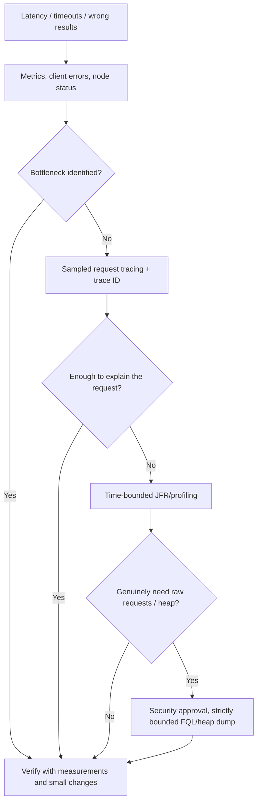
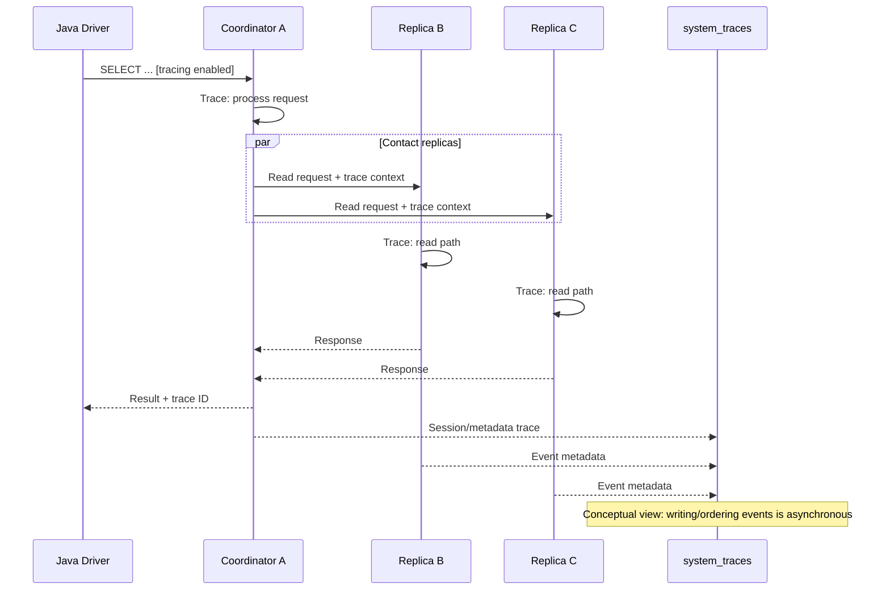

# Tracing/Profiling Overhead and Protecting Sensitive Data

## 1. Why Can Diagnostic Tools Themselves Cause Incidents?

Apache Cassandra is a **distributed wide-column** database: a CQL statement travels from the Java Driver to a coordinator, fans out to replicas based on partition key, replication factor (RF), and consistency level (CL), and then returns results. When hit by high p99 latency or timeouts, operators need visibility into the request's path. **Tracing** reveals steps across coordinators/replicas; **profiling** locates CPU, allocation, lock, GC, or I/O bottlenecks. Yet both consume resources directly on the very system you are trying to rescue.

Another often-overlooked risk: a single trace line or profiler recording can expose **CQL statements, partition keys, customer identifiers, IP addresses, table names, bind values, business payloads, or heap contents**. Pasting raw traces into tickets, chats, or broadly accessible log stores can create a secondary security incident.

This lesson belongs to the **Tracing and Diagnosis** chapter in the `DATABASE_ENGINE_WIDE_COLUMN_CASSANDRA` module. It connects distributed architecture, the wide-column model, partition keys, query-driven table design, read/write consistency levels, CQL, replication, compaction, repair, error handling, and the Java Driver.

After this lesson, learners should be able to:

1. Distinguish **metrics**, **request tracing**, **JVM/OS profiling**, and **full query logging**, along with the type of evidence each provides.
2. Explain **observability overhead** across CPU, disk, network, memory, GC, latency, and storage—especially why 100% tracing must not be enabled in production.
3. Use selective CQL tracing, read `system_traces`, and correlate with coordinator/replica metrics without making invalid inferences.
4. Design sampling with **bounded scope, duration, and budget**, including explicit configuration rollback steps.
5. Protect sensitive data when collecting, sharing, storing, and deleting trace/profiler artifacts.

## 2. Choosing the Right Tool for the Question

No single "turn everything on to see everything" tool is both free and safe.

| Technique | Appropriate Question | Data Collected | Primary Cost / Risk |
| --- | --- | --- | --- |
| **Aggregate metrics** (JMX/Prometheus/driver) | Which node/table/DC has rising read/write latency? | Histograms, counters, queues, throughput | Relatively low if scraped sensibly; risk of exposing table/host names or high cardinality. |
| **Per-request CQL tracing** | Which replicas did the coordinator contact? Which phase took time? | Trace session, events, node sources, timestamps, activity text | Adds instrumentation/events and writes to `system_traces`; may contain sensitive CQL/identifiers. |
| **Probabilistic trace sampling** | What path trends appear across a fraction of requests? | Many traces across sampled requests | Load scales with sample rate and traffic volume; selection bias and more sensitive data. |
| **Driver telemetry / metrics** | Did the client spend time in queues, network, retries, or page fetches? | Per-node/session pools, timeouts, retries, latency | Usually lighter than logging full requests; avoid labels with partition keys or query literals. |
| **JVM Flight Recorder (JFR)** | Are CPU, allocations, thread contention, or GC abnormal? | JVM events, stacks, threads, allocation samples | Overhead and JFR files; stacks, exception messages, thread names, or events can be sensitive. |
| **Async profiler / OS sampling** | Where are CPU hotspots, off-CPU/blocking stacks, or native overhead? | Stack samples, flame graphs | Depends on OS permissions, sampling rate, and collection method; stacks can reveal business logic. |
| **Full Query Logging (FQL)** | Do we need to replay the exact query stream and parameters for deep investigation? | Captured requests/statements, bind values, timestamps per version support | **Extremely high data risk**, heavy write volume, PII/secret exposure; enable only via strict approval. |
| **Heap dump** | Is there a suspected memory leak/object retention unresolved by metrics/JFR? | Snapshot of live heap objects | Can be huge and pause/impact the process; **can contain secrets and live customer data**. |

**Priority order:** start with existing metrics/error logs → selective tracing on synthetic or approved queries → time-bounded JFR/profiling → FQL or heap dumps **only with clear investigative need and explicit security approval**.



## 3. Where Does CQL Tracing Add Extra Work?

A traced CQL request can emit events on the **coordinator** and one or more **replicas**, depending on request type/CL, data path, version, and instrumented stages. Events are recorded and persisted/read through the `system_traces` system keyspace. Although Cassandra uses asynchronous mechanisms to avoid blocking the request path directly, creating events, formatting text, propagating trace context, and persisting to storage **are not free**.



Impacts include:

- **CPU/allocation:** generating events, timestamps, activity strings, serialization, and propagating trace context.
- **Disk and compaction:** `system_traces.sessions`/`events` are real Cassandra tables, causing writes, flushes, compactions, and disk usage per TTL/retention policy.
- **Network:** propagating trace context across nodes; writing or reading trace rows across replicas generates extra messages.
- **Queues/GC/latency:** under high load, heavy trace event volume competes for CPU, memory, request pools, and I/O with normal CQL traffic.
- **Observer effect:** a traced request **no longer behaves identically** to an untraced one. A query whose p99 sits near its timeout may slow down further when traced.

**A trace is not a complete record of every syscall or byte transferred.** It reveals events instrumented by Cassandra; portions of latency may sit in the client/driver, connection pools, queues, JVM, disk, or outside instrumented events. Never sum individual event lines as sequential intervals to compute real latency.

## 4. Practicing Bounded CQL Tracing

### 4.1. Enable Only for Lab or Approved Queries

Example table keyed by `device_id + bucket_day`; use a lab keyspace and synthetic data:

```sql
CREATE KEYSPACE trace_lab_ks
WITH replication = {'class': 'NetworkTopologyStrategy', 'dc1': 3};

CREATE TABLE trace_lab_ks.events_by_device (
    device_id text,
    bucket_day date,
    event_ts timestamp,
    event_id uuid,
    payload text,
    PRIMARY KEY ((device_id, bucket_day), event_ts, event_id)
);

INSERT INTO trace_lab_ks.events_by_device
    (device_id, bucket_day, event_ts, event_id, payload)
VALUES ('synthetic-device-7', '2026-11-21',
        '2026-11-21T08:00:00+0000',
        11111111-2222-4333-8444-555555555555,
        'sample-only');
```

In `cqlsh`, verify the active coordinator/DC, select CL, and wrap tracing around **one** query only:

```sql
CONSISTENCY LOCAL_QUORUM
PAGING 100
ELAPSED ON
TRACING ON

SELECT event_ts, event_id, payload
FROM trace_lab_ks.events_by_device
WHERE device_id = 'synthetic-device-7'
  AND bucket_day = '2026-11-21'
LIMIT 10;

TRACING OFF
```

**Note:** `CONSISTENCY`, `PAGING`, `ELAPSED`, and `TRACING` are **`cqlsh`-specific directives**, so they do not require semicolons like standard CQL statements. To avoid accidentally tracing subsequent commands, **run `TRACING OFF` immediately after the query**. In environments without `dc1` or RF3, adjust the lab topology first; never execute `CREATE KEYSPACE`/`INSERT` in production solely for observation.

`cqlsh` output typically prints the activity table and the trace **session ID**. Keep the ID inside a controlled incident record rather than pasting raw output into public channels.

### 4.2. Re-Reading a Session by Known ID

Given a trace UUID (below is **an illustrative UUID only**, not a real session):

```sql
-- In cqlsh, tool-specific command:
SHOW SESSION 11111111-2222-4333-8444-555555555555

-- CQL to read both system tables using the exact partition key:
SELECT session_id, coordinator, duration, request, started_at, parameters
FROM system_traces.sessions
WHERE session_id = 11111111-2222-4333-8444-555555555555;

SELECT session_id, event_id, activity, source, source_elapsed, thread
FROM system_traces.events
WHERE session_id = 11111111-2222-4333-8444-555555555555;
```

**Do not expect all events to be present instantaneously**: trace writes can arrive late or fail; records also depend on TTL/retention and node health. When needed, wait briefly and re-check in a lab workflow; never infer "missing row = Cassandra skipped that step." Column names/schemas can vary across versions; verify via `DESCRIBE TABLE system_traces.sessions`/`events` in `cqlsh` if needed.

### 4.3. Limits on Timestamp Interpretation

| Attribute | Useful Meaning | Caution |
| --- | --- | --- |
| `sessions.coordinator` | Node coordinating the request | Node the Java Driver connected to may differ if a proxy or extra routing layer sits in between. |
| `sessions.duration` | Server-side duration of the trace session (per table/version unit, typically microseconds) | Does not replace end-to-end duration from Java or HTTP clients. |
| `sessions.request`, `parameters` | Request context and options if recorded | **Can contain sensitive data**; never dump straight into public logs/tickets. |
| `events.source`, `thread` | Node/thread emitting the event | Can expose topology, hostnames/IPs, and deployment details. |
| `events.activity` | Description of a read/write path step | Version-dependent; occasionally includes partition keys, CQL literals, or identifiers. |
| `events.source_elapsed` | Elapsed time offset recorded at the trace source (typically microseconds) | Never sum every row to compute total latency. |
| `events.event_id` / timestamp | Used for sorting/correlating events | Clocks across nodes can drift; never treat absolute timestamps as exact cross-node measurements. |

Distinguish **application latency**, **server trace duration**, **individual coordinator/replica latencies**, and **disk I/O**. These measure different boundaries; you cannot subtract two clocks across nodes to claim network RTT without verifying clock synchronization.

## 5. Probabilistic Trace Sampling: A Small Percentage Can Still Be Massive

Instead of `TRACING ON` for one request, Cassandra offers admin tooling to configure **request trace probability** per node on supported versions. Check the exact binary:

```bash
nodetool help gettraceprobability
nodetool help settraceprobability
nodetool gettraceprobability
```

**Lab-only** example after recording the previous value:

```bash
# 0.001 = 0.1% target probability within the node's scope.
# WARNING: changes runtime configuration; use only when approved.
nodetool -h cassandra-lab-a settraceprobability 0.001
nodetool -h cassandra-lab-a gettraceprobability

# After the measurement window: restore the previously recorded value.
# If the prior value was 0, for example:
nodetool -h cassandra-lab-a settraceprobability 0
```

**Do not treat `0.001` as a universal recommendation for every production cluster.** Probability applies to **requests passing through that node**, not only one CQL query, table, or tenant under study; at high throughput, even 0.1% produces massive trace volume. Setting it on node A also does not configure nodes B/C; cluster-wide sampling requires understanding which coordinators actually handle traffic.

A budget estimation formula:

\[
\text{expected traces/sec} \approx
\text{requests/sec in sampling scope} \times p
\]

At 40,000 requests/s on a coordinator with `p = 0.001`, that averages **roughly 40 traces/s**. If each trace emits 30 events, the system can generate **roughly 1,200 events/s**, excluding metadata, replication, WAL/SSTable overhead, and writes on participating nodes. These figures are **illustrative only**: event counts vary sharply by query, RF, CL, and version.

### Sampling Pitfalls

1. **Skewed distribution:** uniform random tracing across all requests mostly captures cheap frequent queries and misses rare slow ones.
2. **Load shifts:** in multi-tenant environments, a fixed rate does not guarantee a stable event/s budget during peak hours.
3. **Multiple coordinators:** a lightly loaded node does not represent the whole DC.
4. **Query bias:** paging and retries can generate multiple requests/traces for one application action, skewing samples away from single business operations.
5. **Compliance burden:** higher sampling means more sessions holding potentially sensitive data that must be protected and purged.

To reduce bias, prefer **targeted sampling of authorized requests**, inspect categorized driver metrics first, enforce **time limits, count limits, load thresholds, and approvals**, and always roll back afterward. To investigate p99, compare p99 from untraced metrics against sampled traces from matching query shapes and time windows—never deduce p99 from one trace.

## 6. JVM/OS Profiling: More Powerful, Yet Not Free

When traces only show "slow replica" without revealing why CPU or GC is elevated, profile on that **specific node**.

### 6.1. JVM Flight Recorder

JFR captures JVM events such as CPU sampling, allocations, GC, threads, and locks depending on the profile. On supported JVMs/JDKs within an approved scope, an **illustrative** command is:

```bash
# ONLY in lab or production under an approved runbook.
# PID is the Cassandra process; requires host/JVM admin privileges.
jcmd <java-pid> JFR.start name=cassandra-diag settings=profile duration=60s filename=/secure/diag/cassandra-diag.jfr
```

A JFR profile can be relatively light under normal conditions, yet **overhead is never zero**. CPU/stack sampling, allocation events, and file I/O consume resources; denser event configs raise overhead sharply. On nodes with nearly full disks or saturated CPU, even a 60-second recording needs careful evaluation.

**Never write JFR files into web roots, publicly synced folders, or volumes holding SSTable data when headroom is tight.** Files can expose business class/method stacks, exception messages, hosts/paths, thread names, and environment details. Never assume "JFR contains no customer data" just because it primarily logs runtime metadata.

### 6.2. CPU Profilers and Off-CPU Profiling

Sampling profilers (e.g., `async-profiler`, `perf`, or eBPF depending on environment) answer "which functions are burning CPU?" or "what locks/I/O are threads waiting on?" You must:

- Target **one slow node**, for a short duration, with bounded sampling rates.
- Distinguish **on-CPU**, **off-CPU**, allocation, and lock profilers—each observes different phenomena.
- Ensure profiler access, kernel capabilities, and JVM attach permissions comply with policy; avoid granting overly broad privileges on multi-tenant hosts.
- Correlate with **CPU, GC pauses, disk await, `compactionstats`, and CQL p99** at the exact same timestamp.

A **flame graph** only visualizes stack proportions within **captured samples**, not per-CQL-statement latency. If workload or sampling shifts mid-profile, proportions can mislead you.

### 6.3. Heap Dumps and Thread Dumps

Thread dumps help diagnose deadlocks/blocked threads yet can expose thread names, classes, call stacks, and paths. **Heap dumps are far more sensitive**: they can contain Strings with tokens, passwords, CQL bind values, user data, and cached payloads—while also stalling GC or consuming huge disk space.

Operational rule: **never** capture a production heap dump simply because GC increased. Inspect GC logs, JFR, and heap metrics first, and establish a concrete object-retention investigation goal. If a heap dump is genuinely necessary, obtain security approval, confirm free disk space, use encrypted isolated storage, restrict to authorized handlers, and enforce a deletion deadline.

## 7. Full Query Logging: An Especially High-Risk Tool

On Cassandra versions that support it, **Full Query Logging (FQL)** records CQL requests in greater detail than single-request traces and can support deep investigation or replay when genuinely needed. Because FQL can include **statement text, bind values, query types, timestamps, and metadata**, its risk of exposing personal data, business payloads, and secrets is far higher than standard metric dashboards.

```bash
# Read the binary's own help text first to see exact available features:
nodetool help enablefullquerylog
nodetool help disablefullquerylog
nodetool help resetfullquerylog
```

**Do not provide one fixed FQL enable command across every environment**: path flags, roll/retention cycles, blocking behavior, and configuration differ across versions. Operators must check the exact version's tooling and understand **write paths, rotation, retention limits, disk caps, permissions, and disk-full failure behavior** before enabling it.

Why not replace metrics with FQL?

- Writes far more data, potentially costing significant disk and CPU under heavy CQL workloads.
- Risk of persisting **CQL literals and user bind parameters** at unnecessary granularity.
- Logs often ship centrally; copies in collectors, backups, and tickets can outlive intended retention policies.
- FQL proves a request reached the server, yet does not replace CPU flame graphs or anti-entropy repair.

Use FQL only for **approved forensic or replay goals**, tightly bounded in scope and duration, writing to protected directories with disk monitoring and a verified disable/cleanup step.

## 8. Matrix of Sensitive Data That Can Land in Artifacts

| Observation Source | Data Potentially Exposed | Required Controls |
| --- | --- | --- |
| CQL text in traces or logs | Emails/phones if embedded as literals; filter predicates, business table names | Never paste raw literals into tickets; use synthetic keys and redaction; inspect query shapes before capture |
| Bind values / statement parameters (especially FQL) | Customer IDs, transaction details, tokens, or personal data | Authorized personnel only, encrypted in transit/at rest, short retention, avoid raw exports |
| Partition keys and trace activities | Account IDs, device IDs, tenant IDs, date buckets | Treat as potentially identifying data; substitute synthetic tokens or secure HMACs |
| Trace session IDs and `system_traces` | Ability to query request metadata, node IPs, timestamps, execution paths | Restrict read access on system tables; never post raw IDs/outputs publicly |
| Profilers / JFR | Method/class names, exception messages, thread names, stacks, file paths | ACLs, encryption, retention limits, and artifact review before sharing |
| Heap dumps | Live memory holding real data, secrets, credentials, caches | Strict restrictions, special approval, isolated storage, controlled deletion |
| Centralized dashboard / log exports | Hosts/IPs, keyspace/table names, tenant labels, query shapes | Role-based access, avoid high-cardinality labels and PII in metric labels |

**Prepared statements** prevent literal concatenation in CQL strings and reuse parse/plans, yet **do not guarantee every trace/FQL system automatically strips bind values**. What looks safe in Java source code is not automatically scrubbed when the server or logger captures raw requests.

### Concrete Classification Policy

Before running any tool, document:

1. **Purpose:** which hypothesis must be tested? Can less sensitive aggregate metrics answer it?
2. **Data classification:** public/internal/confidential/restricted; does it contain PII, payment info, auth tokens, or tenant identifiers?
3. **Authorized audience:** on-call, SRE, DBA, security; enforce least privilege via RBAC/ACL.
4. **Storage location:** encrypted volumes, protected object storage, restricted workstations, TLS transit; never shared temp folders.
5. **Retention limit:** policy-aligned expiry; account for copies in backups, tickets, CI artifacts, and log shippers.
6. **Teardown plan:** disable sampling/profiling, verify rollback, review/purge raw artifacts, and keep only a **sanitized summary**.

## 9. Mitigation Strategies: Capture the Minimum Needed to Answer the Question

### 9.1. Prefer **Query Shape** Context Over Raw Values

Instead of recording:

```text
SELECT * FROM users_by_email WHERE email='person@example.invalid';
```

An investigation record can store:

```text
query_shape = SELECT columns FROM users_by_email WHERE email = ?
keyspace.table = app.users_by_email
client_dc = dc1
consistency = LOCAL_QUORUM
time_window_utc = [2026-11-21T09:00Z, 2026-11-21T09:05Z]
latency_bucket = p99 / timeout
trace_id = <restricted-reference>
```

This is plenty to group symptoms without **putting a real email address** into a ticket. When correlating multiple requests from the same customer is genuinely needed, consider a **keyed HMAC with securely managed secrets** or a non-reversible correlation ID; **unkeyed plain hashes** over predictable emails/IDs do not provide strong anonymization. Never print HMAC secrets in logs or put raw IDs into metric labels.

### 9.2. Diagnose on Synthetic Data First

For sensitive queries, reproduce partition shapes, clustering row counts, TTL/tombstones, or payload sizes in a **lab cluster** with synthetic data. Measure query patterns using prepared statements and fake partition keys. This evaluates SSTable/read-path costs without harvesting raw production payloads.

Do not treat "copying a production snapshot to lab" as a default habit: snapshots hold full customer datasets while labs often lack production access controls and retention rules. If sanitized real data is required, use a validated de-identification pipeline.

### 9.3. Redaction and Artifact Sharing

- Never paste raw `SHOW SESSION`, heap dumps, FQL logs, or JFR files into unrestricted issue trackers.
- When copying traces into runbooks, **replace partition keys, CQL literals, internal IPs, hostnames, and trace IDs** with placeholders while preserving structural flow.
- Check **file attachments**, code blocks, screenshots, clipboards, and chat copies; do not mask only in the UI while uploading the raw file.
- Restrict cluster-wide debug SQL/CQL logging in Java drivers/frameworks, especially error handlers that dump bind values.
- If an artifact was shared by mistake, follow organizational data-incident response; **deleting a file on the source host does not recall copies already synced elsewhere**.

## 10. Guardrails Against Load Spikes and Guaranteed Rollback

A production tracing/profiling plan must define **resource budgets** and stop conditions:

| Control | Example Application | Mistake to Avoid |
| --- | --- | --- |
| Scope | One query shape, one node/coordinator, short duration | Enabling tracing/FQL cluster-wide without limits |
| Duration | Fixed capture window, e.g., 30–60 seconds in lab, explicit stop timer | Forgetting `TRACING OFF` or letting profiler run until disk fills |
| Sample rate | Use traffic volume metrics to budget events/s upfront | Assuming 1% of 100,000 req/s is tiny |
| Disk free | Check trace/JFR/FQL volume and SSTable space | Writing to a nearly full disk or competing with commitlog/SSTables |
| CPU / GC | Compare p95/p99, CPU, GC, and drop/error rates before/during/after | Claiming tracing has zero overhead because median stayed flat |
| Security | ACL/TLS/encryption, secret-free logs, retention limits | Uploading raw sessions/JFR to widely shared storage |
| Rollback | Record old values, disable commands, verify post-stop state | Disabling CLI toggle while forgetting node sampling is still non-zero |

**Predefine stop thresholds**, such as service p99 breaching SLO, abnormal CPU/GC queue growth, disk free crossing warning thresholds, rapid FQL file growth, or sensitive data appearing outside approved scope. Once triggered, prioritize protecting CQL traffic over gathering a few extra events.

### "Turning Off Tracing" Has Multiple Layers

- For **`cqlsh`**, run `TRACING OFF` in that exact active session.
- For **Java Driver**, stop setting tracing on new statements and confirm no code paths leave it on.
- For **`nodetool` sampling**, restore the **previous probability value** on every modified node.
- For **JFR/profilers**, stop the capture via its standard stop command and verify no file writes continue.
- For **FQL**, disable via your version's supported command; inspect directories, queues, and retention—not just the flag.

These mechanisms do not turn each other off. **Running `TRACING OFF` in `cqlsh` does not reset node-level trace probability back to 0.**

## 11. Java Driver 4.x: Tracing an Authorized Request and Safe Logging

This snippet assumes an existing `CqlSession session`, corresponding imports, and a lab table. **Never enable by default for all production requests.**

```java
PreparedStatement prepared = session.prepare(
    "SELECT event_ts, payload FROM trace_lab_ks.events_by_device " +
    "WHERE device_id = ? AND bucket_day = ? LIMIT 10"
);

BoundStatement request = prepared.bind(
    "synthetic-device-7", LocalDate.of(2026, 11, 21)
).setConsistencyLevel(DefaultConsistencyLevel.LOCAL_QUORUM)
 .setPageSize(50)
 .setTracing(true); // Only for a lab or explicitly authorized request.

long startNs = System.nanoTime();
ResultSet result = session.execute(request);
int rows = 0;
for (Row row : result) {
    rows++;
}
double endToEndMs = (System.nanoTime() - startNs) / 1_000_000.0;

UUID traceId = result.getExecutionInfo().getTracingId();

// Access-controlled internal log; never log device_id, payload, or raw CQL.
logger.info(
    "cass_query_shape=events_by_device_lookup cl=LOCAL_QUORUM " +
    "duration_ms={} rows={} traced={}",
    endToEndMs, rows, traceId != null
);
// Record Trace ID only in a protected channel when required by investigation.
```

**Why not print `traceId` by default?** That UUID lets anyone with CQL read access query trace metadata in `system_traces`. Although a UUID is not a password itself, broadcasting it can link requests to user activity, timestamps, and private data. When correlation is needed, store trace IDs inside an RBAC/retention-enforced incident system and reference them selectively rather than dumping raw IDs into public logs.

The snippet sets `LIMIT 10` and a page size larger than the row count to illustrate a tiny query. For **truly paged queries**, each page can be a **separate server request** with its own execution info/trace; never use the first page's trace ID to deduce the full cost of iterating many pages. Furthermore, the driver adds connection acquisition, queuing, codec/deserialization, and retry time outside server trace scope.

**`PreparedStatement` does not replace logging hygiene:** also avoid cluster-wide debug logging of `BoundStatement`s, stack traces carrying business parameters, or exceptions leaking user payloads.

## 12. Security-Aware Slow-Query Investigation Runbook

### Step 1 — Triage the Incident Without Enabling Tracing Yet

Record SLOs, UTC window, DC, keyspace/table, query shape, partition key pattern (no real values needed), RF, CL, Cassandra/Driver versions, request rate, and timeout ratio. Distinguish **slow requests**, **`Unavailable`**, **`ReadTimeout`/`WriteTimeout`**, **paging latency**, **retries**, or **wrong results**.

```bash
# Inspect without collecting raw CQL values:
nodetool status
nodetool tpstats
nodetool compactionstats
nodetool proxyhistograms
```

Gather driver metrics on p50/p95/p99, in-flight counts, retries/timeouts, and server metrics for `ClientRequest`/`Table`/disk/CPU/GC. Align everything to the same window and know each metric's type: percentile, histogram, or cumulative counter.

### Step 2 — Form a Hypothesis and Pick the Lowest-Impact Tool

For example: "Only `events_by_device_lookup` slows down in `dc1` during compaction hours, possibly from higher SSTables per read." Check `nodetool tablestats` and SSTable/tombstone metrics first. If a slow replica is suspected, one trace on **synthetic data** or an approved request may suffice; no FQL or heap dump needed yet.

### Step 3 — Document Security and Load Scope

Specify target nodes, query shape, capture duration, CL, sampling rate, and estimated request count. Confirm read permissions on `system_traces`, encrypted storage path for raw artifacts, authorized viewers, retention limit, approvals, and stop conditions. Snapshot **baseline** CPU, free disk, and p99 beforehand.

### Step 4 — Capture a Small Controlled Sample

In `cqlsh`, wrap `TRACING ON` around a single lab/approved query; in Java, enable `setTracing(true)` on the selected statement. If using node-level probability, set a tiny budgeted value, **keep it brief**, and track every modified node. FQL and heap dumps require separate explicit approval.

### Step 5 — Correlate Traces with Metrics and Outcomes

Track:

1. **Client:** latency, timeouts, retries, page count, row/result count, CL.
2. **Coordinator:** trace duration, contacted nodes, queues, and responses.
3. **Replica:** trace activities, source, SSTable/tombstone read metrics, compaction/repair, and disk I/O.
4. **Infrastructure:** CPU, GC, network, disk await—matched to exact timestamps and nodes.
5. **Correctness:** partition-key alignment, valid business outcomes, whether tombstones/TTLs altered results.

**Never infer causation solely because two graphs rose together.** Check confounders: did load increase during capture? Did p99 drop when tracing stopped? Did untraced nodes show the same behavior? Shifting workload, query shape, or CL between runs introduces noise.

### Step 6 — Stop, Roll Back, and Clean Up Artifacts

Disable tracing/profilers/FQL properly; verify node probabilities/configs, p99, and disk space. Retain only **redacted reports**, necessary charts, a restricted reference to raw traces, and a deletion deadline. Handle copies in log collectors, backups, and tickets per policy; never assume deleting one local file deleted all copies.

### Step 7 — Verify the Fix

If oversized partitions caused it, fix schema/bucketing/query paging; if heavy tombstones, review TTL/repair/compaction; if CPU/GC bottlenecked, tune runtime/capacity; if sampling itself added load, lower observability overhead. Compare **identical query shape, identical CL, comparable load, with tracing disabled** to measure true improvement.

## 13. Analysis Scenario: Tracing Captured, Yet p99 Got Worse

**Hypothetical scenario (not measured data):** One DC has three replicas; `events_by_device` uses `LOCAL_QUORUM`. Before investigation, driver read p99 was ~120 ms with high disk usage. After setting node-level trace probability to 10% "just to be sure," p99 jumped to 280 ms while disk writes and GC climbed together. Some `system_traces.events` rows show replicas waiting a long time.

You cannot immediately conclude "slow replicas were the original root cause." Evaluate **observer overhead adding load**:

| Observation | Possible Explanation | What to Verify |
| --- | --- | --- |
| 10% tracing on a high-traffic coordinator | Generates heavy trace events and system writes | Count sessions/events per window; req/s, disk/GC before vs. after enabling |
| p99 jumped concurrently with tracing | Tracing may have **perturbed** a workload already near limits | Disable capture per runbook and check whether p99 recovers |
| Disk writes rose | Trace storage, compaction, original workload, or combined | Separate `system_traces` vs. table metrics, disk I/O, compaction backlog |
| One trace shows replica B was slow | Replica B was slow during that traced request | Compare against untraced requests and B's metrics at that timestamp |
| Partitions contain many tombstones | Read path may still do extra work even without tracing | Check tombstone/SSTable histograms, query design, and TTL/repair |

**Resolution:** roll back trace probability to its prior setting, keep measuring untraced metrics, isolate the high-p99 query shape, then capture **a few selective traces**. Only after comparing both states should you decide whether to tune SSTables/partitions or the JVM. Never leave 10% tracing running until "something turns up."

## 14. Security Checklist Before Sharing Findings with Another Team

- [ ] Described the investigation goal and query shape without raw customer IDs, emails, or tokens.
- [ ] Trace/JFR/FQL/heap dump **data-classified** and approved per sensitivity level.
- [ ] Captured minimum necessary data; recorded nodes, timestamps, sampling rates, and pre-change values.
- [ ] Disabled tracing in `cqlsh`/Java, reverted node-level sampling, and stopped profilers/FQL.
- [ ] Cross-checked **untraced** workload metrics to rule out measurement bias.
- [ ] Raw artifacts encrypted, RBAC/ACL-protected, access-audited, and given an expiry date.
- [ ] Redacted query literals, bind values, partition keys, trace IDs, and IPs/hostnames where required.
- [ ] Tickets/wikis/chats contain sanitized summaries only; no heap dumps or raw FQL outside approved vaults.
- [ ] Verified disk free space and log/backup pipeline state post-capture.
- [ ] Assigned an owner to complete retention/deletion and handle copies if a leak occurs.

## 15. Self-Check Questions and Exercises

1. Why aren't a server trace `duration=80 ms` and a Java client reading `160 ms` necessarily contradictory? Name at least three distinct time components.
2. Is 1% tracing on a very high-throughput node always lightweight? Write the formula to estimate traces/s and events/s.
3. Why does running `TRACING OFF` in `cqlsh` not guarantee disabling probabilistic tracing set via `nodetool settraceprobability`?
4. When a trace on coordinator A includes events from B and C, why can't you sum all `source_elapsed` values to get total request latency?
5. Identify which fields in `system_traces.sessions`/`events` can leak user identity or internal topology.
6. Do prepared statements prevent SQL/CQL injection? Does that **mean** bind values are automatically scrubbed from FQL/traces?
7. When are metrics sufficient, when is CQL tracing appropriate, and when should JFR/profilers or heap dumps be considered?
8. Why can even a 10-minute FQL capture violate policy if a log shipper copies it into object storage with 1-year retention?
9. A query's p99 jumps right when sampling is enabled and drops after turning it off. Which metrics confirm the cause?
10. Write a lab procedure to capture one trace with `TRACING ON`, copy the UUID, run `TRACING OFF`, query `system_traces`, and produce a report **without exposing raw partition keys**.

**Completion criteria:** learners can pick the lowest-overhead tool sufficient to answer the question, toggle tracing safely within scope, correlate traces with driver/replica metrics without fabricating causation, budget sampling volume, and handle trace/profiler artifacts as **data that may contain secrets**.

## 16. Reference Documentation

- [Apache Cassandra — Tracing](https://cassandra.apache.org/doc/stable/cassandra/managing/operating/tracing.html): overview of tracing mechanics and version-specific diagnostic practices.
- [Apache Cassandra — cqlsh](https://cassandra.apache.org/doc/stable/cassandra/managing/tools/cqlsh.html): `TRACING ON/OFF`, `SHOW SESSION`, and trace session display.
- [Apache Cassandra — nodetool](https://cassandra.apache.org/doc/stable/cassandra/managing/tools/nodetool/nodetool.html): reference for `gettraceprobability`/`settraceprobability` and binary-specific admin commands.
- [Apache Cassandra — Monitoring metrics](https://cassandra.apache.org/doc/stable/cassandra/managing/operating/metrics.html): ClientRequest, Table, JVM, and per-metric scopes.
- [Apache Cassandra — Full Query Logging](https://cassandra.apache.org/doc/stable/cassandra/managing/operating/fqllogging.html): notes on version support, disk usage, retention, and query contents.
- [Apache Cassandra Java Driver 4.x — Tracing](https://apache.github.io/cassandra-java-driver/4.18.0/core/tracing/): enabling tracing per statement and reading trace IDs from execution info.
- [OpenJDK — JDK Flight Recorder](https://docs.oracle.com/en/java/javase/17/jfapi/flight-recorder.html): JVM event recording and profiling methodology.

**Conclusion:** Tracing and profiling illuminate how Cassandra requests execute, yet they are **neither free nor safe for sensitive data by default**. Before enabling them, define what you need to confirm, bound scope and duration tightly, measure impact on p99/CPU/disk, and protect every artifact that could carry queries, bind values, identifiers, or heap contents. Afterward, **restore original configurations, share only sanitized evidence**, and evaluate final performance on normal traffic **free of instrumentation overhead**.
