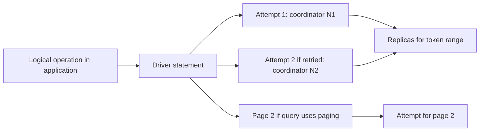

# Building an Evidence Package with Query, Parameters, Topology, Configuration, and Timestamps in Apache Cassandra

## 1. Why Does Cassandra Diagnosis Need an "Evidence Package"?

Suppose a Java application just logged a `ReadTimeoutException` while reading an order. Immediately, several guesses surface: an overloaded coordinator, a slow replica, an oversized partition, excessive tombstones, a congested Java connection pool, an active repair, or cross-DC network trouble.

A single line saying "read timeout at 10 o'clock" **cannot distinguish among these causes**. A `nodetool status` snapshot showing every node `UN` also fails to prove requests are not stalling. To isolate root causes and reproduce incidents, you must gather evidence that is **semantically and temporally aligned**: which query, which parameters, which consistency level, which coordinator/replicas, which effective settings, what changed in the cluster, and exactly when each event occurred.

An **evidence package** is a structured collection of information sufficient for someone else to:

1. Identify **a single logical operation** or group of requests hitting the same issue.
2. Know the CQL query, partition/key range, parameters, and schema version used.
3. Trace the path from the Java Driver to coordinator and replicas per the topology at failure time.
4. Align timestamps, trace IDs, logs, and metrics across machines **within the same window**.
5. Separate **observed facts**, **hypotheses**, and **verified conclusions**.
6. Reproduce cleanly in a controlled setting and measure post-fix results without exposing customer data.

This lesson belongs to the **Tracing and Diagnosis** chapter of the `DATABASE_ENGINE_WIDE_COLUMN_CASSANDRA` module. It draws on partition keys/wide-column modeling, query-driven table design, CQL, read/write consistency levels, replication, compaction, repair, error handling, and the Java Driver. The goal is not hoarding huge volumes of logs, but capturing **the exact evidence capable of testing hypotheses**.

## 2. Units of Investigation: Logical Operation, Attempt, Page, Coordinator, and Replica

Before collecting data, clarify **which unit you are tracking**.

| Unit | Meaning | Why Distinguish? |
| --- | --- | --- |
| **Logical operation** | One business action, e.g., "read order details" | May span multiple CQL statements, retries, or pages |
| **CQL statement execution** | One application call asking the driver to execute a statement | Driver may issue multiple attempts due to retries/speculation |
| **Request attempt** | One driver dispatch to a specific coordinator | Failed and successful attempts may belong to the same logical operation |
| **Page fetch** | One request fetching a result page in a paged query | First page fast, later page failing still fails the overall operation |
| **Coordinator** | Node receiving the request and orchestrating replicas for that attempt | Not necessarily a replica owning the partition |
| **Replica** | Node selected to store/read the token range per RF/topology | One slow replica can impact CL and tail latency |
| **Trace session** | Tracing session of a single traced execution | One trace does not automatically represent all retries/pages |



**Consequence:** a trace ID is helpful yet **does not replace** application request IDs, driver attempt/retry metrics, and page-fetch timestamps. When no trace exists (disabled, timed out, or expired by TTL), you can still assemble a solid evidence package from application/driver logs and server metrics.

## 3. Minimum Evidence Contract

A usable package must answer **five mandatory questions** and cite the proof source.

| Question | Fields to Capture | Source |
| --- | --- | --- |
| **What query?** | CQL shape/fingerprint, keyspace/table, schema version, query type, partition/clustering predicates | App logs, prepared statements, CQL, `system_schema` |
| **Which parameters?** | Data types, anonymized/bucketed values, `IN` element count, time range width, `LIMIT`, page size | App/driver instrumentation |
| **Where did it go?** | Cluster/DC, node/coordinator, token/replica placement, RF, snitch/rack, node `UN/DN` state | Driver execution info, `nodetool`, schema |
| **What config?** | Cassandra/driver versions, CL, SERIAL CL if LWT, timeouts, retry/speculation, compaction/TTL/RF | App config, CQL schema, effective server configuration |
| **When did it happen?** | UTC timestamps with offset/precision, monotonic durations, incident + pre/post windows, clock sync | App logs, NTP, tracing, server logs/metrics |

Beyond these five groups, include **symptoms, SLO impact, request ID/trace ID, outcome, errors, sample counts, confidence level, and missing data**. Where evidence is absent, write **UNKNOWN**—never fill gaps with assumptions presented as facts.

### 3.1. A Package Is Not a Full Production Dump

Collect purposefully: a small set of representative requests, a bounded time window, involved nodes, impactful config settings, and semantically accurate metric charts. Avoid dumping entire `cassandra.yaml` files with secrets, raw PII parameters, or unrelated customer logs into tickets.

**Principle:** enough detail to reproduce and test hypotheses, **with minimal sensitive data**.

## 4. Group 1 — CQL: Preserve Query Shape, Not Just Endpoint Name

Suppose `GET /api/events?day=...` is slow. Recording only the endpoint name is insufficient. You need the actual CQL the app executes:

```sql
SELECT event_time, event_id, payload
FROM evidence_lab.events_by_tenant_day
WHERE tenant_id = ?
  AND bucket_day = ?
  AND event_time >= ?
  AND event_time < ?
LIMIT 50;
```

This is a **query shape** with bind markers—enough to evaluate partition key usage and clustering ranges. Record:

1. **Full keyspace and table:** which table is queried, plus whether any index or materialized view is involved.
2. **Partition key:** are all components of the partition key supplied? A multi-partition scan behaves completely differently from a single-partition lookup.
3. **Clustering predicates:** range start/end, window width; whether `ORDER BY`, `IN`, `LIMIT`, `ALLOW FILTERING`, or aggregations are used.
4. **Returned projection:** all columns or a subset, whether large collections or oversized payloads exist.
5. **Prepared vs. simple statement:** if prepared, keep the CQL template, bind types, and app version—do not just log a `PreparedStatement` object reference.
6. **Batch/LWT:** for `BEGIN BATCH` or `IF ...`, record the statement and corresponding protocol traits; LWTs add Paxos phases and SERIAL consistency.

### 4.1. Why Can `LIMIT 50` Still Be Slow?

`LIMIT` caps returned rows, **not** directly the SSTables, tombstones, or replica coordination the engine must process. If a partition holds heavy deleted data, Cassandra may scan huge numbers of tombstones to find a few live rows. Useful evidence includes the **clustering range** and **tombstones scanned / SSTables per read** metrics, not merely `rows_returned=12`.

### 4.2. Recording a Stable "Fingerprint"

Normalize the CQL template with bind markers and assign a `query_fingerprint` (e.g., an HMAC/hash of the normalized template), paired with **application build/schema version**. Do not substitute the fingerprint for the query shape itself inside a controlled internal package: a fingerprint groups identical shapes, without telling reviewers what query ran.

If CQL is built dynamically, record each normalized template keeping `WHERE` column order and bind positions intact. Never lump queries with different semantics (single-partition vs. multi-partition scan) under one generic `SELECT` label.

## 5. Group 2 — Bind Parameters: Detailed Enough Without Exposing Data

The exact same query shape can be sub-millisecond on a tiny partition and terribly slow on a hot partition. Therefore **parameters** are crucial evidence—especially partition keys, time buckets, and clustering range widths.

| Parameter Type | What to Record | Safe Example |
| --- | --- | --- |
| Customer/tenant partition key | Type + anonymization token **consistent within the incident** | `tenant_id:text, token_alias=tenant_HMAC_42` |
| Clustering time range | Type + UTC bounds or width if too sensitive | `start=2026-11-21T08:00Z; width=60m` |
| `IN` values | Element count, type, estimated partition count | `device_ids:list<uuid>, count=120` |
| `LIMIT` and page size | Exact numeric values | `LIMIT=50, page_size=100` |
| Write payload | Byte size, shape/element count, verification hash if needed | `payload_bytes=24576` |
| TTL or `USING TIMESTAMP` | Value and unit, if present in statement | `ttl_seconds=3600` |
| Consistency and timeout | Effective values executed on statement | `CL=LOCAL_QUORUM; request_timeout=2s` |

**Never** log raw emails, account numbers, login tokens, passwords, API keys, or user payloads. Use a **keyed HMAC with controlled secrets** to generate stable aliases for partition keys; **unsalted plain hashes** of predictable identifiers are not strong anonymization for small keyspaces.

In environments authorized to handle sensitive data, privileged staff can keep a **separate** alias→real-value lookup table with strict TTL/retention. The package sent to the diagnostic team needs only aliases, tokens, or size/range characteristics—never include the HMAC key.

### 5.1. Separating Values from Load-Driving Characteristics

If errors only affect one tenant, an HMAC alias groups the incident without exposing the tenant's name. If errors hit all queries reading older data, **time range width** and **expired TTL ratio** are the decisive factors. To reproduce a hot partition, preserve **row counts, SSTable counts, tombstone density, and read/write rates**, rather than merely copying an anonymized key.

## 6. Group 3 — Topology: Know Which Coordinator and Replicas Participated

A query in DC1 using `LOCAL_QUORUM` behaves very differently from one in DC2 using `QUORUM`. Capture the **topology at request time**, not just what dashboards show two hours later.

Minimum details:

- **Cluster name**, Cassandra version, datacenter, rack, snitch, and membership status (`UN`, `DN`, joining/leaving/moving).
- **Replication strategy / per-DC RF** for the keyspace, e.g., `{'class':'NetworkTopologyStrategy','dc1':3,'dc2':3}`.
- **Attempt coordinator** from Driver `ExecutionInfo` if available; coordinator DC/rack.
- **Replica endpoints** responsible for the partition/token, noting which replicas served reads/writes and which failed to reply if shown by logs/traces.
- **Topology events**: node downs/restarts/replacements, bootstraps, decommissions, DC additions, or RF changes near the error window.
- **Schema agreement** and schema change timestamps; requests mid-topology transition differ from steady-state requests.

### 6.1. Observation Commands

```bash
# Run on the relevant node; results carry "node and timestamp" scope.
nodetool status
nodetool describecluster
nodetool ring

# Background load that can slow coordinator/replicas.
nodetool netstats
nodetool compactionstats
```

In CQL:

```sql
SELECT keyspace_name, replication
FROM system_schema.keyspaces
WHERE keyspace_name = 'evidence_lab';
```

Some versions support `nodetool getendpoints <keyspace> <table> <partition_key>` to inspect replicas for a sample key. **For composite partition keys, input key encoding and token query tools are version-dependent**, so never guess by concatenating strings arbitrarily. If key-to-replica mapping cannot be confirmed, record `replica_mapping=UNKNOWN` instead of guessing from general token ownership.

**Critical trap:** the coordinator is not necessarily a replica. If node A acts as coordinator, logs/traces may show delays on replicas B/C; staring only at A's CPU misses the cause.

### 6.2. Topology Shifting Mid-Incident

Capture **two snapshots**: right **before/at failure time** (from monitoring if available) and **post-incident**. If a node recovered, a current `UN` snapshot does not contradict it having been `DN` during the error window. Cross-check events against gossip/streaming logs and rollout/restart records.

## 7. Group 4 — Configuration: Record Effective State, Not Just Defaults

Concluding based on "Cassandra's default is X ms" easily goes wrong because applications and clusters override settings across multiple layers. The evidence package template must separate **server config**, **schema/table**, and **client/driver**.

| Layer | Details to Capture | Why It Matters |
| --- | --- | --- |
| **Cassandra server** | Version/distribution/build; read/write/range timeouts, native transport, thread/queue caps, JVM/GC settings | Defines node deadlines and internal bottlenecks |
| **Keyspace** | `NetworkTopologyStrategy`, per-DC RF, version/schema agreement | Defines replica set and required quorum ACKs |
| **Table** | Partition/clustering schema, compaction strategy/options, `gc_grace_seconds`, default TTL, caching | Explains range scans, tombstones, SSTables/compaction |
| **Driver 4.x** | Version, local DC, load balancing, request timeout, retry policy, speculative execution, connection pool, paging | Can spawn attempts/paging or time out before the server |
| **Specific statement** | CL, SERIAL CL if applicable, timeout overrides, idempotence, tracing, page size, timestamp, keyspace | Per-request values can override session defaults |
| **Deployment / OS** | CPU/heap, disk, file descriptors, TLS/network proxies, timezone/NTP, recent release changes | Sources of latency outside CQL |

Packages **do not need** raw `cassandra.yaml` files containing secrets. Record each **relevant option**, its **effective value when the error occurred**, its source (server file, system property, deployment config, statement override), and timestamped verification.

### 7.1. Inspecting Table Schema

```sql
-- CQL on versions supporting these system_schema columns.
SELECT keyspace_name, table_name, compaction,
       gc_grace_seconds, default_time_to_live
FROM system_schema.tables
WHERE keyspace_name = 'evidence_lab'
  AND table_name = 'events_by_tenant_day';
```

`system_schema.tables` exposes many attributes yet **does not replace full DDL**: capture partition/clustering columns via `DESCRIBE TABLE evidence_lab.events_by_tenant_day` in `cqlsh` (a `cqlsh` command, **not CQL sent via Java Driver**) or by reading `system_schema.columns`. For query incidents, save the schema **as of request time**, avoiding post-migration DDL as retroactive proof.

### 7.2. Units and Override Precedence

`request_timeout=2000` might mean **milliseconds** or a `2 seconds` string depending on the source. Every timing value must **include explicit units**. A 1.5 s client timeout paired with a 5 s server timeout causes errors **at the driver before the server ever logs a timeout**; checking only server timeouts misses the story.

## 8. Group 5 — Timestamps: Aligning Multi-Machine Timelines Without Introducing Skew

An evidence package lacking a reliable timeline often leads to concluding "the cause happened after the effect."

### 8.1. Timestamp Normalization

Every event should record:

```text
event_time_utc  = 2026-11-21T10:15:23.417Z
source          = java-app/pod-7 (or node cassandra-2)
clock_source    = NTP synchronized / unknown
precision       = milliseconds (or microseconds if actually available)
time_window     = [10:15:20Z, 10:15:30Z)
duration_ms     = 1840.2  (measured via monotonic clock inside same process)
```

- **UTC and offsets:** use ISO 8601 timestamps with `Z` or explicit offsets; avoid timezone-less "10:15."
- **Wall clock vs. monotonic clock:** use wall clocks to place events on a multi-node timeline; use `System.nanoTime()` to measure **elapsed intervals within the same JVM**.
- **Clock skew:** record NTP offsets/drift per node; if `cassandra-2`'s clock runs 800 ms fast, you cannot order events 200 ms apart from log timestamps alone.
- **Window:** include pre-, during-, and post-incident slices, e.g., 5 minutes before and 10 minutes after, tuned to retention and volume; avoid grabbing days of unnecessary logs.
- **Timestamp resolution:** two logs sharing the same millisecond are not guaranteed simultaneous; local log order differs from cluster-wide distributed order.

**Never subtract two `System.nanoTime()` values taken on different machines or processes.** Before concluding an event "arrived later," check clock skew, log exporter delays, and collector buffering.

### 8.2. Recording Request Start and Request End

For a single request:

```text
client_request_started_utc = 2026-11-21T10:15:23.417Z
client_elapsed_ms          = 1840.2
client_result              = ReadTimeoutException
server_trace_started_utc   = 2026-11-21T10:15:23.421Z (if traced)
server_trace_duration_us   = ... (if available and completed)
```

Record separate markers for retries/pages when needed; **never** treat one server attempt's duration as the duration of a logical operation spanning retries, paging, or driver queue time.

## 9. What Value Does Tracing Provide—and Where Are Its Limits?

**Cassandra tracing** exposes events along the request execution path, potentially covering coordinator work, message dispatches, SSTable reads, and replica waits/responses depending on version. Data is typically stored in `system_traces.sessions` and `system_traces.events` for a bounded retention window.

However, tracing:

- Incurs **CPU/I/O overhead and trace writes**; never leave it on cluster-wide or on every request "just in case."
- Can contain **query text, parameters, node addresses, and user/tenant info**; enforce strict access controls.
- Is not guaranteed to be **complete** if requests error out, trace writes lag, or records hit TTL.
- Describes **one traced execution**, not p99 or every request.
- Uses trace event elapsed times distinct from **end-to-end Java latency**; combine with driver logs and metrics.

### 9.1. Selecting Requests to Trace

In production, prefer **controlled sampling** of a representative request, briefly and with authorization, after alerts/query shapes are identified. Pick requests sharing **the same CQL and parameter shape** as the failing workload; avoid enabling tracing in a way that adds load and alters the underlying cause.

If data is sensitive, reproduce in **staging** with equivalent schema, partition distribution, TTLs, and SSTable counts, or use an organization-approved tracing workflow. A tiny lab query cannot reproduce a massive production hot partition.

## 10. Hands-On Tracing in `cqlsh` in the Lab

Assume a lab Cassandra cluster and keyspace `evidence_lab` exist. The example below creates a table with a **composite partition key `(tenant_id, bucket_day)`** to illustrate partition filtering and clustering ranges:

```sql
CREATE KEYSPACE IF NOT EXISTS evidence_lab
WITH replication = {
    'class': 'NetworkTopologyStrategy',
    'dc1': 3
};

CREATE TABLE IF NOT EXISTS evidence_lab.events_by_tenant_day (
    tenant_id text,
    bucket_day date,
    event_time timestamp,
    event_id uuid,
    payload text,
    PRIMARY KEY ((tenant_id, bucket_day), event_time, event_id)
) WITH CLUSTERING ORDER BY (event_time DESC, event_id ASC);

INSERT INTO evidence_lab.events_by_tenant_day
    (tenant_id, bucket_day, event_time, event_id, payload)
VALUES (
    'tenant_demo', '2026-11-21', '2026-11-21T08:30:00Z',
    11111111-1111-1111-1111-111111111111, 'demo'
);
```

Execute **in `cqlsh`** (on a test cluster; adjust DC/RF and CL to your environment):

```sql
CONSISTENCY LOCAL_QUORUM;
TRACING ON;

SELECT event_time, event_id, payload
FROM evidence_lab.events_by_tenant_day
WHERE tenant_id = 'tenant_demo'
  AND bucket_day = '2026-11-21'
  AND event_time >= '2026-11-21T08:00:00Z'
  AND event_time <  '2026-11-21T09:00:00Z'
LIMIT 50;

TRACING OFF;
```

`CONSISTENCY` and `TRACING` are **`cqlsh` commands**, not standard CQL statements dispatched via Java Driver's `session.execute`. `TRACING ON` enables tracing for **subsequent `cqlsh` requests**; turn it off immediately after the target query.

`cqlsh` usually displays the **Tracing session** (UUID) along with activities, sources, and elapsed times. With the trace ID, you can inspect session details:

```sql
-- Replace the illustrative UUID with the actual tracing session ID.
SELECT *
FROM system_traces.sessions
WHERE session_id = 22222222-2222-2222-2222-222222222222;

SELECT session_id, event_id, activity, source, source_elapsed, thread
FROM system_traces.events
WHERE session_id = 22222222-2222-2222-2222-222222222222;
```

**Warning:** traces can drop or lose events on timeouts or TTL expiration. Never query trace tables with unbounded `SELECT *` scans cluster-wide; above, `WHERE session_id` targets the partition key. Tracing schemas/fields can vary across Cassandra versions, so verify on your active release.

### 10.1. Reading Traces Through Hypotheses

| Trace Clue | Hypothesis to Test Next | Accompanying Evidence |
| --- | --- | --- |
| Long wait for replica | Slow replica, coordinator–replica network, high-ACK CL | Node read/write metrics, `tpstats`, network |
| Many SSTable/data scan events | Many SSTables, wide partition, tombstone scan, cache misses | `tablestats`, `tablehistograms`, query/range |
| Incomplete trace yet client timed out | Request aborted/stalled, trace writes dropped or capped | Driver error time, server logs, tracing config |
| Multiple requests/pages/attempts per operation | Paging, retry/speculative execution, or caller loop | Driver execution metadata, attempt counters |
| No issue visible in one trace | Sample request wasn't representative or transient stall | p95/p99 distribution, multiple valid request samples |

**A trace does not prove causation on its own.** It narrows hypotheses; place it alongside contemporaneous metrics, topology, and timelines.

## 11. Java Driver 4.x: Recording Request Metadata and Tracing IDs

In Java, use `PreparedStatement` + `BoundStatement` to make query shape, CL, paging, and bind types explicit. For a request **selected to be traced**, enable `setTracing(true)` and extract `ExecutionInfo` from the result.

Java 17+ / Java Driver 4.x example; assumes `CqlSession session` is already configured with contact points, local datacenter, and appropriate auth/TLS:

```java
import com.datastax.oss.driver.api.core.DefaultConsistencyLevel;
import com.datastax.oss.driver.api.core.cql.BoundStatement;
import com.datastax.oss.driver.api.core.cql.ExecutionInfo;
import com.datastax.oss.driver.api.core.cql.PreparedStatement;
import com.datastax.oss.driver.api.core.cql.ResultSet;
import com.datastax.oss.driver.api.core.cql.Row;
import java.time.Instant;
import java.time.LocalDate;
import java.util.UUID;

PreparedStatement ps = session.prepare("""
    SELECT event_time, event_id, payload
    FROM evidence_lab.events_by_tenant_day
    WHERE tenant_id = ?
      AND bucket_day = ?
      AND event_time >= ? AND event_time < ?
    LIMIT 50
    """);

BoundStatement statement = ps.boundStatementBuilder()
    .setString(0, "tenant_demo")
    .setLocalDate(1, LocalDate.of(2026, 11, 21))
    .setInstant(2, Instant.parse("2026-11-21T08:00:00Z"))
    .setInstant(3, Instant.parse("2026-11-21T09:00:00Z"))
    .setConsistencyLevel(DefaultConsistencyLevel.LOCAL_QUORUM)
    .setPageSize(100)
    .setTracing(true) // Enable only for approved samples, never default in production.
    .build();

Instant requestStartedUtc = Instant.now();
long startedNs = System.nanoTime();
try {
    ResultSet rs = session.execute(statement);
    int rows = 0;
    for (Row row : rs) {
        rows++; // Never dump payload into evidence logs.
    }
    long elapsedNs = System.nanoTime() - startedNs;
    ExecutionInfo info = rs.getExecutionInfo();
    UUID tracingId = info.getTracingId();

    // Record: request-id, query_fingerprint, CL, page size, row count,
    // start UTC, elapsed, coordinator from info (if present), tracingId,
    // warnings, app/driver versions, and partition key alias.
    // Avoid logging customer data or secrets.
} catch (RuntimeException error) {
    long elapsedNs = System.nanoTime() - startedNs;
    // Record error class, cause, request-id, timing, and safe sample params.
    // Errors may not return ExecutionInfo/tracing ID; check server logs.
    throw error;
}
```

**Limitations to document in the exercise:**

- `ResultSet.getExecutionInfo()` reflects execution info returned per driver API scope and may not describe every page/attempt across the full loop. For multi-page queries, instrument each page and consult your driver version's API for execution info.
- `info.getTracingId()` may be `null` if no trace ID was returned. Enabling tracing can also shift latency due to overhead.
- If a query **times out** before returning results, the `catch` block only knows the exception class and client timing—never invent a trace ID or guess the coordinator.
- `setPageSize(100)` differs from `LIMIT 50`: page size hints rows per page, while `LIMIT` caps total rows. Never compare two runs with different page sizes as equivalent.
- `requestStartedUtc` is wall-clock time for log alignment; `elapsedNs` uses a monotonic clock for duration **within the JVM**. Never deduce replica timestamps from JVM time without synchronized clocks.
- A **tenant alias** should be logged in practice; the literal `tenant_demo` here is lab data only.

### 11.1. One Request Can Have Multiple Attempts

When retries or speculative execution are enabled, one logical operation can hit multiple coordinators. The evidence package should record **retry count, speculative execution count, selected coordinators, and per-attempt timeouts/errors where exporters expose them**. Do not assume the final successful `getExecutionInfo` captures the complete history of prior attempts; use driver metrics/logs and request correlation.

## 12. Collecting Metrics and Logs from the Same Window

A trace captures **one request's** path; metrics reveal whether it repeats and how many requests suffer. Every chart or snapshot should include **UTC start/end, time resolution, node/DC, source/collector, and units**.

### 12.1. Safe Inspection Commands

```bash
# Membership and current schema/topology.
nodetool status
nodetool describecluster

# Thread pools, queues, and rejected/dropped messages per release.
nodetool tpstats

# Coordinator-side latency distributions.
nodetool proxyhistograms

# Space, SSTables, latency, and per-table metrics.
nodetool tablestats evidence_lab.events_by_tenant_day
nodetool tablehistograms evidence_lab events_by_tenant_day

# Background activities that can cause contention.
nodetool compactionstats
nodetool netstats
```

These are **read-only observation commands**. Never trigger `repair`, `cleanup`, or major compaction mid-investigation without a dedicated remediation plan; they alter cluster state and erase root-cause clues.

### 12.2. Metrics Checklist to Save

| Layer | Metrics to Correlate | Reason |
| --- | --- | --- |
| **Java application** | Accepted/successful RPS, errors and timeouts per query shape, p50/p95/p99, retries, and paging | Establishes real SLO impact and dropped traffic |
| **Driver** | Per-node connections/in-flight, request throttling queues, retries/speculation, client timeouts | Separates client-side bottlenecks from server |
| **Coordinator** | Read/write/range latency, timeouts/failures/unavailables, request attempts, pending tasks | Identifies slow coordinators and error classes |
| **Replica / table** | Read/write latency, SSTables per read, tombstones scanned, partition size | Quantifies data model and SSTable impact |
| **JVM / OS / node** | CPU, heap/GC pauses, disk I/O latency, network RTT/loss, free disk | Checks infrastructure bottlenecks |
| **Cluster maintenance** | Compaction backlog, repair/streaming, snapshots, node restarts/topology shifts | Separates background work from query faults |

**Never average node p99s** to compute cluster p99; use valid merged histograms or keep per-node p99 paired with each node's traffic volume. Separate **successful RPS** from **offered RPS** and errors: if most requests time out, success-only p99 can drop while user experience degrades.

### 12.3. Distinguishing Sources and Reliability

| Source | What It Can Prove | What It Cannot Prove Alone |
| --- | --- | --- |
| Java logs | Client errors/timeouts, query shape, duration, IDs | How much data a specific replica received |
| Driver execution info | Coordinator and trace ID for the reported execution (if any) | That every attempt/page was captured |
| Trace events | Traced steps on coordinator/replicas | All requests or total time spent in client queues |
| `nodetool status` | Membership/node/DC state at run time | That the node stayed healthy throughout the incident window |
| `tpstats` | Node queues/stages at measurement time | That a specific logical Java operation caused it |
| Metrics time series | Latency, throughput, error, and resource trends | Sole root cause without correlation |

## 13. Structuring the Package So Others Can Review It

An ideal package contains a **manifest** and appendices linked via request IDs, UTC timeline, node/DC, and query fingerprints. The directory layout below is a **documentation template**, not a requirement to create extra files in this exercise:

```text
INC-2026-1121-CASS-001/
  manifest.yaml            # Scope, owner, versions, access controls
  timeline.csv             # UTC, source, event, link ID, confidence
  requests.csv             # Request IDs, query shape, anonymized params
  topology-snapshot.txt    # Pre/post RF/DC/rack/nodes, capture timestamps
  config-summary.yaml      # Effective options, no secrets
  tracing/
    trace-index.csv        # Query/request ID -> Cassandra tracing session ID
    sampled-events.txt    # Only authorized traced requests
  metrics/
    windows.csv            # Node/DC, metric, range, units, dashboard links
  logs/
    app-redacted.txt       # By request ID + timestamp
    cassandra-redacted.txt # Involved nodes, same window
  hypotheses.md            # Observations, hypotheses, tests, outcomes
  hashes.txt               # Checksums of packaged artifacts
```

Not every file is needed for every incident. Still, a minimal package must cover all five groups—**CQL, parameters, topology, effective config, timeline**—plus **links to outcomes/errors**. If tracing is unavailable, set `trace_available=false` with a reason in the manifest rather than leaving it ambiguously blank.

### 13.1. Reusable Manifest Template

```yaml
incident_id: INC-2026-1121-CASS-001
service: DATABASE_ENGINE_WIDE_COLUMN_CASSANDRA
classification: internal-restricted
owner_role: database-oncall
status: collecting   # collecting | investigating | validated | closed
timezone: UTC
window:
  start: "2026-11-21T10:10:00Z"
  end: "2026-11-21T10:30:00Z"
clock_sync:
  source: NTP
  max_known_offset_ms: 35
cluster:
  alias: cluster-prod-alias
  cassandra_version: "RECORD_ACTUAL_VERSION"
  local_dc: dc1
  keyspace: evidence_lab
  table: events_by_tenant_day
query:
  fingerprint: query_hmac_001
  shape_ref: requests.csv
  partition_alias: tenant_hmac_42
  consistency: LOCAL_QUORUM
  page_size: 100
  request_timeout_ms: 2000
topology_snapshot_at: "2026-11-21T10:15:00Z"
trace:
  enabled_for_sample: true
  tracing_session_id: null   # null if not captured; never invent an ID
artifacts:
  timeline: timeline.csv
  sanitized_logs: logs/
  metrics: metrics/windows.csv
missing_evidence:
  - "Replica endpoints at exact failure time not yet verified"
privacy:
  redaction_policy: "INCIDENT-HMAC-V1"
  retention_days: 30
```

**Values in the manifest are illustrative.** Before sharing, populate real verified details, keep anonymized aliases, and obey organizational retention rules. Never store HMAC keys or access tokens inside the manifest.

## 14. Sample Timeline Table: Separating FACT, HYPOTHESIS, and UNKNOWN

**Hypothetical** example: application reads by full partition key at `LOCAL_QUORUM` with a 2,000 ms driver request timeout. Some nodes in DC1 are running heavy compaction.

| UTC | Event | Source | Evidence Label |
| --- | --- | --- | --- |
| 10:14:40.000 | Node N2 read latency p99 jumps to 380 ms | Coordinator metrics, 1-min window | **FACT**: observed metric |
| 10:14:55.000 | Pending tasks in a stage on N2 spike abnormally | `tpstats`/exporter on N2 | **FACT**: queue snapshot |
| 10:15:01.120 | Java app starts request `req-7f` | App log UTC | **FACT** |
| 10:15:01.126 | Coordinator for sample request is N1 | Driver execution info/trace if present | **FACT** if IDs match |
| 10:15:01.130 | Trace shows prolonged wait on replica N2 | Verified trace session | **FACT** for sample |
| 10:15:03.122 | Java app logs `ReadTimeoutException` | App log | **FACT** |
| 10:15:04.000 | Investigator suspects N2 I/O caused timeout | Combining queue + trace + disk metrics | **HYPOTHESIS**, needs testing |
| 10:15:06.000 | Was repair running on N2 during failure? | Logs/metrics not yet gathered | **UNKNOWN** |

**Never** relabel a HYPOTHESIS as FACT just because the story sounds plausible. For instance, "N2 overloaded due to compaction" requires **compaction backlog, disk I/O**, start–end timestamps, and independent testing/correlation. If no trace ID exists, never assert an assumed "N1 coordinator" as fact.

### 14.1. Impact Classification

Include in the report:

- Affected query shapes and **error rates**, not a single stack trace.
- Count of affected tenants/partitions or app slices via anonymized aliases.
- p50/p95/p99, offered/successful RPS, and timeout/unavailable/failure rates before, during, and after.
- Affected regions/DCs and nodes, distinguishing a single replica set / hot partition from cluster-wide degradation.
- Preceding changes: app deploys, RF/topology changes, repairs, compactions, TTL changes, Java Driver upgrades, or traffic ramps.

Never write "incident only affected one key" if you only checked one key. Write "confirmed at least one key; broader scope unverified."

## 15. Phased Evidence Collection Workflow

### Phase A — Lock Scope and Preserve Observations

1. Record incident ID, owner, severity, symptoms, and **UTC window**.
2. Identify query shapes, endpoints, CL, DC, and **a few representative requests**, especially failing ones.
3. Export relevant metric time series and logs **before retention expires**.
4. Record timestamped node status/topology and preserve rollout/maintenance logs.
5. Never enable mass tracing or run data-mutating jobs just to "get more evidence."

### Phase B — Link Request ↔ Node ↔ Trace

1. Gather application request IDs, fingerprints, and anonymized bind shapes/types.
2. Pull coordinator/tracing IDs from the driver when requests succeed with tracing; on failures, correlate logs via UTC windows and available node/attempt metadata.
3. Confirm the replica set via token/placement and RF/CL; never guess from whichever node acted as coordinator.
4. Extract trace events **by exact session ID** if still retained; separate server elapsed from client elapsed.
5. Align resource metrics and compaction/repair logs to the exact nodes and timestamps.

### Phase C — Test Hypotheses

1. List at least two testable hypotheses, e.g., **driver queues** vs. **replica disk I/O**.
2. State **supporting evidence**, **refuting evidence**, and **missing evidence** for each hypothesis.
3. If reproduction is needed, use staging or a tightly bounded canary matching query shape, partition distribution, and key settings.
4. Evaluate before/after under identical SLOs and load; never treat one clean post-fix trace as proof p99 is cured.
5. Document conclusions, action owner, timestamps, and recurrence prevention.

### Phase D — Close and Hand Off

Record package status, checksums, storage location, retention, authorized viewers, technical decisions, and remediation links in the manifest. **Never delete raw evidence before verifying the anonymized copy** and retention limits, yet never keep sensitive data indefinitely outside policy.

## 16. Symptom-Based Decision Table

| Symptom | Priority Evidence to Collect | Avoid Jumping To |
| --- | --- | --- |
| `ReadTimeoutException`, server p99 rises | Query/CL, coordinator trace, replica read metrics, queues, disk | "Cassandra network fault" without checking replicas |
| Java timeout, normal server latency | Driver queues, pool/in-flight, callbacks/event loop, client→coordinator network | "Server is congested" solely from client errors |
| `UnavailableException` after node down | RF/CL, node/DC status, replica endpoints, node event timeline | "Just retry" when quorum is impossible |
| Query returns few rows yet stays slow | Partition/clustering range, LIMIT, tombstones/SSTable reads, paging | "Small LIMIT means cheap query" |
| Only one tenant/partition fails | Partition alias, token, replica set, data skew, and hot keys | "Whole cluster is slow" due to one hot key |
| Historical data missing after RF increase | Keyspace RF, repair/stream coverage, pre/post topology, sample data | "ALTER succeeded so new replicas hold all data" |
| Slow LWT, rising conflicts | CQL `IF`, serial consistency, contended key, retries, Paxos metrics | "Regular SELECT is fast so LWT must be fast" |
| Deleted data still visible on read | TTL/tombstones, write timestamps, consistency, repair history | "Compaction fixes it automatically" if replicas are stale |
| Another DC reads stale data | Write/read CL, remote replica health, local DC, WAN, time-to-visibility | "Read timeout and stale read are the same bug" |

A strong evidence package also lists **ruled-out causes**, e.g., `driver_queue_ms` stayed normal across requests while N2 disk latency jumped at the same timestamp. That narrows diagnosis responsibly.

## 17. Security, Access Control, and Evidence Integrity

Evidence packages can carry secrets or user-identifying traces:

- Query literals, bind parameters, `payload` columns, sensitive table/keyspace names.
- Trace sessions storing query text, node addresses, partition keys, or protocol details.
- Config files holding credentials, TLS private keys, JMX endpoints, or tokens.
- Application logs containing request headers, tenant IDs, emails, or session tokens.
- IP addresses, DC/rack locations, or internal topology maps.

**Protection workflow:**

1. Classify as `internal-restricted` or matching label; enforce **least privilege**.
2. **Redact before sharing**: HMAC-alias sensitive keys, strip payloads, secrets, and host details unneeded by recipients; preserve technical traits like data types, sizes, ranges, and CL.
3. Record **export timestamp, source, collector version, and anonymization policy** for methodological auditability.
4. Generate checksums such as **SHA-256** on packaged artifacts to detect tampering; checksums are **not** encryption or anonymization.
5. Maintain chain of custody: who collected, who redacted, when, where stored, and who has read access.
6. Enforce retention/deletion deadlines per policy; never upload PII-bearing logs/traces to unapproved public services.

For lab work, use synthetic data; never copy production datasets onto a personal laptop just to reproduce a timeout.

## 18. Completeness: PASS / INCOMPLETE Criteria for a Package

Evaluate each group:

| Criterion | PASS If… | INCOMPLETE If… |
| --- | --- | --- |
| **Query** | CQL shape, table/schema, and operation type identified | Only HTTP endpoint name is known |
| **Parameters** | Bind types, partition/range traits, CL/page size, and anonymization present | Cannot tell hot partitions or range widths apart |
| **Topology** | Coordinator/replica set known or gaps explicitly flagged; RF/DC valid for error time | Only a `status` snapshot captured hours later |
| **Configuration** | Versions and effective options recorded across client/server/schema | Relies on guessed defaults |
| **Time** | UTC window, client timings, clock source/skew or error bounds recorded | Ambiguous timestamps with mixed timezones |
| **Correlation** | Request ID ↔ trace ID ↔ node/log/metrics aligned on same timeline | Disconnected files that cannot be linked |
| **Quality / privacy** | Fact/hypothesis separation, redaction, owner, retention documented | Logs leak PII or conclusions lack sources |
| **Validation** | Verification/refutation tests and post-fix measurements included | Only untested hypotheses exist |

If traces cannot be captured because the incident passed TTL, the trace group is **INCOMPLETE, yet the package is not necessarily worthless**: bounded conclusions can still rest on logs, metrics, and independent evidence. Still, state confidence levels and missing data explicitly—never claim "tracing confirmed" when no trace exists.

## 19. Hands-On Exercise: Assembling an Evidence Package for a Read Timeout

### 19.1. Prompt

A three-node lab cluster in `dc1`, RF = 3. A Java app runs a prepared `SELECT` at `LOCAL_QUORUM`, page size 100, timeout 2 s. Over 10 minutes, 1.2% of requests slow down or time out, mostly affecting one tenant alias. One node shows a compaction backlog and rising coordinator p99.

**Exercise requirements:**

1. Create `evidence_lab.events_by_tenant_day` as shown, seed synthetic data featuring **one hot tenant and several normal tenants**, with controllable TTL/deletes in the lab.
2. Record the CQL template, bind types, partition alias, time range, `LIMIT`, CL, paging, timeout, and driver/cluster versions; keep data synthetic.
3. Measure client p50/p95/p99 and failure rates **by fingerprint** across a UTC window covering pre-, during-, and post-incident slices.
4. Collect `status`, `tpstats`, `proxyhistograms`, `tablestats`, and `compactionstats` from relevant nodes in the same window.
5. Enable tracing for **a few representative requests**; collect session IDs and events in `system_traces`, noting which requests lack traces.
6. Build a FACT/HYPOTHESIS/UNKNOWN timeline and two competing hypotheses: **expensive partition scan** vs. **node/disk bottleneck**. Identify what evidence distinguishes them.
7. Test changing one factor in staging while holding load/query constant and re-measure. Separate workload shifts from remediation effects.
8. Finalize manifest, redaction, checksums, explicit limitations, and conclusions.

### 19.2. Four Questions Every Package Recipient Must Be Able to Answer

- Which query failed, with **which exact parameters/ranges**, rather than just the endpoint name?
- Which **node/coordinator/replicas** experienced the failure, and during **which UTC window**?
- Which **versions/configs/CL** were actually effective then, and did any topology change or repair occur?
- Why is "Cause A" more credible than "Cause B," and do **post-fix** metrics prove recovery?

If the recipient has to guess any of those four answers, add the missing evidence or explicitly mark it unverified.

## 20. Self-Check Questions

1. Why is a `ReadTimeoutException` stack trace insufficient to blame a specific replica?
2. How does a logical operation differ from a request attempt and a page fetch?
3. When recording a prepared CQL statement, why do you need both query shape and bind parameter types/traits?
4. Why shouldn't you log raw tenant IDs and payloads? How does an HMAC alias improve on a plain hash?
5. How do `LOCAL_QUORUM` and replication factor determine which replicas must respond?
6. Does a node showing `UN` in `nodetool status` now prove it was healthy during an earlier failure window?
7. Why shouldn't `TRACING ON` be enabled broadly in production?
8. What does `system_traces.events` queried by `session_id` reveal, and when can traces be incomplete?
9. Why can't `System.nanoTime()` values from two separate machines be subtracted directly to measure latency?
10. Why must you record **effective configuration** and statement overrides instead of assuming Cassandra defaults?
11. What is wrong with averaging node p99s to derive cluster-wide p99?
12. When Java times out yet server latency looks normal, which layers require additional evidence?
13. What can leave historical data missing in a newly added DC even after RF has been updated?
14. How does "compaction backlog correlates with timeouts" differ from "compaction caused the timeouts"?
15. Is an evidence package without a tracing session ID still useful, and how must its limitations be documented?

## 21. Conclusion

**Building an evidence package in Cassandra means establishing verifiable links across queries, parameters, topology, configuration, and time.** You cannot diagnose a read timeout or stale read from a single error line; nor can a single trace, `nodetool` snapshot, or p99 chart stand as complete proof.

A solid package records **CQL shape + bind types/ranges**, **partition/token and coordinator/replicas**, **effective RF/CL/driver/server settings**, **UTC timelines and clock skew**, alongside **request IDs, trace IDs, logs, and metrics**. Every statement must be tagged **FACT, HYPOTHESIS, or UNKNOWN**, with strict access controls and data anonymization. Post-fix, verify under **identical workload and SLOs**. Whenever evidence falls short, the right conclusion is **INCOMPLETE with a list of gaps**—never a guessed root cause.
