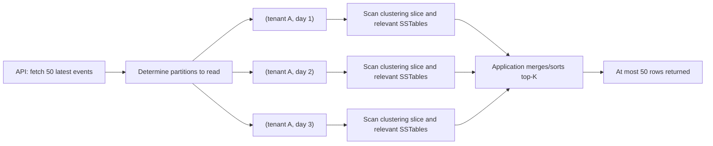
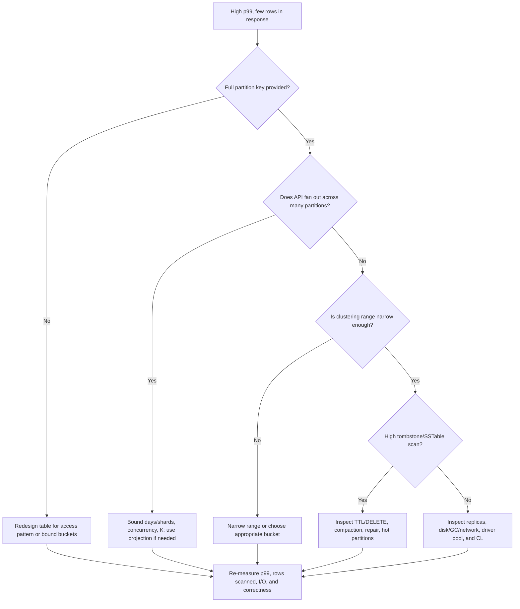

# Bounding the Number of Partitions and Rows Read

An Apache Cassandra query returning **20 rows** does not mean the server only read **20 rows**, and `LIMIT 20` does not guarantee the query will be fast. To return 20 live rows, Cassandra may have to inspect multiple SSTables, skip TTL-expired values, process tombstones, or traverse an overly wide key range. Another API returning just the 50 latest events might open **hundreds of partitions** in parallel, forcing numerous replicas and coordinators to do work before Java merges the results.

This lesson belongs to the **Query Tuning** chapter of the **DATABASE_ENGINE_WIDE_COLUMN_CASSANDRA** module. The focus is on **proactively bounding the number of partitions and rows read** through query-driven table design, choosing partition keys and clustering keys, narrowing time ranges, controlling fan-out/paging, and measuring the amount of data actually read. This mindset directly ties into replication, consistency, SSTables/compaction, tombstones, repair, error handling, and the Java Driver.

**Core principle:** instead of only asking "How many rows does SELECT return?", ask simultaneously:

1. How many **partitions** must the request touch?
2. Within each partition, which **clustering key range** does the server need to examine?
3. To produce the returned live rows, how many **rows/cells/tombstones** must the server traverse?
4. How many **SSTables/replicas** must each partition read consult, and how many **concurrent queries** does the application issue?

## 1. Learning Objectives

After this lesson, you will be able to:

1. Distinguish **partitions accessed**, **candidate rows**, **rows actually returned**, **cells/tombstones scanned**, and the number of requests sent to replicas.
2. Design `PRIMARY KEY`s so point queries or narrow time-range queries use the **full partition key** and a **clustering slice**.
3. Explain why `LIMIT`, `PER PARTITION LIMIT`, page size, and `ALLOW FILTERING` do **not** on their own enforce an I/O or tombstone-scan budget.
4. Weigh trade-offs across **large partitions**, **time-based buckets**, **sharding**, **multi-partition fan-out**, and **query-specific summary tables**.
5. Write CQL for single-partition/range reads and a bounded multi-bucket top-K read pattern.
6. Use Java Driver 4.x to read across multiple buckets with **concurrency limits**, day bounds, and per-bucket row limits, merging top-K results without triggering full scans.
7. Use tracing, histograms, metrics, latency, and controlled benchmarks to verify the impact of a change.

## 2. Cost Model of a Cassandra Read

Cassandra organizes data by **partition key**, while rows within a partition are ordered by **clustering columns**. The partition key is hashed into a token to locate replicas according to the replication strategy. Reading a single partition differs dramatically from asking Cassandra to inspect many partitions scattered across the token ring.



Each partition is read through a coordinator and the appropriate replicas per the consistency level. **One partition** does not necessarily mean **one machine**: with RF = 3 and `LOCAL_QUORUM`, the coordinator typically requires responses from two replicas in the local DC. Conversely, a single CQL query or Java call can touch **multiple partitions**.

### Five Numbers to Keep Distinct

| Illustrative symbol | Meaning | Example |
| --- | --- | --- |
| `P` | Number of logical partitions the request must access. | Reading one tenant across seven days: `P = 7` when bucketed by day. |
| `K` | Maximum live rows desired from each partition. | `LIMIT 50` per daily query. |
| `R_returned` | Number of rows the application actually returns. | After merging, returns `50` rows. |
| `R_scanned` | Rows/cells/tombstones the server must inspect to produce the result. | Can be **far more than 50** due to TTLs, DELETEs, wide ranges, or stale data. |
| `Q` | Number of CQL calls/requests and concurrency issued by the app. | Seven queries with concurrency cap `3`, rather than all seven always running at once. |

With `P = 7` and at most `K = 50` live rows per partition, the application receives at most **350 rows before merging**, yet you must not assume `R_scanned ≤ 350`. Deleted cells are not counted as returned rows; on some read paths, significantly more data and SSTables must be examined to find 50 live rows.

This is a **reasoning model**, not an exact latency prediction formula. Caching, overlapping SSTables, token distribution, page size, CL, network, GC, compaction, and row width also affect performance.

## 3. Starting from the Query: Sample Table by Tenant and Day

Suppose an event system has these business requirements:

- Fetch the **50 latest events** for a tenant on **a given day**.
- Fetch events between **08:00 and 09:00** for a tenant/day.
- Fetch the **50 latest events across seven days**, merging across partitions in the API if needed.
- Do not support "list all history for all tenants" by default on an interactive endpoint.

A suitable table is:

```sql
CREATE KEYSPACE IF NOT EXISTS query_tuning_lab
WITH replication = {
  'class': 'NetworkTopologyStrategy',
  'dc1': 3
}
AND durable_writes = true;

CREATE TABLE IF NOT EXISTS query_tuning_lab.events_by_tenant_day (
  tenant_id text,
  event_day date,
  event_time timestamp,
  event_id uuid,
  event_type text,
  payload text,
  PRIMARY KEY ((tenant_id, event_day), event_time, event_id)
) WITH CLUSTERING ORDER BY (event_time DESC, event_id DESC);
```

This example assumes **dc1 has at least three nodes** so RF = 3 is satisfiable; in a single-node lab, create the keyspace with an RF suitable for the lab instead of running `LOCAL_QUORUM` against three non-existent replicas. In production, RF/DC/rack settings must match the topology and failure domains.

### Reading the Key Structure

```text
PRIMARY KEY ((tenant_id, event_day), event_time, event_id)
             └────── partition key ──────┘  └── clustering columns ──┘

(tenant-a, 2026-11-21)  ->  1 partition
  15:05:00 / event-id-X
  15:04:50 / event-id-Y
  15:03:00 / event-id-Z

(tenant-a, 2026-11-20)  ->  different partition
(tenant-b, 2026-11-21)  ->  different partition
```

The partition key determines **where data is stored**, while `CLUSTERING ORDER BY` orders rows **within the same partition**. For reading the latest events, `DESC` ordering lets you read from the head of the partition without sorting the entire history in the application. Cassandra does not provide arbitrary `ORDER BY` across non-clustering columns or across the entire keyspace.

### Creating Sample Data

```sql
CONSISTENCY LOCAL_QUORUM;

INSERT INTO query_tuning_lab.events_by_tenant_day
  (tenant_id, event_day, event_time, event_id, event_type, payload)
VALUES ('tenant-a', '2026-11-21', '2026-11-21T08:05:00+0000',
        11111111-1111-4111-8111-111111111111, 'OPEN', 'lab-a');

INSERT INTO query_tuning_lab.events_by_tenant_day
  (tenant_id, event_day, event_time, event_id, event_type, payload)
VALUES ('tenant-a', '2026-11-21', '2026-11-21T08:20:00+0000',
        22222222-2222-4222-8222-222222222222, 'UPDATE', 'lab-b');

INSERT INTO query_tuning_lab.events_by_tenant_day
  (tenant_id, event_day, event_time, event_id, event_type, payload)
VALUES ('tenant-a', '2026-11-20', '2026-11-20T23:10:00+0000',
        33333333-3333-4333-8333-333333333333, 'CLOSE', 'lab-c');
```

These timestamps are just for generating lab data. If `event_day` is derived from the UTC date of `event_time`, the application must **enforce a consistent date-derivation rule**; Cassandra does not automatically validate that the two columns match.

## 4. A Good Query: One Partition and One Clustering Slice

### Fetching the Latest N Rows in a Day

```sql
SELECT event_time, event_id, event_type
FROM query_tuning_lab.events_by_tenant_day
WHERE tenant_id = 'tenant-a'
  AND event_day = '2026-11-21'
LIMIT 50;
```

**Why is this a good starting point?**

1. `tenant_id` and `event_day` form the **full partition key**, avoiding multi-partition fan-out.
2. Data is pre-sorted by `event_time DESC`, matching the latest-events access pattern.
3. `LIMIT 50` caps the maximum **live rows returned**, shrinking the response and preventing an API from accidentally returning millions of rows.
4. Selecting only required columns reduces network transfer and deserialization, especially if `payload` is large.

**However:** this is still not a "budget of at most 50 row reads." If the head of the partition holds many tombstones or overlapping SSTables, the server may have to inspect extra data to return 50 live rows.

### Fetching Events Within One Hour

```sql
SELECT event_time, event_id, event_type
FROM query_tuning_lab.events_by_tenant_day
WHERE tenant_id = 'tenant-a'
  AND event_day = '2026-11-21'
  AND event_time >= '2026-11-21T08:00:00+0000'
  AND event_time <  '2026-11-21T09:00:00+0000'
LIMIT 50;
```

This is a **clustering slice**: after locating the partition, Cassandra restricts the clustering key range. This is especially effective when the client actually knows the exact time window needed.

```text
Partitions located:               1
Clustering range inspected:       [08:00, 09:00)
Max live rows returned:           50
Cells/tombstones actually scanned: depends on actual data/SSTables
```

Notice `<` on the upper bound creates a half-open interval so adjacent windows do not overlap when using `>= start AND < end`. Do not put a time predicate on a regular column expecting it to act like a clustering slice; predicates only narrow storage reads when the schema and keys align.

## 5. Three Seemingly Small Queries That Can Be Very Expensive

### Missing Part of the Partition Key

```sql
-- Not a well-designed interactive query for the table above.
SELECT event_time, event_id
FROM query_tuning_lab.events_by_tenant_day
WHERE tenant_id = 'tenant-a'
ALLOW FILTERING;
```

`tenant_id` is only **one component** of the composite partition key `(tenant_id, event_day)`, not the entire key. The query does not pinpoint a single partition; with `ALLOW FILTERING`, Cassandra may have to examine far more data than it returns. This statement is shown only to analyze the anti-pattern—**do not run it on large/production tables**.

Instead, the API should specify a date range, bound the number of buckets, or design a **separate query table** if the requirement truly is "all events for a tenant" with no time bound.

### Filtering on a Regular Column

```sql
-- event_type is not part of the primary key.
SELECT event_time, event_id
FROM query_tuning_lab.events_by_tenant_day
WHERE tenant_id = 'tenant-a'
  AND event_day = '2026-11-21'
  AND event_type = 'ERROR'
ALLOW FILTERING
LIMIT 20;
```

Even after pinpointing **one partition**, filtering on `event_type` outside the primary key can force the server to **inspect many rows in the partition** before finding 20 matches. `LIMIT 20` still limits only the output, not the candidate rows checked. For frequent queries by `event_type`, consider adding a dedicated table:

```sql
CREATE TABLE IF NOT EXISTS query_tuning_lab.events_by_tenant_type_day (
  tenant_id text,
  event_type text,
  event_day date,
  event_time timestamp,
  event_id uuid,
  PRIMARY KEY ((tenant_id, event_type, event_day), event_time, event_id)
) WITH CLUSTERING ORDER BY (event_time DESC, event_id DESC);
```

This is **query-driven denormalization**: trading higher write and maintenance cost for a narrower read path. The application must keep both tables updated with proper idempotency and reconciliation mechanisms; writing to two tables does not create an atomic cross-partition transaction.

### COUNT(*) Is Not an O(1) Statistic

```sql
-- Do not use this as a per-request total count API on large tables.
SELECT COUNT(*) FROM query_tuning_lab.events_by_tenant_day;
```

In Cassandra, counting an entire table generally requires **traversing large amounts of data/partitions**, not reading a pre-maintained metadata counter. A `COUNT(*)` can consume heavy resources and time out. If a dashboard needs continuous counts, consider **pre-aggregated summary tables**, counters with well-understood semantics, or a separate analytics engine; evaluate accuracy and consistency trade-offs.

## 6. LIMIT, PER PARTITION LIMIT, and Page Size: How Do They Differ?

| Mechanism | What does it bound? | What does it **not** guarantee? |
| --- | --- | --- |
| `LIMIT N` | Maximum live rows returned by the `SELECT` statement. | Does not bound `P` partitions examined, tombstones, SSTables, or CPU/I/O. |
| `PER PARTITION LIMIT K` | Maximum rows returned from **each partition** when `SELECT` supports this clause. | Does not bound the number of partitions; does not turn a multi-partition scan into a point read. |
| **Driver page size** | Result page size per fetch, acting as a protocol-level pagination target/limit. | Does not cap total query rows if the client keeps fetching; does not bound server-side tombstone scans. |
| **Clustering range** | Key span examined inside a partition in clustering order. | Does not solve an oversized partition if the range itself is still huge or full of tombstones. |
| **Application budget** | Designed limits on buckets/days, query count, concurrency, and total records/deadlines. | Does not alter Cassandra's internal read mechanics; metrics must still be measured. |

### When Is PER PARTITION LIMIT Useful?

Suppose another table uses `user_id` as a single partition key, with events ordered by time:

```sql
CREATE TABLE IF NOT EXISTS query_tuning_lab.activity_by_user (
  user_id text,
  event_time timestamp,
  event_id uuid,
  summary text,
  PRIMARY KEY ((user_id), event_time, event_id)
) WITH CLUSTERING ORDER BY (event_time DESC, event_id DESC);

-- Only two explicit partitions and at most five rows per partition.
SELECT user_id, event_time, event_id, summary
FROM query_tuning_lab.activity_by_user
WHERE user_id IN ('user-a', 'user-b')
PER PARTITION LIMIT 5;
```

What makes this safe is an **explicitly bounded partition list** combined with `PER PARTITION LIMIT 5` capping results **per partition**. If the `IN` list held thousands of user IDs, you would still create a massive multi-partition query. Verify `IN` and `PER PARTITION LIMIT` behavior and constraints on your Cassandra version; never substitute them for an unbounded batch API.

### Why a Small Page Size Does Not Automatically Make a Query "Cheap"

Consider a `SELECT` without `LIMIT` where Java sets `pageSize=100`. If the application iterates through the entire `ResultSet` to the end, total rows read can still be huge, and subsequent pages issue additional requests. A smaller page size reduces per-response memory and payload size, but increases round trips. In partitions packed with tombstones, even a single page returning few live rows can force the server to scan large volumes of deleted data.

**Right approach:** use page size to control memory and transfer chunks, **and** use `LIMIT`, partition/range budgets, and deadlines to bound the API's demand. Do not mistake one knob for an entire query-bounding strategy.

## 7. Multi-Partition Reads: Fan-Out Needs a Budget

Requirement: "fetch the **50 latest events** for tenant A over **7 days**." A day-bucketed table requires the application to query up to seven partitions; this is an intentional trade-off.

```text
Request: last 7 days, global K = 50

  day D0 -> LIMIT 50 -> up to 50 candidates
  day D1 -> LIMIT 50 -> up to 50 candidates
  day D2 -> LIMIT 50 -> up to 50 candidates
  day D3 -> LIMIT 50 -> up to 50 candidates
  day D4 -> LIMIT 50 -> up to 50 candidates
  day D5 -> LIMIT 50 -> up to 50 candidates
  day D6 -> LIMIT 50 -> up to 50 candidates

  Merge at most 350 live rows, sorted by event_time DESC
  Return at most 50 global rows (for the defined 7-day window)

  Partition budget:   P <= 7
  Concurrency budget: C <= 3 or 4 (for example)
  Candidate budget:   <= 7 * 50 = 350 rows returned before merge
  Internal scan:      may exceed 350 due to tombstones/SSTables
```

### Why Fetching Top-K per Partition Before Merging Is Correct

When there is **no extra business filtering after retrieval**, if you need the global top `K=50` across seven partitions, any row ranked **outside the top 50 of its own partition** cannot possibly belong in the global top 50: at least 50 rows in that same partition already precede it. Therefore, fetching **top K from each partition** and merging yields enough candidates to determine the global top K across the window **under a consistent comparator**.

Conditions for this argument to hold:

- Every partition is read in the **same order** (`event_time DESC, event_id DESC` when tie-breaking is needed).
- There is **no post-read filtering** (e.g., keeping only `event_type='ERROR'`); if you filter client-side, the pre-filter top 50 might yield fewer than 50 valid rows.
- Do not treat separate read queries as an **atomic global snapshot** while concurrent writes/deletes are happening.
- The time window is **genuinely bounded by business rules**; do not label results "50 latest events of all time" if only seven days were queried.

### Why You Should Not Read Hundreds of Partitions Sequentially or Unboundedly

One tenant has 365 day buckets or 8,760 hour buckets per year. "Each bucket only uses `LIMIT 50`" across an entire year still triggers hundreds or thousands of RPCs, amplifying reads, retries, and load on coordinators and replicas. Bounding `P` and `C` protects the cluster and prevents one request from exhausting resources.

**If the product requires unbounded history lookup:** add a dedicated `recent_events_by_tenant` read model with short retention, benchmarked indexes/auxiliary views, or route large historical queries to an analytics system. Never silently raise `P` arbitrarily.

## 8. Time Bucketing: Too Small Also Has a Cost

One day may suit small tenants yet fail when a "hot" tenant emits millions of events per day. Splitting by hour or shard keeps each partition smaller:

```sql
CREATE TABLE IF NOT EXISTS query_tuning_lab.events_by_tenant_hour (
  tenant_id text,
  event_day date,
  hour_bucket tinyint,
  event_time timestamp,
  event_id uuid,
  event_type text,
  PRIMARY KEY ((tenant_id, event_day, hour_bucket), event_time, event_id)
) WITH CLUSTERING ORDER BY (event_time DESC, event_id DESC);
```

To read events from 08:00 to 09:00:

```sql
SELECT event_time, event_id, event_type
FROM query_tuning_lab.events_by_tenant_hour
WHERE tenant_id = 'tenant-a'
  AND event_day = '2026-11-21'
  AND hour_bucket = 8
LIMIT 50;
```

**The price of smaller buckets:** reading a full day may open **24 partitions** instead of one; reading seven days may touch **168 partitions**. If data is sparse, this can make aggregate queries slower. Choose bucket granularity based on **peak per-tenant volume**, row size, dominant query patterns, and acceptable partition fan-out.

### Sharding to Avoid Hot Partitions

If a tenant generates excessive writes within a single hour, include a `shard_id` in the partition key—for example `shard_id = hash(event_id) % S` to spread writes:

```text
PARTITION KEY = (tenant_id, event_day, hour_bucket, shard_id)

S = 4:
  tenant-a/day/hour/shard-0
  tenant-a/day/hour/shard-1
  tenant-a/day/hour/shard-2
  tenant-a/day/hour/shard-3
```

Reading a full hour then requires merging up to `S=4` partitions. If you introduce sharding solely to boost write throughput without designing a **bounded read path**, you may simply move the bottleneck from writes to reads. A table keyed by `hash(event_id)` also does not support looking up by `event_id` alone without a separate lookup table serving that access pattern.

## 9. LIMIT Cannot Rescue Tombstone-Dense Ranges

Tombstones are deletion markers created by `DELETE` or expired TTLs (and relevant update/delete operations). Cassandra must reconcile tombstones against versions stored in other SSTables so deleted data is not resurrected. A partition containing many expired entries interleaved with live rows forces `LIMIT 10` to traverse many entries before collecting 10 valid rows.

```text
Within the query range:
  X  X  X  X  X  live  X  X  X  live  X  ...
  X = deleted/expired row inspected during read

LIMIT 2 returns two live rows.
Yet the server may examine far more than two entries across multiple SSTables.
```

Remediation by root cause:

| Root cause | Sustainable way to reduce scanning |
| --- | --- |
| Partition holds many TTL-expired days/hours | Align bucket granularity with lifecycle and query near current time; narrow clustering range. |
| Frequent row-by-row `DELETE` among live data | Revisit retention model, separate live vs. expired data or use query-specific tables, control deletion patterns. |
| Append-only time-series with uniform TTL | Evaluate `TimeWindowCompactionStrategy` under suitable conditions; monitor fully expired SSTables. |
| Heavy SSTable overlap, high pending compactions | Inspect compaction strategy, disk I/O, CPU, and backlog; do not treat major compaction as a routine fix. |
| Replicas missing deletes / lagging repairs | Fix repair/hints and tune `gc_grace_seconds` carefully for zombie risk; **never lower grace recklessly**. |
| Query lacks partition/bucket key | Design a new table matching the access pattern; `LIMIT` or `ALLOW FILTERING` does not shrink search scope. |

Raising `tombstone_warn_threshold` or `tombstone_failure_threshold` only moves the **warning/abort threshold** for tombstone scans; it does not make the server read fewer tombstones. Lowering `gc_grace_seconds` risks purging tombstones before lagging replicas catch up, causing deleted data to reappear (zombies). Configuration knobs do not replace schema and query tuning.

## 10. SSTables, Compaction, Cache, and Consistency Add to Cost

Even a request targeting a single partition key can be slow due to:

- **Multiple SSTables consulted:** STCS/LCS/TWCS organize files differently; the read path may touch Bloom filters, partition indexes, data blocks, and tombstones across several files.
- **Cold cache:** data/index blocks are absent from caches and require disk reads; benchmarks must separate warm vs. cold cache.
- **Oversized partitions:** one partition spans many chunks/files; wide ranges, compression, and tombstones make reads heavy.
- **Running compaction/repair/streaming:** competes for disk, CPU, and network, causing tail-latency swings.
- **Consistency level:** `LOCAL_QUORUM` with RF=3 requires two replicas in the local DC, whereas `LOCAL_ONE` needs one; latency reflects replica health and cluster state. Lowering CL solely for speed changes consistency guarantees.
- **Coordinator and Java driver:** networking, connection pools, request throttling, speculative execution, and retries can add latency outside server-side scanning.

**Do not assume "fewer total SSTables in the table means faster queries."** What matters is how many SSTables and bytes are actually touched for that **specific partition/range**, along with row size, caching, tombstones, and replica health.

## 11. Measuring Partition Budget, Row Scans, and Latency

### Node-Level Observation Commands

Run in a lab or authorized operational environment after checking version-specific syntax:

```bash
nodetool status
nodetool tablestats query_tuning_lab.events_by_tenant_day
nodetool tablehistograms query_tuning_lab events_by_tenant_day
nodetool compactionstats
nodetool tpstats
nodetool netstats
```

| Measurement group | What questions should it answer? |
| --- | --- |
| **Application query** | Which `query_name`, expected `P`, clustering range, `LIMIT`, page size, CL, and CQL call count? |
| **Client latency** | p50/p95/p99 by `query_name`/tenant tier/DC; are driver retries, speculative executions, or queueing occurring? |
| **Server read metrics** | Read latency, `SSTablesPerReadHistogram`, `LiveScannedHistogram`, `TombstoneScannedHistogram` (names vary by version/exporter). |
| **Partition size/rows** | Estimated partition size, cells/rows per partition in table/SSTables; how do hot tenants compare to average? |
| **Compaction/replicas** | Pending compactions, disk read I/O, SSTables, repaired/unrepaired state, node DOWN/hints/repair lag. |
| **Host resources** | Disk latency/IOPS, CPU, heap/GC, network throughput, and coordinator load. |
| **Result distribution** | Live rows returned, payload bytes, empty-response rate, page fetch counts, and deadline hits. |

Most histograms are **aggregates**; a table-level p99 does not identify which partition is slow. Combine per-`query_name` logging with **size-bucket/large-partition classification** without putting PII into metric labels. `nodetool tablestats` is not a per-request profiler and may use different field names across Cassandra releases.

### Tracing a Representative Query

In `cqlsh`, enable tracing only temporarily:

```sql
TRACING ON;

SELECT event_time, event_id, event_type
FROM query_tuning_lab.events_by_tenant_day
WHERE tenant_id = 'tenant-a'
  AND event_day = '2026-11-21'
LIMIT 50;

TRACING OFF;
```

Cassandra records coordinator/replica activity and query steps in the trace. **Tracing incurs overhead**, writes asynchronously, and has its own retention; use it only with sampling or in labs—never on all production requests. Do not compare a trace from one query at one point in time against another query at a different time as if conditions were identical.

### Pre-Tuning Baseline

Record at minimum:

```text
query_name: events_by_day.latest
partition_budget: P <= 1
clustering_filter: none / or [start,end)
result_limit: 50
page_size: 50 or 100
consistency: LOCAL_QUORUM
client_latency_p50/p95/p99: [measured]
server_tombstones_scanned: [histogram/tracing]
sstables_per_read: [histogram]
read_iops/throughput: [measured]
compaction_pending: [measured]
concurrency: [RPS + in-flight requests]
```

Never enter hypothetical benchmark numbers as real measurements. Declare an improvement only after collecting data under **equivalent load, dataset size, cache state, CL, hardware, and repair/compaction status**.

## 12. Java Driver 4.x: Single Partition, Single Range, Bounded Results

Assuming a connected `CqlSession session` with a configured local datacenter, use prepared statements so the driver has partition key metadata for token-aware routing:

```java
import java.time.LocalDate;
import java.time.Instant;
import com.datastax.oss.driver.api.core.ConsistencyLevel;
import com.datastax.oss.driver.api.core.cql.BoundStatement;
import com.datastax.oss.driver.api.core.cql.PreparedStatement;
import com.datastax.oss.driver.api.core.cql.ResultSet;
import com.datastax.oss.driver.api.core.cql.Row;

PreparedStatement byHour = session.prepare(
    "SELECT event_time, event_id, event_type " +
    "FROM query_tuning_lab.events_by_tenant_day " +
    "WHERE tenant_id = ? AND event_day = ? " +
    "AND event_time >= ? AND event_time < ? LIMIT 50");

BoundStatement bound = byHour.bind(
        "tenant-a", LocalDate.of(2026, 11, 21),
        Instant.parse("2026-11-21T08:00:00Z"),
        Instant.parse("2026-11-21T09:00:00Z"))
    .setConsistencyLevel(ConsistencyLevel.LOCAL_QUORUM)
    .setPageSize(50)
    .setIdempotent(true); // This SELECT has no side effects.

ResultSet result = session.execute(bound);
for (Row row : result) {
    // At most 50 live rows are returned for this query.
}
```

This statement **targets exactly one partition**, restricts to one hour, and caps output at 50 rows. Even so:

- `LIMIT 50` caps returned rows, **not** how many tombstones may be scanned.
- `setPageSize(50)` configures pagination, **not** a timeout or hard I/O cap.
- `setIdempotent(true)` fits a side-effect-free `SELECT`, though broader workflows must be evaluated independently.
- `LOCAL_QUORUM` should not be downgraded to `LOCAL_ONE` just to mask a wide scan.
- `PreparedStatement` avoids string concatenation in CQL; it does not automatically make a poorly modeled table efficient.

## 13. Java: Bounded Fan-Out and Top-K Merge Across Seven Partitions

When an endpoint needs the **50 latest events over seven days**, issue **seven point/range queries by partition key** with at most four running concurrently. The code below uses Java 17 and Java Driver 4.x; it is a principle example and should be augmented with timeouts, cancellation, logging, and partial-failure handling per your SLA.

```java
import com.datastax.oss.driver.api.core.CqlSession;
import com.datastax.oss.driver.api.core.ConsistencyLevel;
import com.datastax.oss.driver.api.core.cql.PreparedStatement;
import com.datastax.oss.driver.api.core.cql.ResultSet;
import com.datastax.oss.driver.api.core.cql.Row;
import java.time.Instant;
import java.time.LocalDate;
import java.util.ArrayList;
import java.util.Comparator;
import java.util.List;
import java.util.UUID;
import java.util.concurrent.CompletableFuture;
import java.util.concurrent.ExecutorService;
import java.util.concurrent.Executors;

public final class RecentEventsQuery {
    record Event(Instant time, UUID id, String type) {}

    public static List<Event> top50Last7Days(
            CqlSession session, String tenantId, LocalDate todayUtc) {

        final int DAYS = 7;           // Product/API budget.
        final int TOP_K = 50;         // Global top-K and per-bucket limit.
        final int MAX_PARALLEL = 4;   // Avoid firing 7 or 365 requests simultaneously.

        PreparedStatement select = session.prepare(
            "SELECT event_time, event_id, event_type " +
            "FROM query_tuning_lab.events_by_tenant_day " +
            "WHERE tenant_id = ? AND event_day = ? LIMIT 50");

        ExecutorService pool = Executors.newFixedThreadPool(MAX_PARALLEL);
        try {
            List<CompletableFuture<List<Event>>> tasks = new ArrayList<>();
            for (int offset = 0; offset < DAYS; offset++) {
                LocalDate day = todayUtc.minusDays(offset);
                tasks.add(CompletableFuture.supplyAsync(() -> {
                    ResultSet rs = session.execute(
                        select.bind(tenantId, day)
                            .setConsistencyLevel(ConsistencyLevel.LOCAL_QUORUM)
                            .setPageSize(TOP_K)
                            .setIdempotent(true));

                    List<Event> dayEvents = new ArrayList<>();
                    for (Row row : rs) {
                        dayEvents.add(new Event(
                            row.getInstant("event_time"),
                            row.getUuid("event_id"),
                            row.getString("event_type")));
                    }
                    return dayEvents;
                }, pool));
            }

            List<Event> candidates = new ArrayList<>();
            for (CompletableFuture<List<Event>> task : tasks) {
                candidates.addAll(task.join());
            }
            candidates.sort(Comparator.comparing(Event::time).reversed()
                .thenComparing(Event::id, Comparator.reverseOrder()));

            return new ArrayList<>(
                candidates.subList(0, Math.min(TOP_K, candidates.size())));
        } finally {
            pool.shutdown();
        }
    }
}
```

### Code Review

- **Partition budget:** exactly seven `(tenant_id, event_day)` pairs; never scans all existing days in the table.
- **Result budget:** each partition returns at most 50 rows, merging down to at most 50; at most 350 candidates travel to Java.
- **Concurrency budget:** the thread pool allows at most four concurrent `execute()` tasks in this example. A driver session may still perform internal retries or speculative execution per config, so application concurrency is **not** the absolute server request count.
- **Ordering:** Cassandra returns `event_time DESC, event_id DESC` within each partition; Java applies the exact same comparator when merging buckets.
- **UTC date consistency:** `todayUtc` must follow the application's bucket policy consistently; never mix a user's local timezone date with UTC-partitioned data.
- **Deadlines and partial failures:** the lab code calls `join()` and throws if one bucket fails. Production needs an overall deadline and an explicit policy: **fail the endpoint, return flagged partial results, or fall back**—never silently return a top-50 missing a day and label it complete.
- **Bounded queues:** for seven tasks, a fixed pool suffices as an illustration. Production endpoints handling thousands of concurrent requests need a **shared bounded bulkhead/queue**, rate limiting, and the driver's async API rather than creating a new thread pool per HTTP request.
- **Non-blocking API:** for strict SLAs, consider `executeAsync()` with bounded in-flight coordination. Never call `join()` on an event-loop/I/O thread.

**Correctness boundary:** under concurrent writes or `DELETE`s, seven separate `SELECT`s are not an atomic distributed snapshot. If the business requires "top-K at an exact single point in time," define snapshot/as-of semantics via another mechanism rather than assuming a client merge provides it.

## 14. Deciding Between One Large Partition vs. Many Small Partitions

| Workload characteristic | Day partition | Hour partition | Sharding / denormalization |
| --- | --- | --- | --- |
| Small tenant, full-day reads common | Often ideal, low partition count. | Can cause unnecessary fan-out. | Usually not worth the cost. |
| Tenant with millions of events/day | Risk of oversized/hot partitions. | Shrinks each partition. | Shard if a single hour is still too hot. |
| Latest reads within 10 minutes | Clustering slice may suffice, depending on load. | Naturally bounds to one or a few hours. | A recent-events read model can tighten p99. |
| Interactive full-month reads | Requires multi-day fan-out. | Much larger fan-out. | Consider summary tables or analytics. |
| High, steady write throughput | Depends on per-tenant hotspots. | Better token spread via buckets. | Sharding distributes writes, but reads must merge. |
| Frequent TTL/DELETE churn | Depends on compaction/tombstones and read range. | Separates lifecycles by time. | Avoid creating excessive tombstones/metadata. |

**There is no single "universally right" partition size in rows or MB for every system.** Measure partition size distribution, hot-key throughput, clustering range reads, p99, SSTables/tombstones scanned, and streaming/repair behavior; keep partitions small enough for operational stability without splitting so finely that fan-out breaks the API budget.

## 15. When Should You Create Another Query Table?

A hallmark of sound Cassandra data modeling is that **every critical endpoint has a narrow access path**. If you resort to `ALLOW FILTERING` or scanning many days just to serve a recurring query, the current table does not fit that query.

Examples:

| Endpoint | Reasonable storage/query approach to test |
| --- | --- |
| **Fetch event by `event_id`** | An `event_by_id` table with `event_id` as partition key; avoid searching every day bucket. |
| **Fetch 50 latest events/tenant in 7 days** | `events_by_tenant_day` + bounded fan-out; if still too costly, evaluate a `recent_events_by_tenant` table with bounded retention/bucketing. |
| **Fetch 20 latest ERROR events/day** | `events_by_tenant_type_day` or an index benchmarked on the exact workload. |
| **Hourly event counts on a dashboard** | An aggregated projection table `event_counts_by_tenant_hour` updated with an explicit idempotency/consistency policy. |
| **Multi-tenant full-history reporting** | An analytics/batch pipeline or scan-oriented store, not an unbounded synchronous online API. |

Secondary indexes/SAI can help on **suitable versions and workloads**, but do not automatically eliminate fan-out, provide global `ORDER BY`, or replace performance testing. `Materialized view`s, where available, carry version-specific consistency and operational trade-offs; choose based on SLA and pipeline control rather than merely avoiding extra write code.

## 16. Controlled Benchmarking: Proving "Fewer Reads"

A valid experiment does not merely compare two `p99` numbers after changing `LIMIT`. It must compare **equivalent business results** and the resources consumed to produce them.

### Four Options to Compare

1. **Day table, SELECT entire partition, LIMIT 50.**
2. **Day table, SELECT 1-hour clustering range, LIMIT 50.**
3. **Hour table, SELECT single hour partition, LIMIT 50.**
4. **Day table, 7-day top-K API with bounded concurrency and merge.**

Note that these four options do not have identical access semantics; when comparing against a single requirement, align all candidates to the **same tenant, same time window, and same expected result set**. For example, options 1 and 2 return different datasets if the "one hour" constraint is applied only in option 2. Never declare wrong results an optimization.

### Measurement Template (Do Not Fabricate Values)

| Option | P partitions/request | Live rows returned | Tombstones scanned | SSTables/read | Read p95/p99 | Disk IOPS | CQL calls/concurrency |
| --- | ---: | ---: | ---: | ---: | ---: | ---: | --- |
| Day, single partition | ... | ... | ... | ... | ... | ... | ... |
| Day, one-hour range | ... | ... | ... | ... | ... | ... | ... |
| Hour, single partition | ... | ... | ... | ... | ... | ... | ... |
| Seven days, bounded merge | ... | ... | ... | ... | ... | ... | ... |

### How to Structure the Test

1. Generate a dataset matching expected production **tenant count, ingest rate, per-tenant skew, row sizes, TTLs, and DELETEs**.
2. Include **average tenants, extremely hot tenants, and tombstone-heavy tenants**, not just small clean partitions.
3. Run warm-up, explicitly distinguish warm vs. cold cache, and hold RF, CL, driver version, node resources, and background load constant.
4. Test each query type at identical **RPS, concurrent clients, and SLA**, then test mixed workloads.
5. Record predicted `P` from code alongside actual CQL call counts; use tracing/histograms to inspect the server read path.
6. Ramp load until tail latency, timeouts, or backlogs appear; evaluate **stability**, not just peak throughput.
7. Verify business correctness (accurate top-K/range, no missing days/broken tie-breaks) alongside total cluster resources (disk/CPU/GC/network).

**Baseline rule:** raising `LIMIT` from 50 to 500 and observing higher p99 proves nothing about partition optimization; measure live rows, tombstones, token span, and read amplification separately.

## 17. Runbook When a Query Returns Few Rows Yet Reads Too Slowly



### Diagnostic Questions in Order

1. **Which CQL?** Capture `query_name`, bind shape, partition key, clustering restrictions, `LIMIT`, and page size; avoid logging PII.
2. **How many partitions?** How many keys in `IN`, how many day/hour/shard buckets are expanded, and are queries running concurrently?
3. **How many live rows found?** Are results sparse because data does not exist, because of TTL/DELETE, or because of post-processing filters?
4. **How many tombstones/SSTables?** Check histograms, selective traces, compaction backlog, and partition-size distribution.
5. **Replicas and CL?** Is a slow replica or degraded DC driving p99? Are there driver routing or pool issues?
6. **Excessive app retries/fan-out?** Retrying on timeouts can amplify load and trigger cascading failures.
7. **Fix the actual root cause** with before/after evidence. Never jump straight from "high p99" to lowering `gc_grace_seconds`, raising tombstone thresholds, or forcing major compaction.

### Symptom and Action Table

| Symptom | Priority diagnosis | Avoid jumping to conclusions |
| --- | --- | --- |
| `LIMIT 10` yet read timeouts occur | Dense tombstones, hot partition, unnarrowed range, overlapping SSTables. | "LIMIT definitely reads only ten rows." |
| Endpoint reads 365 days and times out | Partition fan-out and concurrency; are cascading retries firing? | "Just increase timeout or page size." |
| One tenant is slower than all others | Row/partition skew, hot key, write/delete rate, GC/disk on owning replicas. | "The whole Cassandra cluster is slow." |
| p99 spikes after TTL expiration | Tombstones scanned, compaction, fully expired SSTables, and repair. | "Setting gc_grace to 0 is safe." |
| Full-table `COUNT(*)` is very slow | Full dataset scan and aggregation cost. | "COUNT(*) reads directly from metadata." |
| Reads were fine before adding shards, then slowed | More partitions opened per request plus merge/routing cost. | "More shards are always better." |
| `LOCAL_ONE` is faster than `LOCAL_QUORUM` | Fewer replicas waited on / different consistency guarantees. | "We can lower CL without checking SLA." |

## 18. Hands-On Exercises

### Exercise A — Counting "How Much Is Read" Correctly

An endpoint fetches the top 30 events over 14 days from a day-bucketed table. For each day, Java executes `LIMIT 30`:

1. What is the maximum `P`?
2. What is the maximum total candidate live rows transferred to Java?
3. If 90% of rows in the newest range have TTL-expired, can you conclude the server only inspected the candidate count? Why?
4. If the business requires the **top 30 of all time**, is the 14-day design functionally correct?
5. Propose a concurrency cap and metrics to track when the API handles 1,000 concurrent requests.

### Exercise B — Fixing a Query Missing Part of the Partition Key

A table has `PRIMARY KEY ((tenant_id, event_day), event_time, event_id)`. Query:

```sql
SELECT * FROM query_tuning_lab.events_by_tenant_day
WHERE tenant_id = 'tenant-a'
ALLOW FILTERING
LIMIT 20;
```

Analyze why `LIMIT 20` does not stop Cassandra from inspecting many days/partitions. Design an API accepting `start_date/end_date` with a strict maximum span, plus an alternative table if users frequently query full history. Address both **partition budget** and **correctness when data falls outside the window**.

### Exercise C — Bucketing and Hot Partitions

A tenant produces 5 million events/day with an average row size of 1 KB. Roughly estimate the **logical data** in a daily partition (excluding overhead/tombstones/replicas): approximately 5 GB in decimal units. Compare an hourly design, and if adding four shards per hour, how many partitions must a **full-day** query inspect? Explain why this is only an estimate, while actual sizing requires measuring SSTable compression, metadata, and hourly ingest distribution.

### Exercise D — Top-K Merge and Post-Query Filtering

Java fetches top 50 per day for seven days and then filters `event_type='ERROR'` in memory. Why could it return fewer than 50 `ERROR` rows even when the database contains plenty? Design `events_by_tenant_type_day` or another solution to filter **before applying the top-K limit**. Discuss the trade-offs of writing an extra table and projection update latency.

### Exercise E — Pagination

A Java service sets `pageSize=100` and iterates the full `ResultSet` over a partition with millions of rows, claiming "only 100 rows are read." Refute this, distinguish `pageSize`, `LIMIT`, and rows/cells/tombstones scanned, and propose API-level bounds along with how to measure page counts.

### Exercise F — Incident Runbook

A query for a single `tenant_id + event_day` returns five rows yet routinely takes two seconds. Tracing shows high tombstones scanned; `compactionstats` shows a backlog. Ops wants to raise the tombstone failure threshold and drop `gc_grace_seconds`.

Write an ordered investigation and remediation plan covering: range/partition bounds, TTL/DELETE patterns, compaction strategy, repair safety, p99 verification, and data correctness. Explain why those two config changes are not default fixes and carry distinct availability and correctness risks.

### Exercise G — Guarding Against Regressions

Design a load test suite to run after every schema or Java endpoint change. Inputs should cover small tenants, hot tenants, tombstone-dense partitions, and cold caches; outputs should include max partitions accessed, CQL call count, rows returned, p95/p99, timeouts, and top-K correctness. Define criteria to fail the build or block deployment if fan-out budgets are violated.

### Completion Criteria

Learners must substantiate an optimization plan with **three types of evidence**:

1. **Explainable read scope:** full partition key, clustering slice, bucket/shard counts, and concurrency cap.
2. **Measured data actually read:** live rows vs. tombstone scans, SSTables/read, disk I/O, and latency under representative load.
3. **Correct business results:** accurate top-K/range/tie-breaking, clear behavior under concurrent mutations, and defined handling for timeouts or missing buckets.

## 19. Self-Check Questions

1. Why does `LIMIT 20` not mean Cassandra only reads 20 rows from disk?
2. When a table has composite partition key `(tenant_id, event_day)`, does supplying only `tenant_id` identify a single partition?
3. How does a clustering range restrict work inside a partition?
4. How does `PER PARTITION LIMIT` differ from `LIMIT` when multiple partitions are selected?
5. Is the driver page size a hard cap on total rows returned by an API?
6. For global `K=50` across seven partitions, why is top 50 per partition sufficient before merging when **no post-filter** exists?
7. Why can shrinking buckets from day to hour alleviate hot partitions while increasing fan-out?
8. Is a full-table `COUNT(*)` in Cassandra ever a constant-time metadata lookup?
9. Why can raising the tombstone threshold merely convert a "blocked query" error into timeouts or higher node load?
10. When benchmarking two read approaches, why must CL, dataset, cache state, and background load remain comparable?
11. Does a request reading seven partitions at `LOCAL_QUORUM` mean only seven nodes perform work?
12. When should you build a new read-model table rather than trying to patch an `ALLOW FILTERING` query?

## 20. References

- [Apache Cassandra — CQL SELECT](https://cassandra.apache.org/doc/latest/cassandra/developing/cql/dml.html): `WHERE`, partition keys, clustering restrictions, `LIMIT`, and `PER PARTITION LIMIT` by version.
- [Apache Cassandra — Data modeling](https://cassandra.apache.org/doc/latest/cassandra/developing/data-modeling/): query-driven table design, partition keys, and clustering columns.
- [Apache Cassandra — Storage engine](https://cassandra.apache.org/doc/latest/cassandra/architecture/storage_engine.html): memtables, SSTables, read path, and compaction.
- [Apache Cassandra — Tombstones](https://cassandra.apache.org/doc/latest/cassandra/managing/operating/compaction/tombstones.html): TTLs, DELETEs, grace period, and tombstone scan cost.
- [Apache Cassandra — nodetool](https://cassandra.apache.org/doc/latest/cassandra/managing/tools/nodetool/): `tablestats`, `tablehistograms`, `compactionstats`, and node health.
- [Apache Cassandra Java Driver 4.x](https://apache.github.io/cassandra-java-driver/): prepared statements, fetch size/paging, connection pools, retries, and token-aware routing.

**Takeaway:** in Cassandra, capping **returned row count** is only part of read optimization. You must target **fewer, query-aligned partitions**, narrow **clustering ranges**, bound **fan-out/concurrency**, and measure **tombstones, SSTables, replicas, and latency**. `LIMIT` and page size cannot turn a broad scan into a cheap query. Query-driven schemas, well-sized buckets, budgeted top-K reads, and concurrency-bounded Java Driver usage are practical tools to keep p99 stable without sacrificing data correctness.
